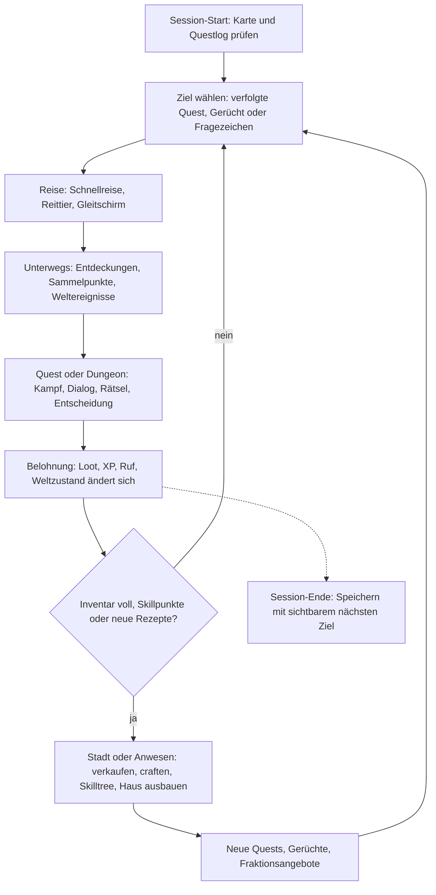

# Vision & Überblick – Chroniken von Aetherfall

> Teil der Phase-0-Planung · Stand: 2026-10-12 · Quelle: [Master-Prompt](../00_Master-Prompt.md)

**Kennzeichnungen in allen GDD-Dateien:**
- **Vorschlag:** füllt eine Lücke im Master-Prompt.
- **Verbesserungsvorschlag:** weicht bewusst vom Master-Prompt ab. Das Original bleibt erkennbar.
- ❓ **Offene Entscheidung:** liegt beim Auftraggeber. Gesammelt am Dateiende.

**Inhalt:** [Vision](#vision-in-10-sätzen) · [Pitch](#elevator-pitch--spielerfantasie) · [Säulen](#die-6-kernsäulen) · [Zielgruppe](#zielgruppe--referenzspiele) · [Core Loops](#core-loops) · [Pacing](#pacing--anti-langeweile) · [Spielzeiten](#ziel-spielzeiten--plausibilität) · [Umfangsstufen](#umfangsstufen) · [Index](#dokumenten-index) · [Glossar](#glossar) · [Offene Entscheidungen](#offene-entscheidungen) · [Risiken](#risiken--hinweise)

---

## Vision in 10 Sätzen

1. Du spielst einen Rissgeborenen, der die Zerstörung seines Dorfes überlebt hat und seitdem Aether in den Adern trägt.
2. Aetherfall ist ein Kontinent, den der Große Riss vor 300 Jahren zerbrochen hat, mit acht Regionen vom Bauerntal bis zu schwebenden Inseln.
3. Sieben Fraktionen kämpfen um die Aether-Quellen, während hinter den Rissen die Leere erwacht und ganze Landstriche verschlingt.
4. Der Kampf ist wuchtige Echtzeit-Action mit lernbaren Angriffsmustern, Ausdauer, Parieren und Haltung, zugänglicher als Elden Ring.
5. Quests haben mehrere Lösungswege, und jede Entscheidung verändert die Welt sofort oder Dutzende Stunden später bis hin zu mindestens vier Enden.
6. Hinter jedem Hügel und in jeder Höhle wartet etwas: Loot, Lore, eine Quest, ein Geheimnis oder eine Aussicht.
7. In jeder Spielsitzung wird der Spieler stärker, reicher oder klüger, über frei mischbare Klassen, Ausrüstung, Berufe und ein eigenes Anwesen.
8. NPCs folgen Tagesabläufen, Fraktionen verfolgen eigene Ziele, und Orte verändern sich sichtbar durch die Taten des Spielers.
9. Nach der Story halten Weltstufen, Riss-Expeditionen, Sammlungen, New Game+ und saisonale Ereignisse das Spiel monatelang frisch, ohne Grind-Pflicht.
10. Das Spiel läuft nativ auf Apple-Silicon-Macs und Windows-PCs mit 60 FPS, nahtlosem Welt-Streaming und vollständiger Controller-Bedienung.

---

## Elevator Pitch & Spielerfantasie

**Elevator Pitch:**
Ein Open-World-Action-RPG, in dem du als Rissgeborener einen zerbrochenen Fantasy-Kontinent erkundest, dich zwischen sieben Fraktionen entscheidest und eine erwachende Leere bekämpfst. Es verbindet Quests mit echten Konsequenzen wie in The Witcher 3 mit lernbarem, wuchtigem Kampf wie in Elden Ring und einem Endgame für Monate.

**Spielerfantasie:**
> Du bist der Rissgeborene: Du hast überlebt, was niemand überlebt. Das Aether in deinen Adern macht dich zur letzten Hoffnung des Kontinents und zugleich zu seiner größten Gefahr. Jede Fraktion will dich benutzen. Du entscheidest, wem du hilfst, was du opferst und was aus Aetherfall wird.

- **Ton (§3):** ernst, mit dunklen Untertönen. Humor gibt es in Nebenquests und Begleiter-Dialogen.
- **Persönlicher Faden (Vorschlag aus [01](./01_Welt_Story_Fraktionen.md)):** Die jüngere Schwester Lina wird im Prolog vom Riss verschluckt. Sie ist die emotionale Achse bis Akt 5.
- ❓ **Offene Entscheidung:** Ist die Spielfigur frei gestaltbar (Körpertyp, Aussehen, Name) oder ein fester Charakter wie Geralt? Empfohlener Standard: frei gestaltbar mit schlankem Editor (2 Körpertypen, Presets, wenige Regler, Pronomen getrennt wählbar) und **ohne** Sprachausgabe in Dialogen. Das spart bei zwei Sprachen geschätzt 8.000–12.000 Aufnahmen. Details in [01_Welt_Story_Fraktionen](./01_Welt_Story_Fraktionen.md).

---

## Die 6 Kernsäulen

Regel aus §2: Jede Designentscheidung muss mindestens eine Säule stärken.
**Vorschlag:** Zusätzlich darf keine Entscheidung eine andere Säule spürbar schwächen, ohne dass dies im Feature-Steckbrief (unten) dokumentiert ist.

### Säule 1 – Erkundung belohnt immer
- **Bedeutung:** Jeder Ort, den der Spieler bewusst ansteuert (Höhle, Ruine, Gipfel, auffällige Landmarke), liefert mindestens eine von fünf Belohnungsarten: Loot, Lore, Quest, Geheimnis oder Aussicht.
  - **Vorschlag – „90-Sekunden-Regel“:** Auf Wegen und in erschlossenem Gelände vergehen zu Fuß nie mehr als 90 s Laufzeit ohne Interessenspunkt. Bei 5 m/s sind das ~450 m. Interessenspunkte sind auch kleine Dinge: Sammelpunkt-Cluster, Lore-Item, Truhe, Aussicht.
- **Beispiele:**
  - Aussichtspunkte lichten den Kartennebel im Radius von 600 m und werden Schnellreisepunkte (§14.5, Regeln in [01](./01_Welt_Story_Fraktionen.md)).
  - Fundorte-Zähler je Region, z. B. „Truhen 12/24“. Eine komplett erkundete Region bringt Titel und Kosmetik.
  - Ein großes Geheimnis pro Region (§14.3), dazu ≥ 2 Geheimnisse, die nur mit Aether-Sicht auffindbar sind.
- **Prüffrage:** „Bekommt ein Spieler, der hier vom Weg abweicht, etwas, das er auf dem Hauptweg nicht bekäme?“
- **Anti-Beispiel:** eine Höhle mit 3 Gold und einer leeren Kiste; Kartensymbol-Checklisten ohne Geschichte; kopierte Banditenlager ohne Variation.

### Säule 2 – Entscheidungen zählen
- **Bedeutung:** Eine Entscheidung setzt Weltzustand-Flags. Jede Entscheidung hat mindestens eine Folge, die der Spieler sieht oder hört (NPC, Ort, Dialog, Belohnung, Ruf).
  - **Vorschlag – Zielquoten:**
    - ≥ 60 % der Regions-, Fraktions- und Nebenquests haben ≥ 2 Lösungswege.
    - Jede Entscheidung in einer Hauptquest hat ≥ 1 verzögerte Konsequenz.
- **Beispiele:**
  - „Banditen am Mühlbach“: angreifen, schleichen oder mit dem Anführer verhandeln (§16.9).
  - Ein verschonter Bandit aus dem Eichental taucht ~30 h später in Aurelion als Informant auf (§16.5).
  - Der Pakt am Ende von Akt 2 schließt andere Fraktionen aus (§15.3).
- **Prüffrage:** „Kann der Spieler später erkennen, dass eine andere Wahl etwas anderes bewirkt hätte?“
- **Anti-Beispiel:** Scheinentscheidungen mit identischem Ergebnis; eine Gut/Böse-Leiste statt konkreter Folgen; Entscheidungen ohne ausreichende Information.

### Säule 3 – Ständiger Fortschritt
- **Bedeutung:** Jede Sitzung von ≥ 30 min endet mit messbar mehr Macht, Besitz oder Wissen. Der Takt ist 5 / 30 / 120–180 min (siehe [Pacing](#pacing--anti-langeweile)).
- **Beispiele:**
  - 1 Attribut- und 1 Skillpunkt pro Level (§11.3).
  - Berufsstufen 1–100 (§13.2) und Haus-Ausbau in Stufen (§21).
  - Bestiarium mit aufgedeckten Gegnerschwächen als Wissens-Fortschritt.
- **Prüffrage:** „Was kann der Spieler nach 30 Minuten mit diesem Feature, das er vorher nicht konnte?“
- **Anti-Beispiel:** voll mitskalierende Gegner wie in Oblivion (nach §20.4 ausgeschlossen); Boni von +0,5 % ohne spürbare Wirkung; Inventar-Müll ohne jede Verwendung.

### Säule 4 – Abwechslung
- **Bedeutung:** Kampf, Erkundung, Dialog, Rätsel, Crafting und Basisbau wechseln sich ab.
  - **Vorschlag:**
    - Auf dem kritischen Pfad dauert keine Tätigkeit länger als 20 min am Stück.
    - In einer Questreihe folgen nie zwei Quests mit identischem Haupt-Zieltyp aufeinander.
- **Beispiele:**
  - 23 Ziel-Typen (§16.4), darunter Detektiv-Modus, Eskorte und Schleichen.
  - Minispiele: Rissduell, Angeln, Pferderennen, Armdrücken, Würfeln (§23).
  - Umgebungsrätsel mit Druckplatten, Spiegeln, Hebeln und Elementen (§14.5).
- **Prüffrage:** „Welche Tätigkeit unterbricht dieses Feature, und wie oft wiederholt sich dieselbe Handlung pro Stunde?“
- **Anti-Beispiel:** „Töte 10 Wölfe“, direkt gefolgt von „Töte 10 Banditen“; ein Dungeon mit 40 min reinem Kampf ohne Rätsel oder Atempause.

### Säule 5 – Lebendige Welt
- **Bedeutung:** Die Welt hat Zustände, die sich mit Zeit, Wetter und Spieleraktionen ändern. Diese Änderungen sind sichtbar oder hörbar.
- **Beispiele:**
  - NPC-Tagesabläufe: Arbeit, Essen, Taverne, Schlafen (§15.1).
  - Weltereignisse wie Karawanen, Überfälle, Riss-Ausbrüche und Duellanten (§14.4).
  - Das Dorf Eichental wird nach der Befreiung wieder aufgebaut (Flag `flag.eichental.dorf_wiederaufbau`).
- **Prüffrage:** „Reagiert die Welt sichtbar oder hörbar auf diese Aktion, diese Tageszeit oder dieses Wetter?“
- **Anti-Beispiel:** NPCs, die 24 h am selben Fleck stehen; ein gerettetes Dorf, das unverändert bleibt; Barks, die sich alle 20 s wiederholen.

### Säule 6 – Spielerfreiheit
- **Bedeutung:** Verschiedene Builds, Spielstile und Wege sind gleichwertig gültig.
  - **Vorschlag:** Jeder Pflichtinhalt (Hauptquest, Story-Boss) ist ohne Respec mit mindestens je einem Nahkampf-, Fernkampf- und Magie-Build schaffbar.
- **Beispiele:**
  - Freie Klassenmischung und Hybridklassen (§11).
  - Schwierigkeit jederzeit änderbar (§29).
  - Jedes Umgebungsrätsel hat einen Weg ohne Magie ([01](./01_Welt_Story_Fraktionen.md)).
- **Prüffrage:** „Kann ein Schleich-, ein Magie- und ein Nahkampf-Charakter diesen Inhalt sinnvoll bewältigen?“
- **Anti-Beispiel:** ein Boss, der nur mit Fernkampf besiegbar ist; eine Dialogprobe als einziger Weg zum Questfortschritt; eine Pflicht-Fraktion.

### Feature-Prüfung (Vorschlag)
Jedes neue Feature bekommt vor der Umsetzung einen Steckbrief mit fünf Feldern:

| Feld | Inhalt |
|---|---|
| Gestärkte Säule(n) | Nummer und ein Satz Begründung |
| Geschwächte Säule(n) | „keine“ oder Begründung mit Gegenmaßnahme |
| Umfangsstufe | A / B / C (siehe [Umfangsstufen](#umfangsstufen)) |
| Kosten | S (≤ 2 Tage), M (≤ 2 Wochen), L (≤ 2 Monate), XL (> 2 Monate) |
| Prüffragen | Antworten auf die Prüffragen der betroffenen Säulen |

Regel: Ein Feature ohne zugeordnete Umfangsstufe wird nicht geplant.

### Nicht-Ziele (Vorschlag)
- Kein Multiplayer, kein Koop und kein Online-Zwang. Das Endgame ist solo mit Begleitern (§23).
- Keine Online-Bestenlisten. „Ranglisten-Stufen“ in der Arena (§23) sind lokale Rangstufen gegen NPCs.
- Keine Konsolen-Ports in den Stufen A–C. Die Architektur soll sie nicht verbauen.
- ❓ **Offene Entscheidung:** Monetarisierung. Empfohlener Standard: Premium-Einmalkauf ohne Mikrotransaktionen und ohne Lootboxen.

---

## Zielgruppe & Referenzspiele

### Zielgruppe (Vorschlag)

| Segment | Profil | Sucht vor allem |
|---|---|---|
| Primär | Story- und Open-World-RPG-Spieler, 25–45 Jahre, kennen Witcher 3, Skyrim, Dragon Age, BG3 | Quests mit Konsequenzen, Erkundung, Begleiter |
| Sekundär | Action-RPG-Spieler, die Elden Ring mögen, sich aber mehr Zugänglichkeit und Story wünschen | Kampf mit Tiefe, Bosse, Build-Vielfalt |
| Tertiär | Langzeit- und Loot-Spieler (Diablo-, Genshin-Endgame) | Weltstufen, Expeditionen, Sammlungen |
| Nische | Mac-Spieler mit Apple Silicon: Es gibt wenige native Open-World-RPGs | Native Performance, Controller-Support |

- **Sitzungsmuster:** werktags 60–120 min, am Wochenende länger. Daraus folgt: Jede 30-min-Sitzung bringt spürbaren Fortschritt (Säule 3).
- **Eingabe:** Controller und Maus/Tastatur gleichwertig (§4.3).
- ❓ **Offene Entscheidung:** Ziel-Altersfreigabe. Empfohlener Standard: USK 16 / PEGI 16, passend zu Ton und Gewalt. Das beeinflusst Blut-Effekte, Flüche und Romanzen-Darstellung.

### Referenzspiele

| Spiel | Übernehmen wir | Übernehmen wir bewusst nicht | Warum |
|---|---|---|---|
| The Witcher 3 | Nebenquests mit Twist, moralische Grauzonen, verzögerte Konsequenzen, Begleiterkommentare, Anschlagbretter | Fragezeichen-Flut ohne Inhalt; Detektiv-Sinne als Dauerlösung; Junk-Überflutung im Inventar | Quests sind das Herzstück (§16). Füllsymbole schwächen Säule 1. |
| Skyrim | Freie Erkundung aus Neugier, klassenlose Entwicklung, Haus, prozedurale Aufträge | Schwammiges Trefferfeedback; Level-Scaling; generische Dungeons; Aufträge, die handgemachte Quests verdrängen | §9.1 fordert Wucht, §20.4 feste Gebietslevel, §16.7 ein Tageslimit für prozedurale Aufträge. |
| Elden Ring | Lernbare Gegnermuster, Haltung/Poise, Weltbosse, Entdeckung ohne Handholding (als Option „Erkundungsmodus“) | Hohe Frustschwelle als Standard; kryptische Questführung ohne Questlog; keine Schwierigkeitsgrade | „Zugänglicher“ (§9.1): vier Schwierigkeitsgrade (§20.4) und ein Questlog (§16.6). |
| Baldur's Gate 3 | Mehrere Lösungswege, reaktive Begleiter, Fertigkeitsproben im Dialog, Lagerfeuer-Gespräche | Rundenkampf; volle Vertonung und Kinematik jeder Zeile | Echtzeit-Kampf ist gesetzt. Volle Vertonung in DE und EN übersteigt jedes kleine Budget. |
| Genshin Impact | Gleitschirm- und Kletter-Erkundung, Elementreaktionen (§9.5), lesbare stilisierte Optik, Belohnungsrhythmus | Gacha, Energie-Limits (Resin), FOMO-Events, Daily-Pflicht | Säule 6 und Premium-Empfehlung. Saisonale Events kehren jährlich wieder, statt zu verfallen. |
| Dragon Age | Begleiter-Loyalität, Fraktionsentscheidungen, Lagerfeuer, Romanzen bei manchen Begleitern (§19) | MMO-artige Füllquests („Sammle 10 Felle“) in großen leeren Zonen | Säule 4: Abwechslung statt Masse. |

---

## Core Loops

### Moment-zu-Moment (~30 s)
1. **Wahrnehmen:** Landmarke, Kompass-Marker, Geräusch, Loot-Glitzern.
2. **Annähern:** laufen, klettern, schleichen, reiten, gleiten.
3. **Handeln:** Kampf (ausweichen, parieren, Kombo, Fähigkeit) oder Interaktion (Truhe, NPC, Rätsel-Element).
4. **Feedback:** Hitstop, Trefferpartikel, Loot-Strahl, XP-Zahl, Codex-Eintrag.
5. **Nächster Reiz:** ein neues Ziel im Kompass oder eine sichtbare Landmarke.

Kampf-Mikroloop (2–5 s): Muster lesen → ausweichen oder parieren → Öffnung nutzen → Ausdauer managen → Haltung brechen → Finisher. Details in [03_Kampf_Charakter_Progression](./03_Kampf_Charakter_Progression.md).

### Session (~1–2 h)

- **Vorschlag – „offener Haken“:** Beim nächsten Start zeigt der Ladebildschirm das zuletzt verfolgte Ziel und eine offene Frage aus dem Questlog („Wer hat den Brief geschrieben?“).

### Meta (Wochen)
- Hauptstory in 5 Akten (40–60 h, §1, §18).
- Regionen komplettieren (Fundorte-Zähler, großes Geheimnis je Region).
- Fraktionsruf aufbauen und Pakt schließen. Ausschlüsse erzeugen Wiederspielwert (§15.3).
- Begleiter-Loyalität bis zur persönlichen Questreihe (§19).
- Build bis Level 80, Hybridklassen (§11).
- Haus-Ausbau, Berufe 1–100.
- Verzögerte Konsequenzen werden eingelöst (§16.5).

### Endgame (Details in [04_Items_Crafting_Wirtschaft_Endgame](./04_Items_Crafting_Wirtschaft_Endgame.md))
1. Weltstufe wählen (1–10, §23).
2. Inhalt wählen: Riss-Expedition mit Modifikatoren, Weltbosse, Raid-Bosse, Arena, wöchentliche Herausforderung.
3. Bessere Beute: Mythisch, Sets, Aether-Splitter.
4. Build optimieren: Verzauberung, Sockel, Paragon.
5. Nächsthöhere Weltstufe → zurück zu 1.

Parallel laufen 11 legendäre Waffen-Questreihen (eine je Waffentyp, §23), Sammlungen, Erfolge, New Game+ und saisonale Ereignisse.

---

## Pacing & Anti-Langeweile

### Belohnungstaktung als messbare Regeln (§23)

Event-Namen außer denen aus §6.2 sind **Vorschlag**. Die endgültigen Namen legt [Technik/01_Architektur](../Technik/01_Architektur.md) fest.

| Regel | Master-Prompt | Zählt als Ereignis (EventBus) | Zielwert (Vorschlag) | Alarm im Playtest |
|---|---|---|---|---|
| R5 – klein | spätestens alle 5 min | `ItemPickedUp`, `ChestOpened`, `LocationDiscovered`, `LoreFound`, `XpGained` (≥ 1 % des Levels) | Median ≤ 2 min, 90. Perzentil ≤ 5 min | Lücke > 5 min |
| R30 – groß | spätestens alle 30 min | `QuestCompleted` (nicht prozedural), `LevelUp`, `SkillUnlocked`, `ItemEquipped` mit Upgrade ab Selten | 90. Perzentil ≤ 30 min | Lücke > 30 min |
| R180 – neu | spätestens alle 2–3 h | `FeatureUnlocked`, `RegionEnteredFirstTime`, `CompanionJoined`, `MechanicIntroduced` | ≤ 120 min bis Spielstunde 20, danach ≤ 180 min | Lücke > 180 min |
| Kein Grind-Zwang | §23 | Spielerlevel beim Start jeder Hauptquest | ≥ empfohlenes Level − 3 | > 20 % der Tester mehr als 3 Level darunter |
| Wiederholung mit Abwechslung | §23 | `ExpeditionStarted` mit Modifikator-Satz | kein identischer Modifikator-Satz in 3 aufeinanderfolgenden Expeditionen | Wiederholung erkannt |
| Minispiele als Pause | §23 | `MinigameAvailable` je Siedlung | ≥ 1 Minispiel in jeder Siedlung ab der Goldküste | Siedlung ohne Minispiel |

Gemessen wird **aktive Spielzeit**. Pause zählt nicht, Menüzeit über 30 s am Stück auch nicht.

### So stellt der Content-Plan die Regeln sicher (Vorschlag)
- **POI-Dichte:** Ein Editor-Validator prüft je Region entlang des NavMesh: maximal 90 s Laufweg (≈ 450 m) zwischen Interessenspunkten. Lücken werden markiert. Technik in [Technik/02_Systeme_und_Abhaengigkeiten](../Technik/02_Systeme_und_Abhaengigkeiten.md).
- **Quest-Länge:**
  - Nebenquests dauern 10–30 min.
  - Quests über 30 min brauchen eine Stage-Belohnung in der Mitte (Zwischenloot, Lore, Skillpunkt).
- **XP-Kurve (§28):**
  - Level 1–10 in ~4 h: 9 Level-Ups in 240 min, also ~27 min je Level-Up. Das Level-Up trägt R30 allein.
  - Level 10–30 in ~36 h: Ø ~108 min je Level. Ab hier tragen Questabschlüsse und Skill-Freischaltungen R30.
  - Level 30–60 in ~80 h: Ø ~160 min je Level.
- **Neue Mechanik je Region:** Jede Region bringt ≥ 1 neue Mechanik, ≥ 1 neuen Gegnerrollen-Mix und ≥ 1 neue Aktivität. Beispiele aus [01](./01_Welt_Story_Fraktionen.md): Gezeiten (Goldküste), Gift-Sumpf (Moorschatten), Hitze und Treibsand (Kar'Zul), Kälte (Frostgipfel), Lava und Ausbruchszyklus (Glutlande), Inseldrift (Zerbrochener Himmel).
- **Pacing-Pass vor Content-Lock:** Pro Region wird ein Durchlauf als Zeitleiste geplant (Quest, erwartete Minute, Belohnungsklasse). Das Feld „Pacing-Minute“ steht im Quest-Editor (siehe [02_Quests_und_Dialoge](./02_Quests_und_Dialoge.md)).

### Messung per Entwicklungs-Telemetrie (§28, Vorschlag)
- Nur in Development-Builds. Bei externen Testern nur mit Opt-in, pseudonymer Tester-ID und ohne personenbezogene Daten.
- Die Telemetrie abonniert vorhandene EventBus-Events (§6.2: `EnemyKilled`, `ItemPickedUp`, `QuestCompleted`, `NPCTalkedTo` und weitere). So entsteht keine zusätzliche Kopplung.
- **Ausgabe:**
  - Lokale Ereignisliste pro Session (JSON).
  - **Pacing-Report:** Zeitleiste mit markierten Lücken (R5/R30/R180) samt Position und Aktivität.
  - Die in §28 geforderten Daten: Zeit pro Quest, Todesorte (Heatmap), häufigste Builds.
- **Auswertungsregel:** Eine Lücke, die bei ≥ 30 % der Tester an derselben Stelle auftritt, wird zum Content-Ticket.
- Technik in [Technik/01_Architektur](../Technik/01_Architektur.md).

### Was ist neu nach Stunde X (Vorschlag: Freischalt-Reihenfolge, Stunde 0–20)

Abgestimmt mit der Akt-Struktur in [01](./01_Welt_Story_Fraktionen.md) und der Reihenfolge der 8 Beispiel-Quests in [02](./02_Quests_und_Dialoge.md). Zeiten gelten für gemischtes Spielen (Haupt- und Nebenquests).
Säulen: 1 Erkundung · 2 Entscheidungen · 3 Fortschritt · 4 Abwechslung · 5 Lebendige Welt · 6 Freiheit

| ~Stunde | Neu | Auslöser / Ort | Säule |
|---|---|---|---|
| 0:00 | Bewegung, leichter und schwerer Angriff, Springen, Interagieren | Prolog am Erntefest, Hauptquest „Asche über Eichental“ | 3 |
| 0:10 | Ausweichrolle (I-Frames), Blocken | Erster Kampf gegen Risslinge im brennenden Dorf | 4 |
| 0:25 | Erste Aether-Kraft (Aether-Stoß), Verderbnis-Balken | Kontakt mit dem Riss | 3 |
| 0:40 | Wahl der Startklasse, Questlog, Kompass, Inventar | Ende der ersten Hauptquest in Lindenhain (**Vorschlag:** Klassenwahl im Dialog nach dem Prolog statt im Hauptmenü) | 6 |
| 1:00 | Level-Up, Attribut- und Skillpunkt, Skilltree | Level 2–3 | 3 |
| 1:15 | Bogen für alle Klassen, Kopftreffer, Aether-Sicht (Detektiv-Modus), Spuren | „Die Wölfe vom Nordhang“ | 4 |
| 1:30 | Schleichen, Verhandeln, Dialogproben, perfektes Parieren; Quest-Start über ein Item | „Banditen am Mühlbach“, „Ein Brief, der nie ankam“ | 2 |
| 1:45 | Minispiel Würfeln, Aussichtspunkt, Schnellreise | „Die Schatzkarte des alten Seemanns“ | 1, 4 |
| 2:00 | Erster Begleiter (Ser Maren Falkenried): Kommentare, Loyalität, KI-Verhalten | Hauptquest „Die Prüfung der Silberwacht“ (E1.1) | 5 |
| 2:30 | Dungeon, Umgebungsrätsel, Mini-Boss | „Die vergessene Gruft“ | 1, 4 |
| 3:00 | Kräuterkunde, Alchemie-Grundlagen, Tageszeit als Questbedingung | „Das Kraut der Kräuterfrau“ | 3 |
| 3:30 | Kopfgeldbrett, Boss mit eigener Mechanik, Elementkombination Feuer + Öl | „Kopfgeld: Grimmbart“ | 4 |
| 4:30 | Weltereignisse (kleiner Riss-Ausbruch, Wanderhändler), erste Vision | Hauptquest „Der Steinkreis von Altenhain“, Wildnis am Riss | 5 |
| 5:00 | Anwesen Gut Eichenruh (Haus Stufe 1), Lagerkiste, Schlafen | Hauptquest „Ein Dach über dem Kopf“ (§21) | 3 |
| 6:00 | Reittier (Pferd), Reitkamera | Akt 1 (**Vorschlag:** Geschenk des Dorfvogts zum Anwesen) | 1 |
| 7:30 | Erster Story-Boss (Ealdor, der Aschenhirsch), Riss-Siegel, Entscheidung E1.3 | Hauptquests „Der Zorn des Waldes“, „Das erste Siegel“ | 2, 3 |
| 9:00 | Goldküste, Hafenstadt Velmara, Schwimmen und Tauchen, Gezeiten | Hauptquest „Nach Westen“, Beginn Akt 2 | 1 |
| 9:30 | Prozedurale Aufträge | Anschlagbrett und Fraktionsbüro in Velmara | 3 |
| 10:00 | Spezialhändler, Schmieden, Verzauberung (Affixe) | Velmara | 3 |
| 10:30 | Fraktionen und Ruf: Handelsgilde, Aether-Konvent (Silberwacht kennt man seit Akt 1) | Velmara, Akademie Lumenspitze | 2 |
| 11:00 | Kartenspiel „Rissduell“, Abschluss der Schatzsuche | Taverne in Velmara, Grotte am Möwenfels | 4 |
| 12:00 | Zweiter Begleiter (Jasper), Gruppe zu dritt, Lagerfeuer-Gespräche | Velmara | 5 |
| 13:00 | Erster Weltboss | Goldküste | 1, 4 |
| 13:30 | Angeln; Falke als Tierbegleiter für Waldläufer | Küste, Kap Varro | 4 |
| 15:00 | Haus Stufe 2: Schmiede, Küche, Garten, Bau-Modus | Gut Eichenruh | 3 |
| 16:30 | Moorschatten: Gift-Sumpf, Untote, Hexenzirkel, Entscheidung E2.2 | Akt 2 | 2, 4 |
| 18:00 | Aurelion: Schattenhand, Diebstahl, Hehler, Kopfgeld-System, Sperrstunde | Akt 2 | 2, 5 |
| 20:00 | Gleitschirm; alte Regionen bieten neu erreichbare Geheimnisse | Aurelion, Uhrwerkturm-Quest | 1 |

- Die größte Lücke liegt bei ≤ 2 h. Damit ist R180 erfüllt.
- Der Vertical Slice (Stufe A) deckt ungefähr Stunde 0–3:30 ab (Reihenfolge der 8 Beispiel-Quests laut [02](./02_Quests_und_Dialoge.md), 11.0), ohne Haus und Crafting-Stationen (Phase 5).
- Akt 1 endet bei gemischtem Spielen nach ~8,5 h (reine Story: 6–8 h laut [01](./01_Welt_Story_Fraktionen.md)). Level 10 ist laut §28 schon nach ~4 h erreicht; die XP-Abschwächung bei Überlevel aus [02](./02_Quests_und_Dialoge.md) fängt das ab.
- Hybridklassen sind für ~Level 30, also ~40 h, vorgesehen und stehen deshalb nicht in der Tabelle. Details in [03](./03_Kampf_Charakter_Progression.md).

---

## Ziel-Spielzeiten & Plausibilität

### Ziele laut §1
| Umfang | Ziel |
|---|---|
| Hauptstory | ca. 40–60 h |
| Hauptstory + Nebenquests | ca. 150–200 h |
| Komplettierung inkl. Endgame | 300+ h |

### Überschlag

Formel: **Spielzeit ≈ Σ (gespielte Quests × Ø-Dauer) + Erkundung außerhalb von Quests + Systemzeit.**
Die Ø-Dauern sind Annahmen (**Vorschlag**) und enthalten die Reisezeit innerhalb der Quest. Durch Fraktionsausschlüsse spielt ein Durchgang ~60 % der Fraktionsquests ([01](./01_Welt_Story_Fraktionen.md), 8.4).

**Rechnung 1 – Kategorien aus §16.2 am unteren und oberen Ende:**

| Kategorie | Master-Prompt | Minimum: erstellt / gespielt | Maximum: erstellt / gespielt | Ø-Dauer | Stunden (Min / Max) |
|---|---|---|---|---|---|
| Hauptquests | ca. 60 | 60 / 60 | 60 / 60 | 45 min | 45 / 45 |
| Fraktionsquests | 7 × 15–25 | 105 / 60 | 175 / 100 | 25 min | 25 / 42 |
| Regionsquests | 3–6 Reihen je Region | 72 / 72 (3 Reihen × 3 × 8) | 192 / 192 (6 × 4 × 8) | 25 min | 30 / 80 |
| Nebenquests | 20–30 je Region | 160 / 160 | 240 / 240 | 15 min | 40 / 60 |
| Begleiterquests | 4–6 je Begleiter | 32 / 32 | 48 / 48 | 25 min | 13 / 20 |
| Kleinformate (Kopfgeld, Schatz, Dungeon, Handwerk, Rätsel) | keine Zahl | 35 / 35 (1 je Kategorie und Region) | 35 / 35 | 15 min | 9 / 9 |
| **Summe Quests** | **≥ 400** | **464 / 419** | **750 / 675** | | **162 / 256** |
| Erkundung ohne Quest (Dungeons, POIs, Truhen, Rätsel) | – | | | 4–6 h je Region | 32 / 48 |
| Systeme (Crafting, Haus, Handel, Minispiele) | – | | | | 10 / 20 |
| **Gesamt „Hauptstory + Nebenquests“** | **150–200 h** | | | | **≈ 204 / ≈ 324** |

**Rechnung 2 – „400 Quests × Ø-Dauer“ mit dem Budget aus [02](./02_Quests_und_Dialoge.md):**

| Kategorie | Original (§16.2) | Budget Stufe C | Gespielt | Stunden |
|---|---|---|---|---|
| Hauptquests | ca. 60 | 60 | 60 | 45,0 |
| Fraktionsquests | 7 × 15–25 | 105 (7 × 15) | 60 | 25,0 |
| Regionsquests | 3–6 Reihen je Region | 66 (7 × 3 Reihen × 3 + 3) | 66 | 27,5 |
| Nebenquests | 20–30 je Region | 129 (7 × 18 + 3) | 129 | 32,3 |
| Begleiterquests | 4–6 je Begleiter | 32 (8 × 4) | 32 | 13,3 |
| Kleinformate | – | 35 (5 Kategorien × 7 Regionen) | 35 | 8,8 |
| **Summe** | **≥ 400** | **427** | **382** | **151,9** |
| Erkundung und Systeme | – | | | ~42 |
| **„Hauptstory + Nebenquests“** | **150–200 h** | | | **≈ 194 h** |
| Legendäre Reihen (§23, Endgame) | eine je Waffentyp | +33 (11 × 3) | 33 | +22 |

- Gewichtete Ø-Dauer über das Budget: 10.235 min / 427 Quests ≈ **24 min je Quest**.
- **400 Quests × 24 min ≈ 160 h**. Abzüglich der Fraktionsausschlüsse ≈ 145 h gespielt. Plus ~42 h Erkundung und Systeme ≈ **187 h**.

**Ergebnis (offen):**
1. **400 Quests plus Erkundung ergeben 150–200 h, aber nur knapp.** Voraussetzung: Nebenquests bleiben bei Ø 15 min und Erkundung bei ≤ 6 h je Region.
2. **Die Kategorie-Minima aus §16.2 ergeben bereits 464 Quests und ~204 h.** Mit den Höchstwerten sind es ~750 Quests und > 300 h. „Mindestens 400“ und die Kategorien-Bandbreiten passen also nicht genau zusammen.
3. **Hauptstory:** 60 × 45 min = 45 h plus Reise. [01](./01_Welt_Story_Fraktionen.md) verteilt das auf die Akte mit 45–57 h. Das passt zu 40–60 h.
4. **Komplettierung:** Laut [02](./02_Quests_und_Dialoge.md) ≈ 315–355 h (Legendär-Reihen, wiederholbares Endgame 80–120 h, zweiter Fraktionsweg in NG+). 300+ h sind plausibel, ohne weitere handgemachte Quests.

**Verbesserungsvorschlag – Quest-Budget 427 für Stufe C** (statt der Kategorien-Summe von 464–750). Die Feinverteilung oben stammt aus [02](./02_Quests_und_Dialoge.md):
- Nebenquests 18 statt 20–30 je Region; die Endgame-Region bekommt nur 3, weil dort prozedurale Inhalte tragen.
- Fraktionsquests 15 je Fraktion (Original 15–25); die Kapitelstruktur in [01](./01_Welt_Story_Fraktionen.md) erlaubt später 20.
- Die 33 legendären Quests zählen als Endgame zur Komplettierung, nicht zu „150–200 h“.
- Hinweis: [01](./01_Welt_Story_Fraktionen.md) plant 35 statt 32 Begleiterquests (Maren, Gundra, Kael mit je 5). Das liegt innerhalb von §16.2 (4–6 je Begleiter); der Budget-Zähler im Quest-Editor führt die Abweichung.

### Story-Level-Lücke (wichtig)
- §28 beschreibt gemischtes Spielen: Level 30 nach ~40 h, Level 60 nach ~120 h. Akt 4 spielt aber in Regionen mit Level 35–60 (Frostgipfel, Glutlande), Akt 5 im Zerbrochenen Himmel mit Level 60–80. Wer der Story folgt, käme dort deutlich unterlevelt an. Das widerspricht „Keine Pflicht zum Grinden für die Hauptstory“ (§23).
- **Verbesserungsvorschlag – Story-Korridor:** Die Regionslevel aus §14.2 bleiben. Hauptquests bekommen eigene empfohlene Level. [01](./01_Welt_Story_Fraktionen.md) übernimmt diesen Korridor:

  | Akt | Story-Level | Region laut §14.2 |
  |---|---|---|
  | 1 | 1–10 | Eichental 1–10 |
  | 2 | 10–24 | Goldküste 10–20, Moorschatten 18–28, Aurelion 20–60 |
  | 3 | 24–32 | Kar'Zul 25–38 |
  | 4 | 32–42 | Frostgipfel 35–48, Glutlande 45–60 |
  | 5 | 40–48 (Story-Bereich mit festem Level) | Zerbrochener Himmel 60–80, erst nach der Story voll offen (§18) |

- **Folgerung für die XP:** Hauptquests liefern Ø ~0,7–1,0 Level je Quest (Akt 1: 10 Quests für 9 Level; Akt 3: 12 Quests für 8 Level). Das Belohnungsband in [02](./02_Quests_und_Dialoge.md) (0,8–1,5 Lv) wird in Akt 3–4 am unteren Rand genutzt.
- **Gegenseite:** Gemischt spielende Spieler kommen in Akt 4–5 eher überlevelt an. Gegenmittel: Schwierigkeit jederzeit änderbar (§29), XP-Abschwächung bei Überlevel ([02](./02_Quests_und_Dialoge.md)), optionale Story-Herausforderungen.
- ❓ **Offene Entscheidung:** Story-Korridor (empfohlen) oder deutlich mehr XP aus Hauptquests? Abstimmung mit [03](./03_Kampf_Charakter_Progression.md).

---

## Umfangsstufen

**Vorschlag zur Risikominimierung:** Das Projekt wird in drei Stufen geplant. Jede Stufe ist für sich spielbar und testbar. Nach Stufe A wird die tatsächliche Produktionsgeschwindigkeit gemessen (Personentage je Quest, Gegnertyp, Dungeon, km² Welt). Auf dieser Basis wird Stufe B neu kalkuliert.

| Merkmal | Stufe A – Vertical Slice | Stufe B – erste veröffentlichbare Version | Stufe C – volle Vision |
|---|---|---|---|
| Roadmap | Phase 4 (§31) | Phase 5 + Teile von Phase 6 | Phase 6–7 vollständig |
| Story | Prolog und erste Hauptquest von Akt 1 | Akt 1–2 (26 Hauptquests laut [01](./01_Welt_Story_Fraktionen.md)) | Akt 1–5, Nach-Story, NG+ |
| Regionen | Teil des Eichentals (~1 km²: Lindenhain, Mühlbach, Nordhang, Gruft) | Eichental, Goldküste, Moorschatten komplett; Aurelion als Story-Hub mit 2 Vierteln (~18 km²) | alle 8 (~46 km²) |
| Level | 1–8 | 1–30 | 1–80 + Paragon |
| Handgemachte Quests | 8 (§16.9) | ~150: Haupt 26, Fraktion 20 (Kapitel I von 5 Fraktionen), Region 27 (3 Regionen × 3 Reihen × 3), Neben 50, Begleiter 13, Kleinformate 14 | 427 + 33 legendäre (siehe oben) |
| Prozedurale Vorlagen | 0–1 | 4–6 | 12 ([02](./02_Quests_und_Dialoge.md)) |
| Gegnertypen | 5 ([01](./01_Welt_Story_Fraktionen.md), 11.4) | ~22 (Auswahl aus den 35 Typen dieser Regionen) | 67 laut Roster in [01](./01_Welt_Story_Fraktionen.md) (§20.1: ≥ 60) |
| Bosse | Grimmbart (Kopfgeld), Ritter Odric (Gruft) | 2 Story-Bosse (Ealdor, Kaldris), ~17 Dungeon-Bosse, ~10 Weltbosse | alle (§20.3) |
| Waffentypen | 3: Einhandschwert (+ Schild), Bogen, Zauberstab | 6: + Zweihandschwert, Dolche, Axt | 11 (§9.3) |
| Klassen | 2 (Krieger, Magier) + Aether-Grundkräfte | 4 Startklassen (Krieger, Waldläufer, Schurke, Magier) + Rissläufer mit 1 Ast | 6 + Hybridklassen |
| Skilltree | ~15 Knoten je Klasse | ≥ 40 Knoten je Klassenbaum (§11.2) + Baum „Überleben“ | + Bäume „Handwerk“, „Sprache/Charisma“, Hybride |
| Begleiter | 1 (Maren) | 3 (Maren, Jasper oder Ilvy, Morwen) + Tierbegleiter Wolf | 8 + Wolf, Falke, Bär (§19) |
| Systeme | Kampf, Inventar, Loot, Quests, Dialog, Speichern, HUD | + Crafting, Händler, Fraktionen, Haus Stufe 1–2, Reittier, Weltereignisse, 2 Minispiele | alle |
| Endgame | – | **Vorschlag:** Riss-Expeditionen „Lite“ ab Level 25 | voll (§23) |
| Spielzeit | 2–3 h (§31) | Story ~20–26 h, gesamt ~75–90 h | 45–57 h / ~194 h / 315–355 h |

**Überschlag Stufe B:** Haupt 26 × 45 min (19,5 h) + Fraktion 20 × 25 min (8,3 h) + Region 27 × 25 min (11,3 h) + Neben 50 × 15 min (12,5 h) + Begleiter 13 × 25 min (5,4 h) + Kleinformate 14 × 15 min (3,5 h) ≈ 60 h Quests, dazu 12–18 h Erkundung und 5–10 h Systeme.

Hinweise:
- **Stufe C in Akt-Updates (Vorschlag):**
  - C1 = Akt 3 + Kar'Zul + Kleriker.
  - C2 = Akt 4 + Frostgipfel + Glutlande + Aurelion vollständig.
  - C3 = Akt 5 + Zerbrochener Himmel + volles Endgame.
- **B-Minimal (Rückfallebene):** Eichental und Goldküste, Akt 1 und erste Hälfte von Akt 2 (~16 Hauptquests), ~70 Quests, ~40 h gesamt. Diese Variante greift, wenn die Messung nach Stufe A zeigt, dass B zu groß ist.
- **Schatzkarte im Vertical Slice:** „Die Schatzkarte des alten Seemanns“ endet an der Goldküste (§16.9). [02](./02_Quests_und_Dialoge.md) empfiehlt, die letzten Stages bis Stufe B zu sperren. [01](./01_Welt_Story_Fraktionen.md) nennt in 3.1 noch „1 Küstenzelle“ im Slice. Die Entscheidung liegt in 02; diese Datei folgt deren Empfehlung (Sperre mit Teaser-Text).
- ❓ **Offene Entscheidung:** Release-Modell. Empfohlener Standard: Early Access ab Stufe B (oder B-Minimal), Version 1.0 ab C1 oder später. Voraussetzung: Speicherstände bleiben ab dem ersten öffentlichen Build migrierbar (§25).

---

## Dokumenten-Index

| Datei | Inhalt in einem Satz |
|---|---|
| [00_Master-Prompt](../00_Master-Prompt.md) | Verbindliche Spezifikation des Auftraggebers (§0–§33). |
| [00_Vision_und_Ueberblick](./00_Vision_und_Ueberblick.md) | Vision, Säulen, Zielgruppe, Core Loops, Pacing, Spielzeiten, Umfangsstufen, Index und Glossar. |
| [01_Welt_Story_Fraktionen](./01_Welt_Story_Fraktionen.md) | Setting, Lore, Hauptstory, Regionen, lebendige Welt, NPCs, Fraktionen, Ruf, Begleiter, Gegner-Roster und Bosse. |
| [02_Quests_und_Dialoge](./02_Quests_und_Dialoge.md) | Quest-Design, Kategorien, Mengen, Ziele, Konsequenzen, prozedurale Aufträge, Quest-Editor, die 8 Beispiel-Quests und das Dialogsystem. |
| [03_Kampf_Charakter_Progression](./03_Kampf_Charakter_Progression.md) | Steuerung, Kamera, Bewegung, Kampf, Magie, Status, Schaden, Gegner-KI, Werte, Klassen, Skilltrees, Erfahrung und Level. |
| [04_Items_Crafting_Wirtschaft_Endgame](./04_Items_Crafting_Wirtschaft_Endgame.md) | Inventar, Ausrüstung, Loot, Crafting und Berufe, Haus, Wirtschaft, Endgame, Minispiele und Paragon. |
| [05_UI_Audio_Grafik_Barrierefreiheit](./05_UI_Audio_Grafik_Barrierefreiheit.md) | HUD, Menüs, UX-Regeln, Audio, Art Direction, Grafikoptionen, Barrierefreiheit und Speichern aus Spielersicht. |
| [Technik/01_Architektur](../Technik/01_Architektur.md) | Technische Architektur: Bootstrapper, Services, EventBus, Datenmodell, Speichern, Streaming und UI-Technologie. |
| [Technik/02_Systeme_und_Abhaengigkeiten](../Technik/02_Systeme_und_Abhaengigkeiten.md) | Liste aller Systeme mit Abhängigkeiten und Umsetzungsreihenfolge. |
| [Technik/03_Technik-Recherche](../Technik/03_Technik-Recherche.md) | Verifizierte Fakten zu Unity-Version, Paketen, APIs, Builds und Speicherpfaden (Stand Oktober 2026). |

---

## Glossar

| Begriff | Bedeutung | Mehr in |
|---|---|---|
| Aether | Magische Energie, die aus Rissen fließt. Mächtig, aber gefährlich, verändert Lebewesen (§3). Jeder Ort hat eine Aether-Dichte 0–3. | [01](./01_Welt_Story_Fraktionen.md) |
| Aether-Splitter | Endgame-Währung (§22), entsteht aus kristallisiertem Aether. | [04](./04_Items_Crafting_Wirtschaft_Endgame.md) |
| Aether-Verderbnis | Statuseffekt mit Balken 0–100 (§9.6). Beim Spieler riskante Ressource mit Stufen von „Rein“ bis „Überflutet“. Als Gegnervariante „Aether-verderbt“ (§20.1). | [01](./01_Welt_Story_Fraktionen.md), [03](./03_Kampf_Charakter_Progression.md) |
| Riss | Bruchstelle in der Welt, aus der Aether austritt. Ein Riss-Ausbruch ist ein Weltereignis (§14.4). | [01](./01_Welt_Story_Fraktionen.md) |
| Großer Riss | Die Katastrophe vor 300 Jahren, die Aetherfall zerbrach. Laut Akt 3 wurde er absichtlich geöffnet (§18). | [01](./01_Welt_Story_Fraktionen.md) |
| Rissgeborener | Die Spielfigur: jemand, der Aether-Kontakt überlebt hat und besondere Kräfte besitzt (§3). | [01](./01_Welt_Story_Fraktionen.md) |
| Rissläufer | Story-Klasse mit Aether-Magie und Teleport (§11.1). | [03](./03_Kampf_Charakter_Progression.md) |
| Die Leere | Uralte Macht hinter den Rissen, die Landstriche verschlingt (§3). Hinterlässt entsättigte Leere-Zonen. | [01](./01_Welt_Story_Fraktionen.md) |
| Leere-Resonanz | Story-Wert 0–100 (`stat.player.leere_resonanz`), ändert sich nur durch Entscheidungen und bestimmt mit, welche Enden offenstehen. | [01](./01_Welt_Story_Fraktionen.md) |
| Riss-Siegel | Fähigkeit des Rissgeborenen (Ende Akt 1), die einen Riss dauerhaft schließt; beendet das Weltereignis „Riss-Ausbruch“. | [01](./01_Welt_Story_Fraktionen.md) |
| Weltstufe | Endgame-Schwierigkeit 1–10. Hebt Gegner auf das Spielerlevel und verbessert den Loot (§20.4, §23). | [04](./04_Items_Crafting_Wirtschaft_Endgame.md) |
| Riss-Expedition | Zufällig generierter Dungeon mit Modifikatoren, ähnlich Rifts oder Mythic+ (§23). | [04](./04_Items_Crafting_Wirtschaft_Endgame.md) |
| Paragon | Meisterschaftssystem nach Level 80 mit kleinen Boni (§23). | [04](./04_Items_Crafting_Wirtschaft_Endgame.md) |
| Haltung (Poise) | Balken, der durch Treffer sinkt. Ist er leer, ist der Gegner betäubt (Stagger) und offen für einen Finisher (§9.2). | [03](./03_Kampf_Charakter_Progression.md) |
| Perfektes Parieren | Block im kurzen Zeitfenster vor dem Treffer. Öffnet den Gegner für einen Konter (§9.2). | [03](./03_Kampf_Charakter_Progression.md) |
| I-Frames | Unverwundbarkeits-Frames während der Ausweichrolle (§8.2). | [03](./03_Kampf_Charakter_Progression.md) |
| Hitstop | Kurzes Einfrieren der Animation (wenige Frames) bei einem Treffer, damit er wuchtig wirkt (§9.1). | [03](./03_Kampf_Charakter_Progression.md) |
| Affix | Zufällige Zusatzeigenschaft eines Items. Die Anzahl hängt von der Seltenheit ab (§12.4). | [04](./04_Items_Crafting_Wirtschaft_Endgame.md) |
| Seltenheit | 7 Stufen: Gewöhnlich, Ungewöhnlich, Selten, Episch, Legendär, Mythisch, Set (§12.3). Farben und Formcodes in [05](./05_UI_Audio_Grafik_Barrierefreiheit.md). | [04](./04_Items_Crafting_Wirtschaft_Endgame.md) |
| Bad-Luck-Protection | Die Chance auf gute Beute steigt, solange nichts Gutes gedroppt ist (§12.5). | [04](./04_Items_Crafting_Wirtschaft_Endgame.md) |
| Transmog | Das Aussehen der Ausrüstung lässt sich getrennt von ihren Werten einstellen (§12.2). | [04](./04_Items_Crafting_Wirtschaft_Endgame.md) |
| Weltzustand-Flag | Benannter Wert (Bool oder Zahl) im zentralen World State (§6.5), z. B. `flag.eichental.dorf_zerstoert`. Zahlen heißen `stat.<bereich>.<name>`. | [Technik/01](../Technik/01_Architektur.md) |
| Condition | Wiederverwendbare Bedingung, kombinierbar mit UND, ODER und NICHT, im Inspector einstellbar (§6.4). | [Technik/01](../Technik/01_Architektur.md) |
| Action | Wiederverwendbare Aktion, z. B. Item geben, Flag setzen, Musik wechseln (§6.4). | [Technik/01](../Technik/01_Architektur.md) |
| Stage | Stufe einer Quest mit Questlog-Text, Zielen, Aktionen und Verzweigungen (§16.3). | [02](./02_Quests_und_Dialoge.md) |
| Objective | Einzelnes Ziel innerhalb einer Stage, z. B. „Rede mit NPC“ (§16.4). | [02](./02_Quests_und_Dialoge.md) |
| Entscheidungs-Ledger | Zusammenfassung der Entscheidungen einer abgeschlossenen Quest im Questlog (§16.6). | [02](./02_Quests_und_Dialoge.md) |
| Erkundungsmodus | Questanzeige ohne genaue Marker, nur mit Suchgebiet und Landmarken-Hinweisen (§16.6). | [05](./05_UI_Audio_Grafik_Barrierefreiheit.md) |
| Story-Korridor | Eigene empfohlene Level für Hauptquests (Akt 1–5: 1–10 bis 40–48), unabhängig vom Regionslevel. | [Story-Level-Lücke](#story-level-lücke-wichtig) |
| Vertical Slice | Spielbarer Ausschnitt in Zielqualität (Phase 4, §31): Teil des Eichentals, 8 Beispiel-Quests, 2–3 h. Entspricht Umfangsstufe A. | [Umfangsstufen](#umfangsstufen) |

---

## Offene Entscheidungen

| Frage | Optionen | Empfehlung | Warum wichtig |
|---|---|---|---|
| Teamgröße und Budget | Solo · 2–5 · 6–15 · größer | Ehrliche Zahl nennen; danach Stufe B kalkulieren | Bestimmt, ob Stufe B oder B-Minimal realistisch ist |
| Zeitrahmen bis zur ersten Veröffentlichung | 12 · 24 · 36+ Monate | Festlegen, sobald Stufe A gemessen ist | Ohne Zielzeitpunkt lässt sich der Umfang nicht steuern |
| Release-Modell | Early Access · Vollrelease · Demo + Vollrelease | Early Access ab Stufe B (oder B-Minimal) | Finanzierung, Feedback, Pflicht zur Save-Migration |
| Vertriebsplattform | Steam · GOG · Mac App Store · itch.io · mehrere | Steam zuerst (Mac + Windows), weitere später | Bestimmt Cloud-Speicher, Erfolge, Notarisierung und Speicherpfade |
| Plattform-Priorität | Mac zuerst · Windows zuerst · gleichzeitig | Entwicklung auf dem Mac, Windows-Build wöchentlich ab Phase 1, gleichzeitiger Release | Windows ist der größere Markt, entwickelt wird auf dem Mac |
| Monetarisierung | Premium · Premium + Erweiterungen · Free-to-Play | Premium, später bezahlte Erweiterungen möglich; keine Mikrotransaktionen | Beeinflusst Loot-Design, Endgame und Vertrauen der Spieler |
| Spielfigur | frei gestaltbar · fester Charakter | Frei gestaltbar, Protagonist ohne Sprachausgabe in Dialogen | Kosten für Aufnahmen, Rüstungsvarianten und Cutscenes; Identifikation |
| Ziel-Altersfreigabe | USK 12 · USK 16 · USK 18 | USK 16 / PEGI 16 | Blut, Gewalt, Themen in Quests, Romanzen |
| Quest-Menge | „≥ 400“ als Untergrenze (Kategorie-Minima = 464) · Budget 427 + 33 legendäre | Budget 427 + 33 (Verbesserungsvorschlag) | Einige hundert Personentage Unterschied, Spielzeit über 200 h |
| Story-Level-Lücke | Story-Korridor · mehr Story-XP · Status quo | Story-Korridor (Akt 4 ~32–42, Akt 5 ~40–48) | Sonst ist Grinden für die Hauptstory Pflicht (Widerspruch zu §23) |
| Zeitpunkt der Klassenwahl | im Hauptmenü · im Dialog nach dem Prolog | Nach dem Prolog (~0:40), damit der Spieler den Kampf erst erlebt | Erste Stunde, Onboarding, Charaktererstellung |
| Umfang von Stufe B | B (3 Regionen + Aurelion-Hub) · B-Minimal (2 Regionen) | Nach Messung in Stufe A entscheiden, B-Minimal als Rückfallebene | Die erste Veröffentlichung darf nicht an Überumfang scheitern |

---

## Risiken & Hinweise

1. **Der Umfang übersteigt ein kleines Team um ein Vielfaches.**
   - Quest-Inhalt Stufe C (427 + 33): ≈ 2.000–3.100 Personentage (PT), also ≈ 9–14 Personenjahre bei 220 PT/Jahr ([02](./02_Quests_und_Dialoge.md), 10.6).
   - Ortsbau (Dungeons, POIs, Siedlungen): ≈ 2.400 PT; Welt-Art für ~46 km²: ≈ 1.150–1.850 PT ([01](./01_Welt_Story_Fraktionen.md)).
   - Zusammen mit Figuren, Animation, Audio, Code und Übersetzung liegt Stufe C bei **über 25 Personenjahren**.
   - → Gegenmaßnahme: Umfangsstufen A/B/C. Nach Stufe A echte PT messen und B/C neu rechnen. Modular bauen (Dungeon-Kits, POI-Vorlagen, Gegnervarianten statt neuer Rigs).
2. **Die Kategorien im Master-Prompt summieren sich auf mehr als 400 Quests und mehr als 200 h.**
   → Gegenmaßnahme: Quest-Budget 427 + 33 festlegen und im Quest-Editor als Zähler je Kategorie und Region führen.
3. **Story-Level-Lücke und Überlevel.** Reine Story-Spieler wären in Akt 4–5 zu schwach, Mischspieler eher zu stark.
   → Gegenmaßnahme: Story-Korridor, XP-Abschwächung bei Überlevel, im Playtest per Telemetrie „Level bei Hauptquest-Start“ prüfen (Alarm bei > 3 Level Abstand in beide Richtungen).
4. **Teure Inhalte, die ein Spieler nie sieht.** Durch Fraktionsausschlüsse bleiben je Durchgang ~40 % der Fraktionsquests ungespielt.
   → Gegenmaßnahme: Ausschlüsse erst mit dem Pakt am Ende von Akt 2 auslösen. Fraktionsquests teilen sich Orte und Assets. Exklusive Inhalte günstig halten (Dialog statt neuer Gebiete).
5. **Pacing-Regeln ohne Messung sind wirkungslos.**
   → Gegenmaßnahme: Die Telemetrie-Grundlage gehört in Phase 1–2, weil sie am EventBus hängt, nicht erst in Phase 7. Den ersten Pacing-Report gibt es mit dem Vertical Slice.
6. **Feature-Creep:** Jede Säule lässt sich als Begründung für „noch ein System“ verwenden.
   → Gegenmaßnahme: Feature-Steckbrief mit Umfangsstufe ist Pflicht. Die Nicht-Ziele-Liste wird bei jeder Phase-Abnahme geprüft.
7. **Entwickelt wird auf dem Mac, der größere Markt ist Windows.** Windows-IL2CPP-Builds lassen sich nicht auf macOS erstellen ([Technik/03](../Technik/03_Technik-Recherche.md)).
   → Gegenmaßnahme: Windows-Testrechner spätestens ab Phase 2, wöchentlicher Windows-Build, Controller-Tests auf beiden Systemen.
8. **Lokalisierung DE + EN ab Tag 1 verdoppelt das Textvolumen.** Größenordnung in Stufe C: einige hunderttausend Wörter je Sprache (Schätzung).
   → Gegenmaßnahme: Wortbudget je Quest (Nebenquest ≤ 1.500 Wörter), Localization-Tabellen von Anfang an, Übersetzung je Akt statt am Ende.
9. **Early Access verlangt kompatible Speicherstände über viele Updates.**
   → Gegenmaßnahme: Stabile String-IDs (§6.3), Save-Versionierung und Migrationstests in der Testsuite ab dem ersten öffentlichen Build.
10. **Phase 0 erzeugt nur Papier.**
    → Gegenmaßnahme: Nach Freigabe sofort Phase 1. Die größten Annahmen (Kampfgefühl, 60 FPS auf dem MacBook, Tempo im Quest-Editor) werden so früh wie möglich mit Prototypen geprüft.
