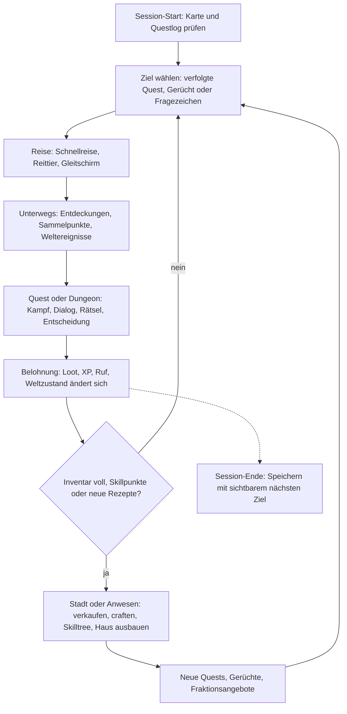

# Vision & Überblick – Chroniken von Aetherfall

> Teil der Phase-0-Planung · Stand: 2026-10-12 · Quelle: [Master-Prompt](../00_Master-Prompt.md)

**Kennzeichnungen in allen GDD-Dateien:**
- **Vorschlag:** füllt eine Lücke im Master-Prompt.
- **Verbesserungsvorschlag:** weicht bewusst vom Master-Prompt ab. Das Original bleibt erkennbar.
- ❓ **Offene Entscheidung:** liegt beim Auftraggeber. Gesammelt am Dateiende.

---

## Vision in 10 Sätzen

1. Du spielst einen Rissgeborenen, der die Zerstörung seines Dorfes überlebt und dabei Aether-Kräfte erlangt hat.
2. Schauplatz ist Aetherfall, ein Kontinent, den der Große Riss vor 300 Jahren zerbrochen hat und der heute aus acht sehr unterschiedlichen Regionen besteht.
3. Sieben Fraktionen ringen um die Aether-Quellen, während hinter den Rissen die Leere erwacht und ganze Landstriche verschlingt.
4. Gekämpft wird in wuchtiger Echtzeit-Action zwischen The Witcher 3 und Elden Ring, mit lernbaren Angriffsmustern, Ausdauer, Parieren und Haltung, aber zugänglicher als ein Soulslike.
5. Quests haben mehrere Lösungswege, und Entscheidungen verändern die Welt sofort oder erst Dutzende Stunden später, bis hin zu mindestens vier Enden.
6. Hinter jedem Hügel und in jeder Höhle wartet eine Belohnung: Loot, Lore, eine Quest, ein Geheimnis oder eine Aussicht.
7. In jeder Spielsitzung wird der Spieler stärker, reicher oder klüger, über frei mischbare Klassen, Skilltrees, Ausrüstung, Berufe und ein eigenes Anwesen.
8. NPCs leben nach Tagesabläufen, Fraktionen verfolgen eigene Ziele, und Orte verändern sich sichtbar durch die Taten des Spielers.
9. Nach der Story halten Weltstufen, Riss-Expeditionen, Sammlungen, New Game+ und saisonale Ereignisse das Spiel über Monate abwechslungsreich, ohne Grind-Zwang.
10. Das Spiel läuft auf macOS (Apple Silicon) und Windows mit 60 FPS, nahtlosem Welt-Streaming und voller Controller-Bedienung, und neue Inhalte entstehen als Daten ohne Code-Änderungen.

---

## Elevator Pitch & Spielerfantasie

**Elevator Pitch:**
Ein Open-World-Action-RPG, in dem du als Rissgeborener einen zerbrochenen Fantasy-Kontinent erkundest, dich zwischen sieben Fraktionen entscheidest und eine erwachende Leere bekämpfst. Es verbindet Quests mit echten Konsequenzen wie in The Witcher 3 mit lernbarem, wuchtigem Kampf wie in Elden Ring und einem Endgame für Monate.

**Spielerfantasie:**
> Du bist der Rissgeborene: Du hast überlebt, was niemand überlebt. Das Aether in deinen Adern macht dich zur letzten Hoffnung des Kontinents und zugleich zu seiner größten Gefahr. Jede Fraktion will dich benutzen. Du entscheidest, wem du hilfst, was du opferst und was aus Aetherfall wird.

- **Ton (§3):** ernst, mit dunklen Untertönen. Humor gibt es in Nebenquests und in Begleiter-Dialogen.
- ❓ **Offene Entscheidung:** Ist die Spielfigur frei gestaltbar (Körpertyp, Aussehen, Name) oder ein fester Charakter wie Geralt? Empfohlener Standard: frei gestaltbar mit schlankem Editor (2 Körpertypen, Presets und wenige Regler) und **ohne** Sprachausgabe für den Protagonisten, weil das bei zwei Sprachen Kosten spart. Details folgen in [01_Welt_Story_Fraktionen](./01_Welt_Story_Fraktionen.md).

---

## Die 6 Kernsäulen

Regel aus §2: Jede Designentscheidung muss mindestens eine Säule stärken.
**Vorschlag:** Zusätzlich darf keine Entscheidung eine andere Säule spürbar schwächen, ohne dass dies dokumentiert ist.

### Säule 1 – Erkundung belohnt immer
- **Bedeutung:** Jeder Ort, den der Spieler bewusst ansteuert (Höhle, Ruine, Gipfel, auffällige Landmarke), liefert mindestens eine von fünf Belohnungsarten: Loot, Lore, Quest, Geheimnis oder Aussicht.
  - **Vorschlag – „90-Sekunden-Regel“:** Auf Wegen und in erschlossenem Gelände vergehen zu Fuß nie mehr als 90 s Laufzeit ohne Interessenspunkt. Interessenspunkte sind auch kleine Dinge wie Sammelpunkt-Cluster, Lore-Item oder Truhe.
- **Beispiele:**
  - Aussichtspunkte lichten den Kartennebel (§14.5).
  - Fundorte-Zähler je Region, z. B. „Truhen 12/24“.
  - Lore-Gegenstände schalten versteckte Quests frei (§16.2).
  - Ein großes Geheimnis pro Region (§14.3).
- **Prüffrage:** „Bekommt ein Spieler, der hier vom Weg abweicht, etwas, das er auf dem Hauptweg nicht bekäme?“
- **Anti-Beispiel:** eine Höhle mit 3 Gold und einer leeren Kiste; Kartensymbol-Checklisten ohne Geschichte; kopierte Banditenlager ohne Variation.

### Säule 2 – Entscheidungen zählen
- **Bedeutung:** Eine Entscheidung setzt Weltzustand-Flags. Jede Entscheidung hat mindestens eine Folge, die der Spieler sieht oder hört (NPC, Ort, Dialog, Belohnung, Ruf).
  - **Vorschlag – Zielquoten:**
    - ≥ 60 % der Regions-, Fraktions- und Nebenquests haben ≥ 2 Lösungswege.
    - Jede Entscheidung in einer Hauptquest hat ≥ 1 verzögerte Konsequenz.
- **Beispiele:**
  - „Banditen am Mühlbach“: angreifen, schleichen oder verhandeln.
  - Ein verschonter Bandit aus dem Eichental taucht ~30 h später in Aurelion als Informant auf (§16.5).
  - Wer einer Fraktion beitritt, schließt andere aus (§15.3).
- **Prüffrage:** „Kann der Spieler später erkennen, dass eine andere Wahl etwas anderes bewirkt hätte?“
- **Anti-Beispiel:** Scheinentscheidungen mit identischem Ergebnis; eine Gut/Böse-Leiste statt konkreter Folgen; Entscheidungen ohne ausreichende Information.

### Säule 3 – Ständiger Fortschritt
- **Bedeutung:** Jede Sitzung von ≥ 30 min endet mit messbar mehr Macht, Besitz oder Wissen. Der Takt ist 5 / 30 / 150–180 min (siehe [Pacing](#pacing--anti-langeweile)).
- **Beispiele:**
  - 1 Attribut- und 1 Skillpunkt pro Level (§11.3).
  - Berufsstufen 1–100 (§13.2).
  - Haus-Ausbau in Stufen (§21).
  - Bestiarium mit aufgedeckten Gegnerschwächen als Wissens-Fortschritt.
- **Prüffrage:** „Was kann der Spieler nach 30 Minuten mit diesem Feature, das er vorher nicht konnte?“
- **Anti-Beispiel:** voll mitskalierende Gegner wie in Oblivion (nach §20.4 ausgeschlossen); Boni von +0,5 % ohne spürbare Wirkung; Inventar-Müll ohne jede Verwendung.

### Säule 4 – Abwechslung
- **Bedeutung:** Kampf, Erkundung, Dialog, Rätsel, Crafting und Basisbau wechseln sich ab.
  - **Vorschlag:**
    - Auf dem kritischen Pfad dauert keine Tätigkeit länger als 20 min am Stück.
    - In einer Questreihe folgen nie zwei Quests mit identischem Haupt-Zieltyp aufeinander.
- **Beispiele:**
  - 23 Ziel-Typen (§16.4), darunter Detektiv-Modus, Eskorte und Schleichen.
  - Minispiele: Rissduell, Angeln, Pferderennen, Armdrücken, Würfeln.
  - Umgebungsrätsel mit Druckplatten, Spiegeln, Hebeln und Elementen.
- **Prüffrage:** „Welche Tätigkeit unterbricht dieses Feature, und wie oft wiederholt sich dieselbe Handlung pro Stunde?“
- **Anti-Beispiel:** „Töte 10 Wölfe“, direkt gefolgt von „Töte 10 Banditen“; ein Dungeon mit 40 min reinem Kampf ohne Rätsel oder Atempause.

### Säule 5 – Lebendige Welt
- **Bedeutung:** Die Welt hat Zustände, die sich mit Zeit, Wetter und Spieleraktionen ändern. Diese Änderungen sind sichtbar oder hörbar.
- **Beispiele:**
  - NPC-Tagesabläufe: Arbeit, Essen, Taverne, Schlafen (§15.1).
  - Weltereignisse wie Karawanen, Überfälle, Riss-Ausbrüche und Duellanten (§14.4).
  - Das Eichental wird nach der Befreiung wieder aufgebaut (Weltzustand-Flags).
- **Prüffrage:** „Reagiert die Welt sichtbar oder hörbar auf diese Aktion, diese Tageszeit oder dieses Wetter?“
- **Anti-Beispiel:** NPCs, die 24 h am selben Fleck stehen; ein gerettetes Dorf, das unverändert bleibt; Barks, die sich alle 20 s wiederholen.

### Säule 6 – Spielerfreiheit
- **Bedeutung:** Verschiedene Builds, Spielstile und Wege sind gleichwertig gültig.
  - **Vorschlag:** Jeder Pflichtinhalt (Hauptquest, Story-Boss) ist ohne Respec mit mindestens je einem Nahkampf-, Fernkampf- und Magie-Build schaffbar.
- **Beispiele:**
  - Freie Klassenmischung und Hybridklassen (§11).
  - Schwierigkeit jederzeit änderbar (§29).
  - Respec beim NPC (§11.3).
- **Prüffrage:** „Kann ein Schleich-, ein Magie- und ein Nahkampf-Charakter diesen Inhalt sinnvoll bewältigen?“
- **Anti-Beispiel:** ein Boss, der nur mit Fernkampf besiegbar ist; eine Dialogprobe als einziger Weg zum Questfortschritt; eine Pflicht-Fraktion.

### Feature-Prüfung (Vorschlag)
Jedes neue Feature bekommt vor der Umsetzung einen Steckbrief mit fünf Feldern:

| Feld | Inhalt |
|---|---|
| Gestärkte Säule(n) | Nummer und ein Satz Begründung |
| Geschwächte Säule(n) | „keine“ oder Begründung mit Gegenmaßnahme |
| Umfangsstufe | A / B / C (siehe [Umfangsstufen](#umfangsstufen)) |
| Kosten | S (≤ 2 Tage), M (≤ 2 Wochen), L (≤ 2 Monate), XL (> 2 Monate) |
| Prüffragen | Antworten auf die Prüffragen der betroffenen Säulen |

Regel: Ein Feature ohne zugeordnete Umfangsstufe wird nicht geplant.

### Nicht-Ziele (Vorschlag)
- Kein Multiplayer, kein Koop und kein Online-Zwang. Das Endgame ist solo mit Begleitern (§23).
- Keine Online-Bestenlisten. „Ranglisten-Stufen“ in der Arena (§23) sind lokale Rangstufen gegen NPCs.
- Keine Konsolen-Ports in den Stufen A–C. Die Architektur soll sie nicht verbauen.
- ❓ **Offene Entscheidung:** Monetarisierung. Empfohlener Standard: Premium-Einmalkauf ohne Mikrotransaktionen und ohne Lootboxen.

---

## Zielgruppe & Referenzspiele

### Zielgruppe (Vorschlag)

| Segment | Profil | Sucht vor allem |
|---|---|---|
| Primär | Story- und Open-World-RPG-Spieler, 25–45 Jahre, kennen Witcher 3, Skyrim, Dragon Age, BG3 | Quests mit Konsequenzen, Erkundung, Begleiter |
| Sekundär | Action-RPG-Spieler, die Elden Ring mögen, sich aber mehr Zugänglichkeit und Story wünschen | Kampf mit Tiefe, Bosse, Build-Vielfalt |
| Tertiär | Langzeit- und Loot-Spieler (Diablo-, Genshin-Endgame) | Weltstufen, Expeditionen, Sammlungen |
| Nische | Mac-Spieler mit Apple Silicon: Es gibt wenige native Open-World-RPGs | Native Performance, Controller-Support |

- **Sitzungsmuster:** werktags 60–120 min, am Wochenende länger. Daraus folgt: Jede 30-min-Sitzung bringt spürbaren Fortschritt (Säule 3).
- **Eingabe:** Controller und Maus/Tastatur gleichwertig (§4.3).
- ❓ **Offene Entscheidung:** Ziel-Altersfreigabe. Empfohlener Standard: USK 16 / PEGI 16, passend zu Ton und Gewalt. Das beeinflusst Blut-Effekte und Darstellungsgrenzen.

### Referenzspiele

| Spiel | Übernehmen wir | Übernehmen wir bewusst nicht | Warum |
|---|---|---|---|
| The Witcher 3 | Nebenquests mit Twist, moralische Grauzonen, verzögerte Konsequenzen, Begleiterkommentare, Anschlagbretter | Fragezeichen-Flut ohne Inhalt; Detektiv-Sinne als Dauerlösung; Junk-Überflutung im Inventar | Unsere Quests sind das Herzstück (§16). Füllsymbole schwächen Säule 1. |
| Skyrim | Freie Erkundung aus Neugier, klassenlose Entwicklung, Haus, prozedurale Aufträge | Schwammiges Trefferfeedback; Level-Scaling; generische Dungeons; Aufträge, die handgemachte Quests verdrängen | §9.1 fordert Wucht, §20.4 feste Gebietslevel, §16.7 Tageslimit für prozedurale Aufträge. |
| Elden Ring | Lernbare Gegnermuster, Haltung/Poise, Weltbosse, Entdeckung ohne Handholding (als Option „Erkundungsmodus“) | Hohe Frustschwelle als Standard; kryptische Questführung ohne Questlog; keine Schwierigkeitsgrade | Wir wollen „zugänglicher“ sein (§9.1): vier Schwierigkeitsgrade (§20.4) und ein Questlog (§16.6). |
| Baldur's Gate 3 | Mehrere Lösungswege, reaktive Begleiter, Fertigkeitsproben im Dialog, Lagerfeuer-Gespräche | Rundenkampf; volle Vertonung und Kinematik jeder Zeile | Echtzeit-Kampf ist gesetzt. Volle Vertonung in DE und EN übersteigt jedes kleine Budget. |
| Genshin Impact | Gleitschirm- und Kletter-Erkundung, Elementreaktionen (§9.5), lesbare stilisierte Optik, Belohnungsrhythmus | Gacha, Energie-Limits (Resin), FOMO-Events, Daily-Pflicht | Säule 6 und Premium-Empfehlung. Saisonale Events kehren jährlich wieder statt zu verfallen. |
| Dragon Age | Begleiter-Loyalität, Fraktionsentscheidungen, Lagerfeuer, Romanzen (bei manchen, §19) | MMO-artige Füllquests („Sammle 10 Felle“) in riesigen leeren Zonen | Säule 4: Abwechslung statt Masse. |

---

## Core Loops

### Moment-zu-Moment (~30 s)
1. **Wahrnehmen:** Landmarke, Kompass-Marker, Geräusch, Loot-Glitzern.
2. **Annähern:** laufen, klettern, schleichen, reiten, gleiten.
3. **Handeln:** Kampf (ausweichen, parieren, Kombo, Fähigkeit) oder Interaktion (Truhe, NPC, Rätsel-Element).
4. **Feedback:** Hitstop, Trefferpartikel, Loot-Strahl, XP-Zahl, Codex-Eintrag.
5. **Nächster Reiz:** ein neues Ziel im Kompass oder eine sichtbare Landmarke.

Kampf-Mikroloop (2–5 s): Muster lesen → ausweichen oder parieren → Öffnung nutzen → Ausdauer managen → Haltung brechen → Finisher. Details stehen in [03_Kampf_Charakter_Progression](./03_Kampf_Charakter_Progression.md).

### Session (~1–2 h)

- **Vorschlag – „offener Haken“:** Beim Speichern oder Beenden zeigt der Ladebildschirm des nächsten Starts das zuletzt verfolgte Ziel und eine offene Frage aus dem Questlog.

### Meta (Wochen)
- Hauptstory in 5 Akten (40–60 h, §1, §18).
- Regionen komplettieren (Fundorte-Zähler, großes Geheimnis je Region).
- Fraktionsruf aufbauen und Fraktion wählen. Ausschlüsse erzeugen Wiederspielwert (§15.3).
- Begleiter-Loyalität bis zur persönlichen Questreihe (§19).
- Build bis Level 80, Hybridklassen (§11).
- Haus-Ausbau, Berufe 1–100.
- Verzögerte Konsequenzen werden eingelöst (§16.5).

### Endgame (Details in [04_Items_Crafting_Wirtschaft_Endgame](./04_Items_Crafting_Wirtschaft_Endgame.md))
1. Weltstufe wählen (1–10, §23).
2. Inhalt wählen: Riss-Expedition mit Modifikatoren, Weltbosse, Raid-Bosse, Arena, wöchentliche Herausforderung.
3. Bessere Beute: Mythisch, Sets, Aether-Splitter.
4. Build optimieren: Verzauberung, Sockel, Paragon.
5. Nächsthöhere Weltstufe → zurück zu 1.

Parallel dazu laufen legendäre Waffen-Questreihen (eine je Waffentyp, also 11), Sammlungen, Erfolge, New Game+ und saisonale Ereignisse.

---

## Pacing & Anti-Langeweile

### Belohnungstaktung als messbare Regeln (§23)

| Regel | Master-Prompt | Zählt als Ereignis (EventBus) | Zielwert (Vorschlag) | Alarm im Playtest |
|---|---|---|---|---|
| R5 – klein | spätestens alle 5 min | `ItemPickedUp`, `ChestOpened`, `LocationDiscovered`, `LoreFound`, `XpGained` (≥ 1 % des Levels) | Median ≤ 2 min, 90. Perzentil ≤ 5 min | Lücke > 5 min |
| R30 – groß | spätestens alle 30 min | `QuestCompleted` (nicht prozedural), `LevelUp`, `SkillUnlocked`, `ItemEquipped` mit Upgrade ab Selten | 90. Perzentil ≤ 30 min | Lücke > 30 min |
| R180 – neu | spätestens alle 2–3 h | `FeatureUnlocked`, `RegionEnteredFirstTime`, `CompanionJoined`, `MechanicIntroduced` | ≤ 150 min bis Spielstunde 20, danach ≤ 180 min | Lücke > 180 min |
| Kein Grind-Zwang | §23 | Spielerlevel bei Start jeder Hauptquest | Abweichung zum empfohlenen Level ≤ 3 | > 20 % der Tester mehr als 3 Level darunter |

Gemessen wird **aktive Spielzeit**. Pause zählt nicht. Menüzeit über 30 s am Stück zählt nicht.

### So stellt der Content-Plan die Regeln sicher (Vorschlag)
- **POI-Dichte:** Jede Region bekommt einen Abstands-Check entlang des NavMesh: maximal 90 s Laufweg zwischen Interessenspunkten. Ein Editor-Validator markiert Lücken. Die Technik dazu steht in [02_Systeme_und_Abhaengigkeiten](../Technik/02_Systeme_und_Abhaengigkeiten.md).
- **Quest-Länge:**
  - Nebenquests dauern 10–30 min.
  - Quests über 30 min brauchen eine Stage-Belohnung in der Mitte (z. B. Zwischenloot, Lore, Skillpunkt).
- **XP-Kurve:** Bis Level 10 kommt alle ≤ 30 min ein Level-Up. Das passt zu „Level 10 nach ca. 4 h“ (§28): 9 Level-Ups in 240 min ergeben ~27 min je Level-Up. Danach tragen Questabschlüsse die R30-Regel.
- **Neue Mechanik je Region:** Jede Region bringt ≥ 1 neue Mechanik, ≥ 1 neuen Gegnerrollen-Mix und ≥ 1 neue Aktivität.
  - Beispiele für Mechaniken: Kälte (Frostgipfel), Sandsturm (Kar'Zul), Lava und Hitze (Glutlande), sich verändernde Inseln (Zerbrochener Himmel).
- **Pacing-Pass vor Content-Lock:** Pro Region wird ein Durchlauf mit Zeitleiste geplant (Quest, erwartete Minute, Belohnungsklasse). Diese Spalten stehen im Quest-Editor-Filter (siehe [02_Quests_und_Dialoge](./02_Quests_und_Dialoge.md)).

### Messung per Entwicklungs-Telemetrie (§28, Vorschlag)
- Nur in Development-Builds. Bei externen Testern nur mit Opt-in, mit pseudonymer Tester-ID und ohne personenbezogene Daten.
- Die Telemetrie abonniert vorhandene EventBus-Events (§6.2: `EnemyKilled`, `ItemPickedUp`, `QuestCompleted`, `NPCTalkedTo` und weitere). So entsteht keine zusätzliche Kopplung.
- **Ausgabe:**
  - Lokale Ereignisliste pro Session.
  - **Pacing-Report** mit Zeitleiste, markierten Lücken (R5/R30/R180) samt Position und Aktivität.
  - Dazu die in §28 geforderten Daten: Zeit pro Quest, Todesorte (Heatmap), häufigste Builds.
- **Auswertungsregel:** Eine Lücke, die bei ≥ 30 % der Tester an derselben Stelle auftritt, wird zum Content-Ticket.
- Die Technik dazu steht in [01_Architektur](../Technik/01_Architektur.md).

### Was ist neu nach Stunde X (Vorschlag: Freischalt-Reihenfolge, Stunde 0–20)

Säulen: 1 Erkundung · 2 Entscheidungen · 3 Fortschritt · 4 Abwechslung · 5 Lebendige Welt · 6 Freiheit

| ~Stunde | Neu | Auslöser / Ort | Säule |
|---|---|---|---|
| 0:00 | Bewegung, leichter und schwerer Angriff, Springen, Interagieren | Prolog, Hauptquest „Asche über Eichental“ | 3 |
| 0:10 | Ausweichrolle (I-Frames), Blocken | Erster Kampf im brennenden Dorf | 4 |
| 0:25 | Erste Aether-Kraft des Rissgeborenen | Kontakt mit dem Riss (Akt 1) | 3 |
| 0:40 | Wahl der Startklasse, Questlog, Kompass, Inventar | Ende des Prologs (**Vorschlag:** Klassenwahl nach dem Prolog statt im Hauptmenü) | 6 |
| 1:00 | Level-Up, Attribut- und Skillpunkt, Skilltree | Level 2–3 | 3 |
| 1:15 | Bogen und Fernkampf für alle Klassen, Kopftreffer | „Die Wölfe vom Nordhang“ | 4 |
| 1:30 | Schleichen, alternative Lösungswege | „Banditen am Mühlbach“ | 2 |
| 1:45 | Schnellreise über Wegpunkte, Aussichtspunkte | Erster Aussichtspunkt | 1 |
| 2:00 | Erster Begleiter, Kommentare, Loyalität | Dorf im Eichental | 5 |
| 2:30 | Dungeon, Umgebungsrätsel, Mini-Boss | „Die vergessene Gruft“ | 1, 4 |
| 3:00 | Sammeln (Kräuterkunde), Alchemie-Grundlagen, Kochen am Lagerfeuer | „Das Kraut der Kräuterfrau“ | 3 |
| 3:30 | Kopfgeldbrett, Boss mit eigener Mechanik | „Kopfgeld: Grimmbart“ | 4 |
| 4:00 | Level 10, verfallenes Anwesen (Haus Stufe 1), Lagerkiste | Hauptquest Akt 1 (§21) | 3 |
| 5:00 | Reittier (Pferd) | Aufbruch zur Goldküste | 1 |
| 6:00 | Region Goldküste, Hafenstadt Velmara, Schwimmen und Tauchen | Beginn Akt 2 | 1 |
| 7:00 | Spezialhändler, Schmieden, Verzauberung (Affixe) | Velmara | 3 |
| 8:00 | Fraktionen und Ruf (Erstkontakt Handelsgilde, Silberwacht, Aether-Konvent) | Velmara | 2 |
| 9:00 | Prozedurale Aufträge (Anschlagbrett, Fraktionsbüro) | Velmara | 3 |
| 10:00 | Schatzsuche, Minispiel „Rissduell“ | „Die Schatzkarte des alten Seemanns“, Taverne | 4 |
| 11:00 | Weltereignisse (Karawane, Riss-Ausbruch), erster Weltboss | Goldküste | 5 |
| 12:00 | Zweiter Begleiter (Gruppe zu dritt), KI-Verhalten, Lagerfeuer-Gespräche | Goldküste | 5 |
| 13:30 | Angeln | Küste | 4 |
| 15:00 | Haus Stufe 2: Schmiede, Küche, Garten, Bau-Modus | Anwesen Eichental | 3 |
| 16:30 | Moorschatten: Gift- und Untoten-Gegner, Hexenzirkel | Akt 2 | 4 |
| 18:00 | Aurelion: Schattenhand, Diebstahl, Hehler, Kopfgeld-System | Akt 2 | 2 |
| 20:00 | Gleitschirm; alte Regionen bieten neue erreichbare Geheimnisse | Aurelion (Turm-Quest) | 1 |

- Die größte Lücke liegt bei ≤ 2 h. Damit ist R180 erfüllt.
- Der Vertical Slice (Stufe A) deckt ungefähr Stunde 0–3 ab, aber ohne Crafting und Haus (beides Phase 5).
- Hybridklassen sind für ~Level 30 vorgesehen, also ~40 h, und stehen deshalb nicht in der Tabelle. Details in [03](./03_Kampf_Charakter_Progression.md).

---

## Ziel-Spielzeiten & Plausibilität

### Ziele laut §1
| Umfang | Ziel |
|---|---|
| Hauptstory | ca. 40–60 h |
| Hauptstory + Nebenquests | ca. 150–200 h |
| Komplettierung inkl. Endgame | 300+ h |

### Überschlag

Formel: **Spielzeit ≈ Σ (gespielte Quests × Ø Dauer) + Erkundung außerhalb von Quests + Systemzeit.**
Die Ø-Dauern sind Annahmen (Vorschlag) und enthalten die Reisezeit innerhalb der Quest.

| Kategorie | Master-Prompt | Erstellt (Min / Mitte) | Gespielt je Durchgang (Min / Mitte) | Ø Dauer | Stunden (Min / Mitte) |
|---|---|---|---|---|---|
| Hauptquests | ca. 60 | 60 / 60 | 60 / 60 | 45 / 50 min | 45 / 50 |
| Fraktionsquests | 7 × 15–25 | 105 / 140 | 60 / 80 (4 von 7 Fraktionen spielbar wegen Ausschlüssen) | 25 / 30 min | 25 / 40 |
| Regionsquests | 3–6 Reihen × 8 Regionen | 72 / 144 (3 Reihen × 3 Quests bzw. 4,5 × 4) | 72 / 144 | 25 min | 30 / 60 |
| Nebenquests | 20–30 × 8 Regionen | 160 / 200 | 160 / 200 | 15 min | 40 / 50 |
| Begleiterquests | 4–6 × 8 | 32 / 40 | 32 / 40 | 25 min | 13 / 17 |
| Kleinformate (Kopfgeld, Schatz, Dungeon, Handwerk, Rätsel, Legendär, Versteckt) | keine Zahl | 60 / 100 | 60 / 100 | 15 min | 15 / 25 |
| **Summe Quests** | **≥ 400** | **489 / 684** | **444 / 624** | | **168 / 242** |
| Erkundung ohne Quest (Dungeons, POIs, Truhen, Rätsel) | – | | | 4–6 h je Region | 32 / 48 |
| Systeme (Crafting, Haus, Handel, Minispiele) | – | | | | 10 / 20 |
| **Gesamt „Hauptstory + Nebenquests“** | **150–200 h** | | | | **≈ 210 / ≈ 310** |

**Ergebnis:**
1. Schon die **Mindestwerte** pro Kategorie ergeben ~490 handgemachte Quests, nicht 400. Die Kategorien-Zahlen und „mindestens 400“ passen also nicht genau zusammen. Die 400 werden bereits durch die fünf Hauptkategorien erreicht.
2. Die Mindestwerte ergeben ~210 h. Das liegt knapp über dem Ziel von 150–200 h. Mit mittleren Werten (~310 h) wird das Ziel deutlich überschritten.
3. Die Hauptstory allein ergibt 45–50 h Quest-Zeit plus Reise. Das passt zu 40–60 h.
4. 300+ h Komplettierung sind plausibel, weil das Endgame wiederholbar ist (Weltstufen, Expeditionen).

**Verbesserungsvorschlag – Quest-Budget 420 für Stufe C** (statt der Kategorien-Summe von 490–700):

| Kategorie | Original (§16.2) | Vorschlag | Gespielt | Stunden |
|---|---|---|---|---|
| Hauptquests | ca. 60 | 60 | 60 | 45 |
| Fraktionsquests | 7 × 15–25 | 7 × 15 = 105 | 60 | 25 |
| Regionsquests | 3–6 Reihen je Region | 7 × 3 Reihen × 3 + 3 im Zerbrochenen Himmel = 66 | 66 | 28 |
| Nebenquests | 20–30 je Region | 7 × 18 + 8 im Zerbrochenen Himmel = 134 | 134 | 34 |
| Begleiterquests | 4–6 je Begleiter | 8 × 4 = 32 | 32 | 13 |
| Kleinformate (handgemacht) | – | 30 (der Rest prozedural) | 30 | 8 |
| **Summe** | | **427** | **382** | **153 h + 42 h Erkundung/Systeme ≈ 195 h** |

Begründung: Das erfüllt „≥ 400“ und „150–200 h“ zugleich. Gekürzt werden die Nebenquests je Region (18 statt 20–30). Die Endgame-Region bekommt bewusst weniger handgemachte Inhalte, weil dort prozedurale Inhalte tragen.

### Story-Level-Lücke (wichtig)
- Die Level-Ziele aus §28 lauten: Level 30 nach ~40 h, Level 60 nach ~120 h (gemischtes Spiel). Wer nur die Hauptstory spielt (40–60 h), liegt am Ende bei ~Level 33–37.
- Akt 4 spielt aber in Regionen mit Level 35–60 (Frostgipfel, Glutlande), und Akt 5 im Zerbrochenen Himmel mit Level 60–80. Das widerspricht „Keine Pflicht zum Grinden für die Hauptstory“ (§23).
- **Verbesserungsvorschlag:** Die Regionslevel aus §14.2 bleiben. Hauptquests in Akt 4–5 bekommen aber einen eigenen **Story-Korridor**:
  - Akt 4 empfohlen ~Level 32–42.
  - Akt 5 empfohlen ~Level 40–48. Das Finale ist ein Story-Bereich mit festem Level.
  - Der offene Zerbrochene Himmel (Level 60–80) wird erst nach der Story voll freigeschaltet. Das passt zu §18 („Nach der Story“).
- ❓ **Offene Entscheidung:** Story-Korridor (empfohlen) oder deutlich mehr XP aus Hauptquests? Die Abstimmung erfolgt mit [03](./03_Kampf_Charakter_Progression.md).

---

## Umfangsstufen

**Vorschlag zur Risikominimierung:** Das Projekt wird in drei Stufen geplant. Jede Stufe ist für sich spielbar und testbar. Nach Stufe A wird die tatsächliche Produktionsgeschwindigkeit gemessen (Personentage je Quest, Gegnertyp, Dungeon). Auf dieser Basis wird Stufe B neu kalkuliert.

| Merkmal | Stufe A – Vertical Slice | Stufe B – erste veröffentlichbare Version | Stufe C – volle Vision |
|---|---|---|---|
| Roadmap | Phase 4 (§31) | Phase 5 + Teile von Phase 6 | Phase 6–7 vollständig |
| Story | Prolog und Anfang Akt 1 | Akt 1–2 | Akt 1–5, Nach-Story, NG+ |
| Regionen | Teil des Eichentals (1 Dorf, 1 Dungeon) | Eichental, Goldküste, Moorschatten komplett; Aurelion als Story-Hub (1–2 Viertel) | alle 8 |
| Level | 1–8 | 1–30 | 1–80 + Paragon |
| Handgemachte Quests | 8 (§16.9) | ~150: Haupt 24, Fraktion 3 × 8, Region 3 × 3 Reihen, Neben 3 × 15–20, Begleiter 3 × 4, Kleinformate ~10 | ≥ 400 (Vorschlag: 427, siehe oben) |
| Prozedurale Vorlagen | 0–1 | 4–6 | 15+ |
| Gegnertypen | 5 (§31) | ~20 (je 4 Varianten) | 60+ (§20.1) |
| Bosse | 1 Dungeon-Boss, Grimmbart-Mechanik | ~15 Dungeon-, 6 Welt-, 3 Story-Bosse | alle (§20.3) |
| Waffentypen | 3: Einhandschwert (+ Schild), Bogen, Zauberstab | 6: + Zweihandschwert, Dolche, Axt | 11 (§9.3) |
| Klassen | 2 (Krieger, Magier) + Aether-Grundfähigkeit | 4 Startklassen (Krieger, Waldläufer, Schurke, Magier) + Rissläufer (1 Ast, Story) | 6 + Hybridklassen |
| Skilltree | ~15 Knoten je Klasse | ≥ 40 Knoten je Klassenbaum (§11.2) | dazu allgemeine Bäume und Hybride |
| Begleiter | 1 | 3 + Tierbegleiter Wolf | 8 + Wolf, Falke, Bär (§19) |
| Systeme | Kampf, Inventar, Loot, Quests, Dialog, Speichern, HUD | + Crafting, Händler, Fraktionen, Haus Stufe 1–2, Reittier, Weltereignisse, 2 Minispiele | alle |
| Endgame | – | **Vorschlag:** Riss-Expeditionen „Lite“ bei Level 30 | voll (§23) |
| Spielzeit | 2–3 h (§31) | Story ~15–20 h, mit Nebeninhalten ~50–70 h | 40–60 / 150–200 / 300+ h |

Hinweise:
- **Stufe C in Akt-Updates (Vorschlag):**
  - C1 = Akt 3 + Kar'Zul.
  - C2 = Akt 4 + Frostgipfel + Glutlande.
  - C3 = Akt 5 + Zerbrochener Himmel + volles Endgame.
- **B-Minimal (Rückfallebene):** Eichental und Goldküste, Akt 1 und erste Hälfte von Akt 2, ~70 Quests, ~25–35 h. Diese Variante greift, wenn die Messung nach Stufe A zeigt, dass B zu groß ist.
- Hinweis zu Stufe A: Die Quest „Die Schatzkarte des alten Seemanns“ endet an der Goldküste (§16.9). Im Vertical Slice braucht es dafür einen kleinen Küstenausläufer als Weltzelle, oder die letzte Stufe wird bis Stufe B gesperrt. Die Entscheidung liegt in [02_Quests_und_Dialoge](./02_Quests_und_Dialoge.md).
- ❓ **Offene Entscheidung:** Release-Modell. Empfohlener Standard: Early Access ab Stufe B (oder B-Minimal), Version 1.0 ab C1 oder später. Voraussetzung: Speicherstände bleiben ab dem ersten öffentlichen Build migrierbar (§25).

---

## Dokumenten-Index

| Datei | Inhalt in einem Satz |
|---|---|
| [00_Master-Prompt](../00_Master-Prompt.md) | Verbindliche Spezifikation des Auftraggebers (§0–§33). |
| [00_Vision_und_Ueberblick](./00_Vision_und_Ueberblick.md) | Vision, Säulen, Zielgruppe, Core Loops, Pacing, Spielzeiten, Umfangsstufen, Index, Glossar. |
| [01_Welt_Story_Fraktionen](./01_Welt_Story_Fraktionen.md) | Setting, Lore, Hauptstory, Regionen, lebendige Welt, NPCs, Fraktionen, Ruf, Begleiter, Gegner-Roster und Bosse. |
| [02_Quests_und_Dialoge](./02_Quests_und_Dialoge.md) | Quest-Design, Kategorien, Mengen, Ziele, Konsequenzen, prozedurale Aufträge, Quest-Editor, die 8 Beispiel-Quests, Dialogsystem. |
| [03_Kampf_Charakter_Progression](./03_Kampf_Charakter_Progression.md) | Steuerung, Kamera, Bewegung, Kampf, Magie, Status, Schaden, Gegner-KI, Werte, Klassen, Skilltrees, Erfahrung und Level. |
| [04_Items_Crafting_Wirtschaft_Endgame](./04_Items_Crafting_Wirtschaft_Endgame.md) | Inventar, Ausrüstung, Loot, Crafting und Berufe, Haus, Wirtschaft, Endgame, Minispiele, Paragon. |
| [05_UI_Audio_Grafik_Barrierefreiheit](./05_UI_Audio_Grafik_Barrierefreiheit.md) | HUD, Menüs, UX-Regeln, Audio, Art Direction, Grafikoptionen, Barrierefreiheit, Speichern aus Spielersicht. |
| [Technik/01_Architektur](../Technik/01_Architektur.md) | Technische Architektur: Bootstrapper, Services, EventBus, Daten, Speichern, Streaming, UI-Technologie. |
| [Technik/02_Systeme_und_Abhaengigkeiten](../Technik/02_Systeme_und_Abhaengigkeiten.md) | Liste aller Systeme mit Abhängigkeiten und Umsetzungsreihenfolge. |
| [Technik/03_Technik-Recherche](../Technik/03_Technik-Recherche.md) | Verifizierte Fakten zu Unity-Version, Paketen und APIs. |

---

## Glossar

| Begriff | Bedeutung | Mehr in |
|---|---|---|
| Aether | Magische Energie, die aus Rissen fließt. Sie ist mächtig, aber gefährlich und verändert Lebewesen (§3). | [01](./01_Welt_Story_Fraktionen.md) |
| Aether-Splitter | Endgame-Währung (§22). | [04](./04_Items_Crafting_Wirtschaft_Endgame.md) |
| Aether-Verderbnis | Story-Statuseffekt (§9.6). Als Gegnervariante heißt es „Aether-verderbt“ (§20.1). | [03](./03_Kampf_Charakter_Progression.md) |
| Riss | Bruchstelle in der Welt, aus der Aether austritt. Ein Riss-Ausbruch ist ein Weltereignis (§14.4). | [01](./01_Welt_Story_Fraktionen.md) |
| Großer Riss | Die Katastrophe vor 300 Jahren, die Aetherfall zerbrach. Laut Akt 3 wurde er absichtlich geöffnet (§18). | [01](./01_Welt_Story_Fraktionen.md) |
| Rissgeborener | Die Spielfigur: jemand, der Aether-Kontakt überlebt hat und besondere Kräfte besitzt (§3). | [01](./01_Welt_Story_Fraktionen.md) |
| Rissläufer | Story-Klasse mit Aether-Magie und Teleport (§11.1). | [03](./03_Kampf_Charakter_Progression.md) |
| Die Leere | Uralte Macht hinter den Rissen, die Landstriche verschlingt (§3). | [01](./01_Welt_Story_Fraktionen.md) |
| Kult der Leere | Gegenfraktion, die die Leere verehrt (§15.2). | [01](./01_Welt_Story_Fraktionen.md) |
| Weltstufe | Endgame-Schwierigkeit 1–10. Hebt Gegner auf das Spielerlevel und verbessert den Loot (§20.4, §23). | [04](./04_Items_Crafting_Wirtschaft_Endgame.md) |
| Riss-Expedition | Zufällig generierter Dungeon mit Modifikatoren, ähnlich Rifts oder Mythic+ (§23). | [04](./04_Items_Crafting_Wirtschaft_Endgame.md) |
| Paragon | Meisterschaftssystem nach Level 80 mit kleinen Boni (§23). | [04](./04_Items_Crafting_Wirtschaft_Endgame.md) |
| Haltung (Poise) | Balken, der durch Treffer sinkt. Ist er leer, ist der Gegner betäubt (Stagger) und offen für einen Finisher (§9.2). | [03](./03_Kampf_Charakter_Progression.md) |
| Perfektes Parieren | Block im kurzen Zeitfenster vor dem Treffer. Öffnet den Gegner für einen Konter (§9.2). | [03](./03_Kampf_Charakter_Progression.md) |
| I-Frames | Unverwundbarkeits-Frames während der Ausweichrolle (§8.2). | [03](./03_Kampf_Charakter_Progression.md) |
| Hitstop | Kurzes Einfrieren der Animation (wenige Frames) bei einem Treffer, damit er wuchtig wirkt (§9.1). | [03](./03_Kampf_Charakter_Progression.md) |
| Lock-On | Zielfixierung auf einen Gegner (R3, §7.1). | [03](./03_Kampf_Charakter_Progression.md) |
| Affix | Zufällige Zusatzeigenschaft eines Items. Die Anzahl hängt von der Seltenheit ab (§12.4). | [04](./04_Items_Crafting_Wirtschaft_Endgame.md) |
| Seltenheit | 7 Stufen: Gewöhnlich, Ungewöhnlich, Selten, Episch, Legendär, Mythisch, Set (§12.3). Farben siehe [05](./05_UI_Audio_Grafik_Barrierefreiheit.md). | [04](./04_Items_Crafting_Wirtschaft_Endgame.md) |
| Bad-Luck-Protection | Die Chance auf gute Beute steigt, solange nichts Gutes gedroppt ist (§12.5). | [04](./04_Items_Crafting_Wirtschaft_Endgame.md) |
| Transmog | Das Aussehen der Ausrüstung lässt sich getrennt von ihren Werten einstellen (§12.2). | [04](./04_Items_Crafting_Wirtschaft_Endgame.md) |
| Weltzustand-Flag | Benannter Wert (Bool oder Zahl) im zentralen World State (§6.5). ID-Schema z. B. `flag.eichental.dorf_zerstoert`. | [Technik/01](../Technik/01_Architektur.md) |
| Condition | Wiederverwendbare Bedingung, kombinierbar mit UND, ODER und NICHT (§6.4). | [Technik/01](../Technik/01_Architektur.md) |
| Action | Wiederverwendbare Aktion, z. B. Item geben oder Flag setzen (§6.4). | [Technik/01](../Technik/01_Architektur.md) |
| Stage | Stufe einer Quest mit Questlog-Text, Zielen, Aktionen und Verzweigungen (§16.3). | [02](./02_Quests_und_Dialoge.md) |
| Objective | Einzelnes Ziel innerhalb einer Stage, z. B. „Rede mit NPC“ (§16.4). | [02](./02_Quests_und_Dialoge.md) |
| Fraktionsruf | 8 Stufen von Verhasst bis Legende je Fraktion (§15.3). | [01](./01_Welt_Story_Fraktionen.md) |
| Loyalität | Beziehungswert eines Begleiters zum Spieler (§19). | [01](./01_Welt_Story_Fraktionen.md) |
| Erkundungsmodus | Questanzeige ohne genaue Marker, nur mit Hinweisen (§16.6). | [05](./05_UI_Audio_Grafik_Barrierefreiheit.md) |
| Vertical Slice | Spielbarer Ausschnitt in Zielqualität (Phase 4, §31): Teil des Eichentals, 2–3 h, entspricht Stufe A. | [Umfangsstufen](#umfangsstufen) |

---

## Offene Entscheidungen

| Frage | Optionen | Empfehlung | Warum wichtig |
|---|---|---|---|
| Teamgröße und Budget | Solo · 2–5 · 6–15 · größer | Ehrliche Zahl nennen; danach Stufe B kalkulieren | Bestimmt, ob Stufe B oder B-Minimal realistisch ist |
| Zeitrahmen bis zur ersten Veröffentlichung | 12 · 24 · 36+ Monate | Festlegen, sobald Stufe A gemessen ist | Ohne Zielzeitpunkt lässt sich der Umfang nicht steuern |
| Release-Modell | Early Access · Vollrelease · Demo + Vollrelease | Early Access ab Stufe B (oder B-Minimal) | Finanzierung, Feedback, Pflicht zur Save-Migration |
| Vertriebsplattform | Steam · GOG · Mac App Store · itch.io · mehrere | Steam zuerst (Mac + Windows), weitere später | Bestimmt Cloud-Speicher, Erfolge, Overlay und Sandbox-Pfade |
| Plattform-Priorität | Mac zuerst · Windows zuerst · gleichzeitig | Entwicklung auf dem Mac, Windows-Build wöchentlich ab Phase 1, gleichzeitiger Release | Windows ist der größere Markt, entwickelt wird aber auf dem Mac |
| Monetarisierung | Premium · Premium + Erweiterungen · Free-to-Play | Premium, später bezahlte Erweiterungen möglich; keine Mikrotransaktionen | Beeinflusst Loot-Design, Endgame und Vertrauen der Spieler |
| Spielfigur | frei gestaltbar · fester Charakter | Frei gestaltbar, Protagonist ohne Sprachausgabe | Kosten für Sprachaufnahmen, Identifikation, Cutscene-Aufwand |
| Ziel-Altersfreigabe | USK 12 · USK 16 · USK 18 | USK 16 / PEGI 16 | Blut, Gewalt, Themen in Quests |
| Quest-Menge | „≥ 400“ als Untergrenze (Kategorie-Minima ≈ 490) · 400–430 als Budget | Budget 427 (Verbesserungsvorschlag) | Einige hundert Personentage Unterschied, Spielzeit über 200 h |
| Story-Level-Lücke | Story-Korridor-Level · mehr Story-XP · Status quo | Story-Korridor (Akt 4 ~32–42, Akt 5 ~40–48) | Sonst ist Grinden für die Hauptstory Pflicht (Widerspruch zu §23) |
| Umfang von Stufe B | B (3 Regionen + Aurelion-Hub) · B-Minimal (2 Regionen) | Nach Messung in Stufe A entscheiden, B-Minimal als Rückfallebene | Erste Veröffentlichung darf nicht an Überumfang scheitern |

---

## Risiken & Hinweise

1. **Der Umfang übersteigt ein kleines Team um ein Vielfaches.**
   - Grobe Schätzung (Annahme: Pipeline und Assets vorhanden):
     - Hauptquest ~10–15 Personentage (PT).
     - Fraktions-, Regions- und Begleiterquests ~5–8 PT.
     - Nebenquest ~3–4 PT.
     - Kleinformat ~1–2 PT.
     - Ergebnis für 427 Quests: ≈ 2.000–3.100 PT, also ≈ 9–14 Personenjahre (bei 220 PT pro Jahr) allein für Quest-Inhalte.
   - Noch nicht enthalten: Welt-Art, Animation, Audio, Übersetzung.
   - Hinzu kommen 40–64 Dungeons (5–8 je Region) und 60+ Gegnertypen mit je 4 Varianten.
   - → Gegenmaßnahme: Umfangsstufen A/B/C. Nach Stufe A echte PT messen und B/C neu rechnen. Inhalte modular bauen (Dungeon-Kits, Gegnervarianten statt neuer Rigs).
2. **Die Kategorien im Master-Prompt summieren sich auf mehr als 400 Quests und mehr als 200 h.**
   → Gegenmaßnahme: Quest-Budget 427 (Verbesserungsvorschlag) festlegen und im Quest-Editor als Zähler je Kategorie und Region führen.
3. **Story-Level-Lücke für Spieler, die nur die Hauptstory spielen.**
   → Gegenmaßnahme: Story-Korridor-Level festlegen. Im Playtest per Telemetrie „Level bei Hauptquest-Start“ prüfen (Alarm bei > 3 Level Abstand).
4. **Teure Inhalte, die ein Spieler nie sieht.** Durch Fraktionsausschlüsse bleiben je Durchgang ~40 % der Fraktionsquests ungespielt.
   → Gegenmaßnahme: Ausschlüsse spät setzen (Ende Akt 2). Fraktionsquests teilen sich Orte und Assets. Exklusive Inhalte günstig halten (Dialog statt neuer Gebiete).
5. **Pacing-Regeln ohne Messung sind wirkungslos.**
   → Gegenmaßnahme: Die Telemetrie-Grundlage gehört schon in Phase 1–2, weil sie am EventBus hängt, und nicht erst in Phase 7. Den ersten Pacing-Report gibt es mit dem Vertical Slice.
6. **Feature-Creep:** Jede Säule lässt sich als Begründung für „noch ein System“ verwenden.
   → Gegenmaßnahme: Feature-Steckbrief mit Umfangsstufe ist Pflicht. Die Nicht-Ziele-Liste wird bei jeder Phase-Abnahme geprüft.
7. **Entwickelt wird auf dem Mac, der größere Markt ist Windows.**
   → Gegenmaßnahme: Windows-Testrechner (oder Cloud-Build plus Testgerät) ab Phase 1, wöchentlicher Windows-Build, Controller-Tests auf beiden Systemen.
8. **Lokalisierung DE + EN ab Tag 1 verdoppelt das Textvolumen.** Größenordnung in Stufe C: einige hunderttausend Wörter je Sprache (Schätzung).
   → Gegenmaßnahme: Wortbudget je Quest (Vorschlag: Nebenquest ≤ 1.500 Wörter), Localization-Tabellen von Anfang an, Übersetzung je Akt statt am Ende.
9. **Early Access verlangt kompatible Speicherstände über viele Updates.**
   → Gegenmaßnahme: Stabile String-IDs (§6.3), Save-Versionierung und Migrationstests in der Testsuite ab dem ersten öffentlichen Build.
10. **Phase 0 erzeugt nur Papier.**
    → Gegenmaßnahme: Nach Freigabe sofort Phase 1. Die größten Annahmen (Kampfgefühl, Performance auf dem MacBook, Quest-Editor-Tempo) werden so früh wie möglich mit Prototypen geprüft.
