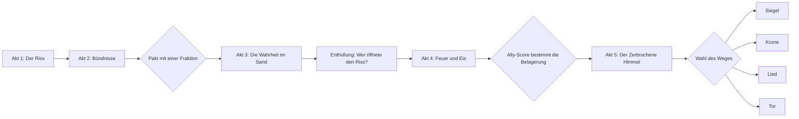
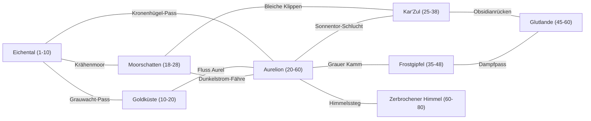
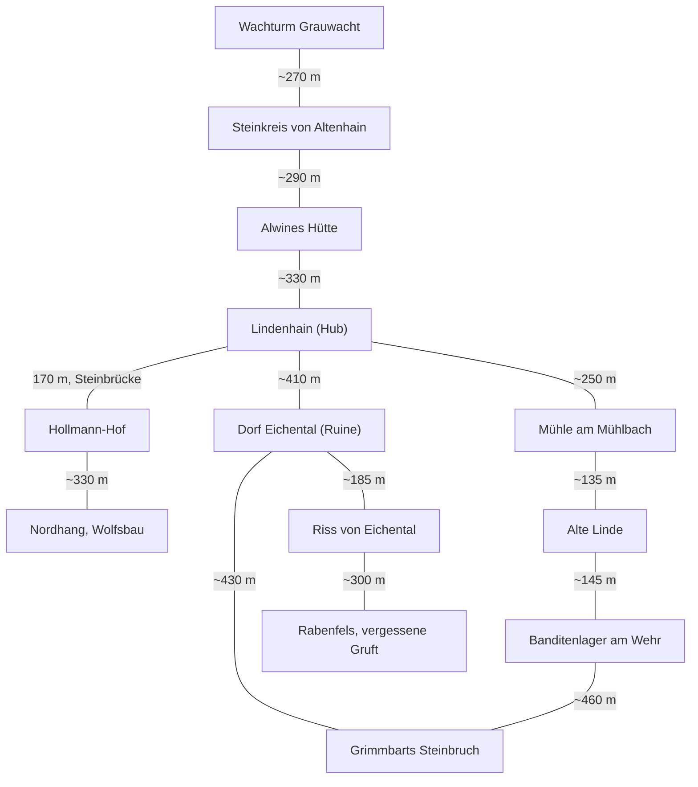

# Welt, Story & Fraktionen

> Teil der Phase-0-Planung · Stand: 2026-10-12 · Quelle: [Master-Prompt](../00_Master-Prompt.md)

**Kennzeichnungen** (wie in [00_Vision_und_Ueberblick](./00_Vision_und_Ueberblick.md)):
- **Vorschlag:** füllt eine Lücke im Master-Prompt.
- **Verbesserungsvorschlag:** weicht bewusst vom Master-Prompt ab. Das Original bleibt erkennbar.
- ❓ **Offene Entscheidung:** liegt beim Auftraggeber. Am Dateiende gesammelt.

**ID-Schema (Vorschlag, gilt projektweit):** stabile String-IDs in snake_case mit Punkt-Hierarchie (§6.3). IDs enthalten keine Umlaute (ä → ae, ö → oe, ü → ue, ß → ss).

| Präfix | Beispiel | Verwendung |
|---|---|---|
| `region.` | `region.eichental` | Region |
| `loc.<region>.` | `loc.eichental.vergessene_gruft` | Ort, Dungeon, POI, Siedlung, Trigger-Zone |
| `npc.<region>.` | `npc.eichental.bauer_hollmann` | NPC. Begleiter: `npc.begleiter.<name>`. Story-Figuren ohne festen Ort: `npc.main.<name>` |
| `group.` | `group.graumaentel` | NPC-Gruppe ohne eigenen Fraktionsruf |
| `faction.` | `faction.silberwacht` | Fraktion |
| `quest.<kategorie>.` | `quest.main.asche_ueber_eichental`, `quest.side.eichental.woelfe_vom_nordhang` | Quest (Kategorien und Schema: [02](./02_Quests_und_Dialoge.md)) |
| `flag.<bereich>.` | `flag.eichental.dorf_zerstoert` | Weltzustand: Bool **oder** Enum (Ganzzahl 0–9, Bedeutung im Flag-Register) |
| `stat.<bereich>.` | `stat.player.leere_resonanz` | Weltzustand: Zähler und Skalen (Ruf, Loyalität, Resonanz, Ally-Score, Kills) |
| `enemy.<familie>.<typ>` | `enemy.wolf.grauwolf` | Gegnertyp |
| `boss.<region>.<name>` | `boss.eichental.grimmbart` | Benannter Gegner: Mini-, Dungeon- und Weltboss. Story-Bosse: `boss.story.<name>` |
| `event.welt.` | `event.welt.riss_ausbruch` | Weltereignis |

**Vorschlag (Präzisierung des Glossars in 00):** Enums wie `flag.eichental.grimmbart_ausgang` (1 = tot, 2 = lebend) bleiben `flag.*`, wie in [02](./02_Quests_und_Dialoge.md) verwendet. `stat.*` ist für Werte reserviert, die zählen oder auf einer Skala laufen.

### Kanon-Abgleich mit 02 (Eichental)

[02](./02_Quests_und_Dialoge.md) legt die Figuren und Orte der 8 Beispiel-Quests (§16.9) im Detail fest. Diese Datei übernimmt sie als Kanon: Lindenhain, Hollmann-Hof, Mühle, Harrik, Grimmbart, Ole Brack, Hauptmann Dorn und alle weiteren. Die folgenden Punkte gelten ab jetzt für alle Kapitel:

| Thema | Bisher in 02 | Kanon (diese Datei) | Grund |
|---|---|---|---|
| Dorfvorsteherin | Maren Eichholz, `npc.eichental.dorfvorsteherin_maren` | **Hedda Eichholz**, `npc.eichental.dorfvorsteherin_hedda` | Namensgleichheit mit Begleiterin Ser Maren Falkenried (00, 05: „Maren gefällt das.“) |
| Kräuterfrau | „Mutter Alwine“, wahrer Name offen | Deckname **Alwine**, wahrer Name **Ysolde** vom Zirkel der Nebelmütter, Mentorin von Begleiterin Morwen. ID bleibt `npc.eichental.kraeuterfrau_alwine` | Verbindet Quest 5 mit Morwen und E2.2 |
| Graue Gestalt | Platzhalter `npc.main.graue_gestalt` | ID bleibt. Die Figur ist **der Graue Wanderer**. Sein Gefolge sind die **Graumäntel** (`group.graumaentel`): „die Grauen am Turm“ (Quest 3), „Männer in Grau“ (Quest 6) | Füllt die offenen Verweise aus 02 |
| Ersatz-Informantin Aurelion | `npc.aurelion.informantin_ersatz` | **Nell Kettenbach**, Hehlerin im „Gebrochenen Rad“, `npc.aurelion.hehlerin_nell` | Name von 01 angefragt |
| Erste Aether-Kraft | „Rissstoß“, `skill.aether.rissstoss` | Name **Aether-Stoß** (wie in 00). Die Skill-ID legt [03](./03_Kampf_Charakter_Progression.md) fest. | Ein Name in allen Kapiteln |
| Gegner-IDs | `enemy.rissling`, `enemy.bandit_schlaeger`, `enemy.skelett_krieger`, `enemy.unique.*` | `enemy.rissbrut.rissling`, `enemy.bandit.schlaeger`, `enemy.untot.skelett_krieger`. Benannte Gegner als `boss.eichental.*` (siehe [11.4](#114-gegner-im-vertical-slice-31-phase-4)) | Familien-Hierarchie für 67 Typen |
| Ereignis und Zähler | `event.riss_ausbruch`, `flag.global.risse_geschlossen`, `flag.global.banditen_getoetet` | `event.welt.riss_ausbruch`, `stat.global.risse_geschlossen`, `stat.global.banditen_getoetet` | ID-Schema oben |
| Ruf-Größen | Platzhalter S/M/L | S = +25, M = +50, L = +100 bestätigt. Dazu XS = +10, XL = +250, XXL = +500 ([9.2](#92-ruf-quellen-und--senken)) | Ruf-System |
| Hauptquests je Region | 02, Abschnitt 3: 8/7/7/10/10/6/6/6 | 10/4/4/13/12/4/3/9 plus 1 ortsvariabel ([2.1](#21-überblick)) | Folgt der Akt-Struktur |
| Ziel der Schatzkarte | Grotte am Möwenfels „südlich von Velmara“ | Grotte am Möwenfels unter dem **alten Hafen von Möwenbucht**, einem Fischerdorf südlich von Velmara. ID bleibt `loc.goldkueste.moewenfels_grotte` | Gezeiten (4.2) und Schmuggler passen zum Hafen |

**Inhalt**
1. [Setting & Lore](#1-setting--lore-3)
2. [Hauptstory](#2-hauptstory-18)
3. [Weltaufbau](#3-weltaufbau-141)
4. [Regionen](#4-regionen-142)
5. [Content-Mengen](#5-content-mengen-143)
6. [Lebendige Welt & Erkundung](#6-lebendige-welt-144--erkundung-145)
7. [NPCs](#7-npcs-151)
8. [Fraktionen](#8-fraktionen-152)
9. [Ruf-System](#9-ruf-system-153)
10. [Begleiter](#10-begleiter-19)
11. [Gegner-Roster & Bosse](#11-gegner-roster-201--bosse-203)
12. [Offene Entscheidungen](#offene-entscheidungen)
13. [Risiken & Hinweise](#risiken--hinweise)

---

## 1. Setting & Lore (§3)

### 1.1 Der Kontinent und der Große Riss

| Feld | Festlegung |
|---|---|
| Genre | High Fantasy mit dunklen Untertönen (§3) |
| Kontinent | Aetherfall (§3) |
| Zeitrechnung | **Vorschlag:** Jahre „v. R.“ und „n. R.“ (vor und nach dem Riss). Spielbeginn: Herbst 300 n. R., am Erntefest in Eichental. |
| Vor dem Riss | **Vorschlag:** Das Aurelische Kaiserreich beherrschte den Kontinent. Sein Herzland **Caelum** beherbergte die Himmelsakademie, die als Erste Aether-Adern unter der Erde anzapfte. |
| Der Große Riss (Jahr 0) | **Vorschlag:** Unter Caelum brach ein ~3 km breiter Spalt auf, **der Schlund**. Caelum wurde zerrissen, seine Trümmer schweben seitdem als Inseln über dem Schlund. Das ist der **Zerbrochene Himmel** (Region 8). Rund ein Drittel der Bevölkerung starb, das Kaiserreich zerfiel. Aurelion am Rand des Schlunds überlebte als Hauptstadt ohne Kaiser. |
| Heute | Kleine Risse öffnen sich immer häufiger. Sieben Fraktionen streiten um die Aether-Quellen. Hinter den Rissen erwacht die Leere und verschlingt Landstriche (§3). |

### 1.2 Regeln des Aether (spielmechanisch nutzbar)

**Vorschlag:** Die neun Regeln gelten für Lore-Texte, Quest-Design und Systeme gleichermaßen. Die endgültigen Zahlen legt [03_Kampf_Charakter_Progression](./03_Kampf_Charakter_Progression.md) fest. Die Werte hier sind Startwerte.

| Nr. | Regel (Lore) | Umsetzung im Spiel |
|---|---|---|
| A1 | **Herkunft:** Aether ist ungeformte Ur-Energie an der Grenze zwischen Welt und Leere. Er tritt nur an Rissen, Adern und Kristallen aus. | Jede Weltzelle und jedes Volumen hat eine **Aether-Dichte 0–3**. Dichte 3 gibt es nur direkt an Rissen. Sie ist als Partikel und Farbstich sichtbar. |
| A2 | **Macht:** Aether verstärkt jede Magie. | Zauberkraft +10 % bei Dichte 2, +20 % bei Dichte 3. Das gilt für Spieler und Gegner. |
| A3 | **Preis I, Verderbnis:** Jeder Kontakt hinterlässt Spuren im Körper. | Statuseffekt **Aether-Verderbnis** (§9.6) mit Aufbau-Balken 0–100. Aufbau: Dichte 1 = +0,2/s, Dichte 2 = +1/s, Dichte 3 = +3/s. Jeder Einsatz einer Aether-Fähigkeit +2, Treffer eines verderbten Gegners +5. Abbau −2/s bei Dichte 0. |
| A4 | **Preis II, Veränderung:** Lebewesen, die lange in Dichte ≥ 2 leben, mutieren. | Gegnervariante **Aether-verderbt** (§20.1, siehe [11.2](#112-variantensystem)) mit Kristallwucherungen und einem Kristallkern als Schwachpunkt. Beispiel: die Wölfe vom Nordhang (Quest 2). |
| A5 | **Aetherbrand:** Die meisten Menschen sterben bei starkem Kontakt. Sie kristallisieren oder werden zu **Gebrochenen**, hirnlosen Kristallghulen. Schwacher, langer Kontakt verursacht bei Kindern **Aether-Fieber** (Pim Hollmann, Quest 5). | Riss-Ausbrüche hinterlassen Kristallleichen als Lore- und Loot-Objekte. Gebrochene sind ein Gegnertyp der Rissbrut-Familie. |
| A6 | **Rissgeborene:** Etwa 1 von 10.000 überlebt. Der Körper „lernt“ Aether. | Beim Spieler ist Verderbnis 100 nicht tödlich, sondern löst eine Überflutung aus (Tabelle unten). Das ist die Basis für Aether-Sicht, Riss-Siegel und die Klasse Rissläufer (§11.1). |
| A7 | **Kristallisierung:** Aether verfestigt sich mit der Zeit zu Kristall. | Aether-Kristalle sind Crafting-Material, **Aether-Splitter** die Endgame-Währung (§22). Abbau eines Kristalls kostet +5 Verderbnis. |
| A8 | **Abzapfen dünnt die Grenze:** Wo viel Aether entnommen wird, wird die Haut der Welt dünn und die Leere sickert ein. | Kernkonflikt: Konvent und Gilde zapfen ab, Stämme und Silberwacht warnen. Story-Flags wie `flag.karzul.ir_hamad_verschlungen` lassen **Leere-Zonen** wachsen. |
| A9 | **Risse schließen:** Siegelsteine schließen einen Riss für ~50 Jahre. Die Technik stammt von den Eichenrittern, die Silberwacht hat sie übernommen. Ein Rissgeborener kann einen Riss dauerhaft schließen. | Fähigkeit **Riss-Siegel**: 5 s kanalisieren, bei Treffer abgebrochen, +30 Verderbnis. Beendet das Weltereignis „Riss-Ausbruch“. Der Siegelstein in der vergessenen Gruft (Quest 7) ist ein solcher Stein. |

**Verderbnis-Stufen beim Spieler (Vorschlag):**

| Stufe | Balken | Bonus | Malus | Sichtbar/hörbar |
|---|---|---|---|---|
| Rein | 0–24 | – | – | – |
| Berührt | 25–49 | +5 % Aether-Schaden | −5 % erhaltene Heilung | Adern glimmen |
| Durchdrungen | 50–74 | +10 % Aether-Schaden | −10 % Heilung, −10 % Ausdauer-Regeneration | Flüstern im Audio |
| Gezeichnet | 75–99 | +15 % Aether-Schaden | −15 % Heilung. NPCs reagieren ängstlich, Händler +10 % | Augen leuchten |
| Überflutet | 100 | 20 s lang +25 % Aether-Schaden | 20 s lang 2 % max. LP pro Sekunde. Danach fällt der Balken auf 60. | Leuchten, verzerrter Ton |

- **Reinigung:** Silberwacht-Schrein (auf 0), Läuterungstrank (−50, Alchemie), 8 h Schlaf (auf 0), Aufenthalt in Dichte 0 (−2/s).
- **Begleiter** (keine Rissgeborenen außer Kael): Bei 100 sind sie 3 s betäubt, verlieren 20 % LP, der Balken fällt auf 0.
- Verderbnis ist eine **riskante Ressource**, kein reiner Malus. Das stärkt Säule 6: Aether-Builds spielen bewusst „heiß“.

**Leere-Resonanz (Story-Wert, Vorschlag):** `stat.player.leere_resonanz`, 0–100.
- Verändert sich **nur durch Story-Entscheidungen**, nie im Kampf. Beispiele: Riss-Aether aufnehmen statt versiegeln +10, Leere-Visionen annehmen +5 bis +15, Pakt mit dem Grauen Wanderer +15, Riss versiegeln −5.
- Bestimmt mit, welche Enden offenstehen (siehe [2.4](#24-enden)), und färbt NPC-Zeilen.
- Ab Akt 3 im Charakterbogen sichtbar, vorher nur durch Flüstern und Visionen angedeutet.

### 1.3 Die Leere

- **Was sie ist (Vorschlag):** das Nichts vor der Schöpfung. Kein Wesen mit Plan, sondern ein Hunger mit Bewusstseinsresten. Sie „erinnert sich“ an alles, was sie verschlingt. Daraus entstehen Echos und Leergeborene.
- **Verhältnis zum Aether:** Aether ist die Haut der Welt. Wo sie reißt oder dünn wird (Regel A8), sickert die Leere ein.

| Erscheinungsform | Beschreibung | Spielmechanik (Vorschlag) |
|---|---|---|
| Leere-Zone | Entsättigte Landstriche, Materie zerfällt zu grauem Staub | Mana-Regeneration 0. Ohne Schutz −1 % max. LP pro Sekunde. Schutz: **Leere-Laterne** (Questitem Akt 3) mit 120 s Brenndauer, an Aether-Kristallen aufladbar. |
| Leergeborene | Kreaturen aus verschlungenen Erinnerungen: Schatten mit Rissen, deren Form an Verlorenes erinnert (Ritter, Tiere, Kinder) | Gegnerfamilie „Leere“ (ab Akt 3). Schwäche Aether, Resistenz Schatten. |
| Echos | Erinnerungsfetzen an Orten, an denen die Leere fraß | Rissgeborenen-Fähigkeit **Echo-Lesen** (ab Akt 3) spielt kurze Rückblenden ab. Werkzeug für Lore und Rätsel. |
| Leere-Stille | Kurzzeitige Ausdehnung: Farben verblassen, Geräusche verstummen | Weltereignis, siehe [6.4](#64-zufällige-weltereignisse) |
| Flüstern | Nur Rissgeborene hören es | Audio-Hinweise, Visionen, Entscheidungen mit Leere-Resonanz |

- **Was die Leere will,** bleibt bis Akt 5 bewusst offen. Für das Ende „Leere besänftigen“ muss sie ansprechbar sein: Sie lässt sich mit Erinnerungen „sättigen“, die ihr freiwillig gegeben werden (Motiv „Lied“, siehe [2.4](#24-enden)).

### 1.4 Rissgeborene

| Aspekt | Festlegung |
|---|---|
| Häufigkeit | **Vorschlag:** ~40 bekannte Rissgeborene auf dem Kontinent. Die meisten verstecken sich. |
| Merkmale | Aether-Adern unter der Haut, die bei Verderbnis leuchten. Sie hören das Flüstern der Leere. |
| Ansehen | Silberwacht: „Gefäße“, die beaufsichtigt werden müssen. Konvent: wertvolle Forschungspartner. Kult: „Erwählte“. Wilde Stämme: „Kinder der Wunde“, mit Scheu respektiert. Volk: Angst. |
| Kernfähigkeiten des Spielers (klassenunabhängig, Vorschlag) | 1. **Aether-Stoß** (erste Kraft, Quest 1, ~0:25 Spielzeit). 2. **Aether-Sicht**: Detektiv-Modus aus §16.4, zeigt Aether-Spuren, verborgene Wege und Hinweise. 3. **Riss-Siegel** (Ende Akt 1). 4. **Echo-Lesen** (Akt 3). Die Klasse Rissläufer vertieft diese Fähigkeiten, siehe [03](./03_Kampf_Charakter_Progression.md). |
| Bekannte andere Rissgeborene | Kael (Begleiter), Jorin Falkenried (Bruder von Begleiterin Maren, in Silberwacht-Verwahrung), der Graue Wanderer, ein Teil der Graumäntel |

### 1.5 Zeitstrahl der Welt (Vorschlag)

| Jahr | Ereignis | Spielrelevanz |
|---|---|---|
| ~1200 v. R. | Zwerge gründen **Khaz Morund** in den Frostgipfeln und lernen, Aether mit Runen stabil zu binden. | Runenkunde ist Voraussetzung für den Riss-Schlüssel in Akt 4. |
| ~800 v. R. | Gründung des Aurelischen Kaiserreichs, Hauptstadt **Aurelion**. | Ruinen und Lore auf dem ganzen Kontinent, z. B. Wachturm Grauwacht |
| ~60 v. R. | Die Himmelsakademie von **Caelum** entdeckt Aether-Adern unter dem Herzland und beginnt das Projekt „Himmelstor“. | Akt-3-Enthüllung, Archiv von Ir-Hamad, Messrunen der Graumäntel |
| **0** | **Der Große Riss.** Caelum zerbricht, der Schlund entsteht, das Kaiserreich fällt. | Grundkonflikt, Zerbrochener Himmel |
| 1–30 n. R. | **Die Dunklen Jahre:** Aetherbrand, erste Rissgeborene, Gebrochene ziehen durchs Land. Im Eichental halten die **Eichenritter** die kleinen Splitterrisse mit Siegelsteinen in Schach. Sie liegen in der Gruft unter dem Rabenfels. | Quest 7 „Die vergessene Gruft“, versteckte Quest „Das Lied der alten Linde“, legendäre Reihe „Eidwahrer“ ([02](./02_Quests_und_Dialoge.md)) |
| 34 n. R. | **Aldric Sturmfels**, der letzte Eichenritter, gründet in Aurelion die **Silberwacht** und verbreitet die Siegelstein-Technik. | Fraktion 1, Lore-Brücke Gruft → Orden |
| 61 n. R. | Überlebende Magister gründen den **Aether-Konvent**. | Fraktion 2, Verbindung zum Antagonisten |
| 112 n. R. | **Die Rissjagd:** Die Silberwacht nimmt Rissgeborene in „Verwahrung“. Aether-Magie in Aurelion wird verboten. | Delikt „Verbotene Magie“ in Aurelion, Begleiterquest Maren |
| 147 n. R. | **Charta von Velmara:** Die Handelsgilde erhält das Monopol auf den Aether-Kristallhandel. | Fraktion 3, Konflikt mit den Stämmen |
| 190 n. R. | **Der Torschluss:** Die Zwerge verriegeln Khaz Morund. Offizieller Grund: Verrat der Menschen. Wahrer Grund: ein Leere-Einbruch in den Tiefen. | Fraktion 7, Akt 4 |
| 233–271 n. R. | Erste dokumentierte Leere-Zone, **die Graue Stelle** im Süden von Kar'Zul. Der **Kult der Leere** tritt auf. 271 bricht der Vulkan **Ashkarr** aus, der Kult verschanzt sich in den Glutlanden. | Fraktion 6, Akt 3, Region 6 |
| 296–300 n. R. | Riss-Ausbrüche verdreifachen sich. Silberwacht und Konvent streiten im **Rat der Sieben**. Am Erntefest 300 n. R. verwüstet ein Riss das **Dorf Eichental**. **Spielbeginn.** | Akt-2-Politik, Akt 1 |

### 1.6 Völker und Kulturen

**Vorschlag:** Nur **zwei Völker**, Menschen und Zwerge, dazu Kreaturen. Grund: Jedes weitere Volk kostet Körpermodelle, Animationen, Rüstungsvarianten und Gesichter. Vielfalt entsteht über menschliche Kulturen:

| Kultur | Region | Erkennungsmerkmale |
|---|---|---|
| Aurelier | Aurelion, Eichental | Kaiserreichs-Erbe, Stein und Banner, Ordnung |
| Velmarer | Goldküste | Seefahrt, Handel, bunte Stoffe |
| Moorvolk | Moorschatten | Pfahlbauten, Schilf, Ahnenmasken |
| Sandläufer | Kar'Zul | Nomaden, Tücher, Sternkunde |
| Grünmäntel | Wälder des Eichentals | Waldläufer-Sippen, gehören zu den Wilden Stämmen |
| Nordleute | Frostgipfel (Menschendörfer) | Pelze, Jagd, Handel mit den Zwergen |
| Zwerge von Khaz Morund | Frostgipfel | Runen, Clans, Ahnenkult |

- Hinweis Kar'Zul: Wüstenkulturen werden respektvoll als eigene Fantasy-Kultur gestaltet, ohne reale Klischees zu kopieren (Kleidung, Musik, Namen).

### 1.7 Ton: Ernst und Humor (§3)

**Regeln (Vorschlag):**
1. Die **Hauptstory ist ernst.** Humor kommt dort nur aus Figuren (trockene Begleiterkommentare), nie aus Situationskomik.
2. **Nebenquests und Begleiter** dürfen komisch sein. Jede komische Quest hat aber einen Kern, der ernst genommen wird (Twist, Verlust, Entscheidung).
3. **Kein Humor auf Kosten von Opfern** im selben Moment. Nach einer Tragödie gilt eine „Stille-Regel“: 5 min keine Witz-Barks.
4. **Keine Meta-Witze,** keine Popkultur-Zitate, keine vierte Wand. Easter Eggs nur als versteckte Geheimnisse (§23).
5. **Begleiter haben unterschiedliche Humor-Arten** (trocken, frech, schwarz, laut), siehe [10](#10-begleiter-19).

| Situation | Ernste Ebene | Humor-Ebene |
|---|---|---|
| „Die Wölfe vom Nordhang“ | Die Wölfe sind Aether-verändert, Hollmanns Sohn Pim hat Aether-Fieber. Erstes Zeichen, dass der Riss das ganze Tal vergiftet. | Ansgar Hollmann hat jedem Schaf einen Namen gegeben und zählt die Vermissten einzeln auf. |
| „Die Schatzkarte des alten Seemanns“ | Oles Schatz ist eine späte Wiedergutmachung an die Tochter, die er verlassen hat. | Ole erzählt jede Runde eine andere Geschichte, wie er sein Auge verloren hat. Er hat beide. |
| Velmara, Gildenhaus | Die Gilde verkauft Aether-Kristalle, deren Abbau Oasen tötet. | Ein Patrizier führt den Spieler durch eine endlose Gebührenliste („Atemgebühr im Kontor: 2 Kupfer“). |
| Lagerfeuer nach dem Fall der Oase Ir-Hamad | Ashka trauert um ihren Stamm. | Keine Witze (Stille-Regel). Jasper legt ihr wortlos seinen Mantel um. |
| Riss-Ausbruch im Moorschatten | Gebrochene, Aetherbrand, Tote | Pater Ludo segnet hinterher die Kröten, „damit wenigstens die in den Himmel kommen“. |
| Akt-3-Enthüllung | Wer den Riss geöffnet hat | Nichts. Die Szene bleibt ernst. |

---

## 2. Hauptstory (§18)

### 2.1 Überblick

Die 5 Akte und ihre Regionen stammen aus §18. Die Zahl der Hauptquests (≈ 60, §16.2) ist hier auf die Akte verteilt (**Vorschlag**). Die Story-Level folgen dem Story-Korridor aus [00](./00_Vision_und_Ueberblick.md#story-level-lücke-wichtig).

| Akt | Titel (§18) | Regionen | Hauptquests | Story-Level | Dauer (Hauptstory) | Akt-Boss |
|---|---|---|---|---|---|---|
| 1 | Der Riss | Eichental | 10 | 1–10 | 6–8 h | Ealdor, der Aschenhirsch |
| 2 | Bündnisse | Goldküste, Moorschatten, Aurelion | 16 | 10–24 | 14–18 h | Hierophant Kaldris |
| 3 | Die Wahrheit im Sand | Sonnenwüste von Kar'Zul | 12 | 24–32 | 9–11 h | Ankhar, der letzte Sonnenkönig |
| 4 | Feuer und Eis | Frostgipfel, Glutlande, Aurelion (Belagerung) | 13 | 32–42 | 10–12 h | Ignareth, der Leere-Drache |
| 5 | Der Zerbrochene Himmel | Zerbrochener Himmel (Story-Bereich) | 9 | 40–48 | 6–8 h | Der Graue Wanderer / Herz der Leere |
| **Σ** | | | **60** | | **45–57 h** | |

**Hauptquests je Region** (für das Questbudget in [02](./02_Quests_und_Dialoge.md), Abschnitt 3): Eichental 10 · Goldküste 4 · Moorschatten 4 · Aurelion 13 (8 in Akt 2, 5 in Akt 4) · Kar'Zul 12 · Frostgipfel 4 · Glutlande 3 · Zerbrochener Himmel 9 · ortsvariabel 1 („Die Verteidigung“, Velmara oder Kaltenbrunn) = **60**.

### 2.2 Der Antagonist und die Akt-3-Enthüllung

In Akt 1 folgt der Spieler einer mysteriösen Gestalt, die den Riss über Eichental geöffnet hat (§18). Akt 3 enthüllt, dass der Große Riss absichtlich geöffnet wurde, und von wem (§18).

**Fest, unabhängig von der offenen Entscheidung unten (Vorschlag):**

| Element | Festlegung | Auftritte |
|---|---|---|
| Die graue Gestalt (`npc.main.graue_gestalt`) | Im Volk „der Graue Wanderer“. Ein Rissgeborener in aschgrauem Mantel, der Risse öffnen kann. Er wartet im Prolog auf die Spielfigur: „Du bist es also.“ ([02](./02_Quests_und_Dialoge.md), 11.1) | Akt 1 Prolog, Visionen, Akt 3 Angebot (E3.3), Akt 5 Konfrontation |
| Die Graumäntel (`group.graumaentel`) | ~20 Gefolgsleute: Rissgeborene und abtrünnige Konvent-Adepten. Erkennungszeichen: aschgraue Mäntel, verbrannte Messrunen aus der Himmelsakademie von Caelum. Sie gehören **nicht** zum Kult. Der Wanderer benutzt den Kult nur. | Akt 1: messen nachts am Wachturm Grauwacht den Riss („die Grauen am Turm“, Quest 3) und bezahlen Grimmbart, damit die Silberwacht im Tal beschäftigt ist („Männer in Grau“, Quest 6). Akt 2: kaufen Kristalle über einen Gilden-Patrizier. Akt 3: graben im Archiv von Ir-Hamad. Akt 4: je nach E3.3 Verbündete oder Saboteure. |
| Kampfdaten | Keine eigenen Gegnertypen. Graumäntel nutzen die Daten von Kult-Klinge und Kult-Akolyth mit eigener Optik ([11.1](#111-gegnerfamilien-pro-region)). | ab Akt 2 |

❓ **Offene Entscheidung: Wer hat den Großen Riss geöffnet?** Alle Story-Beats unten funktionieren mit jeder Option.

| Option | Kern | Stärken | Schwächen |
|---|---|---|---|
| **A – Der Magister (empfohlen)** | **Valerian Ascor**, Erzmagister der Himmelsakademie von Caelum, öffnete das „Himmelstor“, um unbegrenzten Aether für das sterbende Kaiserreich zu gewinnen. Er überlebte als erster Rissgeborener und ist der Graue Wanderer. Heute will er das Tor vollständig öffnen, weil er glaubt, die Leere beherrschen zu können. | Klarer Gegenspieler mit nachvollziehbarem Motiv. Der Konvent (von seinen Schülern gegründet) wird moralisch belastet, bleibt aber spielbar. Passt zu allen vier Enden, besonders zu „Aether kontrollieren“ als Versuchung. | Der „größenwahnsinnige Magier“ ist ein bekanntes Muster. Gegenmittel: Er hat recht damit, dass die Leere ohnehin kommt. |
| B – Der Gründer | **Aldric Sturmfels**, Eichenritter und Feldherr im Thronstreit, ließ das Himmelstor als Waffe öffnen. Danach gründete er die Silberwacht, um die Tat zu vertuschen. Die heutige Hochmeisterin weiß davon. Der Graue Wanderer ist ein Rissgeborener, der die Wahrheit enthüllen will und dabei über Leichen geht. | Starker Twist: Die „Guten“ haben gelogen. Graue Moral. Die Gruft der Eichenritter (Quest 7) wird rückwirkend unheimlich. | Bestraft Spieler, die sich der Silberwacht angeschlossen haben. Das Ende „Riss versiegeln“ wird ideologisch belastet. Höherer Schreibaufwand für zwei Antagonisten. |
| C – Der Damm | **Seraphine**, die Erste Rissgeborene, öffnete den Riss **kontrolliert**, um einen viel größeren Einbruch der Leere zu verhindern. Der Riss war ein Ventil. Sie ist die Graue Wanderin und öffnet heute neue Risse, weil das Ventil versagt. | Tragische Gegenspielerin. Die Leere bleibt die eigentliche Bedrohung. Stärkt das Ende „Leere besänftigen“. | Weniger klares Feindbild für Akt 4–5. Erfordert sehr präzises Schreiben. |

**Empfehlung:** Option A mit einem Element aus C. Valerian handelte aus Größenwahn, **aber** seine Warnung, dass die Leere ohnehin durchbrechen wird, stimmt. Das gibt dem Pakt mit ihm (E3.3) echtes Gewicht. Vor dem Schreiben der Akt-1-Dialoge muss die Option feststehen, weil Quest 1, 3 und 6 auf die Graumäntel hinweisen ([02](./02_Quests_und_Dialoge.md)).

### 2.3 Akte im Detail

Hauptquest-IDs folgen dem Schema `quest.main.<titel>`. Titel sind Arbeitstitel (**Vorschlag**). Inhalte der Hauptquests jenseits von Quest 1 schreibt [02](./02_Quests_und_Dialoge.md) später als Daten aus.

#### Akt 1 – Der Riss (Eichental, Level 1–10, 10 Hauptquests)

**Kernbeats:**
1. **Prolog am Erntefest** (Zwischensequenz `cs.prolog.erwachen`): Ein Riss öffnet sich über dem Dorf Eichental. Die jüngere Schwester der Spielfigur, **Lina**, wird ins Licht gezogen. **Vorschlag:** persönlicher roter Faden bis Akt 5.
2. **„Asche über Eichental“** ([02](./02_Quests_und_Dialoge.md), 11.1): Erwachen im brennenden Dorf, Rettung von Tobold und Wenna (E1.2), Risslinge. Die graue Gestalt wartet am Riss. Aether-Berührung, erste Kraft (Aether-Stoß), Prolog-Rissbrut. Die Überlebenden ziehen nach **Lindenhain**. Klassenwahl im Dialog mit Hedda Eichholz.
3. **Die Spur der Grauen:** verbrannte Messrunen, Hinweise aus Quest 3 und 6. Am **Wachturm Grauwacht** liegt ein verlassenes Lager der Graumäntel mit Aether-Messgerät und einem halb verbrannten Brief mit dem Siegel des Hafenamts von Velmara.
4. **Ser Maren Falkenried** trifft aus Aurelion ein, um den Rissgeborenen zu prüfen (E1.1).
5. **Steinkreis von Altenhain:** Vision, Lina ruft aus dem Riss. Die Spielfigur lernt Aether-Sicht.
6. Hedda überlässt der Spielfigur das verfallene Anwesen **Gut Eichenruh** und ein Pferd (§21, Haus Stufe 1).
7. Der Riss pulsiert, Tiere verderben. **Ealdor**, der Hirschgeist, den die Grünmäntel als Hüter des Tals verehren, ist vom Riss verdorben. Bosskampf.
8. Die Spielfigur schließt oder nutzt den Eichental-Riss (E1.3), lernt das Riss-Siegel, der Wiederaufbau beginnt. Aufbruch über den Grauwacht-Pass nach Velmara.

| Nr. | Titel | ID | Ort | Inhalt |
|---|---|---|---|---|
| 1 | Asche über Eichental (§16.9) | `quest.main.asche_ueber_eichental` | Dorf Eichental → Riss → Lindenhain | Prolog, Rettung, erste Kraft ([02](./02_Quests_und_Dialoge.md), 11.1) |
| 2 | Die graue Gestalt | `quest.main.die_graue_gestalt` | Lindenhain → Wachturm Grauwacht | Spur der Graumäntel, Brief mit Hafensiegel von Velmara |
| 3 | Die Prüfung der Silberwacht | `quest.main.pruefung_der_silberwacht` | Wachposten Lindenhain | Maren, E1.1 |
| 4 | Der Steinkreis von Altenhain | `quest.main.steinkreis_von_altenhain` | Steinkreis | Vision, Aether-Sicht |
| 5 | Ein Dach über dem Kopf | `quest.main.ein_dach_ueber_dem_kopf` | Gut Eichenruh | Haus Stufe 1, Pferd |
| 6 | Stimmen aus dem Riss | `quest.main.stimmen_aus_dem_riss` | Riss, Ruine des Dorfs | Erster Riss-Ausbruch als Pflicht-Ereignis, verderbte Tiere |
| 7 | Der Hüter des Tals | `quest.main.hueter_des_tals` | Lager Rotbuche, Wald | Grünmäntel, Spurensuche nach Ealdor |
| 8 | Der Zorn des Waldes | `quest.main.zorn_des_waldes` | Lichtung am Steinkreis | Boss Ealdor |
| 9 | Das erste Siegel | `quest.main.das_erste_siegel` | Riss von Eichental | E1.3, Riss-Siegel, Start des Wiederaufbaus |
| 10 | Nach Westen | `quest.main.nach_westen` | Grauwacht-Pass → Velmara | Abschied, Übergang zu Akt 2 |

**Entscheidungen:**

| ID | Entscheidung | Optionen | Sofort | Verzögert | Flag |
|---|---|---|---|---|---|
| E1.1 | Prüfung der Silberwacht | annehmen / fliehen | Annehmen: Maren schließt sich als Aufpasserin an (Loyalität 40). Fliehen: Maren stellt den Spieler am Nordhang, nach Duell oder Gespräch schließt sie sich an (Loyalität 25). | Annehmen: Silberwacht +L, in Aurelion legaler Status per Siegelbrief. Fliehen: Silberwacht −M, in Aurelion gilt das Delikt „Verbotene Magie“. | `flag.main.a1_pruefung_angenommen` |
| E1.2 | Rettung im Prolog ([02](./02_Quests_und_Dialoge.md), 11.1) | Wenna zuerst (beide leben) / Tobold zuerst (Wenna stirbt). Sichtbarer Countdown. | Schmiede mit Tobold (volles Angebot) oder mit Edwin (kleineres Angebot). Bäckerei in Lindenhain nur mit Wenna. | Tobold bestimmt Lieses Wahl in Quest 3. **Vorschlag:** Lebt Tobold, leitet er den Wiederaufbau, Stufe 2 kostet 30 % weniger Gold. | `flag.eichental.tobold_gerettet`, `flag.eichental.wenna_gerettet` |
| E1.3 | Eichental-Riss | versiegeln / Aether aufnehmen | Versiegeln: Silberwacht +M, Leere-Resonanz −5. Aufnehmen: Aether-Stoß sofort Stufe 2, Leere-Resonanz +10. | Aufnehmen: Ein ruhender Riss (Dichte 1) bleibt, mit abbaubaren Kristallen in der Nähe. Der Wiederaufbau dauert eine Stufe länger. | `flag.eichental.riss_versiegelt` |

**Entscheidungen aus den Beispiel-Quests mit Folgen für die Hauptstory (Vorschlag):**

| Quest ([02](./02_Quests_und_Dialoge.md)) | Flag | Folge in Akt 2–4 |
|---|---|---|
| 3 Ein Brief, der nie ankam | `flag.eichental.brief_hinweis_gelesen` | Dialogoption über „die Grauen am Turm“ in HQ 2. Endet die Quest mit Ende 2, dient Jannik in Aurelion als Wache und grüßt den Spieler. |
| 4 Banditen am Mühlbach | `flag.eichental.harrik_verschont` | HQ 20 „Schatten über Aurelion“: Harrik als Informant mit Schleichroute (§16.5). Ally-Score +1 in Akt 4. Ohne Harrik hilft Nell Kettenbach gegen 300 Gold. |
| 5 Das Kraut der Kräuterfrau | `flag.eichental.alwine_status` (1 geduldet, 2 verraten, 3 getötet, 4 Bündnis) | HQ 17 „Die Nebelmütter“: Bei 4 empfängt Zirkelmutter Morra den Spieler sofort. Bei 2 ist eine zusätzliche Überzeugen-Probe nötig. Bei 3 ist der Zirkel feindlich und der Zugang führt über Morwen. Morwens Start-Loyalität: 4 → 40, 1 → 30, 2 → 20, 3 → 10. |
| 6 Kopfgeld: Grimmbart | `flag.eichental.grimmbart_ausgang` (1 tot, 2 lebend) | Lebend: Verhör-Hinweis auf die Graumäntel in HQ 2. In Akt 4 bietet Grimmbart aus dem Kerker von Aurelion sein Kriegshorn an: +1 bemannte Ballista gegen Ignareth. |
| 7 Die vergessene Gruft | `flag.eichental.siegelstein_verbleib` (1 Konvent, 2 belassen, 3 behalten) | 1: Corvin erforscht in der Lumenspitze die Eichenritter-Siegel (HQ 12). In Akt 4 braucht der Riss-Schlüssel dann 20 % weniger Kristalle. 2: Silberwacht +M. 3: Siegelstein als Sockel-Amulett. |

#### Akt 2 – Bündnisse (Goldküste, Moorschatten, Aurelion, Level 10–24, 16 Hauptquests)

**Kernbeats:**
1. **Velmara:** Das Hafenregister zeigt, dass die Graumäntel über den Gilden-Patrizier **Orsino Vell** große Mengen Aether-Kristalle gekauft haben.
2. **Akademie Lumenspitze:** Der Aether-Konvent untersucht die Spielfigur. Erste klare Vision der Leere (Lina ruft).
3. **Schädelbucht:** Piraten schmuggeln für die Graumäntel Kristalle ins Moor. Die Spur führt in den Moorschatten.
4. **Moorschatten:** Ein Totenriss bei Bernwald erweckt Untote. Die Silberwacht jagt den Zirkel der Nebelmütter, das Moorvolk schützt ihn. Zirkelmutter Morra weiß mehr über Rissgeborene als jede Fraktion.
5. **Aurelion:** Ankunft mit Siegelbrief oder als Gesuchte(r) (E1.1). In der Senke entdeckt die Spielfigur eine Kult-Zelle (Harrik oder Nell helfen).
6. Im **Rat der Sieben** bieten fünf Fraktionen Hilfe gegen die Leere an, jede mit einem Preis (Tabelle unten).
7. **Die Nacht der Stillen Glocken:** Der Kult greift die Ratsversammlung an. Hierophant Kaldris öffnet einen Riss im Glockenturm. Bosskampf.
8. **Der Pakt:** Die Spielfigur wählt eine Hauptverbündete (E2.4). Damit werden die Ausschlussregeln der Fraktionen wirksam ([8.3](#83-ausschlussregeln-wiederspielwert)). Ausblick: Der Wanderer sucht die Grabmäler der Sonnenkönige in Kar'Zul.

| Nr. | Titel | ID | Ort | Inhalt |
|---|---|---|---|---|
| 11 | Das Hafenregister | `quest.main.das_hafenregister` | Velmara | Kristallkäufe führen zu Patrizier Orsino Vell |
| 12 | Lichter der Lumenspitze | `quest.main.lichter_der_lumenspitze` | Akademie Lumenspitze | Untersuchung, Vision, Konvent-Kontakt (Ilvy) |
| 13 | Das Kristalllager | `quest.main.das_kristalllager` | Velmara, Hafen | E2.1 |
| 14 | Feuer in der Schädelbucht | `quest.main.feuer_in_der_schaedelbucht` | Piratenlager Schädelbucht | Schmuggelroute ins Moor: Kampf, Schleichen oder Bestechung |
| 15 | Der Weg ins Moor | `quest.main.der_weg_ins_moor` | Krähenmoor → Dunkelwasser | Gift-Sumpf eingeführt, Moorvolk |
| 16 | Der Totenriss von Bernwald | `quest.main.totenriss_von_bernwald` | Bernwald, Feldlager Graufels | Untote, Silberwacht im Moor |
| 17 | Die Nebelmütter | `quest.main.die_nebelmuetter` | Zirkel der Nebelmütter | Morra, Wissen über Rissgeborene, Morwen |
| 18 | Hexenjagd | `quest.main.hexenjagd` | Bernwald | E2.2 |
| 19 | Vor den Toren Aurelions | `quest.main.vor_den_toren_aurelions` | Aurelion, Tore und Gildenmarkt | Siegelbrief oder Verbotene Magie, Stadtregeln |
| 20 | Schatten über Aurelion | `quest.main.schatten_ueber_aurelion` | Die Senke | Kult-Zelle. Ab Stage s30 Zugang zur Unterstadt über Harrik oder Nell ([02](./02_Quests_und_Dialoge.md), 6.5) |
| 21 | Der Rat der Sieben | `quest.main.der_rat_der_sieben` | Ratshalle | Anhörung, die Fraktionen stellen sich vor |
| 22 | Fünf Angebote | `quest.main.fuenf_angebote` | Aurelion, alle Viertel | Hub-Quest: je ein Gespräch und ein Auftrag pro Fraktion, Reihenfolge frei |
| 23 | Die Nacht der Stillen Glocken | `quest.main.nacht_der_stillen_glocken` | Glockenviertel | Kult-Angriff, E2.3 |
| 24 | Der Glockenturm | `quest.main.der_glockenturm` | Glockenturm | Boss Kaldris |
| 25 | Der Pakt | `quest.main.der_pakt` | Ratshalle | E2.4 |
| 26 | Spur in den Sand | `quest.main.spur_in_den_sand` | Aurelion → Sonnentor-Schlucht | Aufbruch der Expedition |

**Der Preis der Fraktionen (Vorschlag):**

| Fraktion | Hilfe | Preis |
|---|---|---|
| Silberwacht | Ritter-Eskorte, Siegelsteine | **Siegelband**: Die Verderbnis bleibt höchstens bei 74 (keine Überflutung), dafür +10 % Aether-Resistenz. Entfernbar ab Akt 4. |
| Aether-Konvent | Leere-Laterne früher, Wissen über Echos | Blutproben und Experimente: Leere-Resonanz +10 |
| Handelsgilde | Schiff, 5.000 Gold, Karawane | Unterstützung der Erweiterung der Kristallcharta: Wilde Stämme −300 |
| Schattenhand | Informanten, Zugang zum Ratsarchiv | Diebstahl eines Siegelsteins aus der Schatzkammer der Silberwacht: Silberwacht −200, falls entdeckt |
| Wilde Stämme | Sandläufer-Führer durch Kar'Zul, das Wissen vom „Lied“ | Sabotage einer Aethermine der Gilde: Handelsgilde −300 |
| Kein Pakt (Alleingang, **Vorschlag**) | – | Keine Eskorte. Ally-Score in Akt 4 niedriger, dafür bleiben alle Fraktionen offen. |

**Entscheidungen:**

| ID | Entscheidung | Optionen | Konsequenz | Flag |
|---|---|---|---|---|
| E2.1 | Kristalllager der Gilde in Velmara | beschlagnahmen lassen / schützen / selbst ausräumen | Silberwacht +L bzw. Gilde +L bzw. Schattenhand +L. In Akt 4 fehlen die Kristalle für den Riss-Schlüssel oder werden geliefert. | `flag.goldkueste.kristalllager` (1/2/3) |
| E2.2 | Hexenzirkel im Moorschatten | ausliefern / schützen | Ausliefern: Silberwacht +200, Stämme −300, Morwen flieht (siehe [10.1](#101-steckbriefe)). Schützen: umgekehrt. Bedingung für das Ende „Lied“. | `flag.moorschatten.zirkel_geschuetzt` |
| E2.3 | Nacht der Stillen Glocken | Ratsherrin Elvira Quast (Konvent) retten / Glockenviertel evakuieren | Rettung: Der Konvent stimmt im Rat für den Spieler. Evakuierung: Das Glockenviertel bleibt bewohnt, sonst brennt es ab. | `flag.aurelion.glockenviertel_gerettet` |
| E2.4 | Der Pakt | Silberwacht / Konvent / Gilde / Schattenhand / Stämme / keiner | Bestimmt Expedition, Ally-Score und Enden | `flag.main.pakt` (0 keiner, 1–5 Fraktion) |

#### Akt 3 – Die Wahrheit im Sand (Kar'Zul, Level 24–32, 12 Hauptquests)

**Kernbeats:**
1. Expedition mit der Pakt-Fraktion zur Karawanserei Drei Brunnen. Begegnung mit den Sandläufer-Nomaden (Begleiterin Ashka).
2. **Grabmal der Sonnenkönige:** Licht- und Spiegelrätsel. Die Spielfigur lernt **Echo-Lesen**. Kael wird gefunden.
3. **Echo-Sequenzen (Vorschlag):** 3 kurze spielbare Rückblenden ins Caelum der Jahre ~60 v. R. bis 0, in denen der Spieler eine Figur der Himmelsakademie steuert. Die Assets werden mit Farbfilter wiederverwendet.
4. **Die Graue Stelle** dehnt sich auf die **Oase Ir-Hamad** aus (E3.2).
5. **Archiv von Ir-Hamad:** Die **Vier Tafeln** beschreiben vier Wege, einen Riss zu beenden: Siegel, Krone, Lied, Tor. Damit sind die Enden im Spiel benannt.
6. **Die Enthüllung:** Wer den Großen Riss geöffnet hat (Option A/B/C).
7. Der Graue Wanderer erscheint und bietet einen Pakt an (E3.3).
8. Boss **Ankhar, der letzte Sonnenkönig**. Danach entzündet der Kult Signalfeuer über allen Regionen: offener Krieg, Übergang zu Akt 4.

| Nr. | Titel | ID | Ort | Inhalt |
|---|---|---|---|---|
| 27 | Die Karawane | `quest.main.die_karawane` | Sonnentor-Schlucht → Drei Brunnen | Expedition, Hitze und Sandsturm eingeführt |
| 28 | Gastrecht | `quest.main.gastrecht` | Wanderlager der Sandläufer | Ashka, Ehrenkodex der Nomaden |
| 29 | Die Oasenstadt | `quest.main.die_oasenstadt` | Sar'Hadun | Konvent-Grabung gegen Nomaden, Weg zum Grabmal |
| 30 | Das Grabmal der Sonnenkönige | `quest.main.grabmal_der_sonnenkoenige` | Grabmal | Spiegelrätsel, Echo-Lesen, Kael |
| 31 | Echo: Die Akademie | `quest.main.echo_die_akademie` | Rückblende Caelum | Spielbare Rückblende 1 |
| 32 | Die Graue Stelle | `quest.main.die_graue_stelle` | Süden von Kar'Zul | Leere-Zone, Leere-Laterne |
| 33 | Ir-Hamad | `quest.main.ir_hamad` | Oase Ir-Hamad | E3.2 |
| 34 | Echo: Das Himmelstor | `quest.main.echo_das_himmelstor` | Rückblende Caelum | Spielbare Rückblende 2 |
| 35 | Die Vier Tafeln | `quest.main.die_vier_tafeln` | Archiv von Ir-Hamad | Die vier Wege werden benannt |
| 36 | Echo: Der erste Tag | `quest.main.echo_der_erste_tag` | Rückblende Jahr 0 | Enthüllung, E3.1 |
| 37 | Das Angebot des Wanderers | `quest.main.angebot_des_wanderers` | Ruinen am Rand der Grauen Stelle | E3.3 |
| 38 | Der letzte Sonnenkönig | `quest.main.der_letzte_sonnenkoenig` | Sarkophagkammer | Boss Ankhar, Signalfeuer |

| ID | Entscheidung | Optionen | Konsequenz | Flag |
|---|---|---|---|---|
| E3.1 | Die Wahrheit | dem Rat offenlegen / geheim halten / an die Schattenhand verkaufen | Offenlegen (bei Option A): Konvent −300, Silberwacht +150, Unruhen in Aurelion. Geheim halten: Druckmittel gegen den Konvent als Dialogoptionen in Akt 4. Verkaufen: 3.000 Gold, Schattenhand +200, die Wahrheit kursiert verzerrt als Gerücht. | `flag.main.wahrheit` (1/2/3) |
| E3.2 | Oase Ir-Hamad | Nomaden evakuieren / Archiv sichern | Evakuieren: Ally-Score +1, Stämme +200, nur 2 von 4 Tafeln. Die übrigen 2 gibt es über das Geheimnis von Kar'Zul und Ashkas Questreihe. Archiv sichern: alle 4 Tafeln, Oase verschlungen, Ashka-Loyalität −25. | `flag.karzul.ir_hamad_verschlungen` |
| E3.3 | Pakt mit dem Grauen Wanderer | annehmen / ablehnen | Annehmen: Leere-Resonanz +15. Er hilft in Akt 4 gegen den Kult und öffnet das Ende „Krone“ über ihn. In Akt 5 verrät er den Spieler, außer die Leere-Resonanz ist ≥ 50. Ablehnen: Die Graumäntel sabotieren in Akt 4 den Riss-Schlüssel, eine Zusatz-Stage wird nötig. | `flag.main.a3_pakt_wanderer` |

#### Akt 4 – Feuer und Eis (Frostgipfel, Glutlande, Aurelion, Level 32–42, 13 Hauptquests)

**Kernbeats:**
1. **Die Signalfeuer:** Der Kult greift an mehreren Orten gleichzeitig an. Nur einen Ort kann der Spieler sofort verteidigen (E4.1). „Städte fallen“ (§18).
2. **Frostgipfel:** Das Tor von Khaz Morund muss geöffnet werden (E4.2). In den Tiefen liegt die Wahrheit über den Torschluss: ein Leere-Einbruch.
3. **Glutlande:** Durchbruch zur Kathedrale der Stille. Bergung des **Aether-Herzens** aus dem Krater Ashkarr während eines Ausbruchs.
4. Schmieden des **Riss-Schlüssels** in der Ahnenschmiede auf dem **Runenamboss** aus Aether-Herz und Kristallen.
5. **Begleiter-Krise:** Begleiter mit Loyalität ≤ 10 verlassen die Gruppe. Kael, Jasper und Maren können sich gegen den Spieler stellen (siehe [10.3](#103-loyalität)).
6. **Die Belagerung von Aurelion:** Der Verlauf hängt vom **Ally-Score** ab (Tabelle unten).
7. **Ignareth, der Leere-Drache**, einst Feuerdrache des Ashkarr, führt den Angriff auf Aurelion. Bosskampf am Schlundrand. Wie viele Ballisten bemannt sind, hängt vom Ally-Score ab.
8. Der Himmelssteg am Schlundrand öffnet sich.

| Nr. | Titel | ID | Ort | Inhalt |
|---|---|---|---|---|
| 39 | Die Signalfeuer | `quest.main.die_signalfeuer` | Aurelion | Notrat, E4.1 |
| 40 | Die Verteidigung | `quest.main.die_verteidigung` | Velmara **oder** Kaltenbrunn | Wellenverteidigung am gewählten Ort |
| 41 | Über den Grauen Kamm | `quest.main.ueber_den_grauen_kamm` | Frostgipfel, Kaltenbrunn | Kälte eingeführt, Nordleute |
| 42 | Das Tor von Khaz Morund | `quest.main.das_tor_von_khaz_morund` | Runentor → Khaz Morund | E4.2, Gundra |
| 43 | Die Tiefen | `quest.main.die_tiefen` | Tiefen von Khaz Morund | Leere-Einbruch, Wahrheit über den Torschluss |
| 44 | Der Dampfpass | `quest.main.der_dampfpass` | Dampfpass → Brandwall | Hitze und Lava eingeführt |
| 45 | Die Kathedrale der Stille | `quest.main.kathedrale_der_stille` | Kathedrale der Stille | Prophetin Nhalia entkommt, E4.3 |
| 46 | Das Aether-Herz | `quest.main.das_aether_herz` | Krater Ashkarr | Bergung während des Ausbruchs |
| 47 | Der Riss-Schlüssel | `quest.main.der_riss_schluessel` | Ahnenschmiede (Frostgipfel) | Schmieden. Bei abgelehntem Pakt (E3.3): Sabotage-Stage |
| 48 | Treue und Verrat | `quest.main.treue_und_verrat` | Heerlager vor Aurelion | Begleiter-Krise |
| 49 | Die Belagerung von Aurelion | `quest.main.belagerung_von_aurelion` | Aurelion | Ally-Score bestimmt den Verlauf |
| 50 | Der Leere-Drache | `quest.main.der_leere_drache` | Schlundrand, Ruine des Kaiserpalasts | Boss Ignareth |
| 51 | Der Himmelssteg | `quest.main.der_himmelssteg` | Schlundrand | Der Steg öffnet sich |

**Ally-Score (Vorschlag):** Zahl, die beim Start der Belagerung berechnet wird (`stat.main.ally_score`).

| Quelle | Punkte |
|---|---|
| Pakt-Fraktion (E2.4) | +2 |
| Jede weitere Fraktion mit Ruf ≥ Geachtet | +1 (max. +3) |
| Tor von Khaz Morund friedlich geöffnet (E4.2) | +1 |
| Nomaden von Ir-Hamad evakuiert (E3.2) | +1 |
| Harrik verschont und Informant in Aurelion (§16.5, `flag.eichental.harrik_verschont`) | +1 |
| Je 2 Begleiter mit Loyalität ≥ 70 | +1 (max. +2) |

| Ally-Score | Ergebnis der Belagerung |
|---|---|
| ≥ 6 | Aurelion hält. Zusätzliche Truppen in Akt 5. |
| 3–5 | Glockenviertel und Hafenviertel fallen. Wiederaufbau als Endgame-Questreihe. |
| ≤ 2 | Halb Aurelion wird zerstört. Händler ziehen in ein Notlager. Endgame-Questreihe „Aurelion erhebt sich“. |

| ID | Entscheidung | Optionen | Konsequenz | Flag |
|---|---|---|---|---|
| E4.1 | Signalfeuer | Velmara verteidigen / Kaltenbrunn (Frostgipfel) verteidigen | Der andere Ort brennt: Velmaras Hafen wird zur Ruine, oder Kaltenbrunn wird zum Flüchtlingslager. Das bleibt so bis zu einer Wiederaufbau-Quest. | `flag.goldkueste.velmara_gebrannt` / `flag.frostgipfel.kaltenbrunn_gefallen` |
| E4.2 | Tor von Khaz Morund | Gundra überzeugt den Ahnenrat / Runenamboss stehlen | Überzeugen: Die Zwerge werden Verbündete, Ally-Score +1. Stehlen: Die Zwerge bleiben feindlich bis zu einer Sühnequest nach der Story. | `flag.frostgipfel.tor_offen` |
| E4.3 | Gefangene Kultisten | hinrichten / bekehren / freilassen | Bekehren: Ein abtrünniger Kult-Zweig bietet nach der Story Händler und Quests. Freilassen: Sie verstärken den Kult in Akt 5. | `flag.glutlande.kultisten` (1/2/3) |

#### Akt 5 – Der Zerbrochene Himmel (Story-Bereich, Level 40–48, 9 Hauptquests)

**Kernbeats:**
1. Aufstieg über den Himmelssteg mit dem Riss-Schlüssel.
2. **Ankerplatz:** Brückenkopf der Pakt-Fraktion auf der ersten Insel.
3. **Echo-Stadt Caelum:** Ruinen der Himmelsakademie. Lina erscheint als Echo.
4. Abschied der Begleiter: Wer hohe Loyalität hat, kommt mit bis ins Herz des Risses.
5. Konfrontation mit dem Grauen Wanderer, als Kampf oder als Verhandlung (E3.3).
6. **Herz der Leere:** Wahl des Weges. Gesperrte Wege werden grau angezeigt, mit Grund („Du hast den Zirkel ausgeliefert“). So sieht der Spieler, dass andere Entscheidungen etwas anderes bewirkt hätten (Säule 2).
7. Finale je nach Ende.
8. **Epilog:** Pro Region, Fraktion und Begleiter ein Standbild mit Text (günstig umsetzbar). Danach Rückkehr in die offene Welt.

| Nr. | Titel | ID | Ort | Inhalt |
|---|---|---|---|---|
| 52 | Aufstieg | `quest.main.aufstieg` | Himmelssteg | Aufstiegssequenz, verdeckt das Laden |
| 53 | Der Ankerplatz | `quest.main.der_ankerplatz` | Ankerplatz | Brückenkopf der Pakt-Fraktion |
| 54 | Brücke aus Trümmern | `quest.main.bruecke_aus_truemmern` | Inselkette | Inselsprünge, Gleiten, Inseldrift |
| 55 | Echo-Stadt Caelum | `quest.main.echo_stadt_caelum` | Ruinen von Caelum | Lina als Echo |
| 56 | Letzte Worte am Feuer | `quest.main.letzte_worte_am_feuer` | Ankerplatz | Abschied der Begleiter |
| 57 | Die Sternwarte | `quest.main.die_sternwarte` | Sternwarte von Caelum | Kampf oder Verhandlung mit dem Grauen Wanderer |
| 58 | Das Herz des Risses | `quest.main.das_herz_des_risses` | Herz des Risses | Wahl des Weges |
| 59 | Der letzte Weg | `quest.main.der_letzte_weg` | Herz des Risses | Finale je Ende |
| 60 | Nachhall | `quest.main.nachhall` | ganze Welt | Epilog, Rückkehr in die offene Welt |

**Akt-5-Bereich:** Der Story-Teil des Zerbrochenen Himmels hat ein festes Level (Story-Korridor). Die offene Endgame-Region (Level 60–80) wird erst nach dem Finale vollständig freigeschaltet (§18).

### 2.4 Enden

§16.5 fordert mindestens 4 Enden, §18 nennt sie: Riss versiegeln, Aether kontrollieren, Leere besänftigen, selbst Teil der Leere werden. Die Bedingungen sind ein **Vorschlag**.

| Ende | Bedingungen (Fraktionen, Flags, Entscheidungen) | Weltzustand danach | Endgame-Auswirkung |
|---|---|---|---|
| **1 – Siegel** (Riss versiegeln) | Riss-Schlüssel geschmiedet **und** Leere-Resonanz ≤ 69 **und** (Pakt Silberwacht **oder** Silberwacht ≥ Geachtet **oder** Tor von Khaz Morund offen) | Aether nimmt um ~70 % ab, Magie wird schwächer. Leere-Zonen heilen langsam. Die Silberwacht wird zur führenden Macht. | Zerbrochener Himmel stabil. Riss-Expeditionen heißen „Echo-Risse“. Aether-Splitter −25 %, dafür Siegel-Sets als Belohnung. |
| **2 – Krone** (Aether kontrollieren) | Leere-Resonanz 20–79 **und** (Pakt Konvent **oder** Pakt Gilde **oder** Pakt mit dem Wanderer) | Aether-Türme speisen die Städte. Wohlstand, aber Stämme und Zwerge gehen in Opposition. Neue Risse entstehen dort, wo zu viel abgezapft wird. | Aether-Splitter +25 %. Weltereignis „Aether-Turm überlastet“. Die Stämme starten als Misstrauisch. |
| **3 – Lied** (Leere besänftigen) | Alle 4 Tafeln gefunden **und** Leere-Resonanz 30–79 **und** (Zirkel geschützt **oder** Wilde Stämme ≥ Geachtet) | Die Leere zieht sich zurück. Risse bleiben offen, aber ruhig. Leere-Zonen werden zu „Stillen Gärten“. Lina kann erlöst werden. | Neues Biom „Stiller Garten“. Leergeborene teils friedlich. Der Kult spaltet sich in Pilger und Fanatiker. |
| **4 – Tor** (Teil der Leere werden) | Leere-Resonanz ≥ 70 **oder** Kult-Pfad (siehe [8.5](#85-beitritt-zum-kult-der-leere)) | Die Spielfigur wird zum Herold der Leere. Die Welt liegt in Dämmerung, Leere-Zonen wachsen in Kar'Zul und den Glutlanden. | Die meisten Fraktionen starten als Feindlich. Der Kult wird Händler und Questgeber. Eigene Endgame-Questreihe „Hof der Stille“. |
| **Rückfall – Brüchiges Siegel** | Keine der Bedingungen oben erfüllt | Der Riss wird notdürftig geschlossen und bricht nach der Story wieder auf. | Endgame-Questreihe „Das Siegel hält nicht“, die in Ende 1 mündet. |
| **5 – Das Opfer** (**Vorschlag**) | Bedingungen von Ende 1 oder 3 **und** ein Begleiter mit Loyalität ≥ 90 ist in der Gruppe | Der Begleiter opfert sich. Der Riss wird versiegelt, **ohne** dass der Aether schwindet: das hellste Ende, mit spürbarem Verlust. | Der Begleiter fehlt dauerhaft. Gedenkstätte im Haus. Einzigartiger Titel. |

- Jeder Spielstand erreicht **mindestens ein Ende** (Rückfall). Keine Sackgasse.
- E2.2, E3.2 und E3.3 schließen Enden gegenseitig aus. Das erfüllt „Kein Spieler soll beim ersten Durchgang alles sehen können“ (§16.5).

### 2.5 Nach der Story und New Game+

**Nach der Story (§18):**
- Die Welt bleibt offen. Weltzustand, Fraktionen und Händler richten sich nach dem Ende (Tabelle oben).
- Der Zerbrochene Himmel wird vollständig freigeschaltet (Level 60–80, Weltstufen, Riss-Expeditionen). Details in [04](./04_Items_Crafting_Wirtschaft_Endgame.md).

**New Game+ (Vorschlag, Kurzbeschreibung):**

| Bereich | Regel |
|---|---|
| Wird übernommen | Level, Skills, Ausrüstung (ohne Questitems), Rezepte, Berufsstufen, Sammlungen, Titel, Erfolge |
| Wird zurückgesetzt | Quests, Weltzustand, Fraktionsruf, Begleiter-Loyalität, Haus, Gold auf 25 % |
| Gegner | Regionslevel +20, mindestens Spielerlevel −5. Bis NG+3 stapelbar, ab NG+2 mit Champion-Affixen (§20.1). |
| Neu | ~150 „Déjà-vu“-Zeilen: Der Wanderer erkennt die Spielfigur, Lina erinnert sich. Neue Prolog-Option „Den Wanderer am Riss stellen“ als kurzer Kampf, der verloren werden darf. NG+-exklusive Items und Rezepte ([04](./04_Items_Crafting_Wirtschaft_Endgame.md)). |

### 2.6 Die Spielerfigur (Rissgeborener)

| Aspekt | Festlegung |
|---|---|
| Herkunft | **Vorschlag:** fest, Bewohner des Dorfes Eichental. Der Prolog braucht diese Bindung. |
| Hintergrund | **Vorschlag:** 3 wählbare Hintergründe ohne Werte-Effekt: „Lehrling bei Tobold“ (Schmiede), „Findelkind der Kapelle“, „Heimkehrer“ (ehemaliger Söldner). Je ~15 zusätzliche Dialogzeilen und 1 eigene Nebenquest. |
| Familie | Jüngere Schwester **Lina** (`npc.eichental.lina`), im Prolog vom Riss verschluckt. Roter Faden bis Akt 5. |
| Name | Frei wählbar. NPCs sprechen die Figur mit Titeln an („Rissgeborene/r“, später Fraktionstitel). Der Name wird nie vertont. |
| Geschlecht und Aussehen | ❓ **Offene Entscheidung** (auch in [00](./00_Vision_und_Ueberblick.md)). Empfehlung: frei gestaltbar, 2 Körpertypen, Presets und wenige Regler, Pronomen getrennt vom Körpertyp wählbar. |
| Stimme | ❓ **Offene Entscheidung.** Empfehlung: Protagonist ohne Sprachausgabe in Dialogen, aber mit 2 Sets Kampf- und Anstrengungslauten. Spart bei DE + EN geschätzt 8.000–12.000 vertonte Zeilen. |
| Persönlichkeit | Dialogoptionen mit Tonfall (empathisch, pragmatisch, spöttisch). Keine Gut/Böse-Leiste. |
| Volk | Mensch (siehe [1.6](#16-völker-und-kulturen)) |

---

## 3. Weltaufbau (§14.1)

### 3.1 Weltgröße (Vorschlag)

**Technische Grenze:** Alle spielbaren Punkte liegen ≤ 8 km vom Ursprung, die Welt misst also höchstens 16 × 16 km. Das Raster besteht aus Zellen von 512 m (siehe [03_Technik-Recherche](../Technik/03_Technik-Recherche.md)).

**Vorschlag:**
- **Kontinent:** Raster von 8 × 8 km (64 km², 16 × 16 Zellen). Davon sind **~41 km² begehbar**. Der Rest ist Meer, Gebirgskulisse und der Schlund.
- **Zerbrochener Himmel:** eigener Weltbereich von ~5 km² mit eigenem Ursprung. Erreichbar über den Himmelssteg mit einer Aufstiegssequenz, die das Laden verdeckt.
- **Gesamt begehbar: ~46 km².** Zum Vergleich: Für Skyrim werden häufig ~37–40 km² genannt (Schätzung, keine offizielle Angabe).

**Laufzeiten** (Bewegungswerte als Vorschlag, endgültig in [03](./03_Kampf_Charakter_Progression.md): Laufen 5 m/s, Sprinten 7 m/s, Pferd im Galopp 13 m/s):

| Strecke | Luftlinie | Laufen | Pferd |
|---|---|---|---|
| Vertical-Slice-Gebiet quer | 1,2 km | ~4 min | ~1,5 min |
| Eichental quer | 2,2 km | ~7 min | ~3 min |
| Lindenhain → Velmara | 4 km | ~13 min | ~5 min |
| Kontinent West → Ost | 8 km | ~27 min | ~10 min |
| Kontinent diagonal | 11 km | ~37 min | ~14 min |

Bei diesen Zeiten bleibt Schnellreise eine Bequemlichkeit und wird keine Pflicht.

**Content-Dichte:** Die 90-Sekunden-Regel aus [00](./00_Vision_und_Ueberblick.md#säule-1--erkundung-belohnt-immer) bedeutet bei 5 m/s alle ~450 m einen Interessenspunkt. Auf 41 km² sind das mindestens ~200 Punkte entlang der Wege. Die Mindestmengen aus §14.3 ergeben ~70 markierte Orte je Region, also ~560 auf dem Kontinent (~12 je km²). Das reicht, wenn die Orte gleichmäßig verteilt sind.

| Region | Begehbare Fläche | ≈ Zellen (512 m) | Begründung |
|---|---|---|---|
| Eichental | 4 km² | 16 | Startregion: dicht, überschaubar, Tutorial |
| Goldküste | 7 km² | 28 | Große Stadt Velmara und Küstenlinie |
| Moorschatten | 6 km² | 24 | Nebel und Sicht < 50 m lassen die Region größer wirken |
| Kar'Zul | 8 km² | 32 | Weite ist Teil der Fantasie. Darf dünner besiedelt sein, aber nicht leer. |
| Frostgipfel | 7 km² | 28 | Viel Vertikalität, die begehbare Grundfläche ist kleiner als sie wirkt |
| Glutlande | 6 km² | 24 | Lavaflüsse begrenzen den Raum |
| Aurelion | 3 km² | 12 | Stadt ~1,2 km² plus Umland und Schlundrand |
| Zerbrochener Himmel | 5 km² | eigener Bereich | Inseln, vertikal, teils prozedural |
| **Summe** | **46 km²** | | |

**Ehrliche Einordnung:**
- Welt-Art (Terrain, Vegetation, Set-Dressing, Wege, Beleuchtung) kostet mit einem fertigen Asset-Kit grob **25–40 Personentage (PT) je km²**. Für 46 km² sind das ~1.150–1.850 PT, also **5–8 Personenjahre** allein für die Welt-Art. Quests, Dungeons und Figuren kommen noch dazu.
- Realistische Etappen: Vertical Slice ~1,1 km² Eichental (Layout in [4.1.2](#412-vertical-slice-gebiet-31-phase-4)), **ohne** Küstenzelle. Die Schatzkarte endet im Slice mit einem Teaser, wie [02](./02_Quests_und_Dialoge.md), 11.8 empfiehlt. Stufe B ~18 km² (Eichental, Goldküste, Moorschatten, Aurelion-Hub).
- **Verbesserungsvorschlag:** Liegt der gemessene Wert nach Stufe A über 40 PT/km², werden Kar'Zul und die Frostgipfel auf 70 % ihrer Fläche verkleinert. Original (§14.1): „eine große, zusammenhängende offene Welt“. Das bleibt erhalten, nur kleiner.

### 3.2 Nachbarschaft der Regionen

Lage (**Vorschlag**): Aurelion liegt in der Mitte am Rand des Schlunds, darüber schwebt der Zerbrochene Himmel. Das Eichental liegt im Südwesten, die Goldküste im Westen entlang der Küste, der Moorschatten im Süden, Kar'Zul im Südosten, die Glutlande im Osten, die Frostgipfel im Norden.

| Grenze | Natürliche Grenze (§14.1) | Übergänge |
|---|---|---|
| Eichental – Goldküste | Hügelkette mit dem Fluss Silberlauf im Süden | **Grauwacht-Pass** im Nordwesten des Tals (Reichsstraße nach Velmara, Wachturm Grauwacht). Im Süden ein Höhlenweg zum Möwenfels (Schmugglerpfad, Stufe B). |
| Eichental – Aurelion | Hügelkette Kronenhügel | Kronenhügel-Pass. Die Reichsstraße gabelt sich hinter dem Grauwacht-Pass nach Westen (Velmara) und Nordosten (Aurelion). |
| Eichental – Moorschatten | Krähenmoor (Sumpfgürtel) | Bohlenweg |
| Goldküste – Aurelion | Fluss Aurel (Delta bei Velmara) | Brücke und Flussschiff |
| Moorschatten – Aurelion | Fluss Dunkelstrom | Dunkelstrom-Fähre |
| Moorschatten – Kar'Zul | Bleiche Klippen (Steilstufe ~80 m) | Serpentinenpfad, später mit dem Gleitschirm abwärts |
| Aurelion – Kar'Zul | Sonnentor-Schlucht | Karawanenstraße |
| Aurelion – Frostgipfel | Gebirgsausläufer Grauer Kamm | Bergstraße, bei Schneesturm gesperrt (Umweg) |
| Kar'Zul – Glutlande | Obsidianrücken | Schwarzer Pass |
| Frostgipfel – Glutlande | Gebirge, wo Eis auf Lava trifft | Dampfpass |
| Aurelion – Zerbrochener Himmel | Der Schlund (~3 km breit) | Himmelssteg (ab Ende Akt 4) |

**Regionsfreigabe:** Keine unsichtbaren Wände. Regionen mit hohem Level sind früh betretbar, aber gefährlich (§14.1: „gefährliche Ausnahmen“). Harte Sperren gibt es nur für Story-Bereiche (Kathedrale der Stille, Herz des Risses).

### 3.3 Streaming-Hinweis

- Jede Region besteht aus Zellen (512 m) als additive Szenen, die über Addressables in Ringen geladen werden. Dungeons und große Innenräume sind eigene Szenen mit Ladebildschirm (§4.4).
- Jede Zelle gehört zu genau einer Region (für Musik, Wetter, Gegnerlevel, Fundort-Zähler). Feinere Übergänge laufen über Volumes.
- Aurelion braucht wegen der Objektdichte eventuell kleinere Zellen (256 m). Das wird im Prototyp gemessen.
- Details: [Technik/01_Architektur](../Technik/01_Architektur.md) und [Technik/03_Technik-Recherche](../Technik/03_Technik-Recherche.md).

---

## 4. Regionen (§14.2)

### 4.0 Übersicht

Name und Level stammen aus §14.2. Alles andere ist ein **Vorschlag**.

| # | Region | ID | Level | Biom | Hauptkonflikt | Präsente Fraktionen | Regionsmechanik | Wetter |
|---|---|---|---|---|---|---|---|---|
| 1 | Das Eichental | `region.eichental` | 1–10 | Mischwald, Felder, Hügel | Riss-Verwüstung und Wiederaufbau. Banditen und Grimmbart nutzen das Chaos, die Graumäntel beobachten den Riss. | Silberwacht (Wachposten Lindenhain, Wachturm Grauwacht), Wilde Stämme (Grünmäntel), Aether-Konvent (Feldforscher), Zirkel der Nebelmütter (verdeckt) | Keine harte Mechanik. Sanfte Aether-Nachbeben am Riss (Dichte 1–2). | Klar, Regen, Gewitter, Morgennebel |
| 2 | Die Goldküste | `region.goldkueste` | 10–20 | Klippen, Strände, Weinberge, Hafenstadt | Gilde gegen Piraten und Schmuggler, Aether-Kristallhandel | Handelsgilde (Sitz), Aether-Konvent (Sitz), Schattenhand, Silberwacht | **Gezeiten:** Ebbe öffnet Watthöhlen, Grotten und Wracks. Schwimmen und Tauchen. | Klar, Regen, Sturm, Seenebel |
| 3 | Der Moorschatten | `region.moorschatten` | 18–28 | Nebelsumpf, Schilf, versunkene Ruinen | Hexenjagd der Silberwacht gegen Moorvolk und Hexen, ein Totenriss erweckt Untote | Wilde Stämme (Sitz), Zirkel der Nebelmütter, Silberwacht, Kult | **Gift-Sumpf** (Gift-Aufbau im Wasser), Irrlichter führen in die Irre, Untote meiden Fackellicht | Nebel (häufig), Regen, Schwüle |
| 4 | Die Sonnenwüste von Kar'Zul | `region.karzul` | 25–38 | Dünen, Felsplateaus, Oasen, Grabmäler | Die Leere frisst Oasen, Konvent-Grabungen gegen Nomaden | Wilde Stämme (Sandläufer), Aether-Konvent, Handelsgilde, Kult | **Hitze** am Tag, Kälte in der Nacht, Treibsand | Klar, Hitzewelle, Sandsturm |
| 5 | Die Frostgipfel | `region.frostgipfel` | 35–48 | Hochgebirge, Gletscher, Zwergenfestung | Isolierte Zwerge, Leere aus den Tiefen, Runenbrecher | Zwerge (Sitz), Silberwacht, Kult | **Kälte als Überlebensmechanik** (§14.2), Lawinen, glattes Eis | Klar, Schneefall, Schneesturm, Bergnebel |
| 6 | Die Glutlande | `region.glutlande` | 45–60 | Vulkane, Lavaflüsse, Ascheebenen | Der Kult (Aschenzungen) beherrscht den Vulkan, Flüchtlinge | Kult der Leere (Sitz), Silberwacht, Zwerge | **Hitze und Lava**, Schwefelzonen, Ausbruchszyklus alle 3 Spieltage | Ascheregen, Hitzewelle, Glutsturm |
| 7 | Die Hauptstadt Aurelion | `region.aurelion` | 20–60 | Großstadt mit Vierteln, Schlundrand | Politik im Rat der Sieben, Intrigen, Schattenhand gegen die Obrigkeit | Alle. Silberwacht und Schattenhand haben hier ihren Sitz. | **Stadtregeln:** hohe Wachendichte, Sperrstunde 22–5 Uhr, Dächerwege, Viertel wachsen mit der Story (§14.2) | Klar, Regen, Gewitter, Smog über der Senke |
| 8 | Der Zerbrochene Himmel | `region.zerbrochener_himmel` | 60–80 | Schwebende Inseln im Riss | Die Leere selbst, Reste von Caelum | Pakt-Fraktion (Ankerplatz), Kult | **Inseldrift** (Layout ändert sich wöchentlich), Schwerkraft-Anomalien, Leere-Zonen, Abgründe | Aethersturm, Leere-Stille, Klar |

**Aurelion „wächst mit der Story“ (§14.2, Vorschlag):**

| Viertel | Level | Frei ab |
|---|---|---|
| Gildenmarkt, Glockenviertel, Hafenviertel | 20–26 | Akt 2 |
| Tempelviertel (Ordensburg Weißwall), Die Senke (Unterstadt) | 22–30 | Akt 2 |
| Kronenviertel (Rat der Sieben, Adel) | 30–40 | Ratshalle als Story-Ort ab Akt 2, frei begehbar ab Akt 3 |
| Kanalisation und Katakomben (Dungeon-Netz) | 25–45 | Akt 2, tiefere Ebenen später |
| Schlundrand (Ruinen des Kaiserpalasts) | 50–60 | mit der Belagerung (Akt 4), frei danach |

### 4.1 Das Eichental (Level 1–10)

Das Eichental ist die Region des Vertical Slice. Die Figuren und Orte der 8 Beispiel-Quests stammen aus [02](./02_Quests_und_Dialoge.md), 11.0. Abweichungen stehen im [Kanon-Abgleich](#kanon-abgleich-mit-02-eichental).

#### 4.1.1 Siedlungen und Hauptorte

§14.3 verlangt 1 große Stadt oder 2 Dörfer sowie 3–5 kleinere Siedlungen oder Lager.

| Ort | ID | Typ (§14.3) | Beschreibung | Umfangsstufe |
|---|---|---|---|---|
| Dorf Eichental | `loc.eichental.dorf_eichental` | Dorf 1 | Heimatdorf der Spielfigur, im Prolog zerstört (`flag.eichental.dorf_zerstoert`). Unterorte: Dorfplatz, Dorfrand. Wiederaufbau in 3 Stufen (`flag.eichental.dorf_wiederaufbau` 0–3, siehe [6.5](#65-orte-die-sich-durch-quests-verändern)). | A (Ruine) |
| Lindenhain | `loc.eichental.lindenhain` | Dorf 2, Hub | Unversehrtes Nachbardorf, nimmt die Überlebenden auf. Gasthaus „Zum Krummen Kessel“ mit Anschlagbrett, Wachposten der Silberwacht mit Kopfgeldbrett, Schmiede, Bäckerei (nach Quest 4), Marktplatz unter der Dorflinde. | A |
| Hollmann-Hof | `loc.eichental.hof_hollmann` | Hof | Schafzucht nördlich von Lindenhain, hinter der Steinbrücke über den Birkenbach | A |
| Mühle am Mühlbach | `loc.eichental.muehle_muehlbach` | Weiler | Mühle der Familie Brenner, Mehl für das ganze Tal | A |
| Wachturm Grauwacht | `loc.eichental.wachturm_grauwacht` | Posten | Wachturm aus der Kaiserzeit am Grauwacht-Pass, zur Hälfte Ruine. Im Erdgeschoss ein Posten der Silberwacht (3 Wachen, 1 Zelle). Das Krähennest oben ist verfallen und über eine Kletterpassage erreichbar. Es ist der erste Aussichtspunkt. Nachts treffen sich hier die Graumäntel. | A |
| Banditenlager am Wehr | `loc.eichental.banditenlager_muehlbach` | Lager (feindlich) | Mühlbach-Banditen unter Harrik, 300 m bachaufwärts der Mühle. Nach Quest 4 je nach Ausgang verlassen, Mühlenwache oder geräumt. | A |
| Holzfällerlager Rotbuche | `loc.eichental.lager_rotbuche` | Lager | Grünmäntel und Holzfäller, Kupfermine. Sitz von Hüterin Ravna. | B |
| Gut Eichenruh | `loc.eichental.gut_eichenruh` | Anwesen | Verfallenes Herrenhaus der Spielfigur (§21), ~700 m südwestlich von Lindenhain am Mühlbach | B |

#### 4.1.2 Vertical-Slice-Gebiet (§31 Phase 4)

**Vorschlag:** Lage der Orte relativ zum Dorfplatz von Lindenhain (x = Osten, y = Norden, in Metern). Fläche ~1,16 × 0,97 km ≈ **1,1 km²**. Laufzeit = Luftlinie bei 5 m/s. Auf Wegen dauert es ~30 % länger.

| Ort | ID | Position (x / y) | Laufzeit ab Lindenhain | Quests (§16.9) |
|---|---|---|---|---|
| Lindenhain | `loc.eichental.lindenhain` | 0 / 0 | – | alle |
| Dorf Eichental (Dorfplatz) | `loc.eichental.dorfplatz` | +400 / +80 | 1:20 min | 1 |
| Riss von Eichental | `loc.eichental.riss_eichental` | +520 / +220 | 1:55 min | 1, 5 |
| Steinbrücke, Hollmann-Hof | `loc.eichental.hof_hollmann` | 0 / +170, 0 / +280 | 0:35 / 0:55 min | 2, 5 |
| Nordhang (Birkenwald) | `loc.eichental.nordhang` | −50 bis +150 / +400 bis +640 | ab 1:20 min | 2, 3 |
| Wolfsbau unter dem Wolfskopf-Felsen | `loc.eichental.wolfsbau_nordhang` | +100 / +600 | 2:00 min | 2 |
| Mühle am Mühlbach | `loc.eichental.muehle_muehlbach` | −80 / −240 | 0:50 min | 3, 4, 8 |
| Die alte Linde | `loc.eichental.alte_linde` | +40 / −300 | 1:00 min | 3, versteckte Quest |
| Banditenlager am Wehr | `loc.eichental.banditenlager_muehlbach` | +180 / −330 | 1:15 min | 3, 4 |
| Alwines Hütte | `loc.eichental.kraeuterhuette` | −330 / +40 | 1:05 min | 5 |
| Steinkreis von Altenhain | `loc.eichental.steinkreis` | −380 / +330 | 1:40 min | 5 (Akt 1: HQ 4, 8) |
| Senke unter dem Rabenfels (Gruft-Eingang) | `loc.eichental.vergessene_gruft` | +300 / +420 | 1:45 min | 7 |
| Grimmbarts Steinbruch | `loc.eichental.steinbruch_grimmbart` | +640 / −280 | 2:20 min | 6 |
| Wachturm Grauwacht | `loc.eichental.wachturm_grauwacht` | −520 / +560 | 2:35 min | 3, 8 |

- **Gewässer:** Der Mühlbach fließt vom Wehr im Osten nach Westen an der Mühle vorbei. Der Birkenbach kommt vom Nordhang, unterquert die Steinbrücke und mündet westlich von Lindenhain in den Mühlbach.
- **Lücken der 90-Sekunden-Regel** (Strecken > 450 m ohne Ort) füllen kleine POIs: Wegkreuz mit Lore-Tafel, Kräuterwiese, Aussichtsfels am Mühlbach (Quest 4), Rabenfels-Spitze (zweiter Aussichtspunkt).
- **Außerhalb des Slice** (Stufe B): Gut Eichenruh, Lager Rotbuche, Kronenhügel-Pass, Krähenmoor, Hügelgrab Altenhain.

#### 4.1.3 NPCs des Eichentals (Kanon)

| Name | ID | Rolle | Ort | Quests / Akt |
|---|---|---|---|---|
| Lina | `npc.eichental.lina` | Jüngere Schwester der Spielfigur. Verschwindet in `cs.prolog.erwachen` im Riss. Hedda fragt in Quest 1, s70 nach ihr. | Riss (Prolog), Visionen | 1, HQ 4, Akt 5 |
| Hedda Eichholz | `npc.eichental.dorfvorsteherin_hedda` | Dorfvorsteherin von Eichental, führt die Überlebenden. Übergibt Gut Eichenruh und das Pferd. | Eichental → Lindenhain | 1, HQ 5 |
| Tobold Kern | `npc.eichental.schmied_tobold` | Schmied, Vater von Edwin. Leitet den Wiederaufbau, wenn er lebt. | Eichental → Lindenhain | 1, 3 |
| Edwin Kern | `npc.eichental.edwin_kern` | Schmiedegeselle, Lieses Verlobter | Lindenhain | 3 |
| Wenna Holt | `npc.eichental.baeckerin_wenna` | Bäckerin, eröffnet die Bäckerei, sobald Mehl kommt | Eichental → Lindenhain | 1, 4 |
| Ansgar Hollmann | `npc.eichental.bauer_hollmann` | Schafbauer | Hollmann-Hof | 2, 5 |
| Pim Hollmann | `npc.eichental.pim_hollmann` | Sohn, 8 Jahre, Aether-Fieber | Hollmann-Hof | 2, 5 |
| Hannes Brenner | `npc.eichental.mueller_brenner` | Müller | Mühle am Mühlbach | 4 |
| Liese Brenner | `npc.eichental.liese_brenner` | Müllerstochter, Empfängerin des Briefs | Mühle am Mühlbach | 3, 4 |
| Jannik Hartwig | `npc.eichental.jannik_hartwig` | Desertierter Rekrut der Silberwacht vom Wachturm Grauwacht. Hat die Graumäntel gesehen. | Banditenlager, alte Linde | 3, 4 |
| Harrik „der Lange“ | `npc.eichental.banditenfuehrer_harrik` | Anführer der Mühlbach-Banditen, früher Fuhrmann in Eichental. Der verschonte Bandit aus §16.5. | Banditenlager | 4, 6, Akt 2 Aurelion |
| Grimmbart (Hagen Grimm) | `npc.eichental.grimmbart` / `boss.eichental.grimmbart` | „Banditenkönig des Eichentals“. Früher Hornträger der Eichental-Miliz, wegen Plünderung verstoßen. Trägt das Kriegshorn der Miliz. Wird von den Graumänteln bezahlt, um die Silberwacht im Tal zu beschäftigen. | Grimmbarts Steinbruch | 6, Akt 4 |
| „Mutter Alwine“ (wahrer Name Ysolde) | `npc.eichental.kraeuterfrau_alwine` | Kräuterfrau, in Wahrheit Hexe vom Zirkel der Nebelmütter. Zirkelmutter Morra hat sie zur Beobachtung des Risses geschickt. Mentorin von Morwen. | Alwines Hütte | 5, Akt 2 |
| Ulf Krugmann | `npc.eichental.wirt_ulf` | Wirt, Gerüchte, Stammtisch-Aufträge | Gasthaus „Zum Krummen Kessel“ | 2, 7, 8 |
| Veit Dorn | `npc.eichental.hauptmann_dorn` | Hauptmann der Silberwacht im Tal, Kopfgeldbrett | Wachposten Lindenhain | 3, 5, 6, HQ 3 |
| Corvin Ascher | `npc.eichental.gelehrter_corvin` | Feldforscher des Aether-Konvents | Gasthaus | 2, 7, HQ 12 |
| Ole Brack | `npc.eichental.seemann_ole` | Alter Seemann, früher Pirat, Besitzer der Schatzkarte | Gasthaus | 8 |
| Merle Brack | `npc.goldkueste.merle_brack` | Oles Tochter, Fischhändlerin | Velmara | 8 (Stufe B) |
| Ser Maren Falkenried | `npc.begleiter.maren_falkenried` | Ritterin der Silberwacht aus Weißwall, Prüferin. Begleiterin im Slice. | Wachposten Lindenhain | HQ 3, Slice ab ~2:00 |
| Hüterin Ravna | `npc.eichental.hueterin_ravna` | Sprecherin der Grünmäntel (Wilde Stämme) | Lager Rotbuche | HQ 6–8, Fraktion |
| Die graue Gestalt | `npc.main.graue_gestalt` | Der Graue Wanderer ([2.2](#22-der-antagonist-und-die-akt-3-enthüllung)) | Riss (Prolog) | 1, HQ 2 |

**Benannte Gegner im Eichental:** Prolog-Rissbrut (`boss.eichental.rissbrut_prolog`), Leitwolf Glutfang (`boss.eichental.glutfang`, Quest 2), Der Wachende Ritter (`boss.eichental.wachender_ritter`, Mini-Boss der Gruft, Quest 7), Grimmbart (Quest 6), Ealdor (`boss.story.ealdor_aschenhirsch`, HQ 8).

**Lore der Gruft:** Die vergessene Gruft ist die **Gruft der Eichenritter** (Dunkle Jahre, [1.5](#15-zeitstrahl-der-welt-vorschlag)). Der Siegelstein ist ein Eichenritter-Siegel (Regel A9). Ihr letzter Ritter Aldric Sturmfels gründete die Silberwacht. Das ist die Lore-Brücke, die [02](./02_Quests_und_Dialoge.md), 11.7 anfragt.

#### 4.1.4 Regionsprofil

- **Gegnerfamilien:** Wölfe, Wildtiere, Banditen, Untote (Gruft), Rissbrut. Details in [11](#11-gegner-roster-201--bosse-203).
- **Ressourcen:** Eichen- und Birkenholz, Kupfererz (Mine Rotbuche), Stein (Steinbruch nach Quest 6), Blutwurz, Silberblatt, Nachtschattenblüte (nur nachts), Rissmoos (nur am Riss), Wolfsfell, Honig, Forellen (Mühlbach), kleine Aether-Splitter (nur am Riss).
- **Tag/Nacht:** Nachts treiben Irrlicht-Risslinge am Riss, Wolfsrudel sind größer (+1–2 Tiere), Banditen schlafen (Schleichweg in Quest 4), die Nachtschattenblüte blüht (Quest 5). Liese und Jannik treffen sich zwischen 21 und 2 Uhr an der alten Linde (Quest 3). Bis zum Abschluss von HQ 2 sind nachts Graumäntel am Wachturm Grauwacht. Bei Neumond singt die alte Linde („Das Lied der alten Linde“, [02](./02_Quests_und_Dialoge.md)) und der Kopflose Vogt erscheint.
- **Musikstimmung:** Folk mit Laute, Holzflöte und Streichern. Das Dorf Eichental in Moll, nach dem Wiederaufbau eine Dur-Variante desselben Themas.

| Weltboss | ID | Konzept |
|---|---|---|
| Borkenvater | `boss.eichental.borkenvater` | Uralter Baumhirte, Aether-verderbt. Wurzelflächen, Kristallkern im Stamm als Schwachpunkt. |
| Hauerkönig Brakk | `boss.eichental.hauerkoenig_brakk` | Riesenkeiler. Ansturm, eine Schlammsuhle verlangsamt. Lehrt Ausweichen. |
| Die Fahle Wölfin | `boss.eichental.fahle_woelfin` | Aether-Wölfin, nur nachts. Ruft ihr Rudel, verschwindet im Nebel. |
| Der Kopflose Vogt | `boss.eichental.kopfloser_vogt` | Geist eines Vogts aus den Dunklen Jahren, nur bei Neumond. Erst ab Level 10 sinnvoll („gefährliche Ausnahme“). |

- **Dungeon-Ideen:** Die vergessene Gruft (Gruft der Eichenritter) · Wolfsbau unter dem Wolfskopf-Felsen (ohne Ladebildschirm) · Riss-Kaverne unter Eichental (Story, HQ 9) · Kupfermine Rotbuche · Hügelgrab Altenhain · Keller des Wachturms Grauwacht · Schmugglerpfad zum Möwenfels. Grimmbarts Steinbruch ist eine Außen-Arena und zählt nicht als Dungeon.
- **Großes Geheimnis:** **Der versunkene Hain** unter dem Steinkreis von Altenhain. Nur bei Vollmond (alle 8 Spieltage) und mit Aether-Sicht zugänglich. Darin das legendäre Amulett „Eichenherz“ und das erste Fragment des „Lieds“ (Ende 3).

### 4.2 Die Goldküste (Level 10–20)

- **Siedlungen:** **Velmara** (`loc.goldkueste.velmara`, große Stadt mit Hafen, Kanälen, Hafenamt, Fischmarkt und Gildenhaus „Goldene Waage“) · **Möwenbucht** (`loc.goldkueste.moewenbucht`, Fischerdorf mit altem Hafen, nahe der Grenze zum Eichental) · Akademie Lumenspitze (Konvent, Klippeninsel vor Velmara) · Salzwerk Weißstrand · Leuchtturm Kap Varro · Weingut Dalcastro · Piratenlager Schädelbucht (feindlich).
- **Ziel der Schatzkarte (Quest 8):** Die **Grotte am Möwenfels** (`loc.goldkueste.moewenfels_grotte`) liegt unter dem Felsen am alten Hafen von Möwenbucht. Ihr Eingang ist nur bei Ebbe offen. Schmuggler nutzen sie als Lager.
- **Gezeiten (Kanon):** Periode 12 Spielstunden (24 min Echtzeit). Ebbe 02:00–05:00 und 14:00–17:00 Uhr, Flut 08:00–11:00 und 20:00–23:00 Uhr. **Springebbe** einmal pro Spielwoche am Ruhetag mit verlängertem Fenster 13:00–18:00 Uhr.
- **Gegnerfamilien:** Piraten, Schmuggler, Krustentiere, Harpyien, Ertrunkene, Korallenrufer.
- **Ressourcen:** Salz, Perlen, Korallen, Seetang, Meeresfische (Angeln), Weintrauben, Zinnerz, Aether-Kristalle aus Küstenadern.
- **Tag/Nacht:** Nachts finden Schmuggler-Übergaben statt, bei Flut steigen Ertrunkene aus dem Meer, der Leuchtturm dient als Orientierung.
- **Musik:** Mandoline, Fidel, Bordun-Töne, tiefer Männerchor. Velmara klingt geschäftig und hell.

| Weltboss | Konzept |
|---|---|
| Tiefmaul | Riesenkrabbe, nur bei Ebbe im Watt. Der Panzer bricht nur durch Wucht oder nach einem Parieren. |
| Kapitänin Sabeth Rotzahn | Geisterpiratin, nur nachts auf ihrem Wrack. Ruft Ertrunkene, ihr Enterhaken zieht den Spieler heran. |
| Kreischkrone | Harpyien-Matriarchin auf den Klippen. Windböen schieben den Spieler zum Abgrund. |
| Der Korallenkoloss | Aether-verderbter Korallengolem am Riff, nur bei Ebbe. Kristallkern im Rücken. |

- **Dungeon-Ideen:** Schmugglertunnel unter Velmara · Wrack der „Goldenen Gans“ (Tauchen) · Leuchtturmruine Kap Varro · Piratenfeste Schädelbucht · Salzmine Weißstrand · Versunkener Gezeitentempel (nur bei Ebbe) · Versuchskeller der Lumenspitze · Harpyiennest.
- **Großes Geheimnis:** **Die Stadt unter der Flut.** Bei Springebbe liegt ein versunkener Vorposten des Kaiserreichs frei. Darin der legendäre Speer „Gezeitenbrecher“.

### 4.3 Der Moorschatten (Level 18–28)

- **Siedlungen:** Dunkelwasser (Pfahldorf des Moorvolks, Dorf 1) · Bernwald (Pilgerdorf mit Hospiz, Dorf 2) · Ahnenhain Wurzelthron (Sitz der Wilden Stämme) · Silberwacht-Feldlager Graufels · Torfstecherlager · Fährhaus am Dunkelstrom · Zirkel der Nebelmütter (versteckt, Sitz von **Zirkelmutter Morra**, `npc.moorschatten.zirkelmutter_morra`).
- **Gegnerfamilien:** Untote, Moorgetier (Kröten, Spinnen), abtrünnige Hexen, Trolle, Irrlichter.
- **Ressourcen:** Torf, Moorbeeren, Alraune, Giftpilze, Raseneisenerz, Schilf, Krötenschleim, Knochenmehl.
- **Tag/Nacht:** Morgens 80 % Nebelwahrscheinlichkeit. Nachts doppelte Untoten-Dichte, Irrlichter locken vom Weg.
- **Musik:** Bordun-Drones, tiefe Streicher, Flüsterchor, Maultrommel. Viel Stille.

| Weltboss | Konzept |
|---|---|
| Der Moorkönig | Untoter Fürst am Totenriss. Beschwört Moorleichen, wechselt die Phase im Nebel. |
| Großmutter Kröte | Riesenkröte. Verschlingt den Spieler (Ausbruch durch Schaden von innen), Giftflächen. |
| Ugrak, der Schlammtroll | Regeneriert im Schlamm. Der Spieler muss ihn auf festen Boden locken oder Feuer einsetzen. |
| Die Hungrige Weide | Lebender Baum, nur nachts. Ranken fesseln, Feuer und Schnitt helfen. |

- **Dungeon-Ideen:** Moorgrab der Fürsten (Totenriss, Story) · Versunkene Abtei · Hexenbrunnen · Trollhöhle · Pestkeller von Bernwald · Ruinen von Alt-Morvath · Torfstollen.
- **Großes Geheimnis:** **Der Neunte Zirkel.** Eine Insel im Moor, nur nachts bei Nebel sichtbar. Sie enthüllt Ysoldes Vergangenheit. Darin das legendäre Zauberbuch „Foliant der Neun Nebel“.

### 4.4 Die Sonnenwüste von Kar'Zul (Level 25–38)

- **Siedlungen:** **Sar'Hadun** (Oasenstadt, große Stadt der Region) · Oase Ir-Hamad (Story, kann verschlungen werden) · Wanderlager der Sandläufer (wechselt alle 3 Spieltage zwischen 3 Orten) · Karawanserei Drei Brunnen · Grabungslager des Konvents · Salzpfannen-Posten.
- **Gegnerfamilien:** Skorpione, Sandkriecher, Grabwächter (Mumien), Sandgeister, Wüstenräuber, Skarabäen, Obelisk-Konstrukte.
- **Ressourcen:** Sonnenstein, Golderz, Kaktusfrucht, Wüstensalbei, Skorpiongift, Datteln, Glassand, Obsidian (am Rand zu den Glutlanden).
- **Tag/Nacht:** Hitze von 10 bis 17 Uhr, kühle Nächte. Nachts erscheinen Sandgeister. Sternbild-Rätsel funktionieren nur nachts.
- **Musik:** Zupfinstrumente, Rahmentrommeln, tiefe Holzbläser. Eigene Fantasy-Kultur, keine Kopie realer Musik.

| Weltboss | Konzept |
|---|---|
| Ghul-Arak, der Sandwurm | Taucht unter, Erschütterungen im Sand kündigen ihn an. Schwachpunkt im offenen Maul. |
| Skorpionmutter Zhar | Gift, Brut-Wellen, gepanzerte Scheren |
| Der Wandernde Obelisk | Konstrukt, das über die Dünen wandert. Sein Sonnenstrahl lässt sich mit Spiegeln zurückwerfen. |
| Sturmreiter | Sandsturm-Elementar, nur während eines Sandsturms. Sicht 15 m, Windstöße. |

- **Dungeon-Ideen:** Grabmal der Sonnenkönige (Story) · Archiv von Ir-Hamad (Story) · Skorpionnest · Versunkene Pyramide · Spiegeltempel · Goldmine der Räuber · Sternwarte der Wüste.
- **Großes Geheimnis:** **Das Grab des Namenlosen Königs.** Nur über 3 Sternbilder in 3 verschiedenen Nächten auffindbar. Darin eine der Vier Tafeln (für das Ende „Lied“) und das legendäre Dolchpaar „Sonnensicheln“.

### 4.5 Die Frostgipfel (Level 35–48)

- **Siedlungen:** **Khaz Morund** (Zwergenfestung, große Stadt, bis Akt 4 verschlossen) · Kaltenbrunn (Dorf der Nordleute) · Jägerlager Weißfell · Runentor (zwergischer Außenposten) · Kloster der Stillen Höhe · Lager der Runenbrecher (feindlich).
- **Gegnerfamilien:** Frostwölfe, Frostriesen, Eisharpyien, Frostgeister, Eiswyrmlinge, Runenbrecher, Runenwächter-Konstrukte, Eiskriecher.
- **Ressourcen:** Eisenerz, Silbererz, Sternsilber (selten), Frostkristall, Schneelotus, Yetifell, Drachenschuppen, Bergkiefernholz.
- **Tag/Nacht:** Nachts Kälte-Aufbau ×1,5 und Frostgeister. Polarlichter erhöhen nachts die Aether-Dichte an Gipfeln (Kristalle abbaubar).
- **Musik:** Tiefe Hörner, Zwergen-Männerchor, kalte Glockenspiele.

| Weltboss | Konzept |
|---|---|
| Frostschwinge Ysgrim | Eisdrache (§14.2). Luft- und Bodenphase, sein Frostatem friert Wasserflächen zu Plattformen. |
| Hrimgar, der Frostriese | Wirft Eisbrocken, stampft Eisschollen auf. Feuer schwächt seine Rüstung. |
| Die Lawinenmutter | Yeti-Matriarchin. Löst Lawinen aus, die Spieler und Gegner treffen. |
| Der Runenkoloss | Außer Kontrolle geratenes Zwergenkonstrukt. Die Runen-Schwachpunkte müssen in der richtigen Reihenfolge zerstört werden. |

- **Dungeon-Ideen:** Die Tiefen von Khaz Morund (Leere-Einbruch, Story) · Eisdrachenhorst · Mine Grauzahn · Gefrorener Seepalast · Katakomben des Klosters · Ahnenschmiede (Runenamboss, Story) · Gletscherspalte.
- **Großes Geheimnis:** **Die Gletscher-Ahnenhalle.** Sie erscheint erst, wenn an 5 Punkten das Eis mit Feuer geschmolzen wird (Zauber, Feuerpfeil oder Fackel). Darin der legendäre Hammer „Erbe der Tiefe“.

### 4.6 Die Glutlande (Level 45–60)

- **Siedlungen:** Brandwall (Grenzfeste von Silberwacht und Zwergen, Dorf 1) · Glimmhain (Bergbaudorf, Dorf 2) · Flüchtlingslager Funkenrast · Lager an den Schwefelminen · Obsidian-Klause (Eremit) · Kathedrale der Stille (Sitz des Kults, feindlich).
- **Gegnerfamilien:** Feuerelementare, Glutimps, Aschenzungen (militanter Zweig des Kults, der „Dämonenkult“ aus §14.2), Magmaschlangen, Schlackengolems, Glutmastiffs.
- **Ressourcen:** Obsidian, Schwefel, Feuerkristall, Glutsalamanderhaut, Aschenblüte, Magmaeisen, Basalt.
- **Tag/Nacht:** Nachts leuchten die Lavaflüsse heller und Kultprozessionen ziehen umher. Tagsüber Hitze-Aufbau.
- **Ausbruchszyklus:** Alle 3 Spieltage bricht der Ashkarr für 6 Spielstunden aus. Lavabomben fallen, neue Lavaflüsse sperren Wege und legen andere frei (seltene Erze).
- **Musik:** Tiefe Trommeln, verzerrtes Blech, dissonanter Chor nahe Kult-Orten.

| Weltboss | Konzept |
|---|---|
| Die Glutmutter | Riesensalamander. Taucht in Lava, ihre Feuerresistenz sinkt nach Eis-Treffern. |
| Der Brandprophet | Kult-Champion. Beschwört Imps und opfert sie für Heilung (Adds zuerst töten). |
| Zerberax | Alpha eines Glutmastiff-Rudels. Dreifacher Ansturm, das Rudel greift koordiniert an. |
| Der Schlackenkönig | Riesiger Golem. Sein Panzer platzt, wenn er mit Wasser oder Eis abgekühlt wird. |

- **Dungeon-Ideen:** Kathedrale der Stille (Story) · Krater Ashkarr (Story, Aether-Herz) · Schwefelminen · Lavaröhren · Dämonengrube der Aschenzungen · Versteinerter Wald · Kerker von Brandwall.
- **Großes Geheimnis:** **Das Auge des Vulkans.** Nur während der Ausbruchsruhe im Krater erreichbar. Darin die legendäre Brustrüstung „Phönixpanzer“.

### 4.7 Die Hauptstadt Aurelion (Level 20–60)

- **Hauptorte:** Ratshalle des Rats der Sieben (Kronenviertel) · Ordensburg Weißwall (Silberwacht, Tempelviertel) · Gildenkontor (Gildenmarkt) · Arena (§23) · „Das Gebrochene Rad“ (Versteck der Schattenhand in der Senke, Hehlerin Nell Kettenbach) · Glockenturm (Glockenviertel) · Kerker der Silberwacht (Haftort von Grimmbart oder Harrik, je nach Ausgang). Viertel und Freischaltung siehe [4.0](#40-übersicht).
- **Kleinere Siedlungen im Umland:** Vorstadt Kronenfeld (Bauern) · Söldnerlager am Sonnentor · Pilgerherberge am Schlundrand.
- **Gegnerfamilien:** Stadtwache (nur bei Kopfgeld), Meuchler, Kult-Schattenwirker, Ratten, Kanalghule, Bombenwerfer, Söldner.
- **Ressourcen:** Kaum Sammelgüter. Dafür Bücher, Rezepte, Handel, Diebesgut, Dachgärten mit Kräutern.
- **Tag/Nacht:** Sperrstunde 22–5 Uhr, Wachen kontrollieren. Schattenhand-Aufträge meist nachts. Tavernen voll von 18 bis 24 Uhr. Stündliche Glockenschläge zur Orientierung.
- **Musik:** Orchestral mit Glocken. Jedes Viertel hat eine Variante (Senke: Fidel und Perkussion, Kronenviertel: Cembalo-Klang).

| Weltboss | Konzept |
|---|---|
| Die Kanalmutter | Mutierte Rattenkönigin in der Kanalisation. Schwärme, Gift, enge Arena. |
| Der Glockengeist | Nur um Mitternacht im Glockenturm. Glockenschläge erzeugen Schockwellen im Takt. |
| Der Schlundwächter | Aether-Golem am Schlundrand (Level 60). Erst nach der Belagerung erreichbar. |

- **Dungeon-Ideen:** Kanalisation (3 Ebenen) · Katakomben unter dem Tempelviertel · Schatzkammer des Rats · Ruine des Kaiserpalasts am Schlundrand · Gefängnis „Der Turm“ · Zisternen der Schattenhand · Uhrwerkturm (Gleitschirm-Quest).
- **Großes Geheimnis:** **Die Kaiserkrypta.** 7 Siegel liegen verteilt in den Vierteln. Wer alle findet, öffnet die Krypta des letzten Kaisers. Darin der legendäre Helm „Krone des Letzten Kaisers“ und Lore über Caelum.

### 4.8 Der Zerbrochene Himmel (Level 60–80, Endgame)

- **Siedlungen:** Ankerplatz (Brückenkopf der Pakt-Fraktion) · Echo-Stadt Caelum (Ruinen) · Leuchtfeuer-Inseln (Wegpunkte) · Lager der Kult-Pilger oder Kult-Stützpunkt (je nach Ende).
- **Gegnerfamilien:** Leere, Echo-Ritter, Fragmentgolems, Aetherschlangen.
- **Ressourcen:** Aether-Splitter, Sternenglas, Leere-Essenz, Himmelserz, Wolkenmoos.
- **Tag/Nacht:** Ewiges Zwielicht. Ein Aether-Puls im Takt des Spieltags (alle 48 min) ersetzt Sonnenauf- und -untergang. In der „Nacht“ tritt Leere-Stille häufiger auf.
- **Musik:** Ätherische Flächen, Chor ohne Worte, „zerbrochene“ Varianten der Themen aller Regionen.

| Weltboss | Konzept |
|---|---|
| Der Sternverschlinger | Leere-Leviathan, der zwischen Inseln fliegt. Frisst Plattformen, Kampf beim Gleiten. |
| Die Echo-Kaiserin | Echo der letzten Kaiserin. Kopiert die zuletzt benutzten Fähigkeiten des Spielers. |
| Der Fragmentkönig | Golem aus Inseltrümmern. Zerstört Plattformen, die Arena schrumpft. |
| Der Erste Gebrochene | Der erste Mensch, der am Aetherbrand zerbrach. Verderbnis-Aufbau ×3. |

- **Dungeons:** Riss-Expeditionen (prozedural, §23, Details in [04](./04_Items_Crafting_Wirtschaft_Endgame.md)) plus handgemacht: Sternwarte von Caelum · Gefallene Akademie · Herz des Risses (Story) · Leerenkathedrale · Archiv der Himmelsakademie.
- **Großes Geheimnis:** **Die Insel, die nicht da ist.** Sie erscheint nur während einer Leere-Stille. Darin der legendäre Zauberstab „Splitter des Ersten Tages“.

---

## 5. Content-Mengen (§14.3)

Die Mindestmengen stammen aus §14.3. Die Personentage (PT) je Einheit sind eine **Schätzung** unter der Annahme, dass Asset-Kits und Editor-Werkzeuge bereits existieren. 1 Personenjahr ≈ 220 PT.

| Inhalt | Minimum je Region (§14.3) | × 8 Regionen | Ideen-Pool in diesem Dokument | PT je Einheit | PT gesamt (Minimum) |
|---|---|---|---|---|---|
| Große Stadt oder 2 Dörfer | 1 Stadt / 2 Dörfer | 4 Städte (Velmara, Sar'Hadun, Khaz Morund, Aurelion), 3 × 2 Dörfer, Ankerplatz | – | Aurelion ~200, andere Stadt ~80, Dorf ~25, Ankerplatz ~20 | ~610 |
| Kleinere Siedlungen oder Lager | 3–5 | 24–40 | ~45 | ~8 | ~190 |
| Dungeons | 5–8 | 40–64 | 7–8 je Region | ~20 (mit Kit) | ~800 |
| Points of Interest | 10–15 | 80–120 | – | ~3 | ~240 |
| Weltbosse | 3–5 | 24–40 | 31 | ~12 (Rig wiederverwendet, eigene Arena und Mechanik) | ~290 |
| Versteckte Truhen | 20+ | 160+ | – | ~0,25 | ~40 |
| Lore-Gegenstände | 10+ | 80+ | – | ~0,5 (Text DE + EN, Platzierung) | ~40 |
| Großes Geheimnis | 1 | 8 | 8 | ~10 | ~80 |
| **Vorschlag:** Aussichtspunkte | 3 | 24 | – | ~1 | ~25 |
| **Vorschlag:** Umgebungsrätsel außerhalb von Dungeons | 4 | 32 | – | ~2 | ~65 |
| **Summe** | | **~560 Orte und Objekte** | | | **≈ 2.400 PT ≈ 11 Personenjahre** |

**Ehrliche Einschätzung:**
- Die ~2.400 PT gelten **nur für den Ortsbau** (Layout, Platzierung, Scripting, Feinschliff). Sie überlappen teilweise mit der Welt-Art aus [3.1](#31-weltgröße-vorschlag). Zusammen sind es grob **3.500–4.500 PT**.
- Dazu kommen die Quests (~2.000–3.100 PT laut [00](./00_Vision_und_Ueberblick.md#risiken--hinweise)), Figuren, Animation, Audio und Code. Der Inhalt von Stufe C liegt damit bei **über 25 Personenjahren**. Für ein kleines Team ist das nur über Jahre und in Etappen machbar.
- Das Eichental allein (Stufe A + B) braucht nach dieser Rechnung ~300 PT Ortsbau und ~100–160 PT Welt-Art.
- **Gegenmaßnahmen:**
  - **Dungeon-Kits** je Bautyp (Höhle, Gruft, Mine, Ruine, Tempel). Jedes Kit wird in mehreren Regionen mit anderem Material wiederverwendet.
  - **POI-Vorlagen** (Banditenlager, Wachturm, Wrack, Schrein) mit 3 Varianten pro Vorlage.
  - **Weltbosse** als Champion-Variante eines vorhandenen Rigs plus eigene Arena und **eine** besondere Mechanik.
  - **Truhen und Lore-Items** werden per Editor-Werkzeug platziert. Ein Validator prüft die Mindestmengen je Region und die 90-Sekunden-Regel.
  - Geplant wird mit den Minimalwerten. Mehr gibt es erst, wenn die Messung nach Stufe A Luft zeigt.

---

## 6. Lebendige Welt (§14.4) & Erkundung (§14.5)

### 6.1 Tag/Nacht und Kalender

- 1 Spieltag = **48 min Echtzeit** (§14.4), also 1 Spielstunde = 2 min. **Vorschlag:** In den Optionen einstellbar von 24 bis 96 min.

| Phase | Spielzeit | Echtzeit | Wirkung |
|---|---|---|---|
| Morgen | 5–8 Uhr | 6 min | NPCs stehen auf, Morgennebel, Tiere an Wasserstellen |
| Tag | 8–18 Uhr | 20 min | Arbeit, Handel, volle Sicht |
| Abend | 18–21 Uhr | 6 min | Taverne, Ambient-Gespräche, Händler schließen |
| Nacht | 21–5 Uhr | 16 min | Nacht-Gegner, Schleichbonus, Schlaf der NPCs |

**Kalender (Vorschlag):**
- **Woche mit 7 Tagen:** Erdtag, Wassertag, Windtag, Feuertag, Aethertag, Markttag, Ruhetag. Am Markttag gibt es Märkte und mehr Wanderhändler. Am Ruhetag gehen NPCs in den Tempel, Läden öffnen 2 h später, an der Goldküste ist Springebbe.
- **Mondzyklus von 8 Spieltagen:** Vollmond an Tag 1, Neumond an Tag 5. Daran hängen Geheimnisse (versunkener Hain), versteckte Quests (Lied der alten Linde) und Bosse (Kopfloser Vogt).
- **Keine Jahreszeiten in der Landschaft** (zu teuer). Saisonale Ereignisse richten sich nach dem echten Kalender, siehe [04](./04_Items_Crafting_Wirtschaft_Endgame.md).
- **Nachtregel (§14.4):** Nachts erscheinen andere, gefährlichere Gegner (+2 Level oder eigene Nacht-Typen). Dafür +25 % XP und +1 Stufe beim Loot-Qualitätswurf.

### 6.2 Wetter mit Gameplay-Effekten

Das Wetter wechselt alle 2–6 Spielstunden (4–12 min) mit 1 Spielstunde Übergang. Jede Region hat eigene Wahrscheinlichkeiten (§14.4). Die Effektwerte sind ein **Vorschlag**, endgültig in [03](./03_Kampf_Charakter_Progression.md).

| Wetter | Gameplay-Effekte |
|---|---|
| Klar | keine |
| Regen | Blitzschaden +20 %, Feuerschaden −20 %. Zustand „Nass“: Schock-Aufbau +50 %, Brennen-Aufbau −50 %. Schritte leiser (Schleichen +15 %). |
| Gewitter / Sturm | Wie Regen. Zusätzlich alle ~45 s ein Blitzeinschlag an hohen Punkten, 3 s vorher durch Leuchten angekündigt. Trifft auch Gegner. |
| Nebel (Morgen-, See-, Bergnebel) | Sichtweite 25 m. Sichtkegel der Gegner −40 %. Fernkampf-Lock-On höchstens 20 m. Der Kompass zeigt keine unentdeckten Orte. |
| Schwüle | Gift-Aufbau ×1,5 |
| Schneefall | Spuren bleiben 60 s sichtbar (Fährten). Eisschaden +10 %. Kälte-Aufbau +0,5/s. |
| Schneesturm | Sicht 20 m, Bewegung −15 %, Kälte-Aufbau ×3, Pfeile driften |
| Hitzewelle | Hitze-Aufbau, Feuerschaden +10 % |
| Sandsturm | Sicht 15 m. Ausdauer-Regeneration −25 % ohne Tuch oder Maske. Projektile driften, Spuren verschwinden. Weltboss Sturmreiter kann erscheinen. |
| Ascheregen | Sicht 40 m. Feuerschaden +15 %. Ohne Maske maximale Ausdauer −15 %. |
| Glutsturm | Brennen-Aufbau +1/s im Freien. Unterstände schützen. |
| Smog (nur Senke in Aurelion) | Sicht 50 m, Schleichen +10 % |
| Aethersturm | Aether-Dichte +1, Aether-Schaden +25 %, Verderbnis-Aufbau ×2. Kleine Teleport-Wirbel erscheinen. |
| Leere-Stille | Mana-Regeneration 0, Farben entsättigt, doppelt so viele Leergeborene (Weltereignis) |

| Region | Wetteranteile |
|---|---|
| Eichental | Klar 50 % · Regen 25 % · Morgennebel 15 % · Gewitter 10 % |
| Goldküste | Klar 55 % · Regen 20 % · Sturm 15 % · Seenebel 10 % |
| Moorschatten | Nebel 45 % · Regen 25 % · Schwüle 20 % · Klar 10 % |
| Kar'Zul | Klar 60 % · Hitzewelle 25 % · Sandsturm 15 % |
| Frostgipfel | Klar 35 % · Schneefall 35 % · Schneesturm 15 % · Bergnebel 15 % |
| Glutlande | Ascheregen 35 % · Hitzewelle 35 % · Glutsturm 15 % · Klar 15 % |
| Aurelion | Klar 55 % · Regen 25 % · Gewitter 10 % · Smog in der Senke 10 % |
| Zerbrochener Himmel | Klar 50 % · Aethersturm 35 % · Leere-Stille 15 % |

**Klima-Mechaniken (Vorschlag, ein gemeinsames System auf Basis der Statuseffekt-Balken aus §9.6):**

| Mechanik | Aufbau | Abbau / Schutz | Effekte bei 50 / 75 / 100 |
|---|---|---|---|
| Kälte (Frostgipfel) | Höhe über 1.200 m +0,5/s, Schneesturm +1,5/s, im Wasser +5/s, nachts ×1,5 | Lagerfeuer −5/s, in Gebäuden −2/s. Eine warme Mahlzeit stoppt den Aufbau für 10 min. Kälteschutz der Rüstung senkt den Aufbau (Pelz-Set −50 %). | Ausdauer-Regeneration −25 % / Bewegung und Angriffstempo −10 % / −1 % max. LP pro Sekunde |
| Hitze (Kar'Zul am Tag, Glutlande) | Sonne +0,5/s, Hitzewelle +1,5/s, nahe Lava +3/s | Schatten −2/s, Wasser trinken −30, ein Hitzetrank stoppt den Aufbau für 10 min, leichte Rüstung | maximale Ausdauer −15 % / Mana-Regeneration −25 % / −1 % max. LP pro Sekunde |
| Gift-Sumpf (Moorschatten) | Im Sumpfwasser +4/s Gift-Aufbau | Bohlenwege, Gift-Resistenz | Statuseffekt Gift (§9.6) |

Auf dem Schwierigkeitsgrad „Geschichte“ verursacht Klima keinen LP-Verlust.

### 6.3 Nacht-Gegner und Wildtiere

| Region | Nacht-Gegner (zusätzlich oder anstelle) |
|---|---|
| Eichental | Größere Wolfsrudel, Irrlicht-Risslinge am Riss, Skelett-Krieger um die Gruft (nur bei `flag.eichental.gruft_untote_nachts`) |
| Goldküste | Ertrunkene (bei Flut), Schmuggler |
| Moorschatten | Untote in doppelter Dichte, Irrlichter, Hungrige Weide |
| Kar'Zul | Sandgeister, aktivere Riesenskorpione |
| Frostgipfel | Frostgeister |
| Glutlande | Kultprozessionen, Glutmastiff-Rudel |
| Aurelion | Meuchler, Kult-Schattenwirker in der Senke |
| Zerbrochener Himmel | Leergeborene in höherer Dichte |

| Verhalten (§14.4) | Tiere | Regel (Vorschlag) |
|---|---|---|
| Fliehen | Reh, Hase, Fasan, Steinbock, Wüstenfuchs | Fliehen bei 15 m Abstand, beim Schleichen erst bei 5 m |
| Herde | Hirsche, Schafe, Wildpferde, Bergziegen | Fliehen als Gruppe hinter einem Leittier |
| Jagen | Wölfe, Bären, Luchse | Jagen sichtbar Herdentiere. Greifen den Spieler an, wenn er näher als 10 m kommt. |
| Wehrhaft | Wildschwein, Elch, Wisent | Greifen nur an, wenn sie provoziert werden oder der Spieler näher als 4 m kommt |
| Aasfresser | Krähen, Geier, Möwen | Kreisen über Leichen und Kadavern. Das ist ein bewusster Hinweis auf Loot oder Ereignisse (Säule 1), z. B. auf den toten Postreiter am Nordhang (Quest 3). |

Kostenrahmen: 4 Basis-Rigs (kleiner Vierbeiner, großer Vierbeiner, Hirschartige, Vogel) decken alle Wildtiere ab.

### 6.4 Zufällige Weltereignisse

Die fünf Beispiele aus §14.4 (Karawanen, Überfälle, Riss-Ausbrüche, Wanderhändler, Duellanten) sind enthalten. Der Rest ist ein **Vorschlag**. Belohnungen skalieren mit dem Regionslevel.

| # | Ereignis | ID | Auslöser / Bedingungen | Ablauf | Belohnung | Häufigkeit |
|---|---|---|---|---|---|---|
| 1 | Händlerkarawane | `event.welt.haendlerkarawane` | Straße, 6–20 Uhr, ab Akt 2 | Karawane zieht zwischen zwei Siedlungen. Handeln oder bis zum Ziel eskortieren. | Seltene Waren. Eskorte: Gold, Handelsgilde +S. | 1 je Spieltag und Region |
| 2 | Überfall | `event.welt.ueberfall` | Straße, Banditen oder Piraten in der Region | Angriff auf Reisende. Eingreifen oder weitergehen. | Loot, Gerücht oder Rezept von Überlebenden. Wer weitergeht, hört später ein Gerücht über die Toten. | 1 je 2 Spieltage |
| 3 | Riss-Ausbruch | `event.welt.riss_ausbruch` | Ab Ende Akt 1, außerhalb von Siedlungen, Aether-Dichte ≥ 1 | Kleiner Riss, 3 Wellen Rissbrut (60–90 s), danach Riss-Siegel (5 s). Kann an festen Orten instanziiert werden, z. B. am Hollmann-Hof ([02](./02_Quests_und_Dialoge.md)). | Aether-Splitter, Kristalle, XP, Silberwacht +S, `stat.global.risse_geschlossen` +1 | 1 je 2 Spieltage und Region, max. 1 aktiv |
| 4 | Wanderhändler | `event.welt.wanderhaendler` | Tag, an Wegen. Am Markttag doppelte Chance. | Fidel Tausendtasche (`npc.welt.fidel_tausendtasche`) rastet 3 Spielstunden an einem Rastplatz. | Seltene Rezepte, Schatzkarten, Kosmetik | 1 je 3 Spieltage |
| 5 | Duellant | `event.welt.duellant` | Ab Level 8, Tag | Herausforderung mit Einsatz 50–500 Gold. Nur Nahkampf, endet bei 10 % LP, kein Tod. | Doppelter Einsatz. Nach 5 Siegen Titel „Klingenbrecher“, nach 10 Siegen eine Duellmeister-Questreihe. | 1 je 2 Spieltage, 12 Duellanten mit Namen |
| 6 | Rissgeborenen-Jagd | `event.welt.rissjagd` | Akt 2–4, Silberwacht in der Region | Eine Patrouille jagt einen flüchtigen Rissgeborenen. Der Wache helfen oder dem Flüchtling. | Silberwacht +M, oder Konvent bzw. Schattenhand +M. Der Flüchtling kann später als NPC im Haus wohnen. | 1 je 4 Spieltage |
| 7 | Kult-Ritual | `event.welt.kult_ritual` | Nachts, ab Akt 2, nahe Ruinen | Kultistenkreis mit 3-min-Timer | Leere-Essenz, Kult-Lore, Silberwacht +S. Misslingt es, entsteht 3 Spieltage lang eine kleine Leere-Zone (Radius 50 m). | 1 je 3 Nächte |
| 8 | Verwundeter Reisender | `event.welt.verwundeter_reisender` | Tag, an Wegen | Heilen oder Trank geben. In 20 % der Fälle ist es ein Hinterhalt. | Schatzkarten-Fragment oder Gerücht | 1 je 2 Spieltage |
| 9 | Aether-Meteor | `event.welt.aether_meteor` | Nachts, klares Wetter, ab Akt 2 | Lichtstreif, der Einschlag ist 5 min auf der Karte markiert. Nach 3 min kommen Plünderer. | Sternmetall (Crafting), Aether-Splitter | 1 je 5 Nächte |
| 10 | Der Weiße Hirsch | `event.welt.weisser_hirsch` | Morgendämmerung, Wälder | Der Hirsch flieht. Der Spieler muss ihm 2 min unentdeckt folgen. | Segen: +10 % XP für 1 Spieltag. Nach 3 Begegnungen ein Hinweis auf ein seltenes Reittier. | 1 je 6 Spieltage |
| 11 | Schmuggler-Übergabe | `event.welt.schmuggel` | Nachts, Küste oder Fluss | Melden, mitmachen oder ausrauben | Gilde +M / Schattenhand +M / Beute mit Kopfgeld-Risiko | 1 je 3 Nächte (Goldküste, Aurelion) |
| 12 | Gefangenentransport | `event.welt.gefangenentransport` | Straße, Wachen in der Region. Kann einen Quest-NPC transportieren (z. B. Harrik bei Verhaftung). Grimmbarts Transport ist eine eigene Quest ([02](./02_Quests_und_Dialoge.md)). | Befreien (Delikt, Kopfgeld 150) oder vorbeiziehen lassen | Information, Hehler-Kontakt, Schattenhand +S | 1 je 4 Spieltage |
| 13 | Jahrmarkt | `event.welt.jahrmarkt` | Markttag, in einer Siedlung je Region | Buden, Gaukler, Minispiele (Armdrücken, Würfeln, Rissduell) | Minispiel-Preise, Kosmetik, Gerüchte | jeder Markttag |
| 14 | Angriff auf eine Siedlung | `event.welt.siedlungsangriff` | Ab Akt 4 und nach der Story, nicht in Städten | Wellenverteidigung: 3 Wellen in 3 min | Ruf der Siedlungsfraktion +L. Ohne Hilfe ist die Siedlung 2 Spieltage beschädigt und die Händler haben geschlossen. | 1 je 5 Spieltage |
| 15 | Leere-Stille | `event.welt.leere_stille` | Ab Akt 3 nahe Leere-Zonen, im Zerbrochenen Himmel häufig | 5 min: Farben verschwinden, doppelt so viele Leergeborene, Echos und verborgene Orte erscheinen | Leere-Essenz, Echos, Zugang zu Geheimnissen | 1 je 4 Spieltage |

**Regeln für die Ereignis-Steuerung (Vorschlag):**
- Höchstens 1 aktives Ereignis im Umkreis von 300 m um den Spieler, mindestens 4 min Abstand zwischen zwei Ereignissen in seiner Nähe.
- Keine Ereignisse in Dungeons, im Kampf oder während Hauptquest-Stufen mit Story-Sperre.
- Ereignisse entstehen außer Sicht (≥ 80 m oder hinter einer Sichtkante). Ausnahme: der Meteor, der absichtlich sichtbar ist.
- Abklingzeit je Typ. Die Gewichte je Region liegen in den Regionsdaten (`Assets/_Project/Data/Regions/`).
- Im Vertical Slice nur Ereignis 3 (fest am Hollmann-Hof) und 4. Alle anderen ab Stufe B.
- Weltereignis-Quests (§16.2) entstehen aus Ereignis plus Folgeaktion. Beispiel: Ein geretteter Überlebender vergibt einen Auftrag. Details in [02](./02_Quests_und_Dialoge.md).

### 6.5 Orte, die sich durch Quests verändern

| Ort | Auslöser | Vorher | Nachher |
|---|---|---|---|
| Dorf Eichental | HQ 9 „Das erste Siegel“, danach Regionsquest „Neue Wurzeln“ (`quest.region.eichental.neue_wurzeln`), Gold und Stein aus dem Steinbruch (`flag.eichental.steinbruch_frei`) | Ruine und Asche | `flag.eichental.dorf_wiederaufbau` = 1: Zelte und Zimmerleute. 2: Häuser stehen (leitet Tobold, −30 % Kosten). 3: Dorf mit Markt, Rückkehr-Quests ([02](./02_Quests_und_Dialoge.md), Abschnitt 3) |
| Lindenhain | Quest 1, 4 | Überfüllt mit Flüchtlingen | Wenna eröffnet die Bäckerei, sobald `flag.eichental.muehle_frei`. Bei friedlichem Ausgang von Quest 4 leben Harriks Leute im Dorf (neue Barks). |
| Banditenlager am Wehr | Quest 4 (`flag.eichental.muehlbach_ausgang`) | Lager der Mühlbach-Banditen | Je nach Ausgang verlassen (später ziehen Wildtiere ein), Mühlenwache gegen Mehl oder geräumt nach Verhaftung |
| Hollmann-Hof | Quest 2 und 5 | Schafsrisse, Pim krank | Kampf: Rudel vertrieben, Wolfspelze. Splitter zerstört: friedliches Rudel am Nordhang. Pim geheilt spielt auf dem Hof. |
| Grimmbarts Steinbruch | Quest 6 | Banditenfestung | Sammelort für Bergbau, Baumaterial für den Wiederaufbau |
| Umgebung der Gruft | Quest 7 (`flag.eichental.gruft_untote_nachts`) | Ruhig | Nachts 2–4 Skelette im Radius 400 m, bis der Stein zurückliegt oder die Silberwacht die Gruft am Ende von Akt 1 versiegelt |
| Wachturm Grauwacht | HQ 2 | Nachts Graumäntel | Lager verlassen, Silberwacht verstärkt den Posten |
| Riss von Eichental | E1.3 | Offener Riss | Versiegelt: Gedenkstein. Aufgenommen: ruhender Riss mit Kristallen. |
| Zirkel der Nebelmütter | E2.2 | Verborgen | Geschützt: offen, mit Händlerin und Lehrerin. Ausgeliefert: Scheiterhaufenplatz in Bernwald, die Hexen sind fort. |
| Glockenviertel (Aurelion) | E2.3 und Ally-Score | Bewohnt | Abgebrannt, danach Wiederaufbau als Questreihe |
| Oase Ir-Hamad | E3.2 | Oase | Leere-Zone wächst. Bei Evakuierung entsteht ein Nomadenlager in der Vorstadt Kronenfeld. |
| Velmara / Kaltenbrunn | E4.1 | Intakt | Hafen in Ruinen bzw. Flüchtlingslager, bis eine Wiederaufbau-Quest abgeschlossen ist |
| Tor von Khaz Morund | E4.2 | Verschlossen | Offen: Handelsposten im Tal, Zwergenhändler in Aurelion. Gestohlen: Tor zu, Wachen feindlich. |
| Leere-Zonen | Ende 3 (Lied) | Grau, tödlich | „Stille Gärten“, begehbar, mit eigenen Ressourcen |
| Gut Eichenruh | Haus-Ausbau (§21) | Ruine | Ausbaustufen, siehe [04](./04_Items_Crafting_Wirtschaft_Endgame.md) |

### 6.6 Erkundung (§14.5)

Die Darstellung (HUD, Karte) steht in [05](./05_UI_Audio_Grafik_Barrierefreiheit.md). Hier stehen die Regeln (**Vorschlag**).

| Element | Regel |
|---|---|
| Kartennebel | Lichtet sich im Radius von 60 m um den Spieler. Der aufgedeckte Bereich wird gespeichert. |
| Aussichtspunkte | 3 je Region, erreichbar über eine Kletterpassage. Aktivieren startet eine Kamerafahrt (5 s, überspringbar), lichtet den Nebel im Radius von 600 m und markiert Orte in diesem Radius als „?“. Jeder Aussichtspunkt ist auch ein Schnellreise-Punkt. Eichental: Krähennest des Wachturms Grauwacht, Rabenfels-Spitze, Kronenhügel (Stufe B). |
| Schnellreise | Zwischen entdeckten Wegpunkten (Aussichtspunkte, Siedlungen, Dungeon-Eingänge). Nicht im Kampf. Kostenlos. |
| Kompass | Oben am Bildschirm. Zeigt Quest-Marker (bis zu 3 verfolgte Quests, §16.6), eigene Marker, entdeckte Orte bis 300 m, unentdeckte Orte erst ab 100 m als „?“ (nicht bei Nebel) und ein Gefahrensymbol bei Elite-Gegnern oder Weltbossen bis 150 m. |
| Eigene Marker | Bis zu 50, mit 6 Symbolen, Farbe und kurzer Notiz |
| Fundort-Zähler | Je Region und Kategorie mit der tatsächlichen Anzahl, z. B. Eichental: Truhen x/24, Lore x/12, Aussichtspunkte x/3, Dungeons x/7, Weltbosse x/4, Geheimnis 0/1 (als „?“ bis zum Fund). Eine komplett erkundete Region bringt einen Titel und eine Kosmetik. |
| Kletter- und Sprungpassagen | Kletterbare Flächen sind dezent markiert (Ranken, helle Kanten, abschaltbar). |
| Gleitschirm (ab ~20 h) | Jede Region ab der Goldküste hat ≥ 3 Orte, die nur gleitend erreichbar sind. Das Eichental hat 2. Das ist ein Grund für die Rückkehr in alte Regionen. |
| Aether-Sicht | ≥ 2 Geheimnisse je Region sind nur mit Aether-Sicht auffindbar (verborgene Wege, unsichtbare Plattformen). |

### 6.7 Umgebungsrätsel-Typen

Regel (Säule 6): Jedes Rätsel ist mit jedem Build lösbar. Elementrätsel haben immer einen Weg ohne Magie. **Vorschlag:** Nach 120 s ohne Fortschritt gibt ein Begleiter einen Hinweis (abschaltbar).

| Typ (§14.5) | Mechanik | Weg ohne Magie | Beispielort |
|---|---|---|---|
| Druckplatten | Gewicht durch Kisten, Spieler, Begleiter (auf Befehl) oder Leichen | Kisten schieben | Hügelgrab Altenhain |
| Hebel und Sequenzen | Reihenfolge aus Lore-Buch, Inschrift oder Wandbild | – | Grabplatten der vergessenen Gruft (Quest 7), Khaz Morund |
| Spiegel und Licht | Strahl über drehbare Spiegel auf Kristalle oder Siegel lenken | – | Siegelkammer der Gruft (Quest 7), Grabmal der Sonnenkönige, Spiegeltempel |
| Elementrätsel | Feuer entzündet Fackeln und Netze, Eis friert Wasser zu Plattformen, Blitz lädt Kristalle, Aether-Stoß bewegt Objekte | Fackel, Öl, Element-Pfeile (§9.4), Bomben aus der Alchemie | Gletscher-Ahnenhalle, Moorschatten |
| Zeit und Gezeiten | Zugang nur bei Ebbe, Vollmond, Nacht oder Sternbild | Warten oder schlafen | Grotte am Möwenfels, Stadt unter der Flut, versunkener Hain |
| Klang | Glocken in der Reihenfolge einer Melodie anschlagen. Die Melodie wird auch als Symbolfolge gezeigt (Barrierefreiheit). | – | Glockenturm, Kloster der Stillen Höhe |
| Aether-Resonanz | Aether-Sicht zeigt unsichtbare Plattformen. Mini-Risse in Reihenfolge schließen. | Aether-Sicht ist klassenunabhängig | Steinkreis von Altenhain, Zerbrochener Himmel |
| Sternbild | Steinscheiben drehen, bis das Sternbild stimmt (nur nachts) | – | Kar'Zul |
| Verse und Hinweise | Rätselverse auf Orte abbilden (Detektiv-Modus, §16.4) | normales Untersuchen | Schatzkarte (siebte Speiche am Mühlrad), Aurelion |
| Kletter- und Sprungparcours | Route zu versteckten Truhen | – | überall, z. B. Krähennest Grauwacht |

---

## 7. NPCs (§15.1)

### 7.1 Tagesablauf-Schema

**Vorschlag:** ~10 Tagesablauf-Vorlagen. Wichtige NPCs (15–25 je Region) bekommen eine Vorlage plus eigene Abweichungen. Hintergrund-NPCs nutzen nur die Vorlage.

| Zeit | Bauer / Handwerker | Händler | Wache Tagschicht | Wache Nachtschicht | Wirt |
|---|---|---|---|---|---|
| 5–7 | Aufstehen, Frühstück zu Hause | Aufstehen | Schichtwechsel um 6 | Patrouille, Schichtende um 6 | Schlaf |
| 7–12 | Arbeit (Feld, Werkstatt) | Laden ab 8 | Posten oder Patrouille | Schlaf | Schlaf bis 10, dann Vorbereitung |
| 12–13 | Mittag in der Taverne oder zu Hause | Mittag im Laden | Mittag in der Kaserne | Schlaf | Mittagstisch |
| 13–18 | Arbeit | Laden | Patrouille | Schlaf bis 17 | Taverne offen |
| 18–21 | Taverne oder Familie | Laden schließt um 18, Taverne | Schichtende um 18, Taverne | Essen, Schichtbeginn um 18 | Hochbetrieb |
| 21–5 | Schlaf | Schlaf | Schlaf | Patrouille mit Fackel | Taverne bis 24, dann Schlaf |

**Beispiele im Eichental:** Ansgar Hollmann (Bauer, 7–18 Uhr am Nordhang bei der Herde), Hannes Brenner (Handwerker, Mühle), Ulf Krugmann (Wirt), Veit Dorn (Wache Tagschicht, abends Kopfgeldbrett), Ole Brack (Sonderplan: 10–24 Uhr im Gasthaus, sonst Schlaf im Hinterzimmer).

**Vorrang bei Konflikten** (höchster zuerst):
1. Quest-Vorgabe (eine aktive Quest-Stufe bindet den NPC an einen Ort)
2. Gefahr (Kampf in der Nähe, Weltereignis): fliehen oder verstecken
3. Wetter: Bei Regen gehen NPCs unter Dächer oder arbeiten drinnen
4. Wochentag: Markttag (Händler auf dem Markt), Ruhetag (Tempel 9–11 Uhr)
5. Standard-Tagesablauf

**UX-Regeln:**
- Questrelevante NPCs sind während der passenden Quest-Stufe immer erreichbar. Falls nicht, nennt das Questlog das Zeitfenster („Hollmann ist von 7 bis 18 Uhr am Nordhang“).
- Händler außerhalb der Ladenzeit: Anklopfen startet einen Dialog. Mit Charisma-Probe gibt es einen Nachtverkauf mit +20 % Preisaufschlag.
- NPCs außerhalb der geladenen Zellen werden nicht simuliert. Beim Laden stehen sie dort, wo ihr Plan sie zu dieser Uhrzeit vorsieht. Technik siehe [Technik/01_Architektur](../Technik/01_Architektur.md).

### 7.2 Reaktionsregeln

| Auslöser | Bürger | Wachen | Händler | Begleiter |
|---|---|---|---|---|
| Gezogene Waffe in einer Siedlung (> 5 s, < 8 m) | Bark „Steck das weg“, nach 10 s gehen sie auf Abstand | Warnung, nach 20 s Ansprache. Kein Delikt. | Kein Handel, solange die Waffe gezogen ist | Kommentar je nach Persönlichkeit |
| Aether-Fähigkeit in einer Siedlung | Erschrecken, 10 m fliehen | Aurelion ohne Siegelbrief: Delikt „Verbotene Magie“. Sonst Warnung. | +10 % Preise für 1 Spieltag | Maren tadelt, Kael verteidigt |
| Gesehener Diebstahl | Ruft die Wache, Beziehung −20 | Ansprache oder Verfolgung, Kopfgeld | Hausverbot für 3 Spieltage (Bestechung möglich) | Loyalität je nach Begleiter (Maren −5, Jasper +2) |
| Angriff auf einen NPC | Flieht und ruft | Greift an | Flieht | Je nach KI-Einstellung |
| Leichenfund | Panik, holt die Wache | 1 Spielstunde erhöhte Wachsamkeit (Sichtweite +20 %) | Schließt | – |
| Private Räume betreten (nachts oder verschlossen) | „Raus hier!“, nach 5 s Delikt Hausfriedensbruch | Kommt bei Hilferuf | – | – |
| Ruf ≥ Geachtet (lokale Fraktion) | Grüßen mit Titel | Übersehen 1 kleines Delikt (Kopfgeld ≤ 25) pro Spieltag | −10 % Preise | – |
| Ruf ≤ Feindlich | Meiden, abfällige Barks | Verweigern Zutritt zu Fraktionsorten | Verweigern den Handel | – |
| Ruf = Verhasst | Fliehen | Greifen im Fraktionsgebiet auf Sicht an | – | – |
| Verderbnis ≥ 75 | Ängstliche Barks | Misstrauisch: Sichtweite für Delikte +20 % | +10 % Preise | Kommentar |

### 7.3 Verbrechen und Kopfgeld

- **Rechtsgebiete:** je Region eines. Aurelion und Khaz Morund haben eigene (Zwergenrecht: Kopfgeld ×2). Im Zerbrochenen Himmel gibt es kein Recht. Im Eichental vollstreckt die Silberwacht unter Hauptmann Dorn.
- **Zeugen:** Nur gesehene Delikte zählen. Ein Zeuge muss eine Wache erreichen oder im Umkreis von 30 m rufen. Wer einen Zeugen tötet, begeht Mord.

| Delikt | Kopfgeld (Vorschlag) |
|---|---|
| Hausfriedensbruch / Schlossknacken | 10 / 15 |
| Taschendiebstahl | 25 |
| Diebstahl | 50 % des Warenwerts, mindestens 5 |
| Vieh stehlen oder töten | 30 |
| Verbotene Magie (Aurelion, ohne Siegelbrief) | 40 |
| Körperverletzung | 40 |
| Gefängnisausbruch | 100 |
| Gefangenenbefreiung, Angriff auf eine Wache | 150 |
| Mord | 1.000 |

| Kopfgeld | Verhalten der Wachen |
|---|---|
| 1–99 | Ansprechen mit Dialog |
| 100–999 | Ansprechen. Bei Flucht Verfolgung, bei Gegenwehr Kampf (+150). |
| ≥ 1.000 | Angriff auf Sicht im Rechtsgebiet. Zusätzlich Kopfgeldjäger als Weltereignis. |

**Optionen bei der Ansprache:**

| Option | Regel |
|---|---|
| Bezahlen | Kopfgeld zahlen. Gestohlene Ware wird konfisziert. |
| Gefängnis | Dauer = Kopfgeld / 10 Spielstunden, höchstens 48. Die Zeit wird übersprungen (Abblende), es gibt keine Echtzeit-Wartezeit und keinen XP-Verlust. Gestohlenes wird konfisziert. Die Ausrüstung liegt in der Truhe der Wache und wird bei der Entlassung zurückgegeben. Eichental: Zelle im Wachturm Grauwacht. |
| Ausbruch aus dem Gefängnis | Dietrich in der Zelle, Schleichpassage. Kopfgeld +100. |
| Bestechen | 50 % des Kopfgelds plus Charisma-Probe, oder Ruf ≥ Freundlich bei der lokalen Fraktion |
| Überreden | Charisma-Probe, nur bei Kopfgeld ≤ 50, einmal pro Spieltag |
| Ordensrecht | Silberwacht-Mitglied mit Ruf ≥ Geachtet: einmal pro Spielwoche Kopfgeld ≤ 100 erlassen (Aurelion) |
| Flucht oder Widerstand | Verfolgung, bei Gegenwehr Kampf |

- **Schattenhand:** löscht Kopfgeld gegen 50 % der Summe (Ruf ≥ Freundlich) bzw. 30 % (≥ Geachtet).
- **Verfall:** −5 % pro Spieltag ohne neues Delikt. Ab ≤ 25 erlischt das Kopfgeld.
- **Gestohlene Ware** ist markiert und nur beim Hehler verkäuflich (§22).
- Ob Proben gewürfelt werden oder feste Schwellen haben, entscheidet der Auftraggeber (siehe [02](./02_Quests_und_Dialoge.md)).

### 7.4 Ambient-Dialoge und Gerüchte

| Art | Umfang | Auslöser | Regel |
|---|---|---|---|
| Bark | 1 Zeile | Nähe, Wetter, Tageszeit, Spieleraktion, Weltzustand | Dieselbe Zeile frühestens nach 10 min wieder |
| Ambient-Gespräch | 2 NPCs, 3–6 Zeilen | Spieler < 10 m, beide NPCs untätig | Höchstens 1 Gespräch gleichzeitig in Hörweite (15 m) |
| Gerücht | Ambient-Gespräch oder Thema beim Wirt | Wie oben, oder beim Wirt kaufbar (10–50 Gold) | Trägt einen Quest-Hinweis: Eintrag im Questlog-Tab „Gerüchte“ und ein ungefährer „?“-Kreis (150 m) auf der Karte |

- Die Auswahl läuft über Conditions (§6.4). Neue Weltereignisse haben Vorrang: Nach einem Questabschluss sprechen NPCs 2 Spieltage lang darüber.
- **Beispiel-Gerücht (Ulf, aus [02](./02_Quests_und_Dialoge.md)):** „Seit dem Riss summt es in der Senke unter dem Rabenfels. Der Gelehrte da hinten will unbedingt hin.“ → Quest 7.
- **Mengen je Region (Vorschlag):** 40 Barks plus 20 reaktive Barks, 12 Ambient-Gespräche, 10 Gerüchte. Das sind ~140 Zeilen je Region, ~1.100 Zeilen insgesamt (je Sprache).

### 7.5 Gedächtnis für Entscheidungen

NPCs erinnern sich auf drei Ebenen (**Vorschlag**):

| Ebene | Inhalt | Beispiel |
|---|---|---|
| Weltzustand-Flags (global, §6.5) | Große Entscheidungen | `flag.eichental.harrik_verschont` |
| NPC-Beziehung (−100 bis +100) | Haltung eines wichtigen NPCs zum Spieler | Hollmann +15, nachdem Pim geheilt ist |
| NPC-Erinnerungen (Tags, max. ~8 je NPC) | Konkrete Ereignisse, die nur dieser NPC kennt | `mem.hat_mich_bestohlen` (Ole, wenn die Karte gestohlen wurde), `mem.hat_den_brief_gebracht` (Liese) |

| Beziehung | Spanne | Wirkung |
|---|---|---|
| Feind | −100 bis −50 | Verweigert Hilfe, kann Gegner informieren |
| Abneigung | −49 bis −10 | Weniger Dialogoptionen, +10 % Preise |
| Neutral | −9 bis +9 | Standard |
| Freundlich | +10 bis +49 | Zusätzliche Themen, −5 % Preise |
| Vertraut | +50 bis +100 | Gefälligkeiten, Geschenke per Bote, −10 % Preise |

**Beispiele für verzögerte Erinnerung:**
- Harrik verschont → ~30 h später Informant in Aurelion, Ally-Score +1 (§16.5, Kette in [02](./02_Quests_und_Dialoge.md), 6.5).
- Alwine an die Silberwacht verraten → Morwen beginnt mit Loyalität 20 und erwähnt es am ersten Lagerfeuer.
- Vor der Silberwacht geflohen (E1.1) → Wachen in Aurelion sprechen den Spieler bis Akt 3 öfter an.
- Liese belogen (Quest 3, Ende 3) → nach dem Wiederaufbau stellt sie den Spieler zur Rede ([02](./02_Quests_und_Dialoge.md)).

Ein Register aller verzögerten Konsequenzen wird im Quest-Editor geführt (siehe [02](./02_Quests_und_Dialoge.md)).

---

## 8. Fraktionen (§15.2)

### 8.1 Überblick

Namen und Grundziele stammen aus §15.2. Alles andere ist ein **Vorschlag**. Questzahl je Fraktion: 15 nach dem Quest-Budget aus [00](./00_Vision_und_Ueberblick.md#ziel-spielzeiten--plausibilität) (Original §15.3: 15–25). Die Kapitelstruktur erlaubt eine spätere Erweiterung auf 20.

| # | Fraktion | ID | Sitz | Anführer (Vorschlag) | Beitritt | Erstkontakt |
|---|---|---|---|---|---|---|
| 1 | Die Silberwacht | `faction.silberwacht` | Ordensburg Weißwall, Aurelion | Hochmeisterin Adelind Sturmfels | ja | Akt 1 (Hauptmann Dorn, Ser Maren) |
| 2 | Der Aether-Konvent | `faction.aether_konvent` | Akademie Lumenspitze, Goldküste | Erzmagistra Selene Varrow | ja | Akt 1 (Corvin Ascher), Akt 2 (Lumenspitze) |
| 3 | Die Handelsgilde von Velmara | `faction.handelsgilde` | Gildenhaus „Goldene Waage“, Velmara | Handelsfürstin Liora Dalcastro | ja | Akt 2 (Goldküste) |
| 4 | Die Schattenhand | `faction.schattenhand` | „Das Gebrochene Rad“, Senke, Aurelion | „Die Witwe“ (Odette Sarn) | ja | Akt 2 (Aurelion) |
| 5 | Die Wilden Stämme | `faction.wilde_staemme` | Ahnenhain Wurzelthron, Moorschatten | Seherin Ahn-Maru | ja | Akt 1 (Grünmäntel, Hüterin Ravna), Akt 2 (Moorschatten) |
| 6 | Der Kult der Leere | `faction.kult_der_leere` | Kathedrale der Stille, Glutlande | Die Stille Prophetin Nhalia | ❓ siehe [8.5](#85-beitritt-zum-kult-der-leere) | Akt 2 (Nacht der Stillen Glocken) |
| 7 | Die Zwerge von Khaz Morund | `faction.zwerge_khaz_morund` | Khaz Morund, Frostgipfel | Runenkönig Durmar Eisenwort | eingeschränkt (Ehrentitel) | Akt 2 (Gundra in Aurelion), Akt 4 (Festung) |

**Allgemeine Regel:** Jede Questreihe hat 4 Kapitel. Kapitel I (4 Quests) ist für alle offen („Anwärter“). Der **Eid** (Beitritt) folgt am Ende von Kapitel I, frühestens mit dem Pakt am Ende von Akt 2. Erst der Eid löst Ausschlüsse aus (siehe [8.3](#83-ausschlussregeln-wiederspielwert)). So sieht jeder Spieler ~20 Fraktionsquests, bevor er sich festlegen muss.

### 8.2 Die sieben Fraktionen

#### 1 – Die Silberwacht

| Feld | Inhalt |
|---|---|
| Ziel | Alle Risse versiegeln (§15.2), Aether-Missbrauch verhindern |
| Herkunft | Gegründet 34 n. R. von Aldric Sturmfels, dem letzten Eichenritter. Die Siegelsteine stammen von den Eichenrittern. |
| Ideologie | „Ein versiegelter Riss ist ein gerettetes Dorf.“ Pflicht, Ordnung, Opferbereitschaft. Schattenseite: Fanatismus, Verwahrung von Rissgeborenen. |
| Haltung zu Aether | Notwendiges Übel, nur zum Versiegeln. Rissgeborene sind „Gefäße“, die beaufsichtigt werden müssen. |
| Haltung zur Leere | Absoluter Feind |
| Sitz | Ordensburg Weißwall (Aurelion). Außenposten: Wachposten Lindenhain und Wachturm Grauwacht (Eichental), Feldlager Graufels (Moorschatten), Brandwall (Glutlande). |
| Anführerin | Hochmeisterin Adelind Sturmfels, Nachfahrin des Gründers. Bei Antagonist-Option B kennt sie die Wahrheit über ihn. |
| Ränge | Anwärter → Knappe → Ritter → Ordensmarschall |
| Belohnungen | Freundlich: Siegelwasser (Verderbnis −50) beim Händler · Geachtet: Plattenset „Silberwacht“, Titel „Schild der Wacht“ · Verehrt: Reittier „Silberhengst“ · Legende: legendärer Schild „Letztes Gebot“, Titel „Schild von Aurelion“ |
| Questreihe (15) | I „Der Knappeneid“ (4, Eichental und Aurelion) · II „Die Verwahrung“ (4, Moorschatten: Hexenjagd und Rissgeborenen-Verwahrung, moralisch grau) · III „Die Siegelkette“ (4, Kar'Zul und Frostgipfel: Siegelsteine setzen) · IV „Das letzte Gebot“ (3, Akt 4–5) |
| Fraktions-Ende | **Reform:** Die Verwahrung endet, Rissgeborene können Ritter werden. **Oder Härte:** Der Orden übernimmt Aurelion, Rissgeborene stehen unter Ausgangssperre. Die Spielfigur wird Ordensmarschall. |

#### 2 – Der Aether-Konvent

| Feld | Inhalt |
|---|---|
| Ziel | Aether erforschen und nutzen (§15.2) |
| Ideologie | „Wissen ist die einzige Mauer, die hält.“ Fortschritt. Schattenseite: Hybris, Experimente an Menschen. |
| Haltung zu Aether | Schlüssel zur Zukunft. Rissgeborene sind Partner und Forschungsobjekte zugleich. |
| Haltung zur Leere | Ein Phänomen, das man verstehen und vielleicht anzapfen kann |
| Sitz | Akademie Lumenspitze (Goldküste), Grabungslager (Kar'Zul), Sitz im Rat der Sieben. Feldforscher in jeder Region (Eichental: Corvin Ascher). |
| Anführerin | Erzmagistra Selene Varrow. Bei Option A wurde der Konvent von Valerians Schülern gegründet. Selene kennt Bruchstücke der Wahrheit. |
| Ränge | Hörer → Adept → Magister → Erzmagister |
| Belohnungen | Freundlich: Zauberrollen, Rezept „Aether-Tinte“ · Geachtet: Stoffset „Magisterrobe“, Titel „Magister“ · Verehrt: Reittier „Aetherross“ · Legende: legendärer Zauberstab „Stab der Ersten Formel“, Titel „Erzmagister“ |
| Questreihe (15) | I „Die Adeptenprüfung“ (4) · II „Resonanz“ (4, Experimente, verbunden mit Ilvys Begleiterquest) · III „Das Archiv“ (4, Kar'Zul, Wettlauf mit den Graumänteln) · IV „Die Krone“ (3, Aether-Türme, Akt 4–5) |
| Fraktions-Ende | **Offene Akademie:** Wissen wird geteilt, Aether-Regeln entstehen gemeinsam mit den Stämmen. **Oder Aetherkratie:** Der Konvent kontrolliert die Aether-Türme und den Rat. |

#### 3 – Die Handelsgilde von Velmara

| Feld | Inhalt |
|---|---|
| Ziel | Profit (§15.2), Kontrolle über Kristallhandel und Seewege |
| Ideologie | „Alles hat einen Preis, auch der Frieden.“ Stabilität durch Handel. Schattenseite: Gier. Patrizier Orsino Vell verkauft heimlich Kristalle an die Graumäntel. |
| Haltung zu Aether | Eine Ware |
| Haltung zur Leere | Schlecht fürs Geschäft. Die Gilde finanziert jeden, der sie aufhält. |
| Sitz | Gildenhaus „Goldene Waage“ (Velmara), Kontor am Gildenmarkt (Aurelion), Karawanserei Drei Brunnen (Kar'Zul) |
| Anführerin | Handelsfürstin Liora Dalcastro. Ihre rechte Hand ist Cassia Krähenfeld, Jaspers Schwester. |
| Ränge | Kontorist → Faktor → Kaufherr → Patrizier |
| Belohnungen | Freundlich: Kontor-Lagerkiste in Velmara · Geachtet: Lederset „Kaufherr“ (Charisma-Boni), Titel „Kaufherr“ · Verehrt: Stadthaus in Velmara zum halben Preis, Reittier „Velmarer Zelter“ · Legende: legendärer Ring „Goldene Waage“, Titel „Patrizier“ |
| Questreihe (15) | I „Das Kontor“ (4, Schmuggel stoppen) · II „Die Kristallcharta“ (4, Konflikt mit den Stämmen) · III „Der Verräter im Rat“ (4, Orsino Vell entlarven, Seekrieg gegen Piraten) · IV „Die Bilanz“ (3, Flotte und Velmara in Akt 4) |
| Fraktions-Ende | **Freie Stadt Velmara:** Bürgerrat, die Gilde verliert ihr Monopol und gewinnt Vertrauen. **Oder Gildenherrschaft:** Monopol ausgebaut, Preise überall +5 %, für den Patrizier −15 %. |

#### 4 – Die Schattenhand

| Feld | Inhalt |
|---|---|
| Ziel | Macht im Verborgenen, Schutz der Unterstadt vor der Obrigkeit |
| Ideologie | „Gesetze schreiben die Reichen. Wir schreiben die Ausnahmen.“ Loyalität untereinander. Schattenseite: Erpressung, Gewalt. |
| Haltung zu Aether | Ware und Werkzeug. Rissgeborene sind willkommene Talente. |
| Haltung zur Leere | Pragmatisch dagegen: „Tote zahlen keine Schulden.“ |
| Sitz | „Das Gebrochene Rad“ in der Senke (Aurelion, Hehlerin Nell Kettenbach), Schmugglertunnel unter Velmara |
| Anführerin | „Die Witwe“, wahre Identität Odette Sarn, enthüllt in Kapitel III |
| Ränge | Lehrling → Finger → Hand → Kopf der Hand |
| Belohnungen | Freundlich: Hehler mit vollen Preisen, Kopfgeld löschen für 50 % · Geachtet: Lederset „Nachtfinger“, Dietrich-Rezepte, Titel „Hand“ · Verehrt: Reittier „Rabenrappe“ (leise Hufe) · Legende: legendäre Dolche „Witwenkuss“, Titel „Kopf der Hand“ |
| Questreihe (15) | I „Lehrling der Dächer“ (4) · II „Der Ratsraub“ (4, Akt 2) · III „Das Netz“ (4, Spionage in allen Regionen, Harrik als Kontakt, falls verschont) · IV „Die Krone ohne Kopf“ (3, Sabotage hinter den Linien des Kults bei der Belagerung) |
| Fraktions-Ende | **Gilde im Licht:** Die Schattenhand wird legal zur Wache der Senke. **Oder Herrschaft der Schatten:** Der Rat wird erpresst, das Kopfgeld des Spielers in Aurelion steigt nie über 100. |

#### 5 – Die Wilden Stämme

| Feld | Inhalt |
|---|---|
| Ziel | Das Land schützen (§15.2): Abbau stoppen, Risse „heilen“ statt versiegeln |
| Aufbau | Bund aus drei Völkern: Grünmäntel (Eichental, Hüterin Ravna), Moorvolk (Moorschatten), Sandläufer (Kar'Zul). Der Zirkel der Nebelmütter unter Zirkelmutter Morra ist verbündet. |
| Ideologie | „Das Land vergisst nicht.“ Gleichgewicht. Schattenseite: Gewalt gegen Siedler und Minenarbeiter. |
| Haltung zu Aether | Das Blut der Welt. Man darf es nicht abzapfen. |
| Haltung zur Leere | Ein Hunger, der sich mit dem „Lied“ sättigen lässt. Grundlage für das Ende „Lied“. |
| Sitz | Ahnenhain Wurzelthron (Moorschatten), Lager Rotbuche (Eichental), Wanderlager der Sandläufer (Kar'Zul) |
| Anführerin | Seherin Ahn-Maru (Moorvolk), Sprecherin des Rats der Drei Feuer |
| Ränge | Gast → Blutsfreund → Hüter → Stimme des Rats |
| Belohnungen | Freundlich: Jagd- und Kräuterrezepte, Ausrüstung für Tierbegleiter · Geachtet: Lederset „Hüter“, Titel „Blutsfreund“ · Verehrt: exotisches Reittier „Großhirsch der Grünmäntel“ · Legende: legendärer Bogen „Lied der Erde“, Titel „Stimme des Landes“ |
| Questreihe (15) | I „Die Prüfung der Sinne“ (4, Jagd und Spurenlesen, beginnt bei Ravna im Eichental) · II „Das Gift der Minen“ (4, gegen Gilde und Konvent) · III „Der Sandpfad“ (4, Kar'Zul) · IV „Das Lied der Erde“ (3, Akt 4–5) |
| Fraktions-Ende | **Bund der Wildnis:** Schutzgebiete, Minen geschlossen, Rohstoffpreise +10 %. **Oder Neuer Frieden:** Verträge mit der Gilde, die Stämme werden Wächter mit Handelsrechten. |

#### 6 – Der Kult der Leere (Gegenfraktion)

| Feld | Inhalt |
|---|---|
| Ziel | Die Leere vollständig erwecken |
| Ideologie | „Form ist Schmerz. Die Stille erlöst.“ Massenmord gilt als Gnade. |
| Haltung zu Aether | Das Gift der Wunde. Rissgeborene sind „Erwählte“ und „Pforten“. |
| Haltung zur Leere | Erlösung, Gottheit |
| Sitz | Kathedrale der Stille (Glutlande). Militanter Zweig: die **Aschenzungen** (der „Dämonenkult“ aus §14.2). Geheime Zellen in jeder Region. |
| Anführerin | Die Stille Prophetin Nhalia. Hierophant Kaldris (Akt-2-Boss) ist ihre Stimme in Aurelion. Der Graue Wanderer und die Graumäntel benutzen den Kult, gehören ihm aber nicht an. |
| Beitritt | ❓ Offene Entscheidung, siehe [8.5](#85-beitritt-zum-kult-der-leere) |
| Belohnungen (nur bei Beitritt) | Freundlich: Händler für Leere-Essenz · Geachtet: Set „Stille Robe“ · Verehrt: Reittier „Leerenross“ · Legende: legendäre Faustwaffe „Hand der Stille“, Titel „Herold der Stille“ |
| Questreihe (15, bei Empfehlung B) | I „Der Köder“ (4, Infiltration als Spion für Silberwacht oder Schattenhand **oder** aus Überzeugung) · II „Die Prüfungen der Stille“ (4) · III „Der Hof der Stille“ (4) · IV „Die letzte Glocke“ (3) |
| Fraktions-Ende | **Verrat:** Der Spieler liefert den Kult aus, die Kathedrale fällt früher, Ally-Score +1. **Oder Bekehrung:** öffnet das Ende „Tor“, alle anderen Fraktionen fallen auf Feindlich. |

#### 7 – Die Zwerge von Khaz Morund

| Feld | Inhalt |
|---|---|
| Ziel | Isolation, Bewahrung der Runenkunst, die Tiefen versiegelt halten |
| Ideologie | „Das Wort hält, der Stein hält.“ Ahnen und Clans. Schattenseite: Starrsinn, Schweigen über die Leere seit 190 n. R. |
| Haltung zu Aether | Nur durch Runen gebunden nutzbar. Die sicherste Aether-Kunst des Kontinents. |
| Haltung zur Leere | Kennen sie aus den eigenen Tiefen und haben darüber geschwiegen |
| Sitz | Khaz Morund (Frostgipfel), Außenposten Runentor, Exilschmiede in Aurelion (Gundra) |
| Anführer | Runenkönig Durmar Eisenwort und der Ahnenrat |
| Beitritt | Eingeschränkt: Ehrentitel statt Volkszugehörigkeit. Ränge: Gast → Steinfreund → Runenträger → Ahnenfreund. |
| Belohnungen | Freundlich: Runensteine für Sockel · Geachtet: schweres Set „Runenwacht“, Titel „Steinfreund“ · Verehrt: Reittier „Bergwidder“ · Legende: legendärer Hammer „Ahnenwort“, Titel „Ahnenfreund“ |
| Questreihe (15) | I „Die Exilschmiede“ (4, Aurelion, Akt 2, über Gundra) · II „Das Tor“ (4, Akt 4) · III „Die Tiefen“ (4) · IV „Der Ahnenrat“ (3, auch nach der Story) |
| Fraktions-Ende | **Offenes Tor:** Handel, Zwergenhändler überall, Rezepte für Runenschmiedekunst. **Oder Wacht der Tiefe:** Die Zwerge bleiben isoliert, übernehmen aber die Versiegelung der Tiefen. Einzigartiges Runen-Set. |

### 8.3 Ausschlussregeln (Wiederspielwert)

**Beziehungsmatrix (Vorschlag)** – V = verbündet, N = neutral, R = rivalisierend, F = verfeindet

| | Silberwacht | Konvent | Gilde | Schattenhand | Stämme | Kult | Zwerge |
|---|---|---|---|---|---|---|---|
| **Silberwacht** | – | R | N | F | R | F | V |
| **Konvent** | R | – | V | N | F | F | N |
| **Gilde** | N | V | – | R | F | F | N |
| **Schattenhand** | F | N | R | – | N | F | N |
| **Stämme** | R | F | F | N | – | F | N |
| **Kult** | F | F | F | F | F | – | F |
| **Zwerge** | V | N | N | N | N | F | – |

Begründungen in Kurzform: Silberwacht und Konvent streiten über Versiegeln oder Nutzen. Die Silberwacht jagt die mit den Stämmen verbündeten Hexen. Konvent und Gilde zapfen Aether auf Stammesland ab. Gilde und Schattenhand konkurrieren im Schmuggel. Die Zwerge teilen das Ziel der Silberwacht und sind sonst neutral. Ihr Misstrauen gegenüber dem Konvent läuft als Dialog-Färbung, nicht als Ausschluss.

**Regeln:**
1. **Anwärter-Phase:** Kapitel I jeder Fraktion ist für alle offen. Keine Ausschlüsse.
2. **Eid:** Frühestens mit dem Pakt am Ende von Akt 2. Ein Eid löst die Regeln 3–5 aus.
3. **Verfeindet (F) schließt aus:** Wer einer Fraktion den Eid leistet, kann der verfeindeten nicht beitreten. Laufende Quests der anderen Fraktion scheitern mit einer Abschiedsszene. Betroffen: Silberwacht ⟂ Schattenhand, Konvent ⟂ Stämme, Gilde ⟂ Stämme.
4. **Rivalisierend (R) erzwingt einen Bruch:** Der Eid bei beiden ist möglich. In Kapitel IV muss sich der Spieler entscheiden. Die andere Fraktion endet mit dem Ende „Bruch“ (keine Stufe Legende). Betroffen: Silberwacht–Konvent, Silberwacht–Stämme, Gilde–Schattenhand.
5. **Kult:** Ein echter Beitritt schließt alle anderen aus. Der verdeckte Pfad (Empfehlung B) bleibt bis Kapitel IV mit allen vereinbar.
6. **Zwerge** sind mit allen außer dem Kult vereinbar.

### 8.4 Beispiel-Kombinationen

| Spielweise | Vollständig spielbar | Mit Bruch in Kapitel IV | Ausgeschlossen |
|---|---|---|---|
| Ordnung | Silberwacht, Gilde, Zwerge | Konvent (gegen Silberwacht) | Schattenhand, Stämme |
| Wissen | Konvent, Gilde, Zwerge | Silberwacht (gegen Konvent) oder Schattenhand (gegen Gilde) | Stämme |
| Schatten | Schattenhand, Konvent, Zwerge | Gilde (gegen Schattenhand) | Silberwacht, Stämme |
| Wildnis | Stämme, Schattenhand, Zwerge | – | Silberwacht, Konvent, Gilde |
| Stille | Kult (verdeckt) zusätzlich zu einer der Kombinationen oben | – | Bei Bekehrung in Kapitel IV alle anderen |

Ergebnis: Pro Durchgang lassen sich 3 Fraktionen vollständig, höchstens 1 weitere bis zum Bruch und der verdeckte Kult-Pfad spielen. Das sind ~45–71 Fraktionsquests und passt zu „4 von 7 Fraktionen spielbar“ in [00](./00_Vision_und_Ueberblick.md#überschlag). Die Zwerge sind in jeder Kombination dabei, außer bei Bekehrung zum Kult.

### 8.5 Beitritt zum Kult der Leere

❓ **Offene Entscheidung:** Kann sich der Spieler dem Kult anschließen?

| Option | Beschreibung | Aufwand | Bewertung |
|---|---|---|---|
| A – Kein Beitritt | Der Kult bleibt reiner Gegner. Das Ende „Tor“ erreicht man nur über Leere-Resonanz ≥ 70. | gering | Widerspricht §15.3 („Jede Fraktion hat eine eigene Questreihe“). Das Ende „Tor“ wirkt unvorbereitet. |
| **B – Verdeckter Pfad (empfohlen)** | Ab Akt 3. Dieselben 15 Quests dienen als Spionage-Auftrag (für Silberwacht oder Schattenhand) **und** als Weg der Bekehrung. Erst in Kapitel IV entscheidet der Spieler: Verrat oder Bekehrung. | mittel (Assets und Orte des Kults sind ohnehin nötig) | Erfüllt §15.3, bereitet das Ende „Tor“ glaubwürdig vor. Die Quests werden in fast jedem Durchgang gespielt. |
| C – Voller Beitritt | Eigene Questreihe ab Akt 2 mit eigenen Gebieten, eigenem Hub und eigener Version von Akt 4 | hoch | Viel exklusiver Inhalt, den die meisten Spieler nie sehen. Für ein kleines Team nicht zu empfehlen. |

---

## 9. Ruf-System (§15.3)

### 9.1 Stufen und Schwellen

Die 8 Stufennamen stammen aus §15.3. Die Punkteschwellen sind ein **Vorschlag** (Wertebereich −1.500 bis +3.000, ID je Fraktion `stat.ruf.<fraktion>`).

| Stufe | Punkte | Zusatzbedingung |
|---|---|---|
| Verhasst | −1.500 bis −1.000 | – |
| Feindlich | −999 bis −400 | – |
| Misstrauisch | −399 bis −1 | – |
| Neutral | 0 bis 299 | Startwert der meisten Fraktionen |
| Freundlich | 300 bis 899 | – |
| Geachtet | 900 bis 1.699 | – |
| Verehrt | 1.700 bis 2.699 | Kapitel III der Fraktion abgeschlossen. Sonst bleibt der Ruf bei 1.699 stehen. |
| Legende | 2.700 bis 3.000 | Fraktions-Ende (Kapitel IV) abgeschlossen. Sonst bleibt der Ruf bei 2.699 stehen. |

**Startwerte:** Silberwacht 0, danach +L oder −M durch E1.1 · Wilde Stämme +50 (Grünmäntel im Eichental) · Zwerge −100 (Isolation) · Kult −400 · alle anderen 0.

**Kontrollrechnung** (mit den Größen aus 9.2):

| Abschnitt | Gewinn | Summe | Stufe |
|---|---|---|---|
| Kapitel I: 1 × M + 3 × L, Kapitelabschluss XL | 350 + 250 | 600 | Freundlich |
| Kapitel II: wie Kapitel I | +600 | 1.200 | Geachtet |
| Kapitel III: wie Kapitel I | +600 | 1.800 | Verehrt |
| Kapitel IV: 1 × M + 2 × L, Fraktions-Ende XXL | +250 + 500 | 2.550 | Verehrt |
| Hauptquest-Entscheidungen, Ereignisse, Aufträge (typisch 200–400) | ≥ +150 | ≥ 2.700 | Legende |

Ohne Grinden erreichbar, aber nur für die Fraktionen, deren Reihe man abschließt.

### 9.2 Ruf-Quellen und -Senken

**Ruf-Größen (Kanon für alle Quest-Daten, Platzhalter aus [02](./02_Quests_und_Dialoge.md) bestätigt):**

| Größe | XS | S | M | L | XL | XXL |
|---|---|---|---|---|---|---|
| Ruf | +10 | +25 | +50 | +100 | +250 | +500 |

| Quelle | Ruf |
|---|---|
| Fraktionsquest | M (Nebenschritt) oder L (Hauptschritt) |
| Kapitel I–III abgeschlossen | je XL |
| Fraktions-Ende | XXL |
| Entscheidung in einer Hauptquest | M bis XL, in Einzelfällen ±300 (siehe Akt-Tabellen) |
| Nebenquest mit Fraktionsbezug | S bis M (z. B. Gruft: Konvent oder Silberwacht M) |
| Auftrag vom Fraktionsbüro (prozedural, §16.7) | XS, höchstens 3 pro Spieltag |
| Weltereignis | S bis L |
| Spende (100 Gold) | +5, höchstens +300 je Fraktion insgesamt |
| Feinde der Fraktion besiegen (z. B. Kultisten für die Silberwacht) | +2, höchstens +50 pro Spieltag |

| Senke | Ruf |
|---|---|
| Mitglied angreifen | −50 |
| Mitglied töten | −150 (plus Kopfgeld) |
| Gesehener Diebstahl von Fraktionseigentum | −25 |
| Fraktionsquest gescheitert | −100 |
| Entscheidung gegen die Fraktion | −100 bis −300 |
| Eid bei einer verfeindeten Fraktion | −500 |

- **Charisma:** +1 % Ruf-Gewinn je Charisma-Punkt über 10, höchstens +20 % (endgültig in [03](./03_Kampf_Charakter_Progression.md)).
- **Fraktionsmarken** (§22): 5–20 Marken je Fraktionsquest. Verwendung in [04](./04_Items_Crafting_Wirtschaft_Endgame.md).

### 9.3 Übertragung zwischen Fraktionen

§15.3: „Ruf bei einer senkt Ruf bei der anderen.“ **Vorschlag:**

| Beziehung (Matrix in [8.3](#83-ausschlussregeln-wiederspielwert)) | Übertragungsfaktor |
|---|---|
| Verbündet | +25 % |
| Neutral | 0 % |
| Rivalisierend | −25 % |
| Verfeindet | −50 % |

- Gilt für Gewinne und Verluste aus Quests, Entscheidungen und Ereignissen, nicht für Spenden.
- **Untergrenze:** Übertragung allein senkt den Ruf nicht unter −399 (Misstrauisch). Feindlich wird man nur durch direkte Taten oder einen Eid.
- **Kult:** Auf dem verdeckten Pfad gibt es bis Kapitel IV keine Übertragung (Tarnung).
- **Beispiel:** Silberwacht +100 → Zwerge +25, Konvent −25, Stämme −25, Schattenhand −50, Kult −50, Gilde 0.

### 9.4 Freischaltungen je Stufe

§15.3 nennt Händler-Items, Rezepte, Quests, Titel, Reittiere und Rüstungssets. Die konkreten Belohnungen je Fraktion stehen in [8.2](#82-die-sieben-fraktionen).

| Stufe | Händler | Preise | Quests | Weiteres |
|---|---|---|---|---|
| Verhasst | – | – | – | Angriff auf Sicht im Fraktionsgebiet. Kopfgeldjäger der Fraktion als Weltereignis. |
| Feindlich | verweigert | – | Nur eine Sühnequest (setzt den Ruf auf −399) | Fraktionsorte gesperrt |
| Misstrauisch | Grundsortiment | +20 % | Sühnequest | Wachen kontrollieren öfter |
| Neutral | Grundsortiment | ±0 % | Kapitel I | Fraktionsbüro: 2 Aufträge pro Tag ([02](./02_Quests_und_Dialoge.md)) |
| Freundlich | Stufe 2, erste Rezepte | −5 % | Eid möglich (ab Pakt), Kapitel II | Fraktionsmarken-Händler |
| Geachtet | Stufe 3, erste Set-Teile | −10 % | Kapitel III | Titel, Nachsicht bei kleinen Delikten, Fraktionsbüro: 3 Aufträge pro Tag |
| Verehrt | Volles Rüstungsset, Rezepte Stufe II | −15 % | Legendärer Fraktionsauftrag | Reittier |
| Legende | Einzigartige Waren | −20 % | Fraktions-Ende abgeschlossen | Legendäres Item, Titel, Trophäe im Haus, Fraktionstruppen in Endgame-Ereignissen |

---

## 10. Begleiter (§19)

Rahmen aus §19: 8 Begleiter, höchstens 2 gleichzeitig in der Gruppe, Loyalität, persönliche Questreihe (4–6 Quests, §16.2), Spezialfähigkeit, Romanze bei manchen, Verlassen oder Verrat bei niedriger Loyalität. Alle Figuren unten sind ein **Vorschlag**.

### 10.1 Steckbriefe

| Name | ID | Volk / Herkunft | Klasse / Rolle | Persönlichkeit | Humor-Art | Fraktionsnähe | Rekrutierung |
|---|---|---|---|---|---|---|---|
| Ser Maren Falkenried | `npc.begleiter.maren_falkenried` | Mensch, Aurelierin | Krieger, Tank (Einhandschwert + Schild) | pflichtbewusst, trocken, zweifelnd | trocken | Silberwacht | Akt 1, Lindenhain (HQ 3), ~2 h |
| Jasper „Fuchs“ Krähenfeld | `npc.begleiter.jasper_kraehenfeld` | Mensch, Hafenkind aus Velmara | Schurke, Hinterhalt (Dolche, Gift) | charmant, gierig, heimlich treu | frech | Schattenhand | Akt 2, Velmara, ~12 h |
| Magistra Ilvy Sternweber | `npc.begleiter.ilvy_sternweber` | Mensch, Aurelierin | Magierin, Elementarschaden (Feuer, Blitz) | neugierig, rücksichtslos, warmherzig | begeistert, nerdig | Aether-Konvent | Akt 2, Akademie Lumenspitze, ~14 h |
| Morwen Schilfrohr | `npc.begleiter.morwen_schilfrohr` | Mensch, Moorvolk (Hexe) | Magierin, Beschwörung und Flüche (Natur, Schatten) | rätselhaft, boshaft, beschützend | schwarz | Wilde Stämme, Zirkel der Nebelmütter | Akt 2, Moorschatten (HQ 17), ~17 h |
| Pater Ludo Weinrich | `npc.begleiter.ludo_weinrich` | Mensch, Aurelier, ehemaliger Feldkaplan | Kleriker, Heiler und Unterstützung (Streitkolben) | zynisch, gütig, trinkfest | zynisch | keine (früher Silberwacht) | Akt 2, Armenhospiz in der Senke (Aurelion), ~19 h |
| Gundra Steinwort | `npc.begleiter.gundra_steinwort` | Zwergin, im Exil | Kriegerin, Kontrolle und Haltung brechen (Zweihandhammer) | stur, laut, sentimental | derb, laut | Zwerge | Akt 2, Exilschmiede (Aurelion), ~21 h |
| Ashka vom Sandpfad | `npc.begleiter.ashka` | Mensch, Sandläuferin | Waldläuferin, Fernkampf (Bogen, Speer, Fallen) | stolz, spöttisch, spirituell | spöttisch | Wilde Stämme | Akt 3, Karawanserei Drei Brunnen, ~30 h |
| Kael | `npc.begleiter.kael` | Mensch, Rissgeborener | Rissläufer, Hybrid (Teleport, Aether, Nahkampf) | melancholisch, unberechenbar, sanft | unfreiwillig komisch (versteht Alltägliches nicht) | Kult-Vergangenheit, geflohen | Akt 3, Grabmal der Sonnenkönige, ~33 h |

- **Abdeckung:** Jede Klasse aus §11.1 ist mindestens einmal vertreten (Krieger 2, Magier 2, Waldläufer, Schurke, Kleriker, Rissläufer). Alle Gruppenrollen sind abgedeckt: Tank (Maren, Gundra), Fernkampf (Ashka), Heilung (Ludo), Kontrolle (Morwen).
- **Morwen ist verpassbar:** Wird der Zirkel ausgeliefert (E2.2), flieht sie und ist erst in Kar'Zul rekrutierbar, mit Loyalität 10. Sonst hängt ihre Start-Loyalität von Quest 5 ab: `flag.eichental.alwine_status` 4 → 40, 1 → 30, 2 → 20, 3 → 10.
- Stufe B (laut [00](./00_Vision_und_Ueberblick.md#umfangsstufen)) enthält 3 Begleiter: Maren, Jasper oder Ilvy, Morwen.

### 10.2 Vorlieben, Questreihen, Spezialfähigkeiten

| Name | Mag | Hasst | Persönliche Questreihe (Prämisse) | Spezialfähigkeit (Loyalität ≥ 60) | Romanze |
|---|---|---|---|---|---|
| Maren | Unschuldige schützen, Ehrlichkeit, Risse versiegeln. Geschenk: Waffenpflege. | Diebstahl, Lügen, Verderbnis ≥ 75 | **„Der Bruder in Weißwall“ (5):** Ihr Bruder Jorin, ein Rissgeborener, sitzt in Silberwacht-Verwahrung. Sie entdeckt, was die Verwahrung wirklich ist. Ende: Jorin befreien (Bruch mit dem Orden) oder den Orden von innen reformieren. | **Schildwall:** 6 s lang erleidet der Spieler 50 % weniger Schaden, Gegner greifen Maren an. | ❓ ja (Empfehlung) |
| Jasper | Diebstahl, Bestechung, clevere Lösungen. Geschenk: Schmuck, Münzen. | Gilden-Patrizier, Silberwacht-Prahlerei, Grausamkeit gegen Wehrlose | **„Schuld und Schwester“ (4):** Er schuldet der Gilde ein Vermögen. Seine Schwester Cassia ist die rechte Hand von Liora Dalcastro. Höhepunkt: Raubzug auf die Goldene Waage. Ende: Versöhnung oder Bruch. | **Schattenwechsel:** Spieler und Jasper sind 4 s unsichtbar, der nächste Angriff ist kritisch. | ❓ ja (Empfehlung) |
| Ilvy | Wissen teilen, Experimente, Lore-Funde. Geschenk: Aether-Kristalle, Bücher. | Bücherverbrennung, Aberglaube, das Siegelband | **„Der kleine Riss“ (4):** Ihr Experiment hat im Keller der Lumenspitze einen Mini-Riss erzeugt, der wächst. Sie braucht das Blut eines Rissgeborenen. Ende: Riss schließen (sie verliert einen Teil ihrer Magie) oder stabilisieren (Aether-Quelle, Leere-Resonanz +5). | **Überladung:** Der nächste Zauber des Spielers macht +50 % Schaden und löst eine Elementkombination aus. | ❓ ja (Empfehlung) |
| Morwen | Geheimnisse, Rache an Unterdrückern, Kröten. Geschenk: Pilze, Alraunen. | Hexenjagd, Feuer als Strafe, Lügen über Ysolde | **„Die Neun Nebel“ (4):** Eine Intrige im Zirkel. Ihre Mentorin Ysolde („Mutter Alwine“ aus dem Eichental) soll den Zirkel an die Graumäntel verraten haben. Ende: Ysolde rehabilitieren oder Morwen wird selbst Zirkelmutter und löst Morra ab. Ist Alwine tot (Quest 5), heißt die Reihe „Ysoldes Grab“ und endet mit Rache oder Vergebung. | **Krötenfluch:** Verwandelt einen Gegner (kein Boss) für 8 s in eine Kröte. | nein |
| Ludo | Barmherzigkeit, Wein, Verlierern helfen. Geschenk: guter Wein. | Fanatismus, Folter, die Verwahrung | **„Die letzte Beichte“ (4):** Vor 20 Jahren segnete er die Rissjagd-Truppe, die das Dorf Weidenbruch auslöschte. Er sucht den einzigen Überlebenden. Das ist Kael. | **Letzte Ölung:** Heilt die Gruppe um 40 %, entfernt Statuseffekte und belebt einmal pro Kampf einen gefallenen Begleiter. | nein |
| Gundra | Handwerk, Ehrlichkeit, Bier. Geschenk: seltene Erze. | Feigheit, Diebstahl von Ahnengut | **„Heimkehr“ (5):** Sie wurde verbannt, weil sie vor dem Schweigen über die Tiefen warnte. Sie will den Ahnenrat überzeugen, das Tor zu öffnen (verknüpft mit E4.2). | **Ahnenhammer:** Bodenschlag, der alle Gegner im Radius von 5 m betäubt (Haltung sofort leer). | nein |
| Ashka | Natur schützen, Sterne und Geschichten, Jagd. Geschenk: Federn, Sternkarten. | Minen, Gier, die Leere | **„Das Lied von Ir-Hamad“ (4):** Sie sucht das alte Lied, um die Toten ihres Stammes zu ehren. Am Ende liefert sie eine der Vier Tafeln. Das ist ein zweiter Weg zum Ende „Lied“. | **Sternenschuss:** Markiert bis zu 5 Gegner. Markierte Gegner erleiden 8 s lang +30 % Schaden. | nein |
| Kael | Ehrlichkeit über die Leere, Aether-Nutzung, Ruhe. Geschenk: kleine Alltagsdinge (Spielzeug, Musikinstrument). | Käfige und Verwahrung, der Kult, als Werkzeug benutzt zu werden | **„Der Junge aus Weidenbruch“ (5):** Seine Erinnerungen kehren zurück. Er überlebte das Massaker, wuchs beim Kult auf und soll in Akt 5 dessen „Pforte“ werden. Ende: Er bricht die Bindung, oder er wird zur Pforte (Verrat). | **Rissschritt:** Teleportiert die Gruppe 15 m weit und hinterlässt am Startpunkt eine Aether-Explosion. | ❓ ja (Empfehlung) |

Summe der Begleiterquests: 5 + 4 + 4 + 4 + 4 + 5 + 4 + 5 = **35** (Budget in [00](./00_Vision_und_Ueberblick.md): 32; §16.2: 32–48).

### 10.3 Loyalität

**Vorschlag:** Skala 0–100, Startwert 30. Ausnahmen: Maren 40 oder 25 nach E1.1, Morwen nach Quest 5 bzw. E2.2 (siehe [10.1](#101-steckbriefe)). ID `stat.begleiter.<name>.loyalitaet`.

| Schwelle | Wirkung |
|---|---|
| ≤ 10 | Der Begleiter verlässt die Gruppe. Vorher gibt es bei 20 ein Warngespräch. Rückkehr nur über eine Versöhnungsquest (eine je Begleiter). |
| ≤ 10 in Akt 4 | **Verrat** (nur Kael, Jasper, Maren): Kael schließt sich dem Kult an, Jasper verkauft Informationen an die Gilde oder den Kult, Maren stellt sich gegen den Spieler, wenn dessen Leere-Resonanz ≥ 70 ist. Der Begleiter wird zum Gegner mit eigenem Kampf. |
| 25 | Normale Kommentare und Kampf-KI |
| 40 | Persönliche Questreihe startet |
| 60 | Spezialfähigkeit, Questreihe ab Teil 2 |
| 75 | Romanze möglich (falls vorgesehen), Ausrüstungs-Upgrade |
| 90 | Spezialfähigkeit Stufe 2. Voraussetzung für Ende 5 „Das Opfer“. |

| Quelle | Loyalität |
|---|---|
| Entscheidung, die der Begleiter mag / hasst | +3 / −3, bei großen Entscheidungen +10 / −10 |
| Schritt der persönlichen Questreihe | +10 |
| Lagerfeuer-Gespräch / persönliches Gespräch | +2 / +5 |
| Geschenk: normal / gemocht / Lieblingsgeschenk / verhasst | +1 / +3 / +6 / −3. Höchstens 1 Geschenk pro Begleiter und Spieltag. Geschenke allein heben die Loyalität höchstens bis 60. |
| Charisma | +2 % auf Gewinne je Punkt über 10, höchstens +20 % |

- **Anzeige:** Balken mit Stufenwort (Abweisend, Kühl, Kollegial, Vertraut, Verbunden), ohne Zahl. Jede Änderung wird kurz eingeblendet („Maren missbilligt das“, abschaltbar, siehe [05](./05_UI_Audio_Grafik_Barrierefreiheit.md)).
- **Ausrüstung und Skilltree:** Jeder Begleiter hat eigene Slots und einen kleinen Baum (Vorschlag: 12 Knoten). KI-Verhalten Aggressiv, Defensiv, Unterstützend, Passiv (§19). Details in [03](./03_Kampf_Charakter_Progression.md).

### 10.4 Lagerfeuer-Gespräche

- **Auslöser:** Rast an einem Lagerplatz mit 2 Begleitern nach einem Meilenstein (Questabschluss, neue Region, Aktwechsel).
- **Inhalt:** Gespräche zwischen Paaren mit Spannung, dazu Einzelgespräche mit dem Spieler.
- **12 Paare (Vorschlag):** Maren–Kael (Verwahrung) · Maren–Jasper (Gesetz und Dieb) · Ludo–Kael (Weidenbruch) · Ilvy–Morwen (Wissenschaft und Hexerei) · Gundra–Ilvy (Runen und Aether) · Ashka–Jasper (Gier) · Ashka–Ilvy (Minen) · Morwen–Maren (Hexenjagd) · Gundra–Ludo (Trinkwettstreit, rein komisch) · Jasper–Ludo (Beichte eines Diebes) · Kael–Ashka (die Leere) · Gundra–Maren (Pflicht und Ehre).
- **Umfang:** 12 Paare × 3 Gespräche plus 8 × 3 Einzelgespräche = 60 Gespräche à ~12 Zeilen, ~720 Zeilen je Sprache.
- Am Lagerfeuer kann man außerdem kochen (§13) und Zeit überspringen.

### 10.5 Tierbegleiter

Regeln (§19): Nur für Waldläufer bzw. wer den Waldläufer-Ast „Tierbund“ erlernt. Mit Tierbegleiter ist höchstens 1 humanoider Begleiter dabei. Es ist immer nur ein Tier aktiv, gewechselt wird im Stall von Gut Eichenruh. Ein gefallenes Tier kehrt nach 60 s zurück.

| Tier | Rolle | Fähigkeit | Erhalt (Vorschlag) |
|---|---|---|---|
| Wolf | Schaden, Blutung | **Rudelruf:** Biss mit Blutung und hohem Haltungsschaden | Eichental: Welpe im Wolfsbau unter dem Wolfskopf-Felsen nach Quest 2, bei jedem Ausgang. Bei friedlichem Ausgang (Splitter zerstört) Bonus „Rudelfreund“: +10 % Schaden des Wolfs. Nicht-Waldläufer können ihn als Haustier im Haus halten. |
| Falke | Aufklärung, Störung | Markiert Gegner durch Wände (30 m). Blendung unterbricht Fernkämpfer und Magier. | Goldküste: Nest an den Klippen von Kap Varro |
| Bär | Tank | Spott, hohe LP, Haltungsschaden | Frostgipfel: Bärenjunges im Jägerlager Weißfell |

### 10.6 Begleiter im Vertical Slice

**Vorschlag: Ser Maren Falkenried.** Gründe:
1. Sie nutzt Einhandschwert und Schild, also einen der 3 Waffentypen des Vertical Slice. Die Animationen des Spielers lassen sich wiederverwenden.
2. Als Tank ergänzt sie beide Klassen des Vertical Slice (Krieger, Magier).
3. Sie hängt an der ersten Story-Entscheidung (E1.1) und stellt die Silberwacht vor.
4. Sie reagiert auf Inhalte des Slice mit echter Spannung: Jannik ist ein Deserteur ihres Ordens (Quest 3), Alwine eine Hexe (Quest 5).
5. Ihr trockener, ernster Ton setzt den Maßstab für die übrigen Begleiter.

**Rekrutierung im Slice (Vorschlag):** Die volle HQ 3 gehört zu Stufe B. Im Slice trifft Maren nach Quest 1 und ~2 Nebenquests (~2:00) in Lindenhain ein. Ein Prüfungsdialog (`dlg.eichental.maren_pruefung`) hat 2 Ausgänge: annehmen (Loyalität 40) oder ablehnen (sie folgt „auf Befehl“, Loyalität 25). Die Flucht mit Duell am Nordhang kommt erst in Stufe B. Die Rekrutierung ist ein Dialog-Ereignis und keine 9. Quest. So bleibt der Slice bei den 8 Quests aus §16.9.

**Umfang im Slice:** Loyalität (Warnung bei 20, Verlassen bei 10), Kommentare zu allen 8 Beispiel-Quests (Jannik ±5, Alwine verraten +5 / gedeckt −5), 2 Einzelgespräche am Lagerfeuer, KI-Verhalten. Bei Loyalität 40 gibt es nur ein Ausblick-Gespräch. Ihre persönliche Questreihe kommt erst in Stufe B.

❓ **Offene Entscheidung: Romanzen.** Optionen: keine · bei 4 von 8 Begleitern · bei allen. Empfehlung: 4 (Maren, Jasper, Ilvy, Kael), unabhängig vom Körpertyp der Spielfigur, höchstens 1 aktive Romanze, keine expliziten Szenen (passend zu USK 16).

---

## 11. Gegner-Roster (§20.1) & Bosse (§20.3)

Kampfverhalten, KI-Zustände, Wahrnehmung und das Token-System stehen in [03_Kampf_Charakter_Progression](./03_Kampf_Charakter_Progression.md). Hier stehen nur Roster und Konzepte (**Vorschlag**). Rollen nach §20.1: Nahkämpfer, Fernkämpfer, Magier, Heiler, Tank, Schwarm, Hinterhalt, Beschwörer.

### 11.1 Gegnerfamilien pro Region

| Region | Familien | Typen (Rolle) | Anzahl |
|---|---|---|---|
| Eichental | Wölfe, Wildtiere, Banditen, Untote, Rissbrut | Grauwolf (Schwarm) · Wildkeiler (Tank) · Bandit-Schläger (Nahkämpfer) · Bandit-Armbrustschütze (Fernkämpfer) · Skelett-Krieger (Nahkämpfer) · Rissling (Hinterhalt) | 6 |
| Goldküste | Piraten, Schmuggler, Krustentiere, Harpyien, Ertrunkene | Pirat-Entermesser (Nahkämpfer) · Pirat-Harpunier (Fernkämpfer) · Sturmrufer (Magier) · Riesenkrabbe (Tank) · Klippenharpyie (Schwarm) · Ertrunkener (Nahkämpfer, Nacht) · Schmuggler-Messerwerfer (Hinterhalt) · Korallenrufer (Beschwörer) | 8 |
| Moorschatten | Untote, Hexen, Moorgetier, Trolle, Irrlichter | Moorleiche (Nahkämpfer) · Skelett-Bogenschütze (Fernkämpfer) · Totenbeschwörer (Beschwörer) · Abtrünnige Hexe (Magier) · Sumpfspinne (Hinterhalt) · Giftkröte (Fernkämpfer) · Moortroll (Tank) · Irrlicht (Schwarm) · Pestpriester (Heiler) | 9 |
| Kar'Zul | Skorpione, Grabwächter, Geister, Wüstenräuber, Konstrukte | Riesenskorpion (Tank) · Sandkriecher (Hinterhalt) · Grabwächter (Nahkämpfer) · Mumienpriester (Heiler) · Sandgeist (Magier) · Wüstenräuber-Speerwerfer (Fernkämpfer) · Skarabäenschwarm (Schwarm) · Obelisk-Konstrukt (Fernkämpfer) | 8 |
| Frostgipfel | Frostbestien, Riesen, Drachenbrut, Runenbrecher, Konstrukte | Frostwolf (Schwarm) · Frostriese (Tank) · Eisharpyie (Fernkämpfer) · Frostgeist (Magier) · Eiswyrmling (Nahkämpfer) · Runenbrecher (Nahkämpfer) · Runenwächter (Tank) · Eiskriecher (Hinterhalt) | 8 |
| Glutlande | Elementare, Dämonen, Aschenzungen (Kult), Golems | Feuerelementar (Magier) · Glutimp (Schwarm) · Aschenzungen-Berserker (Nahkämpfer) · Flammenrufer (Beschwörer) · Magmaschlange (Hinterhalt) · Schlackengolem (Tank) · Glutmastiff (Nahkämpfer) · Blutpriester (Heiler) | 8 |
| Aurelion | Stadtwache, Unterwelt, Kult, Kanalgetier | Stadtwache-Hellebardier (Tank) · Meuchler (Hinterhalt) · Kult-Schattenwirker (Magier) · Rattenschwarm (Schwarm) · Kanalghul (Nahkämpfer) · Bombenwerfer (Fernkämpfer) · Söldner-Feldscher (Heiler) | 7 |
| Zerbrochener Himmel | Leere, Echos, Fragmente | Leerwandler (Nahkämpfer) · Leere-Auge (Fernkämpfer) · Fragmentgolem (Tank) · Aetherschlange (Hinterhalt) · Echo-Ritter (Nahkämpfer) · Leere-Schwärmer (Schwarm) · Sternenmagier-Echo (Magier) · Leere-Prediger (Beschwörer) | 8 |
| Überregional | Rissbrut, Kult der Leere (auch für Graumäntel) | Gebrochener (Nahkämpfer) · Rissbestie (Tank, ab Akt 2) · Riss-Speier (Fernkämpfer) · Kult-Klinge (Nahkämpfer, ab Akt 2) · Kult-Akolyth (Heiler, ab Akt 2) | 5 |
| **Summe** | | | **67** (§20.1: ≥ 60) |

- **ID-Schema:** `enemy.<familie>.<typ>`, z. B. `enemy.pirat.harpunier`, `enemy.untot.moorleiche`, `enemy.schmuggler.messerwerfer`.
- **Rigs:** Die 67 Typen kommen mit ~12 Basis-Rigs aus: Mensch, Zwerg, kleiner Vierbeiner, großer Vierbeiner, Gliederfüßer (Spinne, Skorpion, Krabbe), Flugwesen, großer Humanoid (Troll, Riese, Golem), Schlange, schwebend/amorph (Geist, Elementar, Irrlicht), Kleinkreatur (Rissling, Imp, Ratte), Drache, Leere-Gestalt.
- **Gemischte Gruppen** (§20.1) als Datenvorlagen je Familie. Beispiele: Mühlbach-Banditen = 2 Schläger + 1 Armbrustschütze, ab Level 6 mit Elite-Anführer. Moorschatten = 3 Moorleichen + 1 Totenbeschwörer + 1 Pestpriester.
- **Graumäntel** sind keine eigenen Typen: Kult-Klinge und Kult-Akolyth mit grauer Material-Variante und Aether- statt Schatten-Schaden.

### 11.2 Variantensystem

Jeder Typ existiert in den Varianten aus §20.1. Die Varianten sind **Daten-Overrides** desselben Typs, keine eigenen Modelle.

| Variante | Werte (Vorschlag) | Verhalten / Moveset | Optik | Loot | Anteil |
|---|---|---|---|---|---|
| Normal | Basiswerte nach Regionslevel | Grund-Moveset (3–4 Angriffe) | Basis-Material | Standard-Lootliste | ~80 % |
| Elite | Level +2, LP ×2, Schaden ×1,3, Haltung ×1,5 | +1 Angriff, kontert nach einem Parieren | Rüstungs- oder Farbvariante, Elite-Symbol | 2 Würfe, höhere Chance auf eine bessere Seltenheit | ~15 % |
| Champion | Level +3, LP ×4, Schaden ×1,5, Haltung ×2 | 1–2 Affixe aus einem Pool: Schnell, Feuer-Aura, Frost-Aura, Spiegelnd (reflektiert 15 % Fernkampf), Beschwörer (2 Diener), Unerschütterlich, Regenerierend, Teleportierend | Eigener Name (z. B. „Grimma die Unbeugsame“), Mini-Boss-Balken | Mindestens Selten, Chance auf Episch | ≤ 1 je Gruppe, ~5 % |
| Aether-verderbt (Modifikator, mit jeder der drei Stufen kombinierbar) | +25 % Schaden als Aether-Schaden, Aether-Resistenz +50 % | Treffer erzeugen +5 Verderbnis beim Spieler. **Kristallkern** als Schwachpunkt-Hurtbox: ×2 Schaden. Zerbricht der Kern, ist der Gegner 3 s betäubt und verliert den Aether-Bonus. | Kristallwucherungen (universelles Mesh-Kit plus Shader) | Aether-Kristalle, Splitter | Nahe Rissen (Dichte ≥ 1) 30–60 %, sonst 0–5 % |

- Kosten: ein Material-Set je Familie für Elite und Champion, ein universelles Kristall-Kit für alle verderbten Varianten.
- **Benannte Gegner** (`boss.<region>.<name>`) sind meist ein Champion oder Elite eines vorhandenen Typs plus eigene Arena-Mechanik. Beispiele im Eichental: Prolog-Rissbrut, Glutfang, Der Wachende Ritter ([11.4](#114-gegner-im-vertical-slice-31-phase-4)).
- Ab einer Weltstufe im Endgame werden Gegner auf das Spielerlevel gehoben (§20.4), siehe [04](./04_Items_Crafting_Wirtschaft_Endgame.md).

### 11.3 Bosse

**Story-Bosse je Akt** (§20.3: mehrere Phasen, eigene Arena, Musik und Mechaniken):

| Akt | Boss | ID | Arena | Phasen |
|---|---|---|---|---|
| 1 | Ealdor, der Aschenhirsch | `boss.story.ealdor_aschenhirsch` | Lichtung am Steinkreis von Altenhain | **P1 (100–60 %):** Geweih-Ansturm, Hufstampfer. Haltung brechen legt den Kristallkern frei. **P2 (60–25 %):** Kristalle wachsen aus dem Boden, Mini-Risse spawnen Risslinge und Wölfe. **P3 (< 25 %):** Eine Aschewand lässt die Arena schrumpfen. Das Riss-Siegel ist der Finisher (Tutorial). |
| 2 | Hierophant Kaldris | `boss.story.hierophant_kaldris` | Glockenturm von Aurelion, mehrere Ebenen | **P1:** Duell mit Kultisten, Akolythen heilen ihn (zuerst ausschalten). **P2:** Leere-Zonen breiten sich am Boden aus, der Spieler weicht auf Glockenplattformen aus. **P3:** Der Turm bricht, Kampf in der Glockenstube, Glockenschläge erzeugen Schockwellen im Takt. |
| 3 | Ankhar, der letzte Sonnenkönig | `boss.story.ankhar` | Sarkophagkammer im Grabmal der Sonnenkönige | **P1:** Sonnenklinge, Mumienwächter. **P2:** Die Kammer wird dunkel, nur über Spiegel gelenkte Lichtstrahlen machen ihn verwundbar. **P3:** Sandsturm in der Kammer, Echo-Kopien. Echo-Lesen zeigt das echte Ziel. |
| 4 | Ignareth, der Leere-Drache | `boss.story.ignareth` | Schlundrand von Aurelion, Ruine des Kaiserpalasts | **P1 (Boden):** Feueratem, Schwanzfeger auf dem Wehrgang. **P2 (Luft):** Lavaregen über der Stadt. Der Spieler holt den Drachen mit Ballisten herunter. Bemannte Ballisten = 1 + ⌊Ally-Score / 2⌋, höchstens 4, +1 wenn Grimmbart lebend gefangen wurde. **P3 (Leere):** Teile der Arena verschwinden im Schlund, der Drache wechselt zwischen Feuer- und Leere-Atem. |
| 5 | Der Graue Wanderer | `boss.story.grauer_wanderer` | Sternwarte von Caelum | **P1:** Duell mit gespiegeltem Rissläufer-Moveset (Teleport). **P2:** Er ruft Echo-Ritter aus der Vergangenheit. **P3:** Er zapft das Herz an, die Inseln der Arena driften. Bei Pakt (E3.3) und Leere-Resonanz ≥ 50 folgt eine Verhandlung statt eines Kampfes. |
| 5 | Finale je Ende | `boss.story.herz_der_leere` | Herz des Risses | **Siegel / Opfer:** Avatar der Leere in 3 Phasen, Plattformen schließen sich, Riss-Siegel als Kernmechanik. **Krone:** Avatar der Leere, dazu Aether-Türme laden (Kanalisieren unter Druck). **Lied:** kein Kampf, sondern eine Prüfung aus Echo-Rätseln und ein Dialog mit Lina. **Tor:** Kampf gegen die eigenen Verbündeten (Pakt-Anführer und ein Begleiter). |

**Weitere Bosse:**
- **Dungeon-Bosse:** Jeder Dungeon hat einen Boss (§20.3), also 40–64. **Vorschlag:** 60 % als Champion-Variante eines vorhandenen Typs mit eigener Arena-Mechanik, 40 % als eigener Boss.
- **Weltbosse:** 31 Konzepte in den Regionsprofilen ([4.1](#41-das-eichental-level-110)–[4.8](#48-der-zerbrochene-himmel-level-6080-endgame)). **Vorschlag:** Respawn nach 3 Spieltagen. Loot in [04](./04_Items_Crafting_Wirtschaft_Endgame.md).
- **Musik:** 1 eigenes Thema je Story-Boss, 1 gemeinsames Weltboss-Thema je Region.

### 11.4 Gegner im Vertical Slice (§31 Phase 4)

**Vorschlag:** Diese 5 Gegnertypen decken die 8 Beispiel-Quests ab und brauchen nur 3 Rigs (Mensch, kleiner Vierbeiner, Kleinkreatur). IDs ersetzen die Platzhalter aus [02](./02_Quests_und_Dialoge.md).

| # | Typ | ID | Rolle | Varianten im Vertical Slice | Einsatz (Quest) | Lehrt |
|---|---|---|---|---|---|---|
| 1 | Grauwolf | `enemy.wolf.grauwolf` | Schwarm | Normal, Elite (Rudelführer), Aether-verderbt | 2, Wildnis | Ausweichen, Gruppen lesen. Die verderbte Variante trägt „Die Wölfe vom Nordhang“. |
| 2 | Bandit-Schläger | `enemy.bandit.schlaeger` | Nahkämpfer | Normal, Elite | 4, 6 | Parieren gegen klar angekündigte Schläge |
| 3 | Bandit-Armbrustschütze | `enemy.bandit.armbrustschuetze` | Fernkämpfer | Normal | 4, 6 | Deckung, Positionswechsel, Schleichziel |
| 4 | Skelett-Krieger | `enemy.untot.skelett_krieger` | Nahkämpfer | Normal, Elite (mit Turmschild, blockt frontal) | 7, nachts um die Gruft | Haltung brechen, Schwäche gegen Wucht |
| 5 | Rissling | `enemy.rissbrut.rissling` | Hinterhalt | Normal, Elite | 1, Wildnis am Riss | Aether-Bedrohung, springt aus Spalten |

**Benannte Gegner und Bosse im Vertical Slice** (keine eigenen Typen außer Grimmbart):

| Name | ID | Grundlage | Quest | Mechanik |
|---|---|---|---|---|
| Prolog-Rissbrut | `boss.eichental.rissbrut_prolog` | Champion-Rissling | 1 | Tutorial für den Aether-Stoß ([02](./02_Quests_und_Dialoge.md), 11.1) |
| Glutfang | `boss.eichental.glutfang` | Elite-Grauwolf, Aether-verderbt, mit dem Splitter verwachsen | 2 | Kristallkern, Schwäche Kopftreffer mit dem Bogen; schläft tagsüber |
| Der Wachende Ritter | `boss.eichental.wachender_ritter` | Champion-Skelett-Krieger | 7 (Mini-Boss) | Turmschild-Haltung, Spiegel-Strahl betäubt ihn ([02](./02_Quests_und_Dialoge.md), 11.7) |
| Grimmbart | `boss.eichental.grimmbart` | Eigener Boss auf dem Mensch-Rig, Steinhammer | 6 (Boss des Slice nach §31) | 3 Phasen: Kriegshorn ruft Verstärkung, Kran wirft Steinblöcke, „Eisenbart“ ohne Rüstung ([02](./02_Quests_und_Dialoge.md), 11.6) |

---

## Offene Entscheidungen

| Frage | Optionen | Empfehlung | Warum wichtig |
|---|---|---|---|
| Wer hat den Großen Riss geöffnet? ([2.2](#22-der-antagonist-und-die-akt-3-enthüllung)) | A: Magister Valerian Ascor · B: Silberwacht-Gründer Aldric Sturmfels · C: Seraphine, die Erste Rissgeborene („der Damm“) | A, mit dem Element aus C, dass seine Warnung vor der Leere stimmt | Bestimmt Akt 3–5, die Rolle von Konvent und Silberwacht und den Ton der Enden. Muss vor den Akt-1-Dialogen feststehen (Graumäntel-Hinweise in Quest 1, 3, 6). |
| Persönlicher roter Faden: Schwester Lina | ja · nein | ja | Gibt der Hauptstory eine emotionale Achse. Kostet wenig (Prolog-Zeile, Visionen, Echo, Epilog). |
| Spielfigur: Geschlecht und Aussehen (auch in [00](./00_Vision_und_Ueberblick.md)) | frei gestaltbar · fester Charakter | Frei, 2 Körpertypen, Presets, Pronomen getrennt wählbar | Kosten für Modelle und Rüstungen, Identifikation |
| Stimme des Protagonisten | unvertont · vertont (DE + EN) | Unvertont, mit 2 Sets Kampflauten | Spart geschätzt 8.000–12.000 Aufnahmen |
| Völker | nur Menschen und Zwerge · weitere Völker (z. B. Elfen) | Nur Menschen und Zwerge, Vielfalt über Kulturen | Jedes Volk kostet Körpermodelle, Animationen und Rüstungsvarianten |
| Beitritt zum Kult der Leere ([8.5](#85-beitritt-zum-kult-der-leere)) | A: kein Beitritt · B: verdeckter Pfad ab Akt 3 · C: voller Beitritt | B | Erfüllt §15.3 und bereitet das Ende „Tor“ vor, ohne teure exklusive Gebiete |
| Romanzen ([10.6](#106-begleiter-im-vertical-slice)) | keine · 4 von 8 · alle | 4 (Maren, Jasper, Ilvy, Kael), keine expliziten Szenen | Schreibaufwand, Altersfreigabe, Erwartung der Zielgruppe |
| Verrat durch Begleiter | keiner · 3 Begleiter · alle | 3 (Kael, Jasper, Maren) | Jeder Verrat braucht einen eigenen Kampf und Dialoge |
| Fünftes Ende „Das Opfer“ | ja · nein | ja | Günstig (eine Szene und Epilog), belohnt hohe Loyalität |
| Spielbare Echo-Sequenzen in Akt 3 | 3 kurze Sequenzen · nur Zwischensequenzen · keine | 3 kurze Sequenzen mit wiederverwendeten Assets | Zeigt die Enthüllung, statt sie zu erzählen. Kostet Level-Design-Zeit. |
| Weltgröße ([3.1](#31-weltgröße-vorschlag)) | ~46 km² begehbar · kleiner (~30 km²) · größer | ~46 km², mit Option auf 70 % für Kar'Zul und Frostgipfel nach Messung | Größter Einzelfaktor für die Kosten der Welt-Art |
| Würfel oder feste Werte bei Proben (Bestechen, Überreden) | Würfel · feste Schwellen | Wird in [02](./02_Quests_und_Dialoge.md) geführt | Betrifft hier Kopfgeld-Dialoge und Ruf-Nachsicht |
| Fraktionsquests je Fraktion | 15 (Budget aus 00) · bis 25 (§15.3) | 15, Kapitelstruktur erweiterbar auf 20 | ~70 Quests Unterschied über alle Fraktionen |

---

## Risiken & Hinweise

1. **Der Umfang der Welt allein übersteigt ein kleines Team.** Ortsbau (~2.400 PT) und Welt-Art (~1.150–1.850 PT) ergeben zusammen grob 3.500–4.500 PT, ohne Quests, Figuren und Audio.
   → Gegenmaßnahme: Mit den Minimalwerten aus §14.3 planen. Dungeon- und POI-Kits. PT pro km² und pro Dungeon nach Stufe A messen (Slice-Gebiet 1,1 km² als Messbasis), danach neu rechnen (Schrumpfoption in 3.1).
2. **Verzweigungs-Explosion:** 13 Story-Entscheidungen, 5 Beispiel-Quest-Flags mit Story-Folgen, Ally-Score, 5 Enden und Fraktionsausschlüsse ergeben sehr viele Kombinationen.
   → Gegenmaßnahme: Nur 3 strukturelle Verzweigungen (Pakt, Belagerung, Ende). Alle anderen Entscheidungen ändern Details, nicht die Struktur. Automatisierte Tests setzen Flag-Kombinationen per Debug-Konsole (`set_flag`) und prüfen, ob jedes Ende erreichbar bleibt.
3. **Teure Inhalte, die viele Spieler nie sehen** (Fraktionsenden, verpasste Begleiter, 4 von 5 Enden).
   → Gegenmaßnahme: Kapitel I aller Fraktionen für alle offen. Exklusive Inhalte als Dialog und Epilog statt neuer Gebiete. Orte und Assets zwischen Fraktionsreihen teilen.
4. **Aurelion ist der teuerste Einzelort und ein Performance-Risiko** (NPC-Dichte, Draw Calls, Tagesabläufe). 13 der 60 Hauptquests spielen dort.
   → Gegenmaßnahme: In Stufe B nur 2 Viertel. NPC-Budget je aktiver Zelle festlegen (Vorschlag: ≤ 40 simulierte NPCs). Früher Performance-Test auf dem MacBook.
5. **Inseldrift im Zerbrochenen Himmel** ist technisch heikel (NavMesh, Speichern, Orientierung).
   → Gegenmaßnahme: 3–4 vorgefertigte Layouts, die wöchentlich wechseln, statt freier Bewegung. Eigener Weltbereich mit eigenem Ursprung.
6. **67 Gegnertypen** bedeuten viel Animation.
   → Gegenmaßnahme: ~12 Basis-Rigs, Varianten nur über Daten, zugekaufte Animationspakete für Standard-Rigs. Neue Typen nur, wenn in der Region eine Rolle fehlt. Benannte Gegner als Champion-Varianten.
7. **Textvolumen:** Barks (~1.100 Zeilen), Lagerfeuer (~720 Zeilen), Gerüchte und Dialoge, jeweils in DE und EN.
   → Gegenmaßnahme: Wortbudgets je Kategorie im Quest- und Dialog-Editor, Übersetzung je Akt.
8. **Sensible Themen:** Hexenverbrennung, Massaker an Rissgeborenen, Verwahrung, ein Kind mit Aether-Fieber, eine an Wüstenkulturen angelehnte Region.
   → Gegenmaßnahme: Abgleich mit der Ziel-Altersfreigabe (Empfehlung USK 16 in [00](./00_Vision_und_Ueberblick.md)). Keine realen Religionen oder Kulturen kopieren. Kinder leiden nie dauerhaft durch eine Spielerentscheidung (Regel aus [02](./02_Quests_und_Dialoge.md)). Externes Sensitivity-Review für Kar'Zul vor dem Content-Lock.
9. **Zeitgebundene Inhalte** (Gezeiten, Mondphasen, Nacht, Ladenzeiten) können zu Wartezeit führen.
   → Gegenmaßnahme: Warten und Schlafen überall außerhalb des Kampfes. Das Questlog nennt Zeitfenster. Kein Pflichtinhalt der Hauptstory hängt an Mondphase oder Gezeiten.
10. **Klima und Verderbnis können frustrieren.**
    → Gegenmaßnahme: Klare HUD-Anzeige mit Vorwarnung, kein LP-Verlust auf „Geschichte“. Im Vertical Slice die Verderbnis per Playtest-Telemetrie messen (wie oft erreichen Spieler 100?).
11. **Parallele Autoren vergeben Namen und IDs unterschiedlich.** Beim Abgleich mit 02 gab es bereits Konflikte (zweimal „Maren“, Gegner-IDs, Ruf-Größen, Hauptquests je Region).
    → Gegenmaßnahme: Diese Datei ist Kanon für Welt, Orte, NPCs, Fraktionen und Gegner-IDs. Der [Kanon-Abgleich](#kanon-abgleich-mit-02-eichental) listet alle Änderungen, die 02 nachziehen muss. Der ID-Validator (§6.3) prüft Dubletten und zusätzlich gleiche Vornamen wichtiger NPCs.
12. **Der Antagonist ist offen, aber der Slice deutet ihn schon an** (graue Gestalt, Graumäntel).
    → Gegenmaßnahme: Die Slice-Texte nennen nur die gemeinsamen Elemente aller drei Optionen (grauer Mantel, Messrunen aus Caelum, Geld an Grimmbart). Die Entscheidung muss trotzdem vor Phase 6 (Akt-Inhalte) fallen.
