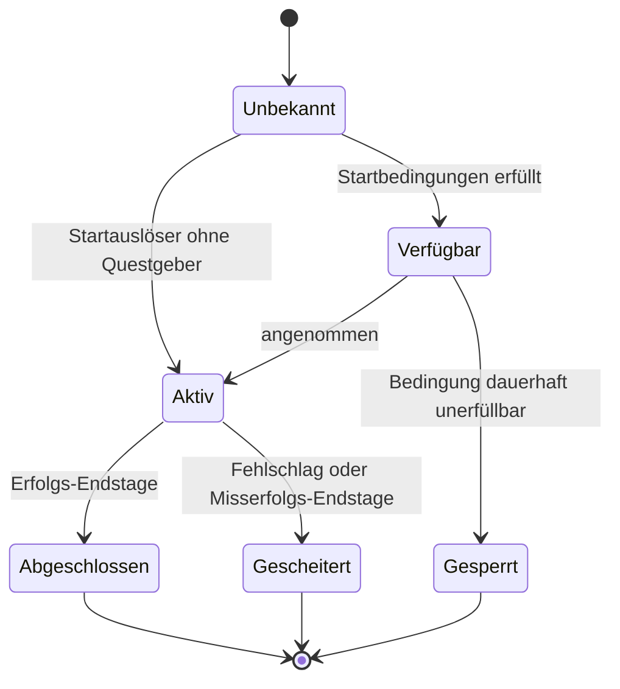
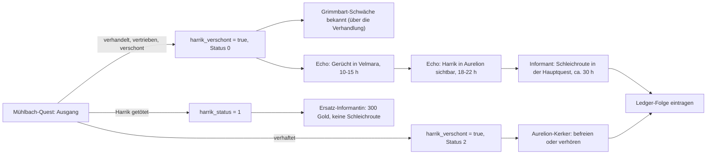
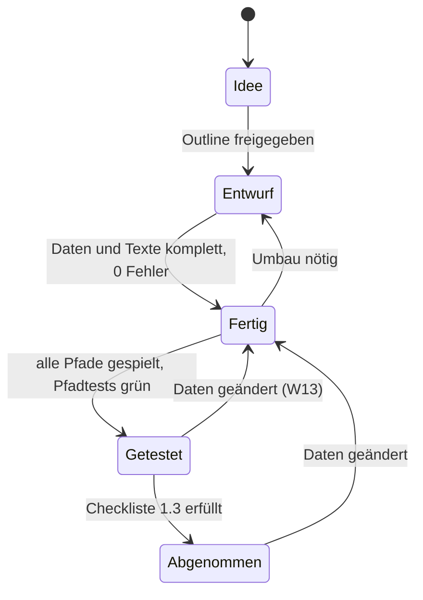
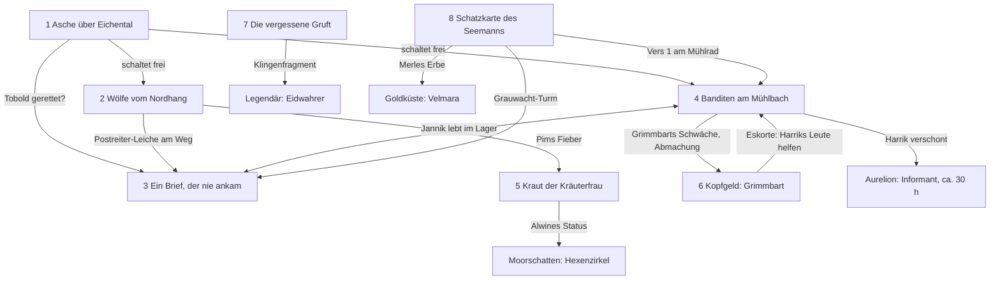

# Quests & Dialoge – Chroniken von Aetherfall

> Teil der Phase-0-Planung · Stand: 2026-10-12 · Quelle: [Master-Prompt](../00_Master-Prompt.md)

**Kennzeichnungen (wie in allen GDD-Dateien):**
- **Vorschlag:** füllt eine Lücke im Master-Prompt.
- **Verbesserungsvorschlag:** weicht bewusst vom Master-Prompt ab. Das Original bleibt erkennbar.
- ❓ **Offene Entscheidung:** liegt beim Auftraggeber. Gesammelt am Dateiende.

**Verwandte Dokumente:**
- [00 Vision & Überblick](./00_Vision_und_Ueberblick.md): Säulen, Pacing, Spielzeiten, Umfangsstufen A/B/C, Quest-Budget 427.
- [01 Welt, Story, Fraktionen](./01_Welt_Story_Fraktionen.md): Regionen, Hauptstory, NPCs, Fraktionen, Ruf, Begleiter, Gegner-Roster.
- [03 Kampf, Charakter, Progression](./03_Kampf_Charakter_Progression.md): Attribute (Charisma für Proben), XP-Kurve, Boss-Design.
- [04 Items, Crafting, Wirtschaft, Endgame](./04_Items_Crafting_Wirtschaft_Endgame.md): Loot-Tabellen, Gold-Balance, tägliche und wöchentliche Aufträge.
- [05 UI, Audio, Grafik, Barrierefreiheit](./05_UI_Audio_Grafik_Barrierefreiheit.md): HUD, Questlog-Tabs, Kompass, Questgeber-Symbole, Untertitel, Benachrichtigungen.
- [Technik/01 Architektur](../Technik/01_Architektur.md): ScriptableObjects, `[SerializeReference]`, EventBus, World State, Save.
- [Technik/02 Systeme & Abhängigkeiten](../Technik/02_Systeme_und_Abhaengigkeiten.md) · [Technik/03 Technik-Recherche](../Technik/03_Technik-Recherche.md): Graph-Editor-Technik, Localization-Paket.

Diese Datei beschreibt Quests und Dialoge aus **Designsicht**. Wie die Daten technisch aussehen, steht in [Technik/01](../Technik/01_Architektur.md).

---

## Inhalt

1. [Design-Prinzipien für Quests](#1-design-prinzipien-für-quests)
2. [Quest-Kategorien & Mengen](#2-quest-kategorien--mengen)
3. [Questbudget pro Region](#3-questbudget-pro-region)
4. [Quest-Aufbau aus Design-Sicht](#4-quest-aufbau-aus-design-sicht)
5. [Ziel-Typen (Objectives)](#5-ziel-typen-objectives)
6. [Entscheidungen & Konsequenzen](#6-entscheidungen--konsequenzen)
7. [Questlog & Anzeige](#7-questlog--anzeige)
8. [Prozedurale Aufträge](#8-prozedurale-aufträge)
9. [Sonderformen: zeitlich begrenzt, versteckt, Weltereignis, legendär](#9-sonderformen-zeitlich-begrenzt-versteckt-weltereignis-legendär)
10. [Quest-Editor-Anforderungen & Authoring-Pipeline](#10-quest-editor-anforderungen--authoring-pipeline)
11. [Die 8 Beispiel-Quests](#die-8-beispiel-quests)
12. [Dialogsystem](#12-dialogsystem)
13. [Schreib-Richtlinien & Lokalisierung](#13-schreib-richtlinien--lokalisierung)
- [Offene Entscheidungen](#offene-entscheidungen)
- [Risiken & Hinweise](#risiken--hinweise)

---

## 1. Design-Prinzipien für Quests

§16.1 nennt das Quest-System das Herzstück des Spiels. Die folgenden Regeln gelten für **alle handgemachten Quests**. Prozedurale Aufträge folgen eigenen Regeln (Abschnitt 8).

### 1.1 Zwölf Regeln (Vorschlag)

| # | Regel | Prüfkriterium (messbar) | Säule |
|---|---|---|---|
| Q1 | **Jede Quest hat eine Figur mit Persönlichkeit oder einen Twist, Nebenquests nach Möglichkeit beides.** | Pitch nennt Figur (Wunsch, Macke, Geheimnis) und Twist in je ≤ 1 Satz. | 5 |
| Q2 | **Kein reines Holen-und-Bringen.** Sammel- und Lieferziele brauchen eine Wendung, eine Entscheidung oder einen Ortswechsel mit Ereignis. | Keine Quest besteht zu > 50 % ihrer Stages aus `Sammle`/`Bringe` ohne Ereignis dazwischen. | 4 |
| Q3 | **Mindestens 2 Lösungswege, wo plausibel** (Kampf, Diplomatie, Schleichen, Bestechung, List). | Zielquote aus [00](./00_Vision_und_Ueberblick.md): ≥ 60 % der Regions-, Fraktions- und Nebenquests haben ≥ 2 Wege. | 2, 6 |
| Q4 | **Kein Weg ist an eine einzige Build-Eigenschaft gebunden.** Eine Dialogprobe ist nie der einzige Weg zum Fortschritt. | Jede Probe hat einen Ausweg ohne Probe (Kampf, Gold, Umweg, Gegenstand). | 6 |
| Q5 | **Entscheidungen sind informiert.** Der Spieler kennt vor der Wahl die wichtigsten Folgen oder bekommt einen Hinweis darauf. | Jede `Wähle`-Stage hat ≥ 1 Dialogzeile oder Questlog-Satz, der die Folgen andeutet. | 2 |
| Q6 | **Jede Entscheidung hat eine sicht- oder hörbare Folge.** Spätestens beim Questabschluss, besser auch später. | Jeder Ausgang setzt ≥ 1 Flag, das außerhalb der Quest gelesen wird (Validator W-Regel, Abschnitt 10). | 2, 5 |
| Q7 | **Keine Soft-Locks.** NPC-Tod, Ortszerstörung, verpasste Fristen und verlorene Items führen zu einem Ausgang, nie zu einer hängenden Quest. | Validator-Regeln V05–V08 und V12 ohne Fehler. | – |
| Q8 | **Abwechslung innerhalb und zwischen Quests.** | Haupt-Zieltyp wechselt zwischen aufeinanderfolgenden Quests einer Reihe ([00](./00_Vision_und_Ueberblick.md)); keine Tätigkeit > 20 min am Stück auf dem kritischen Pfad. | 4 |
| Q9 | **Länge passt zur Kategorie, Belohnung passt zur Länge.** | Ø-Dauer und Belohnungsband aus Abschnitt 2; Quests > 30 min haben eine Zwischenbelohnung ([00](./00_Vision_und_Ueberblick.md)). | 3 |
| Q10 | **Die Welt ist der Questtext.** Orte, Spuren und NPC-Verhalten erzählen mit; das Questlog fasst nur zusammen. | Jede Stage mit Marker hat einen landmarkenbasierten Erkundungshinweis (Abschnitt 7.4). | 1 |
| Q11 | **Verknüpfen statt isolieren.** Jede Nebenquest berührt mindestens eine andere Quest, eine Fraktion oder die Hauptstory. | ≥ 1 gelesenes Fremd-Flag oder gesetztes Flag mit Leser außerhalb der Quest. | 2, 5 |
| Q12 | **Twists variieren.** Der Twist ist nicht immer Verrat. | Twist-Katalog: kein Twist-Typ (z. B. „Auftraggeber lügt“) in > 15 % der handgemachten Quests einer Region. | 4 |

### 1.2 Qualitätskriterien (Vorschlag)

| Kriterium | Zielwert | Gemessen über |
|---|---|---|
| Dauer im Band der Kategorie | 80 % der Tester innerhalb ±30 % der Ø-Dauer | Telemetrie „Zeit pro Quest“ (§28) |
| Verständlichkeit | < 10 % der Tester öffnen > 3× das Questlog innerhalb von 5 min derselben Stage | Telemetrie `QuestLogOpened` |
| Verlaufen | < 15 % der Tester brauchen > 2× die erwartete Zeit für eine `GeheZu`-Stage | Telemetrie pro Stage |
| Wegevielfalt genutzt | Kein Lösungsweg wird von < 5 % der Tester gewählt (sonst versteckt oder unattraktiv) | Ledger-Auswertung |
| Fehlerfreiheit | 0 Validator-Fehler, 0 offene Blocker-Bugs | Editor-Validierung, Bugtracker |
| Textumfang | im Wortbudget (Abschnitt 13) | Editor-Wortzähler |

### 1.3 Abnahme-Checkliste je Quest (Vorschlag)

Eine Quest wechselt erst nach dieser Liste auf Status „Abgenommen“ (Abschnitt 10.5).

- [ ] Pitch mit Figur, Twist, gestärkter Säule und Kategorie liegt vor.
- [ ] Alle Pflichtfelder gesetzt (Abschnitt 4), IDs entsprechen dem Schema.
- [ ] Validator: 0 Fehler. Warnungen sind begründet oder behoben.
- [ ] Jeder Ausgang einmal komplett im Play Mode gespielt (Pfadabdeckung 100 %).
- [ ] Jeder Ausgang hat einen automatisierten Pfadtest (Abschnitt 10.3).
- [ ] Laden/Speichern in jeder Stage getestet (Speichern → Neustart → Laden → Quest läuft weiter).
- [ ] NPC-Tod und Ortszustand behandelt (Abschnitt 6.6).
- [ ] Erkundungsmodus-Hinweise für jede Marker-Stage vorhanden und im Modus gespielt.
- [ ] Entscheidungs-Ledger-Texte vorhanden (Abschnitt 6.4).
- [ ] DE und EN vollständig, Längen im Limit, Kontextnotizen für die Übersetzung gesetzt.
- [ ] Belohnung im Band der Kategorie (Validator W02).
- [ ] Controller-Durchlauf ohne Maus.
- [ ] Questgeber-Symbol, Marker und Benachrichtigungen erscheinen korrekt.

---

## 2. Quest-Kategorien & Mengen

### 2.1 Kategorie vs. Merkmal (Verbesserungsvorschlag)

§16.2 listet 17 Kategorien. Vier davon beschreiben keine eigene Art von Quest, sondern eine **Eigenschaft**, die jede Quest haben kann. Eine Nebenquest kann z. B. gleichzeitig versteckt und zeitlich begrenzt sein.

- **Kategorie** (genau eine je Quest): bestimmt Questlog-Tab, Questgeber-Symbol, Belohnungsband und Budget.
- **Merkmal** (beliebig viele): `versteckt`, `zeitlich_begrenzt`, `kette`.
- **Systemisch erzeugt** (keine handgemachten Daten je Quest): Tägliche und wöchentliche Aufträge, prozedurale Aufträge, Weltereignis-Quests. Sie entstehen aus Vorlagen.

Alle 17 Begriffe aus §16.2 bleiben erhalten. Der Editor zeigt sie als Kategorie oder als Merkmal-Schalter. Das spart Doppelzählungen im Budget und erlaubt Kombinationen.

### 2.2 Kategorien-Tabelle

Belohnungsniveau als **Level-Anteil (Lv)**: Anteil der XP, die beim empfohlenen Level für ein Level-Up nötig sind. Gold und Items: siehe Abschnitt 8.4 und [04](./04_Items_Crafting_Wirtschaft_Endgame.md). Marker-Symbole und Farben übernimmt diese Tabelle aus [05](./05_UI_Audio_Grafik_Barrierefreiheit.md) (Abschnitt 1.9).

| Kategorie | ID-Kürzel | Zielanzahl (Budget C) | Ø-Dauer | Quelle / Questgeber | Belohnungsniveau | Marker-Symbol & Farbe | Wiederholbar |
|---|---|---|---|---|---|---|---|
| Hauptquest | `main` | 60 | 45 min (30–90) | Story-NPCs; automatisch nach der vorigen Hauptquest | 0,8–1,5 Lv; je Akt-Ende 1 Item Episch; Story-Freischaltungen | ! / ? Gold `#F2C14E`, Rautenrahmen | nein |
| Fraktionsquest | `faction` | 105 (7 × 15) | 25 min | Fraktions-NPCs, Fraktionsbüros; ab Rufstufe | 0,5–0,8 Lv; Ruf M–L; Fraktionsmarken | ! / ? Fraktionsfarbe, Wappenschild | nein |
| Regionsquest | `region` | 66 (Reihen à 3) | 25 min je Quest, 75 min je Reihe | Schlüssel-NPCs der Region | 0,5–0,7 Lv; 1 Item Selten je Reihe; sichtbare Ortsveränderung | ! / ? Silber `#D9DEE7`, Doppelrahmen | nein |
| Nebenquest | `side` | 129 | 15 min (10–30) | NPCs, Fundstücke, Gerüchte, Aushänge | 0,3–0,5 Lv; Gold; 30 % Item Ungewöhnlich–Selten | ! / ? Weiß, ohne Rahmen | nein |
| Begleiterquest | `companion` | 32 (8 × 4) | 25 min | Begleiter ab Loyalitätsschwelle (Lagerfeuer) | 0,5 Lv; Loyalität; Begleiter-Fähigkeit oder -Ausrüstung | ! / ? Rosé `#F29CB8`, Mini-Porträt | nein |
| Kopfgeld (handgemacht) | `bounty` | 7 | 20 min | Kopfgeldbretter, Wachhauptleute | 0,5–0,6 Lv; Gold ×2; garantierter Boss-Loot | Fadenkreuz / ? Rot `#E5534B` | nein (prozedurale Kopfgelder: ja) |
| Schatzsuche | `treasure` | 7 | 20 min (über mehrere Orte) | Karten aus Loot, Händler, NPCs, Lore-Bücher | 0,3 Lv; Gold ×3; 1 einzigartiges Schmuckstück | ! / ? Sand `#E3C08D`, Kartenrolle | nein |
| Dungeon-Quest | `dungeon` | 7 | 30 min | Dungeon-Eingang (Entdeckung), NPCs, Aushänge | 0,5–0,7 Lv; Boss-Loot; Truhe | ! / ? Weiß, Torbogen | nein (Dungeon-Vorlagen prozedural: ja) |
| Handwerksquest | `craft` | 7 (1 Meisterprüfung je Herstellungsberuf) | 15 min | Meister an Werkbänken; Berufsstufe 25/50/75/100 | 0,2 Lv + Berufs-XP; Rezept oder Werkzeug | ! / ? Kupfer `#D08A5A`, Hammer | nein (Berufsaufträge prozedural: ja) |
| Rätselquest | `puzzle` | 7 | 20 min | Lore-Bücher, Mechanismen | 0,3 Lv; Skillpunkt oder Geheimnis-Item | ! / ? Weiß, Rune | nein |
| Legendäre Quest | `legendary` | 33 (11 Reihen × 3), Endgame | 40 min je Quest, 2–3 h je Reihe | Item-Fund plus Levelschwelle | 1,0 Lv je Quest; 1 legendäres Item je Reihe | ! / ? Orange `#FF8C1A`, Strahlenkranz | nein |
| Täglicher Auftrag | `daily` | systemisch (Pool ≥ 30 Varianten) | 5–10 min | Endgame-Brett (Aurelion, Zerbrochener Himmel) | 0,1 Lv; Aether-Splitter | ! / ? Blau `#5AA9FF`, Kreispfeil | täglich |
| Wöchentlicher Auftrag | `weekly` | systemisch (Pool ≥ 10 Varianten) | 30–45 min | Endgame-Brett | 0,5 Lv; Aether-Splitter; garantiert Episch | ! / ? Blau, Kreispfeil | wöchentlich |
| Prozeduraler Auftrag | `proc` | unbegrenzt aus 12 Vorlagen | 5–10 min | Anschlagbretter, Fraktionsbüros, Wirte | 0,08–0,2 Lv (Formel 8.4) | ! / ? Blau, Kreispfeil | ja, mit Tageslimit |
| Weltereignis-Quest | `event` | systemisch (≥ 2 Ereignistypen je Region) | 3–8 min | Weltereignis-System (§14.4) | 0,1–0,2 Lv; Gold, Material | nur Kompass-Ring; Riss-Ausbruch Aether-Türkis | ja, mit Abklingzeit |
| *Merkmal* Versteckt | `versteckt` | ≥ 1 je Region (großes Geheimnis, §14.3) | wie Kategorie | Erkundung, besondere Handlungen | Kategorie-Band +25 %, oft Skillpunkt | kein Symbol (absichtlich) | wie Kategorie |
| *Merkmal* Zeitlich begrenzt | `zeitlich_begrenzt` | ≤ 3 je Region | wie Kategorie | wie Kategorie | Kategorie-Band +20 % | Sanduhr-Badge an der Kategorie | nein |
| *Merkmal* Kettenquest | `kette` | alle Regions-, Fraktions-, Begleiter-, Legendär-Reihen | wie Kategorie | Abschluss der Vorgängerquest | letzte Quest der Kette +50 % | Kategorie-Symbol, Questlog zeigt „Teil 2/3“ | nein |

**Hinweise zu Begleiterquests:** 4 Quests je Begleiter (§19: persönliche Questreihe bei hoher Loyalität). Die letzte Quest jeder Reihe entscheidet über die Spezialfähigkeit des Begleiters.
- ❓ **Offene Entscheidung:** Romanzen (§19: „bei manchen“). Wie viele der 8 Begleiter, und unabhängig vom Geschlecht der Spielfigur? Empfehlung: 3 von 8, unabhängig vom Geschlecht, als Teil der 4 Begleiterquests (keine Zusatzquests). Jede Romanze kostet geschätzt +1.000–1.500 Wörter DE und Testaufwand für Eifersuchts- und Trennungszweige.

### 2.3 ID-Schema für Quests (Vorschlag)

| Fall | Schema | Beispiel |
|---|---|---|
| Hauptquest | `quest.main.<name>` | `quest.main.asche_ueber_eichental` |
| Regional gebundene Kategorien | `quest.<kürzel>.<region>.<name>` | `quest.side.eichental.woelfe_vom_nordhang` |
| Fraktionsquest | `quest.faction.<fraktion>.<name>` | `quest.faction.silberwacht.eid_am_riss` |
| Begleiterquest | `quest.companion.<begleiter>.<name>` | `quest.companion.<begleiter-id>.alte_schuld` |
| Legendäre Reihe | `quest.legendary.<waffentyp>.<name>_<n>` | `quest.legendary.einhandschwert.eidwahrer_1` |
| Stage | `<quest-id>.s<nn>[_<suffix>]` | `quest.side.eichental.banditen_am_muehlbach.s30_kampf` |
| Objective | `<stage-id>.o<n>` | `…s20.o1` |
| Prozeduraler Auftrag (Vorlage) | `proc.<vorlage>` | `proc.jagd` |
| Prozeduraler Auftrag (Instanz, nur im Save) | `proc.<vorlage>.<laufende Nr.>` | `proc.jagd.000417` |

Regeln:
- snake_case, nur `a–z`, `0–9`, `_` und `.`; Umlaute werden ersetzt (ä → ae, ö → oe, ü → ue, ß → ss).
- Kategorie-Kürzel sind englisch und kurz, wie im Beispiel `quest.main…` vorgegeben. Namen sind deutsch.
- Stage-Nummern in 10er-Schritten (`s10`, `s20` …), damit später Stages eingefügt werden können.
- IDs sind ab Status „Fertig“ eingefroren (§6.3). Umbenennen geht nur über eine Migrationstabelle ([Technik/01](../Technik/01_Architektur.md)).
- Region-Kürzel: `eichental`, `goldkueste`, `moorschatten`, `karzul`, `frostgipfel`, `glutlande`, `aurelion`, `zerbrochener_himmel`.

### 2.4 Mengen-Hochrechnung: Nachweis ≥ 400

**Master-Prompt-Minimum** (alle Bandbreiten am unteren Ende):

| Kategorie | Rechnung (§16.2) | Minimum |
|---|---|---|
| Hauptquests | ca. 60 | 60 |
| Fraktionsquests | 7 × 15 | 105 |
| Regionsquests | 3 Reihen × 3 Quests × 8 Regionen | 72 |
| Nebenquests | 20 × 8 Regionen | 160 |
| Begleiterquests | 4 × 8 Begleiter | 32 |
| Kleinformate | keine Zahl, 1 je Region und Kategorie (5 Kategorien × 7 Regionen) | 35 |
| **Summe** | | **464** |

Mit den **Höchstwerten** (7 × 25 Fraktions-, 6 Reihen × 4 × 8 Regions-, 30 × 8 Neben-, 6 × 8 Begleiterquests) ergeben sich **~750 Quests**. Schon das Minimum liegt über 400.

**Budget für Stufe C:** [00](./00_Vision_und_Ueberblick.md) schlägt ein Budget von **427** vor (Verbesserungsvorschlag). Diese Datei übernimmt die Summe 427 und verteilt sie feiner:

| Kategorie | Budget laut 00 | Feinverteilung hier | Änderung |
|---|---|---|---|
| Hauptquests | 60 | 60 | – |
| Fraktionsquests | 105 | 105 | – |
| Regionsquests | 66 | 66 (7 Regionen × 3 Reihen × 3 + 1 Reihe à 3 im Zerbrochenen Himmel) | – |
| Nebenquests | 134 | **129** (7 × 18 + 3 im Zerbrochenen Himmel) | −5 |
| Begleiterquests | 32 | 32 | – |
| Kleinformate (handgemacht) | 30 | **35** (Kopfgeld 7, Schatzsuche 7, Dungeon 7, Handwerk 7, Rätsel 7) | +5 |
| **Summe Story + Neben** | **427** | **427** | – |
| Legendäre Reihen (§23: eine je Waffentyp) | in Kleinformaten enthalten | **+33** (11 × 3), getrennt als Endgame | neu |
| **Summe handgemacht** | | **460** | |

**Verbesserungsvorschlag – Feinverteilung:**
- Die Endgame-Region Zerbrochener Himmel bekommt 3 statt 8 Nebenquests, weil dort prozedurale Inhalte und Riss-Expeditionen tragen. Die frei werdenden 5 Quests gehen an Rätselquests, die §16.2 als eigene Kategorie verlangt.
- Die 11 legendären Waffen-Questreihen (§23) passen nicht in 30 Kleinformate. Sie zählen hier als Endgame-Inhalt zur „Komplettierung 300+ h“ und nicht zu „150–200 h“.
- ❓ **Offene Entscheidung:** Feinverteilung und separate Legendär-Reihen annehmen? Empfehlung: ja (Summe 427 bleibt, plus 33 Endgame-Quests).

### 2.5 Abgleich mit den Ziel-Spielzeiten (§1)

Ø-Dauern laut [00](./00_Vision_und_Ueberblick.md). Fraktionsquests: Je Durchgang werden ~60 von 105 gespielt, weil Fraktionen sich gegenseitig ausschließen (§15.3).

| Kategorie | Gespielt je Durchgang | Ø-Dauer | Stunden |
|---|---|---|---|
| Hauptquests | 60 | 45 min | 45,0 |
| Fraktionsquests | 60 | 25 min | 25,0 |
| Regionsquests | 66 | 25 min | 27,5 |
| Nebenquests | 129 | 15 min | 32,3 |
| Begleiterquests | 32 | 25 min | 13,3 |
| Kleinformate | 35 | 15 min | 8,8 |
| **Summe Quests** | **382** | | **151,9** |
| Erkundung ohne Quest, Systeme (Wert aus 00) | | | ~42 |
| **„Hauptstory + Nebenquests“** | | | **≈ 194 h** (Ziel 150–200 h) |
| Nur Hauptstory | 60 + Reisezeit | | ≈ 45–55 h (Ziel 40–60 h) |
| Legendäre Reihen | 33 | 40 min | +22 |
| Endgame wiederholbar (Weltstufen, Expeditionen, Tägliche, Wöchentliche, Prozedurale) | | | +80–120 |
| Zweiter Fraktionsweg (NG+) | 45 | 25 min | +19 |
| **Komplettierung** | | | **≈ 315–355 h** (Ziel 300+ h) |

Ergebnis: Das Budget 427 + 33 erfüllt alle drei Spielzeitziele. Prozedurale Aufträge sind darin bewusst **nicht** eingerechnet. Sie sind Puffer und Endgame-Füllung, keine Pflicht.

---

## 3. Questbudget pro Region

**Vorschlag.** Grundlage ist das Budget aus 2.4. Die Hauptquests folgen den Akten aus §18. Fraktionsquests liegen dort, wo die Fraktion ihren Sitz hat (Details zu den Sitzen in [01](./01_Welt_Story_Fraktionen.md)).

| Region (Level §14.2) | Haupt | Fraktion | Region | Neben | Begleiter | Kopfgeld | Schatz | Dungeon | Handwerk | Rätsel | **Summe** | Quest-Stunden |
|---|---|---|---|---|---|---|---|---|---|---|---|---|
| Eichental (1–10) | 8 (Akt 1) | 4 | 9 | 18 | 2 | 1 | 1 | 1 | 1 (Kochen) | 0 | **45** | ~18 h |
| Goldküste (10–20) | 7 (Akt 2) | 16 | 9 | 18 | 4 | 1 | 1 | 1 | 1 (Schneiderei) | 1 | **59** | ~24 h |
| Moorschatten (18–28) | 7 (Akt 2) | 12 | 9 | 18 | 4 | 1 | 1 | 1 | 1 (Alchemie) | 1 | **55** | ~22 h |
| Aurelion (20–60) | 10 (Akt 2 + 4) | 30 | 9 | 18 | 6 | 1 | 1 | 1 | 1 (Verzauberung) | 0 | **77** | ~32 h |
| Kar'Zul (25–38) | 10 (Akt 3) | 13 | 9 | 18 | 5 | 1 | 1 | 1 | 1 (Lederverarbeitung) | 2 | **61** | ~25 h |
| Frostgipfel (35–48) | 6 (Akt 4) | 14 | 9 | 18 | 5 | 1 | 1 | 1 | 1 (Schmieden) | 1 | **57** | ~22 h |
| Glutlande (45–60) | 6 (Akt 4) | 12 | 9 | 18 | 4 | 1 | 1 | 1 | 1 (Juwelierkunst) | 1 | **54** | ~21 h |
| Zerbrochener Himmel (60–80) | 6 (Akt 5) | 4 | 3 | 3 | 2 | 0 | 0 | 0 | 0 | 1 | **19** | ~9 h |
| **Summe** | **60** | **105** | **66** | **129** | **32** | **7** | **7** | **7** | **7** | **7** | **427** | ~174 h |

Quest-Stunden = Σ (Anzahl × Ø-Dauer aus 2.2). Fraktionsquests sind voll gezählt, also auch die, die ein Durchgang wegen Ausschlüssen nicht sieht.

**Hinweise:**
- Dazu kommen die 33 legendären Quests. Sie verteilen sich über mehrere Regionen, jede Reihe berührt ≥ 3 Regionen (Abschnitt 9.4).
- Die Rätselquests decken das „große Geheimnis“ je Region (§14.3) nur teilweise ab. In den übrigen Regionen ist das Geheimnis eine Nebenquest mit Merkmal `versteckt`.
- **Überlevel-Problem im Eichental:** ~18 h Questinhalt stehen einem Levelband von 1–10 gegenüber. Laut §28 ist Level 10 nach ~4 h erreicht. Gegenmaßnahmen (**Vorschlag**):
  - Quest-XP sinkt je Level über dem empfohlenen Level um 10 %, mindestens auf 25 % (gilt für alle Kategorien außer Hauptquests).
  - ~6 der 18 Eichental-Nebenquests sind **Rückkehr-Quests** und erst nach dem Wiederaufbau verfügbar (Bedingung `flag.eichental.dorf_wiederaufbau ≥ 1`, Level-Empfehlung 12–18). Sie belohnen mit Material und Haus-Gegenständen statt nur mit XP.
- **Vertical Slice (Stufe A):** genau die 8 Beispiel-Quests aus Abschnitt 11 (1 Haupt, 4 Neben, 1 Kopfgeld, 1 Dungeon, 1 Schatz).

---

## 4. Quest-Aufbau aus Design-Sicht

Technische Umsetzung (Quest als ScriptableObject, Ziele, Bedingungen und Aktionen über `[SerializeReference]`, Laufzeitstatus im Save): siehe [Technik/01](../Technik/01_Architektur.md). Hier steht, **was ein Autor ausfüllt und warum**.

### 4.1 Felder einer Quest

Felder aus §16.3 ohne Kennzeichnung. Ergänzungen sind als **Vorschlag** markiert.

| Feld | Zweck | Beispielwert |
|---|---|---|
| ID | Stabile Referenz für Saves, Flags, Dialoge | `quest.side.eichental.woelfe_vom_nordhang` |
| Titel (lokalisierbar) | Name im Questlog, ≤ 32 Zeichen | „Die Wölfe vom Nordhang“ |
| Beschreibung (lokalisierbar) | Kopftext im Questlog, 1–3 Sätze, wird mit den Stages fortgeschrieben | „Bauer Hollmann verliert Schafe an Wölfe …“ |
| Kategorie | Tab, Symbol, Belohnungsband, Budgetzähler | `side` |
| **Vorschlag:** Merkmale | Kombinierbare Eigenschaften (2.1) | `[]` oder `[versteckt, zeitlich_begrenzt]` |
| Empfohlenes Level | Questgeber-Symbol grau ab 4 Level darunter ([05](./05_UI_Audio_Grafik_Barrierefreiheit.md)); XP-Abschwächung | `3` |
| Questgeber | NPC-ID oder Objekt-ID, die die Quest anbietet | `npc.eichental.bauer_hollmann` |
| **Vorschlag:** Ersatz-Questgeber | Geordnete Liste, falls der Questgeber stirbt oder fehlt | `[npc.eichental.wirt_ulf]` |
| **Vorschlag:** Abgabe-NPC | Falls die Abgabe nicht beim Questgeber erfolgt | leer = Questgeber |
| **Vorschlag:** Startauslöser | Wie die Quest beginnt: Dialog, Item aufheben, Gebiet betreten, Aushang lesen, Weltereignis, automatisch | `Dialog(dlg.eichental.hollmann_schafe)` |
| Startbedingungen | Conditions (§6.4), mit UND/ODER/NICHT | `QuestStatus(quest.main.asche_ueber_eichental) = abgeschlossen` |
| Stages | Liste der Stufen, siehe 4.2 | `s10 … s50` |
| **Vorschlag:** Start-Stage | Erste Stage; bei mehreren Startwegen per Bedingung wählbar | `s10` |
| Belohnungen | XP als Level-Anteil (siehe unten), Gold, Items, Ruf, Beziehung, Skillpunkt | `XP 0,5 Lv; Gold 60; Ruf –` |
| Folgequests | Werden nach Abschluss angeboten oder automatisch gestartet | `quest.side.eichental.kraut_der_kraeuterfrau` (angeboten) |
| Wiederholbar | nein / täglich / wöchentlich / mit Abklingzeit | `nein` |
| Kann scheitern + wodurch | Fehlschlag-Bedingungen auf Quest-Ebene und ihre Folge | `nein` oder `Frist abgelaufen → s90_gescheitert` |
| Region und Kartenmarker | Region für Filter und Budget; Marker oder Suchgebiet je Stage | `region.eichental` |
| **Vorschlag:** Frist | Für `zeitlich_begrenzt`: Spielstunden ab Annahme | `48` |
| **Vorschlag:** Kette | Ketten-ID und Position | `kette.eichental.muehlbach`, Teil 1/2 |
| **Vorschlag:** Ledger-Einträge | Texte für die Entscheidungs-Zusammenfassung (6.4) | 1–3 Einträge |
| **Vorschlag:** Pacing-Minute | Erwartete Spielminute beim ersten Kontakt ([00](./00_Vision_und_Ueberblick.md), Pacing-Pass) | `75` |
| **Vorschlag:** Umfangsstufe | A / B / C | `A` |
| **Vorschlag:** Status, Autor, Wortbudget, Notizen | Produktionssteuerung (Abschnitt 10) | `Entwurf`, `liam`, `1.500` |

**Belohnung als Level-Anteil (Vorschlag):** In den Daten steht nicht „300 XP“, sondern „0,5 Lv“. Die Laufzeit rechnet mit der XP-Kurve aus [03](./03_Kampf_Charakter_Progression.md) um. Ändert sich die Kurve, bleiben alle Quests im Band. Damit diese Datei konkrete Zahlen zeigen kann, gilt bis zur Festlegung in 03 die **Platzhalterkurve: XP für Level L → L+1 = 200 × L.**

### 4.2 Felder einer Stage

| Feld | Zweck | Beispielwert |
|---|---|---|
| Stage-ID | Stabile Referenz, Sprungziel im Editor | `s20` |
| Beschreibung für das Questlog | Was ist passiert, was ist zu tun; 1–2 Sätze, ≤ 200 Zeichen | „Auf der Weide liegen gerissene Schafe. Die Spuren sind zu groß für gewöhnliche Wölfe.“ |
| **Vorschlag:** Erkundungshinweis | Ersetzt im Erkundungsmodus den Marker (7.4) | „Die Weide liegt oberhalb des Hofs, beim umgestürzten Zaun.“ |
| Ziele (Objectives) | 1–n Ziele, Typen aus Abschnitt 5 | `Untersuche(clue.eichental.weide_*, 3)` |
| Modus: alle / eines | Wann die Stage erfüllt ist | `alle` |
| **Vorschlag:** Modus „n von m“ | Für „2 von 3 Hinweisen genügen“ | `2 von 3` |
| Optionale Ziele mit Bonusbelohnung | Zusatzziele, kein Muss | `Sammle(item.material.wolfspelz, 3)` → +25 Gold |
| Aktionen beim Start | Actions (§6.4) beim Betreten der Stage | `SpawneGegner(spawn.eichental.nordhang_rudel)` |
| Aktionen beim Abschluss | Actions beim Verlassen der Stage | `SetzeFlag(flag.eichental.woelfe_ausgang, 2)` |
| Verzweigungen | Geordnete Liste „Bedingung → nächste Stage“ plus Standard-Ausgang | `Ziel o2 erfüllt → s50_zerstoert; sonst → s50_kampf` |
| **Vorschlag:** Fehlschlag-Bedingungen | Stage-lokal, z. B. Eskortierter stirbt | `NPCTot(npc…) → s90_gescheitert` |
| **Vorschlag:** Endstage-Typ | keiner / Erfolg / Misserfolg | `Erfolg` |
| **Vorschlag:** Ledger-Eintrag | Wird beim Abschluss der Stage ins Ledger geschrieben | `ledger.c1` |
| **Vorschlag:** Speichersperre | Für zeitkritische Stages (Speichern gesperrt, [05](./05_UI_Audio_Grafik_Barrierefreiheit.md)) | `nein` |

**Verzweigungsregel:** Bedingungen werden von oben nach unten geprüft, die erste erfüllte gewinnt. Ohne Treffer gilt der Standard-Ausgang. Fehlt beides, meldet der Validator einen Fehler (V09).

### 4.3 Lebenszyklus einer Quest



- **Gesperrt** entsteht z. B. durch Fraktionsausschluss. Gesperrte Quests erscheinen nicht im Questlog.
- **Abbrechen (Vorschlag):** Handgemachte Quests lassen sich nicht abbrechen, weil das Flags in halbem Zustand hinterlassen würde. Prozedurale Aufträge lassen sich abbrechen.
- Wiederholbare Quests gehen nach „Abgeschlossen“ und einer Abklingzeit zurück auf „Verfügbar“.

---

## 5. Ziel-Typen (Objectives)

### 5.1 Alle Ziel-Typen

Die 23 Typen aus §16.4 plus 3 Ergänzungen (**Vorschlag**). Die Kurzschreibweise (Spalte „Kürzel“) nutzen die Stage-Tabellen in Abschnitt 11. Ereignisnamen folgen dem Stil von §6.2 (`EnemyKilled`, `ItemPickedUp`, `NPCTalkedTo`). Die verbindliche Ereignisliste steht in [Technik/01](../Technik/01_Architektur.md).

| # | Ziel-Typ (§16.4) | Kürzel | Parameter | Auslösendes Ereignis | Questlog-Vorlage (DE) | Fortschrittsanzeige |
|---|---|---|---|---|---|---|
| 1 | Töte X Gegner vom Typ Y | `Töte` | Gegnertyp-ID, Variante (optional), Anzahl, Gebiet (optional) | `EnemyKilled` | „Töte {Gegner:plural} ({n}/{m})“ | Zähler |
| 2 | Töte einen bestimmten Gegner | `TöteBestimmten` | Unique-ID; erlaubt: töten / bezwingen (lebend) | `EnemyKilled`, `EnemyDefeated` | „Besiege {Name}“ | Häkchen; bei Bossen Boss-Lebensbalken |
| 3 | Sammle X Items | `Sammle` | Item-ID oder Item-Tag, Anzahl; zählt Inventar | `ItemPickedUp`, `InventoryChanged` | „Sammle {Item:plural} ({n}/{m})“ | Zähler, sinkt bei Abgabe oder Verkauf |
| 4 | Bringe Item zu NPC | `Bringe` | Item-ID, Anzahl, NPC-ID | `ItemDelivered` (Dialog-Aktion) | „Bringe {Item} zu {NPC}“ | Häkchen |
| 5 | Rede mit NPC | `Rede` | NPC-ID, Dialog-ID oder Ausgang (optional) | `NPCTalkedTo` | „Sprich mit {NPC}“ | Häkchen |
| 6 | Gehe zu Ort | `GeheZu` | Orts-ID, Radius in m | `AreaEntered` | „Gehe zu {Ort}“ | Distanz im Kompass |
| 7 | Erkunde Gebiet | `Erkunde` | Gebiets-ID, Anteil oder Liste von Teilzonen | `AreaEntered` (Teilzonen), `LocationDiscovered` | „Erkunde {Gebiet} ({p} %)“ | Prozent |
| 8 | Eskortiere NPC | `Eskortiere` | NPC-ID, Ziel-Orts-ID, max. Abstand | `NPCArrived`, `NPCDied` | „Bring {NPC} sicher nach {Ort}“ | Distanz + LP-Balken des NPC |
| 9 | Beschütze NPC / Ort für X Sekunden | `Beschütze` | Ziel-ID, Dauer in s, Ausfallbedingung | `TimerElapsed`, `NPCDied`, `ObjectDestroyed` | „Beschütze {Ziel} ({mm:ss})“ | Countdown + LP-Balken |
| 10 | Verteidige gegen Wellen | `Verteidige` | Ort-ID, Wellen-Definition, Anzahl | `WaveCompleted` | „Halte {Ort} (Welle {w}/{W})“ | Wellenzähler |
| 11 | Stelle Item her | `StelleHer` | Item-ID oder Rezept-ID, Anzahl, Mindestqualität (optional) | `ItemCrafted` | „Stelle {Item} her ({n}/{m})“ | Zähler |
| 12 | Benutze Item an Ort | `BenutzeAn` | Item-ID, Objekt- oder Orts-ID | `ItemUsedAt` | „Benutze {Item} bei {Ziel}“ | Häkchen |
| 13 | Interagiere mit Objekt | `Interagiere` | Objekt-ID(s), Anzahl, Verb für den Text | `Interacted` | „{Verb} {Objekt}“, z. B. „Untersuche das Mühlrad“ | Häkchen oder Zähler |
| 14 | Löse Rätsel | `Rätsel` | Rätsel-ID | `PuzzleSolved` | „Öffne {Rätsel}“ | Häkchen; optional Teilschritte |
| 15 | Schleiche, ohne entdeckt zu werden | `Schleiche` | Zielort-ID, Zone, Folge bei Entdeckung (Fehlschlag / Rücksetzen / Verzweigung) | `AreaEntered`, `PlayerDetected` | „Erreiche {Ort}, ohne entdeckt zu werden“ | Häkchen + Entdeckungsstatus |
| 16 | Erreiche Ort innerhalb einer Zeit | `ZeitLauf` | Orts-ID, Zeit in s | `AreaEntered`, `TimerExpired` | „Erreiche {Ort} ({mm:ss})“ | Countdown |
| 17 | Folge einem NPC oder einer Spur | `Folge` | NPC-ID oder Spur-ID, max. Abstand | `TrailNodeReached`, `NPCArrived` | „Folge {NPC}“ / „Folge der Spur“ | Abstandswarnung „Zu weit entfernt“ |
| 18 | Untersuche Hinweise (Detektiv-Modus) | `Untersuche` | Hinweis-IDs, benötigte Anzahl | `ClueInspected` | „Untersuche Hinweise bei {Ort} ({n}/{m})“ | Zähler |
| 19 | Überzeuge NPC im Dialog | `Überzeuge` | Dialog-ID, Ausgangs-ID(s) | `DialogOutcome` | „Überzeuge {NPC}, {Ziel}“ | Häkchen |
| 20 | Gewinne ein Minispiel | `Minispiel` | Minispiel-ID, Gegner-NPC, Einsatz (optional) | `MinigameFinished` (gewonnen) | „Gewinne {Minispiel} gegen {NPC}“ | Häkchen |
| 21 | Erreiche Fraktionsruf X | `Ruf` | Fraktions-ID, Stufe | `ReputationChanged` | „Erreiche {Stufe} bei {Fraktion}“ | Rufleiste |
| 22 | Warte bis Tageszeit X | `WarteBis` | Uhrzeit-Fenster (von–bis) | `TimeOfDayChanged` | „Warte bis {Tageszeit} ({hh:mm})“ | Uhrzeit; Hinweis „Rasten verkürzt die Wartezeit“ |
| 23 | Wähle eine Seite (Entscheidung) | `Wähle` | Wahl-ID, Optionen (je Option: Auslöser) | `ChoiceMade` | „Entscheide: {A} oder {B}“ | keine; Optionen werden aufgelistet |
| 24 | **Vorschlag:** Lies Text | `Lies` | Buch-, Brief- oder Notiz-ID | `DocumentRead` | „Lies {Dokument}“ | Häkchen |
| 25 | **Vorschlag:** Setze Fähigkeit ein | `Fähigkeit` | Skill-ID, Ziel-ID oder Ort | `AbilityUsedAt` | „Setze {Fähigkeit} bei {Ziel} ein“ | Häkchen |
| 26 | **Vorschlag:** Quest-Zustand | `QuestStatus` | Quest-ID, Stage oder Status | `QuestStageChanged`, `QuestCompleted` | „Schließe „{Quest}“ ab“ | Verweis auf die andere Quest |

### 5.2 Regeln für Ziele (Vorschlag)

- **Vorhandenes zählt sofort:** Hat der Spieler beim Stage-Start bereits 3 Blutwurz, ist `Sammle(item.herb.blutwurz, 5)` sofort bei 3/5.
- **Rückschritt:** `Sammle` zählt das Inventar. Verkauft der Spieler Items, sinkt der Zähler. `Töte`-Zähler sinken nie.
- **Questgegenstände** (Tag `quest_item`) lassen sich nicht verkaufen, zerlegen oder ablegen, solange die Quest aktiv ist (Validator W12).
- **Fremde Kills zählen:** Kills durch Begleiter oder Umgebung (Explosion, Falle) zählen für `Töte`.
- **Versteckte Ziele:** Ein Ziel kann bis zu einer Bedingung unsichtbar sein (z. B. optionales Ziel erst nach Gespräch mit Harrik).
- **Bedingungs-Ziel (Vorschlag):** Ein Ziel kann statt auf ein Ereignis auf eine Bedingung aus §6.4 warten, z. B. „Gruppe feindlich“ oder „Flag gesetzt“. Es wird bei jeder Änderung des Weltzustands geprüft. Beispiel: „Greif das Lager an“ in Quest 4.
- **Ziel-Text ≤ 50 Zeichen** inklusive Zähler.
- **Marker:** Jedes Ziel nennt seine Marker-Ziele (Objekt-, NPC- oder Orts-IDs) oder ein Suchgebiet mit Radius.

### 5.3 Neue Ziel-Typen ergänzen (Designsicht)

§16.4 verlangt: „Eigene Zieltypen müssen leicht hinzufügbar sein (Basisklasse + Erweiterung).“

Ablauf:
1. **Steckbrief** durch Design: Name (DE), Kürzel, Parameter mit Typ und Standardwert, auslösendes Ereignis, Questlog-Vorlage DE/EN, Fortschrittsanzeige, Fehlschlagfall, Speicherdaten (was muss im Save stehen, z. B. Zähler).
2. **Prüfung:** Lässt sich das Ziel aus vorhandenen Typen bauen (z. B. `Interagiere` + `WarteBis`)? Wenn ja, kein neuer Typ.
3. **Umsetzung** durch Technik: eine Klasse, die von der Ziel-Basisklasse erbt und ein Ereignis abonniert. Kein Umbau am Quest-System.
4. **Editor:** Der neue Typ erscheint automatisch im Typ-Menü unter einem deutschen Menüpfad ([Technik/03](../Technik/03_Technik-Recherche.md), Abschnitt 5).
5. **Test:** Unit-Test mit künstlichen Ereignissen plus Eintrag im Quest-Testraum (§30).

Skizze (nur zur Verdeutlichung, kein fertiger Code):

```csharp
namespace Aetherfall.Quests {
  [Serializable, TypeMenu("Ziele/Fähigkeit einsetzen")]
  public sealed class UseAbilityObjective : QuestObjective {
    [SerializeField] private string skillId;   // z. B. "skill.aether.rissstoss"
    [SerializeField] private string targetId;  // Objekt- oder Orts-ID
    protected override void Subscribe(IEventBus bus) =>
      bus.Subscribe<AbilityUsedAt>(e => {
        if (e.SkillId == skillId && e.TargetId == targetId) Complete();
      });
  }
}
```

---

## 6. Entscheidungen & Konsequenzen

### 6.1 Lösungswege (§16.5)

| Weg | Typische Ziele | Typische Voraussetzung | Typischer Preis |
|---|---|---|---|
| Kampf | `Töte`, `TöteBestimmten`, `Verteidige` | Ausrüstung, Level | Risiko, Ruf bei Betroffenen, Tote |
| Diplomatie | `Überzeuge`, `Rede` | Charisma, Ruf, Wissen aus anderen Quests | Zugeständnisse, Versprechen |
| Schleichen | `Schleiche`, `Interagiere` | Schleich-Skills, Nacht, Umgebung | Zeit; bei Entdeckung Kampf |
| Bestechung | Dialog-Option mit Goldkosten | Gold | Gold; manche NPCs sind unbestechlich |
| List | `Lügen`-Probe, `BenutzeAn` (Gift, Brandsatz), falsche Beweise | Charisma, Items, Berufe | Spätere Entdeckung der Lüge (verzögerte Konsequenz) |

**Regeln (Vorschlag):**
- Jeder Weg führt zu einem eigenen Ergebnis, nicht nur zu einem anderen Weg zum gleichen Ende.
- Schleichen und Diplomatie geben mindestens 80 % der XP eines Kampfwegs. Nicht-Kämpfen darf sich nicht wie Verzicht anfühlen.
- Ein gescheiterter Weg öffnet einen anderen (entdeckt → Kampf; Probe nicht bestanden → Bestechung oder Kampf), statt die Quest zu beenden.

### 6.2 Konsequenz-Muster (Vorschlag)

| Muster | Wann tritt es ein? | Umsetzung | Beispiel aus den 8 Quests |
|---|---|---|---|
| **Sofort** | Direkt beim Questabschluss | Aktion beim Abschluss: Flag, NPC entfernen/bewegen, Ort ändern | Mühlbach-Banditen ziehen ab, die Bäckerei in Lindenhain backt wieder |
| **Verzögert** | Stunden später, an einem anderen Ort | Flag + Bedingung in einer späteren Quest, Szene oder einem Bark; optional Mindestalter des Flags | Verschonter Harrik taucht ~30 h später in Aurelion als Informant auf (6.5) |
| **Kumulativ** | Wenn ein Zähler eine Schwelle erreicht | Int-Flag, das von mehreren Quests erhöht wird | `flag.global.banditen_getoetet` ≥ 25 → Banditen im Eichental fliehen beim Anblick des Spielers; ≥ 50 → Titel „Banditenschreck“ |
| **Versteckt** | Der Spieler erfährt die Ursache nicht direkt | Flag wird gelesen, aber nicht im Ledger erklärt, bis der Spieler es entdeckt | Sabotierter Rissbann der Kräuterfrau schwächt den Hexenzirkel im Moorschatten |
| **Echo** (**Vorschlag**) | Zwischen Ursache und großer Folge | Bark, Gerücht, Brief; kostet wenig, zeigt „die Welt erinnert sich“ | Gerücht in Velmara: „Ein langer Kerl aus dem Eichental fragt nach dir.“ |

**Konsequenz-Budget (Vorschlag):** Je Quest wirken höchstens **3 Flags** über die Quest hinaus. Mehr erzeugt Kombinationen, die niemand testen kann. Interne Flags (nur innerhalb der Quest gelesen) sind unbegrenzt, werden aber als `quest.<id>.lokal_*` geführt und beim Questende gelöscht.

### 6.3 Konventionen für Weltzustand-Flags

**Schema:** `flag.<bereich>.<subjekt>_<zustand>`

| Bereich | Wofür | Beispiel |
|---|---|---|
| `<region>` | Zustand in einer Region | `flag.eichental.dorf_zerstoert` |
| `main` | Hauptstory, aktübergreifend | `flag.main.aether_kraft_erhalten` |
| `global` | Zähler und Spielerprofil | `flag.global.banditen_getoetet` |
| `faction.<fraktion>` | Fraktionszustand jenseits des Rufwerts | `flag.faction.silberwacht.beigetreten` |
| `npc.<npc-kurz>` | **Vorschlag:** systemische NPC-Zustände, automatisch geführt | `flag.npc.banditenfuehrer_harrik.tot` |

| Typ | Benennung | Wertebereich | Beispiel |
|---|---|---|---|
| Bool | Zustand als Partizip oder Adjektiv | `true` / `false`, Standard `false` | `flag.eichental.harrik_verschont = true` |
| Int als Zähler | Substantiv im Plural | ≥ 0 | `flag.global.banditen_getoetet = 37` (§6.5) |
| Int als Zustandsliste (Enum) | Endung `_ausgang`, `_status`, `_zustand`, `_verbleib` | Werteliste mit Namen im Editor, 0 = unbekannt/Start | `flag.eichental.muehlbach_ausgang = 4` (Mühlenwache) |

**Regeln (Vorschlag):**
- Flags sind **Fakten über die Welt**, nicht über Quests. Quest-Fortschritt wird über `QuestStatus` abgefragt, nicht über Flags wie `woelfe_quest_fertig`.
- Bool-Flags werden positiv benannt (`harrik_verschont`, nicht `harrik_nicht_getoetet`).
- Enum-Werte sind im Editor als Werteliste hinterlegt (z. B. 1 = getötet, 2 = vertrieben). Bedingungen zeigen Namen statt Zahlen. Der Validator prüft unbekannte Werte (V17).
- **Zeitstempel:** Jedes Flag speichert die aktive Spielzeit, zu der es zuletzt geändert wurde. Bedingung `FlagAlter(flag, ≥ 15 h)` macht verzögerte Konsequenzen unabhängig vom Reisetempo.
- Wer ein Flag schreibt und wer es liest, zeigt der Editor als Liste (Flag-Browser, Abschnitt 10.1). Flags ohne Leser sind eine Warnung (V16).
- Flag-IDs sind wie alle IDs nach Status „Fertig“ eingefroren.

### 6.4 Entscheidungs-Ledger (§16.6)

§16.6 verlangt „Abgeschlossene Quests mit Zusammenfassung der Entscheidungen“. **Vorschlag:** Jede Quest führt 1–3 Ledger-Einträge, die in Stages oder Dialog-Aktionen geschrieben werden.

| Feld | Zweck | Beispiel |
|---|---|---|
| Ledger-ID | Stabile Referenz | `quest.side.eichental.banditen_am_muehlbach.ledger.c1` |
| Text (DE/EN) | 2. Person, Perfekt, ≤ 120 Zeichen | „Du hast mit Harrik verhandelt, statt das Lager anzugreifen.“ |
| Sichtbarkeit | sofort / erst bei Entdeckung | `sofort` |
| Folgen-Einträge | Werden ergänzt, wenn eine verzögerte Konsequenz eintritt | „Folge: Harrik hilft dir in Aurelion als Informant.“ |

**Darstellung im Questlog (Tab „Abgeschlossen“):**

```
Banditen am Mühlbach                                   abgeschlossen
  · Du hast mit Harrik verhandelt, statt das Lager anzugreifen.
  · Harriks Leute bewachen jetzt die Mühle – gegen Mehl.
  · Du hast versprochen, dich um Grimmbart zu kümmern.
  Folgen bisher
  · Die Bäckerei in Lindenhain backt wieder.
  · In Aurelion hat Harrik dir einen Weg in die Unterstadt gezeigt.
```

**Regeln (Vorschlag):**
- Keine Spoiler: Nicht gewählte Optionen und noch nicht eingetretene Folgen erscheinen nie.
- Versteckte Konsequenzen erscheinen erst, wenn der Spieler sie entdeckt hat (Bedingung am Folgen-Eintrag).
- Tritt eine verzögerte Folge ein, kommt eine P1-Meldung „Eine frühere Entscheidung hat Folgen“ mit Link zum Ledger-Eintrag.
- Eine Gesamtansicht „Chronik“ (alle Ledger-Einträge nach Spielzeit) ist **Vorschlag** für Stufe B.
- ❓ **Offene Entscheidung:** Folgen im Ledger anzeigen (empfohlen, stärkt Säule 2) oder nur die Entscheidungen selbst (mehr Immersion, aber Folgen werden leichter übersehen)?

### 6.5 Beispiel durchgespielt: Der verschonte Bandit (§16.5)

§16.5: „Spieler verschont einen Banditen im Eichental → 30 Stunden später taucht er in Aurelion als Informant auf.“ Der Bandit ist hier **Harrik**, Anführer der Mühlbach-Banditen (`npc.eichental.banditenfuehrer_harrik`). Die Kette nutzt alle Konsequenz-Muster aus 6.2.

**Beteiligte Flags:**

| Flag | Typ | Werte |
|---|---|---|
| `flag.eichental.harrik_verschont` | Bool | `true`, sobald Harrik das Ende der Mühlbach-Quest lebend erreicht |
| `flag.eichental.harrik_status` | Enum | 0 = frei, 1 = tot, 2 = in Haft (Silberwacht) |
| `flag.eichental.harrik_belogen` | Bool | Spieler hat ihn mit der Lügen-Probe vertrieben |
| `flag.eichental.muehlbach_ausgang` | Enum | 1 = Lager zerschlagen, 2 = vertrieben, 3 = Abzug verhandelt, 4 = Mühlenwache, 5 = verhaftet |
| `flag.eichental.grimmbart_schwaeche_bekannt` | Bool | Kriegshorn als Schwachstelle bekannt |

**Kette:**

| Schritt | ~Spielstunde | Ort | Bedingung | Aktion / Ergebnis | Muster |
|---|---|---|---|---|---|
| T0 | 1:30 | Mühlbach | Mühlbach-Quest endet mit Harrik lebend (verhandelt, vertrieben, ergeben + verschont, verhaftet) | `harrik_verschont = true`; `harrik_status` = 0 oder 2; Harrik verlässt das Lager (`NPC entfernen`) | sofort |
| T1 | 1:30–4:00 | Steinbruch | Grimmbart in der Verhandlung angesprochen (Dialogknoten n500, 12.10) oder Tributbuch gestohlen | `grimmbart_schwaeche_bekannt = true`; Kopfgeld-Quest bekommt optionales Ziel „Zerstöre das Kriegshorn“ | sofort, quest-übergreifend |
| T2 | 4:00 | Lindenhain | `muehlbach_ausgang = 4` und Grimmbart lebend gefangen | Harriks Leute sichern den Gefangenentransport: kein Hinterhalt (Abschnitt 11.6) | verzögert, klein |
| T3 | 10–15 | Velmara (Goldküste), Taverne | `harrik_verschont` und `harrik_status = 0` | Bark/Gerücht des Wirts: „Ein langer Kerl aus dem Eichental hat nach dir gefragt.“ | Echo |
| T4 | 18–22 | Aurelion, Unterstadt | `harrik_status = 0` und Region = Aurelion | Harrik als Ambient-NPC in einer Hafenkneipe sichtbar, nicht ansprechbar („Später, Rissgeborener. Nicht hier.“) | Echo |
| T5 | ~30 | Aurelion, Unterstadt | `harrik_verschont` und `FlagAlter(harrik_verschont) ≥ 15 h` und `QuestStage(quest.main.schatten_ueber_aurelion) ≥ s30` (Platzhalter) | Harrik bietet als Informant einen Zugang zur Unterstadt an: Die Hauptquest bekommt einen alternativen Weg (Schleichroute statt Wachen-Kampf) | verzögert |
| T5a | ~30 | wie T5 | zusätzlich `harrik_belogen = true` | Harrik ist misstrauisch: Information nur gegen 200 Gold oder `Einschüchtern 25` | verzögert, Variante |
| T5b | ~30 | Aurelion, Kerker der Silberwacht | `harrik_status = 2` | Harrik sitzt in Haft. Befreien (Schattenhand-Weg) oder verhören (Silberwacht-Weg) gibt dieselbe Information, aber andere Ruf-Folgen | verzögert, Variante |
| T5c | ~30 | Aurelion | `harrik_status = 1` oder nie getroffen | **Ersatz-Informantin** `npc.aurelion.informantin_ersatz` (Platzhalter, Name von 01): Information für 300 Gold, ohne Schleichroute | Fallback gegen Soft-Lock |
| T6 | nach T5 | Questlog | T5 eingetreten | Ledger der Mühlbach-Quest bekommt den Folgen-Eintrag „In Aurelion hat Harrik dir einen Weg in die Unterstadt gezeigt.“ | Ledger |



**Prüfung auf Soft-Lock:** Alle drei Zustände von `harrik_status` führen zu einer Lösung der Aurelion-Stage. Die Hauptquest hängt nie an Harrik.

### 6.6 NPC-Tod und Ortszerstörung absichern (Vorschlag)

**Schutzstufen für NPCs:**

| Stufe | Wer | Verhalten bei 0 LP | Kann der Spieler töten? |
|---|---|---|---|
| Essentiell | Hauptquest-Schlüsselfiguren, Begleiter, **alle Kinder**, Funktions-NPCs (Respec-Lehrer, Hausverwalter) | bewusstlos für 30 s, steht wieder auf | nein |
| Questgeschützt | Benannte NPCs, solange eine **aktive** Quest sie braucht und kein Ersatz-Questgeber eingetragen ist | wie essentiell, nur solange der Schutz gilt | nein, solange geschützt |
| Sterblich | Alle übrigen benannten NPCs | stirbt; setzt `flag.npc.<id>.tot`; Ereignis `NPCDied` | ja, mit Folgen (Kopfgeld, Ruf, Ledger) |
| Statist | Generische NPCs (Wache, Bauer ohne Namen) | stirbt, wird nach 3 Spieltagen durch eine neue Person ersetzt | ja |

**Regeln:**
1. **Nur der Spieler tötet benannte NPCs.** Weltereignisse, Gegner-KI, Begleiter-Flächenschaden und Fallen setzen benannte NPCs höchstens auf „bewusstlos“. So stirbt kein Questgeber unbemerkt durch einen Riss-Ausbruch.
2. **Tod-Behandlung ist Pflicht:** Jede Quest, die einen sterblichen NPC referenziert, braucht eine von drei Lösungen (Validator V12):
   - Ersatz-Questgeber (Liste im Quest-Feld), z. B. Müller Brenner stirbt → Tochter Liese übernimmt Mühle und Questabgabe.
   - Verzweigung „NPC tot“ in der betroffenen Stage, z. B. Jannik tot → Ende „Trauer“ der Brief-Quest.
   - Scheitern mit erklärendem Questlog-Satz, z. B. „Hollmann ist tot. Niemand wird dich für die Wölfe bezahlen.“ Gilt nur für Nebenquests.
3. **Questgegenstände toter NPCs** gehen nie verloren: Sie liegen im Leichnam und nach 1 Spieltag in einer „Nachlass“-Truhe im Haus des NPC.
4. **Ortszerstörung nur durch Story oder Quest**, nie zufällig. Zustand als Enum: `flag.<region>.<ort>_zustand` (0 intakt, 1 beschädigt, 2 zerstört, 3 wieder aufgebaut).
5. **Quests an zerstörbaren Orten** brauchen eine Startbedingung auf den Ortszustand. Laufende Quests haben eine Verzweigung oder einen Ersatzort. Der Editor kennt die Liste der zerstörbaren Orte und prüft das.
6. **Hauptquests scheitern nie.** Fällt eine Person oder ein Ort weg, übernimmt eine Ersatzfigur, ein Brief oder ein Bote.
7. **Absichtliches Töten durch den Spieler** wird respektiert. Die Welt reagiert: Kopfgeld der Wachen (§15.1), Ledger-Eintrag, Barks.

---

## 7. Questlog & Anzeige

Layout, Farben, Kompass-Regeln und Benachrichtigungs-Warteschlange stehen in [05](./05_UI_Audio_Grafik_Barrierefreiheit.md) (Abschnitte 1.2, 1.7, 1.8, 1.9). Hier stehen die quest-spezifischen Regeln.

### 7.1 Tabs (§16.6)

Die Unterkategorien des Questlogs aus [05](./05_UI_Audio_Grafik_Barrierefreiheit.md) bleiben. Diese Tabelle ordnet jede Kategorie einem Tab zu (**Vorschlag**).

| Tab | Enthält | Sortierung | Filter-Chips im Tab |
|---|---|---|---|
| Haupt | `main` | Akt, dann Reihenfolge | – |
| Fraktion | `faction` | Fraktion, dann Kettenposition | je Fraktion |
| Region | `region`, Ketten-Fortsetzungen | Region, dann Level | je Region |
| Neben | `side`, `treasure`, `dungeon`, `craft`, `puzzle`, `legendary` | Entfernung zum Spieler | Typ (Schatz, Dungeon …), Region |
| Begleiter | `companion` | Begleiter | je Begleiter |
| Aufträge | `bounty`, `proc`, `daily`, `weekly`, `event` | Restzeit, dann Entfernung | Quelle (Brett, Büro, Wirt) |
| Abgeschlossen | alle abgeschlossenen und gescheiterten Quests mit Ledger | Abschlusszeit, neueste oben | Kategorie, Ergebnis |

- Zeitlich begrenzte Quests stehen in ihrem Tab ganz oben, mit Sanduhr und Restzeit.
- Questketten zeigen „Teil 2/3“ und den Titel der Kette.

### 7.2 Verfolgen (max. 3)

- Bis zu **3 verfolgte Quests** (§16.6), davon genau **1 Fokus-Quest** mit großem Kompassmarker und Distanz ([05](./05_UI_Audio_Grafik_Barrierefreiheit.md)).
- **Automatisch verfolgt (Vorschlag):** Eine neue Hauptquest wird Fokus-Quest. Jede neu angenommene Quest wird verfolgt, solange weniger als 3 verfolgt werden.
- Ist das Limit erreicht, fragt das Spiel nicht nach, sondern verfolgt die neue Quest nicht automatisch. Ein P1-Hinweis zeigt „Im Questlog verfolgen“.
- Nach Abschluss der Fokus-Quest wird automatisch die nächste verfolgte Quest Fokus, nach Kategorie-Priorität Haupt > Begleiter > Region > Fraktion > Rest.

### 7.3 Kompass und Karte

- **Marker je Ziel:** Jedes Ziel zeigt auf seine Marker-Ziele. Bei mehreren Zielen (z. B. 3 Hinweise) zeigen bis zu 3 Marker gleichzeitig, danach nur das Suchgebiet.
- **Suchgebiet statt Punkt:** für `Erkunde`, `Untersuche` und alle Ziele ohne festen Ort. Radius je Stage im Editor, 50–150 m.
- **Mehrstufige Wege:** Liegt das Ziel in einem Dungeon oder Gebäude, zeigt der Marker zuerst auf den Eingang.
- **Folge-Ziele** (`Folge`, `Eskortiere`) zeigen keinen Zielmarker, sondern den Marker am NPC bzw. an der Spur.

### 7.4 Erkundungsmodus (§16.6)

Im Erkundungsmodus entfallen Questmarker im Kompass. Die Karte zeigt ein Suchgebiet. Das Questlog zeigt statt des Markers den **Erkundungshinweis** der Stage ([05](./05_UI_Audio_Grafik_Barrierefreiheit.md)).

**Schreibregeln für Erkundungshinweise (Vorschlag):**
- Jeder Hinweis nennt eine **Landmarke, die aus ≥ 100 m sichtbar ist**, und eine Richtung oder Beziehung („nördlich von“, „unterhalb von“, „wo der Bach fällt“).
- Der Hinweis kommt in der Welt vor: als Satz des Questgebers, auf einer Karte, in einem Brief. Das Questlog wiederholt ihn nur.
- Kein Hinweis setzt Wissen voraus, das der Spieler nicht haben kann.

**Beispiel „Die Wölfe vom Nordhang“:**

| Stage | Modus „Genau“ | Modus „Erkundung“: Hinweistext | Suchgebiet |
|---|---|---|---|
| s10 | Marker auf Hollmann | „Hollmanns Hof liegt nördlich von Lindenhain, gleich hinter der Steinbrücke.“ | 80 m |
| s20 | 3 Marker auf den Hinweisen | „Die gerissenen Schafe liegen auf der oberen Weide, beim umgestürzten Zaun.“ | 50 m |
| s30 | Marker auf der Spur | „Die Spur führt bergauf zum Nordhang, dorthin, wo die Birken enden.“ | 150 m |
| s40 | Marker auf dem Wolfsbau | „Der Bau liegt unter dem Felsen, der aussieht wie ein Wolfskopf.“ | 60 m |
| s50_* | Marker auf Hollmann | „Kehr zu Hollmanns Hof zurück.“ | 80 m |

### 7.5 Benachrichtigungen (§16.6)

Klassen P0–P2 und Warteschlangen-Regeln: [05](./05_UI_Audio_Grafik_Barrierefreiheit.md), Abschnitt 1.7.

| Quest-Ereignis | Klasse | Text-Vorlage (DE) | Ton |
|---|---|---|---|
| Neue Hauptquest | P0 | „Neue Hauptquest: {Titel}“ | Jingle |
| Neue Quest (andere Kategorien) | P1 | „Neue Quest: {Titel}“ | kurzer Ton |
| Ziel-Fortschritt | P1 | „{Ziel} ({n}/{m})“ | kurzer Ton; höchstens 1 je 2 s je Quest |
| Stage abgeschlossen | P1 | „{Titel}: {neues Ziel}“ | kurzer Ton |
| Optionales Ziel erfüllt | P1 | „Bonus: {Ziel}“ | kurzer Ton |
| Quest abgeschlossen | P0 | „Quest abgeschlossen: {Titel}“ + Belohnungen als P2 | Jingle |
| Quest gescheitert | P0 | „Quest gescheitert: {Titel}“ + Grund in 1 Zeile | gedämpfter Jingle |
| Frist bei 50 % und 10 % | P1 | „{Titel}: noch {Zeit}“ | Warnton |
| Verzögerte Konsequenz | P1 | „Eine frühere Entscheidung hat Folgen: {Titel der Ursprungsquest}“ | kurzer Ton |
| Prozeduraler Auftrag abgeschlossen | P2 | „Auftrag erledigt: {Titel}“ | Klicken |

Prozedurale Aufträge erzeugen keine P0-Meldung, damit sie die handgemachten Quests nicht übertönen.

### 7.6 Questgeber-Symbole (§16.6)

Symbole, Farben, Zusatzformen und Zustände: [05](./05_UI_Audio_Grafik_Barrierefreiheit.md), Abschnitt 1.9. Quest-Regeln dazu (**Vorschlag**):
- Ein NPC zeigt immer nur **ein** Symbol. Priorität: Abgabe bereit „?“ > Hauptquest „!“ > andere „!“.
- „!“ erscheint erst, wenn die Startbedingungen erfüllt sind. Quests mit Merkmal `versteckt` zeigen nie ein Symbol.
- Questgeber ohne Symbol, aber mit Gerücht: Der NPC hat einen Bark mit Hinweis (12.8), der eine Quest andeutet.
- Gegenstände als Questgeber (Brief, Schatzkarte, Aushang) glitzern wie Loot, zeigen aber kein „!“.

---

## 8. Prozedurale Aufträge

§16.7: Vorlagen mit Platzhaltern, skalierende Belohnung, kleine Wendungen, Ausgabe über Anschlagbretter, Fraktionsbüros und Wirte, Tageslimit.

### 8.1 Vorlagen-Grammatik (Vorschlag)

Eine Vorlage besteht aus Titel-Varianten, Aushang-Varianten, einer Stage-Folge mit Platzhaltern und einer Liste erlaubter Wendungen. Platzhalter stehen in eckigen Klammern und werden beim Erzeugen aus Listen der Region gefüllt.

| Platzhalter | Quelle (Liste) | Filter beim Füllen |
|---|---|---|
| `[Gegnertyp]` | Gegnerliste der Region (Region-Daten) | Gebietslevel ±2 um den Zielort; Tageszeit (Nachtgegner nur nachts); nicht derselbe Typ wie im letzten Auftrag dieser Quelle |
| `[Elite]` | Erzeugter Elite-Gegner: Namensliste (Vorname + Beiname) + 1–2 Affixe (Varianten Elite/Champion, §20.1) | Name nicht unter den letzten 50 erzeugten |
| `[Ort]` | POI-Liste der Region mit Tag `jagdgebiet`, `lager` oder `ruine` | nicht Ziel einer aktiven Quest; Abklingzeit 3 Spieltage je Ort |
| `[Lager]` | Lager der Region (Banditen, Kult, Piraten) mit Zustand „besetzt“ | Lager nicht durch Story geräumt |
| `[Dungeon]` | Dungeons der Region | bereits entdeckt; Boss respawnt |
| `[Siedlung]` | Siedlungen der Region und der Nachbarregionen | Ortszustand ≠ zerstört; Entfernung 0,5–3 km |
| `[Item]` | Bedarfsliste je Siedlung (Waren) | in der Region herstellbar oder kaufbar |
| `[Material]` | Sammel-Materialien der Region | Sammelpunkte vorhanden |
| `[Handwerksitem]` | Rezepte je Beruf | Rezeptstufe ≤ Berufsstufe des Spielers + 10 |
| `[NPC-Typ]` | Archetypen: Bauer, Händlerin, Pilger, Späher der Silberwacht, Konvent-Novize … | passend zum Lager-Typ |
| `[Auftraggeber]` | Wirt, Büro-NPC oder erzeugter Name auf dem Aushang | – |
| `[Menge]` | Basismenge der Vorlage × Schwierigkeitsfaktor | gerundet |
| `[Frist]` | optional, 1–3 Spieltage | nur bei Vorlagen mit Tag `eilig` |

Text-Platzhalter werden über Smart Strings lokalisiert (Plural, Genus, Fall; Abschnitt 13.4). Platzhalter werden nie in Sätze zusammengeklebt.

Skizze einer Vorlage (Datenform, nur zur Verdeutlichung):

```yaml
id: proc.jagd
titel: [proc.jagd.titel.1, proc.jagd.titel.2, proc.jagd.titel.3]
aushang: [proc.jagd.aushang.1, proc.jagd.aushang.2, proc.jagd.aushang.3]
platzhalter: { ziel: Gegnertyp, ort: Ort, menge: { basis: 6, je_schwierigkeit: 2 } }
stages:
  - s10: Töte([ziel], [menge], gebiet=[ort])
  - s20: Rede([auftraggeber])        # Abgabe
wendungen: [W02, W03, W04, W08, W09, W12]
quellen: [anschlagbrett, wirt]
```

### 8.2 Vorlagen (12)

| ID | Titel-Muster (DE) | Ziele | Quellen | Basis-Schwierigkeit |
|---|---|---|---|---|
| `proc.jagd` | „Jage [Gegnertyp] bei [Ort]“ | `Töte` [Menge] | Brett, Wirt | Normal |
| `proc.kopfgeld` | „Kopfgeld: [Elite]“ | `Untersuche` (Spur, 2 Hinweise) → `TöteBestimmten` | Brett, Wache | Schwer |
| `proc.lieferung` | „Liefere [Item] nach [Siedlung]“ | `Sammle` (kaufen, herstellen oder finden) → `Bringe` | Brett, Fraktionsbüro (Handelsgilde) | Leicht |
| `proc.befreiung` | „Befreie [NPC-Typ] aus [Lager]“ | `Interagiere` (Käfig) → `Eskortiere` | Brett, Fraktionsbüro | Schwer |
| `proc.saeuberung` | „Säubere [Dungeon]“ | `GeheZu` → `TöteBestimmten` (Dungeon-Boss) | Brett, Fraktionsbüro (Silberwacht) | Schwer |
| `proc.bergung` | „Berge [Artefakt] aus [Dungeon]“ | `GeheZu` → `Interagiere` → `Bringe` | Fraktionsbüro (Aether-Konvent) | Normal |
| `proc.sammeln` | „[Auftraggeber] braucht [Material]“ | `Sammle` → `Bringe` | Wirt, Handwerksmeister | Leicht |
| `proc.geleit` | „Begleite [NPC-Typ] nach [Siedlung]“ | `Eskortiere` (1 Hinterhalt garantiert) | Brett, Wirt | Normal |
| `proc.verteidigung` | „Verteidige [Siedlung] bei Einbruch der Nacht“ | `WarteBis` → `Verteidige` (3 Wellen) | Brett, Fraktionsbüro | Normal |
| `proc.botengang` | „Eine Nachricht für [NPC-Typ] in [Siedlung]“ | `Bringe` (Brief) → `Rede` | Wirt | Leicht |
| `proc.handwerk` | „Bestellung: [Menge] × [Handwerksitem]“ | `StelleHer` → `Bringe` | Handwerksmeister | Leicht–Normal |
| `proc.riss` | „Schließe den Riss bei [Ort]“ | `Verteidige` (2 Wellen) → `Fähigkeit` (Aether-Kraft am Riss) | Fraktionsbüro (Silberwacht, Konvent), ab Akt 2 | Schwer |

### 8.3 Wendungen (12)

**Vorschlag:** Jeder Auftrag hat eine **Wendungschance von 25 %**. Höchstens eine Wendung je Auftrag. Die Gewichte unten gelten innerhalb dieser 25 %.

| ID | Wendung | Gewicht | Effektive Chance | Passende Vorlagen | Folge im Spiel |
|---|---|---|---|---|---|
| W01 | Der Auftraggeber hat gelogen: Das Ziel ist unschuldig | 12 % | 3,0 % | kopfgeld, jagd (Tier ist ein Haustier), befreiung | `Wähle`: Ziel trotzdem erledigen oder Auftraggeber zur Rede stellen (Ruf ±) |
| W02 | Ein zweiter Gegner taucht auf | 14 % | 3,5 % | jagd, kopfgeld, saeuberung, verteidigung | Elite-Verstärkung bei 50 % Fortschritt |
| W03 | Rivalisierender Abenteurer | 10 % | 2,5 % | jagd, bergung, kopfgeld | Wettlauf oder Teilen (halbe Belohnung, Beziehung +) |
| W04 | Hinterhalt auf dem Rückweg | 12 % | 3,0 % | lieferung, botengang, bergung | 3–5 Gegner zwischen Ziel und Abgabe |
| W05 | Das Ziel ist schon tot | 8 % | 2,0 % | kopfgeld, jagd | `Untersuche` 3 Hinweise → wahrer Täter (neuer Gegner) |
| W06 | Der Gefangene will nicht gerettet werden | 6 % | 1,5 % | befreiung | Überläufer: `Überzeuge` oder gefesselt eskortieren |
| W07 | Die Ware ist Schmuggelgut | 8 % | 2,0 % | lieferung, botengang | Wachen-Kontrolle: Bestechen, Schleichen oder bei der Wache abliefern |
| W08 | Ziel nur nachts oder bei Sturm erreichbar | 8 % | 2,0 % | jagd, bergung, sammeln | `WarteBis`; Belohnung +25 % |
| W09 | Riss-Ausbruch während des Auftrags | 8 % | 2,0 % | jagd, verteidigung, geleit | Gegner werden Aether-verderbt; Aether-Splitter als Bonus |
| W10 | Die Gegenseite bietet mehr | 6 % | 1,5 % | kopfgeld, befreiung, lieferung | Verrat-Option: doppeltes Gold, Ruf beim Auftraggeber −; Ledger |
| W11 | Verletzter Reisender am Weg | 4 % | 1,0 % | geleit, botengang, lieferung | Optionales Ziel: Heiltrank geben → Beziehung + und Rabatt bei Händler |
| W12 | Die Belohnung ist ein Hinweis | 4 % | 1,0 % | alle außer handwerk | Statt Gold-Bonus ein Kartenfragment → Mini-Schatzsuche (1 Stage, 1 Truhe) |
| | **Summe** | **100 %** | **25 %** | | |

### 8.4 Belohnungsformel (Vorschlag)

```
XP   = XP_Level(L) × 0,10 × S × (1 + T) × D
Gold = G_Basis(L) × S × (1 + min(0,5; 0,1 × E)) × (1 + T)
```

| Symbol | Bedeutung | Werte |
|---|---|---|
| `L` | Gebietslevel des Zielorts, **nicht** Spielerlevel (keine Mitskalierung, §20.4). Ab Weltstufe 1 (Endgame) = Spielerlevel | 1–80 |
| `XP_Level(L)` | XP für ein Level-Up bei L (Kurve aus [03](./03_Kampf_Charakter_Progression.md); Platzhalter 200 × L) | – |
| `S` | Schwierigkeit | Leicht 0,8 · Normal 1,0 · Schwer 1,4 · Elite 2,0 |
| `T` | Wendungsbonus | 0 oder 0,25 |
| `E` | Entfernung Quelle → Ziel in km (Luftlinie) | Bonus max. +50 % |
| `D` | Überlevel-Abschwächung = max(0,25; 1 − 0,1 × max(0; Spielerlevel − L − 3)) | 0,25–1,0 |
| `G_Basis(L)` | Platzhalter bis zur Balance in [04](./04_Items_Crafting_Wirtschaft_Endgame.md): 15 + 6 × L | L5: 45 · L30: 195 · L60: 375 |

**Rechenbeispiel:** L = 10, Schwer, 1,5 km, keine Wendung, Spieler Level 11:
XP = 2.000 × 0,10 × 1,4 × 1 × 1 = **280 XP** (0,14 Lv) · Gold = 75 × 1,4 × 1,15 = **121 Gold**.

**Items:** 30 % Chance auf ein Item aus der Loot-Tabelle der Region (mind. Ungewöhnlich). Bei Schwer und Elite garantiert ein Item, 10 % Selten. Fraktionsbüros geben zusätzlich Ruf (+10 × S) und Fraktionsmarken.

**Zielwert (Vorschlag):** Prozedurale Aufträge liefern in der Story-Phase höchstens 15 % der gesamten XP. Die Telemetrie misst das (§28).

### 8.5 Verteilung und Tageslimits

| Quelle | Wo | Angebote gleichzeitig | Erneuerung | Vorlagen |
|---|---|---|---|---|
| Anschlagbrett | jede Siedlung ab 1 Dorf, Städte mit 2 Brettern | 3 | täglich 06:00 Spielzeit | jagd, kopfgeld, lieferung, befreiung, saeuberung, geleit, verteidigung |
| Fraktionsbüro | Städte, ab Rufstufe Neutral | 2 (ab Geachtet: 3) | täglich 06:00 | fraktionsspezifisch (z. B. Silberwacht: saeuberung, riss) |
| Wirt | Gasthäuser | 1 „Stammtisch-Auftrag“ | täglich 18:00 | jagd, sammeln, botengang, geleit |
| Handwerksmeister | Werkbänke in Städten | 1 je Beruf | alle 2 Spieltage | handwerk, sammeln |

**Limits (Vorschlag):**
- Höchstens **3 aktive prozedurale Aufträge** gleichzeitig.
- Ein Spieltag dauert ~48 min (§14.4). Wer zwischen 2 Siedlungen pendelt, sieht also höchstens ~10 neue Angebote pro Stunde Echtzeit, hat aber nur 3 Plätze.
- **Vorrang für Handgemachtes:** Gibt es im Umkreis von 500 m eine handgemachte Quest, die der Spieler noch nicht kennt, ersetzt das Brett ein prozedurales Angebot durch einen Aushang oder ein Gerücht, das auf diese Quest hinweist.
- Prozedurale Aufträge erscheinen erst nach Abschluss der ersten Hauptquest einer Region bzw. ab Velmara (Pacing aus [00](./00_Vision_und_Ueberblick.md): Stunde ~9).

### 8.6 Anti-Wiederholungsregeln (Vorschlag)

1. Je Brett-Erneuerung ist jede Vorlage höchstens 1× vertreten.
2. Dieselbe Vorlage erscheint an derselben Quelle nicht in zwei aufeinanderfolgenden Erneuerungen.
3. Zielorte haben 3 Spieltage Abklingzeit.
4. Zwei aufeinanderfolgend angenommene Aufträge haben nie denselben Gegnertyp.
5. Eine Wendung wiederholt sich nicht innerhalb der letzten 5 Wendungen, die der Spieler erlebt hat.
6. Erzeugte Namen wiederholen sich nicht innerhalb von 50 Namen.
7. Jede Vorlage hat ≥ 3 Titel- und ≥ 3 Aushang-Varianten sowie ≥ 3 Abgabe-Zeilen je Quelle-Typ.
8. Hat der Spieler eine Vorlage in einer Region 5× erledigt, halbiert sich ihr Gewicht dort.

### 8.7 Tägliche und wöchentliche Aufträge (Endgame)

Inhalt und Belohnungen: [04](./04_Items_Crafting_Wirtschaft_Endgame.md). Quest-seitig gilt (**Vorschlag**): Sie nutzen dieselbe Grammatik wie 8.1, aber mit festen Modifikatoren (z. B. „Gegner explodieren beim Tod“) und Endgame-Orten. Täglich: 3 Aufträge, wöchentlich: 1 Auftrag. Nicht erledigte tägliche Aufträge sammeln sich bis zu 3 Tage an, damit kein Pflichtgefühl entsteht.
- ❓ **Offene Entscheidung:** Tägliche Aufträge nach Echtzeit (Kalendertag) oder nach Spieltagen? Empfehlung: Echtzeit mit Ansammeln bis 3 Tage. Spieltage (48 min) wären zu kurz für „täglich“.

---

## 9. Sonderformen: zeitlich begrenzt, versteckt, Weltereignis, legendär

### 9.1 Zeitlich begrenzte Quests (Merkmal `zeitlich_begrenzt`)

**Regeln (Vorschlag):**
1. Die Frist läuft in **Spielstunden ab Annahme**, nicht ab Entdeckung. Questlog und HUD zeigen Sanduhr und Restzeit.
2. Mindestfrist: **2 Spieltage** (~96 min Echtzeit bei 48-min-Tagen). Ausnahme mit Tag `notfall`: ≥ 10 min Echtzeit, nur wenn das Ziel ≤ 500 m entfernt ist und die Quest mit einer klaren Warnung startet.
3. Warnungen bei 50 % und 10 % Restzeit (P1).
4. Rasten und Warten verbrauchen Frist. Das Rast-Menü warnt: „Wenn du wartest, läuft die Frist von „{Titel}“ ab.“
5. Ablauf = Scheitern **mit Ersatzinhalt**: eine Folge in der Welt, ein Ledger-Eintrag, oft eine kleine Folgequest. Nie „einfach weg“.
6. Nie auf dem kritischen Pfad der Hauptquest. Höchstens 2 zeitlich begrenzte Quests gleichzeitig aktiv. Höchstens 3 je Region.
7. Schwierigkeit „Geschichte“ verdoppelt alle Fristen.

**Beispiel: „Der Gefangenentransport“** (`quest.side.eichental.gefangenentransport`, Level 8)
- Bedingung: `flag.eichental.grimmbart_ausgang = 2` (lebend ausgeliefert) und `QuestStatus(quest.bounty.eichental.grimmbart) = abgeschlossen`.
- Hauptmann Dorn bringt Grimmbart nach Aurelion. Ein Gerücht im Gasthaus: Grimmbarts letzte Getreue wollen den Wagen am Grauwacht-Pass überfallen. **Frist: 2 Spieltage.**
- Erfolg: Hinterhalt vereitelt, Silberwacht Ruf +50, Grimmbart sitzt später im Kerker von Aurelion (Echo).
- Ablauf: Grimmbart ist frei. `flag.eichental.grimmbart_entkommen = true`. Er taucht an der Goldküste als Champion-Variante wieder auf (verzögerte Konsequenz, eigenes prozedurales Kopfgeld mit festem Ziel).

### 9.2 Versteckte Quests (Merkmal `versteckt`)

**Regeln (Vorschlag):**
1. Kein Questgeber-Symbol, kein Marker, kein Eintrag vor dem Start.
2. Start über **≥ 2 unabhängige Bedingungen** (z. B. Lore gelesen UND Ort zur richtigen Zeit besucht), damit der Fund sich verdient anfühlt.
3. **Faire Geheimnisse:** Mindestens ein Hinweis existiert in der Welt (Lore-Buch, Bark, Gerücht, Inschrift).
4. Nach dem Start verhält sich die Quest wie jede andere (Questlog, Marker optional).
5. Belohnung +25 % über dem Kategorie-Band. Bevorzugt Dinge, die man nicht kaufen kann: Skillpunkt (§11.3), Titel, Kosmetik, Lore.
6. Eine versteckte Quest je Region ist das „große Geheimnis“ (§14.3).

**Beispiel: „Das Lied der alten Linde“** (`quest.side.eichental.lied_der_alten_linde`, Level 6)
- Hinweis 1: Lore-Buch „Lindenhainer Sagen“ im Gasthaus („Wer bei Neumond der Linde zuhört, hört die Eichenritter singen“).
- Hinweis 2: Bark der alten Frau am Brunnen: „Bei Neumond summt die Linde. Mein Großvater hat's gehört.“
- Start: `DocumentRead(lore.eichental.lindenhainer_sagen)` UND `Interagiere(obj.eichental.alte_linde)` zwischen 00:00 und 02:00 in einer Neumond-Nacht (alle 8 Spieltage).
- Inhalt: Das Summen führt zu einem verschütteten Schrein der Eichenritter → kleines Umgebungsrätsel → **Skillpunkt** und Codex-Eintrag zur Gruft (Verknüpfung mit 11.7).

### 9.3 Weltereignis-Quests (Kategorie `event`)

**Regeln (Vorschlag):**
1. Erzeugt vom Weltereignis-System (§14.4), nicht von Questgebern. Der Kompass zeigt einen pulsierenden Ring ab 200 m ([05](./05_UI_Audio_Grafik_Barrierefreiheit.md)).
2. Automatischer Start beim Betreten von 100 m Radius. Ein Ereignis läuft 5–10 min Echtzeit und verschwindet danach.
3. Höchstens 1 Weltereignis je Weltzelle gleichzeitig, Abklingzeit 5 Spieltage je Ort.
4. Belohnung: Formel aus 8.4 mit S = 1,5.
5. Ignorieren hat eine kleine, **zeitlich begrenzte** Folge (z. B. Hof 3 Spieltage beschädigt, Händler fehlt), nie eine dauerhafte.
6. Benannte NPCs werden nur bewusstlos (6.6, Regel 1).
7. Zähler-Flags (z. B. `flag.global.risse_geschlossen`) speisen kumulative Konsequenzen und Erfolge.

**Beispiel: „Riss-Ausbruch am Hollmann-Hof“** (`event.riss_ausbruch`, Instanz am Ort `loc.eichental.hof_hollmann`)
- Bedingung: Hauptquest Akt 1 abgeschlossen, Nacht, nicht in den letzten 5 Spieltagen an diesem Ort.
- Ziele: `Verteidige(loc.eichental.hof_hollmann, 3 Wellen Risslinge)` → `Fähigkeit(skill.aether.rissstoss, obj.eichental.risssplitter_hof)`.
- Erfolg: Gold und Aether-Splitter; Hollmann +5 Beziehung; `flag.global.risse_geschlossen` +1.
- Ignoriert oder gescheitert: Hof 3 Spieltage beschädigt (Hollmann verkauft nichts), danach repariert.

### 9.4 Legendäre Quests (Kategorie `legendary`)

**Regeln (Vorschlag):**
1. Eine Reihe je Waffentyp (§23): **11 Reihen**, je 3 Quests (Budget 2.4).
2. Start über einen **Fund** (Fragment, Inschrift, Boss-Drop), oft lange vor dem nötigen Level. Die Quest „ruht“ bis zur Levelschwelle (Questlog: „Das Fragment schweigt. Vielleicht später.“ und Mindestlevel).
3. Mindestlevel für Quest 2: 35. Jede Reihe berührt ≥ 3 Regionen, hat ≥ 1 Rätsel und ≥ 1 einzigartigen Boss.
4. Belohnung: 1 legendäre Waffe mit einzigartigem Effekt, der den Spielstil verändert (§12.4), plus Titel.
5. Keine verpassbaren Schritte: Alles, was eine Reihe braucht, bleibt dauerhaft erreichbar.

**Beispiel: Reihe „Eidwahrer“** (Einhandschwert)

| Teil | ID | Level | Ort | Inhalt |
|---|---|---|---|---|
| 0 (Fund) | – | 6 | Vergessene Gruft (Eichental) | Mini-Boss „Der Wachende Ritter“ lässt `item.quest.klingenfragment_eidwahrer` fallen (11.7). Die Reihe ruht. |
| 1 | `quest.legendary.einhandschwert.eidwahrer_1` | 35 | Aurelion, Archiv der Silberwacht | Der Eid der Eichenritter: Wer trug die Klinge? Detektiv-Ziele und Archiv-Rätsel. |
| 2 | `quest.legendary.einhandschwert.eidwahrer_2` | 40 | Frostgipfel, Schmiede von Khaz Morund | Neu schmieden lassen: Zwergenmeister verlangt Glutstahl aus den Glutlanden. |
| 3 | `quest.legendary.einhandschwert.eidwahrer_3` | 45 | Kar'Zul → Zerbrochener Himmel | Den Eid erneuern: Boss „Der erste Wächter“ auf einer zerfallenden Insel. |
| Belohnung | `item.weapon.eidwahrer` | – | – | Perfekte Parade lädt einen Aether-Schild für 5 s auf (Effekt mit [03](./03_Kampf_Charakter_Progression.md) abstimmen). |

---

## 10. Quest-Editor-Anforderungen & Authoring-Pipeline

Technik-Wahl für den Graph-Editor: [Technik/03](../Technik/03_Technik-Recherche.md), Abschnitt 4. Dort wird empfohlen, zuerst einen **Listen- und Inspector-Editor mit Validierung** zu bauen. Der Node-Graph folgt nach dem Umstieg auf Unity 6.7 LTS. Die Anforderungen unten gelten für beide Ausbaustufen. Was erst mit dem Graphen kommt, ist markiert.

### 10.1 Ansichten (§16.8)

| Ansicht | Inhalt | Ausbaustufe |
|---|---|---|
| **Node-Ansicht** | Jede Stage ist ein Knoten mit Questlog-Text, Zielen (Kürzel), Modus und Ausgängen. Kanten tragen die Verzweigungsbedingung als Kurztext. Endstages farbig (Erfolg grün, Misserfolg rot). Fehler und Warnungen als Symbol am Knoten. Gruppen-Rahmen für Lösungswege (Kampf, Diplomatie …). | Graph (Phase 3, nach 6.7 LTS) |
| **Listen-Ansicht** | Stages als sortierbare Liste mit Einrück-Baum der Verzweigungen. Gleiche Daten wie im Graphen. | Sofort (Phase 3) |
| **Inspector** | Alle Felder aus Abschnitt 4. Bedingungen und Aktionen über Typ-Menü mit deutschen Pfaden. ID-Picker statt Freitext für alle Verweise. | Sofort |
| **Übersicht** | Tabelle aller Quests mit Filtern (10.4) | Sofort |
| **Flag-Browser** | Alle Flags mit Typ, Werteliste, Schreibern und Lesern (Quest, Dialog, Szene) | Sofort |
| **Abhängigkeits-Ansicht** | Welche Quests lesen Flags, die diese Quest schreibt, und umgekehrt (z. B. Mühlbach → Brief, Grimmbart, Schatzkarte, Aurelion) | Stufe B |
| **Dialog-Verknüpfung** | Doppelklick auf ein `Rede`- oder `Überzeuge`-Ziel öffnet den Dialog im Dialog-Editor | Sofort |

### 10.2 Validierungsregeln

**Vorschlag.** Die Validierung läuft schnell beim Speichern eines Assets, vollständig auf Knopfdruck und im CI-Build (Batch-Modus). **Fehler blockieren den Status „Fertig“ und den Release-Build.** Warnungen blockieren nichts, müssen aber für „Abgenommen“ begründet sein.

| ID | Regel | Schwere | Beispiel-Meldung |
|---|---|---|---|
| V01 | Doppelte ID (Quest, Stage, Ziel, Flag, Ledger), projektweit | Fehler | „ID `…s20` existiert zweimal in `woelfe_vom_nordhang`.“ |
| V02 | ID verletzt das Schema (2.3, 6.3) | Fehler | „`quest.Side.Wölfe` – nur a–z, 0–9, _ und . erlaubt.“ |
| V03 | Stage ohne Ziele (außer Endstage oder als „reine Aktionsstage“ markiert) | Fehler | „Stage `s30` hat keine Ziele.“ |
| V04 | Kaputter Verweis: NPC-, Item-, Orts-, Quest-, Flag-, Dialog-, Gegnertyp- oder Skill-ID existiert nicht | Fehler | „`npc.eichental.bauer_holman` nicht gefunden. Meintest du `bauer_hollmann`?“ |
| V05 | Unerreichbare Stage: kein Pfad von der Start-Stage | Fehler | „`s45_abmachung` ist von `s10` aus nicht erreichbar.“ |
| V06 | Sackgasse: Nicht-Endstage ohne Ausgang | Fehler | „`s30_schleichen` hat keinen Ausgang und ist keine Endstage.“ |
| V07 | Zyklus ohne Ausgang: Stages verweisen im Kreis ohne Weg zu einer Endstage | Fehler | „Zyklus `s20 → s25 → s20` ohne Ausgang.“ |
| V08 | Keine erreichbare Erfolgs-Endstage | Fehler | „Quest kann nicht erfolgreich enden.“ |
| V09 | Verzweigung ohne Standard-Ausgang, obwohl die Bedingungen nicht alle Fälle abdecken | Fehler | „`s35` hat keinen Standard-Ausgang.“ |
| V10 | Fehlende Lokalisierung: DE oder EN leer für Titel, Beschreibung, Stage-Text, Ziel-Text, Erkundungshinweis, Ledger | Fehler (ab „Fertig“) | „EN fehlt: `…s20.hint`.“ |
| V11 | Kein Questgeber und kein Startauslöser | Fehler | „Quest kann nie starten.“ |
| V12 | Sterblicher NPC referenziert ohne Tod-Behandlung (6.6) | Fehler | „`npc.eichental.liese_brenner` ist sterblich. Ersatz-Questgeber oder Tod-Verzweigung fehlt.“ |
| V13 | Ungültige Ziel-Parameter (Menge ≤ 0, Zeit ≤ 0, Radius 0, leere Hinweisliste) | Fehler | „`Töte`: Anzahl 0.“ |
| V14 | Fehlender `[SerializeReference]`-Typ (umbenannte Klasse) | Fehler | „Bedingung in `s20` hat einen unbekannten Typ.“ |
| V15 | Wiederholbare Quest gibt ein einzigartiges Item oder setzt ein Bool-Flag ohne Zurücksetzen | Fehler | „Wiederholbar, aber setzt `flag…` dauerhaft.“ |
| V16 | Flag wird gelesen, aber nie geschrieben (Fehler) bzw. geschrieben, aber nie gelesen (Warnung) | Fehler / Warnung | „`flag.eichental.pim_geheilt` wird nie gelesen.“ |
| V17 | Enum-Wert eines Int-Flags nicht in der Werteliste | Fehler | „`muehlbach_ausgang = 6` ist nicht definiert.“ |
| V18 | Startbedingungen widersprechen sich offensichtlich (Level > Regionsmaximum + 20; Quest X aktiv UND abgeschlossen) | Fehler | „Startbedingung nie erfüllbar.“ |
| W01 | Keine Belohnung (weder XP, Gold, Item, Ruf noch Beziehung) | Warnung | „Keine Belohnung.“ |
| W02 | Belohnung außerhalb des Kategorie-Bands (±50 %) | Warnung | „0,9 Lv liegt über dem Band für `side` (0,3–0,5).“ |
| W03 | Empfohlenes Level außerhalb des Regionsbands ±3 (Ausnahme: Rückkehr-Quests) | Warnung | „Level 15 in `region.eichental` (1–10).“ |
| W04 | Text zu lang: Titel > 32, Ziel > 50, Stage-Text > 200, Ledger > 120 Zeichen | Warnung | „Ziel-Text hat 63 Zeichen.“ |
| W05 | Marker-Stage ohne Erkundungshinweis | Warnung | „`s30` hat Marker, aber keinen Hinweis.“ |
| W06 | Wortbudget überschritten (13.3) | Warnung | „1.820 / 1.500 Wörter.“ |
| W07 | `Wähle`-Stage ohne Ledger-Eintrag | Warnung | „Entscheidung ohne Ledger.“ |
| W08 | Nur ein Lösungsweg bei Neben-, Regions- oder Fraktionsquest (Zielquote 60 %, Q3) | Hinweis | „Nur Kampfweg.“ |
| W09 | Zwei aufeinanderfolgende Quests einer Kette mit gleichem Haupt-Zieltyp (Q8) | Warnung | „Teil 1 und 2 sind beide `Töte`.“ |
| W10 | Frist < 2 Spieltage ohne Tag `notfall` (9.1) | Warnung | „Frist 20 Spielstunden.“ |
| W11 | Questgegenstand verkaufbar, zerlegbar oder wird am Questende nicht entfernt | Warnung | „`item.quest.brief_jannik` bleibt nach Questende im Inventar.“ |
| W12 | Mehr als 3 Flags wirken über die Quest hinaus (Konsequenz-Budget, 6.2) | Warnung | „5 externe Flags.“ |
| W13 | Status „Getestet“, aber Daten seit dem Test geändert | Warnung, setzt Status zurück auf „Fertig“ | „Geändert nach Test.“ |

### 10.3 Test-Funktionen im Play Mode (§16.8, §30)

| Funktion | Verhalten |
|---|---|
| Quest starten | Startet die Quest sofort. Option „Startbedingungen erzwingen“ setzt fehlende Voraussetzungen (Flags, Quest-Status, Level). |
| Zu Stage springen | Spielt die Aktionen aller Vorgänger-Stages des gewählten Pfads nach (Items, Flags, Spawns), damit die Stage im richtigen Zustand beginnt. |
| Ziel erfüllen | Markiert ein einzelnes Ziel als erfüllt (auch Zähler auf Wert setzen). |
| Stage abschließen mit Ausgang | Wählt eine Verzweigung explizit, um jeden Pfad zu testen. |
| Quest abschließen / scheitern | Direkt in eine Endstage springen. |
| Quest zurücksetzen | Setzt die Quest und **alle Flags zurück, die sie geschrieben hat** (Schreib-Protokoll). |
| Teleport zum Marker | Spieler zum aktuellen Marker-Ziel versetzen. |
| Weltzustand-Fenster | Flags ansehen und ändern (§6.5). |
| Pfadabdeckung | Zeigt, welche Stages und Kanten in dieser Sitzung durchlaufen wurden; Ziel 100 % vor „Getestet“. |
| Konsolen-Befehle | `start_quest <id>`, `set_stage <id> <stage>`, `complete_objective <id> <stage> <n>`, `fail_quest <id>`, `set_flag <id> <wert>` (§30) |
| Quest-Testraum | Testszene mit Platzhalter-NPCs, Gegnern und Objekten für alle Ziel-Typen (§30). |
| **Automatische Pfadtests (Vorschlag)** | EditMode-Test je Ausgang: speist künstliche Ereignisse (`EnemyKilled`, `NPCTalkedTo` …) ein und erwartet die Endstage und gesetzten Flags. Läuft im CI. |

### 10.4 Übersicht mit Filtern (§16.8)

- **Filter:** Region, Kategorie, Merkmal, Level-Spanne, Status, Umfangsstufe, Autor, Questgeber, „hat Fehler“, „hat Warnungen“, Lokalisierungsstand (DE/EN %), Wortzahl, Pacing-Minute.
- **Spalten:** ID, Titel, Kategorie, Region, Level, Status, Fehler/Warnungen, Wörter DE, EN-Stand, Pfadabdeckung, letzte Änderung.
- **Budget-Zähler:** Ist vs. Soll je Region und Kategorie (Tabelle aus Abschnitt 3), z. B. „Eichental Neben 4/18“.
- **Export** als CSV für Planung und Übersetzung.

### 10.5 Status-Workflow

§16.8 nennt „Entwurf, fertig, getestet“. **Verbesserungsvorschlag:** davor „Idee“ und danach „Abgenommen“, damit Pitches ohne Daten zählbar sind und eine Freigabe durch die Design-Leitung sichtbar wird.



- Ab **Fertig** sind alle IDs eingefroren.
- Ein Content-Lock je Umfangsstufe friert alle Quests auf „Abgenommen“ ein. Danach sind nur noch Bugfixes erlaubt.

### 10.6 Authoring-Pipeline und Produktionsrate

| Schritt | Ergebnis | Aufwand Nebenquest | Aufwand Hauptquest |
|---|---|---|---|
| 1. Idee | Pitch: 3 Sätze, Figur, Twist, Säule, Kategorie, Region | 0,1 PT | 0,5 PT |
| 2. Outline | Stage-Liste, Lösungswege, Flags, Ledger, Verknüpfungen (Format wie Abschnitt 11) | 0,3 PT | 1,5 PT |
| 3. Daten | Quest im Editor, Bedingungen, Aktionen, Marker | 0,5 PT | 1,5 PT |
| 4. Dialoge | Dialog-Graphen, Texte DE (1.000–1.500 Wörter), Barks | 1,0 PT | 3,5 PT |
| 5. Platzierung | NPCs, Objekte, Spawns, Hinweise, Tagesabläufe in der Szene | 0,5 PT | 2,0 PT |
| 6. Test | alle Pfade, Speichern/Laden, Pfadtests, Fehlerbehebung | 0,6 PT | 2,0 PT |
| 7. Übersetzung EN | Übersetzung + Prüfung | 0,3 PT (extern: ~0,10–0,15 € je Wort) | 1,0 PT |
| 8. Abnahme | Checkliste, Playtest-Auswertung | 0,1 PT | 0,5 PT |
| **Summe** | | **≈ 3,4 PT** | **≈ 12,5 PT** |

Annahmen: Quest-System, Editor, Gegner, Animationen und Umgebung existieren bereits. Neue Cutscenes, neue Gegnertypen oder neue Mechaniken (z. B. Grimmbarts Bosskampf) sind **nicht** enthalten.

**Realistische Produktionsrate für 1 Person (Designer und Autor in einem, 5 PT pro Woche):**

| Kategorie | PT je Quest | Quests pro Woche |
|---|---|---|
| Nebenquest | ~3,4 | ~1,5 |
| Fraktions-, Regions-, Begleiterquest | ~6 | ~0,8 |
| Hauptquest | ~12,5 | ~0,4 |
| Kleinformat (Kopfgeld, Schatz …) | ~1,5–2 (ohne Bossmechanik) | ~2,5–3 |
| Prozedurale Vorlage | ~2 (inkl. 3 Text-Varianten DE+EN) | ~2,5 |

**Hochrechnung (ehrlich):**
- Vertical Slice (8 Quests): Haupt 12,5 + 4 × 3,4 Neben + Kopfgeld 3 + Dungeon 4 + Schatz 3 ≈ **36 PT ≈ 7–8 Wochen** für eine Person, nur Quest-Inhalt.
- Stufe B (~150 Quests): ≈ **700–1.000 PT ≈ 3–4,5 Personenjahre** Quest-Inhalt.
- Stufe C (427 + 33): ≈ **2.000–3.100 PT ≈ 9–14 Personenjahre** (gleiche Größenordnung wie in [00](./00_Vision_und_Ueberblick.md)).
- Die erste Messung nach dem Vertical Slice ersetzt diese Schätzung. Erfahrungsgemäß dauern die ersten 10 Quests doppelt so lange, weil Werkzeuge und Regeln noch reifen.

---

## Die 8 Beispiel-Quests

§16.9 verlangt diese 8 Quests „vollständig als Daten“ für den Vertical Slice (Phase 4). Die Outlines unten sind so aufgebaut, dass sie 1:1 in den Quest-Editor übertragen werden können. **Alle Namen von Orten und NPCs sind Vorschläge.** Sie werden mit [01](./01_Welt_Story_Fraktionen.md) abgeglichen, die IDs bleiben dabei stabil.

### 11.0 Überblick

**Reihenfolge im Vertical Slice** (passt zur Freischalt-Tabelle in [00](./00_Vision_und_Ueberblick.md)):

| Nr. (§16.9) | Quest | ID | Kategorie | Empf. Level | ~Spielminute | Neu eingeführt |
|---|---|---|---|---|---|---|
| 1 | Asche über Eichental | `quest.main.asche_ueber_eichental` | Haupt | 1 | 0–40 | Bewegung, Kampf, Aether-Kraft, Questlog |
| 2 | Die Wölfe vom Nordhang | `quest.side.eichental.woelfe_vom_nordhang` | Neben | 3 | 75 | Bogen, Detektiv-Modus, Spuren |
| 3 | Ein Brief, der nie ankam | `quest.side.eichental.brief_der_nie_ankam` | Neben | 3 | 85 (Fund am Nordhang) | Item-Start, mehrere Enden |
| 4 | Banditen am Mühlbach | `quest.side.eichental.banditen_am_muehlbach` | Neben | 4 | 90 | Schleichen, Verhandeln, Proben |
| 7 | Die vergessene Gruft | `quest.dungeon.eichental.vergessene_gruft` | Dungeon | 6 | 150 | Dungeon, Rätsel, Mini-Boss |
| 5 | Das Kraut der Kräuterfrau | `quest.side.eichental.kraut_der_kraeuterfrau` | Neben | 5 | 180 | Kräuterkunde, Tageszeit |
| 6 | Kopfgeld: Grimmbart | `quest.bounty.eichental.grimmbart` | Kopfgeld | 7 | 210 | Kopfgeldbrett, Bossmechanik, Eskorte |
| 8 | Die Schatzkarte des alten Seemanns | `quest.treasure.eichental.schatzkarte_alter_seemann` | Schatzsuche | 5 (Ende: 11) | ab 100, Ende an der Goldküste | Verse-Rätsel, Klettern, Minispiel Würfeln |

Die Tabelle ist nach Spielreihenfolge sortiert. Nummern („Quest 5“) und Abschnitte 11.1–11.8 folgen der Nummerierung aus §16.9.

**Verknüpfungen:**



**Verwendete NPCs (Vorschlag):**

| NPC-ID | Name | Rolle | Ort | Schutzstufe (6.6) | Quests |
|---|---|---|---|---|---|
| `npc.eichental.dorfvorsteherin_maren` | Maren Eichholz | Dorfvorsteherin von Eichental, führt die Überlebenden | Eichental → Lindenhain | essentiell | 1 |
| `npc.eichental.schmied_tobold` | Tobold Kern | Schmied von Eichental, Vater von Edwin | Eichental → Lindenhain | sterblich | 1, 3 |
| `npc.eichental.baeckerin_wenna` | Wenna Holt | Bäckerin von Eichental | Eichental → Lindenhain | sterblich | 1, 4 (Bäckerei) |
| `npc.main.graue_gestalt` | „Die graue Gestalt“ (Platzhalter, Identität: 01) | öffnet den Riss | Riss von Eichental | essentiell, nicht kämpfbar | 1 |
| `npc.eichental.bauer_hollmann` | Ansgar Hollmann | Schafbauer | Hollmann-Hof | questgeschützt (2, 5), sonst sterblich | 2, 5 |
| `npc.eichental.pim_hollmann` | Pim Hollmann | Hollmanns Sohn, 8 Jahre, Aether-Fieber | Hollmann-Hof | essentiell (Kind) | 2, 5 |
| `npc.eichental.mueller_brenner` | Hannes Brenner | Müller | Mühle am Mühlbach | sterblich; Ersatz: Liese, dann Ulf | 4 |
| `npc.eichental.liese_brenner` | Liese Brenner | Müllerstochter, Empfängerin des Briefs | Mühle am Mühlbach | sterblich; questgeschützt in 3 | 3, 4 |
| `npc.eichental.edwin_kern` | Edwin Kern | Schmiedegeselle, Lieses Verlobter, Tobolds Sohn | Lindenhain | sterblich | 3 |
| `npc.eichental.jannik_hartwig` | Jannik Hartwig | desertierter Rekrut der Silberwacht, lebt bei den Banditen | Banditenlager | sterblich; ergibt sich bei 50 % LP | 3, 4 |
| `npc.eichental.banditenfuehrer_harrik` | Harrik, „der Lange“ | Anführer der Mühlbach-Banditen, früher Fuhrmann in Eichental | Banditenlager | sterblich; ergibt sich bei 20 % LP | 4, 6, Aurelion |
| `npc.eichental.grimmbart` | Grimmbart | Banditenboss | Grimmbarts Steinbruch | Boss (sterblich) | 6 |
| `npc.eichental.kraeuterfrau_alwine` | „Mutter Alwine“ (wahrer Name mit 01 abstimmen) | Kräuterfrau, in Wahrheit Hexe aus dem Moorschatten | Kräuterhütte | questgeschützt bis s40, dann sterblich | 5 |
| `npc.eichental.wirt_ulf` | Ulf Krugmann | Wirt, Gerüchte, Stammtisch-Aufträge | Gasthaus „Zum Krummen Kessel“, Lindenhain | essentiell (Funktions-NPC) | 2, 7, 8 |
| `npc.eichental.hauptmann_dorn` | Veit Dorn | Hauptmann der Silberwacht, Kopfgeldbrett | Wachposten Lindenhain | essentiell (Funktions-NPC) | 3, 5, 6 |
| `npc.eichental.gelehrter_corvin` | Corvin Ascher | Feldforscher des Aether-Konvents | Gasthaus, Lindenhain | sterblich; Ersatz: Start ohne Questgeber | 2, 7 |
| `npc.eichental.seemann_ole` | Ole Brack | alter Seemann, früher Pirat | Gasthaus, Lindenhain | sterblich; Ersatz: Karte im Nachlass | 8 |
| `npc.goldkueste.merle_brack` | Merle Brack | Oles Tochter, Fischhändlerin | Velmara | sterblich | 8 |

**Verwendete Orte (Vorschlag):**

| Orts-ID | Name | Hinweis |
|---|---|---|
| `loc.eichental.dorf_eichental` | Dorf Eichental | zerstört (Prolog); `flag.eichental.dorf_zerstoert` |
| `loc.eichental.dorfplatz` | Dorfplatz von Eichental | Prolog |
| `loc.eichental.riss_eichental` | Der Riss von Eichental | Prolog, Kräuter (Rissmoos) |
| `loc.eichental.lindenhain` | Lindenhain | zweites Dorf; Hub des Vertical Slice (§14.3: „2 Dörfer“) |
| `loc.eichental.gasthaus_krummer_kessel` | Gasthaus „Zum Krummen Kessel“ | Wirt, Ole, Corvin, Anschlagbrett |
| `loc.eichental.hof_hollmann` | Hollmann-Hof | nördlich von Lindenhain, hinter der Steinbrücke |
| `loc.eichental.nordhang` | Nordhang | Birkenwald, Wolfsgebiet |
| `loc.eichental.wolfsbau_nordhang` | Wolfsbau unter dem Wolfskopf-Felsen | Höhle ohne Ladebildschirm |
| `loc.eichental.muehle_muehlbach` | Mühle am Mühlbach | Brenner, Liese, Mühlrad |
| `loc.eichental.banditenlager_muehlbach` | Banditenlager am Wehr | 300 m bachaufwärts der Mühle |
| `loc.eichental.alte_linde` | Die alte Linde | Treffpunkt Liese/Jannik, versteckte Quest |
| `loc.eichental.kraeuterhuette` | Alwines Hütte | Waldrand westlich von Lindenhain |
| `loc.eichental.steinkreis` | Steinkreis im Wald | Ritualort |
| `loc.eichental.steinbruch_grimmbart` | Grimmbarts Steinbruch | Boss-Arena |
| `loc.eichental.vergessene_gruft` | Die vergessene Gruft | Dungeon mit eigener Szene und Ladebildschirm (§4.4) |
| `loc.eichental.wachturm_grauwacht` | Wachturm Grauwacht | Ruine am Pass zur Goldküste |
| `loc.goldkueste.velmara` | Velmara | Stufe B |
| `loc.goldkueste.moewenfels_grotte` | Grotte am Möwenfels | Stufe B, südlich von Velmara |

Unterorte und Trigger-Zonen (z. B. `loc.eichental.dorfrand`, `loc.eichental.harriks_zelt`, `loc.eichental.steinbruch_arena`, `loc.eichental.steinkreis_rand`, `loc.eichental.strasse_gefangenenwagen`, `loc.eichental.gruft_siegelkammer_vorraum`, `loc.eichental.gruft_ausgang`) werden in der Szene angelegt und folgen demselben Schema.

**Notation in den Stage-Tabellen:**
- Ziele: `Kürzel(Parameter)` mit den Kürzeln aus 5.1.
- Aktionen: `SetzeFlag(id, wert)`, `GibItem(id, n)`, `NimmItem(id, n)`, `GibGold(n)`, `GibXP(Lv)`, `Ruf(fraktion, ±)`, `Beziehung(npc, ±n)`, `StarteQuest(id)`, `NPC+(id, ort)` (spawnen/bewegen), `NPC−(id)` (entfernen), `Gegner+(spawn-id)`, `Szene(id)`, `Tür(id, auf)`, `Musik(id)`, `Dialog(id)`, `Skill(id)`, `Ledger(id)`, `Autosave`.
- Bedingungen: `Flag(id) = wert`, `Quest(id) = abgeschlossen`, `Zeit hh–hh`, `Hat(item, n)`.
- Ruf-Größen (Platzhalter bis [01](./01_Welt_Story_Fraktionen.md)): S = +25, M = +50, L = +100.
- XP: Level-Anteil (Lv) und Wert nach Platzhalterkurve 200 × L (4.1).
- `quest.lokal.*` sind Hilfs-Flags, die beim Questende gelöscht werden.

---

### 11.1 „Asche über Eichental“ (Haupt)

| Feld | Wert |
|---|---|
| ID | `quest.main.asche_ueber_eichental` |
| Titel (DE) / EN-Arbeitstitel | Asche über Eichental / Ashes over Eichental |
| Kategorie | Hauptquest, Akt 1, Quest 1 (Prolog) |
| Empfohlenes Level | 1 (endet bei ~3) |
| Region / Ort | Eichental: Dorf Eichental → Riss von Eichental → Lindenhain |
| Questgeber | automatisch bei neuem Spiel; Abgabe bei `npc.eichental.dorfvorsteherin_maren` |
| Startbedingungen | neues Spiel |
| Wiederholbar | nein |
| Kann scheitern | nein. Tod des Spielers → letzter Checkpoint |
| Folgequests | `quest.main.die_graue_gestalt` (Platzhalter, Titel und Inhalt: 01). Schaltet frei: Quests 2, 4–8, Kopfgeldbrett, Anschlagbrett |
| Ø-Dauer / Umfangsstufe | 40 min / A |

**Prämisse:** Der Spieler erwacht im brennenden Eichental. In der Nacht hat sich ein Riss geöffnet. Er sucht Überlebende, wehrt Risslinge ab und folgt einer grauen Gestalt zum Riss. Dort berührt ihn der Aether, und er überlebt als Rissgeborener.

**Twist (Vorschlag, mit 01 abstimmen):** Die Gestalt flieht nicht vor dem Spieler, sie wartet auf ihn. „Du bist es also.“ Sie wusste, wer den Riss überleben würde, und verschwindet, bevor der Spieler fragen kann.

❓ **Offene Entscheidung:** Identität und Motiv der grauen Gestalt (Story-Richtung, Antagonist). Diese Datei nutzt nur den Platzhalter `npc.main.graue_gestalt`. Empfehlung: in [01](./01_Welt_Story_Fraktionen.md) festlegen, bevor Akt-1-Dialoge geschrieben werden, weil Quest 3 („die Grauen am Turm“) und Quest 6 („Männer in Grau“) darauf hinweisen.

| Stage | Questlog-Text (DE) | Objectives | Modus | Optionale Ziele | Aktionen beim Start | Aktionen beim Abschluss | Verzweigung |
|---|---|---|---|---|---|---|---|
| s10 | „Eichental brennt. Irgendwo ruft jemand um Hilfe.“ | `GeheZu(loc.eichental.dorfplatz, r=15)` | alle | – | `Szene(cs.prolog.erwachen)`, `Musik(mus.prolog)`, `SetzeFlag(flag.eichental.dorf_zerstoert, true)` | – | → s20 |
| s20 | „Maren, die Dorfvorsteherin, lebt.“ | `Rede(npc.eichental.dorfvorsteherin_maren)` | alle | – | Tutorial Bewegung | `GibItem(Startwaffe, Platzhalter bis 03)` | → s25 |
| s25 | „Maren sammelt die Überlebenden am Dorfrand. Tobold liegt unter einem Balken, Wennas Haus steht in Flammen.“ | `GeheZu(loc.eichental.dorfrand, r=10)` | alle | o2 `Interagiere(obj.eichental.balken_tobold, „Befreie Tobold“)`; o3 `ZeitLauf(obj.eichental.tuer_haus_wenna, 120 s)` „Hol Wenna aus dem Haus“ (sichtbarer Countdown) | `NPC+(maren, dorfrand)` | `SetzeFlag(flag.eichental.tobold_gerettet, o2)`, `SetzeFlag(flag.eichental.wenna_gerettet, o3)`, `Ledger(c1)` | → s30 |
| s30 | „Kreaturen aus dem Riss greifen an. Halte sie von den Überlebenden fern.“ | `Töte(enemy.rissling, 4)` | alle | – | `Gegner+(spawn.eichental.dorfrand_risslinge)`; Tutorial Ausweichen und Blocken | `Autosave` | → s40 |
| s40 | „Eine Gestalt in grauem Mantel geht ruhig durch die Flammen zum Wald. Maren führt die anderen nach Lindenhain. Du folgst der Gestalt.“ | `Folge(spur.eichental.graue_gestalt)` | alle | o2 `Untersuche(clue.eichental.verbrannte_runen, 2)` → Codex-Eintrag | `Szene(cs.prolog.gestalt)`; `NPC+(maren, tobold falls gerettet, wenna falls gerettet → loc.eichental.lindenhain)` | – | → s50 |
| s50 | „Der Riss klafft am Waldrand. Die Gestalt wartet dort, als hätte sie dich erwartet.“ | `GeheZu(loc.eichental.riss_eichental, r=20)` | alle | – | – | `Szene(cs.prolog.aether_beruehrung)`, `Skill(skill.aether.rissstoss)`, `SetzeFlag(flag.main.aether_kraft_erhalten, true)` | → s60 |
| s60 | „Etwas Großes kriecht aus dem Riss. Nutze die neue Kraft.“ | `TöteBestimmten(enemy.unique.rissbrut)` | alle | o2 `Fähigkeit(skill.aether.rissstoss, enemy.unique.rissbrut)` „Triff die Rissbrut mit dem Rissstoß“ (Tutorial) | `Gegner+(spawn.eichental.rissbrut)`, `Musik(mus.boss_prolog)` | `Autosave` | → s70 |
| s70 | „Der Riss ist still, die Gestalt verschwunden. Die Überlebenden warten in Lindenhain.“ | `GeheZu(loc.eichental.lindenhain)`, dann `Rede(npc.eichental.dorfvorsteherin_maren)` | alle | – | – | Klassenwahl im Dialog (**Vorschlag** aus [00](./00_Vision_und_Ueberblick.md)); `GibGold(20)`; `StarteQuest(quest.main.die_graue_gestalt)`; `Ledger(c2)` | Ende (Erfolg) |

Die Rissbrut ist eine Champion-Variante von `enemy.rissling` und kein eigener Gegnertyp. Das spart Produktionszeit.

**Lösungswege:** Der Prolog ist absichtlich linear (Tutorial). Die erste echte Entscheidung ist die Reihenfolge der Rettung in s25. Wer zuerst zu Wenna läuft, schafft beide. Wer zuerst Tobold befreit, kommt bei Wenna zu spät. Der Countdown ist sichtbar, die Entscheidung also informiert (Q5). Auf „Geschichte“ läuft er 240 s.

❓ **Offene Entscheidung:** Darf schon im Prolog ein benannter NPC durch die Spielerentscheidung sterben (Ton, Altersfreigabe)? Empfehlung: ja, mit sichtbarem Countdown. Es zeigt in den ersten 15 Minuten, dass Entscheidungen zählen (Säule 2). Alternative: Wenna überlebt verletzt, und nur ihre Bäckerei fällt weg.

| Gesetztes Flag | Wert |
|---|---|
| `flag.eichental.dorf_zerstoert` | `true` |
| `flag.eichental.tobold_gerettet` | `true` / `false` |
| `flag.eichental.wenna_gerettet` | `true` / `false` |
| `flag.main.aether_kraft_erhalten` | `true` |

**Belohnungen:** ~500 XP (Prolog-Ausnahme oberhalb des Hauptquest-Bands; bringt zusammen mit Kills von Level 1 auf 3) · 20 Gold (Marens Notgroschen) · Startausrüstung der gewählten Klasse und 3 kleine Heiltränke (Details: 03) · Fähigkeit „Rissstoß“ (`skill.aether.rissstoss`, Platzhalter-ID bis 03).

**Konsequenzen und Verknüpfungen:**
- **Sofort:** Gerettete NPCs leben in Lindenhain. Tobold betreibt dort die Schmiede (Händler und Reparatur). Ohne Tobold führt sein Sohn Edwin sie mit kleinerem Angebot und trauert. Wenna eröffnet eine Bäckerei (Nahrung mit Buffs), sobald es Mehl gibt (Quest 4).
- **Verzögert:** Tobolds Schicksal entscheidet in Quest 3, ob Liese sich für Jannik oder für Edwin entscheidet. Beim Wiederaufbau von Eichental (Ende Akt 1) leitet Tobold, wenn er lebt, die Arbeiten.
- **Ledger:** „Du hast Wenna aus dem brennenden Haus geholt.“ / „Für Tobold kam jede Hilfe zu spät.“

---

### 11.2 „Die Wölfe vom Nordhang“ (Neben)

| Feld | Wert |
|---|---|
| ID | `quest.side.eichental.woelfe_vom_nordhang` |
| Titel (DE) / EN-Arbeitstitel | Die Wölfe vom Nordhang / The Wolves of the North Slope |
| Kategorie | Nebenquest |
| Empfohlenes Level | 3 |
| Region / Ort | Eichental: Hollmann-Hof → Nordhang → Wolfsbau |
| Questgeber | `npc.eichental.bauer_hollmann`; Ersatz: Aushang „Wolfsplage“ bei `npc.eichental.wirt_ulf` |
| Startbedingungen | `Quest(quest.main.asche_ueber_eichental) = abgeschlossen` |
| Startauslöser | Dialog `dlg.eichental.hollmann_schafe` oder Aushang im Gasthaus |
| Wiederholbar | nein |
| Kann scheitern | nein (Hollmann ist während der Quest geschützt) |
| Folgequests | bietet Quest 5 an (über Pims Fieber); Fund des Briefs (Quest 3) liegt am Weg |
| Ø-Dauer / Umfangsstufe | 20 min / A |

**Prämisse:** Bauer Hollmann verliert jede Nacht Schafe. Er tippt auf Wölfe und leiht dem Spieler seinen alten Jagdbogen.

**Twist:** Die Wölfe sind keine gewöhnlichen Wölfe. Ein Aether-Splitter im Bau hat sie verändert: Sie leuchten von innen, sind schneller und fürchten kein Feuer. Der Leitwolf Glutfang ist mit dem Splitter verwachsen. Und Hollmanns Sohn Pim hat seit derselben Nacht Fieber.

| Stage | Questlog-Text (DE) | Objectives | Modus | Optionale Ziele | Aktionen beim Start | Aktionen beim Abschluss | Verzweigung |
|---|---|---|---|---|---|---|---|
| s10 | „Auf der oberen Weide liegen gerissene Schafe. Hollmann hat dir seinen alten Jagdbogen geliehen.“ | `Untersuche(clue.eichental.weide_schaf, clue.eichental.weide_pfoten, clue.eichental.weide_aetherspeichel; 3)` | alle | o2 `Interagiere(obj.eichental.strohziel_*, 3)` „Triff die Strohziele hinter der Scheune“ → +10 Pfeile (Bogen-Tutorial) | `GibItem(item.weapon.hollmanns_jagdbogen)`, `GibItem(item.ammo.pfeil, 30)` | – | → s20 |
| s20 | „Die Abdrücke sind zu groß für Wölfe, und der Speichel leuchtet. Die Spur führt zum Nordhang.“ | `Folge(spur.eichental.wolfsspur)` | alle | o2 `Interagiere(obj.eichental.leiche_postreiter, „Untersuche den Toten am Weg“)` → Postsack mit Brief (startet Quest 3) | `Gegner+(spawn.eichental.nordhang_rudel)`: 3 × `enemy.wolf`, Variante `aether_verderbt` | – | → s30 |
| s30 | „Am Nordhang leben Wölfe, die von innen leuchten. Ihr Bau liegt unter dem Wolfskopf-Felsen.“ | `GeheZu(loc.eichental.wolfsbau_nordhang, r=10)` | alle | o2 `Töte(enemy.wolf[aether_verderbt], 3)` → 3 × `item.material.wolfspelz_aether` | – | – | → s40 |
| s40 | „Im Bau steckt ein Aether-Splitter im Fels. Der Leitwolf Glutfang ist mit ihm verwachsen. Töte ihn, zerstöre den Splitter oder brich ihn heraus.“ | o1 `TöteBestimmten(enemy.unique.glutfang)`; o2 `Fähigkeit(skill.aether.rissstoss, obj.eichental.aethersplitter_bau)` „Zerstöre den Splitter“; o3 `Interagiere(obj.eichental.aethersplitter_bau, „Brich den Splitter heraus“)` | eines | – | `Gegner+(enemy.unique.glutfang)`: schläft von 06–20 Uhr | – | o1 → s50_kampf; o2 → s50_zerstoert; o3 → s45_geborgen |
| s45_geborgen | „Du hast den Splitter. Das Rudel ist außer sich vor Wut.“ | `TöteBestimmten(enemy.unique.glutfang)`, `Töte(enemy.wolf[aether_verderbt], 3)` | alle | – | `GibItem(item.quest.aethersplitter_nordhang)`, `Gegner+(spawn.eichental.bau_wut)` | – | → s50_geborgen |
| s50_kampf | „Glutfang ist tot. Die übrigen Wölfe fliehen in die Berge.“ | `Rede(npc.eichental.bauer_hollmann)` | alle | – | – | `SetzeFlag(flag.eichental.woelfe_ausgang, 1)`, `SetzeFlag(flag.eichental.pim_fieber_bekannt, true)`, `GibGold(60)`, `Ledger(c1)` | Ende (Erfolg) |
| s50_zerstoert | „Der Splitter ist zerbrochen. Das Leuchten erlischt. Die Wölfe sind wieder nur Wölfe und laufen davon.“ | `Rede(npc.eichental.bauer_hollmann)` | alle | – | – | `SetzeFlag(flag.eichental.woelfe_ausgang, 2)`, `SetzeFlag(flag.eichental.pim_fieber_bekannt, true)`, `Beziehung(hollmann, +10)`, `GibGold(60)`, `GibItem(item.food.hollmanns_kaese, 3)`, `Ledger(c2)` | Ende (Erfolg) |
| s50_geborgen | „Der Splitter ist in deiner Tasche. Am Nordhang heulen die Wölfe lauter als zuvor.“ | `Rede(npc.eichental.bauer_hollmann)` | alle | – | – | `SetzeFlag(flag.eichental.woelfe_ausgang, 3)`, `SetzeFlag(flag.eichental.nordhang_aether_aktiv, true)`, `SetzeFlag(flag.eichental.pim_fieber_bekannt, true)`, `GibGold(60)`, `Ledger(c3)` | Ende (Erfolg) |

**Lösungswege:**

| Weg | Wie | Flag |
|---|---|---|
| Kampf | Glutfang töten (Elite, Aether-verderbt; Schwäche: Kopftreffer mit dem Bogen) | `woelfe_ausgang = 1` |
| Schleichen + Aether | Bei Tag schläft Glutfang. Wer leise in den Bau schleicht, zerstört den Splitter ohne Kampf. Das Rudel ist danach friedlich. | `woelfe_ausgang = 2` |
| Gier / List | Splitter herausbrechen und behalten (Wert für den Aether-Konvent) | `woelfe_ausgang = 3`, `nordhang_aether_aktiv = true` |

**Belohnungen:** 0,5 Lv ≈ 300 XP (alle Wege gleich) · 60 Gold · Hollmanns Jagdbogen (Ungewöhnlich) bleibt beim Spieler · je Weg: Aether-Wolfspelze (Kampf) oder Käse und Beziehung (Zerstörung) oder Aether-Splitter (Bergung; Corvin zahlt 150 Gold und Ruf Aether-Konvent S).

**Konsequenzen und Verknüpfungen:**
- **Sofort:** Keine Schafsrisse mehr. Hollmann erzählt von Pims Fieber → Quest 5 wird angeboten.
- **Verzögert:** Bei Ausgang 3 streifen nachts Aether-Wölfe am Nordhang (Weltzustand bis zum Ende von Akt 1). Bei Ausgang 2 hat Pim in Quest 5 weniger Fieber (Dialogvariante).
- **Querverbindung:** Die Leiche des Postreiters liegt am Weg der Spur. Dort beginnt Quest 3.
- Ausgang 3 ist die Grundlage für ein Gespräch mit Corvin (Quest 7): Er kauft den Splitter.

---

### 11.3 „Ein Brief, der nie ankam“ (Neben, mehrere Enden)

| Feld | Wert |
|---|---|
| ID | `quest.side.eichental.brief_der_nie_ankam` |
| Titel (DE) / EN-Arbeitstitel | Ein Brief, der nie ankam / A Letter Never Delivered |
| Kategorie | Nebenquest |
| Empfohlenes Level | 3 |
| Region / Ort | Eichental: Nordhang (Fund) → Mühle am Mühlbach → Banditenlager, alte Linde oder Wachturm Grauwacht |
| Questgeber | Objekt `obj.eichental.leiche_postreiter` (Postsack mit `item.quest.brief_jannik`) |
| Startbedingungen | keine. Startauslöser: `ItemPickedUp(item.quest.brief_jannik)` |
| Wiederholbar | nein |
| Kann scheitern | nein. 5 Enden, darunter zwei traurige |
| Folgequests | keine eigene in Stufe A; Echo-Szenen in Velmara und Aurelion (Stufe B) |
| Ø-Dauer / Umfangsstufe | 20 min / A |

**Prämisse:** Am Nordhang liegt ein toter Postreiter, gerissen von Wölfen. In seinem Postsack steckt ein Liebesbrief an Liese Brenner, die Müllerstochter. Er ist Wochen alt.

**Briefauszug (DE):** „Liese, ich hab gesehen, was die Grauen nachts am Turm treiben. Ich bleib keinen Tag länger in der Wacht. Wenn du mich noch willst, komm bei Neumond zur alten Linde. Wenn du nicht kommst, weiß ich die Antwort. – J.“

**Twist:** Jannik lebt. Er hat die Silberwacht verlassen, nachdem er am Grauwacht-Turm graue Gestalten gesehen hatte (Hinweis auf die Hauptstory). Er wartete an der Linde vergeblich und lebt jetzt bei den Mühlbach-Banditen. Liese hält ihn für einen Feigling, der sie sitzen ließ, und ist inzwischen mit Edwin verlobt.

**Lieses Entscheidung** (Hilfs-Flag `quest.lokal.liese_wahl`, wird im Dialog in s20 gesetzt):
- Standard: `Flag(flag.eichental.tobold_gerettet) = true` → Liese wählt Jannik (1). Sonst bleibt sie bei Edwin (2), der um seinen Vater trauert.
- Der Spieler kann sie mit `[Überzeugen 14]` in die andere Richtung bewegen.

**Wo ist Jannik?** (Marker in s20)

| Bedingung | Ort |
|---|---|
| `muehlbach_ausgang` = 0 (Quest 4 offen) | Banditenlager |
| `muehlbach_ausgang` ∈ {1, 2, 3, 4} und Jannik lebt | an der alten Linde (wartet dort tagsüber). Im Kampf ergibt er sich bei 50 % LP und flieht; er stirbt nur, wenn der Spieler ihn danach gezielt tötet. |
| `muehlbach_ausgang` = 5 (verhaftet) | Zelle im Wachturm Grauwacht (Silberwacht-Deserteur) |
| `jannik_status` = 1 (tot) | – (→ s60_trauer) |

| Stage | Questlog-Text (DE) | Objectives | Modus | Optionale Ziele | Aktionen beim Start | Aktionen beim Abschluss | Verzweigung |
|---|---|---|---|---|---|---|---|
| s10 | „Ein toter Postreiter, ein Brief ohne Empfänger. Er ist an Liese Brenner adressiert, die Müllerstochter.“ | o1 `Rede(npc.eichental.liese_brenner)` „Bring Liese den Brief“; o2 `BenutzeAn(item.quest.brief_jannik, tag:feuerstelle)` „Verbrenne den Brief“ | eines | o3 `Lies(item.quest.brief_jannik)` → `SetzeFlag(flag.eichental.brief_hinweis_gelesen, true)` | – | – | o1 → s20_liese; o2 → s90_verbrannt |
| s20_liese | „Liese hat den Brief gelesen. Sie will wissen, ob Jannik lebt.“ | `Rede(npc.eichental.jannik_hartwig)` „Finde Jannik“ | alle | – | `Dialog(dlg.eichental.liese_brief)` setzt `liese_wahl`; Weiche beim Start: `Flag(jannik_status) = 1` → s60_trauer | – | → s30_jannik |
| s30_jannik | „Jannik lebt. Er will wissen, was Liese gesagt hat.“ | `Wähle(wahl.brief.antwort)`: Wahrheit / Lüge („Sie hat dich vergessen.“) | eines | – | `Dialog(dlg.eichental.jannik_brief)` | – | Wahrheit + `liese_wahl = 1` → s40_linde; Wahrheit + `liese_wahl = 2` → s50_ehrlich; Lüge → s55_luege |
| s40_linde | „Liese und Jannik wollen sich an der alten Linde treffen, nach Einbruch der Nacht.“ | `WarteBis(21:00–02:00)`, `GeheZu(loc.eichental.alte_linde)` | alle | – | Falls Jannik in Haft: zusätzliches Pflichtziel `Überzeuge(dlg.eichental.dorn_jannik, frei)` („[Überzeugen 16]“ oder 100 Gold Kaution) | `Szene(cs.eichental.linde_wiedersehen)`, `SetzeFlag(flag.eichental.brief_ende, 1)`, `SetzeFlag(flag.eichental.jannik_status, 2)`, `NPC−(liese)`, `NPC−(jannik)`, `Beziehung(edwin, −15)`, `GibItem(item.trinket.blaues_band)`, `Ledger(c1)` | Ende (Erfolg) |
| s50_ehrlich | „Liese bleibt bei Edwin. Jannik nimmt es hin und will sich der Silberwacht stellen.“ | `Rede(npc.eichental.liese_brenner)` „Bring Liese Janniks Antwort“ | alle | – | `NPC+(jannik, loc.eichental.wachturm_grauwacht)` | `SetzeFlag(brief_ende, 2)`, `SetzeFlag(jannik_status, 3)`, `Ruf(faction.silberwacht, S)`, `GibItem(item.weapon.janniks_silberdolch)`, `Ledger(c2)` | Ende (Erfolg) |
| s55_luege | „Jannik glaubt dir. Er verlässt das Tal noch heute. Liese wartet auf Nachricht.“ | `Rede(npc.eichental.liese_brenner)` „Sag Liese, dass er fort ist“ | alle | – | `NPC−(jannik)` | `SetzeFlag(brief_ende, 3)`, `SetzeFlag(jannik_status, 4)`, `GibItem(item.weapon.janniks_silberdolch)` (Abschiedsgeschenk), `Ledger(c3)` | Ende (Erfolg) |
| s60_trauer | „Jannik ist tot. Liese verdient trotzdem die Wahrheit.“ | `Bringe(item.quest.silberbrosche_jannik, npc.eichental.liese_brenner)` | alle | – | Brosche liegt bei Janniks Leiche, sonst in der Nachlass-Truhe im Lager (6.6) | `SetzeFlag(brief_ende, 5)`, `GibItem(item.trinket.blaues_band)`, `Ledger(c5)` | Ende (Erfolg) |
| s90_verbrannt | „Der Brief ist Asche. Niemand wird je erfahren, was darin stand.“ | – (reine Aktionsstage) | – | – | – | `SetzeFlag(brief_ende, 4)`, `NimmItem(item.quest.brief_jannik)`, `Ledger(c4)` | Ende (Erfolg) |

**Die 5 Enden:**

| Ende | `brief_ende` | Was passiert | Belohnung |
|---|---|---|---|
| Spätes Glück | 1 | Liese und Jannik verlassen gemeinsam das Tal. Edwin ist verbittert. | Blaues Band (Amulett, Ungewöhnlich, +3 % Glück) |
| Ehrliche Antwort | 2 | Liese bleibt bei Edwin. Jannik stellt sich der Silberwacht. | Janniks Silberdolch (Dolch, Ungewöhnlich), Ruf Silberwacht S |
| Gnädige Lüge | 3 | Jannik geht. Liese erfährt nie, dass er auf sie gewartet hat. | Janniks Silberdolch |
| Verbrannt | 4 | Niemand erfährt etwas. Janniks Schicksal hängt allein an Quest 4. | 15 Gold aus dem Postsack (bei Fund) |
| Trauer | 5 | Liese bekommt den Brief und Janniks Brosche. | Blaues Band (Andenken) |

**Lösungswege:** Wahrheit, Lüge, Schweigen (Verbrennen), Diplomatie (Lieses Wahl beeinflussen; Janniks Freilassung über Probe oder Kaution).

**Belohnungen:** 0,4 Lv ≈ 250 XP bei jedem Ende · Items laut Tabelle.

**Konsequenzen und Verknüpfungen:**
- **Verzögert (aus Quest 1):** Ob Tobold lebt, bestimmt Lieses Standardwahl.
- **Verzögert (aus Quest 4):** Tötet der Spieler das Lager samt Jannik, bevor er den Brief liest, bleibt nur „Trauer“.
- **Versteckt (Ende 3):** Nach dem Wiederaufbau von Eichental (Rückkehr-Inhalt) erhält Liese einen Brief von Jannik aus Velmara. Sie stellt den Spieler zur Rede (Beziehung −20). Erst dann erscheint im Ledger: „Liese weiß jetzt, dass du gelogen hast.“
- **Echo (Ende 1):** In Velmara führen Liese und Jannik eine kleine Schenke. Rabatt auf Essen (Stufe B).
- **Echo (Ende 2):** Jannik dient in Aurelion als Wache der Silberwacht und grüßt den Spieler (Stufe B).
- **Hauptstory-Hinweis:** `brief_hinweis_gelesen` schaltet in der nächsten Hauptquest eine Dialogoption über „die Grauen am Turm“ frei.

---

### 11.4 „Banditen am Mühlbach“ (Neben)

| Feld | Wert |
|---|---|
| ID | `quest.side.eichental.banditen_am_muehlbach` |
| Titel (DE) / EN-Arbeitstitel | Banditen am Mühlbach / Bandits at the Millbrook |
| Kategorie | Nebenquest |
| Empfohlenes Level | 4 |
| Region / Ort | Eichental: Mühle am Mühlbach → Banditenlager am Wehr |
| Questgeber | `npc.eichental.mueller_brenner`; Ersatz: `npc.eichental.liese_brenner`, dann `npc.eichental.wirt_ulf` |
| Startbedingungen | `Quest(quest.main.asche_ueber_eichental) = abgeschlossen` |
| Startauslöser | Dialog `dlg.eichental.brenner_banditen` |
| Wiederholbar | nein |
| Kann scheitern | nein; jeder Ausgang ist ein Ende |
| Folgequests | `quest.bounty.eichental.grimmbart` (Abmachung oder Hinweis); verzögerte Kette nach Aurelion (6.5) |
| Ø-Dauer / Umfangsstufe | 25 min / A |

**Prämisse:** Banditen haben sich am Mühlbach festgesetzt. Sie stauen den Bach am Wehr und rauben Brenners Mehlkarren. Ohne Mehl gibt es kein Brot in Lindenhain. Brenner will sie loswerden, egal wie.

**Twist:** Die Banditen sind Flüchtlinge aus dem zerstörten Eichental, angeführt von Harrik, früher Fuhrmann im Dorf. Sie stehlen, weil Grimmbart von ihnen Tribut erpresst. Unter ihnen ist Jannik (Quest 3).

| Stage | Questlog-Text (DE) | Objectives | Modus | Optionale Ziele | Aktionen beim Start | Aktionen beim Abschluss | Verzweigung |
|---|---|---|---|---|---|---|---|
| s10 | „Banditen haben sich am Mühlbach festgesetzt und rauben Brenners Mehlkarren. Brenner will sie loswerden – egal wie.“ | `GeheZu(loc.eichental.banditenlager_muehlbach, r=60)` | alle | o2 `Interagiere(obj.eichental.aussichtsfels_muehlbach, „Beobachte das Lager“)` → alle Banditen markiert | – | – | → s20 |
| s20 | „Das Lager liegt am Wehr. Du kannst angreifen, dich zu Harriks Zelt schleichen oder offen hineingehen und reden.“ | o1 Bedingungs-Ziel „Greif das Lager an“: erfüllt, sobald `Gruppe(banditen_muehlbach) = feindlich` (Spieler greift an, 5.2); o2 `Schleiche(loc.eichental.harriks_zelt, bei Entdeckung → s30_kampf)` „Schleich dich zu Harriks Zelt“; o3 `Rede(npc.eichental.banditenfuehrer_harrik)` „Geh offen ins Lager und verlange Harrik“ | eines | o4 `Interagiere(obj.eichental.tributbuch, „Stiehl das Tributbuch“)` → `SetzeFlag(grimmbart_schwaeche_bekannt, true)`, +0,1 Lv; o5 `Interagiere(obj.eichental.mehlsack, 3)` „Hol Brenners Mehlsäcke zurück“ → +40 Gold | – | o2: `SetzeFlag(quest.lokal.messer_an_kehle, true)` | o1 → s30_kampf; o2 → s30_verhandlung; o3 → s30_verhandlung |
| s30_kampf | „Das Lager wehrt sich. Harrik ruft seine Leute zusammen.“ | `TöteBestimmten(npc.eichental.banditenfuehrer_harrik, bezwingen)`: Harrik ergibt sich bei 20 % LP | alle | – | Gruppe `banditen_muehlbach` feindlich; Jannik ergibt sich bei 50 % LP und flieht aus dem Kampf | übrige Banditen ergeben sich mit Harrik | → s35_gnade |
| s35_gnade | „Harrik wirft die Waffe weg. ‚Genug! Wir sind Bauern, keine Mörder.‘“ | `Wähle(wahl.muehlbach.gnade)`: töten / laufen lassen / an die Silberwacht ausliefern | eines | – | `Dialog(dlg.eichental.harrik_kapitulation)` | töten: `harrik_status = 1`, `muehlbach_ausgang = 1`; laufen lassen: `harrik_verschont = true`, `harrik_status = 0`, `muehlbach_ausgang = 2`; ausliefern: `harrik_verschont = true`, `harrik_status = 2`, `muehlbach_ausgang = 5`, `Ruf(faction.silberwacht, S)` | → s40 |
| s30_verhandlung | „Harrik hört dir zu – noch.“ | `Überzeuge(dlg.eichental.harrik_verhandlung, Ausgang ∈ {abzug, vertrieben, muehlenwache, abmachung, kampf, attentat})` | eines | – | – | Flags laut Dialog (12.9) | kampf → s30_kampf; muehlenwache → s38_brenner; abmachung → s45_abmachung; sonst → s40 |
| s38_brenner | „Harriks Leute würden die Mühle bewachen – gegen Mehl. Jetzt muss Brenner zustimmen.“ | `Überzeuge(dlg.eichental.brenner_wache, Ausgang ∈ {ja, nein})` | eines | – | Brenner sagt automatisch ja, wenn `wenna_gerettet` (die Bäckerin braucht Mehl); sonst `[Überzeugen 12]` oder 50 Gold | ja: `muehlbach_ausgang = 4`; nein: `muehlbach_ausgang = 3` (Harrik zieht ab); beide: `harrik_verschont = true`, `harrik_status = 0` | → s40 |
| s45_abmachung | „Harrik lässt die Mühle in Ruhe und zieht ab, sobald Grimmbart erledigt ist.“ | `QuestStatus(quest.bounty.eichental.grimmbart = abgeschlossen)` | alle | – | `StarteQuest(quest.bounty.eichental.grimmbart)` falls nicht aktiv; `SetzeFlag(grimmbart_schwaeche_bekannt, true)`; Lager friedlich | – | → s38_brenner |
| s40 | „Der Mühlbach ist frei. Brenner wartet auf Nachricht.“ | `Rede(npc.eichental.mueller_brenner)` | alle | – | – | `SetzeFlag(flag.eichental.muehle_frei, true)`, `GibGold(80)`, `NPC−(Banditen)` je nach Ausgang, `Ledger(c1…c3)` | Ende (Erfolg) |

**Lösungswege und Flags:**

| Weg | Ablauf | `muehlbach_ausgang` | Harrik |
|---|---|---|---|
| Kampf | Lager angreifen, Harrik ergibt sich → töten | 1 | tot |
| Kampf + Gnade | wie oben → laufen lassen | 2 | frei |
| Kampf + Recht | wie oben → ausliefern | 5 | in Haft |
| Schleichen | zu Harriks Zelt, Klinge an der Kehle → Verhandlung mit Bonus +4 auf Einschüchtern; oder `[Töten]` lautlos (Lager zerfällt führerlos) | wie Verhandlung, bzw. 1 | je nach Ausgang |
| Diplomatie | Überzeugen: Abzug nach Lindenhain als Flüchtlinge | 3 | frei |
| Diplomatie + Kompromiss | Mühlenwache gegen Mehl (Brenner muss zustimmen) | 4 | frei |
| Einschüchtern | Abzug unter Drohung | 2 | frei |
| List | Lüge: „Die Silberwacht rückt morgen mit dreißig Mann an.“ | 2, `harrik_belogen = true` | frei |
| Bestechung | 80 Gold | 3 | frei |
| Bündnis | Abmachung gegen Grimmbart | 4 (nach Quest 6) | frei |

Alle Wege geben dieselbe Basis-XP (Regel 6.1).

**Belohnungen:** 0,5 Lv ≈ 400 XP · 80 Gold · optional +40 Gold (Mehlsäcke) und +0,1 Lv (Tributbuch) · Ausgang 4: Brenner gibt wöchentlich 3 Brote (Nahrungs-Buff) · Ausgang 1: Harriks Säbel (`item.weapon.harriks_saebel`) als Beute · Ausgang 5: Ruf Silberwacht S.

**Konsequenzen und Verknüpfungen:**
- **Sofort:** `muehle_frei = true` → Wennas Bäckerei in Lindenhain backt (wenn Wenna lebt, Quest 1). Bei Ausgang 3 leben die Flüchtlinge in Lindenhain (neue Ambient-NPCs, Barks).
- **Quest 6:** Ausgang 3 oder 4 bzw. das Tributbuch verraten Grimmbarts Kriegshorn. Ausgang 4 schützt den Gefangenentransport.
- **Quest 3:** Janniks Aufenthaltsort hängt vom Ausgang ab. Stirbt Jannik im Kampf, bleibt Quest 3 nur das Ende „Trauer“.
- **Quest 8:** Vers 1 der Schatzkarte liegt am Mühlrad. Solange das Lager feindlich ist, patrouillieren Banditen bis zur Mühle.
- **Verzögert:** Kette nach Aurelion (6.5).
- **Kumulativ:** Jeder getötete Bandit erhöht `flag.global.banditen_getoetet`.

---

### 11.5 „Das Kraut der Kräuterfrau“ (Neben)

| Feld | Wert |
|---|---|
| ID | `quest.side.eichental.kraut_der_kraeuterfrau` |
| Titel (DE) / EN-Arbeitstitel | Das Kraut der Kräuterfrau / The Herb Woman's Herbs |
| Kategorie | Nebenquest |
| Empfohlenes Level | 5 |
| Region / Ort | Eichental: Alwines Hütte → Wiesen, Rand des Risses → Steinkreis im Wald → Hollmann-Hof |
| Questgeber | `npc.eichental.kraeuterfrau_alwine` |
| Startbedingungen | `Quest(quest.main.asche_ueber_eichental) = abgeschlossen` |
| Startauslöser | Dialog `dlg.eichental.alwine_kraeuter`. Hollmann schickt den Spieler zu ihr, wenn `pim_fieber_bekannt`; sonst zufälliges Treffen am Waldweg |
| Wiederholbar | nein |
| Kann scheitern | nein (Alwine ist bis s40 geschützt; Pim ist essentiell) |
| Folgequests | Moorschatten-Hexenzirkel (Stufe B), Einstieg abhängig von `alwine_status` |
| Ø-Dauer / Umfangsstufe | 25 min / A |

**Prämisse:** Alwine braucht Kräuter für einen Fiebertrank: für Pim und andere Kinder mit Aether-Fieber. Ein Kraut wächst nur am Rand des Risses, ein anderes blüht nur nachts.

**Twist:** Alwine ist eine Hexe aus dem Moorschatten. Der Hexenzirkel hat sie geschickt, um den Riss zu beobachten. Der Trank heilt Pim wirklich. Das Rissmoos aber braucht sie nicht für den Trank, sondern für einen „Rissbann“, mit dem der Zirkel durch den Riss blicken will.

| Stage | Questlog-Text (DE) | Objectives | Modus | Optionale Ziele | Aktionen beim Start | Aktionen beim Abschluss | Verzweigung |
|---|---|---|---|---|---|---|---|
| s10 | „Alwine braucht Blutwurz, Rissmoos vom Rand des Risses und eine Nachtschattenblüte, die nur nachts blüht.“ | `Sammle(item.herb.blutwurz, 5)`, `Sammle(item.herb.rissmoos, 3)`, `Sammle(item.herb.nachtschattenbluete, 1)` | alle | o4 `Sammle(item.herb.blutwurz, 8)` „Sammle 3 Blutwurz mehr“ → Rezept `recipe.alchemie.schwacher_heiltrank` | Tutorial Kräuterkunde; Nachtschatten-Sammelpunkte nur 22–04 Uhr aktiv; `Gegner+(spawn.eichental.riss_risslinge)` am Riss | – | → s20 |
| s20 | „Alwines Hütte ist leer, der Kessel noch warm. Frische Spuren führen in den Wald.“ | `Folge(spur.eichental.alwine_steinkreis)` | alle | o2 `Untersuche(clue.eichental.huette_zirkelzeichen, clue.eichental.huette_brief_morra; 2)` „Durchsuche die Hütte“ → `quest.lokal.hexe_erkannt = true` | `NPC+(alwine, loc.eichental.steinkreis)` | – | → s30 |
| s30 | „Im Steinkreis zeichnet Alwine Zeichen in den Boden, die keine Kräuterfrau kennt. Sie spricht mit jemandem, der nicht da ist.“ | o1 `Schleiche(loc.eichental.steinkreis_rand, Abstand ≤ 15 m)` „Beobachte das Ritual unbemerkt“; o2 `Rede(npc.eichental.kraeuterfrau_alwine)` „Stell Alwine zur Rede“ | eines | – | Ritual-Animation läuft in Schleife | o1: `quest.lokal.ritual_belauscht = true` | → s40 |
| s40 | „Alwine ist eine Hexe aus dem Moorschatten. Ihr Trank würde Pim heilen – das Rissmoos aber dient dem Zirkel.“ | `Wähle(wahl.kraut.alwine)`: a Geheimnis bewahren; b Bündnis `[Überzeugen 14]` (+3 Situationsbonus mit `ritual_belauscht` oder `hexe_erkannt`); c List `[Lügen 12]`: Rissmoos zurückhalten; d an Hauptmann Dorn verraten; e angreifen | eines | – | `Dialog(dlg.eichental.alwine_steinkreis)` | – | a → s50_geduldet; b → s50_buendnis; c → s50_sabotage; d → s50_verraten; e → s50_kampf |
| s50_geduldet | „Alwine hat den Trank gebraut. Pim wartet.“ | `Bringe(item.quest.fiebertrank, npc.eichental.bauer_hollmann)` | alle | – | `NimmItem(Kräuter)`, `GibItem(item.quest.fiebertrank)` | `SetzeFlag(flag.eichental.alwine_status, 1)`, `SetzeFlag(flag.eichental.pim_geheilt, true)`, `Beziehung(alwine, +20)`, `Ledger(c1)` | Ende (Erfolg) |
| s50_buendnis | „Alwine vertraut dir. Sie gibt dir ein Zeichen des Zirkels – und den Trank für Pim.“ | `Bringe(item.quest.fiebertrank, hollmann)` | alle | – | `GibItem(item.quest.zirkelzeichen)`, `GibItem(item.quest.fiebertrank)` | `alwine_status = 4`, `pim_geheilt = true`, Codex „Hexenzirkel des Moorschattens“, `Ledger(c2)` | Ende (Erfolg) |
| s50_sabotage | „Du hast das Rissmoos behalten. Alwine glaubt, es sei verdorrt. Der Trank wirkt trotzdem.“ | `Bringe(item.quest.fiebertrank, hollmann)` | alle | – | `NimmItem(blutwurz, nachtschatten)`, `GibItem(item.quest.fiebertrank)` | `alwine_status = 1`, `pim_geheilt = true`, `SetzeFlag(flag.eichental.alwine_rissbann_sabotiert, true)` (versteckt), `Ledger(c3, sichtbar erst bei Entdeckung)` | Ende (Erfolg) |
| s50_verraten | „Hauptmann Dorn schickt Wachen zum Steinkreis. Alwine ist fort, und mit ihr der Trank.“ | `Rede(npc.eichental.hauptmann_dorn)`, dann `Bringe(item.potion.heiltrank_schwach, hollmann)` „Besorg Pim einen Heiltrank“ (kaufen oder brauen) | alle | – | `NPC−(alwine)` | `alwine_status = 2`, `pim_geheilt = true` (nach Heiltrank), `Ruf(faction.silberwacht, S)`, `GibGold(50)`, `Ledger(c4)` | Ende (Erfolg) |
| s50_kampf | „Alwine wehrt sich mit Nebel und Dornen.“ | `TöteBestimmten(npc.eichental.kraeuterfrau_alwine)`, dann `Bringe(item.quest.fiebertrank, hollmann)` (Trank liegt in ihrer Hütte) | alle | – | Alwine wird feindlich (Mini-Kampf: Nebelwolke, Dornenranken, Rabe als Beschwörung) | `alwine_status = 3`, `pim_geheilt = true`, Loot `item.weapon.alwines_dornenstab` (Zauberstab, Selten), `Ledger(c5)` | Ende (Erfolg) |

**Lösungswege:** Toleranz (a), Diplomatie (b), List (c), Recht und Ordnung (d), Kampf (e). Schleichen in s30 bringt Wissen, das die Probe in b erleichtert.

**Belohnungen:** 0,4 Lv ≈ 400 XP · a/c: 3 kleine Heiltränke + Rezept „Schwacher Heiltrank“ · b: zusätzlich Zirkelzeichen · d: 50 Gold, Ruf Silberwacht S · e: Alwines Dornenstab · Pim geheilt: Hollmann gibt 30 Gold und +15 Beziehung.

**Konsequenzen und Verknüpfungen:**
- **Sofort:** Pim ist geheilt (in allen Wegen. **Vorschlag:** Kein Kind leidet dauerhaft wegen einer Spielerentscheidung, passend zur Schutzregel für Kinder in 6.6). Hollmann bedankt sich, Pim spielt wieder auf dem Hof (Ambient).
- **Verzögert (Moorschatten, Stufe B):**

| `alwine_status` | Folge im Moorschatten |
|---|---|
| 1 geduldet | Alwine ist Kontakt im Zirkel, Händlerrabatt 10 % |
| 4 Bündnis | Zirkel-Questreihe startet mit Vertrauen, die erste Prüfungsquest entfällt |
| 2 verraten | Zirkel ist misstrauisch; Alwine tritt in einer Regionsquest als Gegnerin auf |
| 3 getötet | Weltereignis „Nebeljäger“: Der Zirkel jagt den Spieler nachts im Moorschatten |

- **Versteckt:** `alwine_rissbann_sabotiert` → Ein Ritual des Zirkels im Moorschatten scheitert, der Zirkel verliert Mitglieder an die Leere. Erst wenn Alwine fragt: „Das Moos war wertlos. Warst du das?“, erscheint der Ledger-Eintrag.
- Das Rissmoos aus Weg c kann Corvin (Quest 7) verkauft werden: 60 Gold, Ruf Aether-Konvent S.

---

### 11.6 „Kopfgeld: Grimmbart“ (Kopfgeld)

| Feld | Wert |
|---|---|
| ID | `quest.bounty.eichental.grimmbart` |
| Titel (DE) / EN-Arbeitstitel | Kopfgeld: Grimmbart / Bounty: Grimbeard |
| Kategorie | Kopfgeld (handgemacht) |
| Empfohlenes Level | 7 |
| Region / Ort | Eichental: Kopfgeldbrett Lindenhain → Grimmbarts Steinbruch |
| Questgeber | Objekt `obj.eichental.kopfgeldbrett_lindenhain`; Abgabe bei `npc.eichental.hauptmann_dorn` |
| Startbedingungen | `Quest(quest.main.asche_ueber_eichental) = abgeschlossen` |
| Startauslöser | Aushang lesen (`Interacted`) oder automatisch über die Abmachung in Quest 4 (s45) |
| Wiederholbar | nein |
| Kann scheitern | nein. Entkommt Grimmbart bei der Eskorte, geht die Quest zurück auf s30 |
| Folgequests | bei Gefangennahme: `quest.side.eichental.gefangenentransport` (zeitlich begrenzt, 9.1) |
| Ø-Dauer / Umfangsstufe | 25 min / A |

**Prämisse:** Hauptmann Dorn setzt 250 Gold auf Grimmbart aus, „tot oder lebendig“. Der Banditenkönig des Eichentals hat sich im alten Steinbruch verschanzt und presst die Flüchtlinge aus.

**Twist:** Grimmbart ist mehr als ein Schläger. Er trägt das Kriegshorn der alten Eichental-Miliz und ruft damit Verstärkung. Die Kräne des Steinbruchs sind seine Waffen. Und lebend ist er mehr wert als tot: Im Verhör verrät er, dass „Männer in Grau“ ihn bezahlt haben, die Silberwacht im Tal zu beschäftigen.

| Stage | Questlog-Text (DE) | Objectives | Modus | Optionale Ziele | Aktionen beim Start | Aktionen beim Abschluss | Verzweigung |
|---|---|---|---|---|---|---|---|
| s10 | „Gesucht: Grimmbart, tot oder lebendig. 250 Gold. Er soll sich in einem alten Steinbruch verschanzt haben.“ | `GeheZu(loc.eichental.steinbruch_grimmbart, r=80)` (Suchgebiet 150 m; genauer Marker, wenn `grimmbart_schwaeche_bekannt`) | alle | o2 `Rede(npc.eichental.hauptmann_dorn)` „Frag Dorn nach Grimmbart“ → Gerücht über das Horn | – | – | → s20 |
| s20 | „Grimmbarts Leute bewachen den Steinbruch. Er selbst wartet unten im Kessel.“ | `GeheZu(loc.eichental.steinbruch_arena, r=10)` „Fordere Grimmbart heraus“ | alle | o2 `Interagiere(obj.eichental.kriegshorn, „Zerschlag das Kriegshorn“)` (sichtbar, wenn `grimmbart_schwaeche_bekannt`); o3 `Töte(enemy.bandit_schlaeger, 4, gruppe=steinbruch_wache)` „Schalte die Wachen aus“ | – | o2 erfüllt: Phase-1-Verstärkung entfällt; o3 erfüllt: Verstärkung nur 1 statt 2 | → s30 |
| s30 | „Grimmbart.“ | `TöteBestimmten(npc.eichental.grimmbart, töten oder bezwingen)` | alle | – | `Dialog(dlg.eichental.grimmbart_herausforderung)`, `Musik(mus.boss_grimmbart)`, Boss-Lebensbalken | – | getötet → s40_tot; bezwungen (Finisher „Fesseln“ bei ≤ 10 % LP) → s40_lebend |
| s40_tot | „Grimmbart ist tot. Dorn will einen Beweis.“ | `Bringe(item.quest.grimmbarts_bartzopf, npc.eichental.hauptmann_dorn)` | alle | – | Bartzopf im Loot | `SetzeFlag(flag.eichental.grimmbart_ausgang, 1)`, `GibGold(250)`, `Ledger(c1)` | Ende (Erfolg) |
| s40_lebend | „Grimmbart ist gefesselt. Dorns Wagen wartet an der Straße.“ | `Eskortiere(npc.eichental.grimmbart, loc.eichental.strasse_gefangenenwagen, max. Abstand 15 m)` | alle | – | `Gegner+(spawn.eichental.grimmbart_hinterhalt)`, **außer** `muehlbach_ausgang = 4` (Harriks Leute sichern den Weg) | Eskorte gescheitert → Grimmbart flieht mit 50 % LP in den Steinbruch | Erfolg → s50; gescheitert → s30 |
| s50 | „Grimmbart sitzt in Dorns Wagen und flucht.“ | `Rede(npc.eichental.hauptmann_dorn)` | alle | – | – | `grimmbart_ausgang = 2`, `GibGold(375)`, `SetzeFlag(flag.eichental.grimmbart_verhoer_hinweis, true)`, Folgequest anbieten, `Ledger(c2)` | Ende (Erfolg) |

**Bossmechanik Grimmbart (Vorschlag, Abstimmung mit [03](./03_Kampf_Charakter_Progression.md)):**

| Phase | LP | Verhalten | Telegrafie | Konter |
|---|---|---|---|---|
| 1 „Der Hammer“ | 100–60 % | Hammer-Kombo (3 Schläge), Bodenstampfer (Wucht, 4 m Radius). **Kriegshorn** alle 30 s: 2 Bandit-Schläger | Hammer hebt sich 0,8 s; Griff zum Horn 1,2 s | Seitlich ausweichen; Schlag 1–2 parierbar; Horn-Ruf mit Schock oder Kopftreffer unterbrechen; Horn zerstören (3 Fernkampftreffer oder 1 schwerer Angriff auf den Gürtel) |
| 2 „Steinbruch“ | 60–30 % | Ruft „Lasst fallen!“: Kran wirft 3 Steinblöcke (Schattenkreise). Sturmangriff über 15 m | Schatten am Boden 1,5 s; Scharren 1,0 s | Grimmbart in einen Steinblock oder ein Pulverfass rennen lassen → Haltung bricht sofort, 4 s betäubt (Finisher möglich) |
| 3 „Eisenbart“ | < 30 % | Reißt die Rüstung ab: +25 % Angriffstempo, nimmt aber +25 % Schaden. Wirft Brandtöpfe | Brüllen 1,5 s | Ausdauer sparen, in Wasserpfützen treten (löscht Brennen) |
| Ende | ≤ 10 % | Kniet nieder. 5 s lang Interaktion „Fesseln“ möglich | Prompt am Boss | Fesseln = lebend; weiter angreifen = tot |

- Arena: Steinbruch-Kessel 30 × 30 m, 2 Pulverfässer, 4 Steinblöcke als Deckung, 1 Kran.
- Schwäche: Kopftreffer (+50 %), Rücken in Phase 3. Resistenz: Wucht −20 %.
- Schwierigkeit „Geschichte“: Horn ruft 1 statt 2 Schläger, Telegrafie +50 % länger.

**Lösungswege:** Frontalkampf · Vorbereitung durch Schleichen (Horn zerstören, Wachen ausschalten) · Wissen aus Quest 4 (Horn-Hinweis) · Umgebung nutzen (Kran, Pulverfass) · Entscheidung tot oder lebendig.

**Belohnungen:** 0,6 Lv ≈ 850 XP · 250 Gold (tot) / 375 Gold (lebend) · garantiert `item.weapon.grimmbarts_steinhammer` (Streitkolben/Hammer, Selten), 2 % Chance auf ein legendäres Item (§20.3) · Trophäe `item.trophy.grimmbarts_bartzopf` für das Anwesen (§21; der Bartzopf kommt nach der Abgabe als Trophäe zurück) · Ruf Silberwacht M.

**Konsequenzen und Verknüpfungen:**
- **Sofort:** Der Steinbruch wird zum Sammelort für Bergbau. `flag.eichental.steinbruch_frei` liefert später Baumaterial für den Wiederaufbau von Eichental.
- **Quest 4:** Abmachung erfüllt → Harrik geht zu Brenner (s38).
- **Verzögert (lebend):** Folgequest „Der Gefangenentransport“ (9.1). `grimmbart_verhoer_hinweis` schaltet in der nächsten Hauptquest einen Dialog über die „Männer in Grau“ frei.
- **Kumulativ:** Getötete Banditen zählen in `flag.global.banditen_getoetet`.

---

### 11.7 „Die vergessene Gruft“ (Dungeon)

| Feld | Wert |
|---|---|
| ID | `quest.dungeon.eichental.vergessene_gruft` |
| Titel (DE) / EN-Arbeitstitel | Die vergessene Gruft / The Forgotten Crypt |
| Kategorie | Dungeon-Quest |
| Empfohlenes Level | 6 |
| Region / Ort | Eichental: Senke unter dem Rabenfels → `loc.eichental.vergessene_gruft` (eigene Dungeon-Szene mit Ladebildschirm, §4.4) |
| Questgeber | `npc.eichental.gelehrter_corvin` im Gasthaus; Ersatz: Start ohne Questgeber beim Betreten des Gruft-Vorraums (`AreaEntered`), Abgabe dann an `npc.eichental.hauptmann_dorn` |
| Startbedingungen | `Quest(quest.main.asche_ueber_eichental) = abgeschlossen` |
| Wiederholbar | nein. Die Gruft bleibt begehbar, der Mini-Boss kehrt nicht zurück |
| Kann scheitern | nein |
| Folgequests | Legendäre Reihe „Eidwahrer“ (ruht bis Level 35, 9.4); Codex-Verbindung zur versteckten Quest „Das Lied der alten Linde“ (9.2) |
| Ø-Dauer / Umfangsstufe | 35 min / A |

**Prämisse:** Seit der Riss das Tal erschüttert hat, steht der verschüttete Eingang einer alten Gruft offen. Corvin Ascher vom Aether-Konvent will den Siegelstein, der laut Inschriften „die Toten in ihrem Eid hält“.

**Twist:** Der Siegelstein ist kein Schatz, sondern ein Riegel. Wer ihn nimmt, weckt die Toten des Tals: Nachts streifen Untote durchs Eichental. Die Eichenritter, die hier liegen, bewachten vor 300 Jahren den Großen Riss. Das ist eine Lore-Brücke zur Silberwacht (mit 01 abstimmen).

| Stage | Questlog-Text (DE) | Objectives | Modus | Optionale Ziele | Aktionen beim Start | Aktionen beim Abschluss | Verzweigung |
|---|---|---|---|---|---|---|---|
| s10 | „Corvin will den Siegelstein aus der Gruft der Eichenritter. Der Eingang liegt in der Senke unter dem Rabenfels.“ | `GeheZu(loc.eichental.vergessene_gruft)` | alle | – | – | Ladebildschirm, `Autosave` | → s20 |
| s20 | „Das Tor ist versiegelt. Die Inschrift nennt eine Reihenfolge: ‚Erst die Eiche, die den Schild trug, dann die Krone, die sich beugte, zuletzt der Schild, der nie brach.‘“ | `Rätsel(puzzle.gruft.grabplatten)` | alle | o2 `Untersuche(clue.gruft.wandrelief_*, 3)` „Untersuche die Wandreliefs“ → Codex „Die Eichenritter“ | – | `Tür(door.gruft.tor, auf)` | → s30 |
| s30 | „In den Hallen der Eichenritter regen sich die Toten. Die Siegelkammer liegt in der Tiefe.“ | `GeheZu(loc.eichental.gruft_siegelkammer_vorraum)` | alle | o2 `Interagiere(obj.gruft.kaefig_grabraeuber, „Befreie den Grabräuber“)` → Schlüssel zur Nebenkammer (Truhe Selten) | `Gegner+(spawn.gruft.hallen)`: 6 × `enemy.skelett_krieger` | – | → s40 |
| s40 | „Ein Strahl aus Aether-Licht fällt durch einen Spalt. Drei Spiegel stehen schief in ihren Halterungen.“ | `Rätsel(puzzle.gruft.spiegel)` | alle | – | – | `Tür(door.gruft.siegelkammer, auf)`, `Autosave` | → s50 |
| s50 | „Vor dem Siegelstein erhebt sich der Wachende Ritter.“ | `TöteBestimmten(enemy.unique.wachender_ritter)` | alle | – | `Musik(mus.boss_gruft)`, Boss-Lebensbalken | Loot `item.quest.klingenfragment_eidwahrer` | → s60 |
| s60 | „Der Siegelstein liegt frei. Die Inschrift warnt: ‚Wer den Riegel nimmt, öffnet die Gräber.‘“ | `Wähle(wahl.gruft.siegelstein)`: o1 `Interagiere(obj.gruft.siegelstein, „Nimm den Siegelstein“)`; o2 `GeheZu(loc.eichental.gruft_ausgang)` „Lass ihn liegen“ | eines | – | – | – | o1 → s70_genommen; o2 → s70_belassen |
| s70_genommen | „Du hast den Siegelstein. Hinter dir knirschen Sargdeckel.“ | o1 `Bringe(item.quest.siegelstein_gruft, npc.eichental.gelehrter_corvin)`; o2 `Rede(corvin)` mit Ausgang „Ich behalte ihn“ | eines | – | `GibItem(item.quest.siegelstein_gruft)`, `SetzeFlag(flag.eichental.gruft_untote_nachts, true)` | o1: `siegelstein_verbleib = 1`, `Ruf(faction.aether_konvent, M)`, `GibGold(120)`; o2: `siegelstein_verbleib = 3`, `Beziehung(corvin, −15)` | Ende (Erfolg) |
| s70_belassen | „Die Gruft bleibt versiegelt. Corvin wird nicht erfreut sein.“ | `Rede(npc.eichental.gelehrter_corvin)` | alle | – | – | `siegelstein_verbleib = 2`, `Ruf(faction.silberwacht, M)`, `Beziehung(corvin, −10)`; Corvin zahlt 40 Gold, wenn die Wandreliefs untersucht wurden | Ende (Erfolg) |

**Rätsel (Vorschlag):**

| Rätsel | Aufbau | Lösung | Fehlversuch | Fairness-Hinweis |
|---|---|---|---|---|
| `puzzle.gruft.grabplatten` | 3 Grabplatten mit Reliefs: Eiche mit Schild, gebeugte Krone, Schild | Eiche → Krone → Schild | Pfeilfalle (10 % LP), Platten springen zurück | Inschrift am Tor (Questlog zitiert sie wörtlich) |
| `puzzle.gruft.spiegel` | 3 drehbare Spiegel (je 4 Stellungen), Aether-Strahl aus dem Spalt, Siegel an der Tür | Spiegel 1 → Ost, Spiegel 2 → Nord, Spiegel 3 → West | keine Strafe | Rußspuren am Boden zeigen den alten Strahlenweg |

**Mini-Boss „Der Wachende Ritter“** (Champion-Variante von `enemy.skelett_krieger`, kein neues Rig):
- **Phase 1 (100–50 %):** Turmschild-Haltung, frontal 100 % Block. Angreifbar von hinten oder nach einem parierten Schildstoß (Telegrafie: Schild zieht 0,8 s zurück).
- **Phase 2 (< 50 %):** Ruft 2 Skelette. Im Kampfraum steht ein vierter Spiegel. Wer den Strahl auf den Ritter lenkt, betäubt ihn 5 s. Damit greift das Rätsel in den Kampf ein.
- Schwäche: Wucht +25 %, Aether +25 %. Resistenz: Stich −30 %.

**Lösungswege:** Kampf und Rätsel sind Pflicht (Dungeon). Die Entscheidung am Ende hat drei Ausgänge: Konvent, Silberwacht oder für sich behalten. Schleich-Builds umgehen die Skelette in s30 über einen Seitengang (Kletterstelle).

**Belohnungen:** 0,6 Lv ≈ 700 XP + Mini-Boss-XP · Truhen (Nebenkammer Selten, Siegelkammer Ungewöhnlich) · 120 Gold (Konvent-Weg) bzw. 40 Gold (Lore) · Klingenfragment „Eidwahrer“ · Ruf Konvent M **oder** Silberwacht M.

**Konsequenzen und Verknüpfungen:**
- **Sofort:** Bei `gruft_untote_nachts = true` erscheinen nachts 2–4 Skelette im Umkreis von 400 m um die Gruft (Weltzustand). Das endet, wenn der Spieler den Stein zurücklegt (bei Verbleib 3 jederzeit möglich) oder spätestens am Ende von Akt 1, wenn die Silberwacht die Gruft mit einem Ersatzstein versiegelt (Aktion der Hauptquest).
- **Verzögert:** Klingenfragment → legendäre Reihe „Eidwahrer“ ab Level 35.
- **Querverbindung:** Codex „Die Eichenritter“ ist einer der Hinweise auf die versteckte Quest „Das Lied der alten Linde“.
- Bei Verbleib 3 kann der Siegelstein in Stufe B in ein Amulett gesockelt werden (+Resistenz gegen Untote; mit 04 abstimmen).

---

### 11.8 „Die Schatzkarte des alten Seemanns“ (Schatzsuche)

| Feld | Wert |
|---|---|
| ID | `quest.treasure.eichental.schatzkarte_alter_seemann` |
| Titel (DE) / EN-Arbeitstitel | Die Schatzkarte des alten Seemanns / The Old Sailor's Treasure Map |
| Kategorie | Schatzsuche |
| Empfohlenes Level | 5 (Eichental-Teil), 11 (Goldküsten-Teil) |
| Region / Ort | Lindenhain → Mühle am Mühlbach → Wachturm Grauwacht → Goldküste: Grotte am Möwenfels → optional Velmara |
| Questgeber | `npc.eichental.seemann_ole`; Ersatz: Karte liegt nach seinem Tod im Nachlass (Truhe im Gasthaus) |
| Startbedingungen | `Quest(quest.main.asche_ueber_eichental) = abgeschlossen` |
| Startauslöser | `ItemPickedUp(item.quest.schatzkarte_ole_teil1)` (über Kauf, Würfelspiel, Überzeugen oder Diebstahl) |
| Wiederholbar | nein |
| Kann scheitern | nein |
| Folgequests | Echo in Velmara (Merle, Ole) |
| Ø-Dauer / Umfangsstufe | 20 min (Eichental) + 25 min (Goldküste) / s10–s30 Stufe A, s40–s70 Stufe B |

**Prämisse:** Ole Brack, ein alter Seemann, vertrinkt im Gasthaus „Zum Krummen Kessel“ sein letztes Geld. Er besitzt eine halbe Schatzkarte mit Rätselversen, ist aber zu alt für die Reise.

**Twist:** Der Schatz ist Oles Anteil aus seiner Zeit als Pirat. Er war für die Tochter gedacht, die er in Velmara zurückgelassen hat und der er nie unter die Augen treten konnte. Außerdem suchen Schmuggler der Goldküste dieselbe Grotte.

| Stage | Questlog-Text (DE) | Objectives | Modus | Optionale Ziele | Aktionen beim Start | Aktionen beim Abschluss | Verzweigung |
|---|---|---|---|---|---|---|---|
| s10 | „Ole Brack besitzt eine halbe Schatzkarte. Umsonst gibt er sie nicht her.“ | o1 `Überzeuge(dlg.eichental.ole_schatzkarte, Ausgang ∈ {gekauft 60 Gold, überzeugt [Überzeugen 12]})`; o2 `Minispiel(minigame.wuerfeln, npc.eichental.seemann_ole)`; o3 Taschendiebstahl (nur, wenn die Mechanik in Stufe A existiert; sonst ab B) | eines | – | – | `GibItem(item.quest.schatzkarte_ole_teil1)`; o3: `SetzeFlag(flag.eichental.ole_bestohlen, true)` | → s20 |
| s20 | „Erster Vers: ‚Wo der Müller Wasser fängt, zähl die Speichen bis zur siebten – darunter schläft der Fisch.‘“ | `Interagiere(obj.eichental.muehlrad_speiche_7, „Untersuche die siebte Speiche“)` | alle | – | Suchgebiet 100 m um die Mühle | `GibItem(item.quest.messingplakette_vers2)`, `GibXP(0,1 Lv)` | → s30 |
| s30 | „Zweiter Vers: ‚Wo die Wacht nach Westen späht und keine Möwe nistet, liegt die andere Hälfte.‘“ | `GeheZu(loc.eichental.wachturm_grauwacht)`, `Interagiere(obj.eichental.grauwacht_kraehennest, „Durchsuche das Krähennest“)` (Kletterpassage) | alle | o3 `Untersuche(clue.eichental.grauwacht_asche, 1)` „Untersuche die graue Asche“ → Codex; mit `brief_hinweis_gelesen` zusätzlicher Satz zu Jannik | – | `GibItem(item.quest.schatzkarte_ole_teil2)` → beide Teile werden zu `item.quest.schatzkarte_ole`, `GibXP(0,1 Lv)` | → s40 |
| s40 | „Die ganze Karte zeigt die Goldküste: den Möwenfels südlich von Velmara. ‚Bei Ebbe öffnet sich sein Mund.‘“ | `GeheZu(loc.goldkueste.moewenfels_grotte)`, `WarteBis(02:00–05:00 oder 14:00–17:00)` (Ebbe) | alle | – | **Stufe A:** Bedingung `Region(region.goldkueste) freigeschaltet`; sonst Zusatztext „Der Weg zur Goldküste ist noch versperrt.“ | – | → s50 |
| s50 | „In der Grotte wartet nicht nur Oles Truhe. Schmuggler sind dir zuvorgekommen – fast.“ | o1 `Töte(enemy.schmuggler_*, gruppe=grotte)`; o2 `Überzeuge(dlg.goldkueste.schmuggler_grotte, Ausgang ∈ {bestochen 100 Gold, geteilt})`; o3 `Schleiche(obj.goldkueste.oles_truhe)` | eines | – | `Gegner+(spawn.goldkueste.grotte_schmuggler)` | „geteilt“: Truhe enthält nur 200 Gold | → s55 |
| s55 | „Oles Truhe. Das Schloss ist verrostet, aber es hält noch.“ | `Interagiere(obj.goldkueste.oles_truhe, „Öffne die Truhe“)` | alle | – | – | `GibGold(400)`, `GibItem(item.trinket.oles_messingkompass)`, `GibItem(item.quest.brief_an_merle)` | → s60 |
| s60 | „In der Truhe liegt ein Brief: ‚Für Merle. Von einem Vater, der zu feige war.‘ Merle lebt in Velmara.“ | `Wähle(wahl.schatz.erbe)`: a „Bring Merle Gold und Brief“ `Bringe(item.quest.brief_an_merle + 400 Gold, npc.goldkueste.merle_brack)`; b „Bring Merle nur den Brief“; c „Behalte alles“ | eines | – | – | a: `SetzeFlag(flag.goldkueste.ole_erbe_ausgang, 1)`, Merle zahlt 100 Gold Finderlohn, `Ruf(faction.handelsgilde, M)`, Rabatt 10 % bei Merle; b: `ole_erbe_ausgang = 2`, Merle verbittert; c: `ole_erbe_ausgang = 3` | Ende (Erfolg) |

**Lösungswege:** Karte kaufen, gewinnen, erreden oder stehlen · Grotte: Kampf, Bestechung, Teilen oder Schleichen · Ende: Großzügigkeit, Teilwahrheit oder Gier.

**Belohnungen:** 2 × 0,1 Lv Zwischenbelohnung im Eichental (≈ 200 XP bei Level 5) + 0,3 Lv bei Level 11 (≈ 660 XP) · 400 Gold (Weg c) bzw. 100 Gold Finderlohn (Weg a) · `item.trinket.oles_messingkompass` (Amulett, Selten: +5 % Glück, Kompass zeigt versteckte Truhen in 30 m; Effekt mit 04 abstimmen) · Ruf Handelsgilde M (Weg a).

**Konsequenzen und Verknüpfungen:**
- **Quest 4:** Vers 1 liegt an der Mühle. Ist das Lager noch feindlich, patrouillieren Banditen in der Nähe.
- **Quest 3:** Am Grauwacht-Turm findet der Spieler Spuren der „Grauen“, von denen Janniks Brief spricht.
- **Verzögert (Weg a):** Lebt Ole und wurde er nicht bestohlen, reist er nach Velmara. Wiedersehensszene mit Merle (Stufe B), Ledger-Folge „Ole hat seine Tochter wiedergesehen.“
- **Verzögert (Diebstahl):** Ole spricht nicht mehr mit dem Spieler. Ledger: „Du hast Ole die Karte gestohlen.“
- **Stufe A:** Die Quest bleibt in s40 aktiv und ist speicherfest. Sobald die Goldküste in Stufe B existiert, geht es nahtlos weiter.
- ❓ **Offene Entscheidung:** Im Vertical Slice endet die Quest an der Goldküste ([00](./00_Vision_und_Ueberblick.md) verweist die Entscheidung hierher). Optionen: (a) s40 bleibt bis Stufe B gesperrt, mit Teaser-Text; (b) ein kleiner Küstenausläufer als eigene Weltzelle im Slice. **Empfehlung: (a).** Ein Küstenausläufer braucht ein neues Biom (Strand, Wasser, Gezeiten) und kostet geschätzt 2–4 Wochen Umgebungsarbeit, ohne dass der Slice dadurch eine neue Mechanik prüft. Die ersten beiden Verse zeigen das Schatzsuche-Prinzip bereits vollständig.

---

## 12. Dialogsystem

§17: verzweigte Dialoge als Daten (Knoten-Graph), Bedingungen an Optionen, Fertigkeitsproben, Kennzeichnung von Optionen, Aktionen, Stimmung und Beziehung, Kamerawechsel, Untertitel, spätere Sprachausgabe, Dialog-Editor mit Knoten-Ansicht, Themen, Gerüchte, Händler. Die Editor-Technik ist dieselbe wie beim Quest-Editor ([Technik/03](../Technik/03_Technik-Recherche.md), Abschnitt 4). Validierungsregeln V01, V02, V04–V07, V10 und V14 gelten sinngemäß auch für Dialoge.

### 12.1 Gesprächsmodi (Vorschlag)

| Modus | Wann | Kamera | Eingabe | Spielzeit |
|---|---|---|---|---|
| Voll | Quest-Dialoge, Begleiter, wichtige NPCs | Dialogkamera (12.6) | Action Map „Dialog“ (§7.3) | Tageszeit pausiert, damit Lesen keine Fristen kostet |
| Kurz | Händler, Wachen, kurze Auskünfte | keine Kamerafahrt, nur Blickausrichtung | Action Map „Dialog“ | läuft weiter |
| Bark | Ambient, Kampf, Reaktionen | keine | keine (Spieler bewegt sich frei) | läuft weiter |

### 12.2 Knotentypen

| Knotentyp | Zweck | Felder (Designsicht) | Beispiel |
|---|---|---|---|
| NPC-Zeile | Ein Sprecher sagt eine Zeile | Sprecher-ID, Text-Key, Varianten (Bedingung → Text-Key), Emotion/Animation, Kamera-Hinweis, VO-Clip-ID, Weiter | Harrik: „Wer schickt dich?“ |
| Spieler-Auswahl | Der Spieler wählt eine Antwort | Optionen (2–6): Text-Key, Sichtbarkeits-Bedingung, Wählbarkeits-Bedingung, Kennzeichen (automatisch, 12.4), einmalig ja/nein, Ziel-Knoten | „[Überzeugen 12] Lindenhain nimmt Flüchtlinge auf.“ |
| Bedingungsweiche | Unsichtbare Verzweigung | geordnete Liste Bedingung → Knoten, Standard-Ausgang | „Klinge an der Kehle?“ → anderer Einstieg |
| Aktion | Führt Actions aus (§6.4) | Liste von Actions, Weiter | Flag setzen, Gold abziehen, Quest starten, Kampf beginnen |
| Probe | Fertigkeitsprobe auswerten | Art, Schwelle, Modifikatoren, Erfolg → Knoten, Misserfolg → Knoten, Ergebnis merken | Einschüchtern 14 (+4 mit Klinge an der Kehle) |
| Zufall | Gewichtete Abwechslung | Ausgänge mit Gewicht; Zufallswert je NPC und Spieltag fest (kein Neuladen-Trick) | 3 Begrüßungsvarianten |
| Sprung | Zu Knoten oder anderem Dialog | Ziel-Dialog-ID und Knoten-ID, Rückkehr ja/nein | Themen-Hub, Händler-Unterdialog |
| Ende | Gespräch beenden | Ausgangs-ID (für das Ziel `Überzeuge`), Folgeaktion: Gameplay / Handel öffnen / Kampf | Ausgang `muehlenwache` |

**Regeln (Vorschlag):**
- Höchstens **6 Optionen** je Auswahl, empfohlen 4. Die letzte Option ist immer „Ende“ oder „Zurück“ (Taste B / Kreis / Esc).
- Knoten-IDs: `n010`, `n020` … in 10er-Schritten. Vollständige Zeilen-ID: `<dialog-id>.<knoten-id>`, z. B. `dlg.eichental.harrik_verhandlung.n030`.
- Dialog-IDs: `dlg.<region>.<npc-kurz>_<thema>`.
- Jeder Dialog hat genau einen Start-Knoten und ≥ 1 Ende-Knoten. Zyklen sind erlaubt, wenn jeder Zyklus eine Ausgangsoption hat (V07).

### 12.3 Fertigkeitsproben

**Formel (Vorschlag):**

```
Probewert = Attribut + 2 × Rang der Dialog-Fertigkeit + Situationsbonus (max. ±6)
Erfolg, wenn Probewert ≥ Schwelle
```

| Probe | Attribut | Typische Situationsboni |
|---|---|---|
| Überzeugen | Charisma | Beziehung (Freundlich +2, Vertraut +4, Kühl −2, Feindselig −4); passendes Wissen aus Quests +2 bis +4; Begleiter mit passender Eigenschaft +2 |
| Einschüchtern | max(Charisma, Stärke) | +2 je 3 Level über dem NPC (max. +6); Klinge an der Kehle +4; Ruf „gefürchtet“ +2 |
| Lügen | Charisma | −5, wenn der NPC eine frühere Lüge des Spielers bemerkt hat; +3 mit passendem Beweis-Item |
| Bestechen | – (keine Probe) | Preis statt Schwelle, siehe unten |

- Der Rang der Dialog-Fertigkeit kommt aus dem allgemeinen Baum „Sprache/Charisma“ (§11.2, Details in [03](./03_Kampf_Charakter_Progression.md)).
- **Bestechen:** Preis = Basispreis × Gier des NPC × (1 − min(0,3; (Charisma − 10) × 0,02)). Die Option zeigt den Preis und ist grau, wenn das Gold fehlt. NPCs mit Tag `unbestechlich` bieten die Option nicht an.
- **Passive Proben (Vorschlag):** Erreicht der Spieler eine verborgene Schwelle (z. B. Weisheit 14), erscheint eine zusätzliche Zeile: „[Weisheit] Er zittert. Er lügt.“ Passive Proben kosten nie etwas und sperren nichts.

**Schwellen (Platzhalter, Kalibrierung mit der Attributskala aus [03](./03_Kampf_Charakter_Progression.md); Annahme: Startwert 8–12, Level 80 ≈ 40):**

| Stufe | Schwelle | Typisch für |
|---|---|---|
| Leicht | 10 | Eichental, Bauern, verängstigte NPCs |
| Mittel | 14 | Banditenführer, Händler |
| Schwer | 18 | Hauptleute, Gildenmeister |
| Sehr schwer | 24 | Fraktionsführer |
| Legendär | 30 | Story-Wendepunkte, Endgame |

Im Eichental liegen alle Schwellen zwischen 10 und 16. Das passt zu §17 („nur mit Charisma 15“).

**Deterministisch oder Würfel?**

| Kriterium | Deterministisch (Wert ≥ Schwelle) | Würfel (W20 + Bonus ≥ Schwierigkeit, BG3-Stil) |
|---|---|---|
| Transparenz | Option zeigt Schwelle und eigenen Wert | Option zeigt Erfolgschance in % |
| Spannung | gering | hoch |
| Neuladen bis zum Erfolg | sinnlos | verbreitet |
| Build-Identität (Säule 6) | stark: Ein Charisma-Build öffnet Wege sicher | schwächer: Glück überlagert den Build |
| Schreibaufwand | Misserfolgszweig optional, weil gesperrte Optionen nicht wählbar sind | Misserfolgszweig für **jede** Probe Pflicht: +30–50 % Dialogtext |
| Testaufwand | 1 Zweig je Probe | 2 Zweige je Probe |
| Gefühl | „Das habe ich mir erarbeitet.“ | „Ich hatte Glück / Pech.“ |

- **Empfehlung: deterministisch.** Gesperrte Optionen bleiben sichtbar (mit Schwelle und eigenem Wert), damit der Spieler sieht, was ein anderer Build könnte. Das ist günstiger zu schreiben und zu testen und belohnt Builds verlässlich.
- ❓ **Offene Entscheidung:** deterministisch (empfohlen) oder Würfel. Die Entscheidung muss **vor dem ersten Dialog-Text** fallen, weil sie die Textmenge jeder Probe ändert. Die Daten sind für beide vorbereitet: Probe-Knoten haben immer einen Erfolgs- und einen (optionalen) Misserfolgs-Ausgang.

### 12.4 Kennzeichnung von Optionen

**Vorschlag.** Symbole sind Formcodes und funktionieren deshalb auch in den Farbenblind-Modi ([05](./05_UI_Audio_Grafik_Barrierefreiheit.md), 4.3).

| Kennzeichen | Darstellung | Beispiel |
|---|---|---|
| Probe erfüllt | Präfix in eckigen Klammern, Attributfarbe, Schwelle sichtbar | „[Überzeugen 12] Lindenhain nimmt Flüchtlinge auf.“ |
| Probe nicht erfüllt (deterministisch) | grau, nicht wählbar, mit eigenem Wert | „[Überzeugen 12 · dein Wert 9] …“ |
| Probe (Würfelmodus) | Präfix mit Chance | „[Überzeugen · 65 %] …“ |
| Bestechen | Präfix mit Preis; grau, wenn Gold fehlt | „[80 Gold] Nehmt das Gold und verschwindet.“ |
| Voraussetzung durch Klasse, Item, Wissen | Präfix mit Grund | „[Magier] …“, „[Tributbuch] …“ |
| Quest-Fortschritt | Raute ◆ in der Kategoriefarbe der Quest | „◆ Ich kümmere mich um Grimmbart.“ |
| Quest-Abschluss | Stern ★ in der Kategoriefarbe | „★ Hier ist Grimmbarts Bart.“ |
| Neue Quest | „!“ in der Kategoriefarbe | „! Was ist mit dem Steinbruch?“ |
| Kampf | „[Angriff]“ in Rot | „[Angriff] Dann regeln wir das mit Stahl.“ |
| Töten / unumkehrbar | „[Töten]“ in Rot, Bestätigung durch Halten (1,0 s, [05](./05_UI_Audio_Grafik_Barrierefreiheit.md)) | „[Töten] Du drückst die Klinge tiefer.“ |
| Handel | „[Handel]“ | „[Handel] Zeig mir deine Waren.“ |
| Bereits gewählt | 60 % Deckkraft, bleibt wählbar (Information wiederholen) | „Ihr seid aus Eichental?“ |
| Gespräch beenden | „[Ende]“, immer unten, Taste B / Kreis / Esc | „[Ende] Ich komme wieder.“ |

Reaktionen von Begleitern („Mira gefällt das.“) erscheinen erst **nach** der Wahl als P1-Meldung, nie als Vorschau an der Option.

### 12.5 Stimmung und Beziehung

| Größe | Bereich | Dauer | Wird geändert durch |
|---|---|---|---|
| Beziehung (§15.1) | −100 … +100 je NPC | dauerhaft | Quests, Geschenke, Dialogwahlen, Verbrechen |
| Stimmung (**Vorschlag**) | Neutral, Erfreut, Verärgert, Ängstlich, Trauernd | 1 Spielstunde bis 3 Spieltage | Ereignisse: Waffe gezogen → Ängstlich (1 h); Geschenk → Erfreut (6 h); Diebstahl bemerkt → Verärgert (1 Spieltag); Tod eines Angehörigen → Trauernd (3 Spieltage) |

**Beziehungsstufen:** Feindselig ≤ −50 · Kühl −49 bis −10 · Neutral −9 bis +9 · Freundlich +10 bis +49 · Vertraut ≥ +50.

**Wirkung:**
- **Text:** NPC-Zeilen haben Varianten mit Bedingungen. Die erste passende Variante gewinnt. Begrüßungen haben immer Varianten nach Stimmung und Beziehung. Andere Zeilen höchstens 3 Varianten (Kostenregel).
- **Optionen:** Persönliche Themen erscheinen erst ab „Vertraut“. Feindselige NPCs bieten nur Handel zu schlechten Preisen oder brechen das Gespräch ab.
- **Proben:** Situationsbonus laut 12.3.
- **Händler:** Preise ±10 % je nach Beziehung (zusätzlich zu Charisma, Ruf und Region, §22).

**Beispiel: Begrüßung von Hollmann**

| Bedingung | Zeile |
|---|---|
| `Flag(pim_geheilt) = true` und Beziehung ≥ +10 | „Pim hat heute schon drei Hühner gejagt. Das hab ich dir zu verdanken.“ |
| Stimmung Ängstlich | „Steck das Ding weg, bevor die Schafe durchdrehen!“ |
| `Flag(nordhang_aether_aktiv) = true` | „Nachts heulen sie wieder. Lauter als vorher.“ |
| Standard | „Na, Rissgeborener? Was gibt's?“ (Smart String für die Anrede, 13.4) |

### 12.6 Kamera-Regeln (Voll-Modus)

**Vorschlag.** Umsetzung über Cinemachine (§8.1); Klassen und Einschränkungen: [Technik/03](../Technik/03_Technik-Recherche.md).

| Regel | Wert |
|---|---|
| Eröffnung | Zweier-Einstellung (beide Figuren, Halbtotale), 1,5–3 s |
| NPC spricht | Über-die-Schulter des Spielers auf den NPC (Schuss) |
| Spieler wählt | Gegenschuss auf den Spieler, oder bei Protagonist ohne Sprachausgabe: NPC in Nahaufnahme, der zuhört |
| 180°-Regel | Die Kamera bleibt immer auf einer Seite der Blickachse. Kein Achsensprung zwischen Schuss und Gegenschuss |
| Schnittfrequenz | Kein Schnitt vor 1,5 s Standzeit; höchstens 1 Schnitt je Zeile |
| Nahaufnahme | Nur für Zeilen mit Emotion-Tag „stark“ (Trauer, Wut, Geständnis) |
| Gruppen | Bis 4 Sprecher. Jeder Sprecher bekommt eine Einstellung. Bei 3+ Sprechern Halbtotale als Rückfallebene |
| Begleiter-Einwurf | Schnitt auf den Begleiter, danach zurück auf die Achse Spieler–NPC |
| Hindernisse | Verdeckt ein Objekt die Einstellung (Deoccluder), wird die nächste freie Einstellung aus einer Liste gewählt (ClearShot-Prinzip) |
| Tiefenschärfe | „nur Dialog“ als Grafikoption ([05](./05_UI_Audio_Grafik_Barrierefreiheit.md)) |
| Kamera-Hinweis am Knoten | Auto (Standard) / Nah / Totale / Über-die-Schulter / Objekt (z. B. Blick auf den Brief) |

### 12.7 Untertitel und Text

Optionen und Werte: [05](./05_UI_Audio_Grafik_Barrierefreiheit.md), Abschnitt 4.2. Daraus folgen diese Regeln:
- **Sprechername** vor jeder Zeile. Unbekannte NPCs heißen nach ihrer Rolle („Banditenanführer“), bis eine Aktion `Name bekannt` sie umschaltet. Beispiel: Harrik nennt in n030 seinen Namen.
- **Zeilenlänge:** Untertitel zeigen max. 2 Zeilen à 45 Zeichen (= 1 Seite ≤ 90 Zeichen). Eine NPC-Zeile hat **≤ 180 Zeichen (DE)**, also höchstens 2 Seiten. Längere Zeilen teilt der Autor in zwei Knoten (Validator W04).
- **Textgeschwindigkeit:** Langsam 20 / Normal 40 / Schnell 80 Zeichen pro s / Sofort. Ein Tastendruck zeigt die Zeile sofort ganz, der zweite geht weiter.
- **Automatisch fortsetzen** (Option): Anzeigedauer = max(2,0 s; 1,0 s + 0,06 s je Zeichen) × Lesezeit-Faktor. Mit Sprachausgabe: Clip-Länge + 0,5 s.
- **Spieler-Optionen:** ≤ 60 Zeichen (DE). Die ausgewählte Option wird nicht noch einmal als Zeile angezeigt, wenn der Protagonist keine Stimme hat.

### 12.8 Vorbereitung auf Sprachausgabe

- Jede NPC-Zeile hat ab dem ersten Entwurf eine **Clip-ID** nach [05](./05_UI_Audio_Grafik_Barrierefreiheit.md): `VO_<NPC-ID>_<Zeilen-ID>`, z. B. `VO_npc.eichental.banditenfuehrer_harrik_dlg.eichental.harrik_verhandlung.n030`. Der Editor erzeugt sie automatisch, Autoren tippen sie nie.
- **Sprachausgabe fehlt → Text-Timing**, Clip vorhanden → Clip-Timing. Kein Knoten hängt an einem Clip.
- **Skript-Export (Vorschlag):** CSV je Sprecher mit Zeilen-ID, Text DE/EN, Emotion, Kontextnotiz, vorherige Zeile. Das ist das Aufnahmeskript für Sprecher.
- **Emotion-Tag je Zeile** (neutral, freundlich, wütend, ängstlich, traurig, spöttisch, flüsternd). Er steuert später Regie, Gesichtsanimation und Kamera-Nahaufnahme.
- **Barks und Kampflaute zuerst:** Laut [05](./05_UI_Audio_Grafik_Barrierefreiheit.md) wird in Stufe A/B nur das vertont.
- Text ändern nach Aufnahme → Zeile bekommt Status „Neuaufnahme nötig“ (Metadaten im String-Table-Eintrag).

### 12.9 Themen, Gerüchte, Händler-Dialoge, Barks

**Themen (Vorschlag):**
- Ein Thema (`thema.grimmbart`, `thema.riss`, `thema.graue_gestalt`) wird durch Flags, Items oder Dialoge freigeschaltet und steht dann bei allen NPCs zur Wahl, die eine Zeile dazu haben.
- NPCs ohne eigene Zeile antworten mit einer **Archetyp-Rückfallzeile** (Bauer, Wache, Händler, Gelehrter): „Davon weiß ich nichts. Frag im Gasthaus.“
- Themen-Hub im Dialog: eine Auswahl mit allen freigeschalteten Themen, die der NPC kennt (Sprung-Knoten).

**Gerüchte:**
- Gerüchte sind Zeilen, die eine **Quest andeuten** (§15.1). Wirte haben je Spieltag 1 Gerücht, Ambient-Gespräche können Gerüchte enthalten.
- Ein gehörtes Gerücht schreibt einen Eintrag „Gerüchte“ ins Questlog (**Vorschlag:** eigener Abschnitt im Tab „Neben“) mit Erkundungshinweis, aber ohne Marker.
- Beispiel (Ulf, Gasthaus): „Seit dem Riss summt es in der Senke unter dem Rabenfels. Der Gelehrte da hinten will unbedingt hin.“ → Hinweis auf Quest 7.

**Händler-Dialoge:**
- Kurz-Modus. Begrüßung mit Varianten (Beziehung, Ruf, Tageszeit), dann direkt „[Handel]“, Themen, „[Ende]“.
- Händler kommentieren bemerkenswerte Käufe und Verkäufe per Bark („Grimmbarts Hammer? Den kauf ich nicht. Der bringt Unglück.“).

**Barks (Vorschlag):**

| Regel | Wert |
|---|---|
| Kategorien | Begrüßung im Vorbeigehen, Reaktion auf Ausrüstung oder Waffe, Wetter, Tageszeit, Ruf, Quest-Echo, Kampf, Ambient-Gespräch (2 NPCs, 4–8 Zeilen) |
| Varianten | ≥ 3 je Auslöser und NPC-Archetyp |
| Abklingzeit | je NPC 60 s; je Bark-Zeile 10 min; dieselbe Zeile nicht innerhalb von 30 min Spielzeit |
| Dichte | höchstens 1 Bark je 8 s im Umkreis von 20 m |
| Priorität | Quest-Echo > Ruf > Reaktion > Ambient |
| Länge | ≤ 70 Zeichen |
| Untertitel | eigene Option „Ambient-Gespräche“ ([05](./05_UI_Audio_Grafik_Barrierefreiheit.md)) |

### 12.10 Beispiel-Dialog: Verhandlung mit Harrik am Mühlbach

`dlg.eichental.harrik_verhandlung` · gehört zu Quest 4, Stage `s30_verhandlung` · Modus: Voll · Sprecher-ID: `npc.eichental.banditenfuehrer_harrik` · Proben deterministisch (Würfelmodus: Spalte „Misserfolg“).

| Knoten | Typ | Sprecher / Inhalt (DE) | Bedingung | Aktionen | Weiter |
|---|---|---|---|---|---|
| n010 | Bedingungsweiche | – | `quest.lokal.messer_an_kehle = true` → n015 | – | Standard → n020 |
| n015 | NPC-Zeile | Banditenanführer: „Leise Schritte für jemanden mit so viel Eisen am Leib. Gut. Dann reden wir eben so.“ | – | Kamera: Nah | n030 |
| n020 | NPC-Zeile | Banditenanführer: „Noch ein Schritt, und meine Jungs spicken dich mit Pfeilen. Wer schickt dich – Brenner oder die Silberwacht?“ | – | Kamera: Eröffnung, dann Schuss | n025 |
| n025 | Spieler-Auswahl | a „Der Müller. Er will seine Mühle zurück.“ → n030 · b „Niemand. Ich will nur reden.“ → n030 · c „[Angriff] Ich bin hier, um euch zu erledigen.“ → n900 | – | – | je Option |
| n030 | NPC-Zeile | Harrik: „Seine Mühle. Ich hab sein Mehl zehn Jahre lang gefahren, drüben nach Eichental. Ich bin Harrik. Und Eichental gibt's nicht mehr.“ | – | `Name bekannt(harrik)` | n040 |
| n040 | Spieler-Auswahl (Hub) | a „Ihr seid alle aus Eichental?“ (einmalig, danach ausgegraut) → n050 · b „[Überzeugen 12] Lindenhain nimmt Flüchtlinge auf. Ihr müsst nicht stehlen.“ → n100 · c „[Einschüchtern 14] Zieht ab, oder ich hole mir eure Köpfe. Einen nach dem anderen.“ → n200 · d „[Lügen 13] Die Silberwacht rückt morgen mit dreißig Mann an.“ → n300 · e „[80 Gold] Nehmt das Gold und verschwindet.“ → n400 · f „Wem zahlt ihr eigentlich Tribut?“ → n500 · g „[Angriff] Dann regeln wir das mit Stahl.“ → n900 · h „[Töten] Du drückst die Klinge tiefer.“ → n910 · i „[Ende] Ich komme wieder.“ → n990 | f: Thema `thema.grimmbart` bekannt (über n050, Tributbuch oder aktive Kopfgeld-Quest) · h: `messer_an_kehle` · e: Gold ≥ 80 (sonst grau) | – | je Option |
| n050 | NPC-Zeile | Harrik: „Die Hälfte von uns. Hast du gesehen, was von unseren Häusern übrig ist? Asche. Und Grimmbart will trotzdem seinen Anteil.“ | – | `Thema freischalten(thema.grimmbart)` | n040 |
| n100 | Probe | Überzeugen, Schwelle 12; +2, wenn `wenna_gerettet` (die Bäckerin braucht Hände) | – | – | Erfolg → n110 · Misserfolg → n120 |
| n110 | NPC-Zeile | Harrik: „Brot statt Beute … Und wenn sie uns in Lindenhain aufknüpfen?“ | – | – | n115 |
| n115 | Spieler-Auswahl | a „◆ Ich bürge bei Maren für euch.“ → n130 · b „◆ Bewacht die Mühle für Brenner. Gegen Mehl.“ → n140 | – | – | je Option |
| n120 | NPC-Zeile | Harrik: „Schöne Worte. Davon wird keiner satt.“ | nur Würfelmodus | Option b in n040 ausgegraut | n040 |
| n130 | Aktion | – | – | `SetzeFlag(muehlbach_ausgang, 3)`, `SetzeFlag(harrik_verschont, true)`, `SetzeFlag(harrik_status, 0)`, `NPC+(banditen_muehlbach, loc.eichental.lindenhain)` | n135 |
| n135 | NPC-Zeile | Harrik: „Wenn du gelogen hast, Rissgeborener, finden wir dich.“ | – | – | Ende `abzug` |
| n140 | NPC-Zeile | Harrik: „Wächter statt Wegelagerer. Klingt fast ehrlich. Red mit Brenner.“ | – | – | Ende `muehlenwache` |
| n200 | Probe | Einschüchtern, Schwelle 14; +4 mit `messer_an_kehle`; +2 je 3 Level über Harrik | – | – | Erfolg → n210 · Misserfolg → n220 |
| n210 | NPC-Zeile | Harrik spuckt aus: „Schon gut. Wir ziehen weiter. Aber merk dir mein Gesicht.“ | – | `SetzeFlag(muehlbach_ausgang, 2)`, `harrik_verschont = true`, `harrik_status = 0` | Ende `vertrieben` |
| n220 | NPC-Zeile | Harrik: „Große Worte für jemanden, der allein gekommen ist.“ | nur Würfelmodus | – | n900 |
| n300 | Probe | Lügen, Schwelle 13 | – | – | Erfolg → n310 · Misserfolg → n320 |
| n310 | NPC-Zeile | Harrik: „Dreißig? … Packt zusammen! Wir gehen.“ | – | `muehlbach_ausgang = 2`, `harrik_verschont = true`, `harrik_status = 0`, `SetzeFlag(harrik_belogen, true)` | Ende `vertrieben` |
| n320 | NPC-Zeile | Harrik: „Die Silberwacht hat keine dreißig Mann im ganzen Tal.“ | nur Würfelmodus | Lügen bei Harrik dauerhaft −5 | n040 |
| n400 | Aktion | – | Gold ≥ 80 | `GibGold(−80)` | n410 |
| n410 | NPC-Zeile | Harrik wiegt den Beutel: „Gold aus Eichental riecht nach Rauch. Ich nehm's trotzdem.“ | – | `muehlbach_ausgang = 3`, `harrik_verschont = true`, `harrik_status = 0` | Ende `abzug` |
| n500 | NPC-Zeile | Harrik: „Grimmbart. Hockt im alten Steinbruch. Ohne sein Kriegshorn ist er nur ein fetter Kerl mit Hammer.“ | – | `SetzeFlag(grimmbart_schwaeche_bekannt, true)` | n510 |
| n510 | Spieler-Auswahl | a „◆ Ich kümmere mich um Grimmbart. Dafür lasst ihr die Mühle in Ruhe.“ → n520 · b „Gut zu wissen.“ → n040 | a: Quest 6 nicht abgeschlossen | – | je Option |
| n520 | NPC-Zeile | Harrik: „Bring mir seinen Bart, und wir reden über die Mühle.“ | – | – | Ende `abmachung` |
| n900 | Aktion | – | – | Gruppe `banditen_muehlbach` feindlich, Kampf beginnt | Ende `kampf` |
| n910 | Aktion | – | `messer_an_kehle` | Harrik stirbt lautlos; `harrik_status = 1`, `muehlbach_ausgang = 1`; übrige Banditen fliehen beim Fund der Leiche | Ende `attentat` |
| n990 | Ende | – | – | Quest bleibt in `s30_verhandlung`, Harrik wartet | Ende `vertagt` |

**Ausgänge → Quest 4:** `abzug`, `vertrieben` → s40 · `muehlenwache` → s38_brenner · `abmachung` → s45_abmachung · `kampf` → s30_kampf · `attentat` → s40 · `vertagt` → bleibt in s30_verhandlung.

**Textumfang:** rund 350 Wörter DE für 31 Knoten. Das liegt im Wortbudget der Nebenquest (13.3).

---

## 13. Schreib-Richtlinien & Lokalisierung

### 13.1 Ton

- **Grundton (§3):** ernst, mit dunklen Untertönen. Verlust, Schuld und Hunger sind echt. Niemand ist nur gut oder nur böse (Harrik stiehlt aus Not, Alwine hilft und täuscht zugleich).
- **Humor (§3):** in Nebenquests und Begleiter-Dialogen.
  - Humor entsteht aus Figuren und Situationen, nicht aus Witzen über das Spiel.
  - Keine Popkultur- und Internet-Referenzen, keine Anachronismen („okay“, „Stress“, „Team“).
  - Kein Humor in den ersten 3 Zeilen nach Tod, Trauer oder einer schweren Entscheidung.
  - Hauptquests: höchstens 1 humorvoller Moment je Szene. Nebenquests: Running Gags erlaubt (z. B. Ole und seine immer größer werdenden Seemannsgeschichten).
- **Flüche aus der Welt (Vorschlag):** „Beim Riss!“, „Leere hol’s!“, „Aschenhund!“ statt realer Kraftausdrücke. Schwere Flüche selten, abhängig von der Altersfreigabe ([00](./00_Vision_und_Ueberblick.md): USK 16 empfohlen).
- **Sprachfärbung je Figur:** Jeder benannte NPC hat im NPC-Datensatz 2–3 Sprechmerkmale (z. B. Harrik: kurze Sätze, Fuhrmanns-Bilder; Ole: Seemannsausdrücke, übertreibt; Corvin: Fachwörter, merkt nicht, wenn er langweilt).
- **Anrede (Vorschlag):** Einfache Leute duzen den Spieler. Adel, Offiziere und Gelehrte ihrzen Fremde („Ihr“). Feld „Anrede“ je NPC; ein Wechsel (z. B. ab „Vertraut“) ist eine Aktion.
- ❓ **Offene Entscheidung:** Anrede du/Ihr wie vorgeschlagen, oder überall „du“ (einfacher zu schreiben und zu übersetzen)? Empfehlung: Mischung wie vorgeschlagen; EN nutzt ohnehin „you“.

### 13.2 Längen

| Text | Maximum (DE) | Grund |
|---|---|---|
| Quest-Titel | 32 Zeichen | Questlog-Spalte, Benachrichtigung |
| Ziel-Text | 50 Zeichen inkl. Zähler | HUD rechts oben |
| Stage-Text (Questlog) | 200 Zeichen | 2–3 Zeilen im Questlog |
| Erkundungshinweis | 140 Zeichen | eine Zeile unter dem Ziel |
| Ledger-Eintrag | 120 Zeichen | Liste „Abgeschlossen“ |
| NPC-Zeile | 180 Zeichen (2 Untertitel-Seiten) | Untertitel 2 × 45 Zeichen je Seite ([05](./05_UI_Audio_Grafik_Barrierefreiheit.md)) |
| Spieler-Option | 60 Zeichen | Optionsliste, Controller |
| Bark | 70 Zeichen | eine Untertitel-Seite |
| Aushang (prozedural) | 300 Zeichen | Anschlagbrett-Ansicht |

EN ist meist 10–25 % kürzer als DE. UI-Platz wird daher für DE ausgelegt.

### 13.3 Wortbudgets (Vorschlag)

| Kategorie | Wörter DE je Quest (alle Dialoge, Questlog, Barks) |
|---|---|
| Hauptquest | ≤ 4.000 |
| Fraktions-, Regions-, Begleiterquest | ≤ 2.500 |
| Nebenquest | ≤ 1.500 (wie in [00](./00_Vision_und_Ueberblick.md)) |
| Kopfgeld, Schatz, Dungeon, Handwerk, Rätsel | ≤ 800 |
| Legendäre Quest | ≤ 1.500 |
| Prozedurale Vorlage (alle Varianten) | ≤ 300 |

Hochrechnung Stufe C: 60 × 4.000 + 203 × 2.500 + 129 × 1.500 + 35 × 800 + 33 × 1.500 ≈ **1,02 Mio. Wörter DE als Obergrenze**, realistisch 60–70 % davon (~650.000 Wörter) plus Barks, Codex und Items. Die Übersetzung nach EN verdoppelt die Textarbeit.

### 13.4 Lokalisierung DE + EN von Anfang an (§4.2)

**Werkzeug:** Unity Localization-Paket mit String Tables und Smart Strings ([Technik/03](../Technik/03_Technik-Recherche.md)).

**String Tables (Vorschlag):**

| Tabelle | Inhalt |
|---|---|
| `Quests` | Titel, Beschreibungen, Stage-Texte, Ziele, Erkundungshinweise, Ledger |
| `Dialog_Main` | Dialoge der Hauptquests |
| `Dialog_<Region>` | z. B. `Dialog_Eichental`, `Dialog_Goldkueste`: alle übrigen Dialoge der Region |
| `Dialog_Companions` | Begleiter-Dialoge, Lagerfeuer |
| `Barks` | Barks und Ambient-Gespräche |
| `Proc` | Vorlagen-Texte prozeduraler Aufträge |
| `Items`, `Codex`, `UI` | außerhalb dieser Datei |

**Schlüssel-Konvention (Vorschlag):** Schlüssel = stabile ID + Feld. Der Schlüssel wird **nie aus dem Text abgeleitet**.

| Text | Schlüssel |
|---|---|
| Quest-Titel | `quest.side.eichental.woelfe_vom_nordhang.title` |
| Quest-Beschreibung | `quest.side.eichental.woelfe_vom_nordhang.desc` |
| Stage-Text | `quest.side.eichental.woelfe_vom_nordhang.s20.log` |
| Erkundungshinweis | `quest.side.eichental.woelfe_vom_nordhang.s20.hint` |
| Ziel | `quest.side.eichental.woelfe_vom_nordhang.s20.o1` |
| Ledger | `quest.side.eichental.woelfe_vom_nordhang.ledger.c2` |
| NPC-Zeile | `dlg.eichental.harrik_verhandlung.n030` |
| NPC-Zeile, Variante | `dlg.eichental.hollmann_begruessung.n010.v2` |
| Spieler-Option | `dlg.eichental.harrik_verhandlung.n040.b` |
| Bark | `bark.archetyp.bauer.wetter_regen.3` |
| Prozedurale Vorlage | `proc.jagd.titel.2` |

**Regeln:**
- **Keine zusammengesetzten Sätze.** Platzhalter laufen über Smart Strings, z. B. `{gegner:plural:Wolf|Wölfe}` oder Genus und Fall über Metadaten des Platzhalters.
- **Spielerfigur:** Ist sie frei gestaltbar ([00](./00_Vision_und_Ueberblick.md)), brauchen DE-Zeilen Genus-Varianten: `{spieler.genus:Rissgeborener|Rissgeborene}`. „Du“-Formulierungen vermeiden das in den meisten Fällen.
- **Kontextnotiz für die Übersetzung** an jedem Eintrag: Sprecher, Situation, Ton, Maximallänge.
- **Textänderung** nach der Übersetzung → Eintrag wird als „Übersetzung prüfen“ markiert (Metadaten). Der Editor zeigt den Stand je Quest in Prozent (Filter, 10.4).
- **Pseudo-Lokalisierung (Vorschlag):** Eine Testsprache verlängert alle Texte um 30 % und setzt Klammern. So fallen abgeschnittene Texte und fest eingebaute Strings früh auf.
- **Namen:** Eigennamen bleiben in EN gleich (Eichental, Lindenhain, Harrik). Sprechende Namen bekommen eine EN-Übersetzung, wenn sie im Text erklärt werden (Grimmbart → Grimbeard). Liste in einem Glossar je Region.
- **Schreibreihenfolge:** ❓ **Offene Entscheidung:** Welche Sprache wird zuerst geschrieben?
  - DE zuerst: Muttersprache des Auftraggebers, beste Qualität für Ton und Humor; EN als Übersetzung je Meilenstein.
  - EN zuerst: größerer Markt, einfacher für externe Übersetzer weiterer Sprachen, aber Qualitätsrisiko ohne englischen Muttersprachler im Team.
  - **Empfehlung: DE zuerst**, EN-Übersetzung durch eine muttersprachliche Fachkraft je Meilenstein (nicht maschinell ohne Prüfung). UI-Längen werden für DE geplant.

---

## Offene Entscheidungen

| Frage | Optionen | Empfehlung | Warum wichtig |
|---|---|---|---|
| Proben im Dialog: deterministisch oder Würfel? (12.3) | Wert ≥ Schwelle · W20 + Bonus (BG3-Stil) | Deterministisch, gesperrte Optionen sichtbar mit Schwelle | Würfel verlangen für jede Probe einen Misserfolgszweig: +30–50 % Dialogtext und doppelter Testaufwand. Muss vor dem ersten Dialog feststehen. |
| Quest-Feinverteilung und legendäre Reihen (2.4) | Verteilung aus 00 (Neben 134, Kleinformate 30) · Feinverteilung hier (Neben 129, Kleinformate 35) + 33 Legendär separat | Feinverteilung annehmen; Summe 427 bleibt, plus 33 Endgame-Quests | Rätselquests (§16.2) und 11 Waffen-Reihen (§23) brauchen eigenes Budget; ~150–250 PT Unterschied |
| Schatzkarte im Vertical Slice (11.8) | letzte Stufen bis Stufe B sperren · Küstenausläufer als eigene Zelle | Sperren, mit Teaser-Text | Küstenausläufer kostet ~2–4 Wochen Umgebungsarbeit ohne neuen Erkenntnisgewinn für den Slice |
| Identität und Motiv der grauen Gestalt (11.1) | in 01 festlegen · offen lassen bis Akt 2 | In 01 festlegen, bevor Akt-1-Dialoge geschrieben werden | Quests 1, 3 und 6 deuten auf sie hin; spätere Änderung erzwingt Neuschreiben |
| Tod eines benannten NPC im Prolog (11.1) | ja, mit Countdown · nein, nur verletzt | Ja, mit sichtbarem Countdown | Setzt in den ersten 15 min den Ton „Entscheidungen zählen“; berührt Altersfreigabe |
| Romanzen in Begleiterquests (2.2) | keine · 3 von 8 · alle 8; geschlechtsabhängig oder nicht | 3 von 8, unabhängig vom Geschlecht der Spielfigur, innerhalb der 4 Begleiterquests | Je Romanze +1.000–1.500 Wörter und zusätzliche Testzweige |
| Folgen im Entscheidungs-Ledger anzeigen (6.4) | Entscheidungen und eingetretene Folgen · nur Entscheidungen | Beides, Folgen erst nach Eintreten | Macht Säule 2 sichtbar; ohne Anzeige übersehen Spieler verzögerte Konsequenzen |
| Tägliche Aufträge: Echtzeit oder Spieltage (8.7) | Kalendertag · Spieltag (48 min) | Kalendertag, bis 3 Tage ansammelbar | Spieltage sind für „täglich“ zu kurz; Ansammeln verhindert Pflichtgefühl |
| Anrede im Deutschen (13.1) | du/Ihr nach Stand · überall „du“ | du/Ihr nach Stand, Feld je NPC | Prägt den Ton; „Ihr“ erhöht Schreib- und Prüfaufwand leicht |
| Erste Schreibsprache (13.4) | DE zuerst · EN zuerst | DE zuerst, EN durch muttersprachliche Fachkraft je Meilenstein | Qualität von Ton und Humor; Übersetzungskosten und Zeitplan |

---

## Risiken & Hinweise

1. **Der Quest-Umfang übersteigt ein kleines Team um ein Vielfaches.** 427 + 33 Quests ≈ 2.000–3.100 Personentage nur für Quest-Inhalte (≈ 9–14 Personenjahre bei 1 Person). Schon der Vertical Slice braucht ~7–8 Wochen Quest-Arbeit.
   → Gegenmaßnahme: Umfangsstufen A/B/C aus [00](./00_Vision_und_Ueberblick.md). Nach den 8 Beispiel-Quests die echten PT je Quest messen und Stufe B neu rechnen. Budget-Zähler im Editor (10.4).
2. **Verzweigungs-Explosion.** Schon die 8 Beispiel-Quests schreiben ~25 Flags und verknüpfen sich gegenseitig (Mühlbach wirkt auf Brief, Grimmbart, Schatzkarte und Aurelion). Hochgerechnet auf 400+ Quests ist die Kombinatorik nicht mehr von Hand testbar.
   → Gegenmaßnahme: Konsequenz-Budget (höchstens 3 externe Flags je Quest, W12), automatisierte Pfadtests je Ausgang im CI, Abhängigkeits-Ansicht im Editor, Flags ohne Leser als Warnung (V16).
3. **Verzögerte Konsequenzen gehen verloren.** Ein Haken wie „Harrik in Aurelion“ wird im Eichental (Stufe A) gelegt, aber erst in Stufe B eingelöst. Wird Aurelion gekürzt, bleibt ein toter Haken.
   → Gegenmaßnahme: Konsequenz-Register = Flags mit Schreibern, aber ohne Leser, als Liste im Flag-Browser. Vor jedem Content-Lock prüfen. Jeder Haken hat eine günstige Rückfallebene (Bark, Brief, Ledger-Satz).
4. **Soft-Locks durch NPC-Tod, Ortszerstörung oder verlorene Items.**
   → Gegenmaßnahme: Schutzstufen und Regeln aus 6.6, Validator V12, „Nur der Spieler tötet benannte NPCs“, Nachlass-Truhen, Hauptquests scheitern nie.
5. **Speicherstände brechen durch umbenannte IDs.** Quest-, Stage-, Flag- und Dialog-IDs stehen im Save.
   → Gegenmaßnahme: IDs ab Status „Fertig“ eingefroren, Schema-Validator (V02), Migrationstabelle alte → neue ID ([Technik/01](../Technik/01_Architektur.md)), Lade-Test in der Abnahme-Checkliste.
6. **Zwei Sprachen verdoppeln die Textarbeit.** Obergrenze ~1 Mio. Wörter DE in Stufe C, dazu EN.
   → Gegenmaßnahme: Wortbudgets (13.3), Längen-Validator (W04, W06), Übersetzung je Meilenstein statt am Ende, Pseudo-Lokalisierung ab dem ersten Build, Schlüssel nie aus Text ableiten.
7. **Der Quest-Editor wird selbst zum Großprojekt.** Ein eigener Node-Graph kostet ~3–6 Wochen ([Technik/03](../Technik/03_Technik-Recherche.md)).
   → Gegenmaßnahme: zuerst Listen- und Inspector-Editor mit voller Validierung; Graph erst nach Unity 6.7 LTS. Die 8 Beispiel-Quests sind der Abnahmetest für den Editor.
8. **Prozedurale Aufträge verdrängen handgemachte Quests.**
   → Gegenmaßnahme: Limits aus 8.5, Vorrang für Handgemachtes am Brett, Zielwert ≤ 15 % der XP aus prozeduralen Aufträgen, Telemetrie-Kontrolle.
9. **Twist-Müdigkeit.** Wenn jede Nebenquest einen Twist hat, wird der Twist erwartbar.
   → Gegenmaßnahme: Twist-Katalog mit Höchstanteil je Typ (Q12). Manche Twists sind leise (Ole: Scham statt Verrat). Ab und zu darf eine Quest genau das sein, was sie scheint, wenn die Figur trägt.
10. **Überlevelung durch dichte Startregion.** ~18 h Questinhalt im Eichental stehen Level 1–10 gegenüber.
    → Gegenmaßnahme: XP-Abschwächung bei Überlevel, Rückkehr-Quests nach dem Wiederaufbau mit höherem Level, Pacing-Pass vor Content-Lock ([00](./00_Vision_und_Ueberblick.md)).
11. **Abhängigkeiten zu anderen Kapiteln sind noch offen.** XP-Kurve (03), Attributskala für Proben (03), Gold-Balance (04), Ruf-Schwellen und Namen (01) sind hier Platzhalter.
    → Gegenmaßnahme: Belohnungen als Level-Anteil speichern (4.1), Proben-Schwellen als Stufen statt fester Zahlen in den Daten, Namen nur über IDs referenzieren. Abgleich der `canon`-Liste mit 01 vor Phase 3.
12. **Boss- und Rätselmechaniken sind nicht im Quest-Aufwand enthalten.** Grimmbarts Kran, Pulverfässer und Kriegshorn sowie die Spiegel der Gruft sind Systemarbeit.
    → Gegenmaßnahme: Mechaniken als wiederverwendbare Bausteine bauen (Fallender Gegenstand, Umgebungs-Stagger, Licht-Strahl-Rätsel), damit spätere Bosse und Rätsel sie nur neu kombinieren.
