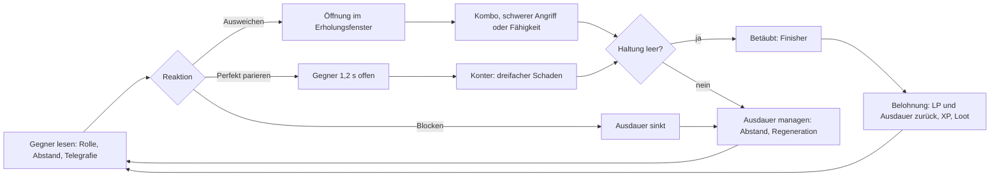
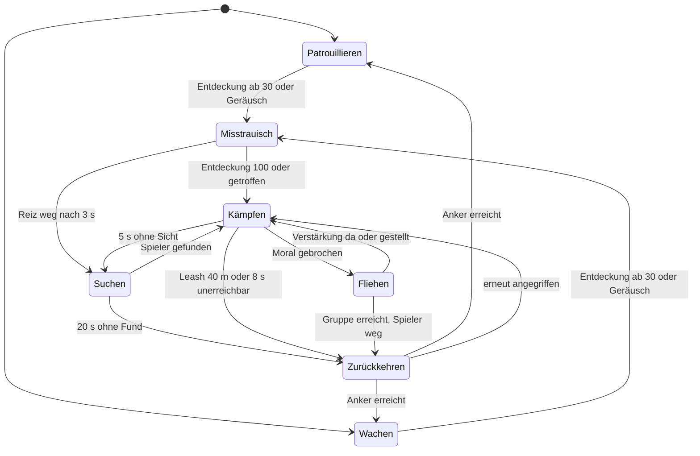

# Kampf, Charakter & Progression

> Teil der Phase-0-Planung · Stand: 2026-10-13 · Quelle: [Master-Prompt](../00_Master-Prompt.md)

**Kennzeichnungen** (wie in [00_Vision_und_Ueberblick](./00_Vision_und_Ueberblick.md)):
- **Vorschlag:** füllt eine Lücke im Master-Prompt. Alle Zahlen dieses Kapitels sind Startwerte für das Balancing und liegen später in ScriptableObjects bzw. CSV-Tabellen (§28), nie im Code.
- **Verbesserungsvorschlag:** weicht bewusst vom Master-Prompt ab. Das Original bleibt erkennbar.
- ❓ **Offene Entscheidung:** liegt beim Auftraggeber. Am Dateiende gesammelt.
- „Original (§x)“ kennzeichnet Festlegungen des Master-Prompts, die unverändert übernommen werden.

**Inhalt**
1. [Steuerung](#1-steuerung-7)
2. [Kamera](#2-kamera-81)
3. [Bewegung](#3-bewegung-82)
4. [Kampfsystem](#4-kampfsystem-91-92-98)
5. [Waffentypen](#5-waffentypen-93)
6. [Fernkampf & Magie](#6-fernkampf-94--magie-95)
7. [Statuseffekte](#7-statuseffekte-96)
8. [Schadensberechnung](#8-schadensberechnung-97)
9. [Gegner-KI, Bosse, Skalierung](#9-gegner-ki-202-bosse-203--skalierung-204)
10. [Charakterwerte](#10-charakterwerte-10)
11. [Klassen & Skilltrees](#11-klassen--skilltrees-11)
12. [Erfahrung & Level](#12-erfahrung--level-113-28)
13. [Begleiter im Kampf](#13-begleiter-im-kampf-19)
14. [Offene Entscheidungen](#offene-entscheidungen)
15. [Risiken & Hinweise](#risiken--hinweise)

### ID-Konventionen dieses Kapitels (Vorschlag)

Präfixe laut [Technik/01](../Technik/01_Architektur.md), Abschnitt 6.1. IDs ohne Umlaute.

| Präfix | Beispiel | Verwendung |
|---|---|---|
| `class.` | `class.krieger`, `class.hybrid.zauberklinge` | Klasse, Hybridklasse |
| `skill.<baum>.<ast>.<knoten>` | `skill.krieger.bollwerk.schildschlag` | Skilltree-Knoten (das, was der Spieler lernt) |
| `skill.aether.<name>` | `skill.aether.aether_stoss` | Kernfähigkeiten des Rissgeborenen (von Quests vergeben, Action `Skill(id)` aus [02](./02_Quests_und_Dialoge.md)) |
| `ability.<klasse oder schule>.<name>` | `ability.feuer.feuerball`, `ability.aether.aether_stoss` | `AbilityDefinition` (das, was auf der Fähigkeitenleiste liegt) |
| `effect.<name>` | `effect.brennen`, `effect.nass` | Statuseffekt oder Umgebungszustand |
| `item.ammo.<name>` | `item.ammo.pfeil_feuer` | Munition |

### Kanon-Abgleich mit den anderen Kapiteln

| Thema | Herkunft | Festlegung in dieser Datei |
|---|---|---|
| Erste Aether-Kraft | [01](./01_Welt_Story_Fraktionen.md) Kanon-Tabelle: Name „Aether-Stoß“, ID von 03 | **`skill.aether.aether_stoss`** (Knoten) schaltet **`ability.aether.aether_stoss`** frei. Ersetzt den Platzhalter `skill.aether.rissstoss` in [02](./02_Quests_und_Dialoge.md) und [Technik/01](../Technik/01_Architektur.md). |
| Aether-Sicht | [01](./01_Welt_Story_Fraktionen.md) 2.3 und [02](./02_Quests_und_Dialoge.md): erlernt in HQ 4 „Steinkreis von Altenhain“ | übernommen. Vorher gibt es „Untersuchen“ auf derselben Taste (1.4). Deckt sich mit [00](./00_Vision_und_Ueberblick.md) (Zeitleiste 5:00, HQ 4). |
| Laufen 5 m/s, Sprinten 7 m/s, Galopp 13 m/s | [01](./01_Welt_Story_Fraktionen.md) 3.1 | übernommen (3.1, 3.4) |
| Aether-Regeln A2, A3, A9, Verderbnis-Stufen | [01](./01_Welt_Story_Fraktionen.md) 1.2 | übernommen als endgültige Werte (7.2) |
| Wetter-Kampfeffekte | [01](./01_Welt_Story_Fraktionen.md) 6.2 | übernommen, ergänzt um Zustand „Nass“ (7.3) |
| Varianten Elite/Champion/Aether-verderbt | [01](./01_Welt_Story_Fraktionen.md) 11.2 | übernommen (10.6, 9) |
| Hitstop 60–120 ms lokal, Eingabepuffer 0,2 s, Coyote-Time 0,12 s, Sprungpuffer 0,15 s, Leash 40 m / 8 s, Token 2 Nah + 2 Fern | [Technik/01](../Technik/01_Architektur.md) 11.3, 11.4, 11.10 | bestätigt und präzisiert (4.4, 4.11, 3.1, 9.3, 9.4). Hitstop erweitert auf 40–120 ms: 40 ms für Dolche, Faustwaffen und Treffer am Spieler. |
| Optionen-Standardwerte (Empfindlichkeit, Totzone, Lock-On umschalten, Sprinten am Controller umschalten, Sichtfeld 55°) | [05](./05_UI_Audio_Grafik_Barrierefreiheit.md) 4.2 | übernommen (1.6, 2.1) |
| Grimmbart-Bossmechanik | [02](./02_Quests_und_Dialoge.md) 11.6 | passt zu den Regeln in 9.6. Telegrafie-Zeiten dort (0,8–1,5 s) liegen im Rahmen von 9.5. |

---

## 1. Steuerung (§7)

### 1.1 Controller-Belegung – Original (§7.1)

| Eingabe | Xbox | PlayStation | Aktion laut §7.1 |
|---|---|---|---|
| Linker Stick | LS | L-Stick | Bewegen |
| Rechter Stick | RS | R-Stick | Kamera |
| Linken Stick drücken | L3 (LS-Klick) | L3 | Sprinten |
| Rechten Stick drücken | R3 (RS-Klick) | R3 | Ziel fixieren (Lock-On) |
| Südtaste | A | ✕ Kreuz | Springen / Interagieren |
| Osttaste | B | ○ Kreis | Ausweichen / Rolle |
| Westtaste | X | □ Quadrat | Leichter Angriff |
| Nordtaste | Y | △ Dreieck | Schwerer Angriff |
| Linke Schultertaste | LB | L1 | Blocken / Parieren |
| Rechte Schultertaste | RB | R1 | Fähigkeit benutzen (Fähigkeitsrad halten) |
| Linker Trigger | LT | L2 | Zielen (Bogen, Zauber) |
| Rechter Trigger | RT | R2 | Schießen / Zauber wirken |
| Steuerkreuz | D-Pad | Richtungstasten | Schnellslots (Tränke, Nahrung, Werkzeuge) |
| Menü-Taste | Menu | Options | Pausemenü |
| Ansicht-Taste | View | Touchpad | Karte |

### 1.2 Maus und Tastatur – Original (§7.2)

| Taste | Aktion laut §7.2 |
|---|---|
| WASD | Bewegen |
| Maus | Kamera |
| Linke Maustaste (LMT) | Leichter Angriff |
| Rechte Maustaste (RMT) | Schwerer Angriff (halten) |
| Shift | Sprinten |
| Leertaste | Springen |
| Strg / C | Ausweichen |
| E | Interagieren |
| Q | Blocken |
| 1–4 | Fähigkeiten |
| 5–8 | Schnellslots |
| Tab | Inventar |
| M | Karte |
| J | Questlog |
| K | Skilltree |
| Esc | Pausemenü |

### 1.3 Lücken und Konflikte – Lösungen

| # | Befund | Lösung | Art |
|---|---|---|---|
| K1 | A / Kreuz ist doppelt belegt: Springen **und** Interagieren. | Kontextregel: Ist ein Interaktionsziel im Fokus (Hinweis sichtbar, ≤ 2 m), interagiert A; sonst springt A. Im Kampf haben nur Objekte mit dem Merkmal `combatUsable` Vorrang (Hebel, Pulverfass-Zünder, „Fesseln“ bei Grimmbart). Plündern im Kampf nur per Halten (0,5 s). Details in 1.4. | **Vorschlag** |
| K2 | RB: „Fähigkeit benutzen“ und „Fähigkeitsrad halten“ auf einer Taste. Dazu 4 Slots × 2 Leisten (§11.3) für nur eine Taste. | RB **tippen** (< 0,2 s) = die gewählte Fähigkeit. RB **halten** (≥ 0,2 s) = Fähigkeitsrad. **Im Rad** lösen X/Y/B/A sofort Slot 1–4 der aktiven Leiste aus (Akkord), der rechte Stick wählt eine beliebige der 8 Fähigkeiten, LB wechselt die Leiste. Tippen und Halten bleiben wie im Original. | **Verbesserungsvorschlag** (Akkord ergänzt das Rad; Original §7.1 bleibt erhalten) |
| K3 | Schleichen (§8.2) hat weder am Controller noch auf M/T eine Taste. | Controller: L3 abhängig vom Stick. Stick ≥ 50 % = Sprinten, Stick < 50 % oder Stillstand = Schleichen umschalten. M/T: **C = Schleichen**, Ausweichen bleibt auf Strg. Soll §7.2 wörtlich bleiben (C = Ausweichen), liegt Schleichen auf **V**. | **Verbesserungsvorschlag** (M/T), **Vorschlag** (Controller) |
| K4 | Ausweichen (B) ist beim Klettern, Schwimmen, Gleiten und Reiten sinnlos. | Kontextbelegung je Bewegungszustand (1.4): Loslassen, Abtauchen, Schirm schließen, Absteigen. | **Vorschlag** |
| K5 | Steuerkreuz-Schnellslots gegen 4 Fähigkeiten auf M/T (1–4). | Kein echter Konflikt: Am Controller laufen Fähigkeiten über RB (K2), das Steuerkreuz bleibt bei den 4 Schnellslots (§12.2). Während LT gehalten wird, wechselt Steuerkreuz ←/→ den Pfeiltyp, ↑/↓ bleiben Schnellslots. | **Vorschlag** |
| K6 | M/T hat kein Zielen und Schießen; RMT ist der schwere Angriff. | **F = Fernkampf-Haltung** umschalten (Bogen bzw. Armbrust ziehen oder Zauber-Zielhaltung). In der Haltung: RMT halten = Zielen, LMT = Schießen bzw. Wirken (halten = spannen). | **Vorschlag** |
| K7 | M/T hat kein Lock-On. | **Mittlere Maustaste (MMT) = Lock-On**, Mausrad = Ziel wechseln. | **Vorschlag** |
| K8 | Es fehlen: Untersuchen/Aether-Sicht, Leiste wechseln, Waffenkunst, Begleiter-Befehle, Reittier rufen, Gehen, Schnellspeichern. | Ergänzungen in der Gameplay-Map (1.5). Controller: R3 ohne Lock-On-Ziel = Untersuchen bzw. Aether-Sicht; LB + Y = Waffenkunst; LB halten + Steuerkreuz = Begleiter; LB halten + A = Reittier. M/T: R, X, Q + RMT, G, H, Feststelltaste, F5/F9. | **Vorschlag** |
| K9 | Reiten, Gleiten und Bauen haben keine Belegung. | Reiten und Bauen bekommen eigene Maps (§7.3). Gleiten liegt in der Gameplay-Map (A in der Luft). | **Vorschlag** |
| K10 | Q/E sind im Gameplay Blocken/Interagieren, im Hub-Menü Tab-Wechsel ([05](./05_UI_Audio_Grafik_Barrierefreiheit.md), 1.3). | Kein Konflikt, weil getrennte Action Maps aktiv sind. | – |
| K11 | macOS: Die Strg-Taste liegt anders als unter Windows, ⌘-Kombinationen sind systembelegt (⌘Q beendet die App). | Keine ⌘-Belegungen im Gameplay. Im Bau-Modus zeigt Rückgängig auf dem Mac ⌘Z, unter Windows Strg+Z. Rebinding für alle Tasten außer Esc. | **Vorschlag** |
| K12 | LB ist Blocken und zugleich Modifikator (Begleiter, Reittier). | Bewusst so: LB + Steuerkreuz bzw. LB + A unterbrechen das Blocken nicht. Schnellslots sind während des Blockens ohnehin gesperrt (Trinken senkt die Deckung, 4.3). | **Vorschlag** |

- ❓ **Offene Entscheidung (K2):** Fähigkeiten am Controller nur über das Rad (wörtlich §7.1) oder Rad + Akkord? Empfohlener Standard: Rad + Akkord, „nur Rad“ als Option.
- ❓ **Offene Entscheidung (K3):** Schleichen auf M/T mit C (Ausweichen nur noch auf Strg) oder V (§7.2 bleibt unverändert)? Empfohlener Standard: C.

### 1.4 Kontextregeln je Zustand (Vorschlag)

Eine Taste, eine **Absicht**: Der `InputService` liefert die Aktion, der `PlayerController` löst sie je Zustand auf. Jede Kontextregel ist in den Optionen einzeln abschaltbar. Dann erzwingt das Rebinding eine eigene Taste für die zweite Aktion.

| Zustand | A / Leertaste (bzw. E) | B / Strg | L3 / Shift | R3 / MMT | X / LMT | LB / Q |
|---|---|---|---|---|---|---|
| Boden, ohne Interaktionsziel | Springen | mit Richtung Rolle, ohne Richtung Rückwärtsschritt | Stick ≥ 50 %: Sprinten · sonst: Schleichen (M/T: C) | mit Ziel: Lock-On · ohne Ziel: Untersuchen, ab HQ 4 Aether-Sicht (M/T: R) | Leichter Angriff | Blocken |
| Boden, Interaktionsziel ≤ 2 m | Interagieren (Vorrang) · halten 0,5 s = Alternative („Alles nehmen“) | wie oben | wie oben | wie oben | wie oben | wie oben |
| Kampf (ein Gegner im Zustand „Kämpfen“ ≤ 15 m) | Springen · Interagieren nur bei `combatUsable` | Rolle | wie oben | Lock-On | Angriff · am betäubten Ziel: Finisher · ≤ 1 s nach Parade: Konter | Blocken / Parieren |
| In der Luft | Gleitschirm öffnen (ab 3 m Fallhöhe, wenn freigeschaltet) | Landerolle (≤ 0,2 s vor dem Aufprall) | – | Lock-On | Sprungangriff (Y: Sturzangriff) | – |
| Klettern | Klettersprung in Stick-Richtung | Loslassen | Schnell klettern (Tempo ×1,5, Ausdauer ×2) | Kamera zentrieren | – | – |
| Schwimmen | Auftauchen / an Land ziehen | Abtauchen | Schnell schwimmen | Kamera zentrieren | – | – |
| Tauchen | Aufsteigen (halten) | Absinken (halten) | Schnell tauchen | Kamera zentrieren | – | – |
| Gleiten | Schirm schließen | Schirm schließen | – | – | – | – |
| Zielen (LT gehalten) | Springen (beendet Zielen) | Rolle (Zielen bleibt aktiv) | – | Schulter wechseln | RT schießt (X bleibt Nahkampf) | Blocken (beendet Zielen); auf M/T in der F-Haltung mit Bogen oder Armbrust: Q = Waffenkunst (5.1) |
| Schleichen | Springen | Schleich-Rolle (Geräusch 4 statt 6 m) | Stick ≥ 50 %: Sprinten (beendet Schleichen) · sonst: Schleichen beenden | Lock-On | Schleichangriff von hinten (≤ 2 m, Gegner nicht im Kampf) | Blocken |

### 1.5 Action Maps (§7.3)

Original (§7.3): getrennte Maps für Gameplay, UI, Dialog, Reiten, Bauen. Asset und Technik: [Technik/01](../Technik/01_Architektur.md), 11.1. Action-IDs sind englisch (Code), Belegungen sind die Standardwerte.

#### Gameplay (zu Fuß)

| Action-ID | Funktion | Gamepad | Maus/Tastatur | Interaktion | Herkunft |
|---|---|---|---|---|---|
| `Move` | Bewegen; < 50 % Auslenkung = Gehen | LS | WASD | Wert 2D | §7 |
| `Look` | Kamera | RS | Maus | Wert 2D | §7 |
| `WalkToggle` | Gehen / Laufen umschalten | – (Stick-Auslenkung) | Feststelltaste | Umschalten | Vorschlag |
| `Sprint` | Sprinten | L3 (Stick ≥ 50 %) | Shift | Controller umschalten, M/T halten ([05](./05_UI_Audio_Grafik_Barrierefreiheit.md)) | §7 |
| `Sneak` | Schleichen | L3 (Stick < 50 %) | C (Verbesserungsvorschlag) bzw. V | Umschalten | Vorschlag |
| `Jump` | Springen, Klettersprung, Gleitschirm (Luft) | A | Leertaste | Drücken | §7 |
| `Interact` | Interagieren; halten = Alternative | A (mit Ziel) | E | Tippen / Halten 0,5 s | §7 |
| `Dodge` | Rolle, Rückwärtsschritt, Kontextaktion (1.4) | B | Strg (Original zusätzlich C) | Drücken | §7 |
| `LightAttack` | Leichter Angriff, Finisher, Konter | X | LMT | Drücken | §7 |
| `HeavyAttack` | Schwerer Angriff; halten = aufladen | Y | RMT | Halten | §7 |
| `Block` | Blocken; Drücken im Fenster = Parieren | LB | Q | Halten | §7 |
| `WeaponArt` | Waffenkunst (Spezialangriff, 5.1) | LB + Y; mit Bogen/Armbrust LT gehalten + Y | Q + RMT; in F-Haltung mit Bogen/Armbrust: Q | Akkord | Vorschlag |
| `LockOn` | Ziel fixieren | R3 (mit Ziel) | MMT | Umschalten ([05](./05_UI_Audio_Grafik_Barrierefreiheit.md)) | §7.1, M/T Vorschlag |
| `SwitchTarget` | Ziel wechseln | RS kippen (bei Lock-On) | Mausrad | Wert | Vorschlag |
| `Investigate` | Untersuchen (5 m), ab HQ 4 Aether-Sicht | R3 (ohne Ziel) | R | Halten | Vorschlag |
| `RangedStance` | Fernkampf-Haltung; mit Zauberstab oder Zauberbuch Zauber-Zielhaltung (6.3) | – (implizit über LT) | F | Umschalten | Vorschlag |
| `Aim` | Zielen (Bogen, Armbrust, Zauber); mit Zauberstab oder Zauberbuch zielt es immer für das Zaubern, ohne Magiewaffe immer mit dem Fernkampf-Slot (6.3) | LT | RMT in Fernkampf-Haltung | Halten ([05](./05_UI_Audio_Grafik_Barrierefreiheit.md): umschaltbar) | §7.1 |
| `Fire` | Schießen / Zauber wirken; halten = spannen; mit Magiewaffe Grundangriff des Stabs bzw. Buchgeschoss (6.3) | RT | LMT in Fernkampf-Haltung | Halten | §7.1 |
| `CycleAmmo` | Pfeiltyp wechseln | Steuerkreuz ←/→ während LT | Mausrad während Zielen | Drücken | Vorschlag |
| `SwapShoulder` | Schulter wechseln | R3 während LT | MMT während Zielen | Drücken | Vorschlag |
| `UseAbility` | gewählte Fähigkeit (entfällt bei Option „Fähigkeitsrad: Umschalten“, 1.6) | RB tippen | – | Tippen < 0,2 s | §7.1 |
| `AbilityWheel` | Fähigkeitsrad (8 Fähigkeiten) | RB halten | – | Halten ≥ 0,2 s | §7.1 |
| `Ability1`–`Ability4` | Fähigkeit 1–4 der aktiven Leiste | RB halten + X / Y / B / A | 1–4 | Akkord bzw. Drücken | §7.2, Akkord Verbesserungsvorschlag |
| `SwitchBar` | Fähigkeitenleiste 1 ↔ 2 | RB halten + LB | X | Drücken | Vorschlag |
| `QuickSlot1`–`QuickSlot4` | Schnellslots | Steuerkreuz ↑ → ↓ ← | 5–8 | Drücken | §7 |
| `CompanionCommand` | Begleiter-Befehle (13.2) | LB halten + Steuerkreuz | G halten = Befehlsrad · G + 1–4 direkt | Akkord | Vorschlag |
| `CallMount` | Reittier rufen | LB halten + A | H | Akkord bzw. Drücken | Vorschlag |
| `Map` | Karte | View / Touchpad tippen | M | Tippen | §7 |
| `HudPeek` | HUD 5 s einblenden | View / Touchpad halten | M halten | Halten 0,4 s | [05](./05_UI_Audio_Grafik_Barrierefreiheit.md) 1.2 |
| `Pause` | Pausemenü / Hub | Menu / Options | Esc | Drücken | §7 |
| `Inventory`, `QuestLog`, `SkillTree` | Hub-Tabs direkt | – (über Hub, [05](./05_UI_Audio_Grafik_Barrierefreiheit.md) 1.3) | Tab, J, K | Drücken | §7.2 |
| `QuickSave`, `QuickLoad` | Schnellspeichern / -laden (§25) | – (Pausemenü) | F5 / F9 | Drücken | Vorschlag |

#### UI (Menüs, Hub, Handel, Werkbank)

Regeln und Glyphen stehen in [05](./05_UI_Audio_Grafik_Barrierefreiheit.md), 1.4 und 1.5. Hier nur die Actions:

| Action-ID | Funktion | Gamepad | Maus/Tastatur |
|---|---|---|---|
| `Navigate` | Fokus bewegen | LS, Steuerkreuz | Pfeiltasten, WASD |
| `Submit` | Bestätigen (halten = Halten zum Bestätigen) | A | Enter, Leertaste, LMT |
| `Cancel` | Zurück | B | Esc, RMT |
| `Secondary` | Ausrüsten, Markieren, Sperren | X | F |
| `SortFilter` | Sortieren / Filtern | Y | R |
| `TabPrev`, `TabNext` | Haupttab | LB / RB | Q / E |
| `SubTabPrev`, `SubTabNext` | Unterkategorie | LT / RT | Z / C (Position; QWERTZ zeigt Y / C) |
| `Details` | Details, Affix-Spannen, Lore | R3 | Shift |
| `ScrollRotate` | Text scrollen, 3D-Vorschau drehen | RS | Mausrad, Ziehen mit LMT |
| `Point`, `Click` | Zeigen, Klicken | – | Maus |
| `CloseHub` | Hub schließen | Menu bzw. die Direkttaste des Tabs | Esc bzw. Tab, M, J, K |
| `SkipCutscene` | Zwischensequenz überspringen (im Zustand Cutscene) | A halten 1 s | Leertaste halten 1 s |

#### Dialog

| Action-ID | Funktion | Gamepad | Maus/Tastatur |
|---|---|---|---|
| `DialogNavigate` | Antwort wählen | LS, Steuerkreuz ↑/↓ | W/S, Pfeiltasten, Maus |
| `DialogSubmit` | Wählen · Weiter (1. Druck: Zeile sofort vollständig, 2. Druck: nächste Zeile) | A | E, Leertaste, Enter, LMT |
| `DialogDirect1`–`9` | Antwort direkt wählen | – | 1–9 |
| `DialogBack` | Zurück aus Themenliste · Gespräch beenden, wenn erlaubt | B | RMT |
| `DialogDetails` | Probe, Schwelle, eigener Wert ([02](./02_Quests_und_Dialoge.md), 12.4) | R3 | Shift |
| `DialogLog` | Gesprächsverlauf | Y | Tab |
| `DialogAuto` | Automatisch fortsetzen an/aus | X | F |
| `Pause` | Pausemenü | Menu | Esc |

#### Reiten

| Action-ID | Funktion | Gamepad | Maus/Tastatur |
|---|---|---|---|
| `MountSteer` | Lenken; Auslenkung < 50 % = Schritt, ≥ 50 % = Trab | LS | WASD (S bremst) |
| `MountLook` | Kamera | RS | Maus |
| `MountGallop` | Gangart hoch: Galopp, erneut = Sprint-Galopp (Reittier-Ausdauer) | L3 | Shift halten = Galopp, doppelt tippen und halten = Sprint-Galopp |
| `MountJump` | Hindernissprung | A | Leertaste |
| `Dismount` | Absteigen | B | E |
| `MountAttack` | Reiterhieb zur Kameraseite (4.6) | X | LMT |
| `MountAim`, `MountFire` | Zielen und Schießen vom Pferd | LT / RT | RMT / LMT |
| `QuickSlot1`–`4` | Schnellslots | Steuerkreuz | 5–8 |
| `Map`, `Pause` | Karte, Pausemenü | View, Menu | M, Esc |

**Vorschlag – Straße folgen:** Im Galopp ohne Lenkeingabe folgt das Pferd dem Weg bis zur nächsten Kreuzung (Option, Standard an).

#### Bauen (Bau-Modus im Haus, §21)

| Action-ID | Funktion | Gamepad | Maus/Tastatur |
|---|---|---|---|
| `BuildCursor` | Bau-Cursor bewegen | LS | WASD bzw. Maus zeigt |
| `BuildOrbit` | Kamera drehen | RS | RMT halten + Maus |
| `BuildZoom` | Zoom 3–20 m | LT / RT | Mausrad |
| `BuildPlace` | Platzieren bzw. Objekt aufnehmen | A | LMT |
| `BuildCancel` | Abbrechen, Auswahl aufheben | B | RMT kurz klicken |
| `BuildRotate` | Drehen in 15°-Schritten, halten = frei | LB / RB | Q / E |
| `BuildHeight` | Höhe ±5 cm | Steuerkreuz ↑/↓ | Bild↑ / Bild↓ |
| `BuildVariant` | Material- bzw. Farbvariante | Steuerkreuz ←/→ | Z / X |
| `BuildGrid` | Raster an/aus (freie Platzierung) | Y | G |
| `BuildStore` | Objekt einlagern (ins Lager) | X | Entf |
| `BuildCopy` | Objekt duplizieren | R3 | C |
| `BuildCatalog` | Möbelkatalog | View | Tab |
| `BuildUndo` | Rückgängig (20 Schritte) | LB + RB | Strg+Z bzw. ⌘Z |
| `BuildMenu` | Bau-Menü: Verlassen, Pause, Optionen | Menu | Esc |

#### Wann welche Map aktiv ist

Zustände laut [Technik/01](../Technik/01_Architektur.md), 4.4. Es ist immer genau **eine** Spieler-Map aktiv. Gameplay ist in Menüs immer aus.

| Spielzustand | Aktive Map | Hinweis |
|---|---|---|
| Boot, Laden | keine | – |
| Hauptmenü, Menü (Hub), Pause | UI | – |
| Spielen, zu Fuß | Gameplay | Klettern, Schwimmen, Gleiten, Zielen und Kampf sind Kontexte innerhalb der Map (1.4), kein Map-Wechsel. |
| Spielen, beritten | Reiten | Wechsel beim Auf- und Absteigen |
| Dialog (Voll- und Kurzmodus) | Dialog | Im Kurzmodus ([02](./02_Quests_und_Dialoge.md), 12.1) bleibt `Move` zusätzlich aktiv, damit man gehend zuhören kann. |
| Zwischensequenz | UI (nur `SkipCutscene`, `Pause`) | – |
| Bau-Modus | Bauen | – |
| Bau-Modus, Möbelkatalog geöffnet (`BuildCatalog`) | UI | LB/RB wechseln die Katalog-Kategorien ([04](./04_Items_Crafting_Wirtschaft_Endgame.md), 7.3); beim Schließen zurück zu Bauen |
| Entwicklungs-Builds | zusätzlich Debug | Konsole, Overlay ([Technik/01](../Technik/01_Architektur.md)) |

### 1.6 Rebinding und Optionen (§7.3)

**Rebinding-Regeln (Vorschlag):**
- Jede Action jeder Map ist umbelegbar. Ausnahmen: `Pause` (Esc/Menu) sowie `Submit`/`Cancel` am Gamepad (§24.3: „A = Bestätigen, B = Zurück“).
- Doppelbelegung **innerhalb** einer Map → Dialog „Tauschen?“. Über Maps hinweg ist dieselbe Taste erlaubt (Q blockt im Gameplay und wechselt Tabs im UI).
- Kontextpaare (A = Springen + Interagieren, L3 = Sprinten + Schleichen, R3 = Lock-On + Untersuchen) sind getrennt umbelegbar. Belegt der Spieler sie getrennt, schaltet sich die Kontextregel automatisch ab.
- Gespeichert in `settings.json`, nicht im Spielstand ([Technik/01](../Technik/01_Architektur.md), 11.1).

**Optionen:** Die Standardwerte für Stick-Empfindlichkeit (5/5), Y-Achse invertieren (getrennt für Kamera und Zielen), Totzone (10 %/10 %), Vibration (80 %), Zielhilfe, Halten/Umschalten und Kamera-Abstand stehen in [05](./05_UI_Audio_Grafik_Barrierefreiheit.md), 4.2. **Vorschlag – zusätzliche Kampf-Optionen:**

| Option | Werte | Standard |
|---|---|---|
| Fähigkeiten-Schema (Controller) | Rad + Akkord / nur Rad (Original) | Rad + Akkord |
| Zeit im Fähigkeitsrad | normal / Zeitlupe 25 % / Pause | Zeitlupe 25 % (Schwierigkeit Geschichte: Pause) |
| Rollen-Richtung | Stick-Richtung / Kamerablick | Stick-Richtung |
| Nach Kill nächstes Ziel fixieren | an / aus | an |
| Angriffs-Ausrichtung ohne Lock-On (Soft-Lock) | aus / schwach (30°) / stark (60°) | schwach |
| Zielen schaltet auf Leiste 2 | an / aus | aus |
| Kontextregeln einzeln (A, L3, R3) | an / aus | an |

- **Option „Fähigkeitsrad: Umschalten“** ([05](./05_UI_Audio_Grafik_Barrierefreiheit.md), 4.2): RB-Tippen öffnet und schließt das Rad. `UseAbility` entfällt, Fähigkeiten laufen dann über das Rad bzw. Rad + Akkord (X/Y/B/A). Bei „Halten“ (Standard) gilt K2 (1.3).

---

## 2. Kamera (§8.1)

Technik: Cinemachine 3, Kameras und Blends laut [Technik/01](../Technik/01_Architektur.md), 11.2. Hier stehen Designwerte (**Vorschlag**).

### 2.1 Kameramodi

FOV = vertikales Sichtfeld. Basis ist die Option „Sichtfeld“ aus [05](./05_UI_Audio_Grafik_Barrierefreiheit.md) (45–70°, Standard 55°). Relative Angaben (z. B. „Basis +3°“) folgen der Option.

| Modus | Abstand | Schulterversatz / Pivot | FOV | Verhalten | Übergang hinein |
|---|---|---|---|---|---|
| Erkundung | 4,0 m (Option Nah 3,2 / Fern 5,0) | 0,3 m rechts / 1,6 m | Basis (55°) | Auto-Zentrieren nach 2 s ohne Kamera-Eingabe ([05](./05_UI_Audio_Grafik_Barrierefreiheit.md)). Im Sprint +0,5 m Abstand und +5° FOV. | 0,25 s |
| Schleichen | 3,6 m | 0,3 m / 1,1 m (tiefer) | Basis | Rahmen etwas enger, damit Deckungskanten lesbar sind | 0,3 s |
| Kampf (ohne Lock-On) | 4,6 m | 0 / 1,5 m | Basis +3° | Rahmen bezieht Gegner im Zustand „Kämpfen“ bis 15 m mit ein (Gewicht Spieler 1,0, Gegner je 0,3). Kein Auto-Zentrieren. | 0,5 s |
| Lock-On | 4,5–7,0 m: 4,5 + 0,25 × Zielhöhe (m) + 0,1 × Abstand (m) | 0,5 m / 1,5 m | Basis bis Basis +7° | Spieler im unteren Drittel, Ziel in Bildmitte. Gegnerwechsel per Stick-Kippen. Bricht ab bei > 30 m oder 2 s ohne Sichtlinie. | 0,3 s |
| Zielen (Bogen, Armbrust, Zauber) | 1,4 m | 0,6 m rechts (Schulter wechselbar) / 1,65 m | Basis −13° (42°), voll gespannt −17° (38°) | Eigene Empfindlichkeit (Option „Zielen“ 4/10). Zielhilfe laut 2.3. | 0,18 s |
| Dialog | 0,9–3,5 m: Nah 0,9 · Über-Schulter 1,4 · Totale 3,5 | Schuss-Gegenschuss | 32–40° | Wechsel alle 1–3 Zeilen, 180°-Regel, `DialogueCameraDirector` ([Technik/01](../Technik/01_Architektur.md)) | Einstieg 0,4 s Blend, danach harte Schnitte |
| Reiten | 6,0 m · Galopp 7,0 · Sprint-Galopp 7,5 | 0 / 2,4 m | Basis +3° · Galopp +8° · Sprint +11° | 0,25 s Nachzieh-Verzögerung (Lag), Horizont ruhig | 0,6 s |
| Schwimmen | 4,0 m | 0 / 0,6 m über der Wasseroberfläche | Basis | Pivot folgt der Wasserlinie, nicht dem Kopf | 0,4 s |
| Tauchen | 3,5 m | 0 / Körpermitte | Basis +5° | Kollision mit Wasseroberfläche (Kamera bleibt unter Wasser) | 0,4 s |
| Klettern | 4,5 m | 0 / 1,4 m | Basis | Schwenkt auf 15° über die Wand-Normale, damit der nächste Griff sichtbar ist | 0,4 s |
| Gleiten | 5,5 m | 0 / 1,8 m | Basis +8° | 0,3 s Lag, leichte Neigung in Kurven | 0,5 s |
| Bau-Modus | Orbital um den Bau-Cursor, 8 m (Zoom 3–20 m) | – | 50° fest | Neigung 50° (25–80°). Wände zwischen Kamera und Cursor werden ausgeblendet (Cutaway) statt herangezoomt. | 0,5 s |
| Finisher und Konter | 2,2 m, seitlich | – | 45° | Kurzschnitt 1,2–2,0 s, danach zurück. Abschaltbar (Option „Finisher-Kamera“). | harter Schnitt |

### 2.2 Kollision, Shake, Lesbarkeit

- **Weiche Kollision (§8.1):** Kugelradius 0,25 m. Heranziehen ohne Verzögerung, Zurückfahren in 0,5 s. Vegetation, Partikel und kleine Objekte unter 0,5 m lösen keine Kollision aus.
- **Verdeckung durch Figuren:** NPCs, Begleiter und Gegner näher als 1,2 m an der Kamera werden auf 30 % Deckkraft geblendet (Dither).
- **Kamera-Shake (§8.1):** nur über Impulse ([Technik/01](../Technik/01_Architektur.md)). Werte je Trefferstärke in 4.11. Globaler Faktor 0–100 % (Option, [05](./05_UI_Audio_Grafik_Barrierefreiheit.md)). Bei 0 % gibt es auch keine Wackel-Ersatzeffekte.
- **Fotomodus (§8.1):** später (Stufe C), eigene Freiflug-Kamera, Spielzeit pausiert.

### 2.3 Lock-On und Zielhilfe

| Regel | Wert (Vorschlag) |
|---|---|
| Zielauswahl beim Fixieren | Kegel ±30° um die Kamerarichtung, Reichweite 25 m (Nebel: 20 m laut [01](./01_Welt_Story_Fraktionen.md)). Gewichtung: Winkel 60 %, Abstand 40 %. |
| Große Gegner und Bosse | mehrere Lock-On-Punkte (Kopf, Kristallkern, Beine), Wechsel per Stick-Kippen |
| Abbruch | > 30 m, 2 s ohne Sichtlinie oder Ziel tot (dann nächstes Ziel, Option) |
| Soft-Lock ohne Lock-On | Angriffe drehen den Spieler beim Start um bis zu 30° (Option 0/30/60°) zum nächsten Gegner in 3 m |
| Angriffs-Magnetismus | Root Motion des Angriffs wird um bis zu 1,5 m auf das Ziel gestreckt bzw. gestaucht (Warping) |
| Zielhilfe Controller (§29), Stufen Schwach / Standard / Stark | Magnetismus-Kegel 3° / 5° / 8° · Verlangsamung der Kamera auf dem Ziel auf 85 % / 70 % / 55 % · Einrasten beim Drücken von LT nur bei „Stark“ (nächstes Ziel im 10°-Kegel) |
| Maus | keine Zielhilfe |

---

## 3. Bewegung (§8.2)

Original (§8.2): Gehen, Laufen, Sprinten (kostet Ausdauer), Springen mit Luftkontrolle, Ausweichrolle mit I-Frames, Klettern an markierten Flächen, Schwimmen und Tauchen (Atemleiste), Schleichen, Gleitschirm (später), Reiten, Schnellreise, Root Motion für Angriffe, In-Place für Fortbewegung. „Weich und direkt“ mit Controller.

### 3.1 Tuning-Tabelle (Vorschlag)

| Parameter | Wert | Anmerkung |
|---|---|---|
| Gehen | 2,0 m/s | Stick < 50 % bzw. Feststelltaste |
| Laufen | **5,0 m/s** | Kanon aus [01](./01_Welt_Story_Fraktionen.md) |
| Sprinten | **7,0 m/s** | Kanon aus [01](./01_Welt_Story_Fraktionen.md); Ausdauer 12/s; Start erst ab 10 Ausdauer |
| Schleichen | 1,8 m/s | Geräusch 2 m, Sichtfaktor ×0,5 (9.2) |
| Bewegung beim Blocken / Zielen | 2,5 / 2,2 m/s | – |
| Lock-On: seitwärts / rückwärts | 4,0 / 3,5 m/s | 8-Wege-Strafing |
| Beschleunigung / Abbremsen | 0 → 5 m/s in 0,15 s / Stopp in 0,12 s | Kurze Wege = „direkt“ |
| Drehrate | 720°/s laufend, 540°/s im Sprint | Ab 150° Richtungswechsel spielt eine Wende-Animation (0,25 s) |
| Stick-Kurve | exponentiell, Totzone 10 %, äußere Totzone 95 % | Option in [05](./05_UI_Audio_Grafik_Barrierefreiheit.md) |
| Sprunghöhe | 1,2 m aus dem Stand | Ausdauer 10 |
| Sprungweite | ~3,5 m laufend, ~4,6 m sprintend | – |
| Schwerkraft | 1,0 g steigend, 1,6 g fallend | Kurzer, „knackiger“ Sprungbogen |
| Höchste Fallgeschwindigkeit | 40 m/s | – |
| Luftkontrolle | 40 % der Bodenbeschleunigung | Richtungskorrektur ja, Umkehr nein |
| Coyote-Time / Sprungpuffer | 0,12 s / 0,15 s | bestätigt aus [Technik/01](../Technik/01_Architektur.md) |
| Hochziehen an Kanten / Überspringen | automatisch bis 2,2 m / bis 1,0 m beim Laufen | Animator `MatchTarget` |
| Hangneigung | begehbar bis 45°, ab 50° rutschen | – |
| Traglast überschritten (§12.1) | max. 3 m/s, kein Sprint, keine Rolle (nur Ausweichschritt), keine Schnellreise | Stufe „Überladen“ (> 100–125 %); darüber „Schwer überladen“ (7.3, [04](./04_Items_Crafting_Wirtschaft_Endgame.md) 1.3) |
| Ausdauer-Regeneration | 25/s nach 0,8 s ohne Verbrauch | Details in 4.3 |

### 3.2 Ausweichrolle und I-Frames (Vorschlag)

Das Rollen-Profil hängt von der **Rüstungsklasse** ab (Stoff = leicht, Leder = mittel, Platte = schwer): relative Mehrheit der 5 Slots Kopf, Brust, Hände, Beine, Füße. Der Umhang ist klassenlos, ein leerer Slot zählt als leicht ([04](./04_Items_Crafting_Wirtschaft_Endgame.md), 2.1). Bei Gleichstand gilt die schwerere Klasse (z. B. 2 Platte + 2 Leder + 1 Stoff = schwer). Zeiten ab Tastendruck.

**Verbesserungsvorschlag – drei Rüstungsklassen:** Original §13.1: Lederverarbeitung = leichte Rüstung. Vorschlag: drei Rüstungsklassen (Stoff leicht, Leder mittel, Platte schwer); „leicht“ im Sinne von §13.1 heißt „nicht Platte“ ([04](./04_Items_Crafting_Wirtschaft_Endgame.md), K30). Grund: Drei Stufen geben drei unterscheidbare Rollen-Profile und Standfestigkeitswerte (4.9), ohne die Berufe aus §13.1 zu ändern.

| Profil | Distanz | Dauer gesamt | I-Frame-Fenster | Abbrechbar ab | Ausdauer |
|---|---|---|---|---|---|
| Leicht | 4,2 m | 550 ms | 50–350 ms (300 ms) | 400 ms | 12 |
| Mittel | 3,6 m | 650 ms | 50–300 ms (250 ms) | 480 ms | 15 |
| Schwer | 3,0 m | 800 ms | 60–260 ms (200 ms) | 600 ms | 20 |
| Überladen | 1,5 m (Schritt) | 450 ms | 50–150 ms (100 ms) | 350 ms | 15 |
| Rückwärtsschritt (B ohne Richtung) | 2,0 m | 350 ms | 50–200 ms (150 ms) | 250 ms | 8 |

- „Abbrechbar ab“: Ab hier kann ein Angriff, Block oder eine weitere Rolle die Rolle beenden (4.4).
- Schwierigkeit „Geschichte“: I-Frames +100 ms; „Albtraum“: −50 ms (9.7).
- Geschick senkt die Ausdauerkosten um 1 % je effektivem Punkt, höchstens −30 % (10.2).

### 3.3 Klettern, Schwimmen, Schleichen, Gleiten (Vorschlag)

| Bewegung | Werte |
|---|---|
| **Klettern** (markierte Flächen: Leitern, Ranken, helle Felsvorsprünge laut [05](./05_UI_Audio_Grafik_Barrierefreiheit.md), 3.2) | Fels 1,2 m/s hoch, 1,4 m/s seitlich · Ranken 1,0 m/s · Leitern 1,5 m/s ohne Ausdauer · Ausdauer 6/s in Bewegung, 2/s beim Hängen, 0 an markierten Rastpunkten · Klettersprung 1,8 m (20 Ausdauer) · bei 0 Ausdauer 1,0 s Zittern als Warnung, dann Absturz |
| **Schwimmen** | 2,5 m/s · schnell 4,0 m/s (10 Ausdauer/s) · erschöpft 1,2 m/s, an der Oberfläche **kein** Ertrinken · keine Waffen und Fähigkeiten im Wasser außer Selbstverstärkung |
| **Tauchen** | 2,2 m/s · Atemleiste **30 s** (+15 s Baum „Überleben“, +30 s Wasseratmungstrank) · ohne Atem 10 % max. LP pro s · Atem füllt sich an der Oberfläche in 3 s |
| **Schleichen** | 1,8 m/s · Geräusch 2 m · im hohen Gras Sichtfaktor ×0,4 · Schleich-Rolle mit 4 m Geräusch · Begleiter schleichen mit (13.3) |
| **Gleitschirm** | Freischaltung **~Stunde 20, Uhrwerkturm-Quest in Aurelion** ([00](./00_Vision_und_Ueberblick.md), [01](./01_Welt_Story_Fraktionen.md)) · Öffnen ab 3 m über Grund · vorwärts 8,0 m/s · Sinkrate 2,0 m/s (Gleitzahl 4 : 1) · Ausdauer 3/s, bei 0 schließt der Schirm · Aufwind über Feuer, Thermik an Klippen, Rissen: +6 m/s steigend · Kurvenrate 90°/s · Baum „Überleben“: Sinkrate −20 % |

### 3.4 Reiten (Vorschlag)

| Reittier | Schritt / Trab / Galopp / Sprint | Besonderheit | Erhalt |
|---|---|---|---|
| Pferd | 2,5 / 6,0 / **13,0** / 16,0 m/s | Sprung 1,4 m hoch, 6 m weit · Drehrate im Galopp 120°/s | Akt 1, ~Stunde 6 ([00](./00_Vision_und_Ueberblick.md)) |
| Sandechse | 2,5 / 5,5 / 12,0 / 15,0 m/s | ignoriert Treibsand und Hitze-Aufbau | Kar'Zul (Ruf Wilde Stämme, [01](./01_Welt_Story_Fraktionen.md)) |
| Bergwidder | 2,0 / 5,0 / 11,0 / 13,5 m/s | Hänge bis 55°, Kälteschutz | Frostgipfel (Ruf Zwerge) |
| Aetherhirsch | 2,5 / 6,5 / 13,0 / 17,0 m/s | Rissprung: 10 m Teleport über Inselspalten (Abklingzeit 20 s) | Zerbrochener Himmel, Endgame |

- **Reittier-Ausdauer:** 100. Sprint −20/s, Regeneration 12/s nach 1 s. Sprungkosten 15.
- **Rufen:** erscheint außerhalb der Sicht ≤ 60 m entfernt und läuft heran (max. 10 s). Nicht in Dungeons, Innenräumen und im Stadtkern von Aurelion.
- **Verletztes Reittier:** kein dauerhafter Tod. Bei 0 LP flieht es und steht nach 2 Spielstunden im Stall.
- **Kampf vom Reittier:** nur Reiterhieb (leicht, zur Kameraseite, 110 % Waffenschaden, kein Kombo) und Bogen/Armbrust. Kein Blocken, keine Fähigkeiten. ❓ **Offene Entscheidung:** Umfang des berittenen Kampfes; empfohlener Standard: so wie hier (~15 statt ~60 Animationen).
- **Keine Flugreittiere** (Vorschlag): Sie würden Welt-Streaming und Level-Design (Klettern, Gleiten, Geheimnisse) aushebeln.

### 3.5 Fallschaden (Vorschlag)

| Fallhöhe h | Schaden |
|---|---|
| ≤ 6 m | 0 |
| 6–20 m | (h − 6) × 7 % der max. LP (z. B. 10 m → 28 %, 15 m → 63 %) |
| > 20 m | tödlich |

- Landerolle (B bzw. Strg ≤ 0,2 s vor dem Aufprall) halbiert den Schaden und verschiebt die sichere Höhe um +2 m.
- Wasser ab 2 m Tiefe: kein Schaden bis 40 m.
- Sturzangriff (4.6) aus ≥ 3 m: kein Fallschaden bis 10 m.
- „Geschichte“: Schaden ×0,5.

### 3.6 Schnellreise (§8.2, Vorschlag)

| Regel | Festlegung |
|---|---|
| Ziele | entdeckte Wegpunkte: Wegschreine, Aussichtspunkte ([01](./01_Welt_Story_Fraktionen.md)), Siedlungen, eigene Häuser, Dungeon-Eingänge (nur von außen) |
| Start | **Verbesserungsvorschlag:** Start von überall außerhalb von Sperren (Original §8.2: nur zwischen entdeckten Wegpunkten; bleibt als **Option** „Schnellreise nur zwischen Wegpunkten“, Standard aus, Teil der Albtraum-Herausforderung). Grund: Bequemlichkeit ohne Rückweg zum nächsten Wegpunkt. Säule 1 bleibt gewahrt, weil nur entdeckte Ziele erreichbar sind und die kostenlose Reise nie Pflicht ist. |
| Sperren | im Kampf; überladen; in Dungeons und Innenräumen; in Leere-Zonen; während Quest-Stages mit `blocksFastTravel` (Eskorte, Zeitlimit, Verfolgung) |
| Kosten | keine (Säule 1: Reisen bleibt Erkundung, Schnellreise ist Bequemlichkeit) |
| Spielzeit | Die Spieluhr springt um die Reisedauer zu Pferd: Luftlinie ÷ 13 m/s, umgerechnet in Spielzeit (1 Echtzeitminute = 30 Spielminuten). Beispiel: 4 km → ~5,1 min Echtzeit → ~2,6 Spielstunden. |
| Begleiter und Reittier | reisen mit |
| Ladezeit | < 15 s (§4.4) |

### 3.7 Root Motion oder In-Place (§8.2)

| Bewegung | Methode | Begründung |
|---|---|---|
| Gehen, Laufen, Sprinten, Schleichen, Strafing | **In-Place** (Code-gesteuert) | Original §8.2; exakte, frame-unabhängige Werte aus 3.1 |
| Schwimmen, Klettern (fortlaufend), Gleiten | In-Place | Tempo ist ein Tuningwert, kein Animationswert |
| Sprung | In-Place mit physikalischer Kurve | Luftkontrolle braucht Code-Steuerung |
| Angriffe, Waffenkünste, Finisher | **Root Motion** mit Warping ≤ 1,5 m | Original §8.2; Treffer passen exakt zur Animation |
| Ausweichrolle, Rückwärtsschritt | Root Motion, auf die Profil-Distanz aus 3.2 skaliert | Eine Animation für alle Profile |
| Treffer-Reaktionen, Taumeln, Umwerfen | Root Motion | Glaubwürdiger Rückstoß |
| Hochziehen, Überspringen, Leiter Ein-/Ausstieg | Root Motion + `MatchTarget` | Hände treffen die Kante |
| Wenden (> 150°) | Root Motion (Rotation) | Gewicht beim Richtungswechsel |
| Gegner: Fortbewegung / Angriffe | NavMeshAgent / Root Motion | Umschalten wie in [Technik/01](../Technik/01_Architektur.md), 11.10 |

---

## 4. Kampfsystem (§9.1, §9.2, §9.8)

### 4.1 Grundprinzip

Original (§9.1): Action-Kampf in Echtzeit, Mischung aus Witcher 3 und Elden Ring, aber zugänglicher. Ausdauer begrenzt Angriffe, Ausweichen und Blocken. Treffer sind wuchtig. Gegner haben lernbare Muster.

**Vorschlag – „zugänglicher“ konkret:**
1. Großzügige Fenster: Parieren 150 ms, I-Frames der Rolle 200–300 ms je Rüstungsklasse (3.2), Eingabepuffer 200 ms (Parierfenster auf „Schwer“ und „Albtraum“ enger, I-Frames nur auf „Albtraum“ −50 ms, 9.7; Eingabepuffer auf allen Stufen 200 ms, 4.4).
2. Jeder Gegnerangriff ist mit ≥ 400 ms Ausholen angekündigt (9.5), unblockbare zusätzlich rot.
3. Vier Schwierigkeitsgrade, jederzeit änderbar (§29, 9.7).
4. Heilung über Schnellslots ohne Item-Rotation.
5. Keine Bestrafung beim Tod außer Zeit (4.12, ❓).
6. Lock-On, Soft-Lock und Zielhilfe.

### 4.2 Kampf-Loop



Takt (Ziel): ein Austausch dauert 2–5 s ([00](./00_Vision_und_Ueberblick.md)). Ein Kampf gegen eine Normalgruppe (3–4 Gegner, gleiches Level, Schwierigkeit Normal) dauert 30–60 s.

### 4.3 Ausdauer-Ökonomie (Vorschlag)

Max. Ausdauer = 100 + 2 × E(Konstitution) + 0,5 × (Level − 1), siehe 10.3. Beispiel Krieger Level 10, Konstitution 18: 120,5, angezeigt **120**; mit Kernknoten Kampfgeist **130**.

| Aktion | Ausdauer | Anmerkung |
|---|---|---|
| Leichter Angriff | leichte Waffen 6–8 · mittlere 12–14 · schwere 16–18 | Werte je Waffentyp in 5.1 |
| Schwerer Angriff | 14–36 je Waffe; aufgeladen Stufe 1 +6, Stufe 2 +12 | – |
| Sprint- und Sprungangriff | 1,5 × leichter Angriff | – |
| Sturzangriff | = schwerer Angriff | – |
| Waffenkunst (Spezialangriff) | 25–35 + Abklingzeit 6–10 s | 5.1 |
| Krieger-, Schurken- und Waldläufer-Fähigkeiten | 15–30 + Abklingzeit | Magie kostet Mana (6.3) |
| Ausweichrolle / Rückwärtsschritt | 12 / 15 / 20 je Profil · 8 | 3.2 |
| Blocken (halten) | 0; Regeneration halbiert | – |
| Geblockter Treffer | Ausdauerschaden des Angriffs × (1 − Stabilität) | 4.7 |
| Perfekte Parade, Konter, Finisher | 0 | Belohnt Können |
| Sprinten / Schwimmen schnell / Klettern / Gleiten | 12/s / 10/s / 6/s / 3/s | – |
| Springen / Klettersprung | 10 / 20 | – |
| Bogen: Schuss / voll gespannt halten | 4 / 5 je s ab 1,5 s Halten | 6.1 |

**Regeln:**
- Eine Aktion ist erlaubt, solange Ausdauer > 0 ist. Die Kosten können den Wert auf 0 senken, nicht darunter.
- Regeneration 25/s nach 0,8 s ohne Verbrauch. Beim Blocken 12,5/s.
- **Erschöpft:** Fällt die Ausdauer auf 0, sind Sprinten und Rolle 1,2 s gesperrt (HUD blinkt, [05](./05_UI_Audio_Grafik_Barrierefreiheit.md)).
- **Deckungsbruch (Guard Break):** Bringt ein geblockter Treffer die Ausdauer auf 0, taumelt der Spieler 1,0 s.
- **Schnellslot benutzen:** Trinken dauert 0,8 s, Bewegung 50 %, nicht während Blocken und Rolle. Treffer mit Haltungsschaden ≥ Standfestigkeit unterbrechen; das Item ist dann **nicht** verbraucht.

### 4.4 Leichte Kombos und Eingabepuffer

Original (§9.2): leichte Angriffe als Kombo (3–5 Schläge). §9.8: Zustandsmaschine mit Eingabepuffer.

**Vorschlag:**

| Regel | Wert |
|---|---|
| Kombo-Länge | 3–5 je Waffentyp (5.1) |
| Phasen je Angriff | Ausholen → Aktiv (Hitbox an) → Erholung |
| Kombo-Fenster | ab ~55 % der Clip-Länge bis Clip-Ende (per Animation Event `ComboWindowOpen/Close`) |
| Kombo-Reset | 0,6 s nach dem letzten Schlag ohne Eingabe |
| Kombo-Abschluss (letzter Schlag) | Schaden ×1,2, Haltungsschaden ×1,5 |
| Abzweig „leicht → schwer“ | Y im Kombo-Fenster nach Schlag n startet einen eigenen Abschluss (Waffendaten); nicht in Stufe A |
| Eingabepuffer | **200 ms**, gilt nur für die letzte Eingabe |
| Puffer für Rolle und Parieren | 150 ms, damit keine ungewollte Rolle „nachläuft“ |
| Vorrang im Puffer | Rolle und Parieren überschreiben einen gepufferten Angriff, nicht umgekehrt |
| Abbruch durch Rolle oder Block | leichte Angriffe: jederzeit außer in der Aktivphase · schwere Angriffe: nur in der Erholung |
| Bewegung während der Kombo | Stick lenkt jeden Schlag beim Start um bis zu 45° (mit Lock-On: aufs Ziel) |

### 4.5 Schwere Angriffe (aufladbar)

| Stufe | Haltedauer | Schaden | Haltungsschaden | Ausdauer | Besonderheit |
|---|---|---|---|---|---|
| Ungeladen | Loslassen vor 0,6 s | ×1,5 | ×1,5 | Basis | ab 0,3 s Halten bereits Hyperarmor |
| Aufgeladen I | ab 0,6 s | ×1,9 | ×2,0 | +6 | Hyperarmor ab 0,3 s Halten (Standfestigkeit ×2) |
| Aufgeladen II | ab 1,2 s | ×2,3 | ×2,5 | +12 | Leuchten an der Waffe, Vibration 0,3 |
| Höchstdauer | 2,0 s | – | – | – | löst automatisch Stufe II aus |

Baum „Waffenmeister“ (11.4) verkürzt die Aufladezeit um bis zu 30 %.

### 4.6 Sprung-, Sprint-, Sturz-, Ausweich- und Schleichangriffe (Vorschlag)

| Angriff | Auslösung | Schaden | Haltung | Ausdauer | Anmerkung |
|---|---|---|---|---|---|
| Sprintangriff | X nach ≥ 0,5 s Sprint | ×1,3 | ×1,5 | 1,5 × leicht | Stoß nach vorn, 2 m Root Motion |
| Sprungangriff | X in der Luft | ×1,2 | ×1,3 | 1,5 × leicht | – |
| Sturzangriff | Y in der Luft | ×1,6, aus ≥ 3 m ×2,5 | ×2,0 | wie schwer | Wirkradius 1,5 m; kein Fallschaden bis 10 m |
| Ausweichangriff | X ≤ 300 ms nach Rollenende | ×1,1 | ×1,0 | wie leicht | schneller Einstieg |
| Schleichangriff (Meucheln) | X von hinten ≤ 2 m, Gegner nicht im Kampf | ×4 und garantiert kritisch | – | 0 | Bosse und Champions: ×2; Assassinen-Ast bis ×6 |
| Reiterhieb | X beritten | ×1,1 | ×1,0 | 8 (Spieler) | Seite nach Kamerablick |

### 4.7 Blocken (Vorschlag)

Original (§9.2): Blocken reduziert Schaden und kostet Ausdauer.

| Block mit | Winkel | Reduktion physisch | Reduktion elementar | Stabilität (senkt Ausdauerkosten) |
|---|---|---|---|---|
| Holzschild | 150° | 80 % | 20 % | 40 % |
| Eisenschild | 150° | 90 % | 35 % | 55 % |
| Turmschild | 170° | 100 % | 50 % | 70 % (Laufen −20 %) |
| Einhand- und Zweihandwaffe | 120° | 60 % | 0 % | 10 % / 25 % |
| Dolche, Faustwaffen | 120° | 40 % | 0 % | 0 % |
| Zauberstab, Zauberbuch: **Barriere** | 140° | 100 % | 100 % | kostet Mana statt Ausdauer: 50 % des Rohschadens |

- Ausdauerkosten je Treffer = Ausdauerschaden des Angriffs × (1 − Stabilität). Beispiel: Hieb des Bandit-Schlägers (30) gegen Holzschild (40 %) → 18 Ausdauer.
- Blocken verhindert Haltungsschaden vollständig, solange kein Deckungsbruch eintritt.
- Rot markierte Angriffe sind unblockbar (9.5). Greifangriffe ebenso.
- Pfeile werden vom Schild immer abgefangen, von Waffen nicht.

### 4.8 Perfektes Parieren und Konter (Vorschlag)

Original (§9.2): perfektes Parieren mit kurzem Zeitfenster öffnet den Gegner für einen Konter.

| Regel | Wert |
|---|---|
| Fenster | Trifft der Angriff **0–150 ms nach** dem Drücken von LB/Q, ist er pariert (Normal). Geschichte 250 ms · Schwer 120 ms · Albtraum 100 ms. Knoten „Parier-Meister“ +30 ms. |
| Schutz vor Dauerdrücken | Erneutes Drücken < 400 ms nach dem Loslassen öffnet kein neues Fenster |
| Wirkung | kein Schaden, keine Ausdauer. Angreifer verliert Haltung (Normal 35 %, Elite 25 %, Champion 20 %, Boss 12 % der max. Haltung) und ist **1,2 s offen** (Boss 0,8 s). Bricht die Haltung dabei, folgt direkt der Finisher. |
| Konter | X oder Y innerhalb von 1,0 s: Waffenschaden ×3,0 (kein zusätzlicher Krit-Wurf), Haltungsschaden ×2 |
| Nicht parierbar | rot markierte Angriffe, Greifangriffe, Flächen, Projektile (Ausnahme: Schild-Parade lenkt Pfeile ab; Knoten „Spiegelschild“ wirft sie zurück) |
| Womit pariert wird | Blocken und Parieren nutzen immer Haupthand-Waffe bzw. Schild; Bogen und Armbrust (Fernkampf-Slot) parieren nie. Zauberstab und Zauberbuch parieren mit der Barriere („Gegenzauber“: perfekte Barriere wirft Zauber-Projektile zurück). |
| Legendär „Eidwahrer“ ([02](./02_Quests_und_Dialoge.md)) | perfekte Parade lädt einen Aether-Schild für 5 s, absorbiert 15–25 % der max. LP (gewürfelt, Referenz 20 %; bricht er, folgt eine Aether-Welle 4 m, 150 % Waffenschaden, `geweiht`; [04](./04_Items_Crafting_Wirtschaft_Endgame.md) 4.6) |

### 4.9 Haltung (Poise) und Standfestigkeit (Vorschlag)

Original (§9.2): Haltungsbalken; nach genug Treffern ist der Gegner betäubt.

**Gegner-Haltung:**

`Haltung_max = H_Typ × V × (1 + 0,025 × (Level − 1))`
- H_Typ aus den Gegnerdaten (Grauwolf 30, Bandit-Schläger 60, Skelett-Krieger 70, Grimmbart 250).
- V = Variantenfaktor aus [01](./01_Welt_Story_Fraktionen.md) 11.2: Normal 1,0 · Elite 1,5 · Champion 2,0.
- Beispiel Grauwolf Level 8: 30 × 1,175 = **35**.

`Haltungsschaden = H_Waffe × M_Angriff × F_Art × (1 − Haltungsresistenz)`

| Faktor | Werte |
|---|---|
| H_Waffe | Haltungswert je Waffentyp (5.1), z. B. Einhandschwert 10 |
| M_Angriff | leicht 1,0 · Kombo-Abschluss 1,5 · schwer 1,5 · aufgeladen 2,0 / 2,5 · Sprint 1,5 · Sturz 2,0 · Konter 2,0 · Rücken +25 % |
| F_Art | Wucht 1,3 · Schnitt 1,0 · Stich 0,9 · Explosion 1,5 · Blitz 0,7 · übrige Elemente 0,5 |

| Regel | Normal | Elite / Champion | Boss |
|---|---|---|---|
| Regeneration | nach 2,5 s ohne Haltungsschaden 15 % pro s | wie Normal | nach 4 s, 8 % pro s |
| Betäubung bei Bruch | 3,0 s | 2,5 s | 4,0 s, Finisher-Fenster 2,5 s |
| Nach dem Bruch | Haltung voll | Haltung voll | Haltung voll, Haltung_max +25 % je Bruch (höchstens +75 %) |

Beispiel: Grauwolf (35) bricht nach 4 leichten Einhandschwert-Treffern (10 + 10 + 10 + 13,5; der Kombo-Abschluss ist ein Stich: 10 × 1,5 × 0,9) = 43,5 ≥ 35.

**Spieler-Standfestigkeit (statt sichtbarem Balken):**
- Standfestigkeit = 20 + Rüstungsklasse (leicht 0, mittel 15, schwer 30) + 0,5 × E(Konstitution) + Skills.
- Summiert sich der erlittene Haltungsschaden innerhalb von 3 s auf ≥ Standfestigkeit, taumelt der Spieler 0,5 s. Bei ≥ 2 × Standfestigkeit in einem Treffer wird er 1,2 s umgeworfen.
- Hyperarmor (aufgeladene schwere Angriffe, manche Fähigkeiten): Standfestigkeit ×2.

### 4.10 Finisher (Vorschlag)

Original (§9.2): Finisher-Angriffe bei betäubten Gegnern.

| Regel | Wert |
|---|---|
| Auslösen | X bzw. LMT am betäubten Gegner (Haltungsbruch, nicht Status „Betäubung“), ≤ 2,5 m, ±60° vor dem Spieler. Glyphe am Gegner ([05](./05_UI_Audio_Grafik_Barrierefreiheit.md), 1.11). |
| Ablauf | synchronisierte Animation 1,5–2,5 s, Spieler unverwundbar, andere Gegner geben ihre Angriffs-Token für die Dauer zurück |
| Schaden | max(Waffenschaden × 5; Anteil der max. LP): Normal 35 % · Elite 20 % · Champion 12 % · Boss 6 %. Normale Gegner sterben, wenn danach ≤ 15 % LP übrig sind. |
| Varianten | je Waffentyp 2 (vorn, hinten) + 1 generischer Finisher für große Gegner |
| Sonderfälle | Grimmbart ≤ 10 % LP: Interaktion „Fesseln“ statt Finisher ([02](./02_Quests_und_Dialoge.md)). Riss-Siegel als Finisher von Ealdor ([01](./01_Welt_Story_Fraktionen.md)). |
| Kamera | Kurzschnitt (2.1), abschaltbar |

❓ **Offene Entscheidung:** Darstellung von Finishern und Blut. Empfohlener Standard bei USK 16 ([00](./00_Vision_und_Ueberblick.md)): Blut an (Option „Blut-Effekte“ in [05](./05_UI_Audio_Grafik_Barrierefreiheit.md)), keine Zerstückelung.

### 4.11 Treffer-Gefühl – Checkliste (§9.1, Vorschlag)

Hitstop wirkt **lokal** (Animator-Geschwindigkeit 0 bei Angreifer und Ziel, [Technik/01](../Technik/01_Architektur.md)). Partikel und Ton laufen weiter. Shake-Amplitude in Impulse-Einheiten (≈ Meter), Vibration als Motorstärke tief/hoch (0–1).

| Ereignis | Hitstop | Kamera-Shake | Partikel | Ton (SFX) | Vibration |
|---|---|---|---|---|---|
| Leichter Treffer | 60 ms (Dolche, Faust: 40 ms) | – | Funken bzw. Blut klein, Material-Staub | Schwung + Aufprall nach Material (Fleisch, Metall, Holz, Stein, Knochen, Kristall) | 0,15 / 0,30 · 60 ms |
| Kombo-Abschluss | 80 ms | 0,02 · 0,12 s | mittel | + Verstärker-Schicht | 0,25 / 0,40 · 80 ms |
| Schwerer Treffer | 90 ms | 0,04 · 0,18 s | groß + Staubring | Aufprall schwer + Bass | 0,40 / 0,50 · 110 ms |
| Kritisch / aufgeladen II | 110 ms | 0,06 · 0,22 s | Krit-Glanz + groß | heller Krit-Ton | 0,55 / 0,70 · 130 ms |
| Perfekte Parade | 120 ms + 0,25 s Zeitlupe 30 % (Spieler und Angreifer) | 0,03 · 0,10 s | weißgoldener Funkenstern `#FFE8A3` ([05](./05_UI_Audio_Grafik_Barrierefreiheit.md)) | heller Klingenton | 0,20 / 0,90 · 90 ms (scharf) |
| Haltungsbruch | 120 ms + 0,3 s Zeitlupe 40 % | 0,07 · 0,25 s | Schockwellen-Ring | Bruch-Ton + Musik-Stinger | 0,60 / 0,60 · 150 ms |
| Finisher | kein Hitstop, Kurzschnitt | 0,05 am Höhepunkt | groß | eigenes Foley | 0,50 / 0,50 · 200 ms am Höhepunkt |
| Geblockt / Deckungsbruch | 50 / 100 ms | 0,02 / 0,06 | Funken / Splitter | Block-Ton / Bruch | 0,30 / 0,30 · 70 ms bzw. 0,70 / 0,50 · 180 ms |
| Spieler getroffen, leicht / schwer | 40 / 70 ms | 0,03 · 0,12 s / 0,08 · 0,30 s | rote Rand-Vignette 0,2 s | Ächzen + Aufprall | 0,50 / 0,20 · 120 ms bzw. 0,80 / 0,40 · 220 ms |
| Bogen | Ziel 40 ms, Schütze 0 | Kopftreffer 0,02 | Pfeil-Einschlag | Sehne, Einschlag, Kopftreffer-Bestätigung | Spannen steigend 0 → 0,15 (hoch) · Schuss 0,20 / 0,40 · 50 ms |
| Explosion | – | 0,15 im Zentrum, 0 bei 20 m | groß | Explosion mit Distanz-Filter | 0,70 / 0,50 · 250 ms, mit Distanz abfallend |

**Regeln:**
- Hitstop höchstens einmal pro Schwung, auch bei mehreren Zielen. Summe höchstens 150 ms innerhalb von 0,5 s.
- Gegner-Reaktion: Ein Treffer löst eine Zuck-Animation aus, wenn der Haltungsschaden ≥ 8 % der max. Haltung ist. Schwarmgegner zucken immer.
- Schadenszahlen und deren Darstellung: [05](./05_UI_Audio_Grafik_Barrierefreiheit.md), 1.11.
- Optionen: Shake und Vibration 0–100 %, „Bildschirmblitze reduzieren“ dämpft Krit-Glanz und Explosionen ([05](./05_UI_Audio_Grafik_Barrierefreiheit.md)).

### 4.12 Tod und Wiedereinstieg

- **Vorschlag:** Neustart am letzten Autosave oder Checkpoint. Vor jeder Boss-Arena liegt ein Checkpoint, vom Tod bis zum neuen Versuch vergehen < 30 s. Keine XP- oder Goldverluste, Gegner werden zurückgesetzt, verbrauchte Tränke nicht.
- ❓ **Offene Entscheidung:** Strafe beim Tod. Empfohlener Standard: keine (siehe oben), passend zu „zugänglicher“ (§9.1).

---

## 5. Waffentypen (§9.3)

Original (§9.3): Jeder Waffentyp hat eigene Animationen, Kombos und Spezialangriffe. Die 11 Typen sind gesetzt.

### 5.1 Übersicht (Vorschlag)

- **Waffenkunst** = Spezialangriff, einheitlich auf **LB + Y** bzw. **Q + RMT** (bei Bogen und Armbrust: LT gehalten + Y bzw. F-Haltung + Q).
- **Tempo** = Dauer eines leichten Schlags bis zum Kombo-Fenster.
- **Skalierung** = Gewichte der Attribute (10.3).

| Typ | Identität | Kombo leicht | Tempo | Haupt-Schadensart | Skalierung | Waffenkunst (Spezialangriff) | Ausdauer leicht / schwer | Haltungswert | Klassen-Affinität |
|---|---|---|---|---|---|---|---|---|---|
| Einhandschwert (+ Schild) | Allrounder, verlässlich, parierfreundlich | 4 | 450 ms | Schnitt (4. Schlag Stich) | Stärke 0,6 · Geschick 0,4 | mit Schild **Schildansturm** (4 m, Haltung 40) · ohne Schild **Konterhaltung** (0,8 s; Treffer darin → automatischer Konter ×2) | 12 / 24 | 10 | Krieger, Kleriker, Rissläufer |
| Zweihandschwert | Reichweite 2,6 m, weite Bögen, Hyperarmor | 4 | 750 ms | Schnitt | Stärke 0,7 · Geschick 0,3 | **Sturmhieb:** aufgeladener Doppelwirbel 360°, Hyperarmor, Haltung 60 | 16 / 32 | 18 | Krieger |
| Dolche (doppelt) | schnell, Krit-Chance +10 %, Blutung, Rückenangriff ×1,3 | 5 | 280 ms | Stich (Schnitt) | Geschick 0,8 · Stärke 0,2 | **Wirbelstich:** Dash 4 m durch den Gegner, 2 Stiche, Blutung +40, I-Frames im Dash | 7 / 16 | 6 | Schurke |
| Axt (einhändig, Schild möglich) | Schildbrecher, Blutung | 3 | 550 ms | Schnitt | Stärke 0,75 · Geschick 0,25 | **Hakenzug:** reißt Deckung weg, Gegner 1,2 s offen; gegen Blocker doppelter Ausdauerschaden | 13 / 26 | 13 | Krieger, Waldläufer |
| Streitkolben / Hammer | Wucht, Haltung, stark gegen Rüstung und Skelette. Zwei Griffarten: Einhand-Streitkolben (Schild möglich), Zweihand-Hammer | 3 / 3 | 600 ms / 900 ms | Wucht | Einhand: Stärke 0,6 · Weisheit 0,4 · Zweihand: Stärke 1,0 | Einhand **Weihschlag** (geweihter Aether, +50 % gegen Untote, Haltung 35) · Zweihand **Erdbeben** (Bodenschlag 4 m, Haltung 50, wirft Schwarmgegner um) | 14 / 28 · 18 / 36 | 14 / 22 | Kleriker, Krieger |
| Speer | Reichweite 3 m, Abstand halten, Stöße durch Reihen | 4 | 520 ms | Stich | Geschick 0,6 · Stärke 0,4 | **Durchbohren:** Sprint-Stoß 5 m, trifft bis zu 3 Gegner, ignoriert 30 % Rüstung | 12 / 24 | 11 | Waldläufer, Krieger |
| Bogen | Präzision, Spannen, Kopftreffer | Schnellschuss-Folge 3 | volle Spannung 800 ms | Stich (je Pfeil, 6.2) | Geschick 1,0 | **Dreifachschuss:** 3 Pfeile im 15°-Fächer, je 70 % | 4 je Schuss | 5 | Waldläufer; für alle Klassen nutzbar ([00](./00_Vision_und_Ueberblick.md)) |
| Armbrust | hoher Einzelschaden, langsames Nachladen, kaum Build-Abhängigkeit | 1 Schuss, Nachladen 1,4 s | 1.400 ms Zyklus | Stich | Geschick 0,3 (dafür Basisschaden ×1,6 gegenüber Bogen); Rüstungsdurchdringung 25 % | **Doppelbolzen:** 2 Schüsse kurz nacheinander, danach 2,5 s Nachladen | 0 | 12 | Schurke, Krieger (build-neutral) |
| Zauberstab | Fokus für Zauberkraft; Grundangriff Elementgeschoss (25 m) | Geschoss-Folge 3 | 500 ms | Element des Stabs | Intelligenz 1,0 (über Zauberkraft) | **Elementarwelle:** Kegel 6 m im Stab-Element, Statusaufbau 40 | 6 / 14 (Grundangriffe kosten kein Mana) | 6 | Magier, Rissläufer |
| Zauberbuch (+ Einhandwaffe) | Nebenhand: Nahkampf-Kombos mit der Haupthand, Buchgeschoss auf RT; Barriere statt Block | Haupthand-Kombo + Buchgeschoss | 600 ms (Buch) | Element des Buchs | Intelligenz 0,5 · Weisheit 0,5 | **Glyphe der Macht:** Bodensiegel 3 m, 6 s; die nächste Fähigkeit im Siegel wirkt +30 % | Buchgeschoss 5 Mana | 6 | Kleriker, Magier, Zauberklinge |
| Faustwaffen | sehr schnell, viel Haltungsschaden pro Sekunde | 5 | 300 ms | Wucht | Stärke 0,5 · Geschick 0,5 | **Hammerfaust:** aufgeladener Haken, schleudert Normalgegner 3 m, Haltung 45 | 6 / 16 | 8 | Krieger, Kleriker, Rissläufer (Aether-Fäuste) |

**Vorschlag – Heilige Magie ohne eigenen Schadenstyp:** §9.7 kennt keinen „heiligen“ Schaden. Heilige Wirkungen (Weihschlag, Läuterung) verursachen **Aether-Schaden mit dem Merkmal `geweiht`**: +50 % gegen Untote und Leergeborene, baut keine Verderbnis auf. So bleibt es bei den 7 Schadensarten aus §9.7.

### 5.2 Animationsaufwand – ehrliche Einordnung

| Baustein | Clips je Typ (Schätzung) |
|---|---|
| Leichte Kombo | 3–5 |
| Schwer (Tippen, Aufladen-Schleife, 2 Stufen) | 4 |
| Sprint-, Sprung-, Sturz-, Ausweichangriff, Konter | 5 |
| Finisher vorn und hinten | 2 (mit Gegenanimation: 4) |
| Waffenkunst | 1–2 |
| Fortbewegung mit Waffe (Idle, 8-Wege-Strafing, Lock-On), Block (Halten, Treffer, Bruch), Parade, Ziehen und Wegstecken, Treffer-Reaktionen | ~20 je **Familie** (siehe unten) |

- **Rechnung:** 11 Typen × ~14 eigene Clips ≈ 155 Clips, dazu 5 Familien × ~20 gemeinsame ≈ 100 Clips. Zusammen **~250 Spieler-Clips nur für Waffen**. Gegner, Begleiter, Reiten, Klettern und Schwimmen kommen hinzu.
- Mit gekauften oder Mixamo-Grundanimationen plus Nachbearbeitung (Retargeting, Timing, Animation Events) sind 0,5–1 Personentag je Clip realistisch: **~125–250 PT** (Schätzung, nicht gemessen).
- **Vorschlag – Moveset-Familien:** Fortbewegung, Block und Treffer-Reaktionen werden je Familie geteilt (Override-Controller laut [Technik/01](../Technik/01_Architektur.md)).

| Familie | Typen |
|---|---|
| Einhand | Einhandschwert, Axt, Einhand-Streitkolben, Haupthand beim Zauberbuch |
| Zweihand | Zweihandschwert, Zweihand-Hammer, Speer (Stangen-Variante) |
| Schnell | Dolche, Faustwaffen |
| Fernkampf | Bogen, Armbrust |
| Magie | Zauberstab, Zauberbuch (Nebenhand-Gesten) |

### 5.3 Staffelung nach Umfangsstufen (Vorschlag)

| Stufe | Typen | Begründung |
|---|---|---|
| A – Vertical Slice | Einhandschwert (+ Schild), Bogen, Zauberstab (laut [00](./00_Vision_und_Ueberblick.md)) **+ Einhand-Streitkolben als Variante der Einhand-Familie** (~8 eigene Clips) | Deckt Nahkampf, Fernkampf und Magie ab. Begleiterin Maren nutzt Einhandschwert und Schild ([01](./01_Welt_Story_Fraktionen.md)). Der Streitkolben macht die Belohnung `item.weapon.grimmbarts_steinhammer` aus Quest 6 im Slice benutzbar. **Abstimmung mit [02](./02_Quests_und_Dialoge.md):** Der Steinhammer ist ein Einhand-Streitkolben. |
| B | + Zweihandschwert, Dolche, Axt ([00](./00_Vision_und_Ueberblick.md)) | Schurke und Waldläufer brauchen Dolche bzw. Axt |
| C | + Zweihand-Hammer, Speer, Zauberbuch, Armbrust, Faustwaffen | Hammer für Gundra, Speer für Ashka, Buch für den Kleriker (C1). Faustwaffen und Armbrust zuletzt, weil keine Klasse und kein Begleiter sie zwingend braucht. |

❓ **Offene Entscheidung:** Bleiben alle 11 Typen Ziel für Stufe C? Empfohlener Standard: ja, mit Faustwaffen und Armbrust als letzte Typen (bei Budgetdruck als Erweiterung nach C).

---

## 6. Fernkampf (§9.4) & Magie (§9.5)

### 6.1 Bogen und Armbrust (Vorschlag)

Original (§9.4): Zielen über die Schulter, Spannen erhöht den Schaden, Pfeiltypen, Kopftreffer machen Zusatzschaden, Munition wird gecraftet oder gekauft.

| Regel | Bogen | Armbrust |
|---|---|---|
| Zielen | LT bzw. F-Haltung + RMT, Schulterkamera (2.1) | wie Bogen |
| Spannen | 0–0,8 s: Schaden 40 % → 100 %, Pfeilgeschwindigkeit 35 → 70 m/s. Voll gespannt halten bis 2,5 s ohne Nachteil, danach Zittern (Streuung +0,5° pro s). Ab 1,5 s Halten 5 Ausdauer pro s. | kein Spannen, Schuss immer 100 %, 80 m/s |
| Ballistik | 0,5 g Fall, effektive Reichweite 60 m | 0,3 g, 80 m |
| Hüftschuss (RT ohne LT) | 0,45 s, 50 % Schaden, Ziel: Lock-On oder nächstes Ziel im 15°-Kegel bis 20 m | 100 % Schaden, Nachladen danach |
| Kopftreffer | ×1,75 (Hurtbox Kopf, §9.8) | ×1,75 |
| Schwachpunkt (z. B. Kristallkern) | ×2,0 ([01](./01_Welt_Story_Fraktionen.md)) | ×2,0 |
| Nachladen | – | 1,4 s; eine Rolle bricht das Nachladen ab |
| Munition | Pfeile: Stapel 99, Gewicht 0,05 kg | Bolzen (eigene Munition, dieselben Spitzen): Stapel 50 |
| Wiederverwenden | Holz- und Breitkopfpfeile zu 50 % aus Leichen und Boden aufsammelbar; Spezialpfeile nie | wie Bogen |

### 6.2 Pfeiltypen (Vorschlag)

Original (§9.4): Feuer, Eis, Gift, Explosiv, Betäubung. Rezepte und Preise legt [04](./04_Items_Crafting_Wirtschaft_Endgame.md) fest; die Zutaten hier sind Platzhalter.

| Pfeil | ID | Schaden | Zusatzwirkung | Statusaufbau | Herstellung (Platzhalter) | Ab Stufe |
|---|---|---|---|---|---|---|
| Holzpfeil | `item.ammo.pfeil_holz` | 100 % Stich | – | – | 1 Holz + 1 Feder → 10 | A |
| Breitkopfpfeil (**Vorschlag**) | `item.ammo.pfeil_breitkopf` | 90 % Schnitt | – | Blutung 30 | + 1 Eisenerz → 10 | B |
| Feuerpfeil | `item.ammo.pfeil_feuer` | 60 % Stich + 40 % Feuer | entzündet Öl, trockenes Gras, Holz | Brennen 35 | + 1 Lampenöl → 5 | A |
| Eispfeil | `item.ammo.pfeil_eis` | 60 % Stich + 40 % Eis | friert 2 m Wasserfläche für 6 s | Frieren 35 | + 1 Frostkristall → 5 | B |
| Giftpfeil | `item.ammo.pfeil_gift` | 70 % Stich + 30 % Gift | – | Gift 40 | + 1 Giftdrüse → 5 | B |
| Explosivpfeil | `item.ammo.pfeil_explosiv` | 50 % Stich + Explosion 3 m (120 %, davon 60 % Wucht, 40 % Feuer) | Haltung 40, Lärm 40 m, nicht wiederverwendbar | Brennen 20 | + 1 Schwarzpulver → 3 | B |
| Betäubungspfeil | `item.ammo.pfeil_betaeubung` | 30 % Wucht (stumpf) | Haltungsschaden ×3, tötet nie (Ziel behält ≥ 1 LP) | Betäubung 45 | + 1 Leder → 5 | B |
| Blitzpfeil (**Vorschlag**) | `item.ammo.pfeil_blitz` | 60 % Stich + 40 % Blitz | leitet in Wasser (6.6) | Schock 35 | + 1 Sturmglas → 5 | C |

### 6.3 Magie – Grundregeln (Vorschlag)

Original (§9.5): Mana als Ressource; Schulen Feuer, Eis, Blitz, Natur, Heilung, Schatten, Aether; Zaubertypen Projektil, Fläche, Kanal, Selbstverstärkung, Beschwörung, Fallen; Elementkombinationen.

| Regel | Wert |
|---|---|
| Mana | Max. Mana = 50 + 5 × E(Intelligenz) + 2 × (Level − 1) (10.3). Magier Level 1: 75. |
| Mana-Regeneration | im Kampf 2,5 % der max. Mana pro s, außerhalb 6 % pro s; jeweils × (1 + 0,02 × E(Weisheit)) |
| Kosten | Projektil 10–20 · Fläche 20–35 · Kanal 8–15 pro s · Selbstverstärkung 20–30 · Beschwörung 30–50 · Falle 15–25. Grundwerte für Level 1, × (1 + 0,02 × (Level − 1)). |
| Wirkzeit | Sofort ≤ 0,3 s · Kurz 0,6 s · Lang 1,2 s · Kanal bis 4 s |
| Unterbrechung | Lange und Kanal-Zauber brechen ab bei Haltungsschaden ≥ Standfestigkeit. Das Mana ist anteilig verbraucht. |
| Bewegung beim Wirken | Projektil 70 % · Kanal 40 % · Fläche und Falle 0 % (stehen) · Selbstverstärkung 100 % |
| Zielen | Mit LT über das Fadenkreuz; Flächen zeigen einen Bodenmarker (max. 20 m). Ohne LT: Lock-On-Ziel bzw. Soft-Ziel. |
| Belegung mit Magiewaffe | Ist Zauberstab oder Zauberbuch ausgerüstet, gehören LT/RT bzw. F-Haltung + RMT/LMT dem Zaubern: RT bzw. LMT = Grundangriff des Stabs bzw. Buchgeschoss, LT bzw. RMT = Zielen. Der Fernkampf-Slot ist dann nur über das Zweitset erreichbar (Schnellslot „Set wechseln“, [04](./04_Items_Crafting_Wirtschaft_Endgame.md) 2.2). Ohne Magiewaffe zielen und schießen LT/RT immer mit dem Fernkampf-Slot. |
| Grenzen | max. 2 Beschwörungen gleichzeitig · max. 3 Fallen je Fallentyp |
| Aether-Dichte (A2 aus [01](./01_Welt_Story_Fraktionen.md)) | Zauberkraft +10 % bei Dichte 2, +20 % bei Dichte 3, für Spieler und Gegner |

### 6.4 Matrix: 7 Schulen × 6 Zaubertypen (Vorschlag, je ein Beispielzauber)

ID-Schema: `ability.<schule>.<name>`, z. B. `ability.eis.frostnova`. Werte sind Startwerte.

| Schule | Projektil | Fläche | Kanal (Strahl) | Selbstverstärkung | Beschwörung | Falle |
|---|---|---|---|---|---|---|
| **Feuer** | Feuerball: Explosion 2 m, Brennen 30 | Flammenteppich: Boden brennt 6 s, Radius 4 m | Flammenstrahl: Kegel 8 m, Brennen 15 pro s | Glutmantel: 10 s Feuer-Aura, Nahkampf +20 % als Feuer | Glutgeist: Feuerwächter 20 s, wirft Feuerbälle | Feuerrune: explodiert bei Berührung, 3 m |
| **Eis** | Eislanze: durchbohrt 2 Ziele, Frieren 35 | Frostnova: 5 m um den Wirker, Frieren 50 | Frosthauch: Kegel 7 m, Frieren 20 pro s | Eispanzer: Rüstung +30 % für 12 s, Angreifer Frieren 10 | Eiswächter: Eisgolem 25 s, spottet | Frostrune: friert Gegner 2 s ein |
| **Blitz** | Kettenblitz: springt auf 3 Ziele (−20 % je Sprung) | Gewitterruf: 3 Einschläge in 6 m, Schock 40 | Blitzstrahl: 15 m, Schock 25 pro s | Sturmschritt: Tempo +20 % für 8 s, Rolle hinterlässt Schockfeld | Sturmkugel: schwebt 15 s, feuert Blitze | Blitzrune: Schock + Kettenblitz |
| **Natur** | Dornensalve: 5 Dornen, Stich, Blutung 15 | Würgewurzeln: hält 2 s fest, Radius 5 m, Gift 20 | Sporenstrom: Kegel, Gift 20 pro s | Rindenhaut: Rüstung +25 %, 2 % LP pro s für 10 s | Dornenranke: stationär, peitscht 20 s | Schlingfalle: hält 3 s fest |
| **Heilung** | Lichtpfeil: heilt Verbündete um 15 % oder verursacht geweihten Aether-Schaden | Heilkreis: 6 m, 4 % LP pro s für 8 s | Lebensband: heilt das Ziel um 6 % pro s | Segen: −15 % erlittener Schaden, entfernt 1 Statuseffekt | Schutzgeist: Lichtwächter heilt die Gruppe 20 s | Weiheglyphe: Untote und Leere erleiden Schaden, Verbündete heilen 2 % pro s |
| **Schatten** | Schattenpfeil: Verfluchung 35 | Finsternis: Wolke 6 m, Gegner sehen 6 s nur 3 m weit | Seelenentzug: Strahl, heilt um 30 % des Schadens | Schattenschleier: 4 s unsichtbar, nächster Angriff kritisch | Knochendiener: 2 Skelette für 30 s | Fluchsiegel: Verfluchung 60 + Furcht 2 s |
| **Aether** | Splittersalve: 3 Kristallsplitter, +2 Verderbnis | **Aether-Stoß** (Kernfähigkeit, 6.5) | Rissstrahl: durchdringt alles auf 20 m, +3 Verderbnis pro s | Phasensprung: Teleport 8 m mit I-Frames | Echo-Klinge: ein Echo kopiert 10 s lang die eigenen Angriffe | Mini-Riss: zieht Gegner 4 s zusammen, implodiert |

**Zuordnung zu Klassenbäumen (11):** Feuer, Eis, Blitz → Magier · Heilung → Kleriker · Aether → Rissläufer · Schatten → Schurke (Schleier) und Hybrid Schattenweber · Natur → Waldläufer (Fallen, Wurzeln) und Hybrid Hainhüter. Gegner dürfen jede Zelle nutzen.

### 6.5 Kernfähigkeiten des Rissgeborenen (klassenunabhängig)

Rahmen aus [01](./01_Welt_Story_Fraktionen.md), 1.4. **Vorschlag** für IDs und Werte:

| Fähigkeit | Skill-ID / Ability-ID | Erhalt | Werte |
|---|---|---|---|
| Aether-Stoß | `skill.aether.aether_stoss` / `ability.aether.aether_stoss` | Quest 1 „Asche über Eichental“, ~0:25 | Kegel 6 m / 90° · 120 % des Bezugswerts (50 % Wucht, 50 % Aether), Bezugswert = max(Waffenschaden, Zauberkraft) · Rückstoß 3 m · Haltung 30 · 15 Mana · Abklingzeit 8 s · +2 Verderbnis. Liegt anfangs auf Slot 4 von Leiste 1. |
| Untersuchen → Aether-Sicht | `skill.aether.aether_sicht` / `ability.aether.aether_sicht` | Untersuchen ab Start; Aether-Sicht ab HQ 4 | Untersuchen: halten, Hinweise im Umkreis von 5 m leuchten ([02](./02_Quests_und_Dialoge.md)). Aether-Sicht: halten, Radius 40 m, Aether-Spuren, verborgene Wege und Plattformen, Bewegung auf Gehtempo begrenzt, keine Kosten. |
| Riss-Siegel | `skill.aether.riss_siegel` | Ende Akt 1 | Interagieren (halten) am Riss: 5 s kanalisieren, bricht bei Treffer ab, +30 Verderbnis ([01](./01_Welt_Story_Fraktionen.md) A9) |
| Echo-Lesen | `skill.aether.echo_lesen` | Akt 3 | Interagieren am Echo, keine Kampfwirkung |

### 6.6 Element-Kombinationen (Vorschlag)

Original (§9.5): z. B. Wasser + Blitz = Schock-Fläche, Feuer + Öl = Explosion. Technisch als `ElementReactionTable` (SO, [Technik/01](../Technik/01_Architektur.md)). „Auslöser“ = Schaden des auslösenden Treffers.

| # | Element A | + Element oder Zustand B | Effekt | Werte |
|---|---|---|---|---|
| 1 | Blitz | Nass oder Wasserfläche | **Schock-Fläche** | Wasserfläche leitet 4 s (max. 8 m): 30 % des Auslösers pro s als Blitz, Schock 25 pro s |
| 2 | Feuer | Öl (Fläche oder Zustand „Ölig“) | **Explosion** | 3 m, 150 % des Auslösers (mind. 20 × (1 + 0,12 × (Angreiferlevel − 1)): L1 20 · L10 42 · L40 114 · L80 210) als Feuer + Wucht, Brennen 60, Haltung 40; Öl brennt danach 8 s |
| 3 | Feuer | trockenes Gras, Unterholz | **Flächenbrand** | breitet sich mit 1 m/s bis 10 m aus, Brennen 20 pro s, Aufwind für den Gleitschirm; nicht bei Regen oder Nässe |
| 4 | Feuer | Frieren / Eingefroren / Eisfläche | **Schmelzen** | Einfrieren endet, einmalig ×1,5 Feuerschaden, Dampfwolke 3 m für 4 s; Eisfläche wird zu Wasser (→ #1 möglich) |
| 5 | Eis | Nass oder Wasserfläche | **Schockfrost** | Frieren-Aufbau ×2; Wasserfläche gefriert 10 s zur Eisfläche (Gegner rutschen, Rolle +1 m) |
| 6 | Wucht | Eingefroren | **Zerschmettern** | ×1,5 Schaden, Haltungsschaden ×2, Einfrieren endet |
| 7 | Wasser (Pfütze, Schwimmen, Regen) | Brennen | **Löschen** | Brennen endet sofort (Regen: Dauer −50 %), Zustand „Nass“ |
| 8 | Feuer | Giftwolke | **Gasexplosion** | Wolke explodiert: 4 m, 100 % des Auslösers als Feuer, Brennen 40; Wolke weg |
| 9 | Blitz | Dampfwolke | **Gewitterdampf** | Wolke wird 4 s zur Schockwolke: Schock 20 pro s |
| 10 | Blitz | Metall (Rüstung, Ketten, Gitter) | **Leiter** | Schock-Aufbau ×1,25; der Blitz springt auf Metallobjekte im Umkreis von 5 m |
| 11 | Aether | Aether-Kristall (Umgebung) | **Resonanz** | Kristall zerspringt: 3 m, 120 % Aether, +15 Verderbnis für alle im Radius (auch Spieler); Rätselwerkzeug |
| 12 | Schatten | verfluchtes Ziel | **Zehrung** | Schattenschaden +30 %, jeder Treffer verlängert den Fluch um 2 s |
| 13 | Aether (geweiht) | Untot oder Leergeboren | **Läuterung** | +50 % Schaden, Untote taumeln 1 s |
| 14 | Gift | Blutung | **Wundbrand** | Gift-Ticks ×1,5, solange die Blutung läuft |
| 15 | Feuer | Wurzeln, Ranken (Natur) | **Brennende Ranken** | festgehaltene Ziele brennen zusätzlich (Brennen 30), Wurzeln vergehen nach 4 s |
| 16 | Explosion oder Feuer | Pulverfass | **Kettenexplosion** | 5 m, Haltung 100 (vgl. Grimmbart-Arena, [02](./02_Quests_und_Dialoge.md)) |

### 6.7 Umgebungs-Interaktionen und Wetter (Vorschlag)

| Element der Umgebung | Quellen | Regeln |
|---|---|---|
| Öl | Ölfässer, zerschlagene Laternen, Wurfflasche „Lampenöl“ (Werkzeug-Schnellslot) | Fläche 3 m. Ziele darin werden 15 s „Ölig“ (Brennen-Aufbau ×2). Feuer → #2. |
| Wasser | Pfützen, Bäche, Regen, Schwimmen | Ziele werden „Nass“ (7.3). Blitz → #1, Eis → #5, löscht Brennen (#7). |
| Gras | Wiesen, Unterholz | hohes Gras: Sichtfaktor beim Schleichen ×0,4. Trockenes Gras brennt (#3); nass brennt es nicht. |
| Holz | Barrikaden, Stege, Türen | brennt 10 s, danach zerbrochen (Weg frei) |
| Eis | Frostgipfel, Eiszauber | rutschig: Bremsweg ×3, Gegner stolpern bei Sprint |
| Kristall | Riss-Umgebung | Aether → #11 |
| Fackeln, Kohlebecken | Lager, Dungeons | Waffe entzünden (Interagieren): 30 s, +20 % des Waffenschadens als Feuer, Brennen 10 je Treffer |
| Pulverfässer | Banditenlager, Steinbruch | #16 |

**Wetter:** Die Kampfeffekte aus [01](./01_Welt_Story_Fraktionen.md), 6.2 gelten als endgültige Startwerte. Beispiele: Regen Blitz +20 % und Feuer −20 %, Nebel Sichtkegel der Gegner −40 % und Fernkampf-Lock-On ≤ 20 m, Aethersturm Aether-Schaden +25 % und Verderbnis-Aufbau ×2. Wetterboni gehen als additiver Bonus in Schritt 3 der Schadensformel ein (8.2).

---

## 7. Statuseffekte (§9.6)

### 7.1 Regeln (Vorschlag)

Original (§9.6): Jeder Effekt hat Aufbau-Balken, Dauer, Stärke und Resistenzen.

- **Aufbau:** Jede Quelle trägt einen Statuswert (Waffe, Affix, Pfeil, Zauber, Fläche pro s). Ohne neuen Aufbau sinkt der Balken nach 2 s um 10 pro s.
- **Schwelle:** `Schwelle = 100 × (1 + Res / 100)`. Res = Statusresistenz des Ziels für diesen Effekt (Spieler 0–200, Cap 10.5; Gegner laut Daten 0–400, Bosse zusätzlich +50 je weiterer Auslösung im Kampf; „immun“ ist ein eigenes Merkmal).
  - Spieler: Res = 1,5 × E(Weisheit) + Ausrüstung + Tränke. Beispiel Weisheit 20 → Res 15 → Schwelle 115.
  - Gegner (Daten): Normal 0 · Elite 50 · Champion 100 · Boss 200–400.
- **Nach dem Auslösen:** Balken leert sich. 10 s lang +50 Res gegen denselben Effekt (verhindert Dauer-Betäubung). Bosse: jede weitere Auslösung desselben Effekts +50 Res (dauerhaft für den Kampf).
- **Stärke:** Schaden über Zeit skaliert mit dem Anteil an der max. LP des Ziels. Bosse haben eigene, niedrigere Prozente und eine Obergrenze pro s von 25 × Angreiferlevel.

### 7.2 Die 8 Statuseffekte

| Effekt | Aufbau-Regel | Schwelle | Dauer | Wirkung | Stapelbar | Resistenz-Wert | Gegenmittel |
|---|---|---|---|---|---|---|---|
| **Brennen** `effect.brennen` | Feuer-Quellen (Feuerpfeil 35, Feuerball 30, Feuerfläche 20 pro s, Feuer-Affix 10 je Treffer). „Nass“ ×0,5, „Ölig“ ×2. | 100 | 6 s | 2 % max. LP pro s (Boss 0,5 %). Tiere und Schwarm fliehen 2 s. Entzündet Gras und Öl im Umkreis von 1 m. | nein; erneutes Auslösen setzt die Dauer zurück | Feuer-Statusres. | Wasser (#7), Rolle −1,5 s, Feuerschutztrank |
| **Frieren** `effect.frieren` | Eis-Quellen (Eislanze 35, Frostnova 50, Frosthauch 20 pro s). „Nass“ ×2 (#5). | 50: Stufe „Unterkühlt“ · 100: „Eingefroren“ | Unterkühlt, solange der Balken ≥ 50 ist · Eingefroren 2,5 s (Spieler 1,5 s) | Unterkühlt: Tempo und Angriffstempo −20 %. Eingefroren: handlungsunfähig; Wucht ×1,5 und beendet (#6). Bosse frieren nie ein: 4 s −30 % Tempo. | nein | Eis-Statusres. | Feuer (#4), Wärmetrank; Spieler: Stick schütteln verkürzt um bis zu 50 % |
| **Schock** `effect.schock` | Blitz-Quellen (Kettenblitz 25, Blitzstrahl 25 pro s). „Nass“ ×1,5 ([01](./01_Welt_Story_Fraktionen.md)), Metall ×1,25 (#10). | 100 | sofort, dann 5 s Nachwirkung | Unterbricht den laufenden Angriff oder Zauber, 0,8 s Taumeln. Nachwirkung: Ausdauer- und Mana-Regeneration −50 %. Bosse: nur in markierten Phasen unterbrechbar (z. B. Grimmbarts Horn). | nein | Blitz-Statusres. | Isoliertrank; Wasser verlassen (beendet „Nass“) |
| **Gift** `effect.gift` | Gift-Quellen (Giftpfeil 40, Giftwolke 15 pro s). Schwüle ×1,5, Sumpfwasser 4 pro s ([01](./01_Welt_Story_Fraktionen.md)). | 100 | 12 s | 1,5 % max. LP pro s (Boss 0,4 %), erhaltene Heilung −50 % | ja, bis 3 Stapel (je +1,5 % pro s), Dauer wird erneuert | Gift-Statusres.; Untote und Konstrukte immun | Gegengift (Alchemie), Zauber „Segen“, Naturknoten |
| **Blutung** `effect.blutung` | Schnitt-Quellen (Dolche 8 je Treffer, Axt 12, Breitkopfpfeil 30, Wirbelstich 40) | 100 | 10 s | Sofort 8 % max. LP (Boss 2 %). Danach 0,8 % max. LP **pro bewegtem Meter**; Rolle und Sprint ×2; Stehen und Gehen (≤ 2 m/s) 0. | nein; erneutes Auslösen wiederholt den Sofortschaden und setzt die Dauer zurück | Blutungsres.; Skelette, Golems, Elementare, Geister immun | Verband (Werkzeug-Schnellslot), Heilzauber |
| **Betäubung** `effect.betaeubung` | Wucht-Spezialangriffe, Schildschlag 50, Betäubungspfeil 45, Explosionen 30. Nicht zu verwechseln mit dem Haltungsbruch. | 100 | 2,0 s (Spieler 1,2 s) | handlungsunfähig, erleidet +20 % Schaden. **Kein** Finisher (der bleibt dem Haltungsbruch vorbehalten). Bosse sind immun; ihr Aufbau wird zu Haltungsschaden. | nein; danach 10 s Immunität | Betäubungs-Statusres. | Spieler: Losreißen durch Tasten oder Stick bis −50 % (Option „Halten statt Hämmern“, [05](./05_UI_Audio_Grafik_Barrierefreiheit.md)) |
| **Verfluchung** `effect.verfluchung` | Schatten-Quellen (Schattenpfeil 35, Fluchsiegel 60), Untoten-Magier | 100 | 20 s | Je Stapel: Schaden −10 %, Rüstung −10 %, Statusres. −10. Ab 3 Stapeln beim Spieler zusätzlich erhaltene Heilung −20 %. | ja, bis 3 Stapel, Dauer wird erneuert | Schatten-Statusres. | Weihwasser, Zauber „Segen“, Silberwacht-Schrein, Läuterungstrank |
| **Aether-Verderbnis** `effect.aether_verderbnis` | laut [01](./01_Welt_Story_Fraktionen.md) A3: Dichte 1 / 2 / 3 = +0,2 / +1 / +3 pro s · Aether-Fähigkeit +2 · Treffer eines verderbten Gegners +5 · Kristall abbauen +5 · Riss-Siegel +30 · Aethersturm ×2 | Stufen bei 25 / 50 / 75 / 100 | bleibt; Abbau −2 pro s nur bei Dichte 0 | Spieler: Stufen Rein bis Überflutet laut [01](./01_Welt_Story_Fraktionen.md) (Bonus Aether-Schaden, Malus Heilung; bei 100 20 s Überflutet, danach 60). Gegner (nicht verderbt): bei 100 **Aether-Ausbruch** (3 m, 10 % max. LP als Aether, 2 s betäubt). Verderbte Varianten sind immun. | Balken, kein Stapel | Aether-Res. (Affixe, Silberwacht-Ausrüstung); Weisheit senkt den Aufbau um 1 % je E, höchstens −30 % | Läuterungstrank −50, Silberwacht-Schrein → 0, 8 h Schlaf → 0, Aufenthalt in Dichte 0 |

### 7.3 Umgebungszustände (Vorschlag)

Zustände sind keine Statuseffekte (kein Balken), werden aber im selben `StatusEffectController` geführt.

| Zustand | ID | Entsteht durch | Dauer | Wirkung |
|---|---|---|---|---|
| Nass | `effect.nass` | Regen, Wasser, Schwimmen | solange die Quelle wirkt + 20 s | Brennen-Aufbau ×0,5, Schock ×1,5 ([01](./01_Welt_Story_Fraktionen.md)), Frieren ×2 |
| Ölig | `effect.oelig` | Ölfläche, Ölflasche | 15 s | Brennen-Aufbau ×2; Feuer-Treffer lösen #2 aus |
| Erschöpft | `effect.erschoepft` | Ausdauer 0 | 1,2 s | kein Sprint, keine Rolle (4.3) |
| Überladen | `effect.ueberladen` | Traglast > 100–125 % | solange | 3.1; zusätzlich Ausdauer-Regeneration −25 % ([04](./04_Items_Crafting_Wirtschaft_Endgame.md) 1.3) |
| Schwer überladen | `effect.schwer_ueberladen` | Traglast > 125 % | solange | wie Überladen, dazu max. 1,5 m/s, kein Springen, Klettern, Gleiten und schnelles Schwimmen, Ausdauer-Regeneration −50 %, Aufsteigen unmöglich ([04](./04_Items_Crafting_Wirtschaft_Endgame.md) 1.3) |

---

## 8. Schadensberechnung (§9.7)

Original (§9.7): Schadenstypen Physisch (Schnitt, Stich, Wucht), Feuer, Eis, Blitz, Gift, Schatten, Aether. Resistenzen und Schwächen. Kritische Treffer mit Chance und Multiplikator. Rüstung reduziert physischen Schaden prozentual mit abnehmendem Ertrag. Formel zentral in **`DamageCalculator`**, gut testbar. Schadenszahlen optional.

### 8.1 Eigenheiten der Schadensarten (Vorschlag)

| Art | Eigenheit |
|---|---|
| Schnitt | baut Blutung auf (Waffenwert) |
| Stich | Krit-Chance +5 Prozentpunkte |
| Wucht | Rüstung des Ziels zählt nur zu 80 %; Haltungsfaktor 1,3; zerschmettert Eingefrorene (#6) |
| Feuer, Eis, Blitz, Gift, Schatten | jeweils der passende Statusaufbau (7.2); Rüstung wirkt nicht |
| Aether | Rüstung wirkt nicht; Merkmal `geweiht` laut 5.1 |

### 8.2 Pipeline (Vorschlag)

Ein Treffer ist ein `DamagePacket` mit Anteilen je Schadensart (z. B. 60 Stich + 40 Feuer). Die Schritte 1–10 laufen **je Anteil**, Schritt 12 summiert.

| Schritt | Formel | Herkunft der Werte |
|---|---|---|
| 1 Rohwert | Waffe: `R = W × M_Angriff` · Fähigkeit: `R = Bezugswert × Koeffizient` | W = Waffenschaden des Items (Item-Level-Formel in [04](./04_Items_Crafting_Wirtschaft_Endgame.md); Platzhalter: Basis_Typ × (1 + 0,12 × (iLvl − 1)) × Seltenheitsfaktor). M_Angriff: leicht 1,0, Kombo-Abschluss 1,2, schwer 1,5 / 1,9 / 2,3, Sprint 1,3, Sprung 1,2, Sturz 1,6 / 2,5, Konter 3,0. Bezugswert: Waffenschaden oder Zauberkraft. |
| 2 Attribut-Skalierung | Waffe: `× (1 + 0,025 × Σ wᵢ × E(Attributᵢ))` · Zauber: steckt bereits in der Zauberkraft | Gewichte wᵢ je Waffentyp (5.1); E(x) mit Soft-Cap (10.1) |
| 3 Additive Boni | `× (1 + Σ bⱼ)` | Skills, Buffs, Affixe „+X % Schaden“, Wetter ([01](./01_Welt_Story_Fraktionen.md)), Verderbnis-Stufe, Aether-Dichte |
| 4 Trefferzone | `× Z` | Körper 1,0 · Glied 0,9 · Kopf 1,5 (Nahkampf) bzw. 1,75 (Fernkampf, Projektil) · Schwachpunkt 2,0 |
| 5 Kritisch | `× K`, wenn Wurf < C | C = Krit-Chance (10.3), K = Krit-Schaden (Basis 1,5). Wurf über `IRandom`. |
| 6 Level-Differenz | `× F_Δ`, F_Δ = klemme(1 + 0,03 × (L_Angreifer − L_Verteidiger); 0,70; 1,15) | Macht Elitegegner mit höherem Level gefährlich (§14.1) |
| 7 Resistenz / Schwäche | `× (1 − Res_eff)` | Res je Art aus Ausrüstung bzw. Gegnerdaten. Spieler: −1,0 bis +0,75. Gegner: −1,0 bis +0,9, „immun“ als Merkmal. Durchdringung senkt nur positive Res. |
| 8 Rüstung (nur physisch) | `Reduktion = R_eff ÷ (R_eff + K × L_Angreifer)`, höchstens 0,85 · `× (1 − Reduktion)` | K = **10**. R_eff = Rüstung × (1 − Durchdringung) × (0,8 bei Wucht). |
| 9 Block | `× (1 − Blockreduktion)` | 4.7; perfekte Parade → Ergebnis 0, Merkmal „Pariert“ |
| 10 Verteidiger-Multiplikatoren | `× Π (1 + vₖ)` | „Markiert“ +0,3, Betäubung +0,2, Schildwall −0,5, Letzte Bastion −0,6 |
| 11 Schwierigkeit | `× G` | nur wenn der Spieler (oder ein Begleiter) Verteidiger ist: G = Gegner-Schaden-Faktor (9.7) |
| 12 Ergebnis | Summe aller Anteile, kaufmännisch gerundet, mindestens 1 | 0 nur bei „immun“ oder „Pariert“ |

Haltungsschaden (4.9) und Statusaufbau (7) berechnet derselbe Aufruf und gibt sie im Ergebnis zurück.

### 8.3 Zahlenbeispiel: Level-10-Krieger trifft Grauwolf

**Annahmen (Vorschlag):**
- Krieger Level 10: Stärke 20 (Start 14 + 6), Geschick 10, Konstitution 18 (Start 15 + 3).
- Waffe „Eisernes Langschwert“: Einhandschwert, iLvl 10, Selten. W = 20 × (1 + 0,12 × 9) × 1,2 = 49,92 → **50 Schnitt**.
- Boni +15 %: Kernknoten „Kampfgeist“ +5 % und Verbrauchsgut „Schleifstein“ +10 %.
- Grauwolf (`enemy.wolf.grauwolf`) Level 8, Normal: Rüstung 15 × (1 + 0,12 × 7) = 27,6 → **28**. LP 70 × (1 + 0,15 × 7) = 143,5 → **144**. Res Schnitt 0, Feuer −0,5.
- Schwerer Angriff (nicht aufgeladen), Körpertreffer, Krit-Wurf gelingt.

| Schritt | Rechnung | Zwischenwert |
|---|---|---|
| 1 Rohwert | 50 × 1,5 | 75,00 |
| 2 Skalierung | E(20) = 10, E(10) = 0 → 1 + 0,025 × (0,6 × 10 + 0,4 × 0) = 1,15 | 86,25 |
| 3 Boni | × 1,15 | 99,19 |
| 4 Zone | Körper × 1,0 | 99,19 |
| 5 Krit | × 1,5 | 148,78 |
| 6 Level-Differenz | 1 + 0,03 × (10 − 8) = 1,06 | 157,71 |
| 7 Resistenz | Schnitt 0 → × 1,0 | 157,71 |
| 8 Rüstung | 28 ÷ (28 + 10 × 10) = 0,21875 → × 0,78125 | 123,21 |
| 9–11 | kein Block, keine Verteidiger-Effekte, Normal | 123,21 |
| 12 Ergebnis | gerundet | **123** (85 % der Wolf-LP) |

Gegenproben: derselbe Schlag ohne Krit = **82**. Leichter Angriff ohne Krit = **55** → der Wolf fällt nach 3 leichten Treffern (Ziel: Normalgegner gleichen Levels nach 3–5 leichten Treffern).

**Gegenrichtung:** Der Wolf beißt den Krieger (Rüstung 60, gemischte Leder- und Plattenteile).
- Biss: 25 × (1 + 0,12 × 7) = 46 Stich.
- Level-Differenz: 1 + 0,03 × (8 − 10) = 0,94.
- Rüstung: 60 ÷ (60 + 80) = 0,4286.
- 46 × 0,94 × 0,5714 = 24,7 → **25** Schaden.
- Max. LP des Kriegers: 100 + 15 × 8 + 12 × 9 = **328** (10.3). Ein Biss nimmt ~8 % der LP.

### 8.4 Zentrale Klasse `DamageCalculator`

Schnittstelle laut [Technik/01](../Technik/01_Architektur.md), 11.4 (`DamageRequest`, `IRandom`). Ergänzung für das Ergebnis:

```csharp
namespace Aetherfall.Combat {
  public sealed class DamageCalculator {            // reine C#-Logik, keine Szene, kein MonoBehaviour
    public DamageCalculator(DamageBalancing balancing) { /* K=10, Caps, Zonen, Faktoren */ }
    public DamageResult Calculate(in DamageRequest request, IRandom random);
  }
  public readonly struct DamageResult {
    public readonly int Damage;               // Schritt 12; 0 nur bei Immun oder Pariert
    public readonly float PoiseDamage;        // Haltungsschaden (4.9)
    public readonly StatusBuildup Buildup;    // Aufbau je Statuseffekt (7.2)
    public readonly HitFlags Flags;           // Krit, Schwäche, Resistent, Immun, Geblockt, Pariert, Kopf, Schwachpunkt
  }
}
```

Die Flags steuern die Schadenszahlen-Darstellung aus [05](./05_UI_Audio_Grafik_Barrierefreiheit.md), 1.11 („Schwach!“, „Immun“, Schild-Symbol).

**Testfälle (EditMode, Unity Test Framework, §30):**
1. Beispiel 8.3 (schwer, krit) ergibt 123.
2. Wie 1, Krit-Wurf misslingt: 82.
3. Wie 1, leichter Angriff ohne Krit: 55.
4. Rüstung 0: keine Reduktion.
5. Rüstung 100 gegen Angreifer Level 10: genau 50 % Reduktion.
6. Rüstung gegen unendlich: Reduktion auf 85 % gedeckelt.
7. Rüstung wirkt nicht auf Elementarschaden: 100 Feuer gegen Rüstung 500 bleiben 100.
8. Gemischtes Paket 50 Schnitt + 20 Feuer: Rüstung reduziert nur den Schnitt-Anteil.
9. Schwäche Res −0,5: ×1,5. Immun-Merkmal: Ergebnis 0 ohne Mindestschaden.
10. Spieler-Resistenz 0,9 aus Ausrüstung wird auf 0,75 geklemmt.
11. Krit-Grenze mit `IRandom`-Attrappe: Wurf 0,049 bei C = 5 % kritisch, Wurf 0,050 nicht.
12. Mindestschaden: Rohwert 0,3 nach allen Reduktionen ergibt 1.
13. Rundung: 54,5 ergibt 55 (`MidpointRounding.AwayFromZero`).
14. Level-Differenz +20 ergibt Faktor 1,15, −20 ergibt 0,70.
15. Durchdringung 25 % (Armbrust) senkt R_eff von 100 auf 75.
16. Wucht: R_eff = 0,8 × R.
17. Kopftreffer: Fernkampf ×1,75, Nahkampf ×1,5.
18. Perfekte Parade: Damage 0, `Pariert`, kein Haltungsschaden beim Verteidiger.
19. Schildblock 80 % physisch / 20 % elementar auf ein gemischtes Paket.
20. Schwierigkeit „Schwer“ (×1,35) wirkt nur, wenn der Spieler Verteidiger ist.
21. E(x): E(8) = −2, E(41) = 30,5, E(60) = 40.
22. Determinismus: gleiche Eingaben und gleicher Seed ergeben 1.000-mal dasselbe Ergebnis.
23. Haltungsschaden: Einhandschwert leicht gegen Grauwolf Level 8 = 10; nach 4 Treffern mit Abschluss (4. Treffer 13,5) bricht die Haltung (35).

---

## 9. Gegner-KI (§20.2), Bosse (§20.3) & Skalierung (§20.4)

Technik (HFSM, Token-Service, KI-LOD): [Technik/01](../Technik/01_Architektur.md), 11.10. Roster und Varianten: [01](./01_Welt_Story_Fraktionen.md), 11. Hier steht das Verhalten aus Spielersicht (**Vorschlag**).

### 9.1 Zustände

Original (§20.2): Patrouillieren, Wachen, Misstrauisch, Suchen, Kämpfen, Fliehen, Zurückkehren.



| Zustand | Spieler sieht und hört | Dauer und Regeln |
|---|---|---|
| Patrouillieren | Gegner läuft eine Route (Gehtempo), Ambient-Barks | Route als Wegpunkte im Spawner |
| Wachen | steht, schaut sich um (Blickwechsel alle 4–8 s) | Wachposten, Lagerfeuer, Tore |
| Misstrauisch | gelbes Symbol, Bark „Was war das?“, dreht sich zum Reiz | 3 s; Entdeckungswert sinkt langsamer |
| Suchen | geht zum letzten bekannten Ort, sucht im Umkreis von 12 m | 20 s; danach 120 s „wachsam“ (+25 % Wahrnehmung) |
| Kämpfen | rotes Symbol, Kampfmusik, Token-Verhalten (9.3) | bis Tod, Flucht, Leash oder Sichtverlust |
| Fliehen | rennt zur Gruppe oder zum Lager, Symbol „Flieht“ | 9.4 |
| Zurückkehren | läuft zum Anker, regeneriert | 9.4 |

### 9.2 Wahrnehmung (Vorschlag)

**Entdeckungswert 0–100** je Gegner: ab 30 misstrauisch (gelb), bei 100 Kampf (rot). Anzeige laut [05](./05_UI_Audio_Grafik_Barrierefreiheit.md), 1.2.

| Sinn | Werte |
|---|---|
| Sichtkegel | Hauptkegel 100° (±50°), Reichweite 22 m bei Tag · Randbereich 160° bis 10 m (halbe Rate) · Nahbereich 2,5 m rundum: Laufen oder Sprinten wird sofort bemerkt, Schleichen nicht |
| Rate pro s | 100 × (1 − Abstand ÷ Reichweite) × Licht × Haltung × Deckung × Variante |
| Licht | Tag 1,0 · Dämmerung 0,7 · Nacht 0,4 · Nacht mit eigener Fackel oder Lichtquelle ≤ 5 m 0,9 · Nebel: Reichweite −40 % ([01](./01_Welt_Story_Fraktionen.md)) |
| Haltung des Spielers | Schleichen 0,5 · Gehen 0,8 · Laufen 1,0 · Sprinten 1,3 · Kämpfen oder Zaubern 1,5 |
| Deckung | 3 Sichtstrahlen (Kopf, Brust, Füße), Anteil sichtbarer Punkte · hohes Gras oder Busch beim Schleichen ×0,4 |
| Variante | Normal 1,0 · Elite 1,2 · Wache 1,3 · Wildtier 1,5 |
| Abbau | −20 pro s nach 2 s ohne Sicht |
| Beispiel | Schleichen bei Tag, 5 m Abstand, keine Deckung: 100 × 0,77 × 1 × 0,5 = 38 pro s → misstrauisch nach 0,8 s, Kampf nach 2,6 s. Nachts: ~15 pro s → ~6,5 s. |

| Geräusch (Gehör) | Radius |
|---|---|
| Schleichen / Gehen / Laufen / Sprinten | 2 / 5 / 10 / 15 m |
| Landung nach Sprung (aus > 2 m) | 8 m (12 m) |
| Rolle / Schleich-Rolle | 6 / 4 m |
| Schwere Rüstung | ×1,5 (beim Schleichen ×1,25) |
| Kampf, Treffer | 25 m |
| Explosion, Explosivpfeil | 40 m |
| Pfeileinschlag, geworfener Stein (Ablenkung) | 8 / 10 m am Einschlagort |
| Regen | ×0,7 ([01](./01_Welt_Story_Fraktionen.md): Schritte leiser) |

- Ein gehörtes Geräusch setzt den Entdeckungswert auf mindestens 40 (im inneren halben Radius auf 70) und den Suchort auf die **Geräuschquelle**, nicht auf den Spieler.
- **Leichen:** Ein Gegner, der eine Leiche bis 15 m sieht, wird misstrauisch und sucht 120 s lang „wachsam“.

### 9.3 Gruppen-KI und Angriffs-Token (Vorschlag)

Original (§20.2): Gegner koordinieren sich, umzingeln, greifen nicht alle gleichzeitig an (Token-System), nutzen Deckung und Gelände.

| Regel | Wert |
|---|---|
| Token-Budget je Ziel (Nahkampf / Fernkampf) | Geschichte 1 / 1 · Normal **2 / 2** · Schwer 3 / 2 · Albtraum 3 / 3 |
| Token-Kosten | Schwarm 1 · Normal 1 · Elite 2 · Champion 3 (darf das Budget allein ausschöpfen) · Bosse: eigene Regeln, Adds teilen sich das Budget |
| Rückgabe | nach dem Angriff + 1,0 s, bevor derselbe Gegner wieder ein Token nehmen darf |
| Takt | mindestens 0,6 s zwischen zwei Angriffsstarts verschiedener Gegner auf dasselbe Ziel |
| Ohne Token | umkreisen in 4–7 m, drohen, blocken, Positionswechsel; Fernkämpfer suchen Deckung |
| Positionen (`EncounterGroup`) | 6 Nahkampfplätze im Ring 2,5–3,5 m · Wartering 5–7 m · Fernkampf 10–20 m hinter Deckung · Flanken bevorzugt, wenn der Spieler blockt |
| Rollen | Tank vorn und spottet Begleiter · Heiler hält 12 m Abstand und heilt bei < 50 % LP · Beschwörer weicht Nahkampf aus · Hinterhalt wartet in Deckung, bis der Spieler kämpft |
| Begleiter | eigene Token-Töpfe (2 / 1) je Begleiter; Gegner verteilen sich nach Bedrohung (Schaden, Spott) |

### 9.4 Fliehen, Verstärkung, Leash (Vorschlag)

| Regel | Wert |
|---|---|
| Moral | Tiere und Schwarm fliehen bei < 25 % LP. Banditen bei < 20 % LP oder mit 50 % Chance, wenn der Anführer fällt. Untote, Konstrukte und Kultisten fliehen nie. |
| Verstärkung holen | Der Fliehende läuft zur nächsten Gruppe bzw. zum Lager-Anker (≤ 80 m). Nach 10–20 s kommen 2–4 Gegner dieser Gruppe. Unterbrechbar durch Schock, Betäubung oder Fernkampf. Hörner (Grimmbart) rufen sofort. |
| Leash | Rückkehr bei > **40 m** vom Anker oder **8 s** unerreichbar (bestätigt aus [Technik/01](../Technik/01_Architektur.md)). Weltbosse 60 m. Boss-Arenen sind geschlossen statt geleasht. |
| Rückkehr | 10 % LP pro s Regeneration, 3 s ohne Reaktion auf Reize. Wer erneut angegriffen wird, kämpft wieder. |
| Unerreichbar-Regel | Steht der Spieler unerreichbar (Felsen, Dach), wirft der Gegner Steine oder zieht sich außer Sicht zurück. Es gibt **keine** Unverwundbarkeit, aber auch keinen „Käse“ ohne Gegenwehr. |

### 9.5 Angriffsmuster und Telegrafie (Vorschlag)

Visuelle Sprache (Glint, Rot, Bodenmarker): [05](./05_UI_Audio_Grafik_Barrierefreiheit.md), 3.2. Timing:

| Regel | Normal | Elite | Champion | Boss |
|---|---|---|---|---|
| Angriffe je Gegnertyp | 3–4 | +1 | +1–2 Affixe | ≤ 6 je Phase |
| Ausholen (Telegrafie) mindestens | 400 ms | 350 ms | 350 ms | 450 ms leicht, 600–900 ms schwer |
| Unblockbar (rot) | ≥ 700 ms, Aufleuchten 500 ms vor dem Treffer | wie Normal | wie Normal | wie Normal |
| Fernkampf-Glint vor dem Schuss | 600 ms | 500 ms | 500 ms | eigene Regeln |
| Flächen-Bodenmarker | 1,0–1,5 s | 1,0 s | 1,0 s | 1,0–2,0 s |
| Erholung nach dem Angriff (Strafraum) | leicht 400 ms, schwer 800–1.200 ms | −100 ms | −100 ms | 600–1.500 ms |

Jeder Angriff hat eine eigene Kombination aus Animation und Ton, damit Spieler ihn lernen können (§9.1).

### 9.6 Boss-Design-Regeln (§20.3, Vorschlag)

| Regel | Festlegung |
|---|---|
| Telegrafie | wie 9.5; jede Phase führt höchstens 2 neue Angriffe ein |
| Phasen | an LP-Schwellen (typisch 100–60 / 60–30 / < 30 %, vgl. Grimmbart in [02](./02_Quests_und_Dialoge.md)). Übergang ≤ 3 s, ohne Zwischensequenz, Boss währenddessen unverwundbar, Haltung danach voll. |
| Arena | geschlossen (Nebel-, Asche- oder Steinwand), mindestens 25 × 25 m, 2–4 Deckungen, ≥ 1 nutzbare Umgebungsmechanik (Pulverfass, Kran, Spiegel, Ballisten) |
| Mechaniken | mindestens eine aus §20.3: Plattformen zerstören, Adds beschwören, Schwachpunkte. Jeder Boss ist mit Nahkampf-, Fernkampf- und Magie-Build schaffbar ([00](./00_Vision_und_Ueberblick.md), Säule 6). |
| Haltung | 2–3 Haltungsbrüche pro Kampf vorgesehen; Bruch = 4,0 s betäubt, davon 2,5 s Finisher-Fenster (4.9, 4.10) |
| Musik | eigenes Thema je Story-Boss, Schicht je Phase; gemeinsames Weltboss-Thema je Region ([01](./01_Welt_Story_Fraktionen.md)) |
| Boss-Lebensbalken | oben Mitte (§20.3): Name, Titel, LP mit Phasenmarken, Haltung ([05](./05_UI_Audio_Grafik_Barrierefreiheit.md)) |
| Wiederholung | Checkpoint vor der Arena, < 30 s bis zum neuen Versuch (4.12) |
| Ziel-Dauer (Normal, passendes Level) | Mini-Boss 60–120 s · Dungeon-Boss 2–4 min · Story-Boss 4–8 min · Weltboss 3–6 min |
| Loot | einzigartiger Loot, kleine Chance auf Legendär (§20.3), Details in [04](./04_Items_Crafting_Wirtschaft_Endgame.md) |
| Schwierigkeit „Geschichte“ | Telegrafie +50 % ([02](./02_Quests_und_Dialoge.md)), weniger Adds |

### 9.7 Skalierung und Schwierigkeitsgrade (§20.4)

Original (§20.4): feste Gegnerlevel je Gebiet (keine Oblivion-Mitskalierung). Ab dem Endgame heben Weltstufen alle Gegner auf das Spielerlevel ([04](./04_Items_Crafting_Wirtschaft_Endgame.md)). Schwierigkeitsgrade: Geschichte, Normal, Schwer, Albtraum.

**Gegnerlevel (Vorschlag):** Spawner tragen ein festes Level aus dem Regionsband (§14.2). Ausnahme: Story-Zonen auf dem kritischen Pfad tragen bis zum Abschluss des Akts das Korridor-Level ([01](./01_Welt_Story_Fraktionen.md), 2.1; z. B. Glutlande-Story 37–41, Schlundrand während HQ 49–51 Level 42). Elite +2, Champion +3 ([01](./01_Welt_Story_Fraktionen.md)), Nacht +2 ([01](./01_Welt_Story_Fraktionen.md)). Ein höheres Gegnerlevel wirkt über die Level-Formeln (10.6) und den Faktor F_Δ (8.2). Gegner ab 6 Level über dem Spieler zeigen einen Totenkopf am Lebensbalken.

**Schwierigkeitsgrade (Vorschlag), jederzeit änderbar (§29); im Bosskampf ab dem nächsten Versuch:**

| Parameter | Geschichte | Normal | Schwer | Albtraum |
|---|---|---|---|---|
| Gegner-Schaden (Faktor G) | ×0,5 | ×1,0 | ×1,35 | ×1,8 |
| Gegner-LP | ×0,7 | ×1,0 | ×1,25 | ×1,6 |
| Gegner-Haltung | ×0,7 | ×1,0 | ×1,15 | ×1,3 |
| Statusaufbau auf den Spieler | ×0,5 | ×1,0 | ×1,25 | ×1,5 |
| Parierfenster | 250 ms | 150 ms | 120 ms | 100 ms |
| I-Frames der Rolle | +100 ms | ±0 | ±0 | −50 ms |
| Telegrafie-Dauer | ×1,5 | ×1,0 | ×1,0 | ×0,9 (nie unter die Mindestwerte aus 9.5) |
| Angriffs-Token (Nah / Fern) | 1 / 1 | 2 / 2 | 3 / 2 | 3 / 3 |
| Abklingzeiten der Gegner | ×1,3 | ×1,0 | ×0,9 | ×0,8 |
| Heilwirkung (Tränke, Nahrung) | ×1,5 | ×1,0 | ×1,0 | ×0,8 |
| Fallschaden, Klima | ×0,5, kein LP-Verlust durch Klima ([01](./01_Welt_Story_Fraktionen.md)) | ×1,0 | ×1,0 | ×1,25 |
| Loot | – | – | +5 Seltenheitsbonus (B_Schwierigkeit, [04](./04_Items_Crafting_Wirtschaft_Endgame.md) 5.3) | +10 Seltenheitsbonus (B_Schwierigkeit) |
| XP | ×1,0 | ×1,0 | ×1,0 | ×1,0 |

- Keine XP-Unterschiede, damit niemand den Schwierigkeitsgrad nur wegen der Progression wechselt.
- Erfolge mit Schwierigkeitsbezug zählen nur, wenn der ganze Inhalt auf dieser Stufe gespielt wurde. Kampftempo unter 100 % schließt Arena-Rangstufen aus ([05](./05_UI_Audio_Grafik_Barrierefreiheit.md)).

---

## 10. Charakterwerte (§10)

Technik: `StatCollection` und Modifikatoren laut [Technik/01](../Technik/01_Architektur.md), 11.5. Dasselbe System für Spieler, Begleiter und Gegner (§10.3).

### 10.1 Attributskala (Vorschlag)

| Regel | Wert |
|---|---|
| Startwerte | 8–15 je Attribut, Summe **66** je Klasse (11.2). Prolog: alle 11. |
| Punkte | 1 Attributpunkt pro Level (§11.3): 79 Punkte bis Level 80, Summe dann 145 |
| Grenzen | min. 1, **Soft-Cap 40**, **Hard-Cap 60** (mehr lässt sich nicht verteilen) |
| Effektive Punkte | `E(x) = x − 10` für x ≤ 40 · `E(x) = 30 + 0,5 × (x − 40)` für x > 40. Unter 10 wird E negativ. |
| Typischer Endwert | Hauptattribut ~50–60, zweites ~30–40. Passt zur Annahme in [02](./02_Quests_und_Dialoge.md) (Level 80 ≈ 40 für ein Nebenattribut wie Charisma). |

### 10.2 Hauptattribute (§10.1) und Wirkungen

| Attribut | Original (§10.1) | Wirkung je effektivem Punkt E (Vorschlag) |
|---|---|---|
| Stärke | Nahkampfschaden, Traglast | Nahkampf-Skalierung (Gewicht je Waffe) · Traglast +2 kg · Einschüchtern-Proben ([02](./02_Quests_und_Dialoge.md): max(Charisma, Stärke)) |
| Geschick | Fernkampf, Dolche, kritische Treffer, Ausweichen | Fernkampf- und Dolch-Skalierung · Krit-Chance +0,25 Prozentpunkte · Ausdauerkosten der Rolle −1 % (max. −30 %) · Spannzeit des Bogens −0,5 % (max. −20 %) |
| Intelligenz | Zauberschaden, Mana | Zauberkraft +2,5 % · Mana +5 |
| Weisheit | Heilung, Mana-Regeneration, Statusresistenz | Heilungsstärke +2 % · Mana-Regeneration +2 % · Statusresistenz +1,5 · Verderbnis-Aufbau −1 % (max. −30 %) |
| Konstitution | Lebenspunkte, Ausdauer | LP +15 · Ausdauer +2 · Standfestigkeit +0,5 |
| Charisma | Dialogoptionen, Händlerpreise, Begleiter-Loyalität | Dialogproben ([02](./02_Quests_und_Dialoge.md), 12.3) · Kaufpreise −1 %, Verkaufspreise +1 % (je max. 25 %, endgültig in [04](./04_Items_Crafting_Wirtschaft_Endgame.md)) · Loyalitätsgewinn +2 % (max. +20 %, [01](./01_Welt_Story_Fraktionen.md)) · Ruf-Gewinn +1 % (max. +20 %, [01](./01_Welt_Story_Fraktionen.md)) · Bestechungspreis −2 % (max. −30 %, [02](./02_Quests_und_Dialoge.md)) · Glück +0,5 |

### 10.3 Abgeleitete Werte (§10.2) – Formeln (Vorschlag)

| Wert | Formel | Beispiel |
|---|---|---|
| Max. LP | 100 + 15 × E(Kon) + 12 × (Level − 1) + Ausrüstung | Krieger L1 (Kon 15): 175 · Krieger L10 (Kon 18): 328 · Magier L1 (Kon 10): 100 |
| LP-Regeneration | im Kampf 0; außerhalb 1 % pro s nach 8 s ohne Schaden | – |
| Max. Ausdauer | 100 + 2 × E(Kon) + 0,5 × (Level − 1) | Krieger L10 (Kon 18): 120,5, angezeigt 120; mit Kernknoten Kampfgeist 130 |
| Ausdauer-Regeneration | 25 pro s nach 0,8 s (4.3) | – |
| Max. Mana | 50 + 5 × E(Int) + 2 × (Level − 1) | Magier L1 (Int 15): 75 · Krieger L1 (Int 8): 40 |
| Mana-Regeneration | 2,5 % (Kampf) bzw. 6 % (außerhalb) der max. Mana pro s × (1 + 0,02 × E(Wei)) | – |
| Angriff (Anzeige) | Waffenschaden × (1 + 0,025 × Σ wᵢ × E(Attributᵢ)) | Krieger L10 mit Langschwert: 57,5, angezeigt 57 |
| Zauberkraft | Zauberkraft der Magiewaffe × (1 + 0,025 × E(Int)); Heilung × (1 + 0,02 × E(Wei)); ohne Magiewaffe 10 × (1 + 0,12 × (Level − 1)) × (1 + 0,025 × E(Int)) (= halbe Zauberkraft eines gewöhnlichen Zauberstabs gleichen Levels) | Grundwert ohne Magiewaffe: L1 10 · L10 20,8 · L40 56,8 · L80 104,8 |
| Rüstung | Σ Rüstungsteile + Schild + Flat-Boni, dann Prozentboni | Wirkung in 8.2 |
| Resistenzen | je Schadensart aus Ausrüstung, Tränken, Buffs | Spieler −1,0 bis +0,75 |
| Statusresistenz | 1,5 × E(Wei) + Ausrüstung | Wei 20: 15 |
| Krit-Chance | 5 % + 0,25 % × E(Ges) + Waffe (Dolche +10 %) + Ausrüstung | Ges 40: 12,5 % |
| Krit-Schaden | 150 % + Ausrüstung | – |
| Bewegungstempo | 100 % + Boni | 3.1 |
| Angriffstempo | 100 % + Boni | – |
| Traglast | 60 kg + 2 kg × E(Stä) + Taschen ([04](./04_Items_Crafting_Wirtschaft_Endgame.md)) | Stä 40: 120 kg |
| Standfestigkeit | 20 + Rüstungsklasse (0 / 15 / 30) + 0,5 × E(Kon) | 4.9 |
| Glück (§10.2) | 0,5 × E(Cha) + Ausrüstung + Buffs | Wirkung auf Loot in [04](./04_Items_Crafting_Wirtschaft_Endgame.md) |

Abgeleitete Werte werden intern ungerundet geführt und abgerundet angezeigt (Prozentwerte mit einer Nachkommastelle, z. B. Krit-Chance 12,5 %).

### 10.4 Modifikator-Reihenfolge

Bestätigt aus [Technik/01](../Technik/01_Architektur.md):

`Wert = (Basis + Σ Flach) × (1 + Σ Prozent-additiv) × Π (1 + Prozent-multiplikativᵢ)`, danach Soft-Cap, danach Klemmen auf Min/Max.

| Art | Typische Quellen (Vorschlag) |
|---|---|
| Flach | Item-Grundwerte, Affixe „+X“, Attribut-Beiträge |
| Prozent-additiv | Skill-Passive, Buffs, Tränke, Nahrung, Affixe „+X %“, Wetter |
| Prozent-multiplikativ | Schlüsselknoten, legendäre Effekte, Set-Boni ab 4 Teilen, Weltstufen. Regel: höchstens 3 multiplikative Quellen je Wert gleichzeitig. |

Beispiel Rüstung: Teile 60 + Ring „+10 Rüstung“ = 70 → × (1 + 0,15 „Eiserne Haut III“ + 0,20 „Spott“) = 94,5 → × 1,10 Set-Bonus = **103,95**.

### 10.5 Caps (Vorschlag)

| Wert | Soft-Cap (darüber halbe Wirkung) | Hard-Cap |
|---|---|---|
| Attribut | 40 | 60 |
| Krit-Chance | 50 % | 75 % |
| Krit-Schaden | – | 300 % |
| Abklingzeitreduktion | 30 % | 40 % |
| Bewegungstempo | – | +30 % (Mali bis −60 %) |
| Angriffstempo | – | +30 % (Mali bis −30 %) |
| Resistenz je Schadensart (Spieler) | – | 75 % |
| Rüstungsreduktion | – | 85 % |
| Schadensreduktion aus Buffs, gesamt | – | 90 % (mind. 10 % des Schadens kommt durch) |
| Statusresistenz (Spieler) | – | 200 (Schwelle 300) |

### 10.6 Gegnerwerte nach Level (Vorschlag)

Gegner nutzen dieselben Werte, aber direkt aus Typdaten (ohne Attribute):

| Wert | Formel | Grauwolf L8 |
|---|---|---|
| LP | LP_Typ × V_LP × (1 + 0,15 × (L − 1)) | 70 × 2,05 = 144 |
| Schaden je Angriff | S_Typ × V_Schaden × (1 + 0,12 × (L − 1)) | Biss 25 × 1,84 = 46 |
| Rüstung | R_Typ × (1 + 0,12 × (L − 1)) | 15 × 1,84 = 28 |
| Haltung | 4.9 | 35 |
| Varianten | aus [01](./01_Welt_Story_Fraktionen.md) 11.2 (Elite LP ×2, Schaden ×1,3, Haltung ×1,5 …) | – |

Die LP wachsen mit 15 % je Level schneller als Waffenschaden und Rüstung (12 %), weil der Spieler zusätzlich über Attribute, Skills und Seltenheit wächst. Ziel: Normalgegner gleichen Levels fallen nach 3–5 leichten Treffern. Im Playtest per Telemetrie (Zeit bis zum Kill) prüfen.

---

## 11. Klassen & Skilltrees (§11)

### 11.1 Grundregeln (Vorschlag)

- Original (§11.1): Startklasse wählen, später frei mischen.
- **Klassenwahl** nach dem Prolog (~0:40, [00](./00_Vision_und_Ueberblick.md)). Sie setzt Startattribute und Startausrüstung und schaltet den Kernknoten der Klasse gratis frei.
- **Weitere Klassenbäume** öffnet ab Level 5 je ein Lehrmeister (kurzes Gespräch, keine Quest). Der Kernknoten kostet dann 1 Punkt.
- Alle Bäume ziehen aus **einem** Skillpunkt-Vorrat. Bis Level 80 gibt es ~107 Punkte (12.2), ein Klassenbaum braucht ~55 bis zum Maximum. Ein Build ist also eine Hauptklasse plus Mischung, nie „alles“.
- ❓ **Offene Entscheidung – Rissläufer:** Der Master-Prompt nennt ihn „Story-Klasse“ und listet ihn zugleich als Startklasse. Empfohlener Standard: **nicht wählbar beim Start**; der Baum öffnet sich für alle nach dem Riss-Siegel am Ende von Akt 1 (~7:30). Die Startwahl umfasst dann 5 Klassen. Wird der Rissläufer doch Startklasse, gelten die Werte in 11.2.

### 11.2 Die 6 Klassen (Original §11.1, Details Vorschlag)

| Klasse | Fantasie | Startattribute Stä / Ges / Int / Wei / Kon / Cha (Summe 66) | Startausrüstung | Spezialisierungsäste (je Identität) |
|---|---|---|---|---|
| **Krieger** (`class.krieger`) | „Ich stehe, wo andere fallen.“ Nahkampf, Rüstung, Kontrolle | 14 / 10 / 8 / 9 / 15 / 10 | Eisernes Einhandschwert, Holzschild, Gambeson (Brust, Beine), Lederstiefel, 3 kleine Heiltränke | **Waffenmeister** (Schaden, Kombos, Zweihand) · **Bollwerk** (Schild, Rüstung, Parieren, Tank) · **Kriegsherr** (Schreie, Banner, Kontrolle, Begleiter) |
| **Waldläufer** (`class.waldlaeufer`) | „Die Wildnis ist mein Verbündeter.“ Bogen, Fallen, Tierbegleiter | 10 / 15 / 9 / 12 / 11 / 9 | Jagdbogen, 40 Holzpfeile, Jagdaxt (Einhand), Lederwams, 3 kleine Heiltränke | **Scharfschütze** (Spannen, Kopftreffer, Zeitlupe beim Zielen) · **Fallensteller** (Fallen, Köder, Naturmagie im Gelände) · **Tierbund** (Tierbegleiter laut [01](./01_Welt_Story_Fraktionen.md) 10.5) |
| **Schurke** (`class.schurke`) | „Du siehst mich erst, wenn es zu spät ist.“ Schleichen, Dolche, Gift, Krit | 9 / 15 / 10 / 9 / 10 / 13 | Dolchpaar, Lederkapuze und -wams, 3 Dietriche, 2 Rauchbomben, 3 kleine Heiltränke | **Assassine** (Schleichen, Meucheln, Krit) · **Giftmischer** (Gift, Blutung, Bomben) · **Duellant** (Dolche, Ausweichen, Konter, Tempo) |
| **Magier** (`class.magier`) | „Feuer, Eis und Sturm gehorchen mir.“ Elementarmagie | 8 / 10 / 15 / 13 / 10 / 10 | Lehrlingsstab (Feuer), Stoffrobe, 3 kleine Manatränke, 3 kleine Heiltränke | **Pyromant** (Feuer, Brennen, Flächen) · **Frostweber** (Eis, Kontrolle, Schutz) · **Blitzbinder** (Blitz, Ketten, Unterbrechung) |
| **Kleriker** (`class.kleriker`) | „Ich trage das Licht in die Dunkelheit.“ Heilung, heilige Magie, Unterstützung | 11 / 8 / 9 / 15 / 12 / 11 | Einhand-Streitkolben, Gebetsbuch (Zauberbuch), Kettenhemd, Weihwasser ×2, 3 kleine Heiltränke | **Barmherzigkeit** (Heilung, Reinigung) · **Läuterung** (geweihter Aether, Streitkolben, gegen Untote) · **Segen** (Auren, Schutz, Gruppen-Buffs) |
| **Rissläufer** (`class.risslaeufer`) | „Ich gehe durch die Wunde der Welt.“ Aether-Magie, Teleport, Story-Klasse | 10 / 12 / 13 / 11 / 10 / 10 | Aether-Klinge (Einhandschwert), Risskristall (Zauberbuch-Fokus), Wanderkleidung, 3 kleine Heiltränke | **Phasenläufer** (Teleport, Mobilität, Aether-Nahkampf) · **Rissweber** (Aether-Strahlen, Mini-Risse, Fernkampf) · **Aetherflut** (Verderbnis als Ressource, kontrollierte Überflutung) |

Alle Klassen bekommen in Quest 1 dieselben 3 kleinen Heiltränke ([02](./02_Quests_und_Dialoge.md)). Ein Bogen ist für alle ab „Die Wölfe vom Nordhang“ verfügbar (Hollmanns Jagdbogen).

### 11.3 Knotentypen und Kosten (Vorschlag)

Original (§11.2): Passive Boni, aktive Fähigkeiten, Fähigkeits-Upgrades, Schlüsselknoten. ≥ 40 Knoten je Klassenbaum.

| Typ | Kürzel | Kosten | Regel |
|---|---|---|---|
| Kern | K | 0 für die Startklasse, sonst 1 | Wurzel des Baums |
| Passiv | P | 1 je Rang (1–3 Ränge; Ausnahme: Dialog-Fertigkeiten im Baum Sprache/Charisma 1–5 Ränge) | kleine, immer aktive Boni |
| Aktiv | A | 1 | neue Fähigkeit für die Fähigkeitenleiste |
| Upgrade | U | 1 | verändert eine Aktive. Oft als **Gabelung**: eines von zwei Upgrades. |
| Schlüsselknoten | S | 2, ab Level 20 | große Veränderung mit Nachteil. Je Ast eines von zwei. |

**Ast-Stufen:** Stufe I ab 0 · II ab 3 · III ab 6 · IV ab 10 · V (Schlüssel) ab 14 Punkten im selben Ast.

### 11.4 Beispielbaum: Krieger (43 Knoten)

Spalte „A“ = im Vertical Slice (Stufe A, ~15 Knoten laut [00](./00_Vision_und_Ueberblick.md)).

**Kern**

| Nr. | ID | Knoten | Typ | Kosten | Voraussetzung | Effekt | A |
|---|---|---|---|---|---|---|---|
| K00 | `skill.krieger.kern.kampfgeist` | Kampfgeist | K | 0 / 1 | – | Nahkampfschaden +5 %, max. Ausdauer +10 | ✓ |

**Ast 1 – Waffenmeister** (Schaden, Kombos, Zweihand)

| Nr. | ID | Knoten | Typ | Kosten | Voraussetzung | Effekt | A |
|---|---|---|---|---|---|---|---|
| WM01 | `skill.krieger.waffenmeister.klingenzucht` | Klingenzucht | P | 1 × 3 | K00 | leichte Angriffe +4 % Schaden je Rang | ✓ |
| WM02 | `skill.krieger.waffenmeister.wuchtiger_hieb` | Wuchtiger Hieb | P | 1 × 2 | K00 | Haltungsschaden schwerer Angriffe +10 % je Rang | ✓ |
| WM03 | `skill.krieger.waffenmeister.wirbelklinge` | Wirbelklinge | A | 1 | K00 | 360°-Wirbel, 2 Umdrehungen, je 140 % Waffenschaden · 30 Ausdauer · Abklingzeit 8 s | ✓ |
| WM04 | `skill.krieger.waffenmeister.kombofluss` | Kombo-Fluss | P | 1 | Stufe II | Kombo-Abschluss stellt 8 Ausdauer wieder her | ✓ |
| WM05 | `skill.krieger.waffenmeister.wirbelklinge_sog` | Wirbelklinge: Sog | U | 1 | WM03, Stufe II, Gabelung mit WM06 | zieht Gegner im Umkreis von 5 m 2 m heran | ✓ |
| WM06 | `skill.krieger.waffenmeister.wirbelklinge_sturm` | Wirbelklinge: Klingensturm | U | 1 | WM03, Stufe II, Gabelung mit WM05 | 3 Umdrehungen, bewegbar mit 3 m/s, +10 Ausdauer | ✓ |
| WM07 | `skill.krieger.waffenmeister.zweihandmeister` | Zweihand-Meisterschaft | P | 1 × 3 | Stufe II | Zweihandwaffen +5 % Schaden und −5 % Ausdauer für schwere Angriffe je Rang | – |
| WM08 | `skill.krieger.waffenmeister.durchbrechen` | Durchbrechen | A | 1 | Stufe III | Ansturm 6 m mit Schulterstoß, 100 % Waffenschaden als Wucht, Haltung 45, Hyperarmor · 25 Ausdauer · Abklingzeit 10 s | – |
| WM09 | `skill.krieger.waffenmeister.blutrausch` | Blutrausch | P | 1 | Stufe III | +15 % Schaden gegen Ziele unter 30 % LP | – |
| WM10 | `skill.krieger.waffenmeister.hinrichter` | Hinrichter | P | 1 | Stufe III | Finisher stellen 15 % LP und 30 Ausdauer wieder her | – |
| WM11 | `skill.krieger.waffenmeister.kettenansturm` | Durchbrechen: Kettenansturm | U | 1 | WM08, Stufe IV | nach einem Treffer 2 s Fenster für einen zweiten Ansturm ohne Abklingzeit (halbe Kosten) | – |
| WM12 | `skill.krieger.waffenmeister.aufgeladene_wut` | Aufgeladene Wut | P | 1 × 2 | Stufe IV | Aufladezeit schwerer Angriffe −15 % je Rang | – |
| WM13 | `skill.krieger.waffenmeister.berserker` | Berserker | S | 2 | Stufe V, Level 20, Gabelung mit WM14 | unter 50 % LP: Angriffstempo +25 %, Schaden +20 %. **Nachteil:** Blocken und Parieren unmöglich. | – |
| WM14 | `skill.krieger.waffenmeister.klingenwelle` | Klingenwelle | S | 2 | Stufe V, Level 20, Gabelung mit WM13 | jeder 5. Kombotreffer ohne erlittenen Treffer dazwischen sendet eine Klingenwelle (8 m, 100 % Waffenschaden). **Nachteil:** Ein erlittener Treffer setzt den Zähler zurück und senkt 3 s lang den Schaden um 10 %. | – |

**Ast 2 – Bollwerk** (Schild, Rüstung, Parieren, Tank)

| Nr. | ID | Knoten | Typ | Kosten | Voraussetzung | Effekt | A |
|---|---|---|---|---|---|---|---|
| BW01 | `skill.krieger.bollwerk.schildmauer` | Schildmauer | P | 1 × 3 | K00 | Block-Stabilität +5 Prozentpunkte je Rang | ✓ |
| BW02 | `skill.krieger.bollwerk.eiserne_haut` | Eiserne Haut | P | 1 × 3 | K00 | Rüstung +5 % je Rang | ✓ |
| BW03 | `skill.krieger.bollwerk.schildschlag` | Schildschlag | A | 1 | K00, Schild ausgerüstet | Stoß mit dem Schild: Haltung 40, Betäubung 50, unterbricht Normalgegner · 15 Ausdauer · Abklingzeit 6 s | ✓ |
| BW04 | `skill.krieger.bollwerk.gegenwehr` | Gegenwehr | P | 1 | Stufe II | perfekte Parade stellt 20 Ausdauer wieder her | ✓ |
| BW05 | `skill.krieger.bollwerk.spott` | Spott | A | 1 | Stufe II | Kampfschrei 10 m: Gegner greifen 6 s den Krieger an, Rüstung +20 % für die Dauer · Abklingzeit 15 s | ✓ |
| BW06 | `skill.krieger.bollwerk.schildschlag_droehnen` | Schildschlag: Dröhnen | U | 1 | BW03, Stufe II, Gabelung mit BW07 | Kegel 3 m, alle Getroffenen taumeln 1 s | – |
| BW07 | `skill.krieger.bollwerk.spiegelschild` | Schildschlag: Spiegelschild | U | 1 | BW03, Stufe II, Gabelung mit BW06 | 1,5 s nach dem Einsatz werden Projektile zurückgeworfen | – |
| BW08 | `skill.krieger.bollwerk.standhaft` | Standhaft | P | 1 × 2 | Stufe III | Standfestigkeit +10 je Rang | – |
| BW09 | `skill.krieger.bollwerk.parier_meister` | Parier-Meister | P | 1 | Stufe III | Parierfenster +30 ms | – |
| BW10 | `skill.krieger.bollwerk.letzte_bastion` | Letzte Bastion | A | 1 | Stufe III | 4 s: erlittener Schaden −60 %, keine Unterbrechung, Bewegung 50 % · keine Ausdauer · Abklingzeit 45 s | – |
| BW11 | `skill.krieger.bollwerk.plattentraeger` | Plattenträger | P | 1 × 2 | Stufe IV | mit schwerer Rüstung: Rollen-Erholung −10 %, Ausdauer-Regeneration +5 % je Rang | – |
| BW12 | `skill.krieger.bollwerk.vergeltung` | Vergeltung | P | 1 | Stufe IV | nach Block oder Parade: nächster Angriff innerhalb von 2 s +30 % Schaden | – |
| BW13 | `skill.krieger.bollwerk.unerschuetterlich` | Unerschütterlich | S | 2 | Stufe V, Level 20, Gabelung mit BW14 | Blocken kostet keine Ausdauer und bricht nie. **Nachteil:** 15 % des Rohschadens jedes geblockten Treffers gehen auf die LP. | – |
| BW14 | `skill.krieger.bollwerk.waechter` | Wächter | S | 2 | Stufe V, Level 20, Gabelung mit BW13 | Begleiter im Umkreis von 8 m erleiden 25 % weniger Schaden. **Nachteil:** 20 % des Schadens, den die Begleiter erleiden, trägt der Krieger. | – |

**Ast 3 – Kriegsherr** (Schreie, Banner, Kontrolle, Begleiter)

| Nr. | ID | Knoten | Typ | Kosten | Voraussetzung | Effekt | A |
|---|---|---|---|---|---|---|---|
| KH01 | `skill.krieger.kriegsherr.kommandostimme` | Kommandostimme | P | 1 × 2 | K00 | Begleiter und Tierbegleiter +5 % Schaden je Rang | ✓ |
| KH02 | `skill.krieger.kriegsherr.einschuechternd` | Einschüchternd | P | 1 × 2 | K00 | +5 % Haltungsschaden je Rang gegen Gegner mit niedrigerem Level | – |
| KH03 | `skill.krieger.kriegsherr.kriegsschrei` | Kriegsschrei | A | 1 | K00 | 8 m: Gegnerschaden −20 % für 8 s; Normalgegner taumeln 1 s, Schwarm flieht 3 s · 20 Ausdauer · Abklingzeit 20 s | ✓ |
| KH04 | `skill.krieger.kriegsherr.fussfeger` | Fußfeger | A | 1 | Stufe II | tiefer Kreishieb 3 m: wirft Gegner 1,2 s um (nicht Bosse und große Gegner), 90 % Waffenschaden · 25 Ausdauer · Abklingzeit 12 s | ✓ |
| KH05 | `skill.krieger.kriegsherr.kriegsschrei_furcht` | Kriegsschrei: Furcht | U | 1 | KH03, Stufe II, Gabelung mit KH06 | Normalgegner fliehen 4 s | – |
| KH06 | `skill.krieger.kriegsherr.kriegsschrei_sammeln` | Kriegsschrei: Sammeln | U | 1 | KH03, Stufe II, Gabelung mit KH05 | Verbündete +20 % Rüstung für 8 s, Betäubung und Furcht werden entfernt | – |
| KH07 | `skill.krieger.kriegsherr.taktiker` | Taktiker | P | 1 × 2 | Stufe II | Abklingzeiten der Krieger-Fähigkeiten −5 % je Rang | – |
| KH08 | `skill.krieger.kriegsherr.kriegsbanner` | Kriegsbanner | A | 1 | Stufe III | Banner 12 s, Radius 6 m: Verbündete +15 % Schaden, +5 Ausdauer pro s · Abklingzeit 30 s | – |
| KH09 | `skill.krieger.kriegsherr.beherrschen` | Beherrschen | P | 1 | Stufe III | +15 % Schaden gegen betäubte, eingefrorene oder umgeworfene Ziele | – |
| KH10 | `skill.krieger.kriegsherr.gnadenstoss` | Gnadenstoß | P | 1 | Stufe III | nach einem Finisher zögern Gegner im Umkreis von 8 m 2 s und verlieren 20 % Haltung | – |
| KH11 | `skill.krieger.kriegsherr.sammelruf` | Banner: Sammelruf | U | 1 | KH08, Stufe IV | das Aufpflanzen heilt Verbündete um 15 % LP | – |
| KH12 | `skill.krieger.kriegsherr.kettenbefehl` | Kettenbefehl | A | 1 | Stufe IV | markiert ein Ziel 8 s: Begleiter +30 % Schaden gegen es, das Ziel erleidet +10 % Schaden · Abklingzeit 20 s | – |
| KH13 | `skill.krieger.kriegsherr.feldherr` | Feldherr | S | 2 | Stufe V, Level 20, Gabelung mit KH14 | je Begleiter in der Gruppe +8 % Schaden und Rüstung; Begleiter-Spezialfähigkeiten laden 30 % schneller. **Nachteil:** ohne Begleiter −10 % Schaden. | – |
| KH14 | `skill.krieger.kriegsherr.einsamer_wolf` | Einsamer Wolf | S | 2 | Stufe V, Level 20, Gabelung mit KH13 | ohne Begleiter: +20 % Schaden, +20 % Rüstung, Abklingzeit des Kriegsschreis halbiert. **Nachteil:** wirkt nicht, sobald ein Begleiter dabei ist. | – |

**Kontrolle der Zahlen:**
- 1 + 14 + 14 + 14 = **43 Knoten** (§11.2: ≥ 40).
- Volle Äste (je Gabelung nur eine Seite): Waffenmeister 19, Bollwerk 19, Kriegsherr 16 Punkte. Der ganze Krieger-Baum kostet 54 Punkte.
- Waffenmeister und Bollwerk erreichen Stufe V (14 Punkte) ohne Stufe-IV-Knoten, Kriegsherr nur mit beiden Stufe-IV-Knoten (der Ast ist kleiner, sein Schlüsselknoten kommt dafür später).
- Im Vertical Slice (Level 1–8) gibt es 7 Punkte. Der Spieler sieht 15 Knoten und kann knapp die Hälfte nehmen.

### 11.5 Äste der anderen Klassen (Vorschlag, nur Ast-Ebene)

Jeder Baum folgt dem Muster aus 11.4: 1 Kern + 3 Äste × 14 Knoten (≥ 40).

| Klasse | Ast | Identität | Signatur-Aktive (Beispiele) | Schlüsselknoten (Beispiel) | Stufe |
|---|---|---|---|---|---|
| Waldläufer | Scharfschütze | Spannen, Kopftreffer, Reichweite | Durchschlagschuss, Pfeilregen, Fokus (Zeitlupe beim Zielen in der Luft) | „Adlerauge“: voll gespannte Kopftreffer sind immer kritisch, Hüftschuss nicht möglich | B |
| Waldläufer | Fallensteller | Fallen, Köder, Gelände, Natur | Schlingfalle, Sprengfalle, Köder, Würgewurzeln | „Revier“: bis zu 4 Fallen je Typ, Fallen sind für Gegner unsichtbar; dafür halbe Fallen-Reichweite | B |
| Waldläufer | Tierbund | Tierbegleiter Wolf, Falke, Bär ([01](./01_Welt_Story_Fraktionen.md)) | Angriffsbefehl, Rudelheulen (Buff), Tierheilung | „Seelenband“: 20 % des Schadens werden geteilt, das Tier steht nach 10 s statt 60 s wieder auf | B |
| Schurke | Assassine | Schleichen, Meucheln, Krit | Schattenschleier, Meuchelstoß (×6), Ablenkung | „Lautlos“: Kills im Schleichen machen kein Geräusch und geben 3 s Unsichtbarkeit; dafür −20 % LP | B |
| Schurke | Giftmischer | Gift, Blutung, Bomben | Klingengift, Rauchbombe, Giftwolke | „Seuchenträger“: stirbt ein vergiftetes Ziel, springt das Gift auf 2 Nachbarn über | B |
| Schurke | Duellant | Dolche, Ausweichen, Konter | Klingentanz, Konterhaltung, Entwaffnen | „Tänzer“: Rolle in den letzten 100 ms vor einem Treffer löst 1 s Zeitlupe aus; dafür Rüstung −25 % | B |
| Magier | Pyromant | Feuer, Brennen, Flächen | Feuerball, Flammenteppich, Glutmantel | „Inferno“: Brennen-Ticks können kritisch treffen und springen über; dafür Eis-Zauber −30 % | A (5 Knoten) / B |
| Magier | Frostweber | Eis, Kontrolle, Schutz | Eislanze, Frostnova, Eispanzer | „Permafrost“: eingefrorene Ziele zerspringen beim Tod zu einer Frostnova | A (5 Knoten) / B |
| Magier | Blitzbinder | Blitz, Ketten, Unterbrechung | Kettenblitz, Blitzstrahl, Sturmkugel | „Gewitterherz“: jeder 4. Zauber kostet kein Mana und löst einen Kettenblitz aus; dafür Mana-Regeneration −20 % | A (4 Knoten) / B |
| Kleriker | Barmherzigkeit | Heilung, Reinigung | Heilkreis, Lebensband, Reinigung | „Märtyrer“: überschüssige Heilung wird zu einem Schild (max. 20 % LP); eigene Heilung −25 % | C1 |
| Kleriker | Läuterung | geweihter Aether, Streitkolben, gegen Untote | Lichtpfeil, Weiheglyphe, Hammer des Urteils | „Inquisitor“: +30 % gegen Untote und Leere, Treffer senken die eigene Verderbnis um 1 | C1 |
| Kleriker | Segen | Auren, Schutz, Gruppen-Buffs | Segen, Schutzgeist, Aura der Standhaftigkeit | „Schutzpatron“: 2 Auren gleichzeitig; dafür eigener Schaden −15 % | C1 |
| Rissläufer | Phasenläufer | Teleport, Mobilität, Aether-Nahkampf | Phasensprung, Echo-Klinge, Rissklinge | „Zwischen den Welten“: die Rolle wird ein 5-m-Teleport mit I-Frames über die ganze Dauer; jede Rolle +3 Verderbnis | B (1 Ast laut [00](./00_Vision_und_Ueberblick.md)) |
| Rissläufer | Rissweber | Aether-Strahlen, Mini-Risse, Fernkampf | Splittersalve, Rissstrahl, Mini-Riss | „Offene Wunde“: Aether-Dichte am Spieler +1 (Zauberkraft +10 %), Verderbnis-Aufbau ×1,5 | C |
| Rissläufer | Aetherflut | Verderbnis als Ressource | Flutstoß (stärker je Stufe), Kontrollierte Überflutung, Ableiten (Verderbnis → Schild) | „Gezeichnet“: Überflutet hält 40 s statt 20 s und kostet 1 % statt 2 % LP pro s | C |

### 11.6 Allgemeine Bäume (§11.2, Vorschlag)

| Baum | Knoten | Beispiele | Bezug |
|---|---|---|---|
| Überleben | 15 (~20 Punkte) | Atem +15 s · Fallschaden −25 % · Klima-Aufbau −20 % ([01](./01_Welt_Story_Fraktionen.md)) · Ausdauer-Regeneration +10 % · Tränke +15 % Wirkung · Nahrungs-Buffs +30 % Dauer · Reittier-Ausdauer +20 · Pfeile zu 75 % wiederverwendbar · Gleitschirm-Sinkrate −20 % · Fährtenlesen (Aether-Sicht zeigt Tierfährten) · „Zweite Chance“ (einmal je 10 min überlebt man einen tödlichen Treffer mit 1 LP) | 3, 4 |
| Handwerk | 12 (~15 Punkte) | Qualitätschance +5 % je Beruf · Materialersparnis 10 % · Zerlegen +1 Material · Upgrade-Kosten −15 % · Verzauberung: Affix sperren | [04](./04_Items_Crafting_Wirtschaft_Endgame.md) (Berufe haben eigene Stufen 1–100) |
| Sprache/Charisma | 12 (~24–27 Punkte) | Überzeugen, Einschüchtern, Lügen mit je **Rang 1–5** (Rang 4 ab Level 30, Rang 5 ab Level 50) · Feilschen (Preise −5 %) · Bestechung (−10 %) · Anführer (Loyalität +10 %) · Gerüchte (zusätzliche Hinweise) · Ruf +10 % | [02](./02_Quests_und_Dialoge.md) 12.3: Probewert = Attribut + 2 × Rang |

### 11.7 Hybridklassen (§11.2, Vorschlag)

Original (§11.2): später freischaltbare Hybridklassen beim Kombinieren, z. B. Krieger + Magier = Zauberklinge.

**Freischaltregel:**
1. Level ≥ 30 (~40 h, [00](./00_Vision_und_Ueberblick.md)).
2. Mindestens 15 Punkte in **jedem** der beiden Klassenbäume.
3. Eine Prüfungsquest beim Mentor der Kombination (Aurelion, `quest.region.aurelion.pruefung_<hybrid>`).
4. Danach öffnet sich ein Hybridbaum mit 15 Knoten (1 Kern, 2 Aktive, 2 Upgrades, 8 Passive, 2 Schlüssel als Gabelung). Kosten wie in 11.3. Mehrere Hybride sind lernbar, der Punktevorrat begrenzt.

| Kombination | Name | ID | Kernidee | Signatur |
|---|---|---|---|---|
| Krieger + Magier | **Zauberklinge** (Original) | `class.hybrid.zauberklinge` | Elementare Waffe, Zauber in der Kombo | Elementklinge: Kombo-Abschluss löst den Zauber auf Slot 1 kostenlos aus |
| Krieger + Kleriker | Eidritter | `class.hybrid.eidritter` | Schild und Segen, geweihter Aether | Eidschwur: perfekte Parade heilt die Gruppe um 5 % |
| Krieger + Schurke | Raubritter | `class.hybrid.raubritter` | Schmutziger Kampf, Blutung, Finisher | Kehlschnitt: Finisher schon bei 25 % Rest-Haltung möglich |
| Waldläufer + Magier | Arkanschütze | `class.hybrid.arkanschuetze` | Elementpfeile aus Mana statt Munition | Elementköcher: Pfeiltyp-Wechsel erzeugt Feuer-, Eis- oder Blitzpfeile für 10 Mana |
| Waldläufer + Kleriker | Hainhüter | `class.hybrid.hainhueter` | Naturheilung, Tierbegleiter, Wurzeln | Lebensbaum: Totem heilt Gruppe und Tier, Würgewurzeln im Umkreis |
| Schurke + Magier | Schattenweber | `class.hybrid.schattenweber` | Schatten, Flüche, Beschwörung | Fluchklinge: Meucheln verflucht alle Gegner im Umkreis von 6 m |
| Schurke + Waldläufer | Pirscher | `class.hybrid.pirscher` | Fallen, Gift und Bogen aus dem Verborgenen | Tarnung im Stillstand: nach 2 s ohne Bewegung unsichtbar |
| Magier + Kleriker | Theurg | `class.hybrid.theurg` | Elementar- und Heilmagie verschmelzen | Elementarsegen: Feuer-, Eis- und Blitzzauber heilen Verbündete im Wirkbereich um 20 % ihres Schadens |
| Rissläufer + Krieger | Leerenbrecher | `class.hybrid.leerenbrecher` | Teleport-Nahkampf, Riss-Schläge | Rissansturm: Teleport zum Ziel mit Haltungsschlag 50 |
| Rissläufer + Magier | Sternenrufer | `class.hybrid.sternenrufer` | Aether und Elemente, Erbe der Himmelsakademie von Caelum | Sternensturz: Kanal 3 s, danach Einschlag 8 m mit Aether und Element der Waffe |

❓ **Offene Entscheidung:** Anzahl der Hybride. Empfohlener Standard: 6 in Stufe C1–C2 (Zauberklinge, Eidritter, Raubritter, Arkanschütze, Schattenweber, Leerenbrecher), die übrigen 4 später.

### 11.8 Fähigkeitenleiste (§11.3)

Original (§11.3): 4 aktive Slots, Wechsel zwischen 2 Leisten. **Vorschlag:**
- 2 Leisten × 4 Slots = 8 aktive Fähigkeiten. Aether-Stoß belegt anfangs Slot 4 von Leiste 1.
- Untersuchen/Aether-Sicht, Riss-Siegel und Echo-Lesen sind Kontextaktionen und belegen keinen Slot.
- **Wechsel:** Controller RB halten + LB, M/T X (1.5). Sofort, aber höchstens alle 0,5 s.
- Abklingzeiten laufen auf beiden Leisten weiter. Dieselbe Fähigkeit darf nur einmal belegt sein.
- Fähigkeiten, die eine andere Waffe brauchen (z. B. Schildschlag ohne Schild), sind ausgegraut.
- Option „Zielen schaltet auf Leiste 2“ (1.6) für Bogen- und Magie-Builds.
- Anzeige: [05](./05_UI_Audio_Grafik_Barrierefreiheit.md), 1.2.

### 11.9 Respec (§11.3)

Original (§11.3): Respec bei einem NPC gegen Gold oder ein spezielles Item. **Vorschlag:**

| Regel | Festlegung |
|---|---|
| NPC | Rolle „Lehrmeister“ (keine feste Figur): Lindenhain ab Akt 1 (nur Skillpunkte), Velmara und Aurelion (Skill- und Attributpunkte) |
| Kosten | Skillpunkte: 100 × Level Gold · Attributpunkte: 200 × Level Gold · beides zusammen: Summe. Endgültig in [04](./04_Items_Crafting_Wirtschaft_Endgame.md) (Gold-Senke, §22). |
| Erster Respec | kostenlos bis Level 15 |
| Item | „Trank des Vergessens“ (selten: Boss-Loot, Meisterrezept Alchemie) = kostenloser Komplett-Respec |
| Rückgängig | Knoten und Attributpunkte lassen sich bis zum Schließen des Menüs frei zurücknehmen |
| Bestätigung | „Halten zum Bestätigen“ ([05](./05_UI_Audio_Grafik_Barrierefreiheit.md), 1.4) |

---

## 12. Erfahrung & Level (§11.3, §28)

### 12.1 Rahmen (Original)

- Max. Level **80** (§11.3), später durch Endgame-Stufen erweiterbar. Nach Level 80 folgt Paragon: [04](./04_Items_Crafting_Wirtschaft_Endgame.md).
- Pro Level **1 Attribut- und 1 Skillpunkt** (§11.3).
- Zusätzliche Skillpunkte durch besondere Quests und Geheimnisse (§11.3).
- Erfahrungskurve als Formel, zentral einstellbar (§28). Ziele (§28): Level 10 nach ~4 h, Level 30 nach ~40 h, Level 60 nach ~120 h.

### 12.2 Zusätzliche Skillpunkte (Vorschlag)

| Quelle | Anzahl | Punkte |
|---|---|---|
| Rätselquests ([02](./02_Quests_und_Dialoge.md): „Skillpunkt oder Geheimnis-Item“) | 7 | 7 |
| Großes Geheimnis je Region (§14.3) | 8 | 8 |
| Abschluss eines Akts der Hauptstory | 5 | 5 |
| Abschluss einer persönlichen Begleiter-Questreihe | 8 | 8 |
| **Summe** | | **28** |

Bis Level 80 gibt es also 79 + 28 = **~107 Skillpunkte**. Zusätzliche Attributpunkte gibt es nicht (§11.3 nennt nur Skillpunkte).

### 12.3 XP-Kurve (Formel, Vorschlag)

```
XP_next(L) = runden_auf_10( 200 × L × (1 + (L / 30)²) )      für L = 1 … 79
```

- XP_next(L) = XP von Level L nach L + 1. Gesamt bis Level 80: **2.851.020 XP**.
- Unten ist die Kurve fast linear (≈ 200 × L). So bleiben die Beispielwerte aus [02](./02_Quests_und_Dialoge.md) gültig: Prolog 500 XP plus Kills ≈ Level 3 (200 + 400 = 600 XP); Quest 2 0,5 Lv bei Level 3 = 305 XP („≈ 300“); Grimmbart 0,6 Lv bei Level 7 = 888 XP („≈ 850“).
- Oben steigt sie kubisch. Wer deutlich über dem Level des Inhalts liegt, bekommt dadurch automatisch weniger relativen Fortschritt.
- Parameter (200, 30, Exponent 2) und die Stützpunkte aus 12.4 liegen in einem `XpCurve`-SO ([Technik/01](../Technik/01_Architektur.md), 5.3; §28).

### 12.4 Herleitung

**Schritt 1 – Zielzeit pro Level t(L).** Die Ziele aus §28 legen fest, wie viele Minuten ein Level dauern darf. **Vorschlag:** lineare Stützpunkte (Level → Minuten): (1 → 9) · (9 → 45) · (10 → 50) · (29 → 160) · (59 → 160) · (60 → 165) · (79 → 300).

| Bereich | Summe der t(L) | Ziel §28 |
|---|---|---|
| Level 1 → 10 | 9 Level × Ø 27 min = 243 min = **4,05 h** | ~4 h |
| Level 10 → 30 | 20 × Ø 105 min = 2.100 min = 35 h → kumuliert **39,05 h** | ~40 h |
| Level 30 → 60 | 30 × 160 min = 4.800 min = 80 h → kumuliert **119,05 h** | ~120 h |
| Level 60 → 80 | 20 × Ø 232,5 min = 77,5 h → kumuliert **196,6 h** | kein Ziel; **Vorschlag:** ~200 h |

❓ **Offene Entscheidung:** Wie lang soll der Weg von Level 60 bis 80 sein? Empfohlener Standard: ~80 h (Level 80 nach ~200 h), danach Paragon ([04](./04_Items_Crafting_Wirtschaft_Endgame.md)).

Mitte des Spiels: ein Level alle ~2,7 h. Das deckt sich mit [00](./00_Vision_und_Ueberblick.md): Ab Level 10 tragen Questabschlüsse und neue Fähigkeiten die 30-Minuten-Regel, nicht mehr das Level-Up.

**Schritt 2 – angenommene XP pro Stunde je Levelbereich** = XP_next(L) ÷ t(L):

| Levelbereich | Ø XP pro Stunde | Ø Level pro Stunde |
|---|---|---|
| 1–10 | 2.333 | 2,22 |
| 10–30 | 3.417 | 0,57 |
| 30–60 | 11.514 | 0,375 |
| 60–80 | 23.236 | 0,26 |

**Schritt 3 – Kann der Inhalt diese XP liefern?** Inhaltsmodell für gemischtes Spielen (Annahmen, **Vorschlag**):

| Quelle | Menge pro Stunde | Belohnung |
|---|---|---|
| Hauptquests | ~0,5 (60 Quests in ~120 h) | 0,85 Lv × XP_next(Korridor-Level) laut Band in [02](./02_Quests_und_Dialoge.md), mit Abschwächung (12.7) |
| Andere Quests (Neben, Region, Fraktion, Begleiter, Kleinformate) | 3,5 bis Stunde 9, danach 2,0; Ø 15 min | **Minuten-Äquivalent** (12.7): 0,9 × 15 ÷ t(L_empf) Lv, max. 0,6 Lv |
| Kämpfe | 20 Normalgegner-Äquivalente | XP_Kill = 4 + 1,5 × Gegnerlevel |
| Erkundung | 6 Entdeckungen | je 1 Minuten-Äquivalent |
| Inhaltsgrenze | Was die Story freischaltet: Eichental bis 10 (0–9 h), Goldküste bis 20 (ab 9 h), Moorschatten bis 28 (ab 16,5 h), Kar'Zul bis 38 (ab 40 h), Frostgipfel bis 48 (ab 62 h), Glutlande bis 60 (ab 75 h), Zerbrochener Himmel bis 80 (ab 120 h) | Zeiten nach [00](./00_Vision_und_Ueberblick.md) und [01](./01_Welt_Story_Fraktionen.md) |

### 12.5 Meilensteine

| Level | XP für das nächste Level | Kumulierte XP bei Erreichen | Dauer dieses Levels t(L) | Angenommene XP pro Stunde | Erwartete Spielzeit (kumuliert) |
|---|---|---|---|---|---|
| 1 | 200 | 0 | 9 min | 1.333 | 0 h |
| 5 | 1.030 | 2.020 | 27 min | 2.289 | 1,1 h |
| 10 | 2.220 | 9.450 | 50 min | 2.664 | **4,0 h** |
| 15 | 3.750 | 23.450 | 79 min | 2.850 | 9,2 h |
| 20 | 5.780 | 46.020 | 108 min | 3.214 | 16,7 h |
| 30 | 12.000 | 129.050 | 160 min | 4.500 | **39,1 h** |
| 40 | 22.220 | 291.200 | 160 min | 8.332 | 65,7 h |
| 50 | 37.780 | 578.470 | 160 min | 14.168 | 92,4 h |
| 60 | 60.000 | 1.050.200 | 165 min | 21.818 | **119,1 h** |
| 70 | 90.220 | 1.779.050 | 236 min | 22.932 | 151,9 h |
| 80 | – (Paragon) | 2.851.020 | – | – | 196,6 h |

### 12.6 Rechnerische Prüfung

Geprüft mit einem Python-Skript (Kurve, Stützpunkte, Simulation in 0,05-h-Schritten). Die Simulation bildet das Inhaltsmodell aus 12.4 ab, einschließlich der Überlevel-Abschwächung aus [02](./02_Quests_und_Dialoge.md).

| Modell | Level 10 | Level 30 | Level 60 | Level 80 | XP-Anteile |
|---|---|---|---|---|---|
| Ziel §28 | ~4 h | ~40 h | ~120 h | – | – |
| Formel t(L) aus 12.4 | 4,05 h | 39,1 h | 119,1 h | 196,6 h | – |
| Simulation, gemischtes Spielen, Minuten-Äquivalent (Vorschlag) | 3,8 h | 35,1 h | 119,5 h | ~240–270 h | Haupt 8–10 % · andere Quests 61–64 % · Kämpfe 15–18 % · Erkundung 12–13 % |
| Simulation, gemischtes Spielen, **feste Bänder aus [02](./02_Quests_und_Dialoge.md)** (Neben 0,3–0,5 Lv) | 3,8 h | **20,8 h** | **70,9 h** | **124,5 h** | Quests 94 % |
| Simulation, nur Hauptstory (Story-Korridor aus [00](./00_Vision_und_Ueberblick.md)) | 5,7 h | 24,6 h | – | – | Haupt 65 % · Kämpfe 35 % |

**Ergebnisse:**
1. Die Kurve trifft die drei Ziele aus §28 mit höchstens 13 % Abweichung (Level 30 nach 35 statt 40 h), sofern Nebenquests nach Minuten-Äquivalent belohnt werden.
2. **Mit den festen Bändern aus [02](./02_Quests_und_Dialoge.md) wird man fast doppelt so schnell stark:** Level 30 nach ~21 h, Level 80 nach ~125 h. Grund: Ab Level 10 dauert ein Level 50–160 min. Eine 15-min-Nebenquest mit 0,4 Lv ist bei Level 10 1,5-mal, ab Level 20 3- bis 5-mal zu großzügig. Die Überlevel-Abschwächung (min. 25 %) fängt das nicht auf. Der Spieler läge dauerhaft 8–10 Level über den festen Gebietsleveln (§20.4).
3. Der Story-Korridor funktioniert: Reine Story-Spieler erreichen Level 25 am Ende von Akt 2 (Korridor 24) und Level 43,5 nach 40 h (Ende Akt 4, Korridor 42).
4. Level 80 liegt in der Simulation später (240–270 h) als in der Formel (197 h). Das hängt von der Endgame-Dichte ab (Weltstufen, Expeditionen, [04](./04_Items_Crafting_Wirtschaft_Endgame.md)) und wird erst im Playtest kalibriert.
5. **Prüfung je Region (§28):** Bei gemischtem Spielen bringt jede Region auf das Einstiegslevel der Folgeregion (größte Abweichung −0,2 Level). Wer alle Hauptquests, aber nur die Hälfte der anderen Quests spielt, liegt bis Kar'Zul im Soll, vor den Glutlanden aber 3,3 und vor dem Zerbrochenen Himmel 5,2 Level unter dem Einstieg (Tabelle unten).

**Prüftabelle je Region** (§28: „Jede Region soll mit Haupt- und einigen Nebenquests auf das nächste Level bringen“). Gleiche Simulation wie oben; Zeitfenster aus der Inhaltsgrenze in 12.4, Aurelion ab ~19,3 h laut [00](./00_Vision_und_Ueberblick.md). Zwei Varianten: **gemischt** = Inhaltsmodell aus 12.4 (alle Hauptquests, andere Quests 3,5 bzw. 2,0 je h); **halb** = alle Hauptquests, halbe Dichte der anderen Quests, Kämpfe und Erkundung ×0,75 (weniger Spielzeit je Story-Abschnitt). „Erfüllt“ heißt: Level beim Wechsel ≥ Einstiegslevel − 2.

| Region (Band §14.2) | Zeitfenster (gemischt) | Level beim Betreten (gemischt / halb) | Level beim Wechsel (gemischt / halb) | Folgeregion (Einstiegslevel) | Erfüllt (gemischt / halb) |
|---|---|---|---|---|---|
| Eichental (1–10) | 0–9 h | 1 / 1 | 15,7 / 13,4 | Goldküste (10) | ja / ja |
| Goldküste (10–20) | 9–16,5 h | 15,7 / 13,4 | 20,4 / 17,9 | Moorschatten (18) | ja / ja |
| Moorschatten (18–28) | 16,5–19,3 h | 20,4 / 17,9 | 21,9 / 19,3 | Aurelion (20) | ja / ja |
| Aurelion, Akt 2 (20–60) | 19,3–40 h | 21,9 / 19,3 | 31,3 / 28,8 | Kar'Zul (25) | ja / ja |
| Kar'Zul (25–38) | 40–62 h | 31,3 / 28,8 | 40,3 / 37,8 | Frostgipfel (35) | ja / ja |
| Frostgipfel (35–48) | 62–75 h | 40,3 / 37,8 | 44,8 / 41,7 | Glutlande (45) | ja / **nein (−3,3)** → Gegenmaßnahme 1 |
| Glutlande (45–60) | 75–120 h | 44,8 / 41,7 | 59,9 / 54,8 | Zerbrochener Himmel (60) | ja / **nein (−5,2)** → Gegenmaßnahme 2 |

- **Gegenmaßnahme 1 (Frostgipfel → Glutlande):** Story-Korridor aus [00](./00_Vision_und_Ueberblick.md): Die Hauptquests von Akt 4 verlangen höchstens Level 42, die Glutlande-Story ist also ohne Grinden spielbar. Questdichte: Die Frostgipfel-Inhalte (bis 48) bleiben offen und geben volles Minuten-Äquivalent, weil die Überlevel-Abschwächung erst 3 Level über dem empfohlenen Level greift.
- **Gegenmaßnahme 2 (Glutlande → Zerbrochener Himmel):** Akt 5 spielt im Story-Bereich mit festem Level 42–48 ([00](./00_Vision_und_Ueberblick.md)); der offene Zerbrochene Himmel (60–80) folgt erst nach der Story. Die fehlenden Level liefern die offenen Glutlande-Inhalte (bis 60) sowie Weltereignisse und prozedurale Aufträge (Questdichte).
- Die Überlevel-Abschwächung aus [02](./02_Quests_und_Dialoge.md) begrenzt die Gegenrichtung: Beim Wechsel ins Goldküsten-Band (10–20) liegt der gemischte Spieler mit 15,7 Level noch im Band.

### 12.7 XP-Quellen und Regeln (Vorschlag)

**Verteilung (Ziel bei gemischtem Spielen):**

| Quelle | Anteil | Regel |
|---|---|---|
| Hauptquests | 10–15 % (nur Story: ~65 %) | Band 0,65–1,5 Lv aus [02](./02_Quests_und_Dialoge.md), 2.2 bleibt (Untergrenze für Akt 3–5 laut Story-Korridor). **Neu:** Hauptquest-Abschwächung −10 % je Level über Korridor + 3, höchstens auf 50 %. |
| Andere handgemachte Quests | 50–60 % | Minuten-Äquivalent (unten) |
| Prozedurale Aufträge, Weltereignisse, Tägliche | ≤ 10 % | ≤ 15 % laut [02](./02_Quests_und_Dialoge.md); Formel dort, mit t(L) statt festem 0,10-Faktor |
| Kämpfe | 15–20 % | XP_Kill (unten) |
| Erkundung | 10–15 % | Minuten-Äquivalent |
| Handwerk und Sammeln | 2–5 % | nur die **erste** Herstellung eines Rezepts: 0,5 Minuten-Äquivalente. Berufs-XP ist getrennt ([04](./04_Items_Crafting_Wirtschaft_Endgame.md)). |

**Verbesserungsvorschlag – Minuten-Äquivalent (ME) statt fester Bänder ab Level 11 (Abstimmung mit [02](./02_Quests_und_Dialoge.md)):**

```
Lv-Belohnung = k_Kategorie × Ø-Dauer (min) ÷ t(L_empfohlen) (min),   höchstens 0,6 Lv
XP           = Lv-Belohnung × XP_next(L_empfohlen) × Überlevel-Abschwächung
```

| Kategorie | k | Beispiel Level 5 (t = 27 min) | Beispiel Level 45 (t = 160 min) |
|---|---|---|---|
| Nebenquest (15 min) | 0,9 | 0,50 Lv (= Band aus 02) | 0,084 Lv |
| Regions- oder Fraktionsquest (25 min) | 1,0 | 0,60 Lv (Deckel) | 0,16 Lv |
| Begleiterquest (25 min) | 0,9 | 0,60 Lv | 0,14 Lv |
| Kopfgeld, Schatzsuche, Dungeon, Rätsel | 0,9 | – | – |
| Handwerksquest | 0,5 | – | – |
| Prozedural, Täglich | 0,5 | – | – |
| Wöchentlich, Legendär | 0,8 / 1,0 | – | – |
| Entdeckung (zählt als 1 min) | 0,9 | 0,03 Lv | 0,006 Lv |

- **Ergebnis für die Daten in 02:** Das Feld „Lv“ bleibt; der Validator W02 nutzt künftig das Band aus dieser Formel statt fester Bänder. Bis Level 10 ergeben sich ungefähr die Bänder aus [02](./02_Quests_und_Dialoge.md); ab Level 11 schrumpfen sie mit der Levelzeit.
- **Begründung:** Belohnung folgt der Spielzeit. Die Ziele aus §28 halten unabhängig von der Questdichte, und Gebietslevel behalten ihre Bedeutung.

**XP aus Kämpfen:**

```
XP_Kill = (4 + 1,5 × L_Gegner) × Variante × Nacht × Level-Differenz
```

- Variante: Normal 1 · Elite 3 · Champion 8 · Mini-Boss 15 · Dungeon-Boss 30 · Weltboss 60.
- Nacht: ×1,25 ([01](./01_Welt_Story_Fraktionen.md)).
- Level-Differenz: Gegner ≥ 6 Level unter dem Spieler −20 % je weiteres Level, min. 10 %; Gegner über dem Spieler +5 % je Level, max. +25 %.
- Beispiel Grauwolf L8 = 16 XP. Prolog: ~6 Risslinge (je ~6 XP) und die Prolog-Rissbrut (Champion L2, 56 XP) ≈ 90 XP + 500 Quest-XP ≈ Level 3.
- Wiederkehrende Gegner (Respawn) geben volle XP. Prozedurale Kopfgelder zählen als Quest, nicht als Kill.

**Weitere Regeln:**
- Schleichen und Diplomatie geben ≥ 80 % der XP des Kampfwegs ([02](./02_Quests_und_Dialoge.md)). Ausgelassene Kampf-XP wird als Quest-Bonus gutgeschrieben.
- Beschwörungen und Begleiter-Kills zählen für den Spieler.
- XP-Leiste und Anzeige: [05](./05_UI_Audio_Grafik_Barrierefreiheit.md).
- Paragon nach Level 80: [04](./04_Items_Crafting_Wirtschaft_Endgame.md).

---

## 13. Begleiter im Kampf (§19)

Original (§19): 8 Begleiter, max. 2 in der Gruppe, eigene Ausrüstung und einfacher Skilltree, KI-Verhalten Aggressiv, Defensiv, Unterstützend, Passiv; ein Tierbegleiter (Wolf, Falke, Bär) für Waldläufer, kombinierbar mit einem humanoiden Begleiter. Figuren, Loyalität und Spezialfähigkeiten: [01](./01_Welt_Story_Fraktionen.md), 10.

### 13.1 KI-Modi (Vorschlag)

| Modus | Ziele | Abstand zum Spieler | Fähigkeiten | Defensive | Typisch für |
|---|---|---|---|---|---|
| **Aggressiv** | greift das Fokusziel des Spielers an, sonst den nächsten Gegner; verfolgt bis 25 m | frei, max. 25 m | sobald bereit | blockt selten, weicht nur roten Angriffen aus | Jasper, Gundra, Wolf |
| **Defensiv** | greift nur Gegner an, die den Spieler oder sich selbst angreifen | ≤ 6 m | Schutz- und Kontrollfähigkeiten zuerst | blockt viel, nutzt Spott, wenn der Spieler < 40 % LP hat | Maren, Bär |
| **Unterstützend** | Fernkampf, Kontrolle, Heilung; meidet Nahkampf | 8–15 m | Heilung, wenn ein Verbündeter < 60 % LP hat; Buffs zu Kampfbeginn | weicht zurück, wenn ein Nahkämpfer < 4 m ist | Ludo, Ilvy, Ashka, Falke |
| **Passiv** | kämpft nicht | folgt mit 3 m | keine | weicht aus; Gegner ignorieren ihn, solange er nicht angreift | Schleichpassagen, Eskorten |

### 13.2 Befehle (Vorschlag)

Eingabe: Controller LB halten + Steuerkreuz, M/T G halten (Befehlsrad) bzw. G + 1–4 (1.5).

| Richtung bzw. Taste | Befehl | Wirkung |
|---|---|---|
| ↑ / G + 1 | Angreifen | alle Begleiter greifen das Lock-On- oder Fadenkreuzziel an (ignoriert „Passiv“ für 10 s) |
| ↓ / G + 2 | Zu mir / Position halten | Tippen: zum Spieler; erneutes Tippen hält die aktuelle Position |
| ← / G + 3 | Spezialfähigkeit Begleiter 1 | ab Loyalität 60 ([01](./01_Welt_Story_Fraktionen.md)): z. B. Marens Schildwall |
| → / G + 4 | Spezialfähigkeit Begleiter 2 | z. B. Ludos Letzte Ölung |
| Menü bzw. Fähigkeitsrad | KI-Modus wechseln | je Begleiter getrennt; Hub-Tab „Begleiter“ ([05](./05_UI_Audio_Grafik_Barrierefreiheit.md)) |

- Spezialfähigkeiten laden sich über Kampfzeit auf (Standard 90 s). Der Knoten „Feldherr“ beschleunigt das um 30 %.
- Der Tierbegleiter hört auf dieselben Befehle; Spezialfähigkeiten des Tiers liegen auf dem Platz des fehlenden zweiten Begleiters.

### 13.3 Regeln (Vorschlag)

| Regel | Festlegung |
|---|---|
| Level | Begleiter haben immer das Spielerlevel (keine abgehängten Begleiter) |
| Werte | dasselbe Stat-System (§10.3); Ausrüstungsslots und 12-Knoten-Baum laut [01](./01_Welt_Story_Fraktionen.md) |
| Schadensanteil (Ziel) | 20–30 % des Gruppenschadens auf Normal. Der Spieler bleibt die Hauptfigur. |
| Kampfunfähig | bei 0 LP kniet der Begleiter. Wiederbeleben: Interagieren halten 3 s (unterbrechbar). Nach dem Kampf steht er mit 30 % LP auf. Kein dauerhafter Tod außer durch die Story ([01](./01_Welt_Story_Fraktionen.md): Verrat). |
| Schleichen | schleicht der Spieler, schleichen Begleiter mit und können nicht entdeckt werden, solange sie nicht angreifen |
| Token | eigene Token-Töpfe (9.3); Gegner verteilen sich nach Bedrohung |
| Friendly Fire | Flächen des Spielers treffen Begleiter **nicht** (❓ Offene Entscheidung, Empfehlung: aus) |
| Statuseffekte | wie beim Spieler. Verderbnis 100: 3 s betäubt, −20 % LP, Balken auf 0 ([01](./01_Welt_Story_Fraktionen.md)); Ausnahme Kael. |
| Verhalten bei Rätseln | Rätsel-Hinweise laut Option in [05](./05_UI_Audio_Grafik_Barrierefreiheit.md) (nach 120 s) |

---

## Offene Entscheidungen

| Frage | Optionen | Empfehlung | Warum wichtig |
|---|---|---|---|
| Rissläufer als Startklasse? (11.1) | A: wählbar ab Start · B: Baum öffnet sich für alle nach Akt 1 („Story-Klasse“) · C: keine Klasse, nur die Kernfähigkeiten | B | Story-Logik (Kräfte entstehen in Quest 1), Klassenwahl-Bildschirm, Umfang Stufe B (1 Ast) |
| Strafe beim Tod (4.12) | keine (Checkpoint) · Goldverlust mit Rückholung (Souls-Stil) · XP-Verlust | keine; Neustart am letzten Checkpoint, < 30 s bis zum neuen Versuch | „zugänglicher als Elden Ring“ (§9.1), Frust, Bindung |
| Fähigkeiten am Controller (1.3 K2) | nur Rad (Original §7.1) · Rad + Akkord RB + Taste · nur Akkord | Rad + Akkord, Rad bleibt als Option | Kampftempo; §7.1 wörtlich gegen Bedienbarkeit von 8 Fähigkeiten |
| Schleichen auf Maus/Tastatur (1.3 K3) | C (Ausweichen nur noch auf Strg) · V (§7.2 bleibt unverändert) | C | Ergonomie, Abweichung von §7.2 |
| Kampf vom Reittier (3.4) | nur Hiebe + Bogen · volles Moveset · gar kein Kampf | nur Hiebe + Bogen | ~15 statt ~60 Animationen |
| Waffentypen in Stufe C (5.3) | alle 11 · 9 (ohne Faustwaffen, Armbrust), Rest später | alle 11 als Ziel, Faustwaffen und Armbrust zuletzt | ~14 eigene Clips je Typ, ~125–250 PT Animation insgesamt |
| Anzahl Hybridklassen (11.7) | 6 · 10 | 6 in C1–C2, 4 später | 15 Knoten, 2 neue Fähigkeiten und 1 Prüfungsquest je Hybrid |
| Dauer von Level 60 bis 80 (12.4) | ~50 h · ~80 h · ~120 h | ~80 h (Level 80 nach ~200 h) | Endgame-Motivation gegen Paragon; Abstimmung mit [04](./04_Items_Crafting_Wirtschaft_Endgame.md) |
| Darstellung von Finishern und Blut (4.10) | Witcher-Niveau · reduziert · ohne Blut | abhängig von der Altersfreigabe ([00](./00_Vision_und_Ueberblick.md)); bei USK 16: Blut an, keine Zerstückelung | Freigabe, Animationsaufwand |
| Friendly Fire auf Begleiter (13.3) | aus · an · nur auf Albtraum | aus | Frust gegen Taktik |

---

## Risiken & Hinweise

1. **Animationsaufwand für 11 Waffentypen.** Geschätzt ~250 Spieler-Clips allein für Waffen, ~125–250 PT; dazu Gegner, Reiten, Klettern.
   → Gegenmaßnahme: Moveset-Familien (5.2), Staffelung A/B/C (5.3), gekaufte oder Mixamo-Grundanimationen als Basis, reale PT je Clip in Stufe A messen.
2. **Das Kampfgefühl lässt sich auf Papier nicht beweisen.** Hitstop, Puffer und Fenster wirken erst im Spiel.
   → Gegenmaßnahme: Kampf-Prototyp früh in Phase 2 mit allen Tuningwerten in SOs (live im Play Mode änderbar). Wöchentliche Playtests mit Controller **und** Maus/Tastatur, auf Mac und Windows (Eingabelatenz kann sich unterscheiden).
3. **Widerspruch zu den XP-Bändern in [02](./02_Quests_und_Dialoge.md).** Mit festen Bändern erreicht ein gemischter Spieler Level 30 nach ~21 h statt ~40 h und überholt die Gebietslevel um 8–10 Stufen (12.6).
   → Gegenmaßnahme: Minuten-Äquivalent ab Level 11 (12.7) mit 02 abstimmen, bevor Quest-Daten in Masse entstehen. Telemetrie „Spielerlevel bei Queststart“ ab dem Vertical Slice ([00](./00_Vision_und_Ueberblick.md)).
4. **Balancing-Raum explodiert:** 6 Attribute × 11 Waffen × 7 Schulen × 8 Statuseffekte × 16 Element-Reaktionen × 4 Schwierigkeiten.
   → Gegenmaßnahme: Eine Formel im `DamageCalculator` mit Tests (8.4), CSV-Import (§28). Ein Editor-Werkzeug „DPS-Rechner“ (Build × Gegner → Treffer bis zum Kill) kommt in Phase 3.
5. **Die Controller-Belegung ist dicht.** Kontextregeln (A, L3, R3), Akkorde (RB, LB) und Halten/Tippen können Fehleingaben erzeugen.
   → Gegenmaßnahme: Kontextregeln einzeln abschaltbar, vollständiges Rebinding, Tutorial-Hinweise beim ersten Kontextwechsel, Playtest-Metrik „ungewollte Sprünge und Rollen“.
6. **KI-Kosten:** Wahrnehmung mit Sichtstrahlen, Token und Gruppenplätze für viele Gegner gleichzeitig.
   → Gegenmaßnahme: KI-LOD und zeitgeteilte Wahrnehmung ([Technik/01](../Technik/01_Architektur.md)), Budget 2 ms pro Frame für die KI, Stresstest mit 30 Gegnern in der Kampfarena auf dem MacBook.
7. **Root Motion, NavMesh und Warping können sich beißen** (Gegner rutschen über NavMesh-Kanten, Angriffe gleiten durch Wände).
   → Gegenmaßnahme: Warping auf 1,5 m begrenzen, NavMesh-Projektion nach jedem Root-Motion-Schritt, Testszene mit Kanten und engen Gängen.
8. **Story-Klasse Rissläufer gegen „Startklasse wählen“** (§11.1).
   → Gegenmaßnahme: Entscheidung vor dem Klassenwahl-Dialog (Phase 3) treffen; die Daten unterstützen beide Varianten.
9. **Hybridklassen vervielfachen den Inhalt** (10 × 15 Knoten, Prüfungsquests, Fähigkeits-Animationen).
   → Gegenmaßnahme: Hybride bauen auf vorhandenen Fähigkeiten auf (Upgrades statt neuer Animationen), 6 statt 10 in Stufe C.
10. **Zugänglichkeit gegen Tiefe.** Großzügige Fenster können erfahrene Spieler langweilen, enge schließen andere aus.
    → Gegenmaßnahme: Fenster an die Schwierigkeit koppeln (9.7), Optionen aus [05](./05_UI_Audio_Grafik_Barrierefreiheit.md) (Kampftempo, Halten statt Hämmern), Telemetrie zu Todesorten (§28).
11. **macOS-Eigenheiten bei der Eingabe:** andere Lage von Strg, systembelegte ⌘-Kombinationen, Controller-Treiber (Xbox über USB, DualSense, laut [Technik/03](../Technik/03_Technik-Recherche.md)).
    → Gegenmaßnahme: keine ⌘-Belegungen im Gameplay, Controller-Matrix-Test (Xbox, DualSense, generisch) auf beiden Systemen in jeder Phase.
12. **Viele Zahlen in diesem Kapitel sind ungeprüfte Startwerte.** Die Formeln sind rechnerisch konsistent (8.3, 12.6), das Spielgefühl nicht.
    → Gegenmaßnahme: Alle Werte in Balancing-SOs. Kalibrierung nach Stufe A anhand von Telemetrie (Zeit bis zum Kill, Tode je Begegnung, Level bei Queststart).
