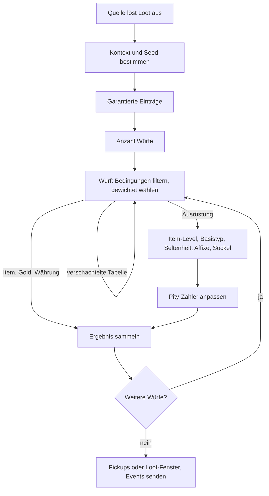
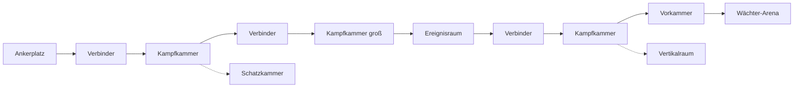

# Items, Crafting, Wirtschaft & Endgame

> Teil der Phase-0-Planung · Stand: 2026-10-13 · Quelle: [Master-Prompt](../00_Master-Prompt.md)

**Kennzeichnungen** (wie in [00_Vision_und_Ueberblick](./00_Vision_und_Ueberblick.md)):
- **Vorschlag:** füllt eine Lücke im Master-Prompt. Alle Zahlen sind Startwerte. Sie liegen später in Balancing-SOs (`LootBalancing`, `EconomyBalancing`, …) bzw. CSV-Tabellen ([Technik/01](../Technik/01_Architektur.md), 5.3), nie im Code (§28).
- **Verbesserungsvorschlag:** weicht bewusst vom Master-Prompt ab. Das Original bleibt erkennbar.
- ❓ **Offene Entscheidung:** liegt beim Auftraggeber. Am Dateiende gesammelt.
- „Original (§x)“ kennzeichnet Festlegungen des Master-Prompts, die unverändert übernommen werden.

**Inhalt**
0. [Kanon-Abgleich & ID-Konventionen](#0-kanon-abgleich--id-konventionen)
1. [Inventar](#1-inventar-121)
2. [Ausrüstung](#2-ausrüstung-122)
3. [Seltenheit](#3-seltenheit-123)
4. [Item-Generierung](#4-item-generierung-124)
5. [Loot](#5-loot-125)
6. [Crafting & Berufe](#6-crafting--berufe-13)
7. [Haus & Basisbau](#7-haus--basisbau-21)
8. [Wirtschaft & Händler](#8-wirtschaft--händler-22)
9. [Endgame](#9-endgame-23)
10. [Minispiele](#10-minispiele-23)
11. [Anti-Langeweile im Endgame](#11-anti-langeweile-im-endgame-23)
12. [Staffelung nach Umfangsstufen](#12-staffelung-nach-umfangsstufen)
- [Offene Entscheidungen](#offene-entscheidungen)
- [Risiken & Hinweise](#risiken--hinweise)

**Kurzfassung (Vorschlag):**
- Inventar ohne Platzlimit, begrenzt nur durch Traglast. Eine Lagerkiste für alle Häuser. Werkbänke im Haus greifen direkt auf sie zu.
- Loot über eine einzige Stellschraube je Quelle: die **Loot-Qualitätsstufe (LQ 0–6)**. Glück, Schwierigkeit, Nacht und Weltstufe addieren sich zu einem Seltenheitsbonus mit Deckel.
- Bad-Luck-Protection garantiert spätestens nach 200 Ausrüstungs-Drops ein Legendär. In der Kampagne liegt der Median bei ~10 h.
- Gold-Ökonomie auf Basis von `G_Basis(L) = 15 + 6 × L` aus [02](./02_Quests_und_Dialoge.md). Das Bilanzmodell (8.7) zeigt je Phase: Kernausgaben 40–69 % des freien Goldes, Angebot 1,1- bis 2,6-mal so groß wie das freie Gold, ab dem Endgame unbegrenzte Senken.
- Endgame: 10 Weltstufen, Riss-Expeditionen aus Raumbausteinen mit 18 Modifikatoren, Arena-Rangleiter, 5 Raid-Bosse, Paragon bis 300 Punkte, 11 legendäre Waffen-Questreihen.

---

## 0. Kanon-Abgleich & ID-Konventionen

### 0.1 Übernommen aus anderen Kapiteln

| # | Thema | Herkunft | Festlegung in dieser Datei |
|---|---|---|---|
| K1 | Traglast = 60 kg + 2 kg × E(Stärke) + Taschen | [03](./03_Kampf_Charakter_Progression.md), 10.3 | übernommen. Taschen und Überladungsstufen in 1.3 |
| K2 | Überladen: max. 3 m/s, kein Sprint, nur Ausweichschritt, keine Schnellreise | [03](./03_Kampf_Charakter_Progression.md), 3.1 / 3.2 | = Stufe „Überladen“ in 1.3, ergänzt um „Schwer überladen“ |
| K3 | Glück = 0,5 × E(Charisma) + Ausrüstung + Buffs | [03](./03_Kampf_Charakter_Progression.md), 10.3 | übernommen. Glück ist ein **Punktwert**. Wirkung in 5.3. „+5 % Glück“ an `item.trinket.oles_messingkompass` ([02](./02_Quests_und_Dialoge.md), 11.8) gilt als **+5 Glück** |
| K4 | Charisma: Kaufpreise −1 %, Verkaufspreise +1 % je effektivem Punkt, je max. 25 % | [03](./03_Kampf_Charakter_Progression.md), 10.2 | bestätigt und endgültig (8.4) |
| K5 | Ruf-Preise: Misstrauisch +20 %, Freundlich −5 %, Geachtet −10 %, Verehrt −15 %, Legende −20 % | [01](./01_Welt_Story_Fraktionen.md), 9.4 | übernommen, ergänzt um Ankauf-Faktoren (8.4) |
| K6 | Händler +10 % bei Verderbnis „Gezeichnet“, Nachtverkauf +20 % | [01](./01_Welt_Story_Fraktionen.md), 1.2 / 7.1 | übernommen als Sonderfaktoren (8.4) |
| K7 | Waffenschaden W = Basis_Typ × (1 + 0,12 × (iLvl − 1)) × Seltenheitsfaktor; Selten = 1,2; Einhandschwert Basis 20 | [03](./03_Kampf_Charakter_Progression.md), 8.2 / 8.3 | bestätigt. Alle Faktoren in 3.1, alle Basiswerte in 4.2 |
| K8 | Loot-Bonus „Schwer +5 %“, „Albtraum +10 %“ auf den Seltenheitswurf | [03](./03_Kampf_Charakter_Progression.md), 9.7 | bestätigt als +5 / +10 Seltenheitsbonus (5.3) |
| K9 | Nachts „+1 Stufe beim Loot-Qualitätswurf“ | [01](./01_Welt_Story_Fraktionen.md), 6.1 | umgesetzt als **+1 Loot-Qualitätsstufe** für Gegner-Loot (5.2) |
| K10 | Elite: 2 Würfe, bessere Seltenheit · Champion: mind. Selten, Chance auf Episch | [01](./01_Welt_Story_Fraktionen.md), 11.2 | übernommen als LQ 2 bzw. LQ 3 (5.2) |
| K11 | Boss: einzigartiger Loot, „kleine Chance auf Legendär“; Grimmbart 2 % | §20.3, [02](./02_Quests_und_Dialoge.md), 11.6 | Legendär-Sonderwurf je Bosstyp, Mini-Boss 2 % (5.7) |
| K12 | Weltboss-Respawn nach 3 Spieltagen | [01](./01_Welt_Story_Fraktionen.md), 11.3 | übernommen (5.7) |
| K13 | Respec: Skillpunkte 100 × Level, Attribute 200 × Level Gold, erster frei bis Level 15, „Trank des Vergessens“ | [03](./03_Kampf_Charakter_Progression.md), 11.9 | bestätigt, ergänzt um Teil-Respec (8.7) |
| K14 | Schnellreise kostenlos; Tod ohne Gold- und XP-Verlust | [03](./03_Kampf_Charakter_Progression.md), 3.6 / 4.12 | übernommen. Beides ist **keine** Gold-Senke |
| K15 | `G_Basis(L) = 15 + 6 × L` (Platzhalter für Auftrags-Gold) | [02](./02_Quests_und_Dialoge.md), 8.4 | bestätigt als Bezugsgröße der ganzen Gold-Ökonomie (8.7) |
| K16 | Fraktionsmarken: 5–20 je Fraktionsquest | [01](./01_Welt_Story_Fraktionen.md), 9.2 | übernommen. Verwendung in 8.1 |
| K17 | Seltenheitsfarben, Formcodes, Strahllängen | [05](./05_UI_Audio_Grafik_Barrierefreiheit.md), 1.10 | übernommen (3.1, 5.8) |
| K18 | Option „Automatisch aufheben“: Aus / Gold und Materialien / Alles (Standard: Gold und Materialien) | [05](./05_UI_Audio_Grafik_Barrierefreiheit.md), 4.2 | übernommen. Regeln in 5.9 |
| K19 | Lagerkiste = ein Container `container.house.lager` für alle Häuser | [Technik/01](../Technik/01_Architektur.md), 11.14 | übernommen (1.7) |
| K20 | Bau-Modus: Raster 0,25 m + frei, 20 Schritte Rückgängig, Action Map „Bauen“ | [Technik/01](../Technik/01_Architektur.md), 11.14 · [03](./03_Kampf_Charakter_Progression.md), 1.5 | übernommen (7.3) |
| K21 | Gut Eichenruh aus HQ 5 „Ein Dach über dem Kopf“ (~5 h), Haus Stufe 2 ab ~15 h | [01](./01_Welt_Story_Fraktionen.md), 2.3 · [00](./00_Vision_und_Ueberblick.md) | übernommen (7.1) |
| K22 | Baum „Handwerk“: Qualitätschance +5 %, Materialersparnis 10 %, Zerlegen +1 Material, Upgrade-Kosten −15 %, Verzauberung: Affix sperren | [03](./03_Kampf_Charakter_Progression.md), 11.6 | eingebaut (6.5, 6.7–6.9) |
| K23 | Pfeil- und Bolzen-Rezepte (Platzhalter) | [03](./03_Kampf_Charakter_Progression.md), 6.2 | Rezepte übernommen, Berufe zugeordnet (6.1) |
| K24 | NG+: Übernahme, Reset, Gold auf 25 %, Gegner +20 Level | [01](./01_Welt_Story_Fraktionen.md), 2.5 | übernommen und ergänzt (9.11) |
| K25 | Ende „Siegel“: Aether-Splitter −25 %; Ende „Krone“: +25 % | [01](./01_Welt_Story_Fraktionen.md), 2.4 | übernommen (8.1) |
| K26 | Tägliche Aufträge 3, wöchentlich 1, Ansammeln bis 3 Tage | [02](./02_Quests_und_Dialoge.md), 8.7 | übernommen, Belohnungen in 9.3 |
| K27 | Legendäre Questreihe „Eidwahrer“ (Einhandschwert), Effekt in [03](./03_Kampf_Charakter_Progression.md) 4.8 | [02](./02_Quests_und_Dialoge.md), 9.4 | übernommen (4.6, 9.9) |
| K28 | Benannte Legendäre der Geheimnisse und Fraktionen | [01](./01_Welt_Story_Fraktionen.md), 4.1–4.8, 8.2 | als feste Legendäre geführt, Effekte für 9 davon in 4.6 |
| K29 | Stufe B enthält 2 Minispiele | [00](./00_Vision_und_Ueberblick.md), Umfangsstufen | Würfeln + Angeln (10, 12) |
| K30 | Rüstungsklasse = Mehrheit der Rüstungsslots; Stoff leicht, Leder mittel, Platte schwer | [03](./03_Kampf_Charakter_Progression.md), 3.2 | übernommen. **Präzisierung (Vorschlag):** Umhänge sind klassenlos, gezählt werden die 5 übrigen Slots (kein Gleichstand möglich). Original §13.1 „Lederverarbeitung (leichte Rüstung)“ heißt hier: nicht Platte. |
| K31 | Saisonale Ereignisse „nach dem echten Kalender“ | [01](./01_Welt_Story_Fraktionen.md), 6.1 | **Abweichung:** Diese Datei empfiehlt ein Spieljahr mit optionaler Kopplung an echte Daten (9.12, ❓). Abstimmung mit 01 nötig. |

### 0.2 ID-Konventionen dieses Kapitels (Vorschlag)

Format laut [Technik/01](../Technik/01_Architektur.md), 6.1 (snake_case, Punkt-Hierarchie, keine Umlaute). Bestehende Präfixe aus [02](./02_Quests_und_Dialoge.md) (`item.weapon.`, `item.armor.`, `item.trinket.`, `item.material.`, `item.potion.`, `item.food.`, `item.ammo.`, `item.quest.`, `item.trophy.`) bleiben unverändert.

| Präfix | Beispiel | Verwendung |
|---|---|---|
| `item.gem.` | `item.gem.rubin_3`, `item.gem.rune_eile_2` | Edelsteine und Runen, Stufe als Ziffer am Ende |
| `item.essence.` | `item.essence.aetherglanz` | Essenzen aus dem Zerlegen |
| `item.fish.` | `item.fish.muehlbachforelle` | Fische |
| `item.tool.` | `item.tool.angelrute_2`, `item.tool.dietrich` | Werkzeuge |
| `item.bomb.` | `item.bomb.feuerbombe` | Bomben, Wurfflaschen, Waffenöle |
| `item.recipe.` | `item.recipe.schwacher_heiltrank` | Rezeptschrift (Item), schaltet ein `recipe.*` frei |
| `item.book.` | `item.book.lindenhainer_sagen` | Buch-Item, verweist auf ein `doc.*` |
| `item.key.` | `item.key.echostein`, `item.key.raid_siegel_brutmutter` | Schlüssel, Echosteine, Raid-Siegel |
| `item.upgrade.` | `item.upgrade.reisetasche` | dauerhafte Upgrades (Taschen) |
| `item.misc.` | `item.misc.silberbecher` | Plunder und Sonstiges |
| `recipe.<beruf>.` | `recipe.alchemie.schwacher_heiltrank` | Rezept-Definition |
| `profession.` | `profession.schmieden` | Beruf |
| `affix.` / `affix.legendary.` | `affix.lodernd`, `affix.legendary.eidwahrer` | Affix bzw. legendärer Effekt |
| `set.` | `set.echo_ritter` | Set mit Boni |
| `loot.<bereich>.` | `loot.enemy.wolf.grauwolf`, `loot.chest.eisen` | Loot-Tabelle |
| `merchant.<region>.` | `merchant.eichental.schmiede_lindenhain` | Händler-Definition (hängt am NPC) |
| `currency.` | `currency.gold`, `currency.aether_splitter`, `currency.marke.silberwacht` | Währungen (die ersten zwei aus [Technik/01](../Technik/01_Architektur.md)) |
| `house.<region>.` / `room.` / `furniture.` | `house.eichental.gut_eichenruh`, `room.schmiede`, `furniture.eichentisch` | Haus, Raum, Möbel |
| `plant.` | `plant.blutwurz` | Gartenpflanze |
| `worldtier.` / `exp.` / `challenge.` / `arena.` / `raid.` | `exp.mod.explosiv`, `raid.brutmutter` | Endgame-Definitionen |
| `ach.` / `title.` / `mount.` / `cosmetic.` / `card.` / `minigame.` | `ach.erkundung.kartograf_eichental`, `minigame.wuerfeln` (wie [02](./02_Quests_und_Dialoge.md)) | Sammlungen, Erfolge, Minispiele |

---

## 1. Inventar (§12.1)

### 1.1 Kategorien

Original (§12.1): Waffen, Rüstung, Schmuck, Verbrauchsgüter, Materialien, Questgegenstände, Bücher, Sonstiges. Unterfilter und Werte sind ein **Vorschlag**.

| Kategorie | Unterfilter | Stapel | Gewicht (typisch) | Verkaufbar | Besonderheit |
|---|---|---|---|---|---|
| Waffen | 11 Waffentypen (§9.3), Schilde | nein (Einzelinstanz) | 1,0–9,0 kg | ja | Vergleich gegen Haupthand, Nebenhand bzw. Fernkampf |
| Rüstung | Kopf, Brust, Hände, Beine, Füße, Umhang | nein | 0,3–10 kg | ja | Symbol der Rüstungsklasse (Stoff, Leder, Platte) |
| Schmuck | Ringe, Amulette | nein | 0,1 kg | ja | Ringe werden gegen beide Ringslots verglichen ([05](./05_UI_Audio_Grafik_Barrierefreiheit.md), 1.4) |
| Verbrauchsgüter | Tränke, Nahrung, Bomben und Öle, Munition, Werkzeuge, Schriftrollen | ja: Tränke 20, Nahrung 20, Pfeile 99, Bolzen 50, Werkzeuge 10 | 0,05–0,5 kg | ja | schnellslot-fähig (2.3) |
| Materialien | Erze und Barren, Holz, Leder und Felle, Stoffe, Kräuter und Samen, Fische, Monsterteile, Edelsteine und Runen, Essenzen, Aether-Kristalle | ja: 99 (Lagerkiste unbegrenzt) | 0,05–1,0 kg | ja | Werkbänke im Haus nutzen die Lagerkiste direkt (1.7) |
| Questgegenstände | aktive Quests, sonstige | je nach Item | **0 kg** | **nein** | nicht ablegbar, nicht zerlegbar (1.8) |
| Bücher | Lore-Bücher, Rezeptschriften, Schatzkarten, Briefe | nein | 0,2–1,0 kg | ja | Gelesene Lore steht danach im Codex. Das Buch selbst ist dann verzichtbar. |
| Sonstiges | Plunder, Schlüssel, Trophäen, Färbemittel, Taschen-Upgrades, Echosteine | gemischt | 0–3 kg | Plunder ja | Plunder ist für den Schnellverkauf markiert (1.6) |

### 1.2 Kein Platzlimit, nur Traglast (Vorschlag)

- §12.1 nennt nur die Traglast. Platz **und** Gewicht wären doppelte Verwaltung und am Controller mühsam.
- Technische Obergrenze: 1.000 Einträge (Speichergröße). Warnung ab 900.
- Das Inventar ist eine Liste mit Spalten, kein Raster (Layout in [05](./05_UI_Audio_Grafik_Barrierefreiheit.md)).
- ❓ **Offene Entscheidung:** Gewicht von Materialien. Empfohlener Standard: leicht (0,05–1 kg) plus direkter Lagerkisten-Zugriff an den Werkbänken im Haus (1.7).

### 1.3 Traglast und Überladung

```
Traglast = 60 kg + 2 kg × E(Stärke) + Tasche + Buffs        (Formel aus 03, 10.3)
E(x) = x − 10 für x ≤ 40 · E(x) = 30 + 0,5 × (x − 40) für x > 40
```

| Stärke | 8 | 14 (Krieger-Start) | 20 | 40 | 60 |
|---|---|---|---|---|---|
| Traglast ohne Tasche | 56 kg | 68 kg | 80 kg | 120 kg | 140 kg |
| mit Meisterrucksack (+40) | 96 kg | 108 kg | 120 kg | 160 kg | 180 kg |

**Taschen (Vorschlag):** dauerhafte Upgrades. Sie werden beim Benutzen verbraucht. Nur die beste Tasche zählt. Sie bleiben in NG+ erhalten.

| Tasche | ID | Traglast | Herstellung (Lederverarbeitung) | Kauf beim Lederer |
|---|---|---|---|---|
| Gürteltasche | `item.upgrade.guerteltasche` | +10 kg | Stufe 10 | 400 Gold |
| Reisetasche | `item.upgrade.reisetasche` | +20 kg | Stufe 30 | 1.500 Gold |
| Expeditionsrucksack | `item.upgrade.expeditionsrucksack` | +30 kg | Stufe 55 | 5.000 Gold |
| Meisterrucksack | `item.upgrade.meisterrucksack` | +40 kg | Stufe 80 | nur herstellbar |

Buffs: Nahrung „Kräftigender Eintopf“ +10 kg (30 min), Trank „Ochsenkraft“ +20 kg (10 min).

**Überladungsstufen:**

| Stufe | Last ÷ Traglast | Wirkung | HUD |
|---|---|---|---|
| Normal | ≤ 90 % | – | – |
| Fast voll | > 90–100 % | keine Mali. Auto-Aufheben nimmt nur noch Gold, Questgegenstände und Schlüssel. | Symbol gelb |
| Überladen (Kanon aus 03) | > 100–125 % | max. 3 m/s, kein Sprint, keine Rolle (nur Ausweichschritt 1,5 m), keine Schnellreise. **Vorschlag:** zusätzlich Ausdauer-Regeneration −25 % | Symbol orange, einmaliger Hinweis |
| Schwer überladen (**Vorschlag**) | > 125 % | max. 1,5 m/s, kein Springen, Klettern, Gleiten und schnelles Schwimmen, Ausdauer-Regeneration −50 %, Aufsteigen unmöglich | Symbol rot, Dauerhinweis „Ablegen oder einlagern“ |

- **Reittier trägt (Vorschlag):** Im Sattel gelten bis 125 % keine Bewegungsmali. Die Schnellreise bleibt gesperrt.
- Gold, Questgegenstände und Schlüssel wiegen nichts. Ausgerüstete Items zählen voll.
- Abhilfe im Menü: Sortierung „Wert je kg“ zeigt die besten Kandidaten zum Ablegen. Aktion „Plunder ablegen“ legt alles Markierte in einen Beutel am Boden (bleibt 10 min).

### 1.4 Sortieren und Filtern

| Funktion | Festlegung (Vorschlag) |
|---|---|
| Sortierungen | Neu zuerst (Standard) · Seltenheit · Item-Level · Kernwert (Schaden bzw. Rüstung) · Wert · Gewicht · Wert je kg · Name · Typ. Primär- und Sekundärsortierung, Standard: Seltenheit, dann Item-Level. |
| Kategorie-Filter | 8 Kategorien + „Alle“ über LT/RT bzw. Z/C ([05](./05_UI_Audio_Grafik_Barrierefreiheit.md), 1.3) |
| Unterfilter | Waffentyp, Slot, Rüstungsklasse, Materialart |
| Schalter | „Nur besser als ausgerüstet“ · „Nur neu“ · „Plunder“ · „Diebesgut“ · „Zutat eines bekannten Rezepts“ · „Gesperrte ausblenden“ |
| Suche | Texteingabe (Tastatur, am Controller Bildschirmtastatur) |
| Speicherung | Sortierung und Filter bleiben je Kategorie erhalten (Spielstand-unabhängige Option) |

### 1.5 Vergleich mit der Ausrüstung

- Tooltip nebeneinander: links ausgerüstet, rechts neu ([05](./05_UI_Audio_Grafik_Barrierefreiheit.md), 1.4). Besser ▲ in `ui.better` `#5FD068`, schlechter ▼ in `ui.worse` `#FF6B5E`, immer mit Zahl („+12 Angriff“).
- **Verglichen werden:**
  - Kernwert. Waffen: Schaden je Treffer und „Schaden je Sekunde (geschätzt)“ = Waffenschaden × Attribut-Skalierung ÷ Tempo des leichten Schlags ([03](./03_Kampf_Charakter_Progression.md), 5.1, 8.2). Rüstung: Rüstungswert.
  - Jeder Affix als Wertdifferenz, Sockel, Gewicht.
  - Set-Bonus-Änderung, z. B. „Set 4 → 3: Bonus (4) entfällt“.
  - Legendärer Effekt als Text ohne Pfeil.
- Ringe gegen beide Ringslots. Zweihandwaffen gegen Haupthand + Nebenhand zusammen.
- **Listen-Pfeil:** ▲ neben dem Eintrag, wenn der Kernwert über dem ausgerüsteten Item derselben Slot-Art liegt.
- **Begleiter (Stufe B):** R3 halten wechselt den Vergleich auf einen Begleiter der Gruppe.

### 1.6 Neu, Favorit, Sperre, Plunder

| Markierung | Setzen | Wirkung | Entfernen |
|---|---|---|---|
| Neu (Punkt) | automatisch beim Aufnehmen | Punkt am Item, Zähler am Kategorie-Tab und am Hub-Tab „Inventar“ | Fokus bzw. Mauszeiger ≥ 0,5 s auf dem Item, oder „Alle als gesehen“ (R3 halten) |
| Favorit (Stern) | eine Taste im Inventar | steht in jeder Sortierung oben, auch in der Schnellslot-Auswahl | erneut drücken |
| Sperre (Schloss) | eine Taste; **automatisch** für Legendär, Mythisch, Set, Fraktionsbelohnungen und benannte Questbelohnungen | nicht verkaufbar, nicht zerlegbar, nicht ablegbar. Aufwerten und Verzaubern bleiben möglich. | Halten zum Bestätigen ([05](./05_UI_Audio_Grafik_Barrierefreiheit.md), 1.4) |
| Plunder (Münze) | automatisch für Wertgegenstände (`item.misc.*`), manuell für alles Ungesperrte | Händler bieten „Allen Plunder verkaufen“ als einen Schritt | manuell |

**Rückkauf (Vorschlag):** Jeder Händler hält die letzten 20 verkauften Items des Spielers bis zum nächsten Restock zum selben Preis bereit.

### 1.7 Lagerkiste

| Regel | Festlegung |
|---|---|
| Ein Container für alle Häuser | Original (§12.1, „geteilter Zugriff“) und [Technik/01](../Technik/01_Architektur.md) 11.14: `container.house.lager` |
| Zugangspunkte | Lagerkiste in jedem eigenen Haus (7.1, 7.7) · Kontor-Lagerkiste in Velmara (Handelsgilde ab Freundlich, [01](./01_Welt_Story_Fraktionen.md) 8.2) · Refugium am Ankerplatz (Endgame) |
| Kapazität (**Vorschlag**) | Einzel-Items (Ausrüstung, Bücher): 300 Plätze, +100 mit Lagerkeller II, +250 mit Waffenkammer = **650**. Stapelbare Items: unbegrenzt. |
| Werkbänke | Stationen in eigenen Häusern nutzen Materialien aus der Lagerkiste direkt. Stationen in Städten nutzen nur das Inventar. |
| Komfort | „Alle Materialien einlagern“ als eine Taste. Option „Beim Betreten des Hauses Materialien einlagern“ (Standard: an). |
| Fundbüro | Liegengelassene Legendär-, Mythisch- und Set-Items landen in der Lagerkiste (5.9). |
| Begleiter | eigene Ausrüstungsfächer je Begleiter, zählen nicht zur Kapazität |

### 1.8 Questgegenstände und Diebesgut

**Questgegenstände (§12.1 + Vorschlag):**
- 0 kg, nicht verkaufbar, nicht zerlegbar, nicht ablegbar.
- Eigener Tab mit Verweis auf die Quest (Taste springt ins Questlog).
- Bei Questabschluss entfernt oder umgewandelt. Beispiel: `item.quest.grimmbarts_bartzopf` wird zu `item.trophy.grimmbarts_bartzopf` ([02](./02_Quests_und_Dialoge.md), 11.6).
- Questgegenstände toter NPCs gehen nie verloren ([02](./02_Quests_und_Dialoge.md), 6.6).

**Diebesgut (§22):**
- Flag `stolen` am Stapel bzw. an der Instanz ([Technik/01](../Technik/01_Architektur.md), 11.6), Symbol „Hand“.
- Nur beim Hehler verkaufbar (8.5). Ausrüstbar, aber bei Bezahlen des Kopfgelds oder im Gefängnis konfisziert ([01](./01_Welt_Story_Fraktionen.md), 7.3).
- Wird nie automatisch aufgehoben (5.9).

---

## 2. Ausrüstung (§12.2)

### 2.1 Slots

Original (§12.2): Kopf, Brust, Hände, Beine, Füße, Umhang, Haupthand, Nebenhand, Fernkampf, 2 Ringe, 1 Amulett, 4 Schnellslots, Transmog. Werte sind ein **Vorschlag**.

| Slot | Erlaubte Items | Kernwert | Sockel max. | Zählt für Rüstungsklasse | Transmog |
|---|---|---|---|---|---|
| Kopf | Helme, Hauben, Kapuzen, Kronen | Rüstung | 1 | ja | ja, ausblendbar |
| Brust | Harnische, Wämser, Roben | Rüstung | 2 | ja | ja |
| Hände | Handschuhe, Panzerhandschuhe | Rüstung | 1 | ja | ja |
| Beine | Beinschienen, Hosen | Rüstung | 2 | ja | ja |
| Füße | Stiefel, Sabatons | Rüstung | 1 | ja | ja |
| Umhang | Umhänge, Mäntel | Rüstung (klein) | 1 | nein (klassenlos) | ja, ausblendbar |
| Haupthand | Einhand: Einhandschwert, Axt, Einhand-Streitkolben · Zweihand: Zweihandschwert, Zweihand-Hammer, Speer, Zauberstab · Paar: Dolche, Faustwaffen | Waffenschaden bzw. Zauberkraft | Einhand 2, Zweihand und Paar 3 | – | nur gleicher Waffentyp |
| Nebenhand | Schild oder Zauberbuch, nur mit Einhandwaffe. Bei Zweihand oder Paar gesperrt. | Schild: Rüstung + Blockwerte ([03](./03_Kampf_Charakter_Progression.md), 4.7) · Buch: Zauberkraft | 2 | nein | gleicher Typ |
| Fernkampf | Bogen, Armbrust | Waffenschaden | 2 | – | gleicher Typ |
| Ring 1, Ring 2 | Ringe | Implizitwert (4.2) | 1 | – | nein (nicht sichtbar) |
| Amulett | Amulette | Implizitwert (4.2) | 1 | – | nein |
| Schnellslot 1–4 | Verbrauchsgüter, Werkzeuge, „Set wechseln“ (2.3) | – | – | – | – |

**Rüstungsklasse (Präzisierung zu [03](./03_Kampf_Charakter_Progression.md) 3.2):** Mehrheit der 5 Slots Kopf bis Füße. Ein leerer Slot zählt als leicht.

### 2.2 Waffen-Sets

- **Original (§12.2):** ein Satz aus Haupthand, Nebenhand und Fernkampf.
- Haupthand + Nebenhand bilden die Nahkampf- bzw. Magie-Ausrüstung. Der Fernkampf-Slot ist zusätzlich immer bereit (LT zielt, [03](./03_Kampf_Charakter_Progression.md) 6.1). Welche Waffe LT bei einer Magiewaffe nutzt, regelt [03](./03_Kampf_Charakter_Progression.md). **Vorschlag:** Bei Zauberstab oder Zauberbuch hat das Zaubern Vorrang. Der Bogen ist dann über das Zweitset erreichbar.
- **Zweitset (Vorschlag, ab Stufe B):** ein zweiter gespeicherter Satz (Haupt, Neben, Fernkampf). Gewechselt wird über einen Schnellslot mit dem Eintrag „Set wechseln“, also ohne neue Taste.
  - Wechselzeit 0,6 s, nicht während Angriff oder Rolle, Abklingzeit 1 s.
  - Beide Sätze zählen zur Traglast.
- Begleiter haben einen Satz und kein Zweitset.

### 2.3 Schnellslots

Original (§12.2, §7): 4 Schnellslots, Steuerkreuz bzw. Tasten 5–8.

| Regel | Festlegung (Vorschlag) |
|---|---|
| Belegbar | Tränke, Nahrung, Bomben, Wurfflaschen, Waffenöle, Werkzeuge (Verband, Fackel, Rast-Lagerfeuer, Angelrute), „Set wechseln“ |
| Bezug | Ein Slot verweist auf eine **Item-Familie**. Ist der Stapel leer, rückt die nächste Qualität nach (z. B. Heiltrank stark → mittel). Abschaltbar. |
| Benutzen | Regeln aus [03](./03_Kampf_Charakter_Progression.md), 4.3 (Trinken 0,8 s, Bewegung 50 %, Unterbrechung ohne Verbrauch) |
| Gemeinsame Abklingzeit | Heiltränke 8 s · Manatränke 8 s · Bomben 3 s · Waffenöle 1 s |
| Nahrung | nur außerhalb des Kampfes, sonst ausgegraut. Grund: Im Kampf heilen Tränke, Nahrung ist Vorbereitung. |
| Pfeiltyp | wird nicht über Schnellslots gewählt, sondern mit Steuerkreuz ←/→ beim Zielen ([03](./03_Kampf_Charakter_Progression.md), 1.3 K5) |

### 2.4 Anlegen

- **Keine Klassen- oder Attributsperren** (Säule 6, §11.1 „frei mischen“).
- **Level-Anforderung (Vorschlag):** Spielerlevel ≥ Item-Level − 3. Höhere Items sind sichtbar und vergleichbar, aber ausgegraut („Ab Level 27“).
- Die Rüstungsklasse bestimmt Rollenprofil, Standfestigkeit und Gewicht ([03](./03_Kampf_Charakter_Progression.md), 3.2 und 4.9). Sie sperrt nichts.
- Für Begleiter gelten dieselben Regeln mit ihrem Level.

### 2.5 Transmog

Original (§12.2): Das optische Aussehen ist getrennt einstellbar. Regeln sind ein **Vorschlag**.

| Regel | Festlegung |
|---|---|
| Freischaltung | Das Aussehen jedes Rüstungs- und Waffen-Items, das der Spieler aufnimmt, landet dauerhaft in der **Garderobe** (je Spielstand, bleibt in NG+). Dazu kommen Kosmetik-Items aus Schneiderei, Festen und Erfolgen. |
| Slot-Regel | Rüstung nur auf denselben Slot. Die Rüstungsklasse ist frei (Plattenoptik auf Stoff erlaubt). |
| Waffen-Regel | nur innerhalb desselben Waffentyps, weil Animationen am Typ hängen ([03](./03_Kampf_Charakter_Progression.md), 5.2). Schild auf Schild. |
| Ausblenden | Helm, Umhang und Rücken-Schild jederzeit kostenlos |
| Färben | 3 Farbzonen je Teil, 1 Färbemittel (Schneiderei) je Zone |
| Outfits | 5 Speicherplätze, Wechsel kostenlos |
| Ort | Garderobe in jedem eigenen Haus, Schneider in Städten |
| Kosten (Gold-Senke) | 20 + 2 × Spielerlevel Gold je Slot (Level 10: 40, Level 50: 120, Level 80: 180) |
| Stufe | B (das Inventar hat in [05](./05_UI_Audio_Grafik_Barrierefreiheit.md) bereits den Bereich „Aussehen“) |

---

## 3. Seltenheit (§12.3)

### 3.1 Seltenheitsstufen

Original (§12.3): Gewöhnlich (grau), Ungewöhnlich (grün), Selten (blau), Episch (lila), Legendär (orange), Mythisch (rot, nur Endgame), Set (gelb, Bonus beim Tragen mehrerer Teile). Hex-Werte und Formcodes aus [05](./05_UI_Audio_Grafik_Barrierefreiheit.md), 1.10. Alles andere ist ein **Vorschlag**.

| Seltenheit | Farbe (Hex) | Formcode | Affixe | Sockel | Basis-Dropgewicht (Anteil) | ab Item-Level / Region | Faktor Basiswert | Faktor Handelswert | Besonderheit |
|---|---|---|---|---|---|---|---|---|---|
| Gewöhnlich | grau `#A6A6A6` | ◆ | 0 | 0 | 6.000 (59,7 %) | iLvl 1 · Eichental | 1,00 | ×1 | kein Strahl, nur Glitzern |
| Ungewöhnlich | grün `#4CC35A` | ◆◆ | 1 | 0–1 (25 % auf 1) | 2.800 (27,9 %) | iLvl 1 · Eichental | 1,10 | ×1,5 | – |
| Selten | blau `#3D8BFF` | ◆◆◆ | 2 | 0–1 (50 % auf 1) | 900 (9,0 %) | iLvl 3 · Eichental | 1,20 | ×3 | Mindestseltenheit ab LQ 3 (5.2) |
| Episch | lila `#A855F7` | ◆◆◆◆ | 3 | 1 (25 % auf 2) | 300 (3,0 %) | iLvl 10 · ab Goldküste; vorher nur als Akt-Ende-Belohnung ([02](./02_Quests_und_Dialoge.md)) | 1,30 | ×6 | Mindestseltenheit ab LQ 5 |
| Legendär | orange `#FF8C1A` | ◆◆◆◆◆ | 3 + legendärer Effekt | 1 (50 % auf 2) | 45 (0,45 %) | Zufallswurf ab iLvl 10. Boss-Sonderwurf und feste Funde ab iLvl 5 (z. B. Grimmbart, „Eichenherz“) | 1,40 | ×15 | Effekt verändert den Spielstil (4.6). Kompass-Marker, automatisch gesperrt. |
| Mythisch | rot `#E53935` | ◆◆◆◆◆◆ | 4 auf höchster Stufe (obere Hälfte) + legendärer Effekt ×1,5 | Slot-Maximum | kein Eigengewicht: Aufwertung eines legendären Drops (4.8) | nur Weltstufe ≥ 1 und iLvl ≥ 60 | 1,55 | ×30 | nur Endgame (Original) |
| Set | gelb `#F2D23C` | Kettenglied | 2 feste Affixe + Set-Bonus | 1 | nur in Set-Tabellen (30 je Set-Eintrag) | Fraktionssets ab iLvl 15, Endgame-Sets ab iLvl 60 | 1,30 | ×8 | Boni bei 2/4/6 Teilen (3.2) |

- Die Dropgewichte gelten für jeden **Ausrüstungswurf** und werden durch Glück, LQ, Schwierigkeit und Weltstufe verschoben (5.3).
- Unter iLvl 10 ist das Legendär-Gewicht 0. Legendäres gibt es dort nur aus festen Funden und dem Boss-Sonderwurf (5.7). So bleibt Grimmbarts „2 %“ ([02](./02_Quests_und_Dialoge.md)) die einzige Zufallschance im Vertical Slice.

### 3.2 Set-Gegenstände

**Regeln (Vorschlag):**
- Ein Set hat 4–6 benannte Teile. Jedes Teil hat eine feste Basis, 2 feste Affixe (Wert gewürfelt im Stufenbereich) und 1 Sockel.
- Boni bei 2, 4 und 6 getragenen Teilen (4-Teile-Sets: 2 und 4). Der 2er-Bonus ist additiv. Ab 4 Teilen sind Boni multiplikativ ([03](./03_Kampf_Charakter_Progression.md), 10.4: höchstens 3 multiplikative Quellen je Wert).
- Teile skalieren wie Episch (Faktor 1,30) und lassen sich aufwerten (6.8).
- Quellen: Fraktions-Quartiermeister (Fraktionssets, [01](./01_Welt_Story_Fraktionen.md) 8.2), Set-Tabellen bestimmter Bosse, Riss-Expeditionen ab Stufe 10, Raid, Auktionshaus.
- **Duplikatschutz:** Teile, die der Spieler noch nicht besitzt, haben im Set-Wurf ×3 Gewicht.
- Der Bonus zählt auch bei verändertem Aussehen (Transmog).
- Set-Affixe sind fest vorgegeben und dürfen von den Slot-Regeln des Affix-Pools (4.4) abweichen.

**Beispiel-Set: „Wacht der Echo-Ritter“** (`set.echo_ritter`)

| Feld | Wert |
|---|---|
| Hintergrund | Nachhall der Ritter von Caelum. Die Echo-Ritter sind Gegner im Zerbrochenen Himmel ([01](./01_Welt_Story_Fraktionen.md), 11.1). |
| Teile (6) | Helm, Brustharnisch, Panzerhandschuhe, Beinschienen, Sabatons (alle Platte) + Umhang „Banner von Caelum“ |
| Quellen | Weltboss „Die Echo-Kaiserin“ ([01](./01_Welt_Story_Fraktionen.md), 4.8): 1 Teil je Sieg · Riss-Expeditionen ab Stufe 10 · Auktionshaus |
| Item-Level | 60–80 |
| Feste Affixe | Platte: „der Standhaftigkeit“ + „Gepanzert“ · Umhang: „des Glücks“ + „der Reinheit“ |
| **2 Teile** | +15 % Haltungsschaden, +10 Standfestigkeit (additiv) |
| **4 Teile** | Eine perfekte Parade ruft ein Echo: 0,5 s später wiederholt ein geisterhafter Ritter den Konter mit 60 % Schaden. Konter-Schaden ×1,20 (multiplikativ). |
| **6 Teile** | Jeder Haltungsbruch eines Gegners ruft für 8 s einen Echo-Ritter als Verbündeten (max. 2). Er bindet Angriffs-Token der Gegner ([03](./03_Kampf_Charakter_Progression.md), 9.3). Solange einer steht, erleidet der Spieler ×0,85 Schaden. |
| Spielstil | Parier-Tank mit Einhandschwert und Schild. Passt zu Krieger-Ast „Bollwerk“ ([03](./03_Kampf_Charakter_Progression.md)) und „Eidwahrer“ (9.9). |

### 3.3 Set-Planung für Stufe C (Vorschlag)

| Gruppe | Sets | Teile | Quelle |
|---|---|---|---|
| Fraktionssets ([01](./01_Welt_Story_Fraktionen.md), 8.2) | „Silberwacht“ (Platte), „Magisterrobe“ (Stoff), „Kaufherr“ (Leder), „Nachtfinger“ (Leder), „Hüter“ (Leder), „Stille Robe“ (Stoff), „Runenwacht“ (Platte) | je 5–6 | Quartiermeister ab Geachtet, Fraktionsmarken |
| Endgame-Sets | je ein Archetyp: Parier-Tank („Echo-Ritter“), Elementarmagie, Krit-Schurke, Bogen, Begleiter-Kommandeur, Aether-Verderbnis | je 6 | Weltbosse Zerbrochener Himmel, Expeditionen, Raid |
| **Summe** | **13 Sets** | **~75 Teile** | 26 Set-Effekte (4er und 6er) sind Code-Arbeit (Risiko 2) |

---

## 4. Item-Generierung (§12.4)

Original (§12.4): Grundwert abhängig vom Item-Level, Affixe nach Seltenheit, legendäre Effekte verändern den Spielstil, Sockel für Edelsteine, Item-Level skaliert mit Gebiet und Gegnerlevel.

### 4.1 Item-Level

```
iLvl = klemme( L_Quelle + Δ_Quelle ; 1 ; 80 )
```

| Quelle | L_Quelle | Δ_Quelle (Vorschlag) |
|---|---|---|
| Gegner | Gegnerlevel inkl. Elite +2, Champion +3, Nacht +2 ([03](./03_Kampf_Charakter_Progression.md) 9.7, [01](./01_Welt_Story_Fraktionen.md) 11.2) | Normal, Elite, Champion 0 · Mini-, Dungeon-, Weltboss +1 · Story-Boss +2 |
| Truhe, Sammelpunkt | Gebietslevel der Weltzelle (Regionsband, Zellendaten) | Truhenstufe 0–3: 0 · Prunktruhe +1 · Geheimnis-Truhe +2 |
| Questbelohnung | empfohlenes Level der Quest | 0 · Akt-Ende-Episch +2 |
| Händler | min(Spielerlevel; Obergrenze des Regionsbands) | 0 · Spezialhändler +2 |
| Herstellung | min(Spielerlevel; Obergrenze der Materialstufe, 6.3) | 0 |
| Ab Weltstufe 1 | max(Gebietslevel; Spielerlevel) + Weltstufen-Aufschlag (9.1) | wie oben |
| Riss-Expedition, Raid, Arena | Spielerlevel | 0 |

- **Beispiele:** Grauwolf Level 8 → iLvl 8 · Grimmbart (Mini-Boss, Level 7) → iLvl 8 · Champion-Wüstenräuber in einem Gebiet mit Level 27 → Level 30 → iLvl 30.
- Elitegegner über dem Gebietslevel („gefährliche Ausnahme“, §14.1) liefern entsprechend höhere Items. Die Level-Anforderung (iLvl − 3, 2.4) macht daraus ein Ziel statt eines Sprungs.

### 4.2 Basiswerte

```
Basiswert = Basis_Typ × (1 + 0,12 × (iLvl − 1)) × Seltenheitsfaktor × Streuung      (Streuung 0,95–1,05)
```

Die Formel aus [03](./03_Kampf_Charakter_Progression.md) 8.2 ist bestätigt. **Neu (Vorschlag):** ±5 % Streuung, damit zwei gleiche Items unterschiedlich ausfallen. Das Zahlenbeispiel in 03 (Eisernes Langschwert, 50 Schnitt) gilt mit Streuung 1,00.

**Waffen (Basis_Typ bei iLvl 1, Vorschlag):** Ziel ist ein Basis-„DPS“ (Basis ÷ Tempo des leichten Schlags) von 40–46 im Nahkampf. Wucht- und Fernkampfwaffen liegen bewusst darunter, weil sie Haltung bzw. Abstand liefern.

| Waffentyp | Basis_Typ | Tempo ([03](./03_Kampf_Charakter_Progression.md) 5.1) | Basis ÷ Tempo | Gewicht |
|---|---|---|---|---|
| Einhandschwert | 20 (Kanon aus 03) | 450 ms | 44 | 2,5 kg |
| Zweihandschwert | 30 | 750 ms | 40 | 5,0 kg |
| Dolche (Paar, je Stich) | 13 | 280 ms | 46 | 1,0 kg |
| Axt | 22 | 550 ms | 40 | 3,0 kg |
| Einhand-Streitkolben | 21 | 600 ms | 35 (+Wucht, Haltung) | 3,5 kg |
| Zweihand-Hammer | 34 | 900 ms | 38 (+Haltung) | 7,0 kg |
| Speer | 23 | 520 ms | 44 | 4,0 kg |
| Faustwaffen (Paar) | 12 | 300 ms | 40 (+Haltung) | 1,5 kg |
| Bogen (voll gespannt) | 18 | 800 ms Spannen | ~20 je s (Abstand) | 1,5 kg |
| Armbrust | 29 (= 1,6 × Bogen, 03) | 1.400 ms Zyklus | ~21 je s | 4,0 kg |
| Zauberstab | Zauberkraft 20 | 500 ms | – | 2,0 kg |
| Zauberbuch | Zauberkraft 12 (+ Haupthand) | 600 ms | – | 1,5 kg |
| Schild | Rüstung 6 · Blockwerte nach Schildart ([03](./03_Kampf_Charakter_Progression.md) 4.7) | – | – | Holz 4, Eisen 6, Turm 9 kg |

**Einhandschwert-Schaden nach Item-Level und Seltenheit** (Streuung 1,00):

| iLvl | Skalierung | Gewöhnlich | Ungewöhnlich | Selten | Episch | Legendär | Mythisch |
|---|---|---|---|---|---|---|---|
| 1 | 1,00 | 20 | 22 | 24 | 26 | 28 | – |
| 10 | 2,08 | 42 | 46 | **50** (03) | 54 | 58 | – |
| 30 | 4,48 | 90 | 99 | 108 | 116 | 125 | – |
| 60 | 8,08 | 162 | 178 | 194 | 210 | 226 | 250 |
| 80 | 10,48 | 210 | 231 | 252 | 272 | 293 | 325 |

**Rüstung (Basis bei iLvl 1, Vorschlag):**

| Slot | Platte (schwer) | Leder (mittel) | Stoff (leicht) | Gewicht Platte / Leder / Stoff |
|---|---|---|---|---|
| Kopf | 5 | 3 | 2 | 4,0 / 1,5 / 0,5 kg |
| Brust | 9 | 6 | 3 | 10,0 / 4,0 / 1,5 kg |
| Hände | 3 | 2 | 1 | 2,5 / 1,0 / 0,3 kg |
| Beine | 6 | 4 | 2 | 7,0 / 3,0 / 1,0 kg |
| Füße | 4 | 3 | 1 | 3,5 / 1,5 / 0,5 kg |
| Umhang (klassenlos) | 1 | 1 | 1 | 1,0 kg |
| **Summe** | **28** | **19** | **10** | **28 / 12 / 4,8 kg** |
| Implizitwert je Teil | – | Ausdauer-Regeneration +2 % (iLvl 1) bis +6 % (iLvl 80) | Zauberkraft +1 % bis +4 % | – |

- **Prüfung gegen 03 (8.3):** Krieger Level 10 mit Platte an Brust, Beinen, Kopf, Leder an Händen und Füßen, Umhang, meist Ungewöhnlich: 26 × 2,08 × 1,1 ≈ **59**. 03 nimmt Rüstung 60 an.
- Volle Platte, iLvl 80, Mythisch: 28 × 10,48 × 1,55 ≈ 455 → Reduktion gegen einen Level-80-Angreifer 455 ÷ (455 + 800) = 36 % ([03](./03_Kampf_Charakter_Progression.md) 8.2, K = 10). Leder liegt bei ~28 %, Stoff bei ~17 %, jeweils vor Affixen.

**Schmuck: Basistyp mit Implizitwert** (iLvl 1 → iLvl 80, linear):

| Basis | Implizit | Basis | Implizit |
|---|---|---|---|
| Eisenring | +2 → +30 Rüstung | Bernsteinamulett | +10 → +150 max. LP |
| Silberring | +5 → +60 max. Mana | Mondsteinamulett | +2 % → +8 % Zauberkraft |
| Goldring | +2 → +8 Glück | Wolfszahnamulett | +4 % → +15 % Krit-Schaden |
| Jadering | +1 % → +5 % alle Resistenzen | Kristallamulett | −2 % → −8 % Verderbnis-Aufbau |

### 4.3 Affix-System

| Regel | Festlegung (Vorschlag) |
|---|---|
| Präfix / Suffix | Präfixe: Angriff und Kernwerte. Suffixe: Verteidigung, Attribute, Nutzen. Höchstens 2 Präfixe und 2 Suffixe je Item. |
| Anzahl | nach Seltenheit (3.1). Legendärer Effekt und Set-Affixe belegen keinen Affix-Platz. |
| Affix-Stufen | I: iLvl 1–9 · II: 10–24 · III: 25–39 · IV: 40–59 · V: 60–74 · VI: 75–80 **und** Weltstufe ≥ 5 oder Mythisch |
| Stufenwahl | höchste erlaubte Stufe 50 %, eine darunter 35 %, zwei darunter 15 %. Mythisch: immer die höchste. |
| Wertebereich | Unter- und Obergrenze linear zwischen Stufe I und VI: Wert(n) = Wert(I) + (Wert(VI) − Wert(I)) × (n − 1) ÷ 5, gerundet |
| Wurf im Bereich | gleichverteilt. Die Untergrenze steigt je Weltstufe um 3 % der Spanne (Weltstufe 10: die unteren 30 % fallen weg). Mythisch: nur die obere Hälfte. |
| Gewichte | Standard 100. Starke Affixe 50, Nutzen-Affixe 60. |
| Smart Loot | 30 % der Affix-Würfe gewichten Affixe ×3, die zu den zwei höchsten Attributen oder zur ausgerüsteten Waffenart des Spielers passen. ❓ **Offene Entscheidung:** Anteil 0 / 30 / 50 %, empfohlen 30 %. |
| Ausschlussregeln | 1. kein Affix doppelt · 2. je Familie höchstens 1 Affix (Ausnahme: 2 **verschiedene** Resistenzen) · 3. nur erlaubte Slots laut Pool · 4. „des Blutegels“ nie zusammen mit „der Dornen“ · 5. „Aetherisch“ nie zusammen mit „der Reinheit“ · 6. Caps aus [03](./03_Kampf_Charakter_Progression.md) 10.5 gelten für die Summe. Werte über dem Cap stehen im Tooltip grau mit Hinweis. |

### 4.4 Affix-Pool (Vorschlag, 29 Einträge, ~40 Affixe mit Varianten)

Slot-Kürzel: **W** alle Waffen · **WN** Nahkampfwaffen · **WF** Bogen und Armbrust · **WM** Zauberstab und Zauberbuch · **R** alle 6 Rüstungsslots · **S** Schild · **Ri** Ring · **Am** Amulett.

| # | Name | Art | Effekt | Stufe I | Stufe VI | Erlaubte Slots | Familie |
|---|---|---|---|---|---|---|---|
| 1 | Scharf | Präfix | +% physischer Waffenschaden | 5–8 % | 25–35 % | WN, WF | Waffenschaden |
| 2 | Lodernd | Präfix | +% Waffenschaden zusätzlich als Feuer | 4–6 % | 16–22 % | W | Element-Zusatz |
| 3 | Frostig | Präfix | … als Eis | 4–6 % | 16–22 % | W | Element-Zusatz |
| 4 | Knisternd | Präfix | … als Blitz | 4–6 % | 16–22 % | W | Element-Zusatz |
| 5 | Giftig | Präfix | … als Gift | 4–6 % | 16–22 % | W | Element-Zusatz |
| 6 | Schattenhaft | Präfix | … als Schatten | 4–6 % | 16–22 % | W | Element-Zusatz |
| 7 | Aetherisch | Präfix | … als Aether; +1 Verderbnis je Treffer beim Spieler (ab Stufe III) | 7–9 % | 20–26 % | W | Element-Zusatz |
| 8 | Gelehrt | Präfix | +% Zauberkraft | 4–6 % | 18–24 % | WM, Kopf, Ri, Am | Zauberkraft |
| 9 | Grausam | Präfix | +% Krit-Schaden | 5–8 % | 25–35 % | W, Hände, Ri, Am | Krit-Schaden |
| 10 | Präzise | Präfix | +Krit-Chance (Prozentpunkte) | 1,0–1,5 | 4,0–5,0 | WF, Kopf, Hände, Ri, Am | Krit-Chance |
| 11 | Wuchtig | Präfix | +% Haltungsschaden | 5–8 % | 20–30 % | WN, Hände | Haltung |
| 12 | Flink | Präfix | +% Angriffstempo | 2–3 % | 7–9 % | WN, Hände, Ri | Tempo |
| 13 | Blutig | Präfix | +% Statusaufbau (Blutung und Elementstatus der Waffe) | 8–12 % | 30–40 % | W, Hände | Statusaufbau |
| 14 | Gepanzert | Präfix | +Rüstung (flach) | 3–5 | 60–80 | R, S | Rüstung |
| 15 | Vital | Präfix | +max. LP (flach) | 10–15 | 160–220 | R, S, Ri, Am | Leben |
| 16 | der Stärke · des Geschicks · der Intelligenz · der Weisheit · der Konstitution · des Charismas | Suffix | +Attribut | +1 | +5–6 | Kopf, Brust, Beine, Ri, Am | Attribut |
| 17 | des Feuerschutzes · der Eiswehr · des Blitzableiters · des Gegengifts · des Lichts (Schatten) · der Aetherwehr | Suffix | +% Resistenz gegen die Schadensart | 3–5 % | 15–20 % | R, S, Ri, Am | Resistenz (max. 2 verschiedene) |
| 18 | der Ausdauer | Suffix | +max. Ausdauer | 3–5 | 20–28 | Brust, Beine, Füße, Umhang | Ausdauer |
| 19 | des Fuchses | Suffix | +% Bewegungstempo | 2 % | 6–8 % | Füße, Umhang | Bewegung |
| 20 | der Eile | Suffix | −% Abklingzeit | 1–2 % | 5–7 % | Kopf, Ri, Am, WM | Abklingzeit |
| 21 | des Glücks | Suffix | +Glück | 2–3 | 10–14 | Kopf, Umhang, Ri, Am | Glück |
| 22 | des Blutegels | Suffix | +LP je Treffer | 1–2 | 12–18 | WN, Hände | Lebensraub |
| 23 | der Dornen | Suffix | reflektiert % des erlittenen Nahkampfschadens | 5–8 % | 20–30 % | Brust, S | Dornen |
| 24 | der Standhaftigkeit | Suffix | +Standfestigkeit | 2–3 | 12–16 | Brust, Beine, Füße, S | Standfestigkeit |
| 25 | der Reinheit | Suffix | −% Verderbnis-Aufbau | 3–4 % | 12–15 % | R, Am | Verderbnis |
| 26 | der Quelle | Suffix | +% Mana-Regeneration | 4–6 % | 20–28 % | WM, Kopf, Ri, Am | Mana |
| 27 | der Heilkunst | Suffix | +% Heilungsstärke | 3–5 % | 15–20 % | WM, Am, Ri | Heilung |
| 28 | des Sammlers | Suffix | +% Sammelertrag (Berufe) | 5 % | 20 % | Hände, Ri | Nutzen |
| 29 | des Nachtwandlers | Suffix | +% Schaden nachts (21–5 Uhr, [01](./01_Welt_Story_Fraktionen.md) 6.1) | 3–5 % | 12–16 % | R | Nacht |

- **Cap-Prüfung (03, 10.5):** Krit-Chance aus Affixen max. 6 Slots × 5 = 30 Prozentpunkte, plus Basis 5 % und Geschick → unter dem Soft-Cap 50 %. Angriffstempo aus Affixen bis 36 % → am Cap 30 % abgeschnitten. Abklingzeit bis 35 % → über 30 % halbe Wirkung.
- Stufe A nutzt 10 Affixe der Stufen I–II, Stufe B 20 Affixe bis Stufe IV, Stufe C alle.

### 4.5 Namensbildung

- **Name = Präfix-Adjektiv des stärksten Präfixes + Basisname + Suffix des stärksten Suffixes.** Beispiel: „Lodernder Sonnenstahl-Säbel des Blutegels“.
- Gewöhnlich: nur Basisname. Legendär, Mythisch und Set: fester Eigenname.
- **Lokalisierung (wichtig):** Deutsche Adjektive beugen nach Genus: „Lodernder Säbel“, „Lodernde Axt“, „Loderndes Schwert“, „Lodernde Dolche“. Jedes Präfix braucht 4 Formen (m, f, n, Plural), jeder Basistyp ein Genus-Tag. Umsetzung mit Smart Strings des Localization-Pakets ([Technik/01](../Technik/01_Architektur.md), 11.17). Suffixe im Genitiv sind genus-neutral. Englisch: „Blazing Sunsteel Sabre of the Leech“.

### 4.6 Legendäre Effekte

**Regeln (Vorschlag):**
- Ein legendärer Effekt ändert **wie** man spielt, nicht nur wie viel Schaden man macht. Zahlenwerte im Effekt werden in einem Bereich gewürfelt. Mythisch: ×1,5.
- Zahlen-Boni legendärer Effekte sind multiplikativ ([03](./03_Kampf_Charakter_Progression.md), 10.4).
- Technisch als Baustein-Kette **Auslöser → Bedingung → Wirkung** in Daten (`[SerializeReference]`), wo es geht. Schätzung: ~30 % der Effekte brauchen eigenen Code.

**10 Beispiele.** Neun der Namen stammen aus [01](./01_Welt_Story_Fraktionen.md) bzw. [02](./02_Quests_und_Dialoge.md), die Effekte sind ein **Vorschlag** (außer Eidwahrer):

| # | Name (Quelle) | Typ / Slot | Effekt | Spielstil |
|---|---|---|---|---|
| 1 | **Eidwahrer** (Questreihe, [02](./02_Quests_und_Dialoge.md) 9.4) | Einhandschwert | Perfekte Parade lädt einen Aether-Schild für 5 s, der 15–25 % der max. LP absorbiert ([03](./03_Kampf_Charakter_Progression.md) 4.8: 20 %). **Neu:** Bricht der Schild, folgt eine Aether-Welle (4 m, 150 % Waffenschaden, `geweiht`). | Parier-Ritter |
| 2 | **Phönixpanzer** (Geheimnis Glutlande) | Brust | Ein tödlicher Treffer lässt den Spieler mit 40–60 % LP wiedergeboren werden: Feuernova 6 m (300 % Waffenschaden bzw. Zauberkraft), 3 s unverwundbar. Danach 5 min „Asche“: −20 % max. LP. | riskant-offensiv |
| 3 | **Sonnensicheln** (Geheimnis Kar'Zul) | Dolche | Treffer von hinten oder aus dem Schleichen setzen ein „Sonnenmal“ (max. 3). Bei 3 Malen ist das Ziel 3 s geblendet (50 % Fehlschläge). Der nächste Wirbelstich teleportiert hinter das Ziel und macht +60–100 % Schaden. | Positions-Schurke |
| 4 | **Gezeitenbrecher** (Geheimnis Goldküste) | Speer | Waffenkunst „Durchbohren“ wird zur Flutwelle (8 m Linie): 4 m Rückstoß, Zustand „Nass“, 6 s Wasserfläche. Blitz darauf erzeugt die Schock-Fläche aus §9.5. | Kontrolle und Element-Kombos |
| 5 | **Foliant der Neun Nebel** (Geheimnis Moorschatten) | Zauberbuch | Jeder Zauber hinterlässt ein Nebelfeld (3 m, 6 s). Gegner im Nebel verlieren den Spieler aus der Wahrnehmung ([03](./03_Kampf_Charakter_Progression.md) 9.2). Zauber aus dem Nebel kosten 30–50 % weniger Mana. Jeder 9. Zauber wirkt doppelt. | Schleich-Magier |
| 6 | **Krone des Letzten Kaisers** (Geheimnis Aurelion) | Kopf | Begleiter erhalten +40–60 % Schaden und LP, ihre Spezialfähigkeit −50 % Abklingzeit, Befehle wirken ohne Verzögerung. Der Spieler selbst macht ×0,8 Schaden. | Kommandeur |
| 7 | **Erbe der Tiefe** (Geheimnis Frostgipfel) | Zweihand-Hammer | Jeder Haltungsbruch legt eine Ahnenrune (max. 3). Der nächste aufgeladene schwere Angriff zündet alle: je Rune ein Erdbeben (6 m, 100–140 % Schaden, Haltung 60). | Gruppen-Kontrolle |
| 8 | **Splitter des Ersten Tages** (Geheimnis Zerbrochener Himmel) | Zauberstab | Zauber kosten statt Mana Verderbnis (Kosten ÷ 5). Ab Verderbnis 75 („Gezeichnet“): Zauberkraft ×1,3–1,5. Die Überflutung ([01](./01_Welt_Story_Fraktionen.md) 1.2) heilt 2 % LP pro s, statt zu schaden. | „heiß“ spielen ([01](./01_Welt_Story_Fraktionen.md)) |
| 9 | **Goldene Waage** (Handelsgilde, Legende) | Ring | Jeder aufgesammelte Goldhaufen gibt 10 s lang +2 % Schaden (max. +25–35 %). Händlerpreise −5 %, Gold-Fund +20 %. | Plünderer, mit Augenzwinkern |
| 10 | **Eichenherz** (Geheimnis Eichental) | Amulett | Überheilung wird zu „Rinde“ (Schild bis 25–35 % max. LP). Nach 1 s Stillstand ist der Spieler „verwurzelt“: ×0,7 erlittener Schaden. Eine Rolle bricht die Wurzeln. | stehender Heiler bzw. Tank |

**Pool-Planung Stufe C (Vorschlag):**

| Gruppe | Anzahl | Quelle |
|---|---|---|
| Geheimnis-Legendäre ([01](./01_Welt_Story_Fraktionen.md), je Region 1) | 8 | große Geheimnisse, fest |
| Fraktions-Legendäre ([01](./01_Welt_Story_Fraktionen.md) 8.2: Letztes Gebot, Stab der Ersten Formel, Goldene Waage, Witwenkuss, Lied der Erde, Hand der Stille, Ahnenwort) | 7 | Rufstufe Legende, fest |
| Legendäre Waffen-Questreihen (9.9) | 11 | Questreihen, fest |
| Zufalls-Legendäre (2–3 je Slot bzw. Waffentyp) | ~40 | Drop, Sonderwurf, Auktionshaus |
| **Summe** | **~66** | Stufe B: 6 Zufalls-Legendäre + 3 Geheimnisse (Eichental, Goldküste, Moorschatten) |

### 4.7 Sockel und Edelsteine

**Sockel:** Anzahl nach Seltenheit (3.1), höchstens das Slot-Maximum (2.1).

**Edelsteinarten (Vorschlag):**

| Edelstein | Thema | in Waffen | in Rüstung und Schild | in Schmuck |
|---|---|---|---|---|
| Rubin | Feuer | +% Waffenschaden als Feuer | +% Feuer-Resistenz | +% Brennen-Aufbau |
| Saphir | Eis | … als Eis | +% Eis-Resistenz | +% Frieren-Aufbau |
| Topas | Blitz | … als Blitz | +% Blitz-Resistenz | +% Schock-Aufbau |
| Smaragd | Gift, Natur | … als Gift | +% Gift-Resistenz | +% Heilungsstärke |
| Amethyst | Schatten | … als Schatten | +% Schatten-Resistenz | +% Verfluchungs-Aufbau |
| Diamant | physisch | +% Krit-Schaden | +% Rüstung | +% alle Resistenzen |
| Aetherit | Aether | … als Aether | −% Verderbnis-Aufbau | +% Aether-Resistenz |
| Runenstein (Zwerge) | Nutzen, 1 je Item | Rune der Eile (+Angriffstempo) · des Wächters (+Standfestigkeit) · der Rast (+Ausdauer-Regeneration) · der Weite (+Flächenradius) · des Spürens (+Sammelertrag) · der Tiefe (+Schaden gegen Bosse) | gleiche Wirkung in jedem Slot | gleiche Wirkung |

**Stufen und Werte** (Element-Zusatz in Waffen / Resistenz in Rüstung / Statusaufbau in Schmuck):

| Stufe | Name | Waffe | Rüstung | Schmuck | Kombinieren (3 × vorige Stufe) | Juwelierkunst ab |
|---|---|---|---|---|---|---|
| I | gesplittert | 2 % | 2 % | 4 % | – (Fund, Schleifen eines Rohlings) | 1 |
| II | matt | 3 % | 4 % | 6 % | 100 Gold | 1 |
| III | geschliffen | 5 % | 6 % | 9 % | 400 Gold | 20 |
| IV | makellos | 7 % | 8 % | 13 % | 1.500 Gold | 40 |
| V | königlich | 10 % | 10 % | 18 % | 6.000 Gold | 60 |
| VI | aether-geschliffen | 14 % | 13 % | 25 % | 25.000 Gold + 20 Aether-Splitter | 85 und Weltstufe ≥ 1 |

- Diamant: Krit-Schaden 4/6/9/13/18/25 %, Rüstung +2/3/5/7/9/12 %, alle Resistenzen +1/2/3/4/5/7 %.
- **Ohne Juwelierkunst** kombiniert der Juwelier-Händler gegen doppeltes Gold. Kein Spieler wird zu einem Beruf gezwungen (Säule 6).
- **Entfernen:** zerstören kostenlos oder retten für 100 × Stufe² Gold (I: 100 … VI: 3.600). Spezialisierung „Steinschleifer“ rettet kostenlos.
- **Sockel bohren:** Aetherbohrer (Juwelierkunst 40) + 40 × iLvl Gold, bis zum Slot-Maximum. Nicht bei Mythisch (immer voll).
- **Runen:** nur Stufe I–IV, aus der Zwergen-Freischaltung „Runensteine für Sockel“ ([01](./01_Welt_Story_Fraktionen.md) 8.2) und von Runenbrechern. Verbessert wird an der Runenschmiede in Khaz Morund, nicht durch Kombinieren.

### 4.8 Mythisch (nur Endgame)

| Regel | Festlegung (Vorschlag) |
|---|---|
| Entstehung | nur als **Aufwertung** eines zufälligen Legendär-Drops: Mythisch-Anteil je Weltstufe (9.1) plus Mythisch-Pity (5.5). Nicht herstellbar, nicht beim Händler. Ausnahme: seltenes Los im Auktionshaus. |
| Voraussetzung | Weltstufe ≥ 1, Spielerlevel ≥ 60, iLvl ≥ 60 |
| Werte | Basiswert ×1,55 · 4 Affixe auf der höchsten Stufe, Wurf in der oberen Hälfte · legendärer Effekt ×1,5 · alle Sockel |
| Darstellung | rote Aura am Modell (ein Shader für alle), eigener Drop-Ton, Puls am Bildschirmrand ([05](./05_UI_Audio_Grafik_Barrierefreiheit.md) 1.10) |
| Verzauberung | nur „Wert polieren“, höchstens 3× je Item (6.9) |
| Zerlegen | 1 Mythosfunke + 3 Legendensplitter + 25 Aether-Splitter |

### 4.9 Beispiel: vollständige Item-Karte

| Feld | Wert |
|---|---|
| **Name** | Lodernder Sonnenstahl-Säbel des Blutegels |
| Seltenheit | Episch ◆◆◆◆ (`#A855F7`) |
| Basis | `item.weapon.sonnenstahl_saebel` · Einhandschwert · Materialstufe T4 Sonnenstahl (Kar'Zul) · Genus m |
| Item-Level | 30 (Champion-Wüstenräuber: Gebiet 27 + Champion 3 + Δ 0) · anlegbar ab Level 27 |
| Herkunft | Gegner-Drop mit LQ 3 (Champion, Mindestseltenheit Selten), Seltenheitswurf ergab Episch |
| **Schaden** | 116 Schnitt (20 × 4,48 × 1,3 = 116,5; Streuung 1,00) + 19 Feuer (16 % aus Affix und Sockel) |
| Tempo, Skalierung, Ausdauer | 450 ms · Stärke 0,6 / Geschick 0,4 · 12 / 24 ([03](./03_Kampf_Charakter_Progression.md) 5.1) |
| Präfix 1 | **Lodernd**, Stufe III (Bereich 9–12 %): +11 % Waffenschaden als Feuer |
| Präfix 2 | **Grausam**, Stufe III (Bereich 13–19 %): +16 % Krit-Schaden |
| Suffix 1 | **des Blutegels**, Stufe III (Bereich 5–8): +7 LP je Treffer |
| Sockel 1/1 | Rubin III (geschliffen): +5 % Waffenschaden als Feuer |
| Gewicht | 2,5 kg |
| Wert | 40 × (1 + 0,15 × 29) × 6 = 1.284, dazu Rubin III 150 = **1.434** (Formel 8.6) |
| Ankauf beim Händler | Sar'Hadun, Ruf Neutral, Charisma 20 (E = 10): 1.434 × 0,20 × 1,10 = **315 Gold** |
| Zerlegen | 3 Sonnenstahlbarren (45 % von 6), 1 Sandechsenleder, 1 Aetherkern, 1 Aetherglanz, Rubin III zurück (6.7) |
| Verzauberung | 0 Veränderungen, kein Platz gebunden (6.9) |
| Markierungen | Neu ✓ · Favorit – · Sperre – (Episch wird nicht automatisch gesperrt) |
| Vergleich mit „Eisernes Langschwert“ (Selten, iLvl 10, 50 Schnitt) | ▲ +66 Schaden · ▲ +19 Feuer · ▲ +16 % Krit-Schaden · ▲ +7 LP je Treffer · ▲ +1 Sockel |

**Speicherdaten der Instanz** (Felder laut [Technik/01](../Technik/01_Architektur.md) 5.1; `baseRoll` und `enchant` sind **Vorschlag**):

```json
{ "instanceId": "9f3a0c7e12b44d01",
  "itemId": "item.weapon.sonnenstahl_saebel",
  "itemLevel": 30, "rarity": "episch", "baseRoll": 1.00,
  "affixes": [ { "id": "affix.lodernd",  "tier": 3, "value": 11 },
               { "id": "affix.grausam",  "tier": 3, "value": 16 },
               { "id": "affix.blutegel", "tier": 3, "value": 7 } ],
  "sockets": [ "item.gem.rubin_3" ],
  "quality": 0, "flags": [ "neu" ], "transmogItemId": null,
  "enchant": { "rerolls": 0, "boundSlot": -1 } }
```

---

## 5. Loot (§12.5)

Original (§12.5): Loot-Tabellen als ScriptableObjects, gewichtete Wahrscheinlichkeiten, garantierte Drops für Bosse, Glück beeinflusst die Seltenheit, Bad-Luck-Protection, Truhen in Qualitätsstufen, Loot-Strahlen in Seltenheitsfarbe. Alles Weitere ist ein **Vorschlag**.

### 5.1 Aufbau einer Loot-Tabelle

`LootTableDefinition` laut [Technik/01](../Technik/01_Architektur.md), 11.6:

| Feld | Typ | Regel |
|---|---|---|
| `id` | String | `loot.<bereich>.<name>`, z. B. `loot.enemy.bandit.schlaeger` |
| Würfe | min–max | Elite +1 Wurf ([01](./01_Welt_Story_Fraktionen.md), 11.2) |
| Einträge | Liste | je Eintrag: Art, Gewicht, Menge, Bedingungen, Flags |
| Eintragsart | Enum | Item · Tabelle (verschachtelt) · Ausrüstung (Generator) · Gold · Währung · Nichts |
| Gewicht | Ganzzahl ≥ 0 | relativ zur Summe der Einträge, deren Bedingungen erfüllt sind |
| Menge | min–max | Gold optional als Vielfaches von `G(L)` (8.7) |
| Bedingungen | Conditions (§6.4) | z. B. Nacht, Quest X aktiv, Region, Variante „Aether-verderbt“. Unerfüllte Einträge fallen aus dem Wurf. |
| Flags | Set | `garantiert` · `einmalig_je_Spielstand` (mit Ersatz-Eintrag) · `ignoriert_Glück` · `zählt_für_Pity` |
| Garantierte Einträge | Liste | immer, zusätzlich zu den Würfen (Boss-Unique, Questitem) |
| LQ-Override | 0–6 | sonst gilt die LQ der Quelle (5.2) |
| Verschachtelung | – | höchstens Tiefe 4. Der Validator prüft Zyklen, leere Tabellen und fehlende Ersatz-Einträge. |

**Beispiel `loot.enemy.bandit.schlaeger`** (1 Wurf, LQ der Quelle):

| Eintrag | Gewicht | Menge | Bedingung | Anteil |
|---|---|---|---|---|
| Nichts | 400 | – | – | 38,8 % |
| Gold | 300 | 0,02–0,05 × G(L) | – | 29,1 % |
| `loot.shared.verbrauch_eichental` (Tabelle) | 150 | 1 | – | 14,6 % |
| `loot.shared.plunder` (Tabelle) | 100 | 1 | – | 9,7 % |
| Ausrüstung (Generator: Waffen 50 %, Rüstung 40 %, Schmuck 10 %) | 80 | 1 | – | 7,8 % |
| `item.quest.tributmarke` | – | 1 | Quest „Banditen am Mühlbach“ aktiv | garantiert |

### 5.2 Loot-Qualitätsstufe (LQ)

Eine Zahl je Quelle steuert Seltenheitsbonus und Mindestseltenheit.

| LQ | Seltenheitsbonus | Mindestseltenheit | Typische Quellen |
|---|---|---|---|
| 0 | +0 | – | Kisten, Fässer, Säcke, Sammelpunkte |
| 1 | +15 | – | Normalgegner, Holztruhe, prozedurale Aufträge |
| 2 | +30 | – | Elite (2 Würfe), Eisentruhe, zufällige Quest-Items, **Normalgegner nachts** |
| 3 | +45 | Selten | Champion, Mini-Boss, versteckte Truhe, Kopfgeld |
| 4 | +60 | Selten | Dungeon- und Weltboss (Zufallsteil), Prunktruhe, Riss-Truhe Stufe 1–9 |
| 5 | +75 | Episch | Story-Boss, Geheimnis-Truhe, Riss-Truhe Stufe 10–19 |
| 6 | +90 | Episch, Legendär-Gewicht ×2 | Raid-Boss, Riss-Truhe ab Stufe 20 |

- **Nacht (Kanon aus [01](./01_Welt_Story_Fraktionen.md) 6.1):** Gegner-Loot +1 LQ, höchstens 6.
- **Mindestseltenheit hebt an statt zu streichen:** Ein Wurf unter der Mindestseltenheit wird auf sie angehoben. Die Chance auf Legendär bleibt dadurch unverändert. So bleibt „kleine Chance“ (§20.3) auch bei hoher LQ klein.
- Questbelohnungen folgen den Bändern aus [02](./02_Quests_und_Dialoge.md) (z. B. Nebenquest 30 % Ungewöhnlich–Selten, Akt-Ende Episch), nicht der LQ.

### 5.3 Glück-Formel

```
B      = Glück + 15 × LQ + B_Schwierigkeit + 10 × Weltstufe + B_Ereignis
B_eff  = B                       für B ≤ 100
       = 100 + (B − 100) ÷ 2     für B > 100, höchstens 175
w'(r)  = w(r) × (1 + k(r) × B_eff ÷ 100)        k: Gewöhnlich 0 · Ungewöhnlich 0,3 · Selten 0,75 · Episch 1,5 · Legendär 2,0
w'(Legendär) zusätzlich × M_Weltstufe × M_Pity × (2 bei LQ 6)
```

- **Glück** laut [03](./03_Kampf_Charakter_Progression.md): 0,5 × E(Charisma) + Ausrüstung + Buffs. Quellen: Affix „des Glücks“ (bis 14 je Item), Goldring (bis 8), Oles Messingkompass (5), Trophäenraum (bis 10), Paragon (bis 15), Nahrung „Kleeblatt-Pastete“ (+10, 30 min). Realistisch: Kampagne 5–30, Glücks-Build im Endgame 80–140.
- **B_Schwierigkeit** (Kanon aus 03): Schwer +5, Albtraum +10. **B_Ereignis:** Frische-Bonus +10 (11), Riss-Gunst ÷ 2 (9.2).
- **M_Weltstufe** = 1 + 0,3 × Weltstufe (9.1). **Deckel:** B_eff ≤ 175, das Legendär-Gewicht steigt dadurch höchstens auf das 4,5-Fache.

| B (vor Deckel) | Gewöhnlich | Ungewöhnlich | Selten | Episch | Legendär |
|---|---|---|---|---|---|
| 0 | 59,7 % | 27,9 % | 9,0 % | 3,0 % | 0,45 % |
| 15 (Normalgegner, Glück 0) | 58,0 % | 28,3 % | 9,7 % | 3,6 % | 0,57 % |
| 30 | 56,3 % | 28,6 % | 10,3 % | 4,1 % | 0,68 % |
| 60 | 53,2 % | 29,3 % | 11,6 % | 5,1 % | 0,88 % |
| 100 | 49,6 % | 30,1 % | 13,0 % | 6,2 % | 1,12 % |
| ≥ 250 (Deckel) | 44,0 % | 31,3 % | 15,3 % | 8,0 % | 1,48 % |

**Beispiele** (je Ausrüstungs-Drop, iLvl ≥ 10, ohne Pity):

| Situation | B | Ergebnis |
|---|---|---|
| Grauwolf-Rudel tagsüber, Glück 0 | 15 | Legendär 0,57 %, Episch 3,6 % |
| Champion nachts (LQ 3 + 1), Glück 20 | 80 | Selten (inkl. Anhebung) 93,4 %, Episch 5,7 %, Legendär 1,0 % |
| Riss-Truhe Stufe 10 (LQ 5), Glück 60, Weltstufe 5 | 185 → B_eff 142,5 | Episch (angehoben) 96,7 %, Legendär 3,3 % je Item |
| Raid-Boss (LQ 6), Glück 30, Weltstufe 10 | 220 → B_eff 160 | Episch 89,7 %, Legendär 10,3 % je Item |

### 5.4 Würfel-Ablauf

1. **Auslösen:** Die Quelle ruft den `LootRoller` auf: Gegner beim Tod, Truhe beim **ersten** Öffnen, Quest beim Belohnen.
2. **Kontext sammeln:** Quell-Level, LQ (inkl. Nacht), Glück, Schwierigkeit, Weltstufe, Region, Pity-Zähler.
3. **Seed:** `Hash(Spielstand-Seed, Quell-ID, Öffnungszähler)`. Neuladen ändert das Ergebnis nicht (gegen Save-Scumming). Gegner nutzen die Spawn-Instanz.
4. **Garantierte Einträge** ausgeben.
5. **Anzahl Würfe:** Tabelle + Elite (+1) + Weltstufe (je Stufe 5 % Chance auf +1 Wurf).
6. **Je Wurf:** Einträge mit erfüllten Bedingungen filtern, gewichtet wählen (inkl. „Nichts“). Tabelle → rekursiv, höchstens Tiefe 4.
7. **Ausrüstungs-Generator:**
   1. Item-Level (4.1).
   2. Basistyp nach Slot-Gewichten der Tabelle. Smart Loot: 30 % der Würfe gewichten Waffentypen und Rüstungsklasse der letzten 5 h Spielzeit ×3.
   3. Seltenheit (5.3), dann Mindestseltenheit anheben, dann bei Legendär die Mythisch-Aufwertung prüfen (4.8).
   4. Bei Legendär oder Set: konkretes Item wählen. Nicht besessene ×2 (Legendär) bzw. ×3 (Set).
   5. Affixe (4.3), Sockel, Streuung, Name (4.5).
8. **Einmalige Items:** schon besessen → Ersatz-Eintrag gleicher Seltenheit.
9. **Pity-Zähler** aktualisieren (5.5).
10. **Ausgabe:** Gegner → Pickups am Boden (gepoolt, mit Strahl). Truhe → Loot-Fenster. Quest → direkt ins Inventar. Events `LootRolled` und `ItemDropped` für Telemetrie (Namen laut [Technik/01](../Technik/01_Architektur.md)).



### 5.5 Bad-Luck-Protection

**Legendär-Zähler Z_L:**

```
Z_L    +1 je zufälligem Ausrüstungs-Drop mit iLvl ≥ 10, der nicht Legendär ist
M_Pity = 1 + 0,04 × max(0; Z_L − 50)          (ab 50 Drops ohne Legendär steigt das Gewicht linear)
Z_L = 200  →  der nächste Ausrüstungs-Drop ist garantiert Legendär
Reset: Z_L = 0 bei jedem zufälligen Legendär (auch Boss-Sonderwurf).
       Feste Legendäre (Quest, Geheimnis, Fraktion) setzen nicht zurück.
```

- **Zählt:** Gegner, Truhen, zufällige Quest-Items, Blinde Ware (8.3). **Zählt nicht:** Händlerkauf, Herstellung, feste Items.
- Die Zähler liegen im Spielstand ([Technik/01](../Technik/01_Architektur.md), 11.6). Sichtbar nur im Entwickler-Overlay (❓ Offene Entscheidung 13).

**Zahlenbeispiel** (B = 30, also Grundchance 0,68 % je Drop):

| Z_L (Drops ohne Legendär) | 0 | 50 | 75 | 100 | 150 | 199 | 200 |
|---|---|---|---|---|---|---|---|
| M_Pity | 1,0 | 1,0 | 2,0 | 3,0 | 5,0 | 6,96 | garantiert |
| Chance je Drop | 0,68 % | 0,68 % | 1,34 % | 2,00 % | 3,29 % | 4,52 % | 100 % |

- Mit Pity: Median 83 Drops, 90 % nach spätestens 149 Drops. Die Garantie bei 200 greift nur in 1,3 % der Fälle.
- Ohne Pity: Median 103 Drops, 90 % erst nach 340 Drops.
- In Spielzeit (Kampagne, Glück 15, ~7,1 Ausrüstungs-Drops je h, 5.10): Median **10,6 h**, 90 % nach 19,4 h, Obergrenze ~28 h. Ohne Pity läge das 90-%-Quantil bei ~40 h.

**Mythisch-Zähler Z_M (nur Weltstufe ≥ 1):** +1 je Zufalls-Legendär, das nicht mythisch wurde. Mythisch-Anteil × (1 + 0,1 × max(0; Z_M − 10)). Bei Z_M = 30 ist das nächste Legendär garantiert mythisch. Beispiel Weltstufe 5 (7 %, ~1 Legendär je h): Erwartung ~15 h, Obergrenze ~31 h.

**Sammler-Pity (Boss-Uniques, seltene Boss-Drops, Reittiere):** Chance = Grundchance + 5 % je Sieg ohne diesen Drop (Reittiere +2 %). Beispiel Weltboss-Unique bei Wiederholung 20 % → garantiert spätestens im 17. Sieg.

### 5.6 Truhen-Stufen

| Stufe | Name | LQ | Gold | Ausrüstung | Weiteres | Typischer Ort | Zugang |
|---|---|---|---|---|---|---|---|
| 0 | Kiste, Fass, Sack | 0 | 0,05 × G(L) | 10 % auf 1 Item | 1–2 Verbrauchsgüter oder Materialien | überall | frei, zerschlagbar |
| 1 | Holztruhe | 1 | 0,25 × G(L) | 50 % auf 1 | 1–3 Verbrauchsgüter | Lager, POIs | frei |
| 2 | Eisentruhe | 2 | 0,5 × G(L) | 1 + 50 % auf ein zweites | Material, 10 % Edelstein I–II | Dungeons, Banditenlager | Schloss Stufe 1 |
| 3 | Versteckte Truhe | 3 | 1,0 × G(L) | 2 (mind. Selten) | Edelstein, 15 % Rezept, 5 % Schatzkarte | die „20+ versteckten Truhen“ je Region (§14.3) | versteckt: Kletterpassage, Rätsel, Gleitstrecke |
| 4 | Prunktruhe | 4 | 2,0 × G(L) | 2–3 (mind. Selten) | Edelstein II–III, 25 % Rezept | Dungeon-Ende, Boss-Kammer | Dungeonschlüssel |
| 5 | Geheimnis-Truhe | 5 | 4–5 × G(L) | 1 festes Item (oft Legendär) + 2 (mind. Episch) | Titel oder Kosmetik, Lore | große Geheimnisse (§14.3), Ende von Schatzsuchen | Rätsel, Bedingung |
| 6 | Riss-Truhe | 4–6 | 2–5 × G(L) | 3–5 | Aether-Splitter, Echosteine | Ende einer Riss-Expedition, Raid | Endgame |

- **Prüfung gegen [02](./02_Quests_und_Dialoge.md):** Oles Truhe (Schatzsuche, Level 11) enthält 400 Gold. 5 × G(11) = 405. Passt zu Stufe 5.
- **Schlösser (Vorschlag ohne Minispiel):** Schloss-Stufe 1–3 verbraucht 1–3 Dietriche. Schurken-Knoten senken die Stufe um 1. Ein Minispiel ist nicht geplant.

### 5.7 Boss-Loot

| Bosstyp | Garantiert beim Erstsieg | Zufallsausrüstung | Legendär-Sonderwurf | Wiederholung | Weiteres |
|---|---|---|---|---|---|
| Mini-Boss, Kopfgeld | Boss-Unique (meist Selten), z. B. `item.armor.grimmbarts_eisenhandschuhe` ([02](./02_Quests_und_Dialoge.md)) | 1 × LQ 3 | **2 %** (Kanon Grimmbart) | nur falls respawnfähig: Unique 25 % (Sammler-Pity) | Kopfgeld-Trophäe |
| Dungeon-Boss | Unique (Selten oder Episch) + Prunktruhe | 2 × LQ 4 | 3 % | Dungeon-Reset nach 7 Spieltagen: Unique 25 %, 1 × LQ 4, 2 % | Trophäe |
| Weltboss | Unique + Trophäe + Regionsmaterial | 2 × LQ 4 | 5 % | Respawn nach 3 Spieltagen ([01](./01_Welt_Story_Fraktionen.md)): Unique 20 % + Sammler-Pity, 1–2 × LQ 4, 5 % | Set-Teile im Zerbrochenen Himmel (3.2) |
| Story-Boss | Unique (Episch) + Akt-Ende-Episch ([02](./02_Quests_und_Dialoge.md)) + Trophäe | 3 × LQ 5 | 10 % | einmalig (in NG+ erneut) | – |
| Raid-Boss | 2 Raid-Uniques + Trophäe (erster Sieg der Woche) | 3 × LQ 6 | 25 % | weitere Siege derselben Woche: 1 × LQ 5 | Mythisch-Anteil ×2 (9.5) |
| Riss-Wächter | – (über die Riss-Truhe) | – | 2 % + 0,2 % × Stufe | jeder Lauf | – |

- Der Sonderwurf erzeugt ein Legendär aus dem Pool der Region und wird mit (1 + Glück ÷ 200) multipliziert. Er setzt Z_L zurück.
- Unter iLvl 10 ist der Sonderwurf die **einzige** Zufallsquelle für Legendäres (3.1).

### 5.8 Loot-Strahlen

Farben, Längen und Formcodes: [05](./05_UI_Audio_Grafik_Barrierefreiheit.md), 1.10. Ergänzende Regeln (**Vorschlag**):

| Regel | Festlegung |
|---|---|
| Sichtweite | Ungewöhnlich (nur Glanz) 15 m · Selten 40 m · Episch 60 m · Set 80 m · Legendär 120 m · Mythisch 200 m |
| Kompass | Legendär, Mythisch, Set: Marker bis zum Aufheben ([05](./05_UI_Audio_Grafik_Barrierefreiheit.md)) |
| Budget | höchstens 30 Strahlen gleichzeitig (Pool). Darüber bekommen die niedrigsten Seltenheiten nur Glitzern. |
| Option | „Strahlen ab Seltenheit“ (Standard: Selten). Farbenblind-Modi tauschen nur die Hex-Werte ([05](./05_UI_Audio_Grafik_Barrierefreiheit.md), 4.3). |
| Legendär-Moment | 0,15 s Zeitlupe beim Drop (abschaltbar, gekoppelt an „Kamerawackeln“) |
| Questgegenstände | weißes Glitzern ohne Strahl ([05](./05_UI_Audio_Grafik_Barrierefreiheit.md), 3.2) |

### 5.9 Automatisch aufheben

Option laut [05](./05_UI_Audio_Grafik_Barrierefreiheit.md) 4.2: Aus / Gold und Materialien / Alles. Standard: Gold und Materialien.

| Regel | Festlegung (Vorschlag) |
|---|---|
| Radius | Gold 5 m (Magnet), alles andere 3 m |
| „Alles“ | mit Unteroption „Ausrüstung ab Seltenheit“ (Standard: Ungewöhnlich) |
| Nie automatisch | Diebesgut, fremdes Eigentum, Quest-Weltobjekte, Inhalte von Leichen und Truhen mit Besitzer |
| Traglast | ab 90 % nur noch Gold, Questgegenstände und Schlüssel (1.3) |
| Im Kampf | Gold und Materialien ja, Ausrüstung erst nach dem Kampf |
| Liegenbleiben | Gewöhnlich und Ungewöhnlich verschwinden nach 10 min Echtzeit oder beim Entladen der Zelle. Selten und Episch bleiben bis zum Entladen. **Fundbüro:** Legendär, Mythisch und Set landen dann mit Hinweis in der Lagerkiste. |
| Loot-Fenster | „Alles nehmen“ (Y bzw. R) lässt Plunder weg, wenn die Option „Plunder ignorieren“ aktiv ist |

### 5.10 Erwartete Fundraten (Plausibilität)

**Kampagne** (Modell, Glück 15, iLvl ≥ 10): ~7,1 Ausrüstungs-Drops je Stunde aus Normalgegnern (1,4), Elite (0,45), Champions (0,4), Truhen (3,65), zufälligen Quest-Items (0,6) und Bossen (0,6).

| Seltenheit | je Stunde | Abstand |
|---|---|---|
| Selten oder besser | ~3,2 | alle ~19 min (Regel R30 aus [00](./00_Vision_und_Ueberblick.md): „Upgrade ab Selten“ zählt als große Belohnung) |
| Episch oder besser | ~0,39 | alle ~2,6 h, dazu Akt-Ende-Belohnungen |
| Legendär (Zufall + Pity) | ~0,09 | Median ~10,6 h, dazu ~20–25 feste Legendäre über die Kampagne (Geheimnisse, Fraktionen, Questreihen) |

**Endgame** (Riss-Expeditionen, ~30 Drops je h, Glück 40):

| Weltstufe | 1 | 3 | 5 | 7 | 10 |
|---|---|---|---|---|---|
| Legendär | alle ~113 min | ~82 min | ~63 min | ~51 min | ~39 min |
| Mythisch (ohne Pity) | ~188 h (mit Pity ≤ ~57 h) | ~45 h | ~15 h | ~7 h | ~2,9 h |

Alle Zahlen sind Simulationen mit den Formeln dieses Kapitels und werden per Telemetrie geprüft (`ItemDropped` je Seltenheit und Stunde).

### 5.11 Technik-Skizze

```csharp
namespace Aetherfall.Items {
  public readonly struct LootContext {
    public readonly string SourceId;  public readonly int SourceLevel;  public readonly int LootQuality; // LQ 0–6
    public readonly int Luck;         public readonly int WorldTier;    public readonly int DifficultyBonus;
    public readonly string RegionId;  public readonly bool IsNight;     public readonly ulong Seed;
  }
  public interface IPityState { int LegendaryCounter { get; } int MythicCounter { get; } int CollectorCount(string dropId); }
  public interface ILootRoller {
    IReadOnlyList<LootResult> Roll(string lootTableId, in LootContext context, IPityState pity);
  }
}
```

Reine C#-Logik mit `IRandom`, ohne `MonoBehaviour`. Damit lassen sich Seltenheitsverteilungen im Unity Test Framework mit festen Seeds prüfen (§30).

---

## 6. Crafting & Berufe (§13)

### 6.1 Berufe

Original (§13.1): Schmieden, Lederverarbeitung, Schneiderei, Alchemie, Kochen, Verzauberung, Juwelierkunst; Sammeln: Bergbau, Kräuterkunde, Holzfällen, Jagd, Angeln. Zuordnungen und Synergien sind ein **Vorschlag**.

| Beruf | ID | Stellt her | Station | Hauptmaterialien | Synergie |
|---|---|---|---|---|---|
| Schmieden | `profession.schmieden` | Metallwaffen (alle außer Bogen, Stab, Buch), Armbrüste, Plattenrüstung, Schilde, Breitkopfpfeile und Bolzen, Schleifsteine (+10 % Waffenschaden, [03](./03_Kampf_Charakter_Progression.md) 8.3) | Schmiede (Amboss, Esse) | Barren, Holz für Griffe, Lederriemen | braucht Bergbau, Holzfällen, Lederverarbeitung; liefert an Verzauberung und Juwelierkunst |
| Lederverarbeitung | `profession.lederverarbeitung` | Lederrüstung (Original: „leichte Rüstung“ = nicht Platte), Taschen (1.3), Bögen, Sättel (Reittier-Ausdauer +10 / +20) | Gerberbank | Leder und Felle, Garn, Holz (Bögen) | braucht Jagd, Schneiderei (Garn), Holzfällen |
| Schneiderei | `profession.schneiderei` | Stoffrüstung, Umhänge, Kosmetik-Outfits, Färbemittel, Verbände ([03](./03_Kampf_Charakter_Progression.md) 7.2), Haus-Textilien (Teppiche, Banner) | Schneidertisch | Stoffe, Garn, Färbepflanzen | braucht Kräuterkunde (Farben); liefert Garn an Leder, Textilien ans Haus |
| Alchemie | `profession.alchemie` | Heil-, Mana- und Schutztränke, Läuterungstrank (Verderbnis −50, [01](./01_Welt_Story_Fraktionen.md)), Gifte und Waffenöle, Bomben, Feuer-, Gift-, Explosiv- und Betäubungspfeile, „Trank des Vergessens“ (Meisterrezept, [03](./03_Kampf_Charakter_Progression.md) 11.9) | Alchemietisch | Kräuter, Drüsen und Monsterteile, Fischöl | braucht Kräuterkunde, Jagd, Angeln, Garten |
| Kochen | `profession.kochen` | Mahlzeiten mit Buffs (1 Mahlzeit-Buff gleichzeitig), Proviant, Köder | Kochstelle, Lagerfeuer (nur Grundrezepte, [01](./01_Welt_Story_Fraktionen.md) 10.4), Küche | Fleisch, Fisch, Gemüse, Gewürze | braucht Jagd, Angeln, Garten |
| Verzauberung | `profession.verzauberung` | Affixe hinzufügen, verändern, entfernen (6.9), Zauberstäbe, Zauberbücher, Eis- und Blitzpfeile, Echosteine, Aether-Tinte | Verzauberungsaltar | Essenzen, Aether-Kristalle, Aether-Splitter (Endgame) | braucht Zerlegen aller Berufe, Bergbau (Kristalle) |
| Juwelierkunst | `profession.juwelierkunst` | Edelsteine schleifen und kombinieren, Ringe, Amulette, Aetherbohrer (Sockel) | Juwelierbank | Edelstein-Rohlinge, Silber, Gold, Perlen | braucht Bergbau, Angeln (Perlen); liefert Sockel an alle Ausrüstungsberufe |
| Bergbau | `profession.bergbau` | Erze, Stein, Edelstein-Rohlinge, Aether-Kristalle | – | – | liefert an Schmieden, Juwelierkunst, Verzauberung, Haus (Stein) |
| Kräuterkunde | `profession.kraeuterkunde` | Kräuter, Pilze, Samen (20 % je Ernte) | – | – | liefert an Alchemie, Kochen, Schneiderei, Garten |
| Holzfällen | `profession.holzfaellen` | Holz, Harz, Rinde | – | – | liefert an Schmieden, Leder (Bögen), Haus (Möbel) |
| Jagd | `profession.jagd` | Häute, Fleisch, Federn, Knochen, Drüsen (durch Häuten erlegter Tiere) | – | – | liefert an Leder, Kochen, Alchemie, Pfeile (Federn) |
| Angeln | `profession.angeln` | Fische, Perlen, Krebse | – | – | liefert an Kochen, Alchemie (Fischöl), Juwelierkunst (Perlen), Trophäenraum |

- **Ohne Beruf:** Holzpfeile (1 Holz + 1 Feder → 10, [03](./03_Kampf_Charakter_Progression.md) 6.2) und Möbel (Baupläne, 7.3) an jeder Werkbank.
- **Alle Berufe sind erlernbar**, ohne Obergrenze. Jede Berufsleistung gibt es auch als NPC-Dienstleistung gegen Aufpreis (Säule 6: kein Zwang).
- **Sammelwerkzeuge** (Spitzhacke, Sichel, Axt, Häutemesser) sind dauerhafte Upgrades in 4 Stufen (Kupfer, Eisen, Sternsilber, Himmelsstahl) wie die Taschen. Sie belegen keinen Platz. Die Angelrute ist ein Werkzeug für den Schnellslot.

### 6.2 Stationen

Original (§13.2): Werkbänke an festen Orten und im eigenen Haus.

| Station | Beruf | Orte in der Welt (Beispiele, [01](./01_Welt_Story_Fraktionen.md)) | Im Haus (7.2) | Meisterstation (Haus Stufe 3, 4.000 Gold) |
|---|---|---|---|---|
| Schmiede | Schmieden | Lindenhain (Tobold oder Edwin, E1.2), jede Stadt | Schmiede | +5 % Qualitätschance |
| Gerberbank | Lederverarbeitung | Lager Rotbuche, Velmara, Dunkelwasser | Werkstatt | +5 % |
| Schneidertisch | Schneiderei | Velmara, Aurelion | Werkstatt | +5 % |
| Alchemietisch | Alchemie | Lumenspitze, Bernwald, Zirkel der Nebelmütter (wenn geschützt) | Alchemielabor | +5 % |
| Kochstelle | Kochen | jedes Gasthaus, Lagerplätze; Lagerfeuer nur Grundrezepte | Küche | +5 % |
| Verzauberungsaltar | Verzauberung | Lumenspitze, Aurelion, Ankerplatz | Aether-Kammer | +5 % |
| Juwelierbank | Juwelierkunst | Velmara, Sar'Hadun, Khaz Morund | Aether-Kammer | +5 % |
| Werkbank | ohne Beruf: Holzpfeile, Möbel, Zerlegen | Lager, Dörfer | Halle | – |
| Runenschmiede | Runen verbessern (4.7) | Khaz Morund | Steinhalle (7.7) | – |

### 6.3 Materialstufen und Materialqualität

**Materialstufen (Vorschlag; kursiv = Kanon-Ressource aus [01](./01_Welt_Story_Fraktionen.md)):**

| Stufe | iLvl-Band | Region | Metall | Leder | Stoff | Holz | Edelstein / Sonder |
|---|---|---|---|---|---|---|---|
| T1 | 1–10 | Eichental | Kupfer (*Kupfererz*) | Wolfsleder (*Wolfsfell*) | Leinen | *Eiche, Birke* | Quarz |
| T2 | 10–20 | Goldküste | Bronze (Kupfer + *Zinnerz*) | Harpyienleder | Baumwolle | Küstenpinie | *Perlen*, *Korallen* |
| T3 | 18–28 | Moorschatten | Eisen (*Raseneisenerz*) | Trollhaut | Schilfleinen (*Schilf*) | Mooreiche | Bernstein |
| T4 | 25–38 | Kar'Zul | Sonnenstahl (Eisen + *Sonnenstein*) | Sandechsenleder | Wüstenseide | Palmholz | *Sonnenstein*, *Golderz* |
| T5 | 35–48 | Frostgipfel | Sternsilber (*Silbererz*, *Sternsilber*) | *Yetifell*, *Drachenschuppen* (selten) | Bergwolle | *Bergkiefer* | *Frostkristall* |
| T6 | 45–60 | Glutlande | Glutstahl (*Magmaeisen*, „Glutstahl“ wie in [02](./02_Quests_und_Dialoge.md) 9.4) | *Glutsalamanderhaut* | Aschenseide (*Aschenblüte*) | Steinholz (Versteinerter Wald) | *Obsidian*, *Feuerkristall* |
| T7 | 60–80 | Zerbrochener Himmel | Himmelsstahl (*Himmelserz*) | Leere-gegerbtes Leder (*Leere-Essenz*) | Wolkengarn (*Wolkenmoos*) | Echoholz | *Sternenglas* |

- Erze werden an der Esse zu Barren geschmolzen (Erz 1,0 kg, Barren 0,5 kg). Das belohnt Verarbeiten statt Schleppen.
- *Aether-Kristalle* gibt es in allen Regionen nahe Rissen. Abbau +5 Verderbnis ([01](./01_Welt_Story_Fraktionen.md), A7).

**Materialqualität ★1–★5 (Vorschlag):** Beim Sammeln entscheidet ein Wurf.

```
w = Zufall(0–100) + 2 × klemme(Berufsstufe − Knotenstufe; 0; 30) + Werkzeug-Bonus (0 / 10 / 20 / 30)
★1: w < 50 · ★2: 50–79 · ★3: 80–94 · ★4: 95–109 · ★5: ≥ 110
```

| Lage | ★1 | ★2 | ★3 | ★4 | ★5 |
|---|---|---|---|---|---|
| Berufsstufe = Knotenstufe, ohne Werkzeug | 50 % | 30 % | 15 % | 5 % | 0 % |
| 15 Stufen darüber, Werkzeug Eisen (+10) | 10 % | 30 % | 15 % | 15 % | 30 % |
| 30 Stufen darüber, Werkzeug Himmelsstahl (+30) | 0 % | 0 % | 5 % | 15 % | 80 % |

Gekaufte Materialien sind ★2. Händler-Materialien ★3 und besser gibt es nur beim Spezialhändler.

### 6.4 Berufsstufen 1–100

Original (§13.2): Jeder Beruf hat eigene Stufen 1–100 und Erfahrung.

```
XP(Stufe n → n + 1) = 15 + 3 × n        Summe 1 → 100 = 16.335 XP
```

| XP-Quelle | Menge (Vorschlag) |
|---|---|
| Herstellen | (10 + 0,5 × Rezeptstufe) × Farbfaktor. Erstherstellung eines Rezepts ×5. |
| Farbfaktor | Δ = Berufsstufe − Rezeptstufe: ≤ 5 → 1,0 · 6–15 → 0,5 · 16–25 → 0,2 · > 25 → 0 (grau) |
| Zerlegen | 2 + 0,1 × iLvl, nur für den passenden Beruf |
| Sammeln | 5 + 0,3 × Knotenstufe je Ernte. Erster Fund einer Materialart ×5. |
| Handwerksaufträge ([02](./02_Quests_und_Dialoge.md) 8.5, Handwerksmeister) | 25 % der aktuellen Stufe |
| Meisterprüfungen (Handwerksquests, §16.2) | Pflicht für Stufe 26, 51 und 76; Belohnung 1 volle Stufe |
| Bibliothek im Haus | +5 % Berufs-XP (7.2) |

- **Beispiel:** Stufe 30 → 31 braucht 105 XP. Ein Rezept der Stufe 30 gibt 25 XP, die Erstherstellung 125 XP.
- **Größenordnung:** ~450–550 Herstellungen bis Stufe 100. Bei regelmäßiger Nutzung erreicht ein Beruf 100 nach ~120–180 h Spielzeit. Alle 12 Berufe auf 100 sind ein Langzeitziel für 300+ h.
- Berufs-XP ist getrennt von Charakter-XP. Nur die erste Herstellung eines Rezepts gibt Charakter-XP ([03](./03_Kampf_Charakter_Progression.md), 12.7).

**Meilensteine (Vorschlag):**

| Stufe | Herstellungsberufe | Sammelberufe |
|---|---|---|
| 1 | Grundrezepte beim Berufsmeister, Materialstufe T1 | T1-Knoten |
| 10 | T2; Veredeln Gewöhnlich → Ungewöhnlich (6.8) | T2; 20 % Chance auf +1 Ertrag |
| 25 | **Meisterprüfung I**, Titel „Geselle/Gesellin“; T3; Zerlegen +10 % | T3; Doppelernte 10 % |
| 40 | T4; **gezielter Affix** (1 Affix bei Herstellung wählbar) | T4; seltene Knoten im Kompass |
| 50 | **Meisterprüfung II**, Titel „Meister/in“; **Spezialisierung** (1 aus 2); Meisterwerk-Chance (6.5); T5 | T5; Doppelernte 20 % |
| 60 | Veredeln bis Episch | – |
| 75 | **Meisterprüfung III**; T6; Signatur (eigener Name im Tooltip, +3 % auf alle Affixwerte des Items) | T6 |
| 90 | T7; Endgame-Rezepte „Riss-Schmiedekunst“ | T7 |
| 100 | Titel „Großmeister/in der …“, 1 legendäres Meisterrezept je Beruf, Trophäe für das Haus | Titel, Werkzeug-Skin |

**Spezialisierungen ab Stufe 50** (Wechsel beim Berufsmeister für 5.000 Gold):

| Beruf | Spezialisierung A | Spezialisierung B |
|---|---|---|
| Schmieden | Waffenschmied: Waffen +5 % Qualitätschance, 2 gezielte Affixe | Rüstungsschmied: dasselbe für Platte und Schilde |
| Lederverarbeitung | Jagdausstatter: Bögen und Lederrüstung wie oben | Taschner: Taschen und Sättel, −20 % Materialkosten |
| Schneiderei | Gewandschneider: Stoffrüstung und Umhänge wie oben | Modeschöpfer: Kosmetik, Färbemittel ×2, exklusive Outfits |
| Alchemie | Heiler: Tränke +20 % Wirkung | Giftmischer: Gifte, Bomben, Spezialpfeile +20 % |
| Kochen | Feldkoch: Kampf-Buffs +20 % | Festkoch: Buff-Dauer +50 %, Bankett wirkt auf Begleiter |
| Verzauberung | Runenleger: Hinzufügen und Entfernen −30 % | Umformer: Verändern −30 %, Eskalation ×1,3 statt ×1,5 |
| Juwelierkunst | Steinschleifer: Edelsteine kostenlos retten, beim Kombinieren 10 % Rückgabe | Goldschmied: Ringe und Amulette mit 2 gezielten Affixen |

### 6.5 Qualitätschance

Original (§13.2): Höhere Berufsstufen = Chance auf bessere Qualität.

```
P(+1 Seltenheitsstufe) = klemme( 5 % + 1,5 % × Δ + 8 % × (M − 1) + Boni ; 0 ; 75 % )
P(+2, „Meisterwerk“)   = P(+1) × 0,20          nur ab Berufsstufe 50
Δ     = klemme(Berufsstufe − Rezeptstufe; 0; 30)
M     = mengengewichtete Ø-Sternqualität der Hauptzutaten (1–5)
Boni  = Baum „Handwerk“ +5 % (03) · Meisterstation +5 % · Begleiter im Haus +5 % (7.4) · Trank „Ruhige Hand“ +3 %
```

- **Ausrüstung:** Das Rezept legt die Grundseltenheit fest (meist Ungewöhnlich). Aufwertung → Selten, Meisterwerk → Episch. Hergestellte Ausrüstung wird **nie** zufällig Legendär. Legendäres gibt es nur über Meisterrezepte.
- **Verbrauchsgüter:** Die Aufwertung erhöht die Sterne. Wirkung ★1–★5: +0 / +10 / +20 / +35 / +50 %.

| Fall | Δ | M | Boni | P(+1) | Meisterwerk |
|---|---|---|---|---|---|
| Berufsstufe 30, Rezept 30, Material ★1 | 0 | 1 | – | 5 % | – |
| Berufsstufe 45, Rezept 30, Material ★3, Baum „Handwerk“ | 15 | 3 | 5 % | 48,5 % | – (Stufe < 50) |
| Berufsstufe 80, Rezept 60, Material ★4, Baum, Meisterstation, Gundra | 20 | 4 | 15 % | 74 % | 14,8 % |

### 6.6 Rezepte

Original (§13.2, §13.3): Rezepte werden gefunden, gekauft oder durch Quests gelernt. Daten: Zutaten, Mengen, Ergebnis, Station, benötigte Stufe ([Technik/01](../Technik/01_Architektur.md), 11.13: zusätzlich Mindestqualität und Zeit).

| Rezept-Seltenheit | Quelle | Beispiele | Kaufpreis |
|---|---|---|---|
| Gewöhnlich | Berufsmeister | Grundrezepte T1–T3 | 20–200 Gold |
| Ungewöhnlich | Händler, Handwerksaufträge | Waffenöle, regionale Gerichte | 100–800 Gold |
| Selten | Truhen ab LQ 3 (15–25 %), Wanderhändler, Fraktion ab Freundlich ([01](./01_Welt_Story_Fraktionen.md) 9.4) | Spezialpfeile, Taschen, „Schwacher Heiltrank“ ([02](./02_Quests_und_Dialoge.md) Quest 5) | 500–3.000 Gold |
| Episch | Fraktion ab Verehrt („Rezepte Stufe II“), Bosse, Handwerksquests | Fraktionsset-Teile, Meisterwerk-Rezepte | 3.000–15.000 Gold |
| Legendär (Meisterrezept) | Berufsstufe 100 + Questreihe; große Geheimnisse | „Trank des Vergessens“, Riss-Schmiedekunst, 1 legendäres Meisterwerk je Beruf | nicht käuflich |

- **Lernen durch Zerlegen (Vorschlag):** Zerlegen eines Items ab Selten lehrt mit 5 % das Rezept seines Basistyps, falls es eines gibt.
- Rezeptschriften (`item.recipe.*`) werden beim Lesen verbraucht. Bereits bekannte Rezepte sind im Tooltip markiert.
- **Umfang Stufe C (Schätzung):** Schmieden 80 · Leder 60 · Schneiderei 60 + 40 Kosmetik · Alchemie 60 · Kochen 50 · Verzauberung 40 · Juwelierkunst 40 → **~430 Rezepte**. Pflege per CSV-Import ([Technik/01](../Technik/01_Architektur.md), 5.3).

### 6.7 Zerlegen

Original (§13.2): Zerlegen von Items gibt Materialien zurück.

| Seltenheit | Rückgabe der Hauptmaterialien | Essenz |
|---|---|---|
| Gewöhnlich | 30 % | – |
| Ungewöhnlich | 35 % | 1–2 Aetherstaub |
| Selten | 40 % | 1 Aetherglanz + 1 Aetherstaub |
| Episch | 45 % | 1 Aetherkern + 1 Aetherglanz |
| Set | 45 % | 2 Aetherkern |
| Legendär | 50 % | 1 Legendensplitter + 2 Aetherkern |
| Mythisch | 50 % | 1 Mythosfunke + 3 Legendensplitter + 25 Aether-Splitter |

- Abrunden, mindestens 1. Baum „Handwerk“: +1 Material ([03](./03_Kampf_Charakter_Progression.md)). Passender Beruf ab Stufe 25: +10 Prozentpunkte.
- Edelsteine kommen immer zurück. Gesperrte Items und Questgegenstände lassen sich nicht zerlegen.
- **Wo:** überall außerhalb des Kampfes über das Inventar. Grund: weniger Schleppen, weniger Überladung.
- **Sammelzerlegen:** „Alle Gewöhnlichen und Ungewöhnlichen zerlegen“ (ohne Favoriten und Gesperrtes) mit Vorschau der Ausbeute.

### 6.8 Upgrade zur nächsten Stufe

Original (§13.2): Upgrade von Ausrüstung zur nächsten Stufe. **Vorschlag:** zwei Formen.

| Form | Wirkung | Grenzen | Kosten |
|---|---|---|---|
| **Aufwerten** (Item-Level) | iLvl +5 je Schritt. Affixe behalten Art und relative Lage im Bereich und wechseln in die Stufe des neuen iLvl. | bis zum Spielerlevel, höchstens 80 | Gold 12 × iLvl_Ziel × R_u + 3–8 Materialien der Zielstufe + Essenz. R_u: Gewöhnlich 1 · Ungewöhnlich 1,5 · Selten 2 · Episch 3 · Set 4 · Legendär 5 · Mythisch 8 |
| **Veredeln** (Seltenheit) | +1 Seltenheitsstufe, +1 zufälliger Affix | nur bis Episch, nicht bei Legendär, Set, Mythisch. Berufsstufe 10 (→ Ungewöhnlich), 30 (→ Selten), 60 (→ Episch) | Gold 20 × iLvl × (1 / 2 / 4) + 3 Aetherstaub / 3 Aetherglanz / 2 Aetherkern |

- **Beispiel:** Legendärer Speer „Gezeitenbrecher“ (Goldküste, iLvl 20) auf iLvl 80: 12 Schritte, 12 × 5 × (25 + 30 + … + 80) = **37.800 Gold**. Lieblings-Legendäre bleiben so über die ganze Kampagne nutzbar (Säule 6).
- Ohne passenden Beruf übernimmt der Schmied-NPC gegen +50 % Gold. Baum „Handwerk“: −15 % ([03](./03_Kampf_Charakter_Progression.md)).

### 6.9 Verzauberung

Original (§13.1): Affixe hinzufügen, verändern, entfernen.

| Vorgang | Wirkung | Grenzen | Gold |
|---|---|---|---|
| **Hinzufügen** | füllt einen **leeren** Affix-Platz mit einem **gewählten** Affix aus den erlernten Verzauberungen. Wert gewürfelt in der Stufe des iLvl. | nur leere Plätze (nach „Entfernen“ oder bei hergestellten Items) | 6 × iLvl × R_v |
| **Verändern** | würfelt **einen** gewählten Affix neu: „Neu würfeln“ (anderer Affix) oder „Wert polieren“ (gleicher Affix, neuer Wert) | Nach dem ersten Verändern ist dieser Platz **gebunden**: Nur er darf weiter verändert werden. Legendärer Effekt und Set-Affixe nie. Mythisch: nur polieren, höchstens 3×. | 4 × iLvl × R_v × min(10; 1,5ⁿ), n = bisherige Veränderungen am Item |
| **Alle neu würfeln** | würfelt alle nicht gebundenen Affixe neu | Baum „Handwerk“: 1 Affix sperren ([03](./03_Kampf_Charakter_Progression.md) 11.6) | 10 × iLvl × R_v |
| **Entfernen** | entfernt einen gewählten Affix, der Platz bleibt leer | höchstens 1 leerer Platz je Item | 3 × iLvl × R_v |

- **R_v:** Ungewöhnlich 1 · Selten 2 · Episch 3 · Set 4 · Legendär 5 · Mythisch 8. Dazu je Vorgang Essenzen der Seltenheit (6.7).
- **Nötige Verzauberungsstufe:** Ungewöhnlich und Selten 1 · Episch 40 · Legendär und Set 60 · Mythisch 80. Ohne Beruf: Verzauberer-NPC gegen +50 % Gold.
- **Beispiel Endgame-Senke:** Verändern an einem Legendär mit iLvl 80: 1.600 → 2.400 → 3.600 → 5.400 → 8.100 → 12.150 → ab dem 7. Versuch 16.000 Gold. 8 Versuche: **65.250 Gold**.

### 6.10 Sammelpunkte und Respawn

Original (§13.3): Sammelpunkte respawnen nach Spielzeit. 1 Spieltag = 48 min Echtzeit ([01](./01_Welt_Story_Fraktionen.md) 6.1).

| Art | Beispiele (Kanon aus [01](./01_Welt_Story_Fraktionen.md)) | Respawn (Spielzeit) | ≈ Echtzeit | Bedingung |
|---|---|---|---|---|
| Häufige Kräuter | Blutwurz, Silberblatt, Moorbeeren, Wüstensalbei | 1 Spieltag | 48 min | – |
| Seltene Kräuter | Nachtschattenblüte (nur nachts), Alraune, Schneelotus, Aschenblüte, Rissmoos (nur am Riss) | 3 Spieltage | 2,4 h | Tageszeit bzw. Ort je Pflanze |
| Bäume (markiert) | Eiche, Birke, Bergkiefer | 1 Spieltag | 48 min | – |
| Erzadern | Kupfer, Zinn, Raseneisen, Eisen, Silber, Gold | 2 Spieltage | 1,6 h | Bergbau ≥ Knotenstufe |
| Seltene Erze | Sternsilber, Magmaeisen, Himmelserz | 4 Spieltage | 3,2 h | Glutlande: nach jedem Ausbruch zusätzliche Adern ([01](./01_Welt_Story_Fraktionen.md) 4.6) |
| Aether-Kristalle | Riss- und Küstenadern | 2 Spieltage | 1,6 h | Aether-Dichte ≥ 1; Frostgipfel nachts bei Polarlicht zusätzlich |
| Wild (Jagd) | Hirsch, Keiler, Wolf | Spawner: 1 Spieltag | 48 min | Spawner-Regeln aus [01](./01_Welt_Story_Fraktionen.md) 6.3 |
| Fischgrund | Schwarm-Kringel im Wasser | nach 5 Fängen 6 Spielstunden Ruhe | 12 min | – |
| Leere-Essenz | nur während „Leere-Stille“ ([01](./01_Welt_Story_Fraktionen.md) 6.4, #15) | an das Ereignis gebunden | – | Ereignis |

- Berechnung beim Laden der Zelle aus `harvestedAtGameMinutes` ([Technik/01](../Technik/01_Architektur.md), 11.13). Kein Nachwachsen im Blickfeld: erst ab 50 m Abstand oder nach Entladen der Zelle.
- Schlafen, Warten und Schnellreise zählen als Spielzeit. „Farmen durch Schlafen“ ist erlaubt (Einzelspieler).
- Ertrag je Ernte: 1–3 + ⌊Berufsstufe ÷ 25⌋. Sternqualität nach 6.3.

### 6.11 Angeln (Minispiel)

Original (§13.2): Angeln als entspannendes Minispiel mit seltenen Fischen. Ablauf und Werte sind ein **Vorschlag**.

**Ablauf:**
1. **Angelplatz:** Schwarm-Kringel im Wasser (ab Angeln 20 als Kompass-Symbol) oder Angelstege. Angelrute über Schnellslot oder Interaktion.
2. **Auswerfen:** LT halten zielt (Bogen-Kamera), RT halten lädt die Wurfweite (5–25 m), Loslassen wirft.
3. **Warten:** 3–15 s (Köder −30 %). Die Pose zuckt 0–2× ohne Biss. Echter Biss: Pose taucht ab, Ton, Vibration. Reaktionsfenster 0,6 s (Barrierefreiheit: 1,2 s).
4. **Drill:** Spannungsleiste mit grüner Zone (Breite 30 % + 0,2 % je Angelstufe). Der Fisch zieht nach links oder rechts (0,4 s angekündigt), der linke Stick hält dagegen. RT holt ein und erhöht die Spannung. Über der Zone länger als 2 s → Schnur reißt (Köder weg). Unter der Zone länger als 3 s → Fisch entkommt. Ist die Fisch-Ausdauer leer, ist er gefangen. Dauer 10–60 s je Seltenheit.
5. **Fang:** Gewicht und Größe (Rekord je Art), Eintrag im Anglerbuch (9.7), Berufs-XP.
- **Optionen:** „Einfaches Angeln“ (kein Gegenhalten, nur Einholen im Takt) und „Halten statt Hämmern“ ([05](./05_UI_Audio_Grafik_Barrierefreiheit.md)).

**Seltenheit:** Grundgewichte Gewöhnlich 60 · Ungewöhnlich 28 · Selten 10 · Episch 1,8 · Legendär 0,2 (nur bei erfüllter Bedingung). Je 10 Angelstufen +0,5 Prozentpunkte auf Selten und besser. Köder verschieben zusätzlich (Wurm, Made, Glühköder, Aether-Köder).

**Fischarten (Auswahl, Vorschlag; Stufe C: 40 Arten, davon 8 legendär):**

| Fisch | Region | Gewässer | Zeit, Wetter | Seltenheit | Nutzen |
|---|---|---|---|---|---|
| Mühlbachforelle (`item.fish.muehlbachforelle`) | Eichental (Kanon: Forellen) | Bach | Morgen und Abend ×1,5 | Gewöhnlich | Kochen |
| Silberbarsch | Eichental | See | – | Gewöhnlich | Kochen |
| Goldbrasse | Goldküste | Meer | Tag | Gewöhnlich | Kochen, Verkauf |
| Perlmuschel | Goldküste | Watt | nur bei Ebbe ([01](./01_Welt_Story_Fraktionen.md) 4.2) | Ungewöhnlich | Perlen (Juwelierkunst) |
| Sturmmakrele | Goldküste | Meer | nur bei Sturm | Selten | Isoliertrank (Alchemie) |
| Moorhecht | Moorschatten | Sumpf | Nebel ×2 | Ungewöhnlich | Kochen |
| Irrlichtaal | Moorschatten | Sumpf | nur nachts | Selten | Leuchttrank, Verzauberung |
| Oasenkarpfen | Kar'Zul | Oase | nachts ×2 | Ungewöhnlich | Kochen |
| Eisforelle | Frostgipfel | Eisloch | Schneefall ×1,25 | Ungewöhnlich | Wärme-Mahlzeit |
| Glutsalm | Glutlande | heiße Quellen | während des Ausbruchs | Selten | Feuerschutztrank |
| Sternenkoi | Zerbrochener Himmel | Wolkenbecken | beim Aether-Puls | Episch | Verzauberung, Trophäe |
| **Der Alte vom Mühlbach** | Eichental | Mühlteich | Neumond-Nacht + Regen | Legendär | Trophäe, Titel |
| **Mutter Schlick** | Moorschatten | Dunkelstrom | Nebel + Nacht | Legendär | Trophäe, Rezept „Moorsuppe“ |
| **Glutzahn** | Glutlande | Lavasee-Rand | während des Ausbruchs | Legendär | Trophäe, Köder-Rezept |

Weitere legendäre Fische (je 1): Goldküste (Springebbe), Kar'Zul (Vollmond), Frostgipfel (Polarlicht), Aurelion (Hafenviertel, Mitternacht), Zerbrochener Himmel (Leere-Stille).

### 6.12 Crafting-Menü

Original (§13.3): Filter „herstellbar“, „fehlende Zutaten“, „alle“. Hergestellt wird an Stationen, das Hub-Tab „Handwerk“ ist das Rezeptbuch ([05](./05_UI_Audio_Grafik_Barrierefreiheit.md), 1.3).

| Filter | Zeigt | Anzeige |
|---|---|---|
| herstellbar | Rezepte, deren Zutaten im Inventar (im eigenen Haus: plus Lagerkiste) reichen und deren Station und Stufe passen | „×n“ = größte herstellbare Menge |
| fehlende Zutaten | bekannte Rezepte, bei denen mindestens eine Zutat fehlt | fehlende Zutat rot, mit bekannten Fundorten aus dem Codex |
| alle | alle bekannten Rezepte und „?“-Platzhalter für unbekannte Rezepte der eigenen Stufe | Anreiz zum Suchen |

- Sortierung nach Stufe, Name, Seltenheit, zuletzt benutzt. Suche per Text.
- Menge ×1 / ×5 / Maximum. Serienherstellung 0,5 s je Stück, abbrechbar.
- **Zutaten verfolgen:** Ein angeheftetes Rezept zeigt im HUD „Blutwurz 3/5“, passende Sammelpunkte werden im Kompass hervorgehoben.
- Vorschau: Ergebnis mit Qualitätschance (6.5) und Vergleich zur Ausrüstung (1.5).

---

## 7. Haus & Basisbau (§21)

Original (§21): verfallenes Anwesen im Eichental in Akt 1; Ausbau in Stufen (Reparieren, Erweitern, Verschönern); Räume Schmiede, Alchemielabor, Küche, Bibliothek, Trophäenraum, Stall, Garten, Waffenkammer; Möbel frei platzieren (Raster und frei); Begleiter und angeheuerte NPCs leben im Haus; Garten; Trophäen; weitere Häuser kaufbar; passive Boni (Ausgeruht). Das Anwesen heißt **Gut Eichenruh** (`house.eichental.gut_eichenruh`, [01](./01_Welt_Story_Fraktionen.md) 4.1.1).

### 7.1 Ausbaustufen

| Stufe | Name (§21) | Freischaltung | Kosten (Gold, Vorschlag) | Ergebnis |
|---|---|---|---|---|
| 0 | Ruine | – | – | – |
| 1 | **Reparieren** | HQ 5 „Ein Dach über dem Kopf“ (~5 h, [01](./01_Welt_Story_Fraktionen.md)). Schlafzimmer und Lagerkeller gibt die Quest. | **1.700** (Dach 500, Halle mit Kamin 800, Unterstand 400) + 40 Holz + 30 Stein | bewohnbar: Ausgeruht (7.8), Lagerkiste, Wechsel von Reittier und Tierbegleiter ([01](./01_Welt_Story_Fraktionen.md) 10.5) |
| 2 | **Erweitern** | ~15 h ([00](./00_Vision_und_Ueberblick.md)): Baumeister anheuern (2.500) | **23.000** gesamt (Baumeister + 8 Räume, 7.2) + Material | Werkstätten, Garten, Gästeflügel, Bau-Modus |
| 3 | **Verschönern** | Akt 3 (~40 h) und 5 Räume der Stufe 2: Freischaltung 10.000 | **89.000** gesamt (Freischaltung + 6 Ausbauten) + optional Meisterstationen 7 × 4.000 | Bibliothek, Trophäenraum, Waffenkammer, Aether-Kammer, Gewächshaus, Fassade und Park |
| **Summe** | | | **~114.000** (ohne Meisterstationen) | ≈ 47 % des freien Goldes bis Stunde 120 (~241.000, 8.7) |

### 7.2 Räume

| Raum | ID | Stufe | Kosten | Nutzen / Bonus |
|---|---|---|---|---|
| Schlafzimmer | `room.schlafzimmer` | 1 (Quest) | – | Schlafen → Ausgeruht (7.8). 8 h Schlaf setzen die Verderbnis auf 0 ([01](./01_Welt_Story_Fraktionen.md) 1.2). |
| Halle mit Kamin | `room.halle` | 1 | 800 | Kamingespräche der Begleiter (wie Lagerfeuer-Gespräche, [01](./01_Welt_Story_Fraktionen.md) 10.4), Werkbank (Möbel, Holzpfeile) |
| Lagerkeller | `room.lagerkeller` | 1 (Quest) · II in Stufe 2 | – · 1.500 | Lagerkiste 300 Plätze · +100 Plätze |
| Stall | `room.stall` | 1 (Unterstand) · II in Stufe 2 | 400 · 2.500 | Wechsel von Reittier und Tierbegleiter · Stall II: 3 Reittiere, Pflege-Buff +20 Reittier-Ausdauer für 1 Spieltag |
| Schmiede | `room.schmiede` | 2 | 3.000 | Schmiede-Station |
| Küche | `room.kueche` | 2 | 1.500 | Kochstelle, Vorratskiste (Koch, 7.4) |
| Garten | `room.garten` | 2 | 2.000 | 8 Beete (7.5) |
| Alchemielabor | `room.alchemielabor` | 2 | 3.500 | Alchemietisch, Destille (mit Gehilfe 1 Trank je Spieltag) |
| Werkstatt | `room.werkstatt` | 2 | 2.500 | Gerberbank und Schneidertisch |
| Gästeflügel | `room.gaestefluegel` | 2 | 4.000 | Wohnraum für bis zu 8 Begleiter und 4 angeheuerte NPCs |
| Bibliothek | `room.bibliothek` | 3 | 8.000 | Gelesene Bücher erscheinen in Regalen. +5 % Berufs-XP. Lesesessel: Schatzkarten-Deutung verkleinert das Suchgebiet um 30 %. |
| Trophäenraum | `room.trophaeenraum` | 3 | 12.000 | 40 Sockel + 20 Wandhalter. Je 5 ausgestellte Trophäen +1 Glück, max. +10 (7.6) |
| Waffenkammer | `room.waffenkammer` | 3 | 9.000 | +250 Lagerplätze für Einzel-Items, Rüstungsständer für Outfits, Garderobe (Transmog, 2.5) |
| Aether-Kammer | `room.aetherkammer` | 3 | 15.000 | Verzauberungsaltar und Juwelierbank, Verzauberungskosten −10 % |
| Gewächshaus | `room.gewaechshaus` | 3 | 10.000 | +8 Beete, wetterunabhängig, Wachstum −25 %, seltene Pflanzen |
| Fassade und Park | `room.prunk` | 3 | 25.000 | „Wohlig ausgeruht“ statt „Ausgeruht“ (7.8), Titel „Herr/Herrin von Eichenruh“, Besuche (Fraktionsgesandte, Händler) |

### 7.3 Bau-Modus

| Regel | Festlegung |
|---|---|
| Steuerung | Action Map „Bauen“ aus [03](./03_Kampf_Charakter_Progression.md), 1.5, vollständig mit Controller (§4.3). Möbelkatalog mit Kategorien (LB/RB), Favoriten, „zuletzt benutzt“. |
| Raster | 0,25 m, abschaltbar für freie Platzierung (Y bzw. G). Drehen in 15°-Schritten, Halten = frei. Höhe ±5 cm. 20 Schritte rückgängig ([Technik/01](../Technik/01_Architektur.md) 11.14). |
| Platzierungsarten | Boden, Wand, Decke, Tischfläche. Kollisionsprüfung mit Vorschau-Material (grün/rot). |
| Funktionsmöbel | Stationen, Betten, Lagerkiste: nur im zugehörigen Raum, dort frei verschiebbar |
| Wegeprüfung (**Vorschlag**) | Der NavMesh-Pfad Tür → Bett → Stationen muss frei bleiben. Sonst rote Warnung, weil Bewohner sonst hängen bleiben. |
| Budget (Performance) | höchstens 150 Objekte je Raum und 800 je Haus. Anzeige „Einrichtung 412/800“. |
| Möbelquellen | Bauplan + Material an der Werkbank (kein Beruf nötig), Möbelhändler und Baumeister, Feste, Erfolge, Fraktionen (Banner, Trophäen), Schneiderei (Textilien) |
| Kamera | Orbit 3–20 m ([03](./03_Kampf_Charakter_Progression.md)), Wände zur Kamera werden ausgeblendet |
| Speichern | `HouseState` ([Technik/01](../Technik/01_Architektur.md) 11.14) |

### 7.4 Bewohner

**Begleiter** (§21, [01](./01_Welt_Story_Fraktionen.md) 10.1): Wer nicht in der Gruppe ist, wohnt in einem gewählten eigenen Haus. In Eichenruh gibt jeder Begleiter mit seinem Lieblingsraum einen Bonus (**Vorschlag**):

| Begleiter | Lieblingsraum | Hausbonus |
|---|---|---|
| Ser Maren Falkenried | Waffenkammer | Übungskampf: 1 Spieltag Parierfenster +10 ms |
| Jasper Krähenfeld | Lagerkeller | „Beutezug“: alle 3 Spieltage ein Plunderbeutel (Wert 2 × G(L)). 10 % Chance auf 50 Kopfgeld in einer zufälligen Region. |
| Magistra Ilvy Sternweber | Aether-Kammer | Verzauberungskosten zusätzlich −10 % |
| Morwen Schilfrohr | Garten oder Alchemielabor | Garten +1 Ertrag je Beet oder Alchemie +5 % Qualitätschance |
| Pater Ludo Weinrich | Halle | Ausgeruht hält 25 % länger |
| Gundra Steinwort | Schmiede | Schmieden +5 % Qualitätschance, Aufwerten −10 % |
| Ashka vom Sandpfad | Stall | Tierbegleiter +10 % Schaden für 1 Spieltag, Jagd +1 Ertrag |
| Kael | Bibliothek | nach einem Gespräch 1 Spieltag Verderbnis-Aufbau −10 % |

**Angeheuerte NPCs (Vorschlag, höchstens 4):**

| Rolle | Anheuern | Lohn je Spielwoche | Funktion |
|---|---|---|---|
| Verwalter/in | 1.000 | 100 | bringt Garten- und Destillen-Erträge in die Lagerkiste, meldet Hausereignisse |
| Gärtner/in | 500 | 50 | pflanzt nach, Wachstum −10 % |
| Koch/Köchin | 800 | 80 | 2 Mahlzeiten (★2) je Spieltag in der Vorratskiste |
| Alchemie-Gehilfe | 1.200 | 120 | 1 Trank je Spieltag aus Kräutern der Lagerkiste |
| Stallbursche | 500 | 50 | Pflege-Buff automatisch |
| Hausierer/in | 1.500 | 5 % Provision | kauft Plunder im Haus, 2.000 Gold Vorrat |
| Bibliothekar/in | 1.000 | 80 | 1 Schatzkarte je Spielwoche |

- Der Lohn wird automatisch abgebucht. Fehlt das Gold 2 Spielwochen lang, kündigt der NPC.
- Ein geretteter Rissgeborener aus dem Ereignis „Rissgeborenen-Jagd“ ([01](./01_Welt_Story_Fraktionen.md) 6.4, #6) zieht kostenlos ein und liefert 2 Aether-Kristalle je Spielwoche.

### 7.5 Garten

| Pflanze | Ort | Wachstum (Spieltage) | Ertrag | Nutzen |
|---|---|---|---|---|
| Blutwurz | Garten | 1 | 3–5 | Heiltränke |
| Silberblatt | Garten | 1 | 3–5 | Manatränke |
| Kohl, Rüben, Zwiebeln | Garten | 2 | 4–6 | Kochen |
| Moorbeeren | Garten | 2 | 3–5 | Kochen, Färbemittel |
| Nachtschattenblüte | Garten | 3, Ernte nur nachts | 1–2 | Gifte; Zutat aus [02](./02_Quests_und_Dialoge.md) Quest 5 |
| Alraune | Garten | 4 | 1–2 | Läuterungstrank |
| Schneelotus | Gewächshaus | 4 | 1–2 | Wärmetrank, Kochen |
| Aschenblüte | Gewächshaus | 4 | 1–2 | Feuerschutz, Aschenseide |
| Rissmoos | Gewächshaus, mit Aether-Kristall als Dünger | 5 | 1 | Verzauberung |

- Samen aus Kräuterkunde (20 % je Ernte) oder vom Händler. Regen verkürzt das Wachstum im Garten um 0,5 Spieltage.
- Sternqualität nach Kräuterkunde-Stufe (6.3). Knochenmehl ([01](./01_Welt_Story_Fraktionen.md) Moorschatten) als Dünger: +1 Ertrag.
- Pflanzen verderben nicht. Vergessen kostet nichts.

### 7.6 Trophäenraum

- **Trophäen:** Story-, Dungeon-, Welt- und Raid-Bosse, Kopfgelder (z. B. `item.trophy.grimmbarts_bartzopf`, [02](./02_Quests_und_Dialoge.md)), legendäre Fische, Fraktion „Legende“ ([01](./01_Welt_Story_Fraktionen.md) 9.4), Berufe (Stufe 100).
- Jede Trophäe zeigt Datum, Spielzeit und Schwierigkeitsgrad des Sieges.
- **Bonus:** je 5 ausgestellte Trophäen +1 Glück (max. +10). Alle Weltbosse einer Region → Titel „Bezwinger/in von …“.
- Begleiter kommentieren einzelne Trophäen (Barks).

### 7.7 Weitere Häuser

| Haus | ID | Region | Freischaltung | Preis | Ausstattung |
|---|---|---|---|---|---|
| Pfahlhaus in Dunkelwasser | `house.moorschatten.pfahlhaus` | Moorschatten | Wilde Stämme Freundlich | 8.000 | Bett, Lagerkiste, Kräuterbeet (4 Moorpflanzen) |
| Stadthaus Velmara | `house.goldkueste.stadthaus` | Goldküste | Akt 2 | 20.000 (10.000 bei Handelsgilde Verehrt, [01](./01_Welt_Story_Fraktionen.md)) | Bett, Lagerkiste, Küche, Bootssteg mit Angelplatz |
| Wüstenhaus in Sar'Hadun | `house.karzul.wuestenhaus` | Kar'Zul | Akt 3 | 30.000 | Bett, Lagerkiste, Juwelierbank, Dachterrasse mit Fernrohr (zeigt Sternbild-Rätsel, [01](./01_Welt_Story_Fraktionen.md) 4.4) |
| Steinhalle in Khaz Morund | `house.frostgipfel.steinhalle` | Frostgipfel | Tor von Khaz Morund offen ([01](./01_Welt_Story_Fraktionen.md) E4.2) | 45.000 | Bett, Lagerkiste, Runenschmiede, Wärmeherd |
| Stadtvilla im Kronenviertel | `house.aurelion.stadtvilla` | Aurelion | Kronenviertel frei (Akt 3, [01](./01_Welt_Story_Fraktionen.md) 4.0) | 75.000 | Bett, Lagerkiste, Salon mit Rissduell-Tisch, Garderobe, 2 Gästezimmer |
| Refugium am Ankerplatz | `house.himmel.refugium` | Zerbrochener Himmel | nach der Story | 150.000 + 300 Aether-Splitter | Bett, Lagerkiste, Verzauberungsaltar, Weltstein (9.1), Expeditions-Tafel |

- Jedes Haus ist Schnellreiseziel ([03](./03_Kampf_Charakter_Progression.md) 3.6) und bietet „Ausgeruht“. Bau-Modus überall.
- Glutlande: kein Haus (Kult-Gebiet).
- **Aufwand (Schätzung):** Eichenruh 60–90 PT, jedes weitere Haus 15–30 PT. ❓ **Offene Entscheidung:** Anzahl der Häuser in Stufe C. Empfehlung: Eichenruh + Velmara + Aurelion + Refugium, der Rest als Update.

### 7.8 Passive Boni

| Bonus | Auslöser | Wirkung | Dauer |
|---|---|---|---|
| Ausgeruht | ≥ 6 Spielstunden Schlaf im eigenen Bett | +10 % XP aus Kämpfen und Erkundung, +10 % Ausdauer-Regeneration | 1 Spieltag (48 min) |
| Wohlig ausgeruht | wie oben, in Eichenruh mit „Fassade und Park“ | +15 % XP aus Kämpfen und Erkundung, +10 % Ausdauer-Regeneration, +5 % max. LP | 1,5 Spieltage |
| Gut genährt | Mahlzeit aus der eigenen Vorratskiste | Nahrungs-Buff +25 % Dauer | je Mahlzeit |
| Gasthauszimmer (Vergleich) | Zimmer für 20 + 0,2 × G(L) Gold | +5 % XP aus Kämpfen und Erkundung | 1 Spieltag |
| Reinigung | 8 h Schlaf ([01](./01_Welt_Story_Fraktionen.md) 1.2) | Verderbnis → 0 | – |

- **Abstimmung mit [03](./03_Kampf_Charakter_Progression.md):** Der XP-Bonus gilt nur für Kampf- und Erkundungs-XP (zusammen ~25–35 % aller XP, 03 12.7). Effektiv sind das ≤ 3,5 % mehr XP. Die Level-Ziele aus §28 bleiben dadurch im Rahmen.

---

## 8. Wirtschaft & Händler (§22)

### 8.1 Währungen

Original (§22): Gold, Fraktionsmarken, Aether-Splitter (Endgame). Details sind ein **Vorschlag**.

| Währung | ID | Quellen | Verwendung | Regeln |
|---|---|---|---|---|
| Gold | `currency.gold` | Quests (8.7), Verkauf, Truhen, humanoide Gegner, Aufträge, Minispiele, Einliefern im Auktionshaus | Händler, Haus, Aufwerten, Verzauberung, Respec, Transmog, Edelsteine, Spenden, Bestechung, Kopfgeld, Wetten | gewichtslos, höchstens 99.999.999 |
| Fraktionsmarken (7) | `currency.marke.<fraktion>`, z. B. `currency.marke.silberwacht` | Fraktionsquests 5–20 ([01](./01_Welt_Story_Fraktionen.md) 9.2) · Fraktionsbüro-Auftrag 2 · Weltereignis 1–5 · Fraktionsauftrag im Endgame 5 | Quartiermeister: Set-Teil 30–40 · Rezept 10–30 · Verbrauchsgut 5 (z. B. Siegelwasser) · Kosmetik und Banner 15–40 · Möbel 20–30 · Reittier 100 (dazu Rufstufe Verehrt) · nach „Legende“: Ehrenkiste 50 | je Fraktion getrennt, kein Tausch. Kult nur bei Beitritt. |
| Aether-Splitter | `currency.aether_splitter` | Kampagne (wenig): Riss-Ausbrüche 2–5, Aether-verderbte Gegner (10 % auf 1), Quests ([02](./02_Quests_und_Dialoge.md) Quest 2). Endgame: Expedition 10 + 3 × Stufe, Wochenprüfung 25–50, Raid 100, tägliche Aufträge 10, Zerlegen Mythisch 25, Sammelpunkte im Zerbrochenen Himmel | Kampagne: Konvent-Feldforscher (Corvin Ascher u. a.): Läuterungstrank 5, Aether-Tinte 3, Rezepte 20–60, Kristallschmuck-Kosmetik 100. Endgame: Echostein 10, Edelstein VI 20, Gezielt Legendär 150 + 5 Legendensplitter, Auktionshaus, Refugium 300, Splitter-Händler (Kosmetik, Riss-Schmiedekunst) | Ende „Siegel“ −25 %, „Krone“ +25 % auf alle Quellen ([01](./01_Welt_Story_Fraktionen.md) 2.4) |

- **Markennamen (Vorschlag):** Silberwacht „Siegelmarke“ · Aether-Konvent „Formelmarke“ · Handelsgilde „Gildentaler“ · Schattenhand „Rabenmünze“ · Wilde Stämme „Ahnenzahn“ · Kult der Leere „Stillmünze“ · Zwerge „Runenpfennig“.
- **Prüfung Marken:** Eine Fraktionsreihe (15 Quests à Ø 12) + ~40 Büro-Aufträge ≈ 260 Marken. Ein volles Set (6 × 35 = 210) ist so innerhalb der Kampagne erreichbar, Reittier und Kosmetik brauchen Endgame-Aufträge.
- ❓ **Offene Entscheidung:** Monetarisierung ([00](./00_Vision_und_Ueberblick.md)). Diese Wirtschaft setzt Premium ohne kaufbare Währung und ohne Zufallspacks voraus (empfohlener Standard).
- **Verbesserungsvorschlag – Währungs-Disziplin:** Keine weiteren Währungen. Arena, Expeditionen, Feste und Rissduell belohnen mit Gold, Items, Titeln und Kosmetik. Grund: Übersicht, weniger UI, kein Währungs-Grind.
- **Gezielt Legendär** (Splitter-Händler am Ankerplatz): Slot oder Waffentyp wählen → zufälliges Legendär daraus. Setzt Z_L zurück.

### 8.2 Händler

Original (§22): Händler haben begrenztes Gold und Inventar, das sich regelmäßig erneuert. Spezialhändler: Waffenschmied, Alchemist, Rüstungsbauer, Bücher, Reittiere, Schwarzmarkt.

| Händlertyp | Sortiment | Kauft an | Gold-Basis | Beispiele |
|---|---|---|---|---|
| Allgemeinwaren | Verbrauchsgüter, Grundmaterial, Werkzeuge, Gürteltasche | alles (Ausrüstung −20 %) | 400 | Marktplatz Lindenhain, jede Siedlung |
| Waffenschmied | Waffen, Munition, Schleifsteine, Schmiede-Rezepte | Waffen, Metall | 800 | Tobold oder Edwin in Lindenhain ([01](./01_Welt_Story_Fraktionen.md) E1.2), jede Stadt |
| Rüstungsbauer | Rüstung, Schilde, Taschen | Rüstung, Leder, Stoff | 800 | Velmara, Aurelion, Khaz Morund |
| Alchemist | Tränke, Kräuter, Alchemie-Rezepte | Kräuter, Monsterteile, Tränke | 600 | Bernwald, Lumenspitze, Aurelion |
| Bücher | Lore-Bücher, Rezeptschriften, Schatzkarten | Bücher | 500 | Glockenviertel Aurelion, Lumenspitze, Sar'Hadun |
| Reittiere (Stallmeister) | Pferde (8.6), Sättel, Reittier-Kosmetik | – | 300 | Lindenhain, Velmara, Kaltenbrunn |
| Schwarzmarkt | Gifte, Dietriche, seltene Waren, Blinde Ware (8.3) | alles außer Diebesgut | 1.000 | Senke (Aurelion), Schmugglertunnel (Velmara) |
| Juwelier | Edelsteine I–III, Ringe, Amulette, Kombinieren als Dienst | Schmuck, Edelsteine | 1.000 | Velmara, Sar'Hadun |
| Verzauberer | Verzauberung als Dienst (+50 %), Essenzen | Essenzen | 600 | Lumenspitze, Aurelion, Ankerplatz |
| Fischhändler | Fisch, Köder, Angelruten | Fisch | 300 | Merle Brack, Velmara ([01](./01_Welt_Story_Fraktionen.md); −10 % nach Quest 8, Weg a) |
| Quartiermeister | Fraktionswaren gegen Marken und Gold | – | – | Fraktionssitze ([01](./01_Welt_Story_Fraktionen.md) 8.1) |
| Hehler | – | nur Diebesgut | 50 % eines Stadthändlers | 8.5 |

- **Gold-Vorrat** = Basis × (1 + 0,1 × L_Region), L_Region = Mitte des Regionsbands. Beispiele: Allgemeinwaren Eichental (L 5) 600 · Waffenschmied Velmara (L 15) 2.000 · Aurelion (L 40) 4.000 · Ankerplatz (L 70) 6.400.
- **Restock:** Sortiment alle 3 Spieltage um 06:00 (2,4 h Echtzeit). Gold +50 % des Maximums je Spieltag. Markttag: +4 Waren ([01](./01_Welt_Story_Fraktionen.md) 6.1). Berechnung beim Besuch, kein Tick ([Technik/01](../Technik/01_Architektur.md) 11.15).
- **Ladenzeiten** laut [01](./01_Welt_Story_Fraktionen.md) 7.1: Nachtverkauf nach Anklopfen und Probe mit +20 %.
- **Weltzustand:** Sortimente hängen an Bedingungen (Ruf, Flags). Beispiele: Tobold oder Edwin (E1.2), geschlossene Läden nach einem Siedlungsangriff ([01](./01_Welt_Story_Fraktionen.md) 6.4, #14).
- **Grundversorgung:** Jeder Allgemeinwarenhändler führt immer Heiltränke der Regionsstufe und Holzpfeile. Keine Sackgasse durch leere Läden.

### 8.3 Wanderhändler, Blinde Ware, Auktionshaus

**Wanderhändler Fidel Tausendtasche** (`npc.welt.fidel_tausendtasche`, Ereignis #4 in [01](./01_Welt_Story_Fraktionen.md) 6.4: 1 je 3 Spieltage, 3 Spielstunden):
- Sortiment: 2 seltene Rezepte, 1–2 Schatzkarten (starten Schatzsuchen), 2 Kosmetik-Items, 1 Episch-Item (iLvl = Spielerlevel), 1 Kuriosität (Möbel), Köder.
- Preise +15 %. Kauft alles für 25 % des Werts (statt 20 %). Gold-Vorrat 5.000.
- Nach 20 Käufen startet die geheime Questreihe „Fidels Schuldner“ (9.10).

**Blinde Ware (Schwarzmarkt ab Aurelion, im Endgame auch Ankerplatz):**
- Slot oder Waffentyp wählen, 25 × Spielerlevel Gold zahlen (Level 40: 1.000; Level 80: 2.000), ein zufälliges Item erhalten (LQ 2, Glück gilt, zählt für Pity).
- Bei Level 80 im Mittel ~1 Legendär je ~80 Käufe ≈ 160.000 Gold ≈ 20–25 h Endgame-Einnahmen.
- Zweck: unbegrenzte Gold-Senke und gezielte Slot-Jagd. ❓ Glücksspiel-Aspekt (Offene Entscheidung 4).

**Auktionshaus „Haus Varn“ (Vorschlag; Original §22: nur NPC-basiert):**

| Regel | Festlegung |
|---|---|
| Ort | Gildenmarkt Aurelion, Zweigstelle Ankerplatz. Neutrales Handelshaus, funktioniert auch bei schlechtem Gilden-Ruf. |
| Freischaltung | nach der Story |
| Takt | 8 neue Lose je Spielwoche (7 Spieltage = 5,6 h Echtzeit) |
| Lose | 3 Legendär (nicht besessene bevorzugt) · 2 Set-Teile (fehlende bevorzugt) · 1 Kosmetik oder Reittier · 1 Edelstein V–VI · 1 Überraschungslos (10 % Mythisch) |
| Wunschliste | 1 Slot oder Set wählbar. Mindestens 1 Los je Woche passt dazu. |
| Schätzwert | Legendär 150 × G(80) ≈ 74.000 · Set-Teil 80 × G ≈ 40.000 · Mythisch 600 × G ≈ 297.000 · Reittier 500 × G ≈ 248.000 · Kosmetik 50–200 × G. Dazu Aether-Splitter (Legendär 50, Mythisch 400). |
| Bieten | Start bei 60 % des Schätzwerts. 2–4 NPC-Bieter mit verdecktem Limit 80–140 %. Der Spieler erhöht in 5-%-Schritten und wird bei Überbieten benachrichtigt. Ende am 7. Spieltag um 18:00. |
| Sofortkauf | 160 % des Schätzwerts |
| Einliefern | höchstens 3 Items je Spielwoche. Erlös 40–70 % des Handelswerts (zufällige Nachfrage), Gebühr 10 %. Besser als beim Händler, aber begrenzt. |

### 8.4 Preisformel

Original (§22): Preise hängen von Charisma, Ruf und Region ab. Formel und Grenzen sind ein **Vorschlag**, die Charisma- und Ruf-Werte sind Kanon (K4, K5).

```
Kaufpreis   = Wert × F_Cha(K) × F_Ruf(K) × F_Region(K) × F_Sonder(K)                                  mindestens 0,60 × Wert
Ankaufpreis = Wert × Quote × F_Cha(V) × F_Ruf(V) × F_Region(V) × F_Nachfrage × F_Sonder(V)            höchstens 0,50 × Wert
```

| Faktor | Kauf (K) | Ankauf (V) | Herkunft |
|---|---|---|---|
| Quote | – | Ausrüstung 0,20 · Materialien 0,25 · Verbrauchsgüter 0,15 · Bücher 0,25 · Plunder 0,40 | Vorschlag |
| F_Cha | 1 − 0,01 × E(Charisma), höchstens −25 %; bei E < 0 bis +9 % | 1 + 0,01 × E(Charisma), höchstens +25 % | [03](./03_Kampf_Charakter_Progression.md) 10.2 |
| F_Ruf (Fraktion des Händlers) | Misstrauisch 1,20 · Neutral 1,00 · Freundlich 0,95 · Geachtet 0,90 · Verehrt 0,85 · Legende 0,80 · Feindlich: kein Handel | Misstrauisch 0,90 · Neutral 1,00 · Freundlich 1,03 · Geachtet 1,05 · Verehrt 1,08 · Legende 1,10 | K-Spalte [01](./01_Welt_Story_Fraktionen.md) 9.4, V-Spalte Vorschlag. Händler ohne Fraktion: 1,00 |
| F_Region | Überschuss 0,85 · normal 1,00 · Mangel 1,15 | Überschuss 0,85 · normal 1,00 · Mangel 1,25 | Vorschlag, Tabelle unten |
| F_Nachfrage | – | −5 % je Stück derselben Item-ID seit dem letzten Restock (min. 0,50) · Aushang „Gesucht“ ×1,50 (2 Items je Restock, höchstens 10 Stück) | Vorschlag |
| F_Sonder | Verderbnis „Gezeichnet“ ×1,10 · Nachtverkauf ×1,20 · Knoten „Feilschen“ ×0,95 · Merle Brack ×0,90 · „Goldene Waage“ ×0,95 | „Goldene Waage“ ×1,05 | [01](./01_Welt_Story_Fraktionen.md), [02](./02_Quests_und_Dialoge.md), [03](./03_Kampf_Charakter_Progression.md), 4.6 |

- **Grenzen:** Kauf nie unter 0,60 × Wert, Ankauf nie über 0,50 × Wert. Damit ist Kaufen und Wiederverkaufen nie Gewinn (keine Arbitrage-Schleife).
- **Beispiel:** Wert 1.000, Charisma 30 (E = 20), Silberwacht-Händler, Ruf Geachtet, Region mit Mangel. Kauf: 1.000 × 0,80 × 0,90 × 1,15 = **828 Gold**. Ankauf (Ausrüstung): 1.000 × 0,20 × 1,20 × 1,05 × 1,25 = **315 Gold**.

**Regionale Überschüsse und Mängel (Vorschlag):**

| Region | Überschuss (billiger) | Mangel (teurer, besserer Ankauf) |
|---|---|---|
| Eichental | Holz, Kräuter, Nahrung | Edelsteine, Aether-Kristalle |
| Goldküste | Fisch, Salz, Perlen, Stoffe | Erze, Holz |
| Moorschatten | Kräuter, Gifte, Knochenmehl | Metallwaren, Nahrung |
| Kar'Zul | Edelsteine, Gold, Gewürze | Holz, Fisch |
| Frostgipfel | Metall, Felle | Nahrung, Kräuter |
| Glutlande | Obsidian, Schwefel, Feuerkristall | Heiltränke, Nahrung |
| Aurelion | Bücher, Kosmetik, Luxuswaren | Rohstoffe |
| Zerbrochener Himmel | Splitter-Waren | alles Irdische (Nahrung, Holz) |

### 8.5 Diebstahl und Hehler

Original (§22): Diebstahl möglich, gestohlene Waren nur beim Hehler verkaufbar. Verbrechen und Kopfgeld regelt [01](./01_Welt_Story_Fraktionen.md) 7.3. Hier nur die Wirtschaft (**Vorschlag**):

| Regel | Festlegung |
|---|---|
| Ankauf beim Hehler | normaler Ankauf × 0,60. Ab Schattenhand Freundlich × 1,00 („Hehler mit vollen Preisen“, [01](./01_Welt_Story_Fraktionen.md) 8.2). |
| Hehler-Orte | Nell Kettenbach („Das Gebrochene Rad“, Aurelion) · Schmugglertunnel Velmara · Fährhaus am Dunkelstrom (Moorschatten) · Hinterzimmer der Karawanserei Drei Brunnen (Kar'Zul) · Flüchtlingslager Funkenrast (Glutlande) |
| Eichental | **Vorschlag:** Harriks Leute an der Mühle kaufen Diebesgut, wenn `flag.eichental.harrik_verschont` gesetzt ist und Quest 4 mit der Mühlenwache endete ([02](./02_Quests_und_Dialoge.md), 11.4). Eine verzögerte Konsequenz mit Nutzen. Sonst kein Hehler im Eichental. |
| Grenzen | höchstens 10 Diebesgut-Items je Hehler und Spieltag. Gold-Vorrat 50 % eines Stadthändlers. |
| Waschen | ab Schattenhand Geachtet: 25 % des Werts, das Flag `stolen` verschwindet |
| Senken aus Verbrechen | Kopfgeld, Bestechung, Kaution ([01](./01_Welt_Story_Fraktionen.md) 7.3) zählen zu den laufenden Ausgaben (8.7) |

### 8.6 Item-Werte und Referenzpreise

```
Wert (Ausrüstung) = V_Kat × (1 + 0,15 × (iLvl − 1)) × Wertfaktor der Seltenheit (3.1) + Σ Edelsteinwerte
```

- **V_Kat:** Einhandwaffe 40 · Zweihand 55 · Fernkampf 45 · Schild 35 · Zauberbuch 40 · Brust 40 · Beine 32 · Kopf 28 · Umhang 25 · Hände 22 · Füße 22 · Ring 50 · Amulett 70.
- **Edelsteinwert:** I 20 · II 50 · III 150 · IV 500 · V 1.800 · VI 7.000.

| Item | Wert (Gold) |
|---|---|
| Heiltrank schwach / mittel / stark / gewaltig | 30 / 90 / 250 / 600 |
| Läuterungstrank | 120 |
| Holzpfeil / Feuerpfeil / Explosivpfeil (je Stück) | 1 / 4 / 15 |
| Mahlzeit einfach / Festmahl | 10 / 200 |
| Pferd beim Stallmeister: „Ackergaul“ / „Küstenfuchs“ (+10 Reittier-Ausdauer) / „Grauwacht-Schimmel“ (+20 Ausdauer) | 1.500 / 6.000 / 15.000 |
| Gerücht beim Wirt ([01](./01_Welt_Story_Fraktionen.md)) | 10–50 |
| Gasthauszimmer | 20 + 0,2 × G(L) |
| Taschen (1.3) | 400 / 1.500 / 5.000 |

Pferde unterscheiden sich nur in Ausdauer und Aussehen, nicht im Tempo ([03](./03_Kampf_Charakter_Progression.md) 3.4).

### 8.7 Gold-Bilanz-Modell

Ziel (§22): Gold hat immer einen Nutzen. Prüfgrößen (**Vorschlag**): je Phase **Kernausgaben ≤ 75 %** des freien Goldes (kein Grind-Zwang, §23) und **Angebot ≥ 1,0 ×** des freien Goldes (immer etwas zu kaufen). Ab dem Endgame unbegrenzte Senken.

**Einnahmen-Modell** (Startwerte, mit Python simuliert; Level-Verlauf aus [03](./03_Kampf_Charakter_Progression.md) 12.5, gemischtes Spielen):

```
G(L)            = 15 + 6 × L                                          (02, bestätigt)
Einnahmen je h  ≈ G(L) × (q + a + 2,0) + Lootverkauf(L)
q               = bis Stunde 9: 3,5 Quests × 1,5 + 0,5 Hauptquest × 2,0 = 6,25 · danach: 2,0 × 1,75 + 0,5 × 3,0 = 5,0
a               = prozedurale Aufträge: 1,0 ab Stunde 9,5 (02)
2,0             = Truhen- und Gegnergold (1,0) + Plunder und Materialüberschuss (1,0)
Lootverkauf     = 6,5 Drops × 70 % verkauft × 0,20 × Wert(L) bei Ø Wertfaktor 1,5
Laufend         ≈ 1,0 × G(L) je h für Tränke, Munition, Nahrung, Gerüchte, Bestechung, Kopfgeld
```

- **Quest-Gold je Quest:** Nebenquest ~1,5 × G(L), Regions-/Fraktionsquest ~2 ×, Hauptquest ~3 ×, Kopfgeld 4–6 ×, Schatzsuche ~5 ×.
- **Prüfung gegen [02](./02_Quests_und_Dialoge.md):** Wölfe (Level 3) 60 Gold ≈ 1,5 × 33 · Banditen (Level 5) 80 ≈ 1,5 × 45 · Grimmbart (Level 7) 250/375 ≈ 4,4–6,6 × 57 · Oles Truhe (Level 11) 400 ≈ 5 × 81. Das Modell ergibt für Stunde 0–4 ~2.000 Gold. Die 8 Beispiel-Quests zahlen ~1.200 Gold, der Rest kommt aus Loot und Truhen.

| Phase | Spielzeit | Level | Einnahmen je h | Einnahmen gesamt | davon frei (nach laufenden Ausgaben) | Kernausgaben | Optionale Ziele (Auswahl) | Kern ÷ frei | Angebot ÷ frei |
|---|---|---|---|---|---|---|---|---|---|
| P1 Akt 1 | 0–9 h | 1–15 | 230 → 900 | ~6.500 | ~5.900 | Eichenruh Stufe 1 (1.700) · Gürteltasche (400) · Wiederaufbau Eichental Stufe 1 (500) = **2.600** | Ausrüstung beim Schmied (~600) · Rezepte (~300) · Bestechung, Kaution, Gerüchte (~300) · Würfel-Einsätze, Gasthaus (~300) · Rücklage Baumeister (2.500) | 44 % | 1,1 |
| P2 Akt 2 | 9–40 h | 15–30 | 900 → 1.900 | ~45.600 | ~40.800 | Eichenruh Stufe 2 (23.000) · Reisetasche (1.500) = **24.500** | Respec mit Level 25 (7.500) · Stadthaus Velmara (20.000 bzw. 10.000) · Pfahlhaus (8.000) · Pferd (6.000) · Möbel (4.000) · Wiederaufbau Stufe 2–3 (~7.000) · Aufwerten, Verzauberung (6.000) · Spenden an 2–3 Fraktionen (bis 18.000) · Edelsteine, Rezepte (3.000) | 60 % | 2,6 |
| P3 Akt 3–4 | 40–120 h | 30–60 | 1.900 → 3.550 | ~217.000 | ~194.000 | Eichenruh Stufe 3 (89.000) · Expeditionsrucksack (5.000) · Aufwerten der Hauptausrüstung (~40.000) = **134.000** | Häuser Sar'Hadun, Khaz Morund, Aurelion (150.000) · Meisterstationen (28.000) · Respec mit Level 45 (13.500) · Verzauberung (30.000) · Edelsteine IV (20.000) · Reittiere (15.000) · Spenden (20.000) · Blinde Ware (unbegrenzt) | 69 % | 2,1 + ∞ |
| P4 bis Level 80 | 120–200 h | 60–80 | 3.550 → 4.650 | ~334.000 | ~298.000 | Aufwerten auf iLvl 80 (~60.000) · Verzauberung (~60.000) = **120.000** | Refugium (150.000 + 300 Splitter) · Edelsteine V (≥ 50.000) · Respec mit Level 70 (21.000) · Dekor (20.000) · Auktionshaus nach der Story (40.000–300.000 je Los) · Blinde Ware | 40 % | 1,5 + ∞ |
| P5 Endgame | ab ~200 h | 80 + Paragon | ~6.000–10.000 | – | – | – | Verzauberungs-Eskalation (bis 16.000 je Versuch) · Auktionshaus · Blinde Ware (2.000 je Item) · Edelstein VI (25.000 + 20 Splitter) · Kosmetik (5.000–50.000) · Arena-Wetten | – | unbegrenzt |

- **Endgame-Einnahmen:** Expedition (~15 min) bringt G(80) × (2 + 0,1 × Stufe) Gold, bei Stufe 10 also 1.485. 3–4 Läufe je h ≈ 5.200 + Lootverkauf ~2.000 + tägliche Aufträge.
- **Lesart:** Ein Spieler, der nur die Kernziele verfolgt, hat in jeder Phase Gold übrig. Wer alles will, muss wählen. Das Gold ist also nie wertlos, aber auch nie Pflicht-Grind.

**Gold-Senken-Katalog:**

| Senke | Kosten | ab Phase | Begrenzt? | Pflicht? |
|---|---|---|---|---|
| Gut Eichenruh | ~114.000 gesamt | P1 | ja | Stufe 1 empfohlen, sonst nein |
| Weitere Häuser | 8.000–150.000 | P2 | ja | nein |
| Möbel und Dekor | 50–20.000 je Stück | P2 | praktisch nein | nein |
| Aufwerten | 12 × iLvl × R_u je Schritt | P2 | je Item ja | nein |
| Veredeln | 20 × iLvl × 1/2/4 | P2 | ja | nein |
| Verzauberung | bis 16.000 je Versuch (Eskalation) | P2 | **nein** | nein |
| Respec ([03](./03_Kampf_Charakter_Progression.md)) | Skill 100 × L, Attribute 200 × L; Teil-Respec 10 × L bzw. 20 × L je Punkt | Level 15 | nein | nein |
| Edelsteine (Kombinieren, Retten, Sockel bohren) | 100–25.000 | P2 | nein | nein |
| Transmog | 20 + 2 × L je Slot | P2 | nein | nein |
| Fraktions-Spenden ([01](./01_Welt_Story_Fraktionen.md) 9.2) | 100 Gold = +5 Ruf, max. +300 je Fraktion | P2 | ja (6.000 je Fraktion) | nein |
| Angeheuerte NPCs | 500–1.500 + 50–120 je Spielwoche | P2 | laufend | nein |
| Blinde Ware | 25 × L je Item | P3 | **nein** | nein |
| Auktionshaus | 40.000–300.000 je Los | P4 | **nein** | nein |
| Laufende Ausgaben | ~1 × G(L) je h | P1 | – | teilweise |
| **Keine Senke** | Reparatur (keine Haltbarkeit, ❓ 1), Schnellreise und Tod ([03](./03_Kampf_Charakter_Progression.md)) | – | – | – |

- ❓ **Offene Entscheidung:** Haltbarkeit und Reparatur von Ausrüstung. Empfohlener Standard: keine. Das Bilanzmodell braucht diese Senke nicht, und Reparaturkosten bestrafen Erkundung.

- **Verbesserungsvorschlag – Teil-Respec** (Ergänzung zu [03](./03_Kampf_Charakter_Progression.md) 11.9): Einzelne Punkte lassen sich für 10 × Level (Skill) bzw. 20 × Level (Attribut) je Punkt zurücksetzen. 5 Skillpunkte bei Level 50 kosten 2.500 statt 5.000 für den Komplett-Respec. Grund: Ausprobieren ohne Komplett-Reset (Säule 6). Die Preise aus 03 bleiben.
- ❓ **Offene Entscheidung:** Respec-Preise. Empfohlener Standard: Preise aus [03](./03_Kampf_Charakter_Progression.md) plus Teil-Respec.

### 8.8 Wirtschafts-Telemetrie (Entwicklungs-Builds, §28)

| Messgröße | Ziel | Alarm |
|---|---|---|
| Gold auf der Hand (Median) | 0,5–3 h Einnahmen | > 10 h (Senken zu schwach) oder < 0,2 h über 3 h Spielzeit (Mangel) |
| Anteil Lootverkauf am Einkommen | 20–35 % | > 50 % (Questgold zu niedrig) |
| Zeit bis Eichenruh Stufe 2 | 14–20 h | > 25 h |
| Händler ohne Gold beim Verkaufsversuch | < 10 % der Besuche | > 25 % |
| Häufigste Goldausgaben | Haus, Aufwerten, Verzauberung vorn | Verbrauchsgüter > 30 % (Kampf zu teuer) |

---

## 9. Endgame (§23)

Original (§23): Weltstufen 1–10, Riss-Expeditionen, wöchentliche Herausforderungen, Arena gegen NPCs, Raid-Bosse für Solo-Spieler mit Begleitern, Paragon nach dem Maximallevel, Sammlungen, Erfolge, legendäre Waffen-Questreihen (eine je Waffentyp), geheime Bosse und Easter Eggs, New Game+, saisonale Ereignisse. Die Endgame-Schleife steht in [00](./00_Vision_und_Ueberblick.md) (Core Loops). Nach der Story ist der Zerbrochene Himmel ganz offen ([01](./01_Welt_Story_Fraktionen.md) 2.5).

### 9.1 Weltstufen

Original (§20.4): Ab dem Endgame heben Weltstufen alle Gegner auf das Spielerlevel. Werte sind ein **Vorschlag**.

| WS | Freischaltung | Gegnerlevel | LP × | Schaden × | Seltenheitsbonus | Legendär × | Mythisch-Anteil | Aether-Splitter × | XP × | Besonderheit |
|---|---|---|---|---|---|---|---|---|---|---|
| 0 | Kampagne | fest je Gebiet | 1,0 | 1,0 | 0 | 1,0 | – | 1,0 | 1,00 | – |
| 1 | Story abgeschlossen (jedes Ende, auch „Brüchiges Siegel“) | max(Gebiet; Spieler) | 1,0 | 1,0 | +10 | 1,3 | 1 % | 1,0 | 1,05 | alle Gebiete auf Spielerlevel |
| 2 | Level 55 + Prüfung: Expedition Stufe 3 | Spieler | 1,3 | 1,15 | +20 | 1,6 | 2 % | 1,1 | 1,10 | – |
| 3 | Level 60 + Stufe 5 | Spieler | 1,7 | 1,3 | +30 | 1,9 | 3 % | 1,2 | 1,15 | Raid-Bosse offen |
| 4 | Level 65 + Stufe 7 | Spieler + 1 | 2,2 | 1,45 | +40 | 2,2 | 5 % | 1,3 | 1,20 | – |
| 5 | Level 70 + Stufe 9 | Spieler + 1 | 2,9 | 1,6 | +50 | 2,5 | 7 % | 1,4 | 1,25 | Affix-Stufe VI |
| 6 | Level 75 + Stufe 11 | Spieler + 1 | 3,7 | 1,8 | +60 | 2,8 | 9 % | 1,5 | 1,30 | Champions mit 2 Affixen |
| 7 | Level 80 + Stufe 13 | Spieler + 2 | 4,7 | 2,0 | +70 | 3,1 | 12 % | 1,6 | 1,35 | – |
| 8 | Paragon 25 + Stufe 15 | Spieler + 2 | 6,0 | 2,25 | +80 | 3,4 | 15 % | 1,7 | 1,40 | – |
| 9 | Paragon 75 + Stufe 17 | Spieler + 2 | 7,5 | 2,5 | +90 | 3,7 | 18 % | 1,8 | 1,45 | – |
| 10 | Paragon 150 + Stufe 19 + ein Raid-Boss auf WS 9 | Spieler + 3 | 9,5 | 2,8 | +100 | 4,0 | 22 % | 2,0 | 1,50 | Titel „Weltenwandler/in“ |

- **Seltenheitsbonus** = 10 × WS, **Legendär ×** = 1 + 0,3 × WS (5.3). Mythisch nur ab Spielerlevel 60 (4.8).
- Die Multiplikatoren gelten **zusätzlich** zum Schwierigkeitsgrad ([03](./03_Kampf_Charakter_Progression.md) 9.7). Gegner über dem Spielerlevel wirken zusätzlich über F_Δ (+3 % je Level, [03](./03_Kampf_Charakter_Progression.md) 8.2).
- **Wechsel** außerhalb von Kampf und Dungeons am Weltstein (Ankerplatz, Refugium) oder an jedem Wegschrein. Niedrigere Stufen bleiben wählbar.
- Questbelohnungen und Aufträge nutzen ab WS 1 das Spielerlevel ([02](./02_Quests_und_Dialoge.md) 8.4).
- **Leistungs-Budget (Plausibilität):** Vom Endgame-Start bis zum optimierten Build wächst der Schaden etwa ×6: iLvl 60 → 80 ×1,30 · Seltenheit Episch → Mythisch ×1,19 · Affixe ×1,6 · Set ×1,4 · Legendär ×1,3 · Edelsteine ×1,2 · Paragon ×1,12. WS 10 (LP ×9,5) bleibt damit ~1,6× zäher als WS 1. Gewollt: „sehr schwer“. Kalibrierung per Telemetrie (Zeit bis zum Kill je WS).

### 9.2 Riss-Expeditionen

Original (§23): zufällig generierte Dungeons mit Modifikatoren (wie Rifts / Mythic+). Alles Weitere ist ein **Vorschlag**.

**Grundregeln:**
- Ein Lauf dauert 12–20 min. Ein Fortschrittsbalken „Riss-Stabilität“ füllt sich durch Kills (Normal 1 %, Elite 4 %, Champion 10 %) und Raumziele. Bei 100 % erscheint der Riss-Wächter in der Wächter-Arena.
- Expeditionen ignorieren die Weltstufe: Die **Expeditionsstufe** ersetzt sie im Riss.
- Begleiter sind erlaubt (Ausnahme: Modifikator „Einsam“).

**Generierung aus Raumbausteinen:**
- Raster 4 m. Bausteine sind Prefabs mit **vorgebackenem NavMesh** und genormten Anschlüssen (Tür 4 m breit, Höhenversatz 0 oder ±4 m über Treppen-Verbinder). Zur Laufzeit wird kein NavMesh gebacken (Performance, [Technik/01](../Technik/01_Architektur.md) 10.6).
- **8 Biome** als „Echos“ der Regionen: Waldruine, Wrack, Sumpfgruft, Grabmal, Eishöhle, Lavaröhre, Katakombe, Himmelsinsel. Sie nutzen die Dungeon-Kits aus [01](./01_Welt_Story_Fraktionen.md) Abschnitt 5.

| Baustein | Größe | Anzahl je Lauf | Inhalt | Varianten je Biom |
|---|---|---|---|---|
| Ankerplatz (Start) | 16 × 16 m | 1 | Rissanker-Stele, Händler-Echo (Verbrauchsgüter) | 2 |
| Verbinder (Gang, Treppe, Brücke) | 4 × 8–16 m | 4–8 | Fallen, kleine Gruppen | 6 |
| Kampfkammer klein | 16 × 16 m | 2–4 | 1 Gegnergruppe | 6 |
| Kampfkammer groß | 32 × 32 m | 2–3 | 2–3 Gruppen + Elite | 4 |
| Ereignisraum | 16 × 24 m | 1 | eines von: Schrein (Buff), kurzes Rätsel, Champion-Duell, Gefangenen-Echo (60 s Eskorte), Schatzgeist (flieht) | 5 |
| Vertikalraum | 16 × 16 × 16 m | 0–1 | Kletter-, Sprung- und Gleitwege | 2 |
| Schatzkammer (Nebenast) | 12 × 12 m | 0–2 | Truhe LQ 3, oft hinter Hebel- oder Elementrätsel ([01](./01_Welt_Story_Fraktionen.md) 6.7) | 3 |
| Vorkammer | 16 × 16 m | 1 | Checkpoint, Heilbrunnen | 1 |
| Wächter-Arena | 32 × 32 m | 1 | Riss-Wächter aus einem Pool von 10 (Champion-Varianten mit eigener Mechanik) | 2 |
| **Summe** | | **13–22 Räume** | | **31 je Biom, ~250 für 8 Biome** |



**Ablauf des Generators:**
1. Seed = Hash(Spielstand-Seed, Kalenderwoche, Laufzähler).
2. Biom wählen. Die Biome der letzten 2 Läufe sind gesperrt.
3. Hauptpfad mit 6–10 Räumen nach der Grammatik oben, dazu 1–3 Nebenäste.
4. Raumvarianten: kein Prefab doppelt im Lauf. Prefabs der letzten 2 Läufe haben ×0,3 Gewicht.
5. Gegnergruppen aus dem Roster des Biom-Ursprungs plus Leere-Familie ([01](./01_Welt_Story_Fraktionen.md) 11.1), gemischt nach Rollen (§20.1).
6. Modifikatoren nach Stufe (Tabelle unten).
7. Prüfen: Erreichbarkeit aller Räume, Pfadlänge 250–450 m. Sonst neu würfeln (höchstens 5×), danach ein handgebautes Ersatz-Layout.

**Modifikatoren (18, Vorschlag):**

| # | Modifikator | ID | Wirkung | Riss-Gunst | ab Stufe | Gruppe |
|---|---|---|---|---|---|---|
| 1 | Explosiv | `exp.mod.explosiv` | Gegner explodieren 1,5 s nach dem Tod (3 m, 15 % max. LP als Feuer) | +10 % | 1 | Tod-Effekt |
| 2 | Ruhelose Tote | `exp.mod.ruhelos` | Normalgegner stehen einmal mit 30 % LP wieder auf | +10 % | 1 | Tod-Effekt |
| 3 | Gepanzert | `exp.mod.gepanzert` | Gegner +50 % Rüstung, +25 % Haltung | +8 % | 1 | – |
| 4 | Wutentbrannt | `exp.mod.wut` | Gegner unter 30 % LP: +30 % Angriffstempo | +8 % | 1 | – |
| 5 | Rissbrut-Flut | `exp.mod.flut` | +30 % Gegnerdichte (mehr Schwärme) | +12 % | 1 | Dichte |
| 6 | Kristallwucherung | `exp.mod.kristall` | alle Gegner Aether-verderbt (Kristallkern ×2, [01](./01_Welt_Story_Fraktionen.md) 11.2) | +6 % | 1 | Aether |
| 7 | Einsam | `exp.mod.einsam` | keine Begleiter; Spieler +20 % Schaden und +20 % LP | +5 % | 1 | – |
| 8 | Schatzgeister (Segen) | `exp.mod.schatzgeister` | 2–4 fliehende Schatzgeister (Gold, Edelsteine) | −5 % | 1 | Segen |
| 9 | Unerbittlich | `exp.mod.unerbittlich` | Elite-Anteil ×2 | +12 % | 3 | Dichte |
| 10 | Beschwörerzirkel | `exp.mod.beschwoerer` | Beschwörer-Anteil ×2, Diener explodieren | +10 % | 3 | – |
| 11 | Aethersturm | `exp.mod.aethersturm` | Verderbnis-Aufbau ×2, Aether-Schaden aller +25 % | +10 % | 3 | Aether |
| 12 | Verfinstert | `exp.mod.finster` | Sicht 20 m, kein Kompass; Schleichangriffe +50 % | +8 % | 5 | Sicht |
| 13 | Spiegelnd | `exp.mod.spiegelnd` | Champions reflektieren 15 % Fernkampfschaden ([01](./01_Welt_Story_Fraktionen.md) 11.2) | +6 % | 5 | – |
| 14 | Blutdurst | `exp.mod.blutdurst` | Gegner heilen sich um 10 % ihres Schadens | +8 % | 5 | Heilung |
| 15 | Gezeichnet | `exp.mod.gezeichnet` | Heilung des Spielers −30 % | +10 % | 7 | Heilung |
| 16 | Brüchiger Boden | `exp.mod.bruechig` | Bodenplatten zerfallen 3 s nach dem Betreten (nur Himmels-, Lava-, Eis-Biom) | +8 % | 7 | – |
| 17 | Elementarfluch | `exp.mod.elementarfluch` | Gegner wechseln alle 20 s ihre Immunität gegen ein Element (Anzeige am Lebensbalken) | +12 % | 10 | – |
| 18 | Zeitdruck | `exp.mod.zeitdruck` | alle Zeitziele −20 % | +15 % | 10 | – |

- **Anzahl je Stufe:** 1–4: 1 · 5–9: 2 · 10–14: 3 + Wochen-Affix · ab 15: 4 + Wochen-Affix.
- **Regeln:** je Gruppe höchstens 1. Kein identischer Modifikatorsatz in 3 Läufen hintereinander (Pacing-Regel aus [00](./00_Vision_und_Ueberblick.md)).
- **Wochen-Affix** (rotiert über 8 Wochen, ab Stufe 10). Beispiele: „Leere-Herold“ (Champions öffnen beim Tod ein Portal mit 3 Leerwandlern) · „Echo-Echo“ (tote Elites kehren nach 10 s als Echo mit 50 % LP zurück) · „Stille“ (alle 30 s 3 s ohne Fähigkeiten) · „Sternfall“ (Meteore wie Ereignis #9 in [01](./01_Welt_Story_Fraktionen.md)).
- **Riss-Gunst** = Summe der Modifikator-Werte. Sie erhöht Gold, Splitter und den Seltenheitsbonus der Riss-Truhe (+Gunst ÷ 2).

**Stufen und Schlüssel:**

```
LP-Faktor = 1,12^(Stufe − 1)        Schadens-Faktor = 1,055^(Stufe − 1)        Stufe 1–30
```

| Stufe | 1 | 5 | 9 | 13 | 15 | 19 | 21 | 25 | 30 |
|---|---|---|---|---|---|---|---|---|---|
| LP × | 1,0 | 1,57 | 2,48 | 3,90 | 4,89 | 7,69 | 9,65 | 15,2 | 26,8 |
| Schaden × | 1,0 | 1,24 | 1,53 | 1,90 | 2,12 | 2,62 | 2,92 | 3,61 | 4,72 |
| ≈ Weltstufe | 1 | 3 | 5 | 7 | 7–8 | 9 | 10 | über 10 | über 10 |

- **Rissanker** (`item.key.rissanker`, dauerhaft): speichert die höchste abgeschlossene Stufe. Wählbar ist jede Stufe bis höchste + 1.
- **Echostein** (`item.key.echostein`, wird je Lauf verbraucht). Quellen: Weltbosse (1–2), Weltereignisse im Zerbrochenen Himmel (1), tägliche Aufträge (1), Raid (3), Arena-Rangkämpfe (1), Herstellung (Verzauberung, 10 Aether-Splitter). **Bewusst:** Expeditionen brauchen Schlüssel aus anderen Aktivitäten (11).
- **Zeitziele:** Gold 12 min, Silber 16 min, Bronze 20 min. Gold → höchste Stufe +2 und Echostein zurück. Silber → +1. Bronze oder langsamer → abgeschlossen ohne Steigerung. Jeder Tod kostet 10 s.

**Belohnungen:**

| Stufe | Riss-Truhe | Ausrüstung | Aether-Splitter | Gold | Erstabschluss |
|---|---|---|---|---|---|
| 1–9 | LQ 4 | 3 (+1 bei Silber, +2 bei Gold) | 10 + 3 × Stufe | G(L) × (2 + 0,1 × Stufe) | Stufe 5: Titel „Rissgänger/in“ |
| 10–19 | LQ 5 | 4 (+1 / +2) | wie oben | wie oben | Stufe 10: Kosmetik-Set „Echo-Wanderer“ · Stufe 15: Reittier-Skin |
| 20–30 | LQ 6 | 5 (+1 / +2) | wie oben | wie oben | Stufe 20: Titel „Bezwinger/in des Risses“ · Stufe 25: Reittier „Riss-Hirsch“ (Aetherhirsch-Variante) · Stufe 30: Trophäe (nur Prestige) |

Dazu: Wächter-Sonderwurf (5.7), Paragon-XP, Set-Teile ab Stufe 10.

**Stufe B „Lite“** ([00](./00_Vision_und_Ueberblick.md)): ab Level 25, 3 Biome (Eichental-, Goldküsten-, Moor-Echo), Stufe 1–10, Modifikatoren 1–8, ohne Weltstufen. Belohnung: Gold, Ausrüstung, wenige Aether-Splitter.

### 9.3 Tägliche Aufträge und wöchentliche Herausforderungen

**Tägliche und wöchentliche Aufträge** (Kanon aus [02](./02_Quests_und_Dialoge.md) 8.7: 3 täglich, 1 wöchentlich, Ansammeln bis 3 Tage). Belohnungen (**Vorschlag**):

| Auftrag | Belohnung |
|---|---|
| Täglich (3) | je 3 × G(L) Gold, 10 Aether-Splitter, 1 Echostein, Paragon-XP; als Fraktionsauftrag zusätzlich 5 Marken |
| Wöchentlich (1) | 1 Item LQ 5, 50 Aether-Splitter, 3 Echosteine |

**Wöchentliche Herausforderung „Wochenprüfung“** (§23: feste Regeln; Rest **Vorschlag**):
- Eine feste Saat für die ganze Woche: gleiche Karte, gleiche Gegner, gleiche Regeln. Beliebig oft spielbar.
- Wertung nach Zeit, erlittenen Treffern und Stil (Paraden, Finisher) → Rang Bronze, Silber, Gold.
- Belohnung einmal je Woche und Rang. Persönliche Bestenliste mit „Geist“ des besten Laufs (Zwischenzeiten).
- 12 Herausforderungen im Wechsel, keine Wiederholung innerhalb von 6 Wochen.

| # | Name | Regeln | Prüft |
|---|---|---|---|
| 1 | Gläserne Klinge | Jeder Treffer tötet den Spieler. Dafür +200 % Schaden und I-Frames +50 ms. | Ausweichen, Muster lesen |
| 2 | Nur der Bogen | nur der Fernkampf-Slot, unbegrenzte Holzpfeile, Gegner nur Schwärme und Fernkämpfer | Zielen, Bewegung |
| 3 | Ohne Rast | keine Tränke, keine Regeneration; Finisher heilen 15 % LP | Haltung brechen |
| 4 | Elementarkette | direkter Schaden ×0,5, Element-Reaktionen ([03](./03_Kampf_Charakter_Progression.md) 6.6) ×3 | Kombinationen |
| 5 | Ahnenprobe | vorgegebener Charakter (Klasse, Ausrüstung, Fähigkeiten), für alle gleich | reines Können |
| 6 | Stille Jagd | 5 Ziele ausschalten; jede Entdeckung setzt den Abschnitt zurück | Schleichen |
| 7 | Weltboss-Marathon | 4 Weltbosse nacheinander in einer Arena, 20 min | Ausdauer, Build |
| 8 | Haltungsprobe | Gegner sterben nur durch Finisher nach Haltungsbruch | Haltung, Finisher |

| Rang | Belohnung (einmal je Woche) |
|---|---|
| Bronze | 25 Aether-Splitter |
| Silber | zusätzlich 1 Item LQ 5 |
| Gold | zusätzlich 1 Legendär aus dem Wunschslot (Zufalls-Pool) und 1 „Saison-Siegel“. 4 Siegel → Kosmetik-Set der Saison. Verpasste Sets kehren in der Rotation wieder. |

- ❓ **Offene Entscheidung:** Reset nach Echtzeit oder Spieltagen ([02](./02_Quests_und_Dialoge.md) 8.7). Empfehlung: Echtzeit (täglich 05:00 Ortszeit, wöchentlich Montag 05:00).

### 9.4 Arena

Original (§23): Arena mit Ranglisten-Stufen gegen NPC-Gegner. Ort: Arena in Aurelion ([01](./01_Welt_Story_Fraktionen.md) 4.7). Alles Weitere ist ein **Vorschlag**.

| Rang | Freischaltung | Kampflevel | Kämpfe bis zum Rangkampf | Rang-Gegner (benannter NPC) | Belohnung |
|---|---|---|---|---|---|
| Neuling | Akt 2, Level 20 | 20 | 3 | Brakka die Mauer (Turmschild, Ansturm) | 500 Gold, Titel „Arenaneuling“ |
| Kämpe | Level 28 | 28 | 4 | Fen und Fae, die Zwillinge (Dolche, Netz) | 1.500 Gold, Arena-Umhang |
| Veteran | Level 36 | 36 | 4 | Magister Ohrwin (Illusionen, Doppelgänger) | 3.000 Gold, Episch-Waffe nach Wahl |
| Klingenmeister | Level 45 | 45 | 5 | Der Löwe von Sar'Hadun (Speer, Sand werfen) | 6.000 Gold, Titel „Klingenmeister/in“ |
| Champion | Level 55 | 55 | 5 | Ser Odo Ohneschild (Zweihand, Konter) | 10.000 Gold, Reittier-Skin „Arenaross“ |
| Großchampion | Level 70 | 70 | 6 | Brokk Hammerfaust (Zwerg, Faustwaffen, Haltung) | 20.000 Gold, Trophäe, Legendär-Wurf (Arena-Pool) |
| Ewige Rangliste | Level 80 und Story | Spielerlevel, nach Weltstufe skaliert | Platz 100 → 1 | 100 NPC-Gladiatoren mit festen Builds; Platz 1: „Die Unbesiegte“ | Kosmetik bei Platz 50, 25, 10; Titel „Unsterbliche/r von Aurelion“ bei Platz 1 |

- **Formate:** Duell (1 gegen 1) · Gruppe (Spieler + 1 Begleiter gegen 2–3) · Spießrutenlauf (5 Wellen) · Bestienkampf (Gegner aus dem Bestiarium mit Champion-Affixen) · Regelkampf (z. B. nur Fäuste, Boden aus Lava).
- **Regeln:** Kein Tod: Der Kampf endet bei 0 LP (wie Duellanten, [01](./01_Welt_Story_Fraktionen.md) 6.4). Verbrauchsgüter frei bis Rang Champion, danach höchstens 3 Tränke. Kampftempo unter 100 % schließt Rangstufen aus ([03](./03_Kampf_Charakter_Progression.md) 9.7).
- **Ewige Rangliste:** Herausfordern bis 3 Plätze über dem eigenen, bei Sieg Platztausch. Saisonpokal alle 4 Echtzeit-Wochen nach Platz, ohne Absenkung.
- **Wetten (Gold-Senke):** auf NPC-gegen-NPC-Kämpfe, Einsatz bis 10 × G(L), Quoten 1,5–3,0, 10 % Vorteil für das Haus. ❓ Offene Entscheidung 4.
- NPC-Gladiatoren nutzen die Movesets der Spieler-Waffentypen ([03](./03_Kampf_Charakter_Progression.md) 5). Keine neuen Rigs.

### 9.5 Raid-Bosse

Original (§23): Raid-Bosse für Solo-Spieler mit Begleitern, sehr schwer. Alles Weitere ist ein **Vorschlag**.

**Regeln:**
- Spieler + bis zu 2 Begleiter (§19). Ab Weltstufe 3, skaliert nach Weltstufe. Wut-Timer 8–12 min.
- **Eintritt mit Raid-Siegel** (`item.key.raid_siegel_<boss>`): je eine Essenz von 3 bestimmten Weltbossen + 50 Aether-Splitter. So führt der Raid durch die offene Welt (11).
- **Volle Beute** beim ersten Sieg je Echtzeit-Woche. Weitere Siege: 1 Item LQ 5.
- **Begleiter-Mechaniken:** Jeder Raid hat 1–2 Mechaniken für Begleiter. Sie laufen über Befehle ([03](./03_Kampf_Charakter_Progression.md) 13.2) auf **fest markierte Ziele** (Kammer, Ballista, Rune). Die KI muss nicht improvisieren.

| Raid | ID | Ort | Siegel-Essenzen von | Kernmechanik | Aufgabe der Begleiter | Phasen |
|---|---|---|---|---|---|---|
| Die Brutmutter | `raid.brutmutter` | Tiefen der Riss-Kaverne unter Eichental (HQ 9) | Borkenvater, Die Fahle Wölfin, Der Moorkönig | Brutkammern an den Wänden müssen innerhalb von 10 s zusammen fallen, sonst folgt eine Brutwelle | „Ziel angreifen“ auf je eine Kammer | 3 |
| Das Triumvirat von Caelum | `raid.triumvirat` | Echo-Stadt Caelum | Die Echo-Kaiserin, Der Fragmentkönig, Der Glockengeist | Drei Echo-Könige teilen sich einen LP-Pool und müssen innerhalb von 10 s nacheinander fallen | je ein Begleiter bindet einen König („Halten“) | 3 |
| Ysgara, Mutter der Frostschwingen | `raid.ysgara` | Eisdrachenhorst, Frostgipfel | Frostschwinge Ysgrim, Hrimgar, Die Lawinenmutter | Luftphasen: Ballisten bemannen (wie Ignareth, [01](./01_Welt_Story_Fraktionen.md) 11.3) | Begleiter bemannen die Ballisten | 4 |
| Ashkarrs Herz | `raid.ashkarr` | Krater Ashkarr, Glutlande | Die Glutmutter, Der Schlackenkönig, Zerberax | Lava steigt alle 90 s. Kühlrunen (5 s kanalisieren) senken sie. | Begleiter kanalisieren, der Spieler schützt sie | 3 |
| Die Stimme der Leere | `raid.stimme_der_leere` | Herz des Risses | Der Sternverschlinger, Der Erste Gebrochene, Der Schlundwächter | eine Variante je Ende ([01](./01_Welt_Story_Fraktionen.md) 2.4): Siegel „Echo im Siegel“ · Krone „Überlasteter Turm“ · Lied „Klagende Stille“ · Tor „Herrscher des Hofs der Stille“ | je Variante | 4 |

**Beute (erster Sieg der Woche):** 2 Raid-Uniques aus einer 6er-Tabelle je Boss (davon 2 legendär) · 3 Items LQ 6 · Legendär-Sonderwurf 25 % · Mythisch-Anteil ×2 · Trophäe beim ersten Sieg · Titel je Weltstufen-Band (1–3, 4–6, 7–9, 10) · nur „Stimme der Leere“: Reittier mit 2 % + 2 % je Sieg ohne Reittier.

- **Ehrlich:** Raids mit KI-Begleitern sind das größte technische Risiko des Endgames. ❓ **Offene Entscheidung:** Stufe C mit 2 Raids (Brutmutter, Triumvirat), die übrigen 3 als Update.

### 9.6 Paragon (Meisterschaft nach Level 80)

Original (§23): Paragon-/Meisterschaftssystem nach dem Maximallevel für kleine Boni. Werte sind ein **Vorschlag**.

```
XP(Paragon p → p + 1) = 10.000 + 200 × p
kumuliert: P 25 = 315.000 · P 50 = 755.000 · P 100 = 2,01 Mio. · P 150 = 3,77 Mio. · P 300 = 12,03 Mio.
```

- **Tempo:** Endgame bringt 30.000–45.000 XP je h ([03](./03_Kampf_Charakter_Progression.md): ~23.000 bei Level 60–80, dazu Weltstufen-XP ×1,05–1,5). Paragon 100 nach ~45–65 h, Paragon 300 nach ~270–400 h.
- **1 Punkt je Stufe.** Die Kategorien wechseln reihum (Stufe p → Kategorie p mod 4). Bei 300 Punkten hat jede Kategorie 75.
- **Deckel: 300 Punkte.** Danach zählen die Stufen weiter (Anzeige, Rahmen-Kosmetik alle 50 Stufen), ohne neue Punkte. ❓ **Offene Entscheidung:** Deckel 300 / 500 / unbegrenzt, empfohlen 300.
- Punkte jederzeit kostenlos umverteilbar (Säule 6). Bleiben in NG+.

| Kategorie | Wert je Punkt | max. Punkte | max. Wirkung |
|---|---|---|---|
| **Offensiv** | Schaden +0,25 % | 60 | +15 % |
| | Krit-Schaden +0,5 % | 40 | +20 % |
| | Statusaufbau +0,5 % | 40 | +20 % |
| | Haltungsschaden +0,5 % | 40 | +20 % |
| **Defensiv** | max. LP +0,25 % | 60 | +15 % |
| | Rüstung +0,5 % | 40 | +20 % |
| | alle Resistenzen +0,25 Prozentpunkte | 40 | +10 Prozentpunkte |
| | Standfestigkeit +0,5 | 40 | +20 |
| **Nutzen** | Abklingzeit −0,1 % | 50 | −5 % |
| | Ausdauer-Regeneration +0,5 % | 40 | +20 % |
| | Mana-Regeneration +0,5 % | 40 | +20 % |
| | Bewegungstempo +0,1 % | 50 | +5 % |
| **Abenteuer** | Glück +0,25 | 60 | +15 |
| | Gold-Fund +0,5 % | 40 | +20 % |
| | Sammelertrag +0,5 % | 40 | +20 % |
| | Reittier-Tempo +0,1 % | 50 | +5 % |

Je Kategorie stehen 75 Punkte gegen 180–190 mögliche. Man muss wählen. Der Schadenszuwachs bleibt bei +12–20 % („kleine Boni“).

### 9.7 Sammlungen

| Sammlung | Umfang Stufe C | Fortschritt | Belohnung |
|---|---|---|---|
| Bestiarium | 67 Gegnertypen × 4 Varianten + Bosse ([01](./01_Welt_Story_Fraktionen.md) 11) | Stufe 1 (1 Kill): Steckbrief · Stufe 2 (10 Kills): Resistenzen und Schwächen erscheinen im Lock-On · Stufe 3 (50 Kills, Bosse 3): Lore und Bestiarium-Trophäe | Familie komplett: +3 % Schaden gegen diese Familie. Alles komplett: Titel „Bestienkundler/in“. |
| Lore-Bibliothek | ≥ 80 Lore-Gegenstände (§14.3) + Bücher | Lesen | Region komplett: Titel und Regal-Möbel. Hinweise für Rätselquests ([02](./02_Quests_und_Dialoge.md)). |
| Reittiere | ~24 auf 4 Rigs (Pferd, Sandechse, Bergwidder, Aetherhirsch, [03](./03_Kampf_Charakter_Progression.md) 3.4), der Rest sind Skins | Erhalt | Ausstellung im Stall, Kosmetik bei 10 und 20 |
| Kosmetik | Garderobe (Transmog), Outfits, Färbemittel, Kartenrücken | Freischaltung | Garderoben-Rahmen |
| Titel | ~100 (Fraktionen, Regionen, Arena, Berufe, Erfolge) | Erhalt | wählbar im Charakter-Tab ([05](./05_UI_Audio_Grafik_Barrierefreiheit.md)) |
| Trophäen | ~110 (Bosse, Kopfgelder, Fische, Fraktionen) | im Trophäenraum ausstellen | Glück (7.6) |
| Anglerbuch | 40 Fischarten, davon 8 legendär | Fang, Rekordgröße | Titel „Meisterangler/in“, Angelrute „Silberfaden“ |
| Rissduell-Karten | 120 | Erwerb | Kartenrücken, Titel |

**Reittiere (Auswahl):** Pferd (Hedda, [01](./01_Welt_Story_Fraktionen.md)) · Stallmeister-Pferde (8.6) · Sandechse · Bergwidder · Aetherhirsch · Fraktions-Reittiere Silberhengst, Aetherross, Velmarer Zelter, Rabenrappe, Großhirsch der Grünmäntel, Leerenross ([01](./01_Welt_Story_Fraktionen.md) 8.2) · Weißer Hirsch (Ereignis #10) · Arenaross · Riss-Hirsch · Winterwidder (Fest) · Raid-Reittier.

### 9.8 Erfolge

Original (§23): Erfolge mit Belohnungen. **Vorschlag:** ~120 Erfolge in Stufe C. Belohnungen sind Titel, Kosmetik und Möbel, **nie** Macht.

| Kategorie | Beispiel | Bedingung | Belohnung |
|---|---|---|---|
| Geschichte | „Asche und Glut“ | Akt 1 abgeschlossen | Titel „Rissgeborene/r“ |
| Entscheidungen | „Der verschonte Bandit“ | Harrik in Aurelion als Informant getroffen ([02](./02_Quests_und_Dialoge.md) 6.5) | Möbel „Harriks Säbel“ (Wandhalter) |
| Erkundung | „Kartograf des Eichentals“ | alle Fundorte im Eichental ([01](./01_Welt_Story_Fraktionen.md) 6.6) | Kosmetik „Kartenmantel“ |
| Kampf | „Unberührt“ | einen Story-Boss ohne Treffer besiegen | Titel „die/der Unberührte“ |
| Sammeln | „Bestienkundler/in“ | Bestiarium vollständig | Titel, Trophäe |
| Handwerk | „Goldener Amboss“ | Schmieden Stufe 100 | Möbel „Goldener Amboss“ |
| Wirtschaft | „Pfeffersack“ | insgesamt 1.000.000 Gold eingenommen | Titel „Pfeffersack“ |
| Minispiele | „Herr/in der Risse“ | alle Rissduell-Gegner besiegt | Kartenrücken |
| Endgame | „Über den Himmel hinaus“ | Weltstufe 10 freigeschaltet | Titel „Weltenwandler/in“ |
| Geheim | „Platzhalter“ | den Platzhalter-Ritter finden (9.10) | Kosmetik „Würfelhelm“ |

- Schwierigkeitsbezogene Erfolge zählen nur, wenn der ganze Inhalt auf dieser Stufe gespielt wurde ([03](./03_Kampf_Charakter_Progression.md) 9.7).
- Plattform-Erfolge (Steam) werden über `IPlatformServices` gespiegelt ([Technik/01](../Technik/01_Architektur.md), 16).
- Entscheidungs-Erfolge sind im ersten Durchgang verpassbar und in NG+ nachholbar. Alles andere ist jederzeit erreichbar.

### 9.9 Legendäre Waffen-Questreihen

Original (§23): eine Reihe je Waffentyp. Regeln aus [02](./02_Quests_und_Dialoge.md) 9.4: je 3 Quests, Mindestlevel 35, mindestens 3 Regionen, 1 Rätsel, 1 einzigartiger Boss, Start oft durch einen frühen Fund. 11 × 3 = 33 Quests (Budget aus [00](./00_Vision_und_Ueberblick.md)). Namen und Ideen außer „Eidwahrer“ sind ein **Vorschlag**.

| Waffentyp | Waffe (ID) | Fund (Teil 0) | Questidee (Teil 1 → 2 → 3) | Einzigartiger Boss | Effekt (kurz) |
|---|---|---|---|---|---|
| Einhandschwert | **Eidwahrer** (`item.weapon.eidwahrer`, Kanon) | Klingenfragment vom Wachenden Ritter, Vergessene Gruft | Archiv der Ordensburg Weißwall → Schmiede von Khaz Morund (Glutstahl) → Kar'Zul und Zerbrochener Himmel | Der erste Wächter | Parade lädt Aether-Schild (4.6) |
| Zweihandschwert | Morgenröte (`item.weapon.morgenroete`) | zerbrochene Klinge im Wrack der „Goldenen Gans“ (Goldküste, Tauchen) | Werftbücher in Velmara → Spiegeltempel in Kar'Zul: Sonnenlicht in die Klinge spiegeln (Rätsel) → im Lavastrom der Glutlande neu härten | Der Aschenritter | voll aufgeladene schwere Angriffe werfen eine Lichtsichel (10 m), Gegner 2 s geblendet |
| Dolche | Zwielicht und Dämmer (`item.weapon.zwielicht_und_daemmer`) | ein Dolch im Irrlicht-Hort (Moorschatten, nachts) | Dächer-Rätsel der Schattenhand in Aurelion → zweiter Dolch im Moor, nur bei Nebel → eine Leere-Stille im Zerbrochenen Himmel vereint beide | Die Doppelgängerin (kopiert das Schleichen) | Schleichangriffe hinterlassen einen Schattenklon (4 s), der den nächsten Angriff wiederholt |
| Axt | Wurzelbeißer (`item.weapon.wurzelbeisser`) | Drop des Borkenvaters (Weltboss Eichental) | Ritual im Ahnenhain Wurzelthron → Herz einer Bergkiefer (Frostgipfel) → Versteinerter Wald (Glutlande) | Der Versteinerte Hüter | Blutung springt beim Tod des Ziels auf 2 Gegner über; „Hakenzug“ zieht bis zu 3 Gegner zusammen |
| Streitkolben / Hammer | Weihglocke (`item.weapon.weihglocke`, Einhand) | Drop des Glockengeists (Aurelion) | Katakomben unter dem Tempelviertel → Pestkeller von Bernwald → Kloster der Stillen Höhe: Glocke neu gießen | Der Pestprior von Bernwald | „Weihschlag“ läutet: Glockenwelle betäubt Untote 2 s; Treffer im Takt (alle 1,2 s) +30 % |
| Speer | Himmelsanker (`item.weapon.himmelsanker`) | Ankerkette im Leuchtturm Kap Varro | Sternwarte in Kar'Zul (Sternbild-Rätsel) → Gipfel der Frostgipfel in einer Sturmnacht → Leuchtfeuer-Inseln | Der Sturmhüter | Waffenkunst wirft den Speer (20 m); erneutes Drücken teleportiert zum Speer |
| Bogen | Sturmsehne (`item.weapon.sturmsehne`) | Feder der Kreischkrone (Weltboss Goldküste) | Sehne aus Irrlicht-Seide (Moorschatten) → Sturmreiter im Sandsturm (Kar'Zul) → Eisharpyien-Horst (Frostgipfel) | Mutter der Winde | voll gespannte Pfeile prallen auf 2 weitere Ziele ab; nach dem Schuss ein 6-m-Windsprung |
| Armbrust | Richtspruch (`item.weapon.richtspruch`) | Bauplan im Uhrwerkturm (Aurelion) | Runentor (Zwergen-Mechanik) → gestohlene Federwerke im Schmugglertunnel Velmara → Probe gegen einen Kult-Champion bei Brandwall | Der Uhrwerk-Henker | 3 Bolzen markieren ein Ziel; der dritte richtet hin (Normalgegner unter 20 % LP sofort, Bosse +100 %), danach Nachladen −50 % |
| Zauberstab | Herdfeuer (`item.weapon.herdfeuer`) | Glut aus Tobolds Esse im zerstörten Dorf Eichental | Akademie Lumenspitze → Kathedrale der Stille (Glutlande) → Ahnenschmiede (Frostgipfel) | Der Glutgeist von Eichental | Feuerzauber hinterlassen Glutnester (4 s): Verbündete +2 % LP je s, Gegner brennen; Kanalzauber ohne Bewegungsabzug |
| Zauberbuch | Das Buch der Stillen Sterne (`item.weapon.buch_der_stillen_sterne`) | Seite im Archiv von Ir-Hamad (Kar'Zul) | 3 Sternbild-Rätsel in Kar'Zul, Frostgipfel und Aurelion → Archiv der Himmelsakademie | Der Bibliothekar ohne Gesicht | die „Glyphe der Macht“ ([03](./03_Kampf_Charakter_Progression.md) 5.1) speichert den letzten Zauber und wirkt ihn erneut, wenn ein Gegner sie betritt |
| Faustwaffen | Zwillingsamboss (`item.weapon.zwillingsamboss`) | Gerücht in Gundras Exilschmiede (Aurelion) | Ahnenschmiede Khaz Morund → Magmaeisen aus den Glutlanden → Faustkampf-Turnier in der Arena | Echo des Ersten Schmieds | jeder 5. Treffer ist ein Schmiedeschlag (+150 % Haltung); ein Haltungsbruch lädt die „Hammerfaust“ sofort |

### 9.10 Geheime Bosse und Easter Eggs

**Regeln (Vorschlag):** Jeder Hinweis existiert in der Welt (faire Geheimnisse, [02](./02_Quests_und_Dialoge.md) 9.2). Belohnungen sind kosmetisch oder seitwärts, nie Pflicht-Macht. Humor nur in Nebeninhalten (§3).

| Name | Auslöser | Inhalt | Belohnung |
|---|---|---|---|
| Das Spiegelbild | 7 Spiegelscherben (eine je Region, Start im Spiegeltempel von Kar'Zul) → Spiegelsaal in Aurelion | Kampf gegen eine Kopie des eigenen Builds | Transmog „Spiegelrüstung“, Titel „die/der Wahre“ |
| Fidels Schuldner | 20 Käufe bei Fidel Tausendtasche | Der Kobold-Bankier in einer Taschenwelt aus Gold, Gold-Jagd mit Zeitlimit | 10 × G(L) Gold, Kosmetik „Tausendtaschen-Mantel“ |
| Ur-Kröte | Moorschatten, Vollmond und Gewitter, nach Großmutter Kröte ([01](./01_Welt_Story_Fraktionen.md) 4.3) | die Mutter von Großmutter Kröte | Trophäe, Rezept „Krötenschleim-Elixier“ |
| Der Kartengraf | alle Rissduell-Gegner besiegt | Kartenduell mit eigenen Riss-Regeln | legendäre Karte, Kartenrücken |
| Gockelbert der Unbeugsame | 10 Hühner in Lindenhain angreifen | ein Aether-verderbter Hahn mit Gefolge | Titel „Hühnerschreck“, Hut „Federkrone“ |
| Der Platzhalter-Ritter | Neumond, Aether-Sicht, unsichtbare Wand im Keller des Wachturms Grauwacht | ein Ritter aus grauen Würfeln und Kapseln in der „Werkstatt der Schöpfer“ (Anspielung auf die Platzhalter-Phase, §4.1) | Kosmetik „Würfelhelm“, Erfolg „Platzhalter“ |
| Der Zweite Wanderer | NG+2, Neumond, Steinkreis von Altenhain | Echo des Grauen Wanderers aus einer anderen Zeitlinie | Titel, legendärer Umhang „Grauer Saum“ |

### 9.11 New Game+

Original (§18, §23): New Game+ mit stärkeren Gegnern, neuen Dialogen, Items und Schwierigkeitsgrad. Grundregeln aus [01](./01_Welt_Story_Fraktionen.md) 2.5.

| Bereich | Regel | Herkunft |
|---|---|---|
| Übernommen | Level, Paragon, Skills, Ausrüstung ohne Questgegenstände, Lagerkiste, Rezepte, Berufsstufen, Taschen, Sammlungen, Garderobe, Titel, Erfolge, freigeschaltete Weltstufen | [01](./01_Welt_Story_Fraktionen.md) + Vorschlag |
| Zurückgesetzt | Quests, Weltzustand, Fraktionsruf und -marken, Begleiter-Loyalität, Häuser, Gold auf 25 % | [01](./01_Welt_Story_Fraktionen.md) (+ Marken) |
| Häuser | Möbel bleiben als Baupläne im Katalog (kostenlos neu baubar), Trophäen im Sammlungs-Archiv | Vorschlag (mildert den Reset aus 01) |
| Gegner | Regionslevel +20, mindestens Spielerlevel −5; bis NG+3 stapelbar; ab NG+2 Champion-Affixe | [01](./01_Welt_Story_Fraktionen.md) |
| Loot | NG+1 zählt wie Weltstufe 2, NG+2 wie WS 4, NG+3 wie WS 6 (Seltenheitsbonus, Legendär ×, Mythisch ab Level 60) | Vorschlag |
| Neue Inhalte | ~150 Déjà-vu-Zeilen, Prolog-Option „Den Wanderer stellen“ | [01](./01_Welt_Story_Fraktionen.md) |
| NG+-exklusiv | **Echo-Legendäre:** feste Legendäre (Geheimnisse, Questreihen) erscheinen als Echo-Variante mit einem zweiten legendären Effekt · Rezepte „Riss-Schmiedekunst II“ · geheimer Boss „Der Zweite Wanderer“ | Vorschlag |

### 9.12 Saisonale Ereignisse

Original (§23): saisonale Ereignisse (z. B. Erntefest, Wintersonnenwende) mit eigenen Quests.

**Spieljahr (Vorschlag):** 4 Jahreszeiten × 4 Wochen × 7 Tage = **112 Spieltage ≈ 90 h Echtzeit** (48-min-Tag). Tag 1 ist das Erntefest, an dem der Prolog spielt ([00](./00_Vision_und_Ueberblick.md)). Die Landschaft hat keine Jahreszeiten ([01](./01_Welt_Story_Fraktionen.md) 6.1). Die Jahreszeit wirkt nur auf Feste, Händler-Sortimente und leicht auf Wettergewichte. Wer 300 h spielt, erlebt jedes Fest ~3×.

| Fest | Spieltage (Jahreszeit) | Ort | Quests | Belohnungen |
|---|---|---|---|---|
| Erntefest | 1–3 (Herbst) | Lindenhain, nach dem Wiederaufbau Dorf Eichental | einmalig „Ein Jahr danach“ (Gedenken an die Zerstörung); jährlich Kürbiskegeln, Erntewettlauf | Rezept „Erntebrot“, Möbel „Erntekrone“, Titel „Erntehüter/in“ |
| Rissnacht | 26–28 (Herbst) | Laternenzug am Schlundrand, Aurelion | „Die Namen der Verlorenen“ (Lore zum Großen Riss); Riss-Ausbrüche ×2 in allen Regionen | Aether-Splitter ×1,5, Laternen-Kosmetik, Laterne als Begleit-Kosmetik |
| Lange Nacht (Wintersonnenwende) | 43–45 (Winter) | Khaz Morund, Kaltenbrunn | „Das Feuer, das nicht erlischt“ (Leuchtfeuer-Kette über die Gipfel); Nächte 1,5× länger | Pelzmantel, Met-Rezept, Reittier „Winterwidder“ bei der 3. Teilnahme |
| Blütenmarkt | 57–59 (Frühling) | Velmara | Blütenkorso-Schnitzeljagd, Pferderennen-Pokal | Färbemittel-Set, Samen „Mondlilie“, Kartenrücken |
| Totenlichter | 71–72 (Frühling) | Dunkelwasser, Moorschatten | „Boote für die Ahnen“; eine Nacht lang sind Untote friedlich, Irrlichter führen zu Schätzen | Irrlicht-Haustier (Kosmetik), Lore, Titel „Lichtträger/in“ |
| Sonnwendfeuer | 85–87 (Sommer) | Ahnenhain Wurzelthron, Lager der Sandläufer | Feuersprung-Parcours, Arena-Turnier mit Sonderregeln | Titel „Feuerspringer/in“, Sonnenkrone (Kosmetik), Reittier-Skin |

- Je Fest beim ersten Erleben eine Questreihe mit 3–5 Quests, danach jährlich 2–3 tägliche Festaufgaben und ein Fest-Händler (Gold).
- Ankündigung 3 Spieltage vorher über Gerüchte und Kartenmarker.
- **Kein FOMO:** Jede Belohnung kehrt jedes Spieljahr wieder.
- **Aufwand:** je Fest ~10–20 PT (Deko-Set, Quests, Minispiel-Variante). Empfehlung für C: Erntefest und Lange Nacht zuerst (beide in §23 genannt).
- ❓ **Offene Entscheidung:** an echte Kalenderdaten koppeln? Empfehlung: Spieljahr als Standard, Option „Feste nach echtem Datum“ (aus): Erntefest Ende September, Rissnacht Ende Oktober, Lange Nacht 21.12., Blütenmarkt April, Totenlichter Mai, Sonnwendfeuer 21.06., je 7 Tage. **Konflikt mit [01](./01_Welt_Story_Fraktionen.md) 6.1**, das den echten Kalender nennt. Gründe für das Spieljahr: Offline-Spieler verpassen sonst Feste, und echte Daten laden zum Verstellen der Systemuhr ein.

---

## 10. Minispiele (§23)

Original (§23): Minispiele als Pause: Kartenspiel „Rissduell“, Angeln, Pferderennen, Armdrücken, Würfeln. Alles Weitere ist ein **Vorschlag**.

### 10.1 Übersicht

Aufwand: **S** ≤ 15 PT · **M** 15–40 PT · **L** > 40 PT (Schätzung inkl. UI, Controller, DE + EN, Tests).

| Minispiel | ID | Kurzbeschreibung | Wo | Aufwand | Stufe | Für den Start verzichtbar? |
|---|---|---|---|---|---|---|
| Würfeln | `minigame.wuerfeln` ([02](./02_Quests_und_Dialoge.md)) | 5 Würfel, Punkte-Kombinationen, „weiterwürfeln oder sichern“; Einsatz 10–500 Gold | Tavernen, Jahrmarkt ([01](./01_Welt_Story_Fraktionen.md) #13), Quest 8 | S (10–15 PT) | A | **nein**: Quest 8 nutzt es ([02](./02_Quests_und_Dialoge.md) 11.8) |
| Angeln | `minigame.angeln` | Auswerfen, Biss, Drill mit Spannungsleiste (6.11) | Gewässer, Stege | M (25–35 PT) | B | **nein**: Sammelberuf (§13.1) |
| Rissduell | `minigame.rissduell` | Kartenspiel mit 3 Rissen und 6 Runden (10.2) | Tavernen ab Velmara | L (60–90 PT inkl. 120 Karten) | C1 (Lite mit 40 Karten in B möglich) | **ja** für Stufe B |
| Pferderennen | `minigame.pferderennen` | Rennen gegen 3–5 NPC-Reiter, Ringe als Checkpoints, Sprint kostet Reittier-Ausdauer | 1 Strecke je Region | M (25–40 PT) | C | **ja** |
| Armdrücken | `minigame.armdruecken` | Timing: Kraftzeiger pendelt, Drücken im grünen Bereich; Stärke verbreitert den Bereich leicht | Tavernen, Jahrmarkt | S (8–12 PT) | C | **ja** |

### 10.2 Rissduell (Kartenspiel)

| Regel | Festlegung (Vorschlag) |
|---|---|
| Spieler | 2 (Spieler gegen NPC) |
| Deck | 20 Karten, je Karte höchstens 2 Kopien, legendäre Karten 1× |
| Spielfeld | 3 Risse (Spalten). Jeder Riss bekommt zufällig eine Eigenschaft, z. B. „Feuer-Riss: Feuerkarten +1 Stärke“, „Stiller Riss: keine Zauber“. |
| Ablauf | 6 Runden. Aether-Vorrat je Runde = Rundennummer (1–6). Beide legen verdeckt Karten in Risse, dann wird aufgedeckt. |
| Kartentypen | Einheit (Kosten, Stärke, Element, Fähigkeit) · Zauber (einmalige Wirkung) · Relikt (verändert einen Riss dauerhaft) |
| Element-Reaktionen | nach §9.5: Wasser + Blitz → alle gegnerischen Einheiten im Riss −2 · Feuer + Öl → Einheit +3 · Eis friert eine gegnerische Einheit ein (ihre Stärke zählt nicht) |
| Sieg | Wer nach Runde 6 in 2 von 3 Rissen die höhere Gesamtstärke hat. Bei Gleichstand entscheidet die Summe aller Risse. |
| Dauer | 4–8 min je Partie |
| Kartenerwerb | Startdeck (Taverne Velmara, ~11 h laut [00](./00_Vision_und_Ueberblick.md)) · Kauf beim Wirt (feste Karten, **keine Zufallspacks**) · erster Sieg gegen einen NPC (seine Signaturkarte) · Quests · Truhen (selten) · Fraktionsdeck ab Freundlich · Weltbosse (Boss-Karte 10 %, Sammler-Pity) |
| Gegner | ~30 Tavernen-NPCs (3–4 je Region), 8 Turniermeister (1 je Region), geheimer Endgegner „Der Kartengraf“ (9.10). Regelbasierte KI in 3 Stärken. |
| Belohnungen | Einsätze 10–500 Gold, Karten, Titel „Rissmeister/in“, Kartenrücken, Erfolge |
| Umfang Stufe C | 120 Karten (8 Decks à 15). Kartenbilder aus vorhandenen Renderings von Gegnern und Figuren. |

Die Struktur ähnelt modernen Spalten-Kartenspielen. Eigene Identität kommt über Element-Reaktionen, Riss-Eigenschaften und Fraktionsdecks.

### 10.3 Kurzregeln der übrigen Minispiele

- **Würfeln „Krähenwurf“:**
  - 5 Würfel. Nach jedem Wurf muss mindestens ein Punktewürfel beiseitegelegt werden: 1 = 100, 5 = 50, Drilling = Augenzahl × 100 (drei Einsen 1.000), Straße 1–5 = 500.
  - Danach weiterwürfeln oder Punkte sichern. Ein Wurf ohne Punkte kostet die Punkte der Runde.
  - Ziel: 2.000 Punkte.
  - Gezinkte Würfel (Schattenhand) erhöhen die Chance auf Einsen. Wer erwischt wird (Probe des Gegners), löst eine Kneipenschlägerei aus.
- **Pferderennen:** 3 Runden oder Punkt-zu-Punkt. Ein verpasster Ring kostet 3 s. Sprint kostet Reittier-Ausdauer ([03](./03_Kampf_Charakter_Progression.md) 3.4). Abkürzungen mit Sprüngen. NPC-Reiter folgen Splines mit ±10 % Gummiband. Belohnung: Gold, Sattel-Kosmetik, Reittier „Rennfuchs“ für alle Goldmedaillen.
- **Armdrücken:** 3 Sätze. Breite des grünen Bereichs 20 % + 0,5 % × E(Stärke), höchstens +15 %. Option „Halten statt Hämmern“ ([05](./05_UI_Audio_Grafik_Barrierefreiheit.md)). Gegner: Stammgäste, Gundra (Humor).

### 10.4 Ehrliche Einschätzung

- **Unverzichtbar:** Würfeln (Quest 8) und Angeln (Beruf, §13.2).
- **Rissduell** ist das teuerste Minispiel: eigene KI, eigene UI, 120 Karten, Balancing. Für Stufe B ist es verzichtbar. ❓ **Offene Entscheidung:** Rissduell in Stufe B? Empfohlener Standard: erst C1, eine Lite-Version nur bei Luft nach der Messung in Stufe A. Dann entfällt der Eintrag „11:00 Rissduell“ aus der Zeitleiste in [00](./00_Vision_und_Ueberblick.md), und der Jahrmarkt ([01](./01_Welt_Story_Fraktionen.md) #13) läuft in Stufe B nur mit Würfeln und einem Angelwettbewerb.
- **Pferderennen und Armdrücken** sind „nice to have“ → Stufe C oder später.
- **Faustregel (Vorschlag):** Ein Minispiel kommt erst ins Spiel, wenn mindestens 3 Quests oder Ereignisse es nutzen.

---

## 11. Anti-Langeweile im Endgame (§23)

Original (§23): Wiederholbare Inhalte immer mit Abwechslung durch Modifikatoren. Keine Pflicht zum Grinden. Die Takt-Regeln R5, R30, R180 stehen in [00](./00_Vision_und_Ueberblick.md).

| Mechanik (Vorschlag) | Wie sie Wiederholung bricht | Messung |
|---|---|---|
| Modifikator-Rotation | kein identischer Modifikatorsatz in 3 Expeditionen hintereinander; Wochen-Affix aus 8 im Wechsel (9.2) | `ExpeditionStarted` mit Modifikatorsatz ([00](./00_Vision_und_Ueberblick.md)) |
| Raum- und Biom-Rotation | kein Prefab doppelt je Lauf; die Biome der letzten 2 Läufe sind gesperrt | Prefab-Wiederholungen je 10 Läufe |
| Inseldrift | Das Layout des Zerbrochenen Himmels ändert sich wöchentlich ([01](./01_Welt_Story_Fraktionen.md) 4.0). Weltbosse, Sammelpunkte und Ereignisse stehen an neuen Orten. | – |
| Kopplung der Aktivitäten | Expeditionen brauchen Echosteine aus Weltbossen, Ereignissen und Arena. Raids brauchen Essenzen von Weltbossen. Das Endgame führt so durch die ganze Welt. | Anteil der Aktivitäten je Woche |
| Frische-Bonus | Nach 5 gleichen Aktivitäten in Folge bringt die nächste **andere** Aktivität +25 % Gold und Splitter sowie +10 Seltenheitsbonus. Wiederholung wird nicht bestraft. | Aktivitätswechsel je Sitzung |
| Kopfgeld des Tages | täglich 3 Weltbosse und 3 Champions mit +50 % Belohnung und einem Echostein | – |
| Eigene Belohnung je Aktivität | Expeditionen: Mythisch-Chance, Paragon · Raids: Raid-Uniques, Trophäen · Arena: Titel, Reittier-Skins · Wochenprüfung: Wunschslot-Legendär · Weltbosse: Set-Teile · Feste: Kosmetik | – |
| Wunschliste | Auktionshaus und Wochenprüfung beachten einen gewählten Slot. Ein Ziel statt reinem Zufall. | Zeit bis zum Wunsch-Item |
| Build-Vielfalt | ~66 legendäre Effekte, 13 Sets, kostenlose Paragon-Umverteilung, Teil-Respec | häufigste Builds (§28) |
| Saison-Siegel | 4-Wochen-Ziel der Wochenprüfung, Belohnungen kehren wieder (kein FOMO) | – |
| Keine Pflicht-Dailys | Tägliches sammelt sich bis 3 Tage an ([02](./02_Quests_und_Dialoge.md) 8.7) | Absprung nach Dailys |

**Takt im Endgame (Abgleich mit §23):**

| Regel (§23) | Was sie im Endgame erfüllt |
|---|---|
| alle 5 min eine kleine Belohnung | Drops in Expeditionen (~30 je h), Sammelpunkte, Ereignisse |
| alle 30 min eine größere | Expeditionsabschluss (12–20 min), Paragon-Stufe (früh 20–40 min), Legendär (WS 5: ~1 je h) |
| alle 2–3 h etwas Neues | Wochen-Affix, neue Auktionslose (alle 5,6 h), Inseldrift, Weltstufen-Aufstieg, neue Raid-Stufe |

---

## 12. Staffelung nach Umfangsstufen

Stufen laut [00](./00_Vision_und_Ueberblick.md) (A = Vertical Slice, B = erste veröffentlichbare Version, C = volle Vision). **Vorschlag:**

| System | Stufe A | Stufe B | Stufe C |
|---|---|---|---|
| Inventar | 8 Kategorien, Traglast, Überladung, Sortieren, Filtern, Vergleich, Neu, Favorit, Sperre, Plunder | + Lagerkiste, Transmog, Zweitset, Begleiter-Vergleich | – |
| Seltenheit | Gewöhnlich bis Selten; Legendär nur über Grimmbarts Sonderwurf (2 %) | + Episch, Legendär (9 Effekte), 2 Fraktionssets | + Mythisch, alle 13 Sets, ~66 Legendäre |
| Affixe, Sockel | 10 Affixe (Stufe I–II), keine Sockel | 20 Affixe bis Stufe IV, Sockel, Edelsteine I–IV | alle Affixe, Edelsteine V–VI, Runen |
| Loot | Loot-Tabellen, LQ, Glück, Pity, Strahlen, Auto-Aufheben, Truhen 0–4 | + Geheimnis-Truhen, Boss-Sonderwürfe, Fundbüro | + Weltstufen, Riss-Truhen |
| Crafting | keine Stationen ([00](./00_Vision_und_Ueberblick.md)); Kräuter-Sammelpunkte und Rezept-Items (Quest 5) | alle 7 Herstellungsberufe bis Stufe 50 (T1–T3), 5 Sammelberufe, Angeln, Zerlegen, Aufwerten, Verzauberung (Grundfunktionen) | Stufe 51–100, Spezialisierungen, Meisterrezepte, T4–T7 |
| Haus | – | Gut Eichenruh Stufe 1–2 ([00](./00_Vision_und_Ueberblick.md)), Bau-Modus, Garten, 2 NPC-Rollen | Stufe 3, weitere Häuser |
| Wirtschaft | Gold, 2 Händler in Lindenhain, Preisformel (Charisma, Region) | + Ruf-Preise, Spezialhändler, Fraktionsmarken, Wanderhändler, Diebstahl und Hehler, Blinde Ware | + Auktionshaus, Aether-Splitter im Endgame |
| Endgame | – | Riss-Expeditionen „Lite“ ab Level 25 ([00](./00_Vision_und_Ueberblick.md)) | Weltstufen, volle Expeditionen, Arena, Raids, Paragon, Sammlungen, Questreihen, NG+, Feste |
| Minispiele | Würfeln | + Angeln | + Rissduell (C1), Pferderennen, Armdrücken |

---

## Offene Entscheidungen

| # | Frage | Optionen | Empfehlung | Warum wichtig |
|---|---|---|---|---|
| 1 | Haltbarkeit und Reparatur von Ausrüstung | keine · mild (bei 0 nur −10 % Werte) · klassisch (Item unbrauchbar) | keine | Reparatur wäre eine Gold-Senke, nervt aber und bestraft Erkundung. Das Bilanzmodell (8.7) kommt ohne sie aus. |
| 2 | Saisonale Ereignisse: welcher Kalender? | Spieljahr im Spiel · echtes Datum · Spieljahr + Option | Spieljahr (112 Spieltage) + Option „echtes Datum“ (aus) | Offline-Spieler würden Feste verpassen, Uhrmanipulation. **Abweichung von [01](./01_Welt_Story_Fraktionen.md) 6.1** – beide Kapitel müssen angeglichen werden. |
| 3 | Reset-Takt für Tägliches, Wöchentliches, Wochenprüfung, Raid-Beute | Echtzeit · Spieltage | Echtzeit (täglich 05:00, wöchentlich Montag 05:00); Händler und Auktionshaus nach Spielwochen | „Täglich“ in Spieltagen (48 min) wäre zu kurz ([02](./02_Quests_und_Dialoge.md) 8.7). |
| 4 | Glücksspiel-Elemente mit Spielwährung (Würfel-Einsätze, Blinde Ware, Arena-Wetten) | alle · ohne Wetten · nur Würfeln | alle, nur mit Spielgold, nie mit Echtgeld; Freigabe vorab prüfen | Der Deskriptor „simuliertes Glücksspiel“ kann die Altersfreigabe beeinflussen ([00](./00_Vision_und_Ueberblick.md): Ziel USK/PEGI 16). |
| 5 | Monetarisierung und Wirtschaft | Premium · Premium + Erweiterungen · Mikrotransaktionen | Premium, keine kaufbare Währung, keine Zufallspacks (auch nicht im Rissduell) | Loot-, Gold- und Pity-Design ändern sich grundlegend, sobald Echtgeld ins Spiel kommt ([00](./00_Vision_und_Ueberblick.md)). |
| 6 | Anzahl Häuser in Stufe C | Eichenruh + 6 · Eichenruh + Velmara + Aurelion + Refugium | Eichenruh + 3, Rest als Update | je Haus 15–30 PT |
| 7 | Raid-Bosse in Stufe C | 5 · 2 + 3 später | 2 (Brutmutter, Triumvirat) | KI-Begleiter in Raid-Mechaniken sind das größte technische Endgame-Risiko. |
| 8 | Rissduell in Stufe B | Lite (40 Karten, 6 Gegner) · erst C1 | erst C1; Lite nur, wenn die Messung nach Stufe A Luft zeigt | 60–90 PT; [00](./00_Vision_und_Ueberblick.md) nennt es bei ~11 h. |
| 9 | Smart Loot (Build-Bias) | aus · 30 % · 50 % | 30 % | weniger Frust gegen weniger Überraschung |
| 10 | Respec-Preise | wie [03](./03_Kampf_Charakter_Progression.md) · halbiert · wie 03 + Teil-Respec | wie 03 + Teil-Respec je Punkt | Experimentierfreude (Säule 6) gegen Gold-Senke |
| 11 | Paragon-Deckel | 300 Punkte · 500 · unbegrenzt | 300 | Machtzuwachs begrenzt halten („kleine Boni“, §23) |
| 12 | Gewicht von Materialien | volles Gewicht · leicht + Lagerkisten-Zugriff · gewichtslos | leicht (0,05–1 kg) + Lagerkisten-Zugriff im Haus | Überladungs-Frust gegen Bedeutung der Traglast |
| 13 | Sichtbarkeit der Pity-Zähler | unsichtbar · im Codex sichtbar | unsichtbar (nur Entwickler-Overlay) | Transparenz gegen „Zählerjagd“ |

---

## Risiken & Hinweise

1. **Der Endgame-Umfang ist größer als der ganze Vertical Slice.** Weltstufen, Expeditionen (8 Biome × 31 Bausteine ≈ 250 Prefabs), Arena, 5 Raids, Wochenprüfungen, Paragon, Sammlungen, 33 Quests der Questreihen, NG+, 6 Feste und 5 Minispiele ergeben grob **500–800 PT** (Schätzung, nicht gemessen).
   → Gegenmaßnahme: Stufe C3 bewusst schneiden. Expeditionen aus den vorhandenen Dungeon-Kits bauen, Biome von 3 auf 8 wachsen lassen. 2 Raids, 2 Feste zuerst. Echte PT nach Stufe A messen.
2. **Legendäre Effekte und Set-Boni sind Code, keine Daten.** ~66 Effekte + 26 Set-Boni ≈ 90 Verhaltensweisen × 1–3 PT ≈ 90–270 PT plus Tests. Kombinationen können Builds sprengen.
   → Gegenmaßnahme: Baustein-System „Auslöser → Bedingung → Wirkung“ in Daten, Grenze von 3 multiplikativen Quellen ([03](./03_Kampf_Charakter_Progression.md)), automatische DPS-Simulation, Auslieferung in Wellen (Stufe B: 9 Effekte).
3. **Die Endgame-Zahlen sind geschätzt.** Weltstufen-Multiplikatoren, Pity-Schwellen und Gold-Modell stammen aus Simulationen, nicht aus Spieltests.
   → Gegenmaßnahme: alle Werte in Balancing-SOs bzw. CSV. Die Simulationsskripte dieses Kapitels kommen ins Repo (`Tools/Balancing/`, Vorschlag). Telemetrie aus 5.10 und 8.8. Erste Kalibrierung nach Stufe B.
4. **Inflation im Endgame** (bis ~10.000 Gold je h).
   → Gegenmaßnahme: unbegrenzte Senken (Verzauberungs-Eskalation, Blinde Ware, Auktionshaus), begrenztes Händlergold, Ankauf höchstens 50 % des Werts, Alarm bei mehr als 10 h Einnahmen auf der Hand.
5. **Generierte Item-Namen auf Deutsch:** Genus, Plural und Beugung („Lodernder Säbel“, „Lodernde Axt“, „Loderndes Schwert“).
   → Gegenmaßnahme: Genus-Tag je Basistyp, 4 Formen je Präfix, Smart Strings des Localization-Pakets. Test mit 10 Präfixen × 11 Waffentypen in DE und EN schon in Stufe A.
6. **Speicherstand-Größe:** bis 1.000 Inventar-Einträge, 650 Lagerplätze, bis 800 Möbel je Haus in bis zu 7 Häusern, Gärten, Händlerzustände.
   → Gegenmaßnahme: kompakte DTOs (nur IDs und Zahlen), nur Abweichungen speichern, Größe in Phase 2 messen ([Technik/01](../Technik/01_Architektur.md) 9.3).
7. **Performance auf dem MacBook:** Bau-Modus (800 Objekte, NavMesh-Update), Loot-Strahlen, Aufbau der Expeditionen.
   → Gegenmaßnahme: Objekt-Budget je Haus, Pool mit höchstens 30 Strahlen, vorgebackene NavMeshes je Baustein, asynchrones Laden der Bausteine über Addressables.
8. **Begleiter-KI in Raids und Arena-Gruppenkämpfen.**
   → Gegenmaßnahme: fest markierte Mechanik-Ziele statt freier KI, Befehle aus [03](./03_Kampf_Charakter_Progression.md) 13.2, Raid-Variante „Einsam“ als Ausweg, früher Prototyp mit einem Raid.
9. **Systemüberladung für Spieler:** 12 Berufe, Gold + 7 Marken + Splitter, Weltstufen, Paragon, Sets, Sockel, Verzauberung.
   → Gegenmaßnahme: Freischaltung in Etappen ([00](./00_Vision_und_Ueberblick.md) „Was ist neu nach Stunde X“), keine weitere Währung, Codex-Tutorials, jede Berufsleistung auch als NPC-Dienst.
10. **Loot-Frust trotz Pity** (Säule 1 „Erkundung belohnt immer“).
    → Gegenmaßnahme: Mindestseltenheit nach LQ, feste Belohnungen an Geheimnissen, Telemetrie der Fundraten (Ziel: Selten+ ~3 je h, Episch+ alle ~2,6 h, Legendär Median ~11 h).
11. **Glücksspiel-Mechaniken und saisonaler Zeitdruck** können Freigabe und Spielerwohl berühren.
    → Gegenmaßnahme: Offene Entscheidung 4; Feste kehren jährlich wieder (kein FOMO); keine Zufallspacks.
12. **Offene Abstimmungen mit Nachbarkapiteln:** Kalender der Feste ([01](./01_Welt_Story_Fraktionen.md) 6.1), Bedienung des Zweitsets und LT bei Magiewaffen ([03](./03_Kampf_Charakter_Progression.md)), Ausgeruht-XP im XP-Modell ([03](./03_Kampf_Charakter_Progression.md) 12), Umhang-Regel der Rüstungsklasse ([03](./03_Kampf_Charakter_Progression.md) 3.2), Zeitpunkt des Rissduells ([00](./00_Vision_und_Ueberblick.md)).
    → Gegenmaßnahme: ein gemeinsamer Kanon-Abgleich vor Phase 3, Ergebnis in den Kanon-Tabellen aller Kapitel.
13. **Datenmenge:** ~430 Rezepte, ~40 Affixe, ~75 Set-Teile, ~66 Legendäre, 120 Karten, 40 Fische, ~300 Basistypen (Schätzung) – alles DE + EN.
    → Gegenmaßnahme: CSV-Import ([Technik/01](../Technik/01_Architektur.md) 5.3), Validator für IDs, Verweise und Wertebereiche, Inhalte in Stufen statt auf einmal.
