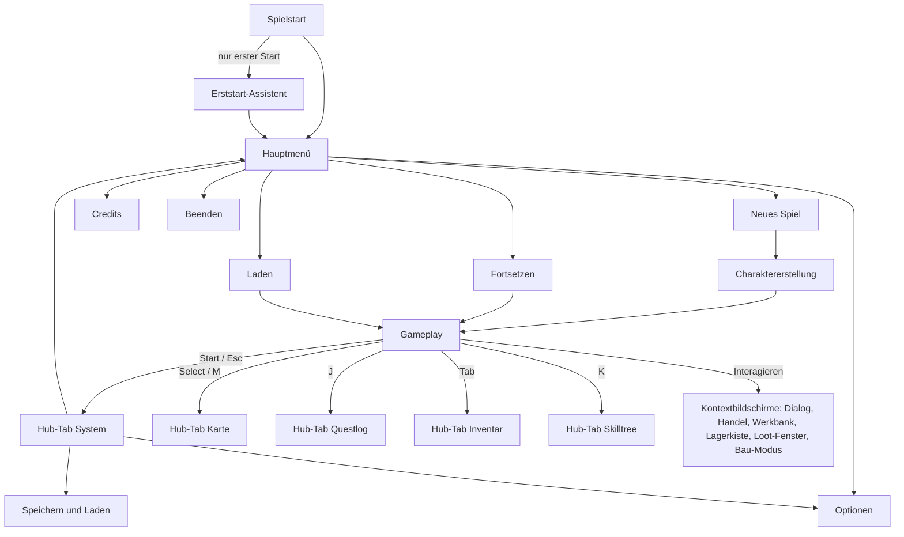
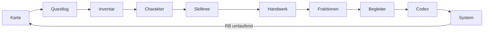
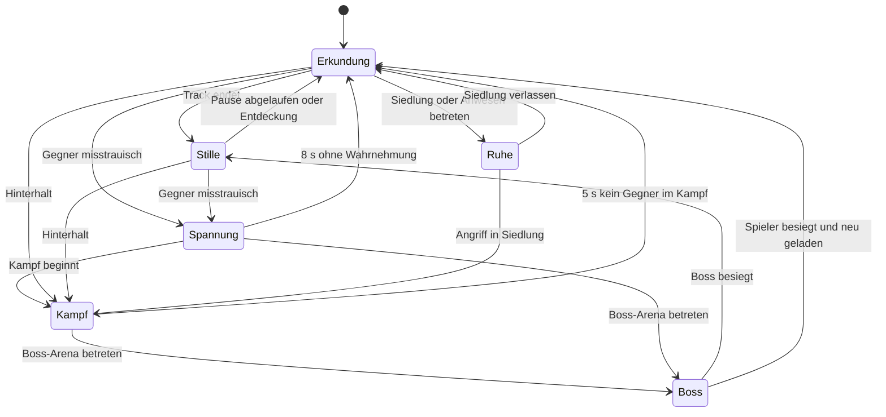
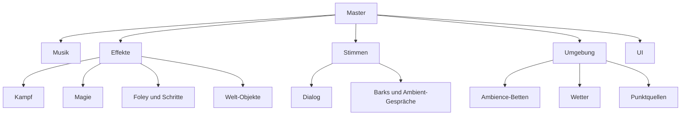

# UI/UX, Audio, Grafik & Barrierefreiheit

> Teil der Phase-0-Planung · Stand: 2026-10-13 · Quelle: [Master-Prompt](../00_Master-Prompt.md)

Kennzeichnungen (**Vorschlag**, **Verbesserungsvorschlag**, ❓ **Offene Entscheidung**) wie in [00_Vision_und_Ueberblick](./00_Vision_und_Ueberblick.md).
Die technische Wahl zwischen UI Toolkit und uGUI (§24.3) sowie SaveManager und `ISaveable` (§25) stehen in [Technik/01_Architektur](../Technik/01_Architektur.md); die Recherche dazu in [Technik/03_Technik-Recherche](../Technik/03_Technik-Recherche.md). Diese Datei beschreibt nur Verhalten und Gestaltung.

---

## 1. UI/UX (§24, §4.3)

### 1.1 Grundregeln
- **Controller zuerst (§4.3, §32.9):** Jede Funktion ist ohne Maus erreichbar. Die Maus ist gleichwertig, aber nie Pflicht.
- **Ein Farbsystem (Vorschlag):** Alle UI-Farben sind benannte Farb-Tokens in einem zentralen Theme-Asset, z. B. `rarity.legendary` oder `damage.fire`. Farbenblind- und Kontrast-Modi tauschen nur Tokens aus, nie einzelne Bildschirme.
- **Reservierte Farben (Vorschlag):**
  - Aether-Türkis steht ausschließlich für Aether (siehe 3.4).
  - Seltenheitsfarben werden in Item-Kontexten für nichts anderes verwendet.
  - Kein Zustand wird nur über Farbe vermittelt. Es gibt immer zusätzlich Form, Symbol oder Text.
- **Tempo:** Menüs öffnen in ≤ 0,15 s und schließen in ≤ 0,10 s (Grenze laut §24.3: < 0,2 s). Eingaben werden ab dem ersten Frame angenommen. Animationen blockieren nie.
- **Ladebildschirme (Vorschlag):** nur beim Betreten von Dungeons und großen Innenräumen (§4.4). Inhalt: Fortschrittsbalken, Regions-Artwork, ein Lore- oder Steuerungstipp und der „offene Haken“ aus [00](./00_Vision_und_Ueberblick.md) (zuletzt verfolgtes Ziel). Ziel ≤ 15 s (§4.4).

**Farb-Token-Gruppen (Vorschlag):**

| Token-Gruppe | Verwendung | Werte in |
|---|---|---|
| `rarity.*` | Seltenheit: Rahmen, Namen, Loot-Strahl | 1.10 |
| `damage.*` | Schadenszahlen, Element-Symbole | 1.11 |
| `quest.*` | Questgeber-Symbole, Questlog, Kompass | 1.9 |
| `faction.*` | Fraktions-Tab, Ruf-Leiste, Banner, Kartengebiete | 1.9 |
| `attr.*` | Attribute im Charakterbogen und in Dialogproben ([02](./02_Quests_und_Dialoge.md), 12.4) | unten |
| `telegraph.*` | Angriffswarnungen | 3.2 |
| `aether.*`, `void.*` | Aether und Leere | 3.4 |
| `ui.focus` | Fokus-Rahmen Weißgold `#FFE8A3` | 1.4 |
| `ui.better`, `ui.worse` | Vergleich: besser Grün `#5FD068` ▲, schlechter Rot `#FF6B5E` ▼ | 1.4 |

**Attributfarben (Vorschlag):** Stärke `#E07A5F` · Geschick `#81C784` · Intelligenz `#64B5F6` · Weisheit `#B39DDB` · Konstitution `#FFB74D` · Charisma `#F48FB1`. Der Attributname steht immer dabei, die Farbe ist nur Zusatz.

### 1.2 HUD (§24.1)

Layout-Skizze bei 16:9 (Vorschlag):

```text
┌──────────────────────────────────────────────────────────────────┐
│ [Begleiter 1|2]          [    Kompass    ]          [Minikarte]  │
│                          [Boss-Lebensbalken]        [Quests ≤ 3] │
│                          [  Banner P0   ]           [Info P1]    │
│                                                                  │
│                           ( Fadenkreuz )            [Loot P2 ×5] │
│                        [Interaktions-Hinweis]                    │
│ [Status-Icons]                                                   │
│ [Verderbnis ▮▮▯▯] [Klima | Laterne]                              │
│ [Lebensbalken ████████]     [Untertitel]       [Fähigkeiten 1–4] │
│ [Ausdauer ████][Mana ███]   [XP-Leiste]        [Schnellslots]    │
└──────────────────────────────────────────────────────────────────┘
```

| Element | Position | Inhalt | Abschaltbar | Kontextabhängig / immersiver Modus |
|---|---|---|---|---|
| Lebensbalken | unten links | LP; der Verlustbalken zieht nach 0,6 s nach; Zahl optional | ja | sichtbar bei < 100 %, im Kampf oder bei Statuseffekt; blendet 4 s nach Kampfende aus |
| Ausdauerbalken | unten links, unter LP | Ausdauer; blinkt bei 0 („Erschöpft“) | ja | sichtbar bei Verbrauch; 2 s nach dem Auffüllen aus |
| Manabalken | unten links, neben Ausdauer | Mana; Kostenvorschau beim Anwählen einer Fähigkeit | ja | sichtbar bei Verbrauch oder im Kampf |
| Aether-Verderbnis | über dem Lebensbalken, dünn | Balken 0–100 in Aether-Türkis, Marken bei 25/50/75, Stufenname beim Wechsel (Rein … Überflutet, siehe [01](./01_Welt_Story_Fraktionen.md), 1.2), Symbol für Aether-Dichte (0–3 Splitter), Deckel-Marke bei 74 mit Siegelband | nein (spielrelevant) | sichtbar bei Wert > 0 oder Dichte ≥ 1; blendet 4 s nach Rückgang auf 0 aus; Modus „Minimal“: erst ab 50 |
| Statuseffekte (Spieler) | über dem Verderbnis-Balken | Icon, Aufbaubalken, Restdauer, Stärke | ja (nicht empfohlen) | wie der Lebensbalken |
| Klima-Meter | rechts neben dem Verderbnis-Balken | Kälte (Frostgipfel) oder Hitze (Kar'Zul am Tag, Glutlande) mit Marken 50/75/100 | nein (spielrelevant) | nur in betroffenen Gebieten und bei Aufbau > 0 |
| Leere-Laterne | rechts neben dem Verderbnis-Balken | Restbrenndauer (120 s), Warnton bei 20 s | nein (spielrelevant) | nur in Leere-Zonen oder bei brennender Laterne |
| Fähigkeitenleiste | unten rechts | 4 Slots mit Glyphe; Abklingzeit radial plus Sekunden; Anzeige Leiste 1/2; rot getönt bei zu wenig Mana oder Ausdauer (Krieger-, Schurken- und Waldläufer-Fähigkeiten kosten Ausdauer, [03](./03_Kampf_Charakter_Progression.md), 4.3) | ja | im Kampf und beim Halten von RB |
| Fähigkeitsrad | Bildschirmmitte | Fähigkeiten beider Leisten (§7.1: RB halten) + KI-Modus je Begleiter ([03](./03_Kampf_Charakter_Progression.md), 13.2) | nein | nur beim Halten |
| Schnellslots | unten rechts, unter den Fähigkeiten | 4 Slots in Kreuzform wie das Steuerkreuz, Anzahl, Abklingzeit | ja | bei Nutzung und im Kampf |
| Kompass | oben Mitte | ±90° Blickfeld, Himmelsrichtungen, Marker (siehe 1.8) | ja | Immersiv: aus |
| Verfolgte Quests | rechts oben | max. 3 Quests (§16.6): Titel, aktuelle Stage, Ziele mit Zähler (3/5), optionale Ziele kursiv | ja | blendet bei Fortschritt 8 s ein |
| Angeheftetes Rezept | rechts oben unter den Quests | Zutaten mit Zähler, z. B. „Blutwurz 3/5“ ([04](./04_Items_Crafting_Wirtschaft_Endgame.md), 6.12) | ja | solange angeheftet |
| Minikarte | oben rechts | Radius 120 m, Spielerpfeil, Marker, Tageszeit-Symbol | ja (§24.1) | Immersiv: aus |
| Benachrichtigungen | siehe 1.7 | Loot, Quest, Level | filterbar | Minimal: nur P0 |
| Gegner-Lebensbalken | über dem Gegner | LP, Haltung, Level, Symbol für Elite, Champion oder Aether-verderbt, Statusaufbau; Totenkopf ab 6 Level über dem Spieler ([03](./03_Kampf_Charakter_Progression.md), 9.7) | ja | Standard: nur bei Schaden oder Lock-On |
| Boss-Lebensbalken | oben Mitte, unter dem Kompass (§20.3) | Name, Titel, LP mit Phasenmarken, Haltung | ja (nicht empfohlen) | immer im Bosskampf |
| Expedition | oben Mitte, unter dem Kompass (über einem Boss-Lebensbalken) | Riss-Stabilität 0–100 %, Zeit bis Gold/Silber/Bronze ([04](./04_Items_Crafting_Wirtschaft_Endgame.md), 9.2) | nein | nur in Riss-Expeditionen |
| Lock-On-Marker | am Ziel | Raute | nein | nur bei Lock-On |
| Fadenkreuz | Mitte | Spannungsgrad; Bestätigung für Treffer und Kopftreffer | ja | nur beim Zielen (LT) |
| Interaktions-Hinweis | unter der Mitte | Glyphe und Verb („E Sprechen“), Ring bei Halte-Aktionen | nein | bei Interaktionsobjekten in ≤ 2 m (Interaktionsradius laut [03](./03_Kampf_Charakter_Progression.md), 1.4 und [Technik/01](../Technik/01_Architektur.md), 11.3) |
| Atemleiste | neben dem Lebensbalken | Atemluft (§8.2) | nein | nur beim Tauchen |
| Entdeckungsanzeige | über dem Gegner und als Bogen um die Mitte | 0–100 %: weiß, dann gelb (misstrauisch), dann rot (entdeckt) | ja | nur beim Schleichen |
| Treffer-Richtung | Bogen um die Bildschirmmitte | Richtung eines Angriffs außerhalb des Blickfelds | ja | nur bei Treffer |
| Begleiter-Status | links oben | 2 Porträts, LP, KI-Verhalten, Spezialfähigkeit bereit | ja | im Kampf oder bei Verletzung |
| XP-Leiste | unten Mitte, dünn | Fortschritt zum nächsten Level | ja | 4 s nach XP-Gewinn |
| Reittier-Ausdauer | unter dem Lebensbalken | Galopp-Ausdauer | ja | nur beim Reiten |
| Traglast | neben dem Ausdauerbalken | Symbol gelb > 90 %, orange > 100 %, rot > 125 % ([04](./04_Items_Crafting_Wirtschaft_Endgame.md), 1.3) | nein | ab > 90 % |
| Speicher-Indikator | Ecke unten rechts | rotierendes Aether-Symbol | nein | während des Speicherns |
| Untertitel | unten Mitte | siehe 4.2 | über Optionen | – |
| Schadenszahlen | am Ziel | siehe 1.11 | ja (§9.7) | – |

**HUD-Modi (Vorschlag):**

| Modus | Verhalten |
|---|---|
| Vollständig | Alle aktivierten Elemente sind immer sichtbar. |
| Kontextabhängig (Standard) | Elemente erscheinen nach den Regeln in der letzten Spalte oben. |
| Minimal | Nur Interaktion, Boss-Lebensbalken, Untertitel, P0-Banner und spielrelevante Meter. Der Lebensbalken erscheint erst unter 30 %. |
| Benutzerdefiniert | Einzelschalter je Element: der „immersive Modus“ aus §24.1. |

**Vorschlag – Schnellansicht:** Select bzw. M **halten** (≥ 0,4 s) blendet 5 s lang alle HUD-Elemente ein. Kurz drücken öffnet weiterhin die Karte.

### 1.3 Menüstruktur (§24.2)

**Navigationskarte (global):**



**Hub-Menü: Tabs mit LB/RB bzw. Q/E, umlaufend:**



| Tab | Unterkategorien (LT/RT bzw. Z/C) | Direkttaste |
|---|---|---|
| Karte | Weltkarte (3 Zoomstufen, Filter, eigene Marker); Regionsübersicht mit Fundorte-Zählern („Truhen 12/24“); Legende | Select / Touchpad, M |
| Questlog | Haupt, Fraktion, Region, Neben, Begleiter, Aufträge, Abgeschlossen mit Entscheidungs-Ledger (Zuordnung der Kategorien in [02](./02_Quests_und_Dialoge.md), 7.1) | J |
| Inventar und Ausrüstung | Ausrüstung mit 3D-Vorschau; die 8 Kategorien aus §12.1; Aussehen (Transmog). Das Inventar ist eine Liste mit Spalten (Seltenheits-Formcode, Name, iLvl, Kernwert, Gewicht, Wert, Markierungen), kein Raster ([04](./04_Items_Crafting_Wirtschaft_Endgame.md), 1.2) | Tab |
| Charakter | Attribute verteilen, abgeleitete Werte, Resistenzen, Verderbnis-Stufe, Leere-Resonanz (ab Akt 3, [01](./01_Welt_Story_Fraktionen.md)), Titel, Paragon (ab Level 80, Punkte jederzeit kostenlos umverteilbar, [04](./04_Items_Crafting_Wirtschaft_Endgame.md), 9.6) | – |
| Skilltree | Klassenbäume, allgemeine Bäume, Belegung der Fähigkeitenleisten | K |
| Handwerk | Rezeptbuch, Berufsstufen, Materialien. Hergestellt wird an Stationen, siehe [04](./04_Items_Crafting_Wirtschaft_Endgame.md) | – |
| Fraktionen | Ruf je Fraktion, freigeschaltete Belohnungen, Feindschaften, Pakt | – |
| Begleiter | Gruppe, Ausrüstung, Skilltree, KI-Verhalten, Loyalität | – |
| Codex | Lore, Bestiarium, Tutorials, Sammlungen, Erfolge; **Vorschlag:** Chronik aller Entscheidungen (Stufe B, [02](./02_Quests_und_Dialoge.md)) | – |
| System | Fortsetzen, Schnellspeichern, Speichern, Laden, Optionen, Benachrichtigungsverlauf, Hauptmenü, Beenden | Start / Esc |

Hinweise:
- Dieselbe Direkttaste schließt das Menü wieder. B bzw. Esc schließt auf oberster Ebene und kehrt ins Gameplay zurück.
- Z/C sind Positionsbelegungen. Auf QWERTZ-Tastaturen wird „Y/C“ angezeigt (siehe 1.5).
- Q/E und Z/C gelten nur in der UI-Action-Map (§7.3). Im Gameplay bleibt Q = Blocken und E = Interagieren (§7.2).
- Kontextbildschirme (Dialog, Handel, Werkbank, Lagerkiste, Loot-Fenster, Bau-Modus) gehören nicht zum Hub. Sie nutzen eigene Action Maps (Dialog, Bauen laut §7.3) und dieselben Bedienregeln aus 1.4. Ausnahme im Loot-Fenster für Truhen: Y bzw. R = „Alles nehmen“ statt Sortieren ([04](./04_Items_Crafting_Wirtschaft_Endgame.md), 5.4 und 5.9).

### 1.4 Controller- und Bedienregeln (§24.3)

| Regel | Festlegung |
|---|---|
| Bestätigen / Zurück | A / Kreuz = Bestätigen, B / Kreis = Zurück. Ohne Ausnahme (§24.3). |
| Weitere Aktionen | X / Quadrat = Sekundäraktion (Ausrüsten, Markieren, Sperren); Y / Dreieck = Sortieren und Filtern; R3 = Details ausklappen. Alle verfügbaren Aktionen stehen mit Glyphe in einer Fußleiste (max. 5). |
| Tabs | LB/RB = Haupttabs (§24.3), LT/RT = Unterkategorien (Vorschlag). |
| Navigation | Linker Stick und Steuerkreuz bewegen den Fokus. Nach 0,4 s Halten setzt Auto-Repeat mit 12 Schritten/s ein. Der rechte Stick scrollt Texte und dreht die 3D-Vorschau. |
| Fokus-Rahmen | 3 px Rahmen in `ui.focus` (Weißgold `#FFE8A3`), 104 % Skalierung, aufgehellter Hintergrund. Kontrast ≥ 3:1 zu jedem Hintergrund. Es ist immer genau ein Element fokussiert. |
| Fokus-Gedächtnis | Jeder Tab und jede Liste merkt sich den letzten Fokus. Verschwindet das fokussierte Element (z. B. verkauft), wandert der Fokus auf das Element an derselben Listenposition, nie ins Leere. |
| Halten zum Bestätigen | 1,0 s (einstellbar 0,5–1,5 s), radialer Fortschritt auf der Glyphe, Loslassen bricht ab. Gilt für: Verkaufen oder Zerlegen ab Seltenheit Episch, Fallenlassen ab Selten, Speicherstand überschreiben oder löschen, Respec, Verzauberung (nicht umkehrbar), Dialogoptionen „[Töten]“ ([02](./02_Quests_und_Dialoge.md), 12.4), Beenden ohne Speichern. |
| Bestätigungsdialoge | Bei destruktiven Aktionen startet der Fokus auf „Abbrechen“. |
| Tooltips | Höchstens 8 Zeilen Grundinformation. Vergleich nebeneinander (links ausgerüstet, rechts neu). Unterschiede in `ui.better` ▲ / `ui.worse` ▼ mit Zahl („+12 Angriff“). Ringe werden gegen beide Ringslots verglichen. Lore und Affix-Spannen stehen hinter R3. |
| Animationen | Öffnen 0,15 s, Schließen 0,10 s, Tabwechsel 0,08 s. Option „Menü-Animationen reduzieren“ setzt alles auf 0 s. |
| Maus | Hover setzt den Fokus, Rechtsklick = Zurück, Mausrad scrollt. Beim Wechsel zum Gamepad wird der Mauszeiger ausgeblendet. |
| Texteingabe | Bildschirmtastatur für Controller, z. B. für Markernamen und Speichernamen (Vorschlag). |
| Ton | Jede UI-Aktion hat einen Ton: Fokus, Bestätigen, Zurück, Tabwechsel, Fehler, Halte-Fortschritt. Jeder Clip ist ≤ 150 ms lang und läuft über den UI-Kanal. |

### 1.5 Button-Glyphen je Gerät (§4.3, §7.3)

| UI-Aktion | Xbox | PlayStation | Nintendo (Switch Pro) | Generisch (Positionssymbol) | Tastatur/Maus |
|---|---|---|---|---|---|
| Bestätigen | A | Kreuz | B (Süd) | Süd-Taste | Enter / Linksklick |
| Zurück | B | Kreis | A (Ost) | Ost-Taste | Esc / Rechtsklick |
| Sekundär | X | Quadrat | Y (West) | West-Taste | F |
| Sortieren/Filtern | Y | Dreieck | X (Nord) | Nord-Taste | R |
| Haupttab ◀ ▶ | LB / RB | L1 / R1 | L / R | Schulter L / R | Q / E |
| Unterkategorie ◀ ▶ | LT / RT | L2 / R2 | ZL / ZR | Trigger L / R | Z / C (Position) |
| Details | R3 | R3 | R-Stick drücken | rechter Stick drücken | Shift |
| Karte | View | Touchpad | − | Select | M |
| Menü | Menu | Options | + | Start | Esc |

**Wechselregeln (Vorschlag):**
- Auf Gamepad-Glyphen wird umgeschaltet bei jeder Gamepad-Taste oder bei Stick-Ausschlag > 50 %.
- Auf Tastatur-Glyphen wird umgeschaltet bei jedem Tastendruck oder bei > 10 px Mausbewegung innerhalb von 0,1 s.
- 0,3 s Hysterese verhindert Flackern.
- Option „Glyphen-Stil“: Automatisch (Standard) / Xbox / PlayStation / Nintendo / Generisch. Die Familien entsprechen den `GlyphSet`-Familien in [Technik/01](../Technik/01_Architektur.md), 11.1.
- **Nintendo (Vorschlag):** Die Belegung bleibt positionsgleich (Süd-Taste = Bestätigen, §24.3). Weil Nintendo A und B anders beschriftet, zeigt die Glyphe dort „B“ für Bestätigen und „A“ für Zurück.
- Glyphen spiegeln immer die **aktuelle** Belegung nach Rebinding (§7.3).
- Tastatur-Glyphen zeigen die Beschriftung des aktiven Layouts (QWERTZ, AZERTY), nicht die US-Bezeichnung.
- **Prüfpunkt (nicht verifiziert):** Ob Steam Input Controller als Xbox-Gerät meldet und dadurch falsche Glyphen erzeugt. Gehört in den UI-Spike vor Phase 2 ([Technik/03](../Technik/03_Technik-Recherche.md), Empfehlung 4).

### 1.6 UI-Skalierung, Schrift & Lesbarkeit

| Thema | Festlegung (Vorschlag) |
|---|---|
| Referenz | Layout für 1920×1080; Skalierung nach Bildschirmhöhe. Retina und 4K skalieren automatisch, sodass die physische Größe gleich bleibt. |
| UI-Größe | 80–150 % in 10er-Schritten, Standard 100 % (§24.3). HUD-Größe separat 80–130 %. |
| Schriftgröße | separat 90–150 % |
| Mindestfenster | 1280×720. Bei 150 % UI-Größe wird die Skalierung begrenzt, damit sich nichts überlappt. |
| Seitenverhältnisse | 16:9, 16:10 (MacBook), 21:9, 32:9. Option „HUD-Breite“: 16:9-Bereich oder volle Breite. |
| Safe Area | 90–100 %, Standard 100 %. MacBook-Notch: Im Vollbild liegt keine UI im Notch-Bereich. **Prüfpunkt** auf dem Referenz-Mac in Phase 1. |
| Schriftgrößen bei 100 % und 1080p | Fließtext 24 px; Tooltip und Kleingedrucktes ≥ 20 px; Überschriften 36–48 px; HUD-Zahlen 22 px |
| Kontrast | Text ≥ 4,5:1, große Schrift und Symbole ≥ 3:1 (angelehnt an WCAG AA). Panels dunkel `#101418` mit 80 % Deckkraft. Texte in der Welt (Namen, Schadenszahlen) mit 2 px Kontur und Schatten. |
| Textlänge | Deutsch ist ~30 % länger als Englisch. Layouts müssen +40 % Textlänge vertragen. Geprüft wird per Pseudo-Lokalisierung. |
| Zahlen | Format je Sprache (1.234,5 bzw. 1,234.5); Ziffern gleicher Breite in Tabellen |
| Schriften | Menüs (UI Toolkit) und Weltlabels (TMP) nutzen dieselben Font-Quellen und Fallbacks ([Technik/03](../Technik/03_Technik-Recherche.md), Abschnitt 3). ❓ **Offene Entscheidung:** Schriftfamilie. Empfehlung: zwei Schriften unter SIL Open Font License mit vollständigen deutschen Glyphen (Serife für Titel, gut lesbare Sans für Fließtext); Lizenz im Register (2.6). |

### 1.7 Benachrichtigungen (Queue-Regeln)

| Klasse | Beispiele | Position | Max. gleichzeitig | Dauer | Im Kampf | In Dialog, Zwischensequenz oder Menü |
|---|---|---|---|---|---|---|
| P0 Meilenstein | Quest abgeschlossen oder gescheitert, neue Hauptquest, Level-Up, Region entdeckt, Fraktionsrang, Erfolg, Begleiter verlässt die Gruppe, kritische Warnung | oben Mitte unter dem Kompass | 1 | 4,0 s (Level-Up 3,0 s) | Level-Up und Warnungen sofort in kompakter Form; der Rest erscheint 3 s nach Kampfende | gepuffert, danach nacheinander |
| P1 Fortschritt | Questfortschritt (3/5), neue Nebenquest, Rezept gelernt, Codex-Eintrag, Ruf ±, Loyalität ± („Maren gefällt das.“), Verderbnis-Stufe gewechselt, verzögerte Konsequenz, Item ab Episch | rechts unter der Questanzeige | 2 | 3,0 s | klein angezeigt | gepuffert |
| P2 Loot und Werte | Item, Gold, XP, Material, prozeduraler Auftrag erledigt | rechts Mitte, gestapelt (neueste unten) | 5 | 2,5 s | angezeigt | gepuffert; Einträge älter als 30 s werden zusammengefasst |

**Regeln (Vorschlag):**
- **Zusammenfassen:** Dasselbe Item innerhalb von 3 s wird zu „Eisenerz ×3“, der Timer startet neu. XP und Gold werden summiert.
- **Lesezeit:** Dauer = max(Grunddauer; 1,0 s + 0,06 s je Zeichen) × Dauer-Faktor. Der Dauer-Faktor ist eine Option: 1× / 1,5× / 2×.
- **Überlauf:** Die Warteschlange fasst max. 30 Einträge. Bei Überlauf werden P2-Einträge zu „+12 Gegenstände“ verdichtet. P0 und P1 gehen nie verloren.
- **Verlauf:** Die letzten 50 Meldungen stehen im System-Tab.
- **Ton:** P0 hat einen eigenen Jingle, P1 einen kurzen Ton, P2 ein dezentes Klicken (höchstens 1 pro 0,2 s).
- **Optionen:** Filter Alle / Wichtige (P0 + P1) / Minimal (P0).
- Welche Quest-Ereignisse welche Klasse auslösen, steht in [02](./02_Quests_und_Dialoge.md), 7.5.

### 1.8 Kompass, Karte & Marker (§14.5, §16.6)

Regeln zu Kartennebel, Aussichtspunkten und Fundort-Zählern stehen in [01](./01_Welt_Story_Fraktionen.md), 6.6. Hier steht die Darstellung.

| Marker | Kompass sichtbar ab | Darstellung |
|---|---|---|
| Fokus-Quest (1 von max. 3 verfolgten) | unbegrenzt | Kategoriefarbe (siehe 1.9), groß, mit Distanz („120 m“, ab 1.000 m als „1,2 km“) |
| Weitere verfolgte Quests | unbegrenzt | Kategoriefarbe, klein, ohne Distanz |
| Quest-Suchgebiet | unbegrenzt | Klammer-Symbol im Kompass, Kreis auf der Karte |
| Eigene Marker | unbegrenzt | 6 Symbole × 6 Farben, kurze Notiz; max. 50 auf der Karte, max. 5 im Kompass |
| Entdeckter Ort (Siedlung, Dungeon, POI) | 300 m | weißes Ortssymbol |
| Unentdeckter POI | 100 m | graues „?“ als Neugier-Signal; bei Nebel-Wetter aus |
| Wegpunkt (Schnellreise, Aussichtspunkt) | 300 m | Wegpunkt-Symbol |
| Questgeber | 75 m | Questgeber-Symbol (siehe 1.9) |
| Weltereignis | 200 m | pulsierender Ring; Riss-Ausbruch in Aether-Türkis |
| Gefahr: Elite-Gegner oder Weltboss | 150 m | Hörner-Symbol in Rot `#E5534B`, Weltboss mit Krone |
| Gegner im Kampf | 40 m | rote Punkte mit Pfeil nach oben oder unten |
| Begleiter | 100 m (außerhalb der Sicht) | Porträtpunkt |
| Reittier | 300 m | Hufeisen |
| Legendäres oder mythisches Item am Boden | 50 m | Raute in Seltenheitsfarbe |

**Regeln (Vorschlag):**
- Höchstens 12 Marker gleichzeitig im Kompass.
- Priorität: Fokus-Quest > andere verfolgte Quests > Gefahr > eigene Marker > Weltereignis > Questgeber > Orte > Rest.
- Marker, die weniger als 4° auseinanderliegen, werden gestapelt.
- Höhenpfeil ▲/▼ ab 6 m Höhenunterschied.
- **Erkundungsmodus (§16.6):**
  - Questmarker entfallen im Kompass. Die Karte zeigt nur ein Suchgebiet mit 50–150 m Radius.
  - Das Questlog zeigt den Erkundungshinweis der Stage mit einer Landmarke („östlich der Mühle, wo der Bach fällt“). Schreibregeln in [02](./02_Quests_und_Dialoge.md), 7.4.
  - Eigene Marker, entdeckte Orte und Gefahren bleiben sichtbar.
- **Karte (§24.2):** 3 Zoomstufen, Filter je Markertyp, Kartennebel (§14.5), Fundorte-Zähler je Region, Fraktionsgebiete in `faction.*`-Farben (optional einblendbar).
- **Aussichtspunkt:** Kamerafahrt 5 s, mit B überspringbar; danach erscheinen die neuen „?“ mit kurzer Einblend-Animation (0,3 s je Marker, gestaffelt).

### 1.9 Questgeber-Symbole (§16.6)

| Kategorie | Annahme | Abgabe | Farbe (Vorschlag) | Zusatzform (für Farbenblindheit) |
|---|---|---|---|---|
| Hauptquest | ! | ? | Gold `#F2C14E` | Rautenrahmen, 125 % Größe |
| Fraktionsquest | ! | ? | Bronze `#C98A4B` (**Verbesserungsvorschlag**, siehe unten) | Wappenschild mit Emblem der Fraktion |
| Regionsquest / Kettenquest | ! | ? | Silber `#D9DEE7` | Doppelrahmen |
| Nebenquest | ! | ? | Weiß `#FFFFFF` | ohne Rahmen |
| Begleiterquest | ! | ? | Rosé `#F29CB8` | Mini-Porträt des Begleiters |
| Kopfgeld | Fadenkreuz | ? | Rot `#E5534B` | Fadenkreuz statt „!“ |
| Schatzsuche | ! | ? | Sand `#E3C08D` | Kartenrolle |
| Dungeon-Quest | ! | ? | Weiß | Torbogen |
| Handwerksquest | ! | ? | Kupfer `#D08A5A` | Hammer |
| Rätselquest | ! | ? | Weiß | Rune |
| Wiederholbar (täglich, wöchentlich, prozedural) | ! | ? | Blau `#5AA9FF` | Kreispfeil |
| Legendäre Quest | ! | ? | Orange `#FF8C1A` | Strahlenkranz |
| Zeitlich begrenzt (Merkmal) | Zusatz | – | Farbe der Kategorie | Sanduhr-Badge |
| Weltereignis | kein Questgeber | – | Weiß; Riss-Ausbruch in Aether-Türkis | nur als Kompass-Marker |
| Versteckte Quest (Merkmal) | kein Symbol | – | – | absichtlich ohne Hinweis |

**Verbesserungsvorschlag – Fraktionsquests in einheitlichem Bronze:** Bisher (auch in [02](./02_Quests_und_Dialoge.md), Tabelle 2.2) stand dort „Fraktionsfarbe“. Sieben Fraktionsfarben zusätzlich zu neun Kategoriefarben ergäben 16 Farbtöne für Symbole in 25–40 m Entfernung; mehrere wären kaum zu unterscheiden (z. B. Gilde gegen Hauptquest-Gold, Zwerge gegen Legendär-Orange). Das Emblem im Wappenschild zeigt die Fraktion eindeutig, auch in den Farbenblind-Modi. Fraktionsfarben bleiben in Fraktionskontexten (Banner, Fraktions-Tab, Ruf-Leiste, Kartengebiete).

**Fraktionsfarben und Embleme (Vorschlag; Fraktionen und IDs aus [01](./01_Welt_Story_Fraktionen.md)):**

| Fraktion | Token | Farbe | Emblem |
|---|---|---|---|
| Die Silberwacht | `faction.silberwacht` | Silberblau `#A9BCD6` | Siegelstern |
| Der Aether-Konvent | `faction.aether_konvent` | Indigo `#6C63D9` (bewusst kein Türkis) | Kristallprisma |
| Die Handelsgilde von Velmara | `faction.handelsgilde` | Velmarer Purpur `#A23B63` | Goldene Waage |
| Die Schattenhand | `faction.schattenhand` | Rauchgrau `#8A8796` | Gebrochenes Rad |
| Die Wilden Stämme | `faction.wilde_staemme` | Moosgrün `#5E8C4A` | Wurzelgeweih |
| Der Kult der Leere | `faction.kult_der_leere` | Leere-Lavendel `#C8B8FF` auf Schwarzviolett | Geschlossenes Auge |
| Die Zwerge von Khaz Morund | `faction.zwerge_khaz_morund` | Glutorange `#E07B39` | Amboss mit Rune |

**Zustände:**

| Zustand | Darstellung |
|---|---|
| Annahme möglich | „!“ gefüllt |
| Level ≥ 4 unter der Empfehlung | „!“ grau mit Levelzahl |
| Abgabe noch nicht möglich | „?“ grau |
| Abgabe bereit | „?“ farbig, pulsiert mit 1 Hz (bei „Bildschirmblitze reduzieren“ ohne Puls) |

**Größe und Sichtweite (Vorschlag):**
- 32 px bis 15 m, verkleinert auf 20 px bei 40 m.
- In der Welt sichtbar bis 40 m, in Städten bis 25 m.
- Ein NPC zeigt immer nur ein Symbol; Priorität und weitere Quest-Regeln in [02](./02_Quests_und_Dialoge.md), 7.6.

### 1.10 Seltenheitsfarben (§12.3) – überall identisch

| Stufe | Farbe laut §12.3 | Hex (Vorschlag) | Formcode | Loot-Strahl (§12.5) | Drop-Ton |
|---|---|---|---|---|---|
| Gewöhnlich | grau | `#A6A6A6` | ◆ | kein Strahl, nur Glitzern | – |
| Ungewöhnlich | grün | `#4CC35A` | ◆◆ | Glanz 0,5 m | – |
| Selten | blau | `#3D8BFF` | ◆◆◆ | Strahl 1,5 m | leiser Klang |
| Episch | lila | `#A855F7` | ◆◆◆◆ | Strahl 3 m | Klang |
| Legendär | orange | `#FF8C1A` | ◆◆◆◆◆ | Strahl 6 m mit Funken | eigener Klang, Kompass-Marker |
| Mythisch (nur Endgame) | rot | `#E53935` | ◆◆◆◆◆◆ | Strahl 8 m mit Bodenwelle | eigener Klang, Puls am Bildschirmrand |
| Set | gelb | `#F2D23C` | Kettenglied | doppelter Strahl 4 m | eigener Klang |

**Regeln:**
- Die Seltenheitsfarbe gilt identisch für Item-Rahmen, Namen im Tooltip, Loot-Strahl, Benachrichtigung, Händlerliste, Vergleichsansicht und Kartenmarker.
- Der Formcode ist immer sichtbar.
- Farbenblind-Modi tauschen nur die Hex-Werte (siehe 4.3).

### 1.11 Schadenszahlen & Kampf-Feedback (§9.7)

| Schadenstyp | Farbe (Vorschlag) | Symbol (optional; im Farbenblind-Modus automatisch an) |
|---|---|---|
| Physisch (Schnitt, Stich, Wucht) | Weiß `#FFFFFF` | Klinge |
| Feuer | Flammenrot `#FF5A1F` | Flamme |
| Eis | Hellblau `#9FD8FF` | Schneeflocke |
| Blitz | Gelb `#FFE14D` | Blitz |
| Gift | Grün `#8BD13A` | Tropfen |
| Schatten | Rauchviolett `#7B61D9` | Rauchwolke |
| Aether | Aether-Türkis `#2FE6D6` | Splitter |

- **Verbesserungsvorschlag:** Feuer ist `#FF5A1F` (rötlicher) statt eines reinen Orange. So bleibt Abstand zu Legendär-Orange `#FF8C1A`, das als Loot-Strahl in derselben Kampfszene liegen kann.

| Fall | Darstellung |
|---|---|
| Kritischer Treffer | 140 % Größe, Pop-Animation (1,3 → 1,0 in 0,15 s), Zusatz „!“ |
| Kopf- oder Schwachpunkttreffer | Zielscheiben-Symbol; Kristallkern verderbter Gegner zusätzlich mit Splitter |
| Schwäche getroffen | Einmal je Gegnertyp der Text „Schwach!“; der Eintrag ins Bestiarium wird aufgedeckt |
| Resistent / Immun | 80 % Größe, grau / Text „Immun“ |
| Geblockt | Schild-Symbol |
| Haltung gebrochen | Text „Betäubt!“, Finisher-Glyphe am Gegner |
| Statusaufbau | keine Zahlen, nur Aufbaubalken am Gegner-Lebensbalken |
| Schaden über Zeit | Ticks werden je 1 s zusammengefasst und klein dargestellt |

**Modi (Vorschlag):**
- Aus / Einzeln / Gesammelt. Standard: Gesammelt, d. h. Treffer auf dasselbe Ziel innerhalb von 0,6 s werden summiert.
- Max. 10 Zahlen gleichzeitig; ältere verblassen schneller.
- Erlittener Schaden des Spielers: Standard aus.

---

## 2. Audio (§26)

### 2.1 Musik-Zustandsmaschine



| Übergang | Auslöser (Vorschlag) | Überblendung |
|---|---|---|
| Erkundung → Spannung | ≥ 1 Gegner im Zustand „Misstrauisch“ oder „Suchen“ (§20.2) im Umkreis von 40 m | Spannungs-Layer in 2 s einblenden |
| Spannung → Erkundung | 8 s ohne Gegner-Wahrnehmung | Layer in 4 s ausblenden |
| → Kampf | ein Gegner im Zustand „Kämpfen“ hat den Spieler als Ziel | am nächsten Takt (max. 1 s warten); bei Hinterhalt sofort mit Stinger |
| Kampf leicht ↔ schwer | Elite oder Champion beteiligt, oder ≥ 4 Gegner | Percussion-Layer ein/aus, 1 Takt |
| Kampf → Erkundung | 5 s kein Gegner im Kampf; Kampfmusik läuft mindestens 10 s | Outro-Stinger, dann Fade 3 s |
| Wiedereinstieg in Kampf | neuer Kampf innerhalb von 15 s nach Kampfende | Kampftrack läuft an alter Position weiter, ohne Neustart |
| → Boss | Trigger der Boss-Arena (§20.3: eigene Musik) | harter Schnitt mit Boss-Stinger (0,5 s); Phasenwechsel am Taktende |
| Boss → Stille | Boss besiegt | Sieg-Stinger, 5–10 s Stille, dann Erkundung mit 8 s Fade-in |
| Erkundung → Stille | Track endet | Pause von 60–180 s (zufällig). Option „Musikhäufigkeit“ verkürzt oder verlängert sie. |
| Stille → Erkundung | Pause abgelaufen, neue Region, Ort entdeckt, Aussichtspunkt | Fade-in 4 s; bei Entdeckung erst ein Kurz-Motiv |
| Erkundung ↔ Ruhe | Siedlung, Anwesen oder Taverne betreten bzw. verlassen | Crossfade 4 s |
| Leere-Stille (Weltereignis, [01](./01_Welt_Story_Fraktionen.md)) | Ereignis beginnt im Umkreis des Spielers | **Vorschlag:** Vorrang vor allen Zuständen außer Boss. Musik in 1 s auf Stille, nur das Leere-Motiv als leiser Drone. Nach Ereignisende Rückkehr in den vorherigen Zustand mit 6 s Fade. |
| Dialog | Gespräch beginnt | kein Zustandswechsel, nur Ducking (siehe 2.5) |
| Zwischensequenz | Timeline startet (§4.2) | Die Timeline steuert die Musik. Danach Rückkehr in den vorherigen Zustand mit 3 s Fade. |

**Vorschlag – vertikale Layer:**
- Jede Erkundungsmusik einer Region besteht aus Stems: Basis, Melodie, Spannungs-Puls.
- Die Kampfmusik derselben Region hat dasselbe Tempo und dieselbe Tonart. So sind Übergänge taktgenau möglich.
- Diegetische Musik (Barden, Taverne) läuft als 3D-Quelle über den Musik-Kanal. So stellt „Musik aus“ auch sie stumm.
- Die Aktion „Musik wechseln“ aus §6.4 setzt einen Zustand oder einen festen Track mit Priorität. Quest-Musik überschreibt Erkundung und Ruhe, aber nie Kampf oder Boss.

### 2.2 Regions- und Tag/Nacht-Musik (§14.1, §26)

| Region | Klangcharakter (Vorschlag) | Tag | Nacht | Ruhe (Siedlung) |
|---|---|---|---|---|
| Eichental | Folk: Laute, Holzflöte, Streicher | warm, Dur | Solo-Cello, Harfe | Dorfthema mit Fiedel; im zerstörten Dorf gedämpfte Variante, nach dem Wiederaufbau volle Fassung |
| Goldküste | mediterran: Mandoline, Gitarre, Akkordeon, Hand-Percussion | hell, rhythmisch | Sologitarre, Brandung | Hafenthema Velmara |
| Moorschatten | tiefe Holzbläser, Drones, gehauchte Frauenstimmen | gedämpft, Moll | fast nur Drones, ferne Glocken | Motiv des Hexenzirkels |
| Kar'Zul | Oud, Duduk, Rahmentrommeln | weit, flirrend | Ney-Flöte, viel Stille | Thema des Nomadenlagers |
| Frostgipfel | Hörner, Männerchor, tiefe Trommeln | karg, erhaben | summender Chor | Thema von Khaz Morund |
| Glutlande | Industrial-Percussion, dissonantes Blech | bedrohlich | Grollen, Puls | Lager des Kults (feindlich) |
| Aurelion | orchestral; Fanfaren in der Oberstadt, Gassenmusik in der Senke | je Viertel | leises Laternenthema; Sperrstunde 22–5 Uhr mit sparsamer Variante | ein Thema je Viertel |
| Zerbrochener Himmel | ätherische Flächen, Chor ohne Worte, „zerbrochene“ Varianten der Themen aller Regionen ([01](./01_Welt_Story_Fraktionen.md), 4.8) | ewiges Zwielicht: keine Tag-Fassung | „Nacht“ nach dem Aether-Puls: dünnere Fassung, häufiger Leere-Stille | Ankerplatz: Thema der Pakt-Fraktion |

**Weitere Festlegungen (Vorschlag):**
- **Leitmotive:**
  - Hauptthema (Menü, Finale).
  - Aether-Motiv (4 Töne, erklingt nahe an Rissen).
  - Leere-Motiv (Gegenspieler, Leere-Stille).
  - Lina-Motiv (persönlicher Faden, Visionen).
- **Tag/Nacht-Wechsel:** Tag-Set 5:00–21:00, Nacht-Set 21:00–5:00 Spielzeit (Phasen aus [01](./01_Welt_Story_Fraktionen.md), 6.1). Bei 48 min pro Spieltag (§14.4) entspricht 1 Spielstunde 2 min Echtzeit. Gewechselt wird nur am Trackende oder in einer Stille-Phase, nie mitten im Track.
- **Bosse:** 1 eigenes Thema je Story-Boss, 1 gemeinsames Weltboss-Thema je Region ([01](./01_Welt_Story_Fraktionen.md), 11.3).
- **Umfang:** Stufe C ≈ 8 Tracks je Region (2 Tag, 1–2 Nacht, 2 Kampf, 1–2 Ruhe; Spannung als Layer), dazu ~20 Boss- und Story-Tracks und ~6 für Menü und Minispiele. Das ergibt ≈ 90 Tracks oder 4–5 h Musik. Stufe A braucht 6–8 Tracks.

### 2.3 Ambience-Layer (§26)

| Layer | Inhalt | Wiedergabe | Steuerung |
|---|---|---|---|
| 1 Basis-Bett | Wind, Raumton der Region | 2D-Stereo-Loop | Region, Höhe |
| 2 Biom | Wald: Vögel bei Tag, Grillen bei Nacht; Küste: Möwen, Brandung (lauter bei Flut); Moor: Frösche, Insekten | 2D-Loops je Zone, Crossfade 3 s | Zonen-Volumes, Tageszeit, Gezeiten |
| 3 Punktquellen | Bach, Wasserfall, Mühle, Schmiede, Lagerfeuer, Lava | 3D mit Abstandsdämpfung | an Objekten |
| 4 Wetter | Regen auf Laub, Stein oder Dach; Gewitter; Sandsturm; Schneesturm; Ascheregen; Aethersturm | 2D-Bett plus 3D-Donner | Wettersystem; Innen- oder Außenbereich |
| 5 Zufalls-One-Shots | knackender Ast, Raubvogel, ferner Wolf, Glocke | 3D, zufällige Position in 20–60 m, alle 5–25 s | Region, eigener Nacht-Pool |
| 6 Siedlung | Stimmengewirr, Markt, Hämmern | 2D-Bett plus 3D-Quellen | NPC-Dichte, Tageszeit (nachts leiser) |
| 7 Aether / Riss | tiefes Brummen, gläsernes Klirren, Puls mit 0,5 Hz | 3D, Intensität nach Aether-Dichte und Distanz (≤ 80 m) | Riss-Objekte; Weltzustand („versiegelt“ = aus) |
| 8 Innenraum | Raumhall, gedämpfte Außenwelt | Mixer-Snapshot | Innenraum-Volumes |
| 9 Flüstern der Leere | Wortfetzen, gehauchter Chor; nur der Spieler hört es | 2D, langsam wandernd im Stereobild | ab Verderbnis 50 (Stufe „Durchdrungen“, [01](./01_Welt_Story_Fraktionen.md)), bei Visionen und in Leere-Zonen; Geräusch-Untertitel „[Flüstern]“ |

### 2.4 Schrittgeräusche je Untergrund (§26)

Untergründe (Vorschlag, 19 Stück):
- Erde, Gras, Laub/Waldboden, Kies/Schotter
- Fels/Stein, Pflaster, Holzdielen, Holz hohl (Brücke, Steg)
- Sand, Schnee, Eis, Schlamm/Moor, flaches Wasser (≤ 0,4 m)
- Metall, Teppich/Stoff, Knochen/Gebeine, Asche/Vulkangestein
- Aether-Kristall, Schwebestein (Zerbrochener Himmel)

Regeln:
- **Bewegungsarten:** Gehen, Laufen, Sprinten, Landung, Rolle. Schleichen nutzt das Geh-Set mit −12 dB. Wie Schrittgeräusche Gegner alarmieren (Gehör der Gegner), steht in [03](./03_Kampf_Charakter_Progression.md).
- **Variation:**
  - ≥ 4 Varianten je Untergrund und Bewegungsart.
  - Zufällige Tonhöhe ±5 %, Lautstärke ±2 dB.
  - Dieselbe Variante folgt nie direkt auf sich selbst.
- **Kostenbremse:** Landung und Rolle nutzen nur drei Materialgruppen (weich, hart, nass) statt 19 Untergründe.
- **Rüstungs-Layer:** Stoff, Leder, Kette oder Platte wird über das Schrittgeräusch gelegt.
- **Erkennung:** Der Terrain-Layer mit dem höchsten Gewicht zählt, sonst das Material-Tag am Collider. Die Umsetzung steht in [Technik/01](../Technik/01_Architektur.md).
- **NPCs:** reduziertes Set mit max. 8 Untergründen; ab 30 m Entfernung keine Schritte.
- **Reittier:** Huf-Set für Erde, Stein, Holz, Sand, Schnee und Wasser.

### 2.5 Mixer-Kanäle & Ducking (§26)



Die 6 Hauptkanäle (§26) sind die Regler im Optionsmenü. Die Unterkanäle dienen nur dem internen Mix.

| Auslöser | Betroffene Kanäle und Absenkung | Attack / Release |
|---|---|---|
| Dialogzeile läuft | Musik −8 dB, Umgebung −6 dB, Effekte-Welt −4 dB | 0,3 s / 1,0 s |
| Bark im Kampf | Musik −3 dB | 0,1 s / 0,5 s |
| Hub-Menü offen | Musik −3 dB; Effekte und Umgebung −6 dB mit Tiefpass 1.200 Hz | 0,15 s / 0,3 s |
| Pause | Effekte und Umgebung angehalten, Musik −6 dB | sofort |
| Stinger (Level-Up, Boss, Sieg) | Musik −6 dB | 0,05 s / 1,5 s |
| Unter Wasser | alle außer Stimmen und UI: Tiefpass 800 Hz | 0,2 s / 0,4 s |
| Niedrige LP (< 20 %) | Effekte mit Tiefpass 3 kHz und Herzschlag (abschaltbar) | 0,5 s / 1,0 s |
| Explosion in < 5 m | Musik und Umgebung −4 dB, kurzes Pfeifen (Option „Tinnitus-Effekt“, Standard an) | 0,05 s / 2,0 s |
| Leere-Stille (Weltereignis) | Umgebung −24 dB, Effekte Tiefpass 2 kHz; nur Flüstern und Leere-Drone bleiben | 1,0 s / 6,0 s |
| Verderbnis „Überflutet“ (20 s) | Effekte und Umgebung leicht verzerrt (Tonhöhe −3 %, Chorus), Flüstern +6 dB | 0,5 s / 2,0 s |
| Zwischensequenz | Gameplay-Effekte stumm, Mix kommt aus der Timeline | 0,5 s |

Grundsätze (Vorschlag):
- UI und Dialog werden nie abgesenkt.
- Lautheitsziel des Gesamtmixes ca. −18 LUFS (±2), True Peak ≤ −1 dBTP.
- Platzhalter werden vor dem Import auf einheitliche Lautheit normalisiert.
- Stimmenbudget und Prioritäten (Dialog > Spieler > Boss > Gegner nah > Ambience) legt [Technik/01](../Technik/01_Architektur.md) fest.

### 2.6 Platzhalter-Quellen & Lizenzen (§26, §27, gilt auch für Grafik)

| Lizenz | Erlaubt? | Bedingung |
|---|---|---|
| CC0 / Public Domain | ja | Quelle trotzdem dokumentieren |
| CC BY 4.0 | ja | Namensnennung in den Credits (aus dem Register erzeugen) |
| Unity Asset Store (Standard-EULA) | ja | Kaufbeleg bzw. Paketname dokumentieren |
| Lizenzfreie kommerzielle Sound-Bundles | ja, nach Prüfung | Lizenztext ablegen; Bedingungen je Bundle prüfen |
| CC BY-SA | nein | Weitergabe-Bedingungen sind für ein kommerzielles Spiel riskant |
| CC BY-NC, „nur privat“, unbekannte Herkunft, Material aus Spielen oder Filmen | nein | – |
| KI-generiert | ❓ | siehe Offene Entscheidungen |

- **Quellen (Beispiele, Lizenz je Asset prüfen):** Freesound (Filter CC0 / CC BY), Kenney (CC0), OpenGameArt (je Asset unterschiedlich), Gratis-Pakete im Unity Asset Store, GDC-Audio-Bundles von Sonniss (eigene Lizenz), Kevin MacLeod / Incompetech (CC BY, Musik).
- **Ablage:**
  - Fremde Assets liegen unter `Assets/ThirdParty/<Quelle>/` (§5), jeweils mit Lizenztext bzw. Screenshot der Lizenzseite zum Download-Zeitpunkt.
  - Eigene Platzhalter (z. B. selbst aufgenommen) tragen das Präfix `PH_`.
- **Register (Vorschlag):** `Assets/ThirdParty/_Lizenzen.csv` mit den Spalten
  `Pfad | Quelle-URL | Autor | Lizenz | Download-Datum | Namensnennungstext | Änderungen | Status (Platzhalter/Final) | Ersetzen bis (Stufe A/B/C)`.
- **Release-Prüfung (Vorschlag):** Vor jedem öffentlichen Build gleicht ein Editor-Check alle referenzierten Fremd-Assets mit dem Register ab. Ein fehlender Eintrag oder ein Status ohne Freigabe blockiert den Build. Die Umsetzung steht in [Technik/02](../Technik/02_Systeme_und_Abhaengigkeiten.md).
- **Benennung eigener Audio-Dateien (Vorschlag):**
  - `MUS_<Region>_<Zustand>_<Variante>`, z. B. `MUS_Eichental_Erkundung_Tag_01`
  - `SFX_Step_<Untergrund>_<Bewegung>_<Nr>`
  - `AMB_<Region>_<Biom>_<Tag|Nacht>`
  - `VO_<NPC-ID>_<Zeilen-ID>` (vom Dialog-Editor erzeugt, siehe [02](./02_Quests_und_Dialoge.md), 12.8)
  - `UI_<Aktion>`
  - Ambience liegt unter `Audio/SFX/Ambience/`, damit die Struktur aus §5 erhalten bleibt.

---

## 3. Art Direction & Grafik (§27)

### 3.1 „Leicht stilisierter Realismus“ konkret (Vorschlag)

| Aspekt | Regel |
|---|---|
| Proportionen | Menschen realistisch mit 7–7,5 Kopfhöhen. Hände, Waffen und Schulterteile sind 10–15 % größer, damit sie aus 4–6 m Kameraabstand lesbar bleiben. |
| Formhierarchie | große / mittlere / kleine Formen im Verhältnis ≈ 60 / 30 / 10. Jede Silhouette muss als schwarze Fläche erkennbar sein. |
| Detail | Mittlere Formen werden modelliert, feine Details kommen in die Normal Map. Kein fotografisches Rauschen in der Albedo. |
| Oberflächen | PBR mit URP Lit. Albedo leicht gemalt (weiche Verläufe, betonte Kanten). Sättigung ~10–15 % über der Foto-Referenz. |
| Materialklassen (Smoothness) | Stoff 0,10–0,25 · Leder 0,30–0,45 · Holz 0,20–0,35 · Stein 0,10–0,30 · poliertes Metall 0,70–0,85 (Metallic 1) · Aether-Kristall 0,90 + Emission |
| Licht | Klare Hauptlichtrichtung. Charaktere bekommen ein dezentes Rim-Light. Schatten sind farbig abgedunkelt statt grau. |
| Landmarken | Wahrzeichen sind 1,5–3× größer als realistisch und aus ≥ 500 m sichtbar (Säule 1). |
| Texel-Dichte | Umgebung 512 px/m; Charaktere und Hero-Props 1.024 px/m. Texturen max. 2.048 px, 4.096 px nur für Terrain und Hero-Assets. |
| Post-Processing (§27) | Bloom dezent (nur Emission und Sonne), Farbkorrektur je Region (LUT), Distanznebel, SSAO |

### 3.2 Lesbarkeit von Gegnern & interaktiven Objekten

**Gegnerrollen (§20.1):**

| Rolle | Silhouette | Signal vor der Aktion |
|---|---|---|
| Nahkämpfer | mittelgroß, Waffe gut sichtbar | Glint an der Waffe |
| Fernkämpfer | schlank, Bogen oder Armbrust, hält Abstand | Glint beim Spannen, Ziellinie bei Elite |
| Magier | Robe, Hände oder Fokus leuchten in Elementfarbe | Elementpartikel beim Wirken |
| Heiler | Stab mit weißgoldenem Licht | sichtbare Heil-Aura (wichtiges Ziel) |
| Tank | breit, Schild oder schwere Rüstung, +20 % Größe | Funken beim Schildblock |
| Schwarm | klein, einfache Form, viele | Gruppenbewegung, hohes Geräusch |
| Hinterhalt | geduckt, getarnt | Rascheln oder Augenleuchten vor dem Sprung |
| Beschwörer | Robe, schwebende Objekte | Beschwörungskreis am Boden |

**Varianten (Werte in [01](./01_Welt_Story_Fraktionen.md), 11.2):**

| Variante | Merkmale |
|---|---|
| Normal | Basismodell |
| Elite | goldene Akzente, Symbol im Lebensbalken |
| Champion | +15 % Größe, eigenes Material, Aura, eigener Name mit Mini-Boss-Balken |
| Aether-verderbt | türkise Adern, Kristallauswüchse mit sichtbarem Kristallkern (Schwachpunkt), aufsteigende Partikel (siehe 3.4) |

**Telegrafie (visuelle Sprache; Timing in [03](./03_Kampf_Charakter_Progression.md)):**
- **Parierbar:** weißgoldener Glint `#FFE8A3` und heller Klingenton.
- **Nicht blockbar:** rotes Aufleuchten `#FF3B30`, Dorn-Symbol über dem Gegner, tiefer Warnton.
- **Flächenangriffe:** Bodenmarkierung mit Kontur in Elementfarbe.
- **Blitzeinschlag bei Gewitter:** 3 s vorher Leuchten am Einschlagpunkt ([01](./01_Welt_Story_Fraktionen.md), 6.2).

**Interaktive Objekte:**

| Typ | Erkennungsmerkmal |
|---|---|
| Plünderbar | Glitzern alle 3 s im Umkreis von 15 m. Truhenqualitäten unterscheiden sich in Form und Material (Holz, Eisen, Silber, Gold, Aether), nicht nur in der Farbe. |
| Interagierbar | Hinweis ab ≤ 2 m (Interaktionsradius laut [03](./03_Kampf_Charakter_Progression.md), 1.4 und [Technik/01](../Technik/01_Architektur.md), 11.3); optional ein Umriss in der Nähe |
| Sammelpunkt | etwas höhere Sättigung, Glitzern ab ≤ 10 m |
| Questgeber-Gegenstand (Brief, Karte, Aushang) | glitzert wie Loot, zeigt aber kein „!“ ([02](./02_Quests_und_Dialoge.md), 7.6) |
| Kletterbar (§8.2) | heller, abgegriffener Fels, Kalkspuren, Seile oder Ranken in einheitlicher Form. Option „Kletterflächen hervorheben“. |
| Zerstörbar | sichtbare Risse, lose Bretter |
| Rätsel-Element | einheitliche Sprache aus Runensteinen; aktiv leuchtet es Aether-Türkis |
| Nur mit Aether-Sicht | verborgene Wege und Plattformen erscheinen als türkise Konturen, nur solange Aether-Sicht aktiv ist |
| Gefahr | sichtbare Druckplatten und Stolperdrähte; Lava und Gift in klarer Signalfarbe |

### 3.3 Farbpalette je Region (§14.2)

Sichtweiten bei Wetter laut [01](./01_Welt_Story_Fraktionen.md), 6.2.

| Region (Level) | Grundstimmung | Hauptfarben | Akzentfarbe | Licht | Nebel / Atmosphäre |
|---|---|---|---|---|---|
| Eichental (1–10) | pastoral, warm; im zerstörten Dorf Asche und Glut | Wiesengrün, Ocker, Strohgelb | Glutrot `#D9481E` (Dorf), Aether-Türkis (Riss) | warme Sonne, lange goldene Stunde | Morgendunst, Bodennebel in Senken, Sicht > 1 km; bei Morgennebel 25 m |
| Goldküste (10–20) | sonnig, wohlhabend, im Hafen verrucht | Sandbeige, Terrakotta, Meerblau | Messing/Gold `#D4A73A` | hart und hell, hoher Sonnenstand | klar, Seedunst am Horizont; bei Seenebel 25 m |
| Moorschatten (18–28) | drückend, unheimlich | Oliv, Moosgrün, Braungrau | Giftgrüne Irrlichter `#9CFF57` | diffus, gedämpft, kaum Schatten | dauerhaft Bodennebel, Grundsicht < 50 m; bei Nebel-Wetter (45 %) 25 m |
| Sonnenwüste von Kar'Zul (25–38) | gleißend, uralt, feierlich | Ocker, Sandorange, Sandstein | Lapislazuli `#2E5FBF` (Grabmäler) | sehr hell, harte Schatten, Hitzeflimmern | Staub; im Sandsturm Sicht 15 m |
| Frostgipfel (35–48) | karg, erhaben, feindlich | Weiß, Blaugrau, Granit | Glutorange der Zwergenschmieden `#FF9A3C` | kühles Blau, tiefe Sonne | Schneetreiben, Höhennebel; im Schneesturm Sicht 20 m |
| Glutlande (45–60) | infernalisch | Basaltschwarz, Aschegrau | Lava-Orangerot `#FF4A1C` | Licht von unten (Lava), rötlicher Himmel | Rauchsäulen; im Ascheregen Sicht 40 m |
| Hauptstadt Aurelion (20–60) | Prunk in der Oberstadt, Verfall in der Senke | Marmorweiß, Königsblau, Gold / Braun, Ruß | Königsblau der Banner `#2448A8` | klar und warm; nachts Laternen | Smog in der Senke, Sicht 50 m |
| Zerbrochener Himmel (60–80) | surreal, schwebend, instabil | entsättigtes Violettgrau, Schwarz der Leere | Aether-Türkis (stark), fahles Lavendel der Leere | ewiges Zwielicht, keine eindeutige Sonne; Aether-Puls alle 48 min | Wolkenmeer darunter, Partikelströme; Leere-Stille entsättigt fast vollständig |

### 3.4 Aether-Visualsprache (§3)

| Merkmal | Aether | Die Leere (Abgrenzung) |
|---|---|---|
| Farbe | Aether-Türkis `#2FE6D6`, Kern fast weiß `#E6FFFC`, Rand Petrol `#0B6E73` | lichtschluckendes Schwarzviolett `#140A1F`, Saum fahles Lavendel `#C8B8FF` |
| Form | kantige Kristallsplitter, Bruchlinien wie gesprungenes Glas, Zickzack-Risse, nie rund | weich, amorph, fließend; entsättigt die Umgebung |
| Bewegung | Partikel steigen langsam auf; Puls 0,5 Hz („Herzschlag des Risses“) | Partikel werden nach innen gesogen |
| Klang | gläsernes Klirren, tiefer Drone | Unterdruck, Stille, rückwärts laufende Klänge |

- **Einsatz von Aether-Türkis:** Risse, Aether-Magie und Aether-Schaden, Rissläufer-Fähigkeiten, Aether-Verderbnis (Adern unter der Haut der Spielfigur, Kristalle an Gegnern, HUD-Balken), Aether-Splitter, aktive Rätsel-Runen, Aether-Sicht, Portale der Riss-Expeditionen, UI-Symbole mit Aether-Bezug, Speicher-Indikator.
- **Intensität nach Aether-Dichte 0–3 ([01](./01_Welt_Story_Fraktionen.md), 1.2):** 0 = nichts; 1 = vereinzelte Partikel; 2 = Partikel plus leichter Türkis-Stich in der Farbkorrektur; 3 = dichte Partikel, Bruchlinien am Boden, Puls im Licht.
- **Reservierung:** Türkis erscheint sonst nirgends, also nicht auf Bannern, Kleidung oder in stark gesättigten Wasser-Highlights.
- **Schatten-Magie:** Rauchviolett `#7B61D9`, Rauch quillt nach außen. Die Leere unterscheidet sich davon durch Sog statt Rauch.

### 3.5 Platzhalter-Strategie bis zu den Blender-Modellen (§4.1)

1. **Graybox:** Level werden mit ProBuilder und Terrain gebaut. Prototyp-Materialien haben ein 1-m-Raster und folgenden Farbcode:

   | Farbe | Bedeutung |
   |---|---|
   | Hellgrau | begehbar |
   | Dunkelgrau | Wand, Blocker |
   | Gelb | kletterbar |
   | Orange | interaktiv |
   | Rot | Gefahr |
   | Blau | Wasser |
   | Grün | Deckung, Vegetation |
   | Türkis | Aether, Riss |
   | Magenta | **reserviert für Fehler** (fehlender Shader) |

2. **Proxy-Figuren:** zuerst eine Kapsel mit „Nase“ als Blickrichtung. Danach frei lizenzierte Humanoid-Modelle und Animationen, jeweils mit Eintrag im Register (2.6).
3. **Stimmungsszenen:** Frei lizenzierte Pakete (z. B. CC0) dienen nur in separaten „Mood“-Testszenen zur Stilfindung. In der Spielwelt sieht ein Platzhalter erkennbar wie ein Platzhalter aus.
4. **Austausch-Reihenfolge:** Spielfigur → Gegner des Vertical Slice (3 Rigs laut [01](./01_Welt_Story_Fraktionen.md), 11.4) → Dorf-Kit Eichental → Waffen der Stufe A → Vegetation.

### 3.6 Blender → Unity-Konventionen (Design-Richtlinie)

Die exakten FBX-Export-Einstellungen werden in Phase 1 mit einer Test-FBX verifiziert (**Prüfpunkt**, nicht Teil der bisherigen Recherche).

| Thema | Regel (Vorschlag) |
|---|---|
| Maßstab | 1 Blender-Einheit = 1 m (Metric, Unit Scale 1,0). Eine Vorlagedatei enthält einen Referenz-Dummy für die Spielfigur (1,80 m). |
| Achsen | Blender: Z oben, das Modell schaut nach −Y (Blender-Vorderansicht). In Unity: Y oben, +Z vorne, Rotation (0,0,0) und Scale (1,1,1) nach dem Import. |
| Transformationen | Vor dem Export alle Transformationen anwenden. Keine negative Skalierung. |
| Pivot | Figuren und Gegner: Boden zwischen den Füßen. Props: unten Mitte. Türen: Scharnierkante unten. Waffen: Griffpunkt. Modulare Teile: untere Ecke auf dem Raster. |
| Raster für modulare Kits | Grundraster 0,5 m; Wandmodule 2 m bzw. 4 m breit |
| Dateinamen | `<Präfix>_<Bereich>_<Name>_<Variante>`. Präfixe: `SM_` statisch, `SK_` mit Skelett, `A_` Animation, `M_` Material, `T_` Textur. Beispiel: `SM_Env_Eichental_Bauernhaus_A` |
| LOD | Mesh-Suffixe `_LOD0` … `_LOD3` in einer FBX-Datei; Polygonanteil 100 / 50 / 25 / 10 % (§27: LOD-Gruppen für alle Modelle). **Vorschlag:** Für einfache Props alternativ Unitys automatisch erzeugte Mesh LODs (ab 6.2, laut [Technik/03](../Technik/03_Technik-Recherche.md), Abschnitt 7); Bäume und Hero-Assets behalten handgemachte LODs. |
| Kollision | vereinfachtes Mesh mit Suffix `_COL`. Die Import-Regel steht in [Technik/01](../Technik/01_Architektur.md). |
| Texturen | `T_<Name>_BC` (Base Color), `_N` (Normal, OpenGL-Konvention Y+), `_MS` (Metallic + Smoothness), `_AO`, `_E` (Emission). Kantenlängen als Zweierpotenzen. |
| Rig | Skelett kompatibel zu Unity Humanoid, Root-Bone für Root Motion (§8.2) |
| Animationen | `A_<Figur>_<Aktion>`, 30 fps; Root-Motion-Clips mit Suffix `_RM` |
| Polygonbudget (LOD0) | Spielfigur 30–50 k Dreiecke, Standardgegner 15–25 k, Boss 40–60 k, Props 0,5–5 k |
| Quelldateien | `.blend` außerhalb von `Assets/`, z. B. `ArtSource/` im Repo-Root mit Git LFS. In `Assets/_Project/Art/Models/` liegen nur exportierte FBX-Dateien. Grund: Unity soll keine `.blend`-Dateien importieren (Build-Rechner ohne Blender). |

### 3.7 Grafikoptionen & Presets (§27, §4.4)

| Option | Werte | Niedrig | Mittel | Hoch | Ultra |
|---|---|---|---|---|---|
| Render-Skalierung | 50–100 % | 60 % | 75 % | 90 % | 100 % |
| Upscaler | Aus / URP-Upscaling-Filter (z. B. FSR 1.0, STP) – **nicht verifiziert**, Verfügbarkeit und Qualität unter Metal im Spike prüfen | an | an | an | aus |
| Sichtweite (LOD-Bias, Detaildistanz) | 4 Stufen | 0,7 | 1,0 | 1,5 | 2,0 |
| Schatten (Auflösung / Kaskaden / Distanz) | 4 Stufen | 1.024 / 2 / 60 m | 2.048 / 2 / 100 m | 2.048 / 4 / 150 m | 4.096 / 4 / 200 m |
| Zusätzliche Schatten (Punktlichter) | 0–8 | 0 | 2 | 4 | 8 |
| Vegetationsdichte / Sichtweite für Gras | % / m | 40 % / 40 m | 70 % / 60 m | 100 % / 90 m | 100 % / 120 m |
| Texturqualität | Halb / Voll | Halb | Voll | Voll | Voll |
| Anisotrope Filterung | 2–16× | 2× | 4× | 8× | 16× |
| Kantenglättung | Aus / FXAA / SMAA / TAA | FXAA | SMAA | TAA | TAA |
| Ambient Occlusion | Aus / Niedrig / Mittel / Hoch | Aus | Niedrig | Mittel | Hoch |
| Bloom | Aus / An | An | An | An | An |
| Nebelqualität | Distanz / + Höhennebel / + Lichtschächte (falls umgesetzt) | Distanz | + Höhe | + Höhe | + Lichtschächte |
| Reflexionen (Probe-Auflösung) | 64–512 | 64 | 128 | 256 | 512 |
| Partikelqualität | % | 50 % | 75 % | 100 % | 100 % |
| NPC-Dichte in Städten | % | 50 % | 75 % | 100 % | 100 % |
| Bewegungsunschärfe | Aus / Niedrig / Hoch | Aus | Aus | Aus | Niedrig |
| Tiefenschärfe | Aus / nur Dialog / An | Aus | nur Dialog | An | An |
| Filmkörnung, chromatische Aberration | Aus / An | Aus | Aus | Aus | Aus |

**Einstellungen außerhalb der Presets:**
- Auflösung.
- Fenstermodus: Vollbild, randlos oder Fenster, je nach Plattform.
- V-Sync (Standard an).
- FPS-Limit: 30 / 60 / 90 / 120 / 144 / unbegrenzt (Standard 60).
- Helligkeit mit Kalibrierungsbild.
- HDR-Ausgabe ist ein Thema für später.

**Ziele (§4.4):**
- „Mittel“ = 60 FPS auf einem aktuellen MacBook Pro.
- „Hoch“ = 60 FPS auf einem Mittelklasse-Gaming-PC.
- Beim ersten Start schlägt eine Hardware-Erkennung ein Preset vor.
- Grafik-APIs: Metal (Mac), DirectX 12 (PC) laut §27; DX11 als Rückfall ([Technik/03](../Technik/03_Technik-Recherche.md), Abschnitt 9).
- Renderpfad (Forward+, GPU Resident Drawer) ist keine Spieleroption; Festlegung in [Technik/01](../Technik/01_Architektur.md).

❓ **Offene Entscheidung:** konkrete Referenz-Hardware für „aktuelles MacBook Pro“ und „Mittelklasse-PC“ (siehe unten).

---

## 4. Barrierefreiheit & Optionen (§29, §4.3, §7.3)

### 4.1 Grundsätze
- Alle Optionen sind jederzeit änderbar, auch während des Spiels, und wirken sofort mit Vorschau.
- **Erststart-Assistent (Vorschlag, ≤ 60 s):** Sprache → Untertitel und Textgröße mit Live-Vorschau → Helligkeit → Eingabegerät und Kamera-Invertierung → Schwierigkeit und Questmarker-Modus. Hinweis „Alles später in den Optionen änderbar“.
- Kein Zustand wird nur über Farbe oder nur über Ton vermittelt. Beispiel aus [01](./01_Welt_Story_Fraktionen.md), 6.7: Klang-Rätsel zeigen die Melodie immer auch als Symbolfolge.
- **Zielniveau (Vorschlag):** Grundstufe der Game Accessibility Guidelines vollständig, ausgewählte Punkte der Mittelstufe (siehe Offene Entscheidungen).

### 4.2 Optionen-Menü mit Standardwerten

**Gameplay**

| Option | Werte | Standard | Quelle |
|---|---|---|---|
| Schwierigkeit | Geschichte / Normal / Schwer / Albtraum | Normal | §20.4; jederzeit änderbar (§29). Auf „Geschichte“ kein LP-Verlust durch Klima ([01](./01_Welt_Story_Fraktionen.md)) |
| Questmarker | Genau / Erkundungsmodus | Genau | §16.6 |
| Autosave-Intervall | 5 / 10 / 15 / 30 min / aus | 10 min | §25 („alle X Minuten“) |
| Länge eines Spieltags | 24 / 48 / 72 / 96 min | 48 min | §14.4 („einstellbar“) |
| Häufigkeit von Begleiterkommentaren | Oft / Normal / Selten | Normal | Vorschlag |
| Rätsel-Hinweise durch Begleiter | Aus / nach 120 s / nach 60 s | nach 120 s | Vorschlag aus [01](./01_Welt_Story_Fraktionen.md), 6.7 |
| Tutorial-Hinweise | An / Nur wichtige / Aus | An | Vorschlag |
| Bestätigung beim Verkaufen oder Zerlegen ab | Selten / Episch / Legendär / Nie | Episch | Vorschlag |
| Automatisch aufheben | Aus / Gold und Materialien / Alles | Gold und Materialien | Vorschlag |
| Ausrüstung ab Seltenheit (Unteroption bei „Alles“) | Gewöhnlich / Ungewöhnlich / Selten / Episch | Ungewöhnlich | [04](./04_Items_Crafting_Wirtschaft_Endgame.md), 5.9 |
| Plunder ignorieren („Alles nehmen“ im Loot-Fenster) | An / Aus | Aus | [04](./04_Items_Crafting_Wirtschaft_Endgame.md), 5.9 |
| Strahlen ab Seltenheit | Ungewöhnlich / Selten / Episch / Legendär | Selten | [04](./04_Items_Crafting_Wirtschaft_Endgame.md), 5.8 |
| Beim Betreten des Hauses Materialien einlagern | An / Aus | An | [04](./04_Items_Crafting_Wirtschaft_Endgame.md), 1.7 |
| Schnellslot-Nachrücken (nächste Qualität, wenn der Stapel leer ist) | An / Aus | An | [04](./04_Items_Crafting_Wirtschaft_Endgame.md), 2.3 |
| Einfaches Angeln | An / Aus | Aus | [04](./04_Items_Crafting_Wirtschaft_Endgame.md), 6.11 |
| Schnellreise nur zwischen Wegpunkten | An / Aus | Aus | [03](./03_Kampf_Charakter_Progression.md), 3.6 (Teil der Albtraum-Herausforderung) |
| Blut-Effekte | An / Reduziert / Aus | An | Vorschlag, hängt von der Altersfreigabe ab |

**Steuerung**

| Option | Werte | Standard | Quelle |
|---|---|---|---|
| Tastenbelegung Controller | je Action Map (Gameplay, UI, Dialog, Reiten, Bauen) | §7.1 | §7.3 |
| Tastenbelegung Maus/Tastatur | je Action Map | §7.2 | §7.3 |
| Glyphen-Stil | Automatisch / Xbox / PlayStation / Nintendo / Generisch | Automatisch | §4.3 |
| Kamera-Empfindlichkeit Stick (horizontal / vertikal) | 1–10 | 5 / 5 | §7.3 |
| Empfindlichkeit beim Zielen (Stick) | 1–10 | 4 | Vorschlag |
| Maus-Empfindlichkeit | 0,1–5,0 | 1,0 | Vorschlag |
| Y-Achse invertieren (Kamera / Zielen getrennt) | An / Aus | Aus / Aus | §7.3 |
| Totzone links / rechts | 0–40 % | 10 % / 10 % | §7.3 |
| Stick-Kurve | Linear / Exponentiell | Exponentiell | Vorschlag |
| Vibration | 0–100 % | 80 % | §7.3 |
| Zielhilfe (nur Controller) | Aus / Schwach / Standard / Stark | Standard | §29 |
| Lock-On | Umschalten / Halten | Umschalten | Vorschlag |
| Sprinten | Halten / Umschalten | Controller: Umschalten (L3); Tastatur: Halten (Shift) | §29 |
| Blocken / Zielen | Halten / Umschalten | Halten | §29 |
| Fähigkeitsrad | Halten / Umschalten | Halten | §7.1, §29 |
| Fähigkeiten-Schema (Controller) | Rad + Akkord / nur Rad (Original §7.1) | Rad + Akkord | [03](./03_Kampf_Charakter_Progression.md), 1.3 (K2) und 1.6 |
| Zeit im Fähigkeitsrad | Normal / Zeitlupe 25 % / Pause | Zeitlupe 25 % (Schwierigkeit Geschichte: Pause) | [03](./03_Kampf_Charakter_Progression.md), 1.6 |
| Rollen-Richtung | Stick-Richtung / Kamerablick | Stick-Richtung | [03](./03_Kampf_Charakter_Progression.md), 1.6 |
| Nach Kill nächstes Ziel fixieren | An / Aus | An | [03](./03_Kampf_Charakter_Progression.md), 1.6 |
| Angriffs-Ausrichtung ohne Lock-On (Soft-Lock) | Aus / Schwach (30°) / Stark (60°) | Schwach | [03](./03_Kampf_Charakter_Progression.md), 1.6 |
| Zielen schaltet auf Leiste 2 | An / Aus | Aus | [03](./03_Kampf_Charakter_Progression.md), 1.6 |
| Kontextregeln einzeln (A, L3, R3) | An / Aus je Regel | An | [03](./03_Kampf_Charakter_Progression.md), 1.4 und 1.6 |
| Finisher-Kamera | An / Aus | An | [03](./03_Kampf_Charakter_Progression.md), 2.1 |
| Straße folgen (Reiten) | An / Aus | An | [03](./03_Kampf_Charakter_Progression.md), 1.5 (Reiten) |
| Kamera automatisch zentrieren | Aus / An (Verzögerung 1–5 s) | An, 2 s | Vorschlag |
| Kamera-Abstand | Nah / Standard / Fern | Standard | Vorschlag |
| Sichtfeld (vertikal) | 45–70° | 55° | Vorschlag |

**Grafik:** siehe 3.7. Bewegungsunschärfe und Kamerawackeln sind zusätzlich unter Barrierefreiheit erreichbar; es ist dieselbe Einstellung.

**Audio**

| Option | Werte | Standard |
|---|---|---|
| Master / Musik / Effekte / Stimmen / Umgebung / UI | 0–100 | 100 / 70 / 85 / 100 / 80 / 70 |
| Dynamikumfang | Breit / Standard / Nacht (komprimiert) | Standard |
| Ausgabe | Lautsprecher / Kopfhörer | Lautsprecher |
| Mono-Audio | An / Aus | Aus |
| Musikhäufigkeit | Immer / Standard / Selten (steuert die Stille-Phasen, siehe 2.1) | Standard |
| Kampfmusik | An / Aus | An |
| Tinnitus-Effekt | An / Aus | An |
| Herzschlag bei niedrigen LP | An / Aus | An |
| Stumm im Hintergrund | An / Aus | An |

**Anzeige / HUD**

| Option | Werte | Standard |
|---|---|---|
| HUD-Modus | Vollständig / Kontextabhängig / Minimal / Benutzerdefiniert | Kontextabhängig |
| Einzelschalter je HUD-Element | siehe Tabelle in 1.2 | alle an |
| UI-Größe / HUD-Größe | 80–150 % / 80–130 % | 100 % / 100 % |
| HUD-Deckkraft | 30–100 % | 100 % |
| HUD-Breite | 16:9-Bereich / volle Breite | volle Breite |
| Safe Area | 90–100 % | 100 % |
| Minikarte / Drehung mit der Kamera | An / Aus | An / An |
| Kompass | An / Aus | An |
| Schadenszahlen | Aus / Einzeln / Gesammelt | Gesammelt |
| Gegner-Lebensbalken | Immer / Bei Schaden / Nur Lock-On / Aus | Bei Schaden |
| Benachrichtigungen | Alle / Wichtige / Minimal | Alle |
| Dauer der Benachrichtigungen | 1× / 1,5× / 2× | 1× |
| Fadenkreuz | Beim Zielen / Immer / Aus | Beim Zielen |
| Menü-Animationen reduzieren | An / Aus | Aus |

**Barrierefreiheit**

| Option | Werte | Standard |
|---|---|---|
| Untertitel für Dialoge / Ambient-Gespräche | An / Aus | An / An |
| Geräusch-Untertitel („[Wolf heult]“, „[Flüstern]“) | An / Aus | Aus |
| Untertitel-Größe | S 28 px / M 34 px / L 42 px / XL 52 px (bei 1080p) | M |
| Untertitel-Hintergrund | Aus / Halbtransparent / Deckend; Deckkraft 0–100 % | Halbtransparent, 60 % |
| Sprechername anzeigen | An / Aus | An |
| Farbe des Sprechernamens | Einheitlich weiß / je Sprecher farbig (Begleiter mit fester Farbe, Kontrast ≥ 4,5:1) | je Sprecher farbig |
| Richtungspfeil am Untertitel (Sprecher außerhalb der Sicht) | An / Aus | Aus |
| Zeilenlänge | max. 2 Zeilen à ≤ 45 Zeichen (fest, Regel in [02](./02_Quests_und_Dialoge.md), 12.7) | – |
| Textgeschwindigkeit (§17) | Langsam 20 / Normal 40 / Schnell 80 Zeichen pro s / Sofort | Schnell |
| Dialog automatisch fortsetzen | Aus / An (Lesezeit-Faktor 1–3×) | Aus |
| Schriftgröße in Menüs | 90–150 % | 100 % |
| Legasthenie-freundliche Schrift | An / Aus (Lizenz prüfen) | Aus |
| Kontrast-Modus | Standard / Hoch (deckende Panels, 4 px Fokusrahmen, Kontur an Welttexten) | Standard |
| Farbenblind-Modus | Aus / Deuteranopie / Protanopie / Tritanopie; Stärke 0–100 % | Aus, 100 % |
| Element-Symbole an Schadenszahlen | An / Aus | Aus (im Farbenblind-Modus automatisch an) |
| Kamerawackeln (§8.1) | 0–100 % | 100 % |
| Bewegungsunschärfe | Aus / Niedrig / Hoch | laut Preset (Standard aus) |
| Bildschirmblitze reduzieren (Blitze, Riss-Ausbrüche, Explosionen, pulsierende Symbole) | An / Aus | Aus |
| Verderbnis-Bildschirmeffekte (Randpuls, Verzerrung bei „Überflutet“) | 0–100 % | 100 % |
| Halte-Eingaben als Umschalten (global) | An / Aus | Aus |
| Dauer für „Halten zum Bestätigen“ | 0,5 / 1,0 / 1,5 s | 1,0 s |
| Schnelles Tastenhämmern durch Halten ersetzen | An / Aus | Aus |
| Kletterflächen hervorheben | An / Aus | Aus |
| Interaktive Objekte hervorheben | Aus / In der Nähe / Immer | In der Nähe |
| Gegner-Umrisse mit hohem Kontrast | An / Aus | Aus |
| Visuelle Geräuschanzeige (Richtung von Schritten und Angriffen) | An / Aus | Aus |
| Pfad zum Questziel einblenden | An / Aus | Aus |
| Kampftempo (**Vorschlag**) | 70 / 85 / 100 % | 100 % (unter 100 % keine Arena-Rangstufen) |
| Menüs vorlesen (Screenreader) | An / Aus | Ziel Stufe B. Unity-Desktop-Player unterstützen ab 6.3 Narrator und VoiceOver ([Technik/03](../Technik/03_Technik-Recherche.md), Abschnitt 1); Zusammenspiel mit UI Toolkit im Spike prüfen |

**Sprache (§4.2, §29)**

| Option | Werte | Standard |
|---|---|---|
| Textsprache | Deutsch / Englisch | Systemsprache, sonst Englisch |
| Sprachausgabe | Deutsch / Englisch (sobald vorhanden) | wie Textsprache |
| Untertitelsprache | Deutsch / Englisch | wie Textsprache |
| Zahlen- und Datumsformat | automatisch je Sprache | automatisch |

### 4.3 Farbenblind-Modi – Umsetzungsregel (Vorschlag)
- Es gibt **keinen** reinen Vollbildfilter. Stattdessen werden spielrelevante Farb-Tokens getauscht: Seltenheit, Schadenstypen, Questkategorien, Fraktionen, Telegrafie, Entdeckungsanzeige, Karten-Marker, Vergleich (▲/▼).
- Jede Palette wird mit einem Simulator gegen alle drei Sehschwächen geprüft. Ziel: Benachbarte Stufen unterscheiden sich deutlich in der Helligkeit.
- Formcodes (Rauten, Symbole, Embleme) sind unabhängig vom Modus immer aktiv.
- Kritische Paare, die jede Palette trennen muss: Ungewöhnlich/Selten (Grün/Blau), Legendär/Mythisch (Orange/Rot), Vergleich besser/schlechter (Grün/Rot), Telegrafie parierbar/nicht blockbar (Weißgold/Rot).

---

## 5. Speichern aus Spielersicht (§25)

Technik (SaveManager, `ISaveable`, JSON, Versionierung, Migration): siehe [Technik/01_Architektur](../Technik/01_Architektur.md). Speicherpfade und Serialisierung: [Technik/03](../Technik/03_Technik-Recherche.md), Abschnitt 10.

### 5.1 Speicherplätze (Vorschlag)

| Typ | Anzahl | Verhalten |
|---|---|---|
| Charakter-Ordner | unbegrenzt | Eigener Ordner je Spielfigur bzw. Durchgang; NG+ als Unterordner „NG+1“ |
| Manuell | bis zu 99 je Charakter | Namen werden automatisch erzeugt („Velmara – Die Schatzkarte …“), lassen sich umbenennen; Überschreiben mit Halten (1,0 s) |
| Autosave | 3 je Charakter, rotierend | Auslöser siehe 5.3 |
| Schnellspeicherung | 3 je Charakter, rotierend | F5 / System-Tab |
| Meilenstein | automatisch, bleibt dauerhaft | Vor Punkten ohne Rückkehr: Akt-Wechsel, Fraktions-Eid, Pakt (E2.4), Pakt mit dem Grauen Wanderer (E3.3), Wahl des Endes. Name „Vor: <Entscheidung>“ |

- „Fortsetzen“ im Hauptmenü lädt den neuesten gültigen Stand, egal welchen Typs.
- Liste: nach Datum sortiert, nach Charakter gruppiert. Löschen nur mit Halten (1,0 s).

### 5.2 Manuelles Speichern
- Erlaubt überall außerhalb des Kampfes (§25).
- **„Im Kampf“ (Vorschlag):** Ein Gegner hat den Spieler als Ziel, oder der Spieler hat in den letzten 5 s Schaden verursacht oder erlitten.
- **Verbesserungsvorschlag – zusätzliche Sperren** (Original §25: „Manuelles Speichern überall außerhalb des Kampfes“). Technik in [Technik/01](../Technik/01_Architektur.md), 9.8:
  - Dialog und Zwischensequenz: Laufende Dialoggraph- bzw. Timeline-Zustände werden nicht gespeichert.
  - Fall, Sprung und Tauchen: Niemand soll unmittelbar vor dem Tod speichern (Fallschaden, Atemnot).
  - Boss-Arena: zählt als Kampf.
  - Zeitkritische Quest-Stages (Stage-Feld „Speichersperre“, [02](./02_Quests_und_Dialoge.md), 4.2): Schutz vor Softlocks, z. B. ein Speicherstand mit 3 s Restzeit.
  - ❓ **Offene Entscheidung:** Diese Sperren übernehmen? Empfehlung: ja (siehe [Offene Entscheidungen](#offene-entscheidungen)).
- Ist Speichern gesperrt, ist der Menüpunkt ausgegraut und nennt den Grund („Speichern im Kampf nicht möglich“).

### 5.3 Autosave-Auslöser

| # | Auslöser | Hinweis |
|---|---|---|
| 1 | Questfortschritt: Stage oder Quest abgeschlossen (alle Kategorien außer prozeduralen Aufträgen) | §25; höchstens 1 Autosave pro 60 s |
| 2 | Regionswechsel, 5 s nach dem Grenzübertritt | §25 |
| 3 | Zeitintervall (Standard 10 min); jede andere Speicherung setzt den Timer zurück | §25 |
| 4 | Vor dem Betreten und nach dem Verlassen von Dungeons und Innenräumen mit Ladebildschirm | §4.4 |
| 5 | Vor einem Bosskampf (Vorkammer, nicht in der Arena) und nach dem Sieg | – |
| 6 | Nach Schnellreise (bei Ankunft) | – |
| 7 | Nach Schlafen oder Warten | – |
| 8 | Nach wichtigen Entscheidungen; davor zusätzlich ein Meilenstein-Stand | §16.5 |
| 9 | Beim Akt-Wechsel (Meilenstein) | §18 |
| 10 | Über das Menü „Speichern und Beenden“ (Standardaktion beim Beenden) | – |

- Fällt ein Auslöser in eine gesperrte Situation (5.2), wird der Autosave verschoben, bis Speichern wieder erlaubt ist.
- Ist das nach 120 s nicht der Fall, entfällt dieser Autosave.
- Während des Speicherns ist der Speicher-Indikator sichtbar (1.2). Das Spiel friert nicht ein (Schreiben im Hintergrund, siehe [Technik/03](../Technik/03_Technik-Recherche.md)).

### 5.4 Schnellspeichern / Schnellladen (§25)
- **PC/Mac:** F5 speichert schnell, F9 lädt schnell. Beide Tasten sind frei belegbar.
- **Schnellladen:** Es erscheint die Abfrage „Schnellspeicherung von vor 4 min laden? Fortschritt seitdem geht verloren.“ Ein zweiter Druck auf F9 oder Enter bestätigt.
- **Controller:** „Schnellspeichern“ ist der zweite Eintrag im System-Tab, direkt nach „Fortsetzen“ (1.3). Schnellladen läuft über das Lademenü.
- Es gelten dieselben Sperren wie beim manuellen Speichern.

### 5.5 Vorschau je Speicherstand (§25)

| Feld | Beispiel |
|---|---|
| Screenshot (ohne HUD, zum Speicherzeitpunkt) | 16:9-Vorschaubild |
| Charaktername, Level, Klasse(n) | „Liara · Level 14 · Krieger/Magier“ |
| Ort | „Goldküste › Velmara, Hafenviertel“ |
| Aktuelle Hauptquest | „Akt 2 – <Questname>“ |
| Spielzeit | „23:41 h“ |
| Datum und Uhrzeit (real) | „12.10.2026, 21:14“ |
| Schwierigkeit, NG+, Weltstufe | „Normal“, „NG+1“, „Weltstufe 3“ |
| Typ | Manuell / Auto / Schnell / Meilenstein |
| Spielversion (klein) | „v0.4.2“ |

### 5.6 Fehlerfälle aus Spielersicht

| Situation | Das sieht der Spieler | Verhalten (Vorschlag) |
|---|---|---|
| Speicherstand beschädigt | Slot mit Warnsymbol „Beschädigt“. Beim Laden: „Sicherung vom 12.10.2026, 20:58 laden?“ | Jeder Slot hat eine Vorversion als Backup. Die beschädigte Datei wird nicht gelöscht, sondern für Fehlerberichte in den Ordner „Beschädigt“ verschoben. |
| Speichern fehlgeschlagen (Speicher voll, keine Rechte) | „Speichern fehlgeschlagen: <Grund>. Dein vorheriger Stand ist unverändert.“ | Geschrieben wird zuerst in eine temporäre Datei. Erst nach erfolgreicher Prüfung wird sie umbenannt. |
| Absturz während des Speicherns | nichts Besonderes; „Fortsetzen“ lädt den neuesten gültigen Stand | Unvollständige temporäre Dateien werden ignoriert. |
| Stand aus älterer Spielversion | „Spielstand wird aktualisiert …“ | Migration (§25); das Original bleibt als Backup erhalten. |
| Stand aus neuerer Spielversion | „Benötigt Version 0.5 oder neuer.“ | Wird nicht geladen. |
| Inhalt wurde entfernt (ID existiert nicht mehr) | „Einige Gegenstände wurden ersetzt.“ | Ersatz über eine Tabelle alte ID → neue ID oder Gold-Gutschrift; siehe [Technik/01](../Technik/01_Architektur.md) |
| Spieler sucht seine Dateien | Knopf „Speicherordner öffnen“ im Lademenü | Der Ordner liegt im Benutzerverzeichnis der Plattform (`persistentDataPath`, Pfade in [Technik/03](../Technik/03_Technik-Recherche.md)). Firmen- und Produktname im Player werden vor dem ersten externen Build festgelegt und nie geändert, sonst „verschwinden“ Spielstände. |

❓ **Offene Entscheidung:** Cloud-Speicher (z. B. Steam Cloud). Das hängt von der Vertriebsplattform ab. Empfohlener Standard: Steam Auto-Cloud mit plattformübergreifenden Ständen zwischen Mac und PC (gleiches JSON-Format, Pfad-Overrides laut [Technik/03](../Technik/03_Technik-Recherche.md)).

---

## Offene Entscheidungen

| Frage | Optionen | Empfehlung | Warum wichtig |
|---|---|---|---|
| UI-Kunststil | ornamentale Fantasy · schlicht-modern · Mischung | Schlicht mit dezenten Fantasy-Ornamenten (Rahmen, Titel) | Bestimmt den Aufwand jedes Menüs und die Lesbarkeit |
| Schriftarten | Lizenzschriften · Open-Font-License-Schriften | 2 OFL-Schriften (Serife für Titel, Sans für Text) | Lizenzkosten, deutsche Glyphen, Lesbarkeit |
| Grad der Stilisierung | nah an Witcher (realistisch) · Mitte · nah an Genshin (stark stilisiert) | Mitte, abgenommen über ein Referenzboard (10–15 Bilder) | Grundlage jedes Blender-Modells; später nicht mehr änderbar |
| Referenz-Hardware | konkrete Mac- und PC-Modelle | Je ein Testgerät „aktuelles MacBook Pro (Basischip, 16 GB)“ und „PC mit Mittelklasse-GPU der aktuellen Generation“ | §4.4 lässt sich ohne konkrete Geräte nicht prüfen |
| Umfang der Sprachausgabe | keine · nur Barks · Hauptstory · voll; DE und/oder EN | Stufe A/B: nur Barks und Kampflaute; später Hauptstory in einer Sprache | Kosten mal zwei Sprachen; Untertitel-Timing |
| Musikproduktion | Auftragskomposition · Musik-Library · Mischung | Library-Platzhalter, ab Stufe B Auftragskomposition für Hauptthema und Regionsthemen | ~90 Tracks in Stufe C; größter Audiokostenblock |
| KI-generierte Platzhalter (Audio, Grafik) | nie · nur intern · auch im Release | Nur intern, im Register gekennzeichnet, nie im Release | Rechtliche Unsicherheit beim Urheberrecht; Store-Richtlinien |
| Standard für Questmarker | Genau · Erkundungsmodus · Abfrage beim Start | Abfrage im Erststart-Assistenten, vorausgewählt „Genau“ | Prägt das Erkundungsgefühl (Säule 1) |
| Schadenszahlen standardmäßig | an · aus | An (Gesammelt) | Lesbarkeit gegen Immersion |
| Farbe der Fraktionsquest-Symbole | Fraktionsfarbe · einheitlich Bronze mit Emblem | Bronze mit Emblem (Verbesserungsvorschlag 1.9); Tabelle 2.2 in [02](./02_Quests_und_Dialoge.md) entsprechend anpassen | Lesbarkeit in 25–40 m, Farbenblind-Tauglichkeit |
| Cloud-Speicher | keiner · Steam Cloud · eigener Dienst | Steam Auto-Cloud, falls Steam die Vertriebsplattform wird | Spieler mit Mac und PC; Support-Aufwand |
| Zielniveau Barrierefreiheit | Basis · erweitert · umfassend | Grundstufe der Game Accessibility Guidelines komplett, ausgewählte Punkte der Mittelstufe; Screenreader für Menüs ab Stufe B | Kosten gegen Reichweite |
| Kampftempo-Option | ja · nein | Ja, mit Ausschluss von den Arena-Rangstufen | Barrierefreiheit gegen Balance |
| Speichersperren über §25 hinaus (5.2) | nur im Kampf (wörtlich §25) · zusätzlich Dialog, Zwischensequenz, Fall/Sprung/Tauchen, Boss-Arena, zeitkritische Stages | Ja, Sperren übernehmen (Verbesserungsvorschlag 5.2) | Schutz vor kaputten oder tödlichen Speicherständen gegen „überall speichern“ |

---

## Risiken & Hinweise

1. **Der UI-Umfang wird unterschätzt.** 10 Hub-Tabs, 6 Kontextbildschirme, vollständige Controller-Bedienung, 2 Sprachen, Tooltips mit Vergleich.
   → Gegenmaßnahme: Früh eine wiederverwendbare Komponentenbibliothek bauen (Tableiste, Fokusliste, Tooltip, Vergleich, Halten-Knopf, Dialog). Das HUD und ein Referenzmenü (Inventar) entstehen in Phase 2 komplett und dienen als Vorlage.
2. **Gamepad-Navigation im UI Toolkit ist eine bekannte Schwachstelle** ([Technik/03](../Technik/03_Technik-Recherche.md), Abschnitt 3).
   → Gegenmaßnahme: UI-Spike vor Phase 2 (Inventarliste mit Spalten ([04](./04_Items_Crafting_Wirtschaft_Endgame.md) 1.2), Tableiste, Rebinding, Tooltip, 3D-Vorschau, Sprachwechsel). Abbruchkriterium und Ausweichen auf uGUI laut Technik/03.
3. **Glyphen, Rebinding und Steam Input sind fehleranfällig.**
   → Gegenmaßnahme: Testmatrix ab Phase 1. Geräte: Xbox, DualSense, DualShock 4, Switch Pro, generisches Gamepad, Tastatur DE und US. Systeme: Mac und Windows. Jedes Gerät wird bei jedem Meilenstein geprüft.
4. **Native Retina-Auflösung auf dem MacBook ist für 60 FPS in einer offenen Welt zu teuer.** Ob ein temporaler Upscaler unter Metal verfügbar ist, ist nicht verifiziert.
   → Gegenmaßnahme: Render-Skalierung um 75 % im Preset „Mittel“. Ab Stufe A wird auf dem Referenz-Mac profiliert. Es gibt ein festes Performance-Budget je Szene.
5. **Musikkosten (~90 Tracks in Stufe C).**
   → Gegenmaßnahme: vertikale Layer statt separater Spannungs-Tracks, Stille-Phasen, Leitmotive in Varianten. Stufe A kommt mit 6–8 Tracks aus.
6. **Platzhalter mit unklarer Lizenz rutschen in den Release.**
   → Gegenmaßnahme: Lizenzregister ab dem ersten Import, Präfix `PH_`, Build-Prüfung gegen das Register (2.6).
7. **Barrierefreiheit nachträglich einzubauen ist teuer.** Das gilt für Text-Skalierung, Farb-Tokens und Halten/Umschalten.
   → Gegenmaßnahme: Diese Infrastruktur entsteht in Phase 1–2 zusammen mit Input und UI-Basis, nicht in Phase 7.
8. **Überladene Farbcodes.** Seltenheit, Elemente, Questkategorien, Fraktionen und Attribute konkurrieren.
   → Gegenmaßnahme: Kontexttrennung (Item-UI gegenüber Welt), Formcodes und Embleme überall, reservierte Farben (Türkis, Magenta), Fraktionsquests in einheitlichem Bronze, zentrales Theme-Asset.
9. **Stilbrüche durch gemischte Gratis-Assets.** Teams gewöhnen sich an den Platzhalter-Look.
   → Gegenmaßnahme: Graybox bleibt erkennbar Graybox. Stilfindung nur in Mood-Szenen. Stilabnahme mit Referenzboard vor Beginn der Blender-Produktion.
10. **Blender-Importfehler (Maßstab, Achsen, Pivot).**
    → Gegenmaßnahme: Vorlage-`.blend` mit Referenz-Dummy, Test-FBX in Phase 1, Import-Validator (Technik).
11. **Datenverlust durch kaputte Speicherstände.** Das ist der schlimmste Vertrauensverlust bei 100+ h Spielzeit.
    → Gegenmaßnahme: atomares Schreiben, Backup je Slot, Meilenstein-Stände, automatisierte Lade- und Speichertests mit alten Ständen (§25, §30).
12. **Deutsche Texte sprengen Layouts.**
    → Gegenmaßnahme: Pseudo-Lokalisierung (+40 % Länge) als fester Testschritt jeder UI-Abnahme.
