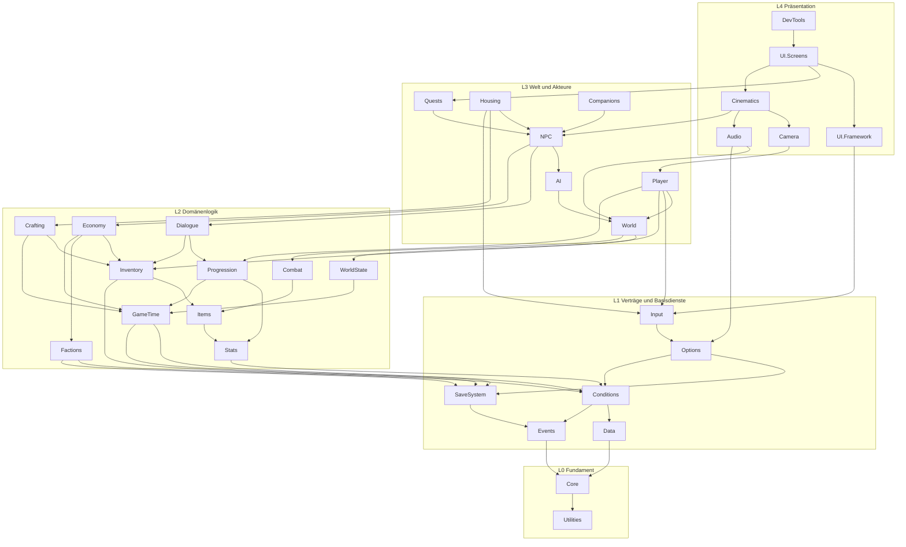
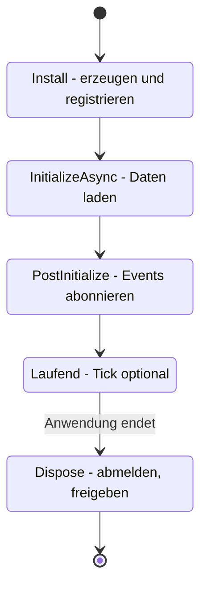
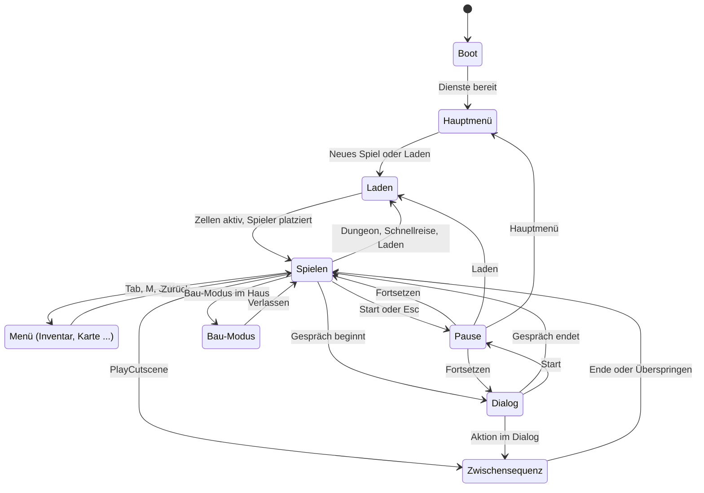
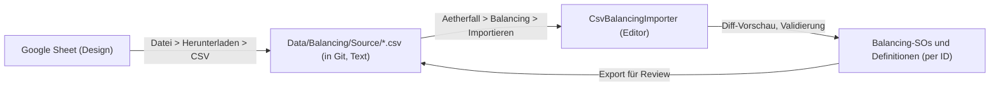
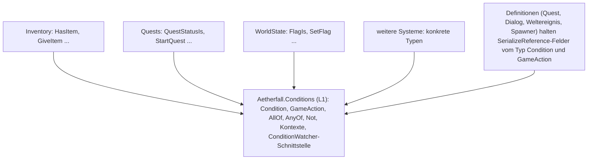
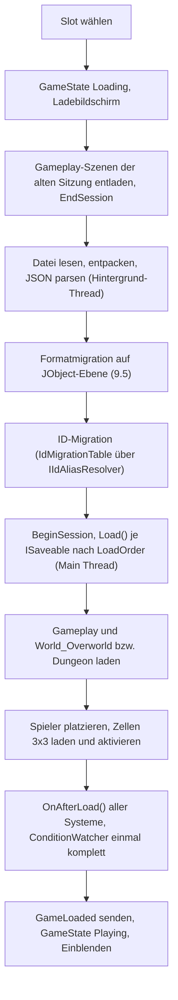
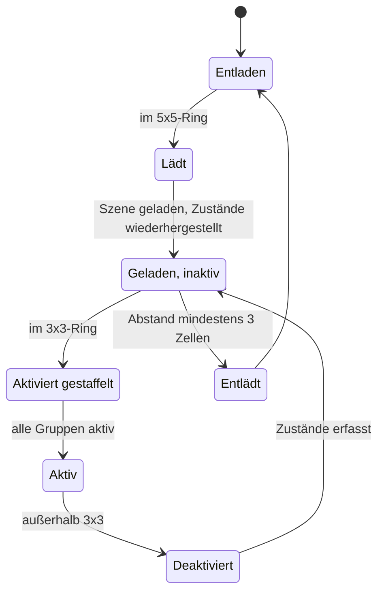

# Technische Architektur

> Teil der Phase-0-Planung · Stand: 2026-10-13 · Quelle: [Master-Prompt](../00_Master-Prompt.md)

Verwandte Dokumente: [Technik-Recherche](./03_Technik-Recherche.md) (Faktenbasis, Versionen, Quellen) · [Systeme & Abhängigkeiten](./02_Systeme_und_Abhaengigkeiten.md) (Umsetzungsreihenfolge) · [Vision](../GDD/00_Vision_und_Ueberblick.md) · [Welt & Story](../GDD/01_Welt_Story_Fraktionen.md) · [Quests & Dialoge](../GDD/02_Quests_und_Dialoge.md) · [Kampf & Progression](../GDD/03_Kampf_Charakter_Progression.md) · [Items & Wirtschaft](../GDD/04_Items_Crafting_Wirtschaft_Endgame.md) · [UI/Audio/Grafik](../GDD/05_UI_Audio_Grafik_Barrierefreiheit.md)

**Kennzeichnungen** (projektweit gleich):
- **Vorschlag:** füllt eine Lücke im Master-Prompt.
- **Verbesserungsvorschlag:** weicht bewusst vom Master-Prompt ab, Original bleibt erkennbar.
- ❓ **Offene Entscheidung:** liegt beim Auftraggeber, gesammelt am Dateiende.

**Geltung:** Dieses Dokument ist verbindlich für Phase 1–3 (§31). Abweichungen nur über eine Änderung der ADR-Tabelle ([Architektur-Entscheidungen](#architektur-entscheidungen-adr-kurzform)). Gestaltungs- und Balancing-Werte stehen im GDD, hier stehen nur Strukturen, Schnittstellen und technische Grenzwerte.

---

## Inhalt

0. [Architekturprinzipien](#0-architekturprinzipien)
1. [Tech-Stack](#1-tech-stack)
2. [Projekt-Setup-Checkliste](#2-projekt-setup-checkliste)
3. [Ordner- und Assembly-Struktur](#3-ordner--und-assembly-struktur)
4. [Kernsysteme (§6.2)](#4-kernsysteme-62)
5. [Daten-Architektur](#5-daten-architektur)
6. [Eindeutige IDs (§6.3)](#6-eindeutige-ids-63)
7. [Conditions & Actions (§6.4)](#7-conditions--actions-64)
8. [Weltzustand (§6.5)](#8-weltzustand-65)
9. [Speichersystem (§25)](#9-speichersystem-25)
10. [Welt-Streaming (§4.4, §14.1)](#10-welt-streaming-44-141)
11. [Systemarchitekturen](#11-systemarchitekturen)
12. [UI-Technologie (§24.3)](#12-ui-technologie-243)
13. [Performance (§4.4, §27)](#13-performance-44-27)
14. [Qualität: Tests, Debug, Logging, Telemetrie, CI](#14-qualität-tests-debug-logging-telemetrie-ci)
15. [Coding-Konventionen (§32)](#15-coding-konventionen-32)
16. [Plattform & Builds](#16-plattform--builds)
17. [Architektur-Entscheidungen (ADR-Kurzform)](#architektur-entscheidungen-adr-kurzform)
18. [Offene Entscheidungen](#offene-entscheidungen)
19. [Risiken & Hinweise](#risiken--hinweise)

---

## 0. Architekturprinzipien

Aus §6.1 übernommen, ergänzt um technische Regeln, die aus der [Recherche](./03_Technik-Recherche.md) folgen.

| # | Prinzip | Quelle | Konkrete Regel |
|---|---|---|---|
| P1 | Datengetrieben | §6.1 | Inhalte sind ScriptableObjects (Definitionen). Neuer Inhalt = neues Asset, keine Code-Änderung. |
| P2 | Lose Kopplung | §6.1 | Systeme kommunizieren über EventBus und Interfaces in tieferen Schichten. Keine direkten Referenzen „nach oben“. |
| P3 | Single Responsibility | §6.1 | **Vorschlag:** Klassen über ~400 Zeilen werden im Review begründet oder geteilt. Kein `GameManager`. |
| P4 | Komposition statt Vererbung | §6.1 | Maximal 2 Ebenen eigene Vererbung unter `MonoBehaviour`/`ScriptableObject`. Varianten über Daten-Komponenten (`[SerializeReference]`). |
| P5 | IDs sind die einzige persistente Referenz | §6.3, §25 | Spielstände, Events, Konsole und CSV nutzen nur String-IDs. Nie `InstanceID`/`EntityId` speichern. |
| P6 | Daten vor Editor | Recherche §4 | Quest-/Dialog-Daten hängen von keinem Graph-Framework ab. Editoren sind austauschbare Ansichten. |
| P7 | CoreCLR-fest ab Tag 1 | Recherche §6 | Domain Reload aus, statischer Zustand wird explizit zurückgesetzt, kein `BinaryFormatter`, keine Mono-P/Invokes. |
| P8 | Speichern mitdenken | §32.8 | Jedes System beantwortet in seinem Steckbrief: „Was wird gespeichert, wann, in welcher Reihenfolge geladen?“ |
| P9 | Controller zuerst | §32.9 | Jede UI wird zuerst mit Gamepad bedient und getestet, dann Maus. |
| P10 | Messen statt glauben | §27 | Jede Budget-Zahl in diesem Dokument ist ein Startwert und wird im Prototyp gemessen und im Performance-Log nachgeführt. |

---

## 1. Tech-Stack

### 1.1 Engine-Version

| Punkt | Festlegung | Begründung |
|---|---|---|
| Start | **Geändert am 2026-10-14 auf Wunsch des Auftraggebers: Unity 6.6 (6000.6.x, installiert 6000.6.5f1).** Ursprünglich geplant war Unity 6.3 LTS (6000.3.x, neuester Patch beim Setup). Wo unten „6.3“ steht, gilt jetzt 6.6. | Einzige produktionsreife LTS mit Support bis 12/2027. 6.0 LTS endet 10/2026, 6.6 wird nur bis zum Erscheinen von 6.7 gepflegt (Recherche §1). |
| Geplanter Wechsel | **Unity 6.7 LTS**, sobald ≥ 2 Patch-Releases erschienen sind, spätestens **vor Phase 3** (Quest-/Dialog-Editor) | Bringt Graph Toolkit als Editor-Modul, reiferes UI Toolkit, Addressables 4. Upgrade ist früh billig, weil noch wenig Inhalt existiert. |
| Danach | Unity 7 / 6.8 (CoreCLR, kein Mono) erst nach eigener Bewertung, frühestens Phase 5 | Mono entfällt, statische Felder werden nicht mehr per Domain Reload zurückgesetzt (Recherche §1, Sicherheit „mittel“). |
| Pinning | Exakte Editor-Version in `ProjectSettings/ProjectVersion.txt`. Alle Rechner und die CI nutzen denselben Patch. | Unterschiedliche Patches erzeugen Diffs in Assets und Serialisierung. |
| Upgrade-Fenster | **Vorschlag:** je Engine-Wechsel 1–2 Wochen, eigener Branch, volle Testsuite + Golden-Save-Tests + Validator grün vor dem Merge | Absicherung gegen stille Datenänderungen. |

### 1.2 Render Pipeline

| Einstellung | Wert | Begründung |
|---|---|---|
| Pipeline | **URP** (§4.1) | vorgegeben |
| Rendering Path | **Forward+** | Voraussetzung für GPU Resident Drawer (GRD), viele Punktlichter in Städten |
| Render Graph | **an, kein Compatibility Mode** (kein Define `URP_COMPATIBILITY_MODE`) | In 6.3 nur noch per Define erreichbar, Voraussetzung für GPU Occlusion Culling (Recherche §6/§7) |
| GPU Resident Drawer | **Instanced Drawing** | Weniger Draw-Call-Kosten bei großer Objektmenge. Konsequenz: **kein `MaterialPropertyBlock`**, nur `MeshRenderer`, DOTS-Instancing-fähige Shader |
| SRP Batcher | an | Voraussetzung für GRD |
| BRG Variants | Keep All (Graphics-Settings) | Voraussetzung für GRD, verlängert Builds |
| Color Space | Linear | Standard für PBR |
| HDR | an (intern), HDR-Ausgabe später (GDD 05) | Bloom, Aether-Leuchten |
| Shader-Erstellung | Shader Graph (URP Lit/Unlit), eigene HLSL nur mit Review | Shader Graph ist SRP-Batcher- und DOTS-Instancing-kompatibel |

### 1.3 Scripting Backend und Laufzeit

| Ziel | Backend | Host | Einsatz |
|---|---|---|---|
| macOS, Apple Silicon | Mono | MacBook | Entwicklungs-Builds, schnelle Iteration |
| macOS, Apple Silicon | **IL2CPP** | MacBook (Xcode-Toolchain) | Release, Performance-Messung |
| Windows x64 | Mono | MacBook, Linux-CI oder Windows | interne Test-Builds |
| Windows x64 | **IL2CPP** | **nur Windows** (PC oder Windows-Runner) | Release, Performance-Messung (§4.4) |

- **API Compatibility Level:** .NET Standard 2.1 (kleinste Schnittmenge, CoreCLR-nah).
- **Sprachstand:** C# 9 (Unity 6). Konsequenz: keine file-scoped Namespaces, keine `global using`, keine `record`/`init` in serialisierten Typen.
- **Incremental GC:** an.
- **Async-Standard:** `Awaitable` (Unity 6), keine UniTask-Abhängigkeit zum Start (Recherche Empfehlung 8).

### 1.4 Paketliste

**Regel:** Exakte Versionen in `Packages/manifest.json`, keine Bereiche. Updates nur gebündelt mit einem Engine-Wechsel oder bei konkretem Bugfix, immer im eigenen Commit „chore(packages): …“. Maßgeblich ist, was der Package Manager unter 6.3 als „released“ anbietet (Recherche, Checkliste „Nicht verifiziert“).

| Paket-ID | Zweck | Version-Linie | ab Phase | Hinweis |
|---|---|---|---|---|
| `com.unity.render-pipelines.universal` | Rendering | an Editor gebunden | 1 | Forward+, Render Graph |
| `com.unity.shadergraph` | Shader | an Editor gebunden | 1 | kommt mit URP |
| `com.unity.inputsystem` | Eingabe (§4.2, §7) | 1.20.x | 1 | Active Input Handling = nur neues System |
| `com.unity.cinemachine` | Kameras (§8.1) | 3.1.x stabil (kein `-pre`) | 1 | 2.x-Tutorials nicht verwenden |
| `com.unity.ugui` (enthält TMP) | uGUI, TextMeshPro | an Editor gebunden | 1 | `com.unity.textmeshpro` ist veraltet, TMP Essentials importieren |
| `com.unity.localization` | DE/EN (§4.2) | 1.5.x | 1 | String Tables, Smart Strings, UI-Toolkit-Bindung |
| `com.unity.test-framework` | Tests (§30) | Kernpaket | 1 | Version an Editor gebunden |
| `com.unity.test-framework.performance` | Performance-Tests | 3.2.x | 2 | lokale Messläufe auf dem MacBook |
| `com.unity.nuget.newtonsoft-json` | Speichern (§25), Options-Datei | **3.2.2** | 1 | nur von `Aetherfall.SaveSystem` direkt referenziert |
| `com.unity.addressables` | Laden/Entladen (§4.2, §27) | **2.x unter 6.3**, 4.x unter 6.7 | 1 | Linie wechselt mit dem Engine-Upgrade |
| `com.unity.ai.navigation` | NavMesh (§4.2) | 2.0.x | 2 | Verhalten bei Terrain-Bäumen ab 2.0.16 beachten |
| `com.unity.probuilder` | Level-Blocking (§4.2) | 6.1.x | 2 | |
| `com.unity.animation.rigging` | IK Blick/Hände (§4.2) | 1.4.x | 2 | wenig Weiterentwicklung, nur für IK nutzen |
| `com.unity.timeline` | Zwischensequenzen (§4.2) | 1.8.x (im Projekt 6.6.0) | 3 | seit S58 (Prolog-Timeline, vom Generator gebacken) |
| `com.unity.terrain-tools` | Offene Welt (§4.2) | 5.3.x | 4 | Editor-Werkzeug |
| `com.unity.memoryprofiler` | Speicheranalyse | laut Package Manager (nicht verifiziert) | 2 | nur Editor |
| `com.unity.testtools.codecoverage` | Testabdeckung | laut Package Manager (nicht verifiziert) | 3 | optional |

**Bewusst nicht verwendet:**

| Paket | Grund |
|---|---|
| `com.unity.behavior` | Unity hat die Investition reduziert, Runtime-Serialisierung nicht empfohlen (Recherche §2) → eigene KI (Abschnitt 11.9) |
| `com.unity.textmeshpro` | veraltet, in `com.unity.ugui` enthalten |
| `com.unity.serialization` | ab 6.6 veraltet |
| `com.unity.graphtoolkit` 0.4 (Paket) | auf 6.3 veraltetes Experimentalpaket |
| xNode, NodeGraphProcessor | praktisch ungepflegt |
| UniTask | erst bei konkretem Bedarf, `Awaitable` reicht zum Start |
| Visual Scripting, Multiplayer Center | aus dem Template entfernen (kein Bedarf, Kompilierzeit) |

### 1.5 Drittanbieter-Policy (§5: `Assets/ThirdParty/`)

| Regel | Inhalt |
|---|---|
| Ort | Jedes Fremd-Asset in `Assets/ThirdParty/<Anbieter>_<Name>/`. Ausnahmen, die Unity erzwingt: `Assets/TextMesh Pro/`, `Assets/AddressableAssetsData/`. |
| Register | **Vorschlag:** `Assets/ThirdParty/THIRDPARTY.md` mit Name, Version, Quelle (URL), Lizenz, Datum, Verantwortlicher, Nutzung (Runtime/Editor), Credits-Pflicht ja/nein. Jede Aufnahme ist ein eigener Commit. |
| Erlaubte Lizenzen | MIT, BSD-2/3, Apache 2.0, Zlib, CC0, CC-BY 4.0 (mit Namensnennung in den Credits), Unity Asset Store EULA (Standard) |
| Nicht erlaubt | GPL/LGPL/AGPL im Laufzeitcode, CC-BY-NC, CC-BY-ND, „nur für private Nutzung“, unklare Lizenz |
| Prüfung vor Aufnahme | 1. Lizenzdatei gelesen. 2. URP- und Unity-6.3-kompatibel. 3. Keine `MaterialPropertyBlock`-Nutzung in Laufzeit-Renderern (GRD). 4. Kein altes Input-System. 5. Keine `Find*`-Aufrufe in `Update`. 6. Keine statischen Singletons ohne Reset (Domain Reload aus). |
| Kapselung | Eigener Code nutzt Fremdcode nur über einen Adapter im jeweiligen System (z. B. `Aetherfall.EditorTools.Core` → mackysoft-Drawer). Fremdcode referenziert nie `Aetherfall.*`. |
| Änderungen | Fremdcode wird nicht im Ort geändert. Nötige Patches als dokumentierter Fork mit Patch-Notiz im Register. |
| Platzhalter | Kostenlose Modelle, Sounds und Texturen (§4.1, §26) unterliegen denselben Regeln; Quellenliste siehe [GDD 05, 2.6](../GDD/05_UI_Audio_Grafik_Barrierefreiheit.md). |

---

## 2. Projekt-Setup-Checkliste

> **Wird erst nach dem OK des Auftraggebers ausgeführt (§31 Phase 0.4, §32.1).** Menüpfade für den Unity-6-Editor auf macOS. Wo eine Option in 6.3 anders heißen kann, steht der Hinweis „prüfen“.

### 2.1 Vorbereitung (außerhalb von Unity)

| # | Schritt | Detail |
|---|---|---|
| 1 | Firmen- und Produktname festlegen | ❓ **Offene Entscheidung:** Namen festlegen (Empfehlung: vor dem Projekt-Setup). Beide sind Teil von `persistentDataPath` und damit der Speicherpfade. Nach dem ersten externen Build nie mehr ändern. |
| 2 | Werkzeuge installieren | `git`, `git-lfs` ≥ 3.8.0 (z. B. per Homebrew), danach einmalig `git lfs install` |
| 3 | Repository | GitHub, privat. Repo-Wurzel = Unity-Projektwurzel (`Assets/`, `Packages/`, `ProjectSettings/` neben `docs/`). **Vorschlag:** zusätzlich `ArtSource/` (Blender/PSD-Quellen, LFS, außerhalb von `Assets/`) und `Tools/` (Skripte für CI/Setup). |
| 4 | Budget | GitHub-Billing: Budget-Limit für LFS und Actions setzen (Empfehlung ~25 USD/Monat), **nicht 0 USD** (sonst LFS-Sperre bis Monatsende, Recherche §8) |

### 2.2 Unity installieren und Projekt anlegen

| # | Schritt | Menüpfad / Wert |
|---|---|---|
| 5 | Editor | Unity Hub > Installs > Install Editor > **Unity 6.3 LTS (neuester 6000.3.x)** |
| 6 | Module (Mac) | Mac Build Support (IL2CPP), Windows Build Support (Mono), Documentation |
| 7 | Module (Windows-PC, falls vorhanden) | Windows Build Support (IL2CPP) + Visual Studio mit Workload „Desktop development with C++“ |
| 8 | Projekt | Unity Hub > Projects > New project > Template **„Universal 3D“** > Name `Aetherfall` > Speicherort = Repo-Wurzel |
| 9 | Template aufräumen | `Assets/TutorialInfo`, `Assets/Readme.asset` und Beispielszene löschen. `Assets/Settings/` nach `Assets/_Project/Settings/Rendering/` verschieben. Visual Scripting und Multiplayer Center im Package Manager entfernen (Template-Inhalt prüfen). |

### 2.3 Editor-Einstellungen

| # | Einstellung | Menüpfad | Wert |
|---|---|---|---|
| 10 | Asset Serialization | Edit > Project Settings > Editor > Asset Serialization > Mode | **Force Text** |
| 11 | Meta-Dateien | Edit > Project Settings > Version Control > Mode | **Visible Meta Files** (explizit setzen, Standardwert für Unity 6 nicht verifiziert) |
| 12 | Enter Play Mode | Edit > Project Settings > Editor > Enter Play Mode Settings | Domain Reload **aus**, Scene Reload **an**. Je nach Version Dropdown „When entering Play Mode“ = **Reload Scene only** bzw. Haken „Enter Play Mode Options“ an und „Reload Domain“ aus (prüfen) |
| 13 | Zeilenenden neuer Skripte | Edit > Project Settings > Editor > Line Endings For New Scripts | **Unix** |
| 14 | Script-Editor | Unity > Settings > External Tools > External Script Editor | Rider oder VS Code; „Generate .csproj files“ für Embedded/Local Packages an |
| 15 | Asset Pipeline | Edit > Project Settings > Editor > Asset Pipeline | Auto Refresh an; Parallel Import an (prüfen, ob in 6.3 vorhanden) |

### 2.4 Player-Einstellungen

| # | Einstellung | Menüpfad | Wert |
|---|---|---|---|
| 16 | Identität | Edit > Project Settings > Player | Company Name, Product Name (siehe #1), Version `0.1.0` |
| 17 | Color Space | Player > Other Settings > Rendering > Color Space | **Linear** |
| 18 | Grafik-API Mac | Player (Mac-Tab) > Other Settings > Rendering > Graphics APIs | **Metal** |
| 19 | Grafik-API Windows | Player (Windows-Tab) > Other Settings > Rendering | „Auto Graphics API for Windows“ **aus**; Liste: **Direct3D12**, **Direct3D11** (Rückfall). Vulkan vorerst nicht (kleinere Testmatrix). |
| 20 | Input | Player > Other Settings > Configuration > Active Input Handling | **Input System Package (New)** → Editor-Neustart |
| 21 | Backend | Player > Other Settings > Configuration | Scripting Backend Mono (Standard für Dev); IL2CPP über Release-Build-Profile (#36). API Compatibility Level **.NET Standard 2.1**. Use Incremental GC an. Allow 'unsafe' Code aus. |
| 22 | Bundle-ID | Player (Mac-Tab) > Other Settings > Identification | `com.<firma>.aetherfall` (❓ **Offene Entscheidung:** siehe #1) |
| 23 | Darstellung | Player > Resolution and Presentation > Fullscreen Mode | Fullscreen Window |
| 23b | Splash Screen | Player > Splash Image > Splash Screen > Show Splash Screen | aus (ab Unity 6 für Personal optional) |

### 2.5 Grafik, Qualität, Physik, Audio

| # | Einstellung | Menüpfad | Wert |
|---|---|---|---|
| 24 | URP-Assets | Project-Fenster: Create > Rendering > URP Asset (with Universal Renderer) | 4 Assets in `_Project/Settings/Rendering/`: `URP_Niedrig`, `URP_Mittel`, `URP_Hoch`, `URP_Ultra` (Werte laut [GDD 05, 3.7](../GDD/05_UI_Audio_Grafik_Barrierefreiheit.md)). Gemeinsamer Renderer `UR_ForwardPlus` mit Rendering Path = **Forward+**. |
| 25 | GRD je URP-Asset | URP-Asset > Rendering > GPU Resident Drawer | **Instanced Drawing**; SRP Batcher an |
| 26 | BRG-Varianten | Edit > Project Settings > Graphics > Shader Stripping > BatchRendererGroup Variants | **Keep All** |
| 27 | Default Pipeline | Edit > Project Settings > Graphics > Default Render Pipeline | `URP_Mittel` |
| 28 | Qualitätsstufen | Edit > Project Settings > Quality | 4 Stufen Niedrig/Mittel/Hoch/Ultra, je mit eigenem URP-Asset. Standard je Plattform: Mac = Mittel, Windows = Hoch (§4.4). |
| 29 | Render Graph | Edit > Project Settings > Player > Scripting Define Symbols | **kein** `URP_COMPATIBILITY_MODE` |
| 30 | Zeit | Edit > Project Settings > Time | Fixed Timestep 0,02 (50 Hz); Maximum Allowed Timestep 0,1 |
| 31 | Layer | Edit > Project Settings > Tags and Layers | Layer-Tabelle in 2.8 |
| 32 | Physik-Matrix | Edit > Project Settings > Physics > Layer Collision Matrix | Matrix-Regeln in 2.8 |
| 33 | Audio | Edit > Project Settings > Audio | **Vorschlag:** Max Real Voices 48, Max Virtual Voices 256 (Stimmenbudget 4.9) |

### 2.6 Pakete

| # | Schritt | Menüpfad / Wert |
|---|---|---|
| 34 | Pakete installieren | Window > Package Manager > + > Add package by name … (Liste 1.4), danach exakte Versionen in `Packages/manifest.json` eintragen |
| 35 | TMP Essentials | Window > TextMeshPro > Import TMP Essential Resources (Ordner `Assets/TextMesh Pro/` bleibt, Ausnahme) |
| 36 | Build Profiles | File > Build Profiles: `Mac_Dev` (Mono, Development Build), `Mac_Release` (IL2CPP, Architektur Apple Silicon), `Win_Dev` (Mono), `Win_Release` (IL2CPP, nur auf Windows-Host). Scene List: **nur** `Scenes/Boot/Boot.unity`. |
| 37 | Localization | Edit > Project Settings > Localization > Create; Locale Generator: `de`, `en` (+ Pseudo-Locale); Project Locale = `de`. Tabellen über Window > Asset Management > Localization Tables (Liste 11.17) |
| 38 | Addressables | Window > Asset Management > Addressables > Groups > Create Addressables Settings. Play Mode Script im Editor = „Use Asset Database“. Remote Catalog aus (alles lokal). Gruppen und Labels laut 10.9. |
| 39 | Input-Asset | Edit > Project Settings > Input System Package > Project-wide Actions → `Assets/_Project/Settings/Input/AetherfallInput.inputactions` anlegen bzw. zuweisen; Maps laut 11.1 |

### 2.7 Ordner, Assemblies, Szenen

| # | Schritt | Detail |
|---|---|---|
| 40 | Ordnerbaum | Struktur aus Abschnitt 3.1 anlegen (leere Ordner mit `.gitkeep`, da Git leere Ordner nicht kennt; `.meta` wird mit committet) |
| 41 | Assembly Definitions | Alle asmdefs aus 3.3 anlegen. Je asmdef: **Auto Referenced = aus**, Root Namespace = Assembly-Name, Editor-Assemblies: Include Platforms = nur Editor. Test-Assemblies: Define Constraint `UNITY_INCLUDE_TESTS`. |
| 42 | Boot-Szene | `Scenes/Boot/Boot.unity` mit `GameBootstrapper` (Abschnitt 4.1); einzige Szene in der Scene List |
| 43 | Defines | File > Build Profiles > [`Mac_Dev` bzw. `Win_Dev`] > Scripting Defines: `AETHERFALL_DEV`, `AETHERFALL_CHEATS`, `AETHERFALL_TELEMETRY` (Playtest-Profil: nur `AETHERFALL_TELEMETRY`). Build-Profil-Defines wirken additiv und nur, solange das Profil aktiv ist. Player > Other Settings > Script Compilation > Scripting Define Symbols bleibt leer (diese Defines gelten projektweit je Plattform und landeten sonst auch im Release-Build). Release-Profile: keine Defines. |

### 2.8 Layer und Physik-Matrix (Vorschlag)

| Layer | Nr. | Zweck | Kollidiert mit |
|---|---|---|---|
| Default | 0 | nicht für Spielobjekte verwenden | – |
| Water | 4 (Unity) | Wasserflächen, Schwimm-Volumes | Player, NPC, Enemy (Trigger) |
| UI | 5 (Unity) | uGUI-Weltlabels | nichts |
| Player | 6 | `CharacterController` des Spielers | Environment, Terrain, Enemy, NPC, TriggerVolume, Water, Pickup |
| Enemy | 7 | Bewegungs-Collider der Gegner | Environment, Terrain, Player, Enemy, NPC |
| NPC | 8 | NPCs, Begleiter | Environment, Terrain, Player, Enemy, NPC, TriggerVolume |
| Hurtbox | 9 | Trefferzonen an Knochen | **nichts** (nur Shape-Cast-Abfragen) |
| Interactable | 10 | Interaktions-Collider | nichts (nur Abfragen) |
| Environment | 11 | statische Welt, Kamera-Kollision | alle Bewegungs-Layer, Projectile |
| Terrain | 12 | Terrain-Collider | alle Bewegungs-Layer, Projectile, Ragdoll |
| Projectile | 13 | Projektile | Environment, Terrain (Treffer auf Hurtbox per Cast) |
| TriggerVolume | 14 | Gebiets-, Regions-, Musik-, Innenraum-Volumes | Player, NPC |
| Ragdoll | 15 | Körper nach dem Tod | Environment, Terrain, Ragdoll |
| Pickup | 16 | Loot im Spiel | Environment, Terrain, Player (Trigger) |
| Mount | 17 | Reittiere | Environment, Terrain, Enemy, NPC |
| PreviewUI | 18 | 3D-Charaktervorschau (RenderTexture) | nichts; nur von der Vorschau-Kamera gerendert |

### 2.9 Git und LFS

| # | Schritt | Detail |
|---|---|---|
| 44 | `.gitignore` | Basis: offizielle `Unity.gitignore` aus `github/gitignore` **unverändert**, darunter Projekt-Ergänzungen (Block unten) |
| 45 | `.gitattributes` | vollständiger Vorschlag unten |
| 46 | UnityYAMLMerge | lokale Git-Konfiguration (Block unten), Pfad je Rechner und Editor-Version anpassen |
| 47 | Prüfen | `git check-attr -a Assets/_Project/Prefabs/x.prefab` zeigt `merge: unityyamlmerge`; `git lfs ls-files` listet nach dem ersten Commit nur Binärdateien |
| 48 | Sperren | `.blend`, `.psd`, `.fbx`, `.spp` sind `lockable`. Vor dem Bearbeiten `git lfs lock <datei>`, danach `git lfs unlock`. |
| 49 | Blender-Regel | **Vorschlag:** `.blend` liegt **nie** in `Assets/` (Unity würde Blender zum Import aufrufen, auch in der CI), sondern in `ArtSource/`. In `Assets/` kommen nur exportierte `.fbx`. |

**`.gitignore`-Ergänzungen** (unter die offizielle Unity-Vorlage):

```gitignore
# --- Aetherfall-Ergänzungen ---
.DS_Store
.idea/
.vscode/*
!.vscode/settings.json
/[Ss]aves[Dd]ev/
/[Tt]elemetry/
/[Tt]est[Rr]esults*/
/[Cc]ode[Cc]overage/
/ArtSource/**/*.blend1
/ArtSource/**/*.blend@
*.swp
```

**`.gitattributes` (vollständiger Vorschlag):**

```gitattributes
# ============================================================
# Aetherfall – .gitattributes (Vorschlag, Stand 2026-10-12)
# Reihenfolge ist wichtig: spätere Zeilen überschreiben frühere.
# ============================================================

# --- Grundregel ---
* text=auto

# --- Code und Textformate: LF erzwingen ---
*.cs               text eol=lf diff=csharp
*.asmdef           text eol=lf
*.asmref           text eol=lf
*.json             text eol=lf
*.xml              text eol=lf
*.uxml             text eol=lf
*.uss              text eol=lf
*.tss              text eol=lf
*.shader           text eol=lf
*.hlsl             text eol=lf
*.cginc            text eol=lf
*.compute          text eol=lf
*.shadergraph      text eol=lf
*.shadersubgraph   text eol=lf
*.inputactions     text eol=lf
*.csv              text eol=lf
*.md               text eol=lf
*.txt              text eol=lf
*.yml              text eol=lf
*.yaml             text eol=lf
*.sh               text eol=lf
.editorconfig      text eol=lf
.gitignore         text eol=lf
.gitattributes     text eol=lf
*.bat              text eol=crlf
*.cmd              text eol=crlf
*.ps1              text eol=crlf

# --- Unity-YAML (Force Text): keine EOL-Umwandlung, Smart Merge ---
*.unity            -text merge=unityyamlmerge diff
*.prefab           -text merge=unityyamlmerge diff
*.asset            -text merge=unityyamlmerge diff
*.mat              -text merge=unityyamlmerge diff
*.anim             -text merge=unityyamlmerge diff
*.controller       -text merge=unityyamlmerge diff
*.overrideController -text merge=unityyamlmerge diff
*.mask             -text merge=unityyamlmerge diff
*.playable         -text merge=unityyamlmerge diff
*.signal           -text merge=unityyamlmerge diff
*.mixer            -text merge=unityyamlmerge diff
*.preset           -text merge=unityyamlmerge diff
*.lighting         -text merge=unityyamlmerge diff
*.terrainlayer     -text merge=unityyamlmerge diff
*.brush            -text merge=unityyamlmerge diff
*.physicMaterial   -text merge=unityyamlmerge diff
*.physicsMaterial  -text merge=unityyamlmerge diff
*.renderTexture    -text merge=unityyamlmerge diff
*.spriteatlas      -text merge=unityyamlmerge diff
*.spriteatlasv2    -text merge=unityyamlmerge diff
*.fontsettings     -text merge=unityyamlmerge diff
*.guiskin          -text merge=unityyamlmerge diff
*.flare            -text merge=unityyamlmerge diff
*.meta             text eol=lf

# --- Immer binäre Unity-Assets: LFS (überschreibt *.asset oben) ---
**/LightingData.asset                      filter=lfs diff=lfs merge=lfs -text
**/NavMesh-*.asset                         filter=lfs diff=lfs merge=lfs -text
Assets/_Project/Art/Terrain/Data/**/*.asset filter=lfs diff=lfs merge=lfs -text

# --- 3D-Modelle und Quelldateien (sperrbar) ---
*.fbx              filter=lfs diff=lfs merge=lfs -text lockable
*.blend            filter=lfs diff=lfs merge=lfs -text lockable
*.obj              filter=lfs diff=lfs merge=lfs -text
*.glb              filter=lfs diff=lfs merge=lfs -text
*.gltf             filter=lfs diff=lfs merge=lfs -text
*.abc              filter=lfs diff=lfs merge=lfs -text
*.spt              filter=lfs diff=lfs merge=lfs -text
*.st               filter=lfs diff=lfs merge=lfs -text
*.spp              filter=lfs diff=lfs merge=lfs -text lockable
*.sbs              filter=lfs diff=lfs merge=lfs -text lockable
*.sbsar            filter=lfs diff=lfs merge=lfs -text

# --- Texturen und Bilder ---
*.png              filter=lfs diff=lfs merge=lfs -text
*.jpg              filter=lfs diff=lfs merge=lfs -text
*.jpeg             filter=lfs diff=lfs merge=lfs -text
*.tga              filter=lfs diff=lfs merge=lfs -text
*.tif              filter=lfs diff=lfs merge=lfs -text
*.tiff             filter=lfs diff=lfs merge=lfs -text
*.exr              filter=lfs diff=lfs merge=lfs -text
*.hdr              filter=lfs diff=lfs merge=lfs -text
*.dds              filter=lfs diff=lfs merge=lfs -text
*.bmp              filter=lfs diff=lfs merge=lfs -text
*.gif              filter=lfs diff=lfs merge=lfs -text
*.psd              filter=lfs diff=lfs merge=lfs -text lockable
*.kra              filter=lfs diff=lfs merge=lfs -text lockable

# --- Audio und Video ---
*.wav              filter=lfs diff=lfs merge=lfs -text
*.ogg              filter=lfs diff=lfs merge=lfs -text
*.mp3              filter=lfs diff=lfs merge=lfs -text
*.aif              filter=lfs diff=lfs merge=lfs -text
*.aiff             filter=lfs diff=lfs merge=lfs -text
*.flac             filter=lfs diff=lfs merge=lfs -text
*.mp4              filter=lfs diff=lfs merge=lfs -text
*.mov              filter=lfs diff=lfs merge=lfs -text
*.webm             filter=lfs diff=lfs merge=lfs -text
*.bank             filter=lfs diff=lfs merge=lfs -text

# --- Schriften, Archive, native Bibliotheken, Rohdaten ---
*.ttf              filter=lfs diff=lfs merge=lfs -text
*.otf              filter=lfs diff=lfs merge=lfs -text
*.cubemap          filter=lfs diff=lfs merge=lfs -text
*.unitypackage     filter=lfs diff=lfs merge=lfs -text
*.zip              filter=lfs diff=lfs merge=lfs -text
*.7z               filter=lfs diff=lfs merge=lfs -text
*.dll              filter=lfs diff=lfs merge=lfs -text
*.dylib            filter=lfs diff=lfs merge=lfs -text
*.so               filter=lfs diff=lfs merge=lfs -text
*.a                filter=lfs diff=lfs merge=lfs -text
*.raw              filter=lfs diff=lfs merge=lfs -text
*.bytes            filter=lfs diff=lfs merge=lfs -text
*.pdf              filter=lfs diff=lfs merge=lfs -text
```

**UnityYAMLMerge** (lokal je Rechner, Pfad an die installierte Version anpassen):

```bash
UYM="/Applications/Unity/Hub/Editor/6000.3.<patch>/Unity.app/Contents/Tools/UnityYAMLMerge"
# Mergetool (laut Unity-Manual, verifiziert)
git config --local mergetool.unityyamlmerge.trustExitCode false
git config --local mergetool.unityyamlmerge.cmd "'$UYM' merge -p \"\$BASE\" \"\$REMOTE\" \"\$LOCAL\" \"\$MERGED\""
git config --local merge.tool unityyamlmerge
# Merge-Treiber für das Attribut merge=unityyamlmerge (nicht verifiziert – beim Setup mit Test-Konflikt prüfen)
git config --local merge.unityyamlmerge.name "Unity SmartMerge"
git config --local merge.unityyamlmerge.driver "'$UYM' merge -p %O %B %A %A"
git config --local merge.unityyamlmerge.recursive binary
```

Rückfall, falls der Treiber Probleme macht: Treiber-Zeilen weglassen und Konflikte mit `git mergetool` lösen.

### 2.10 Abschluss des Setups

| # | Schritt |
|---|---|
| 50 | Checkliste „Nicht verifiziert“ der [Recherche](./03_Technik-Recherche.md#nicht-verifiziert) abarbeiten und dort mit Datum eintragen |
| 51 | Erster Commit: leeres Projekt + Einstellungen + Ordner + asmdefs + Boot-Szene. Tag `setup-6000.3.<patch>` |
| 52 | CI-Grundgerüst (Abschnitt 14.6) mit einem leeren EditMode-Test grün |

---

## 3. Ordner- und Assembly-Struktur

### 3.1 Ordnerstruktur

Struktur aus §5 unverändert übernommen. Ergänzungen sind mit **(V)** = **Vorschlag** markiert.

```
Assets/
  _Project/
    Art/
      Models/  Materials/  Textures/  Animations/  VFX/  UI/
      Shaders/                     (V) Shader Graphs, HLSL-Includes
      Terrain/                     (V) Terrain Layers, Data/ (TerrainData je Zelle, LFS)
    Audio/
      Music/  SFX/  Voice/
      Mixer/                       (V) AudioMixer, Snapshots
    Data/
      Quests/  Items/  Dialogues/  Enemies/  NPCs/  Skills/  Recipes/  Factions/  LootTables/  Regions/
      Abilities/                   (V) Fähigkeiten-Definitionen (§9.8)
      WorldState/                  (V) Flag-Definitionen
      Balancing/                   (V) Balancing-SOs + Source/*.csv (Import, §28)
      Schedules/                   (V) NPC-Tagesabläufe
      Audio/                       (V) SoundEvent- und Musik-Definitionen
      Localization/                (V) String Tables, Asset Tables
      Migration/                   (V) ID-Migrationstabellen
    Prefabs/
      Characters/  Enemies/  Environment/  Items/  UI/  VFX/
    Scenes/
      Boot/  MainMenu/  World/  Dungeons/  Test/
      World/Cells/<region>/        (V) Zellen-Szenen, z. B. Cell_+00_-03.unity
    Scripts/                       je Unterordner genau eine Assembly (Tabelle 3.3)
      Core/  Player/  Combat/  Stats/  Inventory/  Items/  Quests/  Dialogue/  AI/  NPC/
      Factions/  Crafting/  Housing/  Economy/  World/  SaveSystem/  UI/  Audio/  Input/
      Camera/  Utilities/  Editor/
      Events/  Data/  Conditions/  WorldState/  Time/  Options/  Progression/
      Companions/  Cinematics/  DevTools/          (V) zusätzliche Assemblies
      UI/Framework/  UI/Screens/                    (V) UI in zwei Assemblies geteilt
      Editor/Core/  Editor/Data/  Editor/Narrative/  Editor/World/  Editor/Build/   (V)
    Settings/
      Boot/  Input/  Rendering/  Localization/  Build/   (V) Unterordner
    Tests/
      EditMode/  PlayMode/  Shared/  TestData/     (V) Unterordner, TestData z. B. Golden Saves
  ThirdParty/                      §5, Drittanbieter (1.5)
  TextMesh Pro/                    von TMP erzwungen
  AddressableAssetsData/           von Addressables erzwungen
ArtSource/                         (V) außerhalb von Assets: .blend/.psd (LFS, lockable)
docs/                              Planung (diese Dokumente)
```

**Regeln:**
- Keine Skripte außerhalb von `Assets/_Project/Scripts/`, `Assets/_Project/Tests/` und `Assets/ThirdParty/` (§5).
- **Ein Ordner unter `Scripts/` = genau eine Runtime-Assembly.** Keine verschachtelten asmdefs. Ausnahme: `UI/` und `Editor/` haben selbst keine asmdef, nur ihre Unterordner.
- Runtime/Editor-Trennung: Editor-Code liegt ausschließlich in `Scripts/Editor/<Bereich>/` (§5). Ausnahme: `#if UNITY_EDITOR`-Blöcke für `OnValidate`-Hilfen in Runtime-Klassen, maximal 20 Zeilen pro Klasse.
- Tests: `Tests/EditMode/` (Unit-Tests, nur Editor), `Tests/PlayMode/` (Szenen-Tests), `Tests/Shared/` (Test-Doubles, Builder).

### 3.2 Schichtenmodell

| Schicht | Inhalt | Darf referenzieren |
|---|---|---|
| **L0 Fundament** | Hilfsklassen, Service-Infrastruktur, EventBus-Mechanik, Logging, IDs | nur L0 (tiefere Nummer) und Unity |
| **L1 Verträge & Basisdienste** | Event-Structs, Definitionen-Basis, Conditions/Actions-Basis, Speichern, Optionen, Input | L0, L1 mit tieferer Nummer |
| **L2 Domänenlogik** | Zeit, Weltzustand, Stats, Items, Inventar, Progression, Fraktionen, Kampf, Dialog, Crafting, Wirtschaft – weitgehend reine C#-Logik, gut testbar | L0–L1, L2 mit tieferer Nummer |
| **L3 Welt & Akteure** | Szenen, Streaming, KI, NPCs, Begleiter, Spieler, Haus, Quests (Konsument fast aller Domänen) | L0–L2, L3 mit tieferer Nummer |
| **L4 Präsentation** | Kamera, Audio, Zwischensequenzen, UI, Dev-Werkzeuge | L0–L3, L4 mit tieferer Nummer |
| **L5 Editor** | Editor-Fenster, Validatoren, Importer, Build | alles darunter, nur Editor-Plattform |
| **L6 Tests** | EditMode, PlayMode, Test-Doubles | alles darunter |

**Harte Regel:** Jede Assembly hat eine Nummer. **Assembly Nr. n darf nur Assemblies mit Nummer < n referenzieren.** Damit ist der Graph per Konstruktion azyklisch. Ein EditMode-Test liest alle `*.asmdef` und schlägt bei Verstößen fehl (14.1).

### 3.3 Assembly Definitions

Alle Runtime-Assemblies: Auto Referenced = aus, Root Namespace = Assembly-Name. „Unity“-Referenzen sind Paket-Assemblies.

| Nr. | Assembly-Name | Namespace | Ordner | referenziert (nur tiefere Nummern / Pakete) | Editor-only? |
|---|---|---|---|---|---|
| 1 | `Aetherfall.Utilities` | `Aetherfall.Utilities` | `Scripts/Utilities` | – | nein |
| 2 | `Aetherfall.Core` | `Aetherfall.Core` | `Scripts/Core` | 1; Unity.Addressables, Unity.ResourceManager | nein |
| 3 | `Aetherfall.Events` | `Aetherfall.Events` | `Scripts/Events` | 2 | nein |
| 4 | `Aetherfall.Data` | `Aetherfall.Data` | `Scripts/Data` | 1, 2; Unity.Localization, Unity.Addressables, Unity.ResourceManager | nein |
| 5 | `Aetherfall.Conditions` | `Aetherfall.Conditions` | `Scripts/Conditions` | 2, 3, 4 | nein |
| 6 | `Aetherfall.SaveSystem` | `Aetherfall.SaveSystem` | `Scripts/SaveSystem` | 1, 2, 3; Newtonsoft.Json.dll (Override References) | nein |
| 7 | `Aetherfall.Options` | `Aetherfall.Options` | `Scripts/Options` | 2, 3, 5, 6 | nein |
| 8 | `Aetherfall.Input` | `Aetherfall.Input` | `Scripts/Input` | 2, 3, 4, 7; Unity.InputSystem | nein |
| 9 | `Aetherfall.GameTime` | `Aetherfall.GameTime` | `Scripts/Time` | 2, 3, 4, 5, 6 | nein |
| 10 | `Aetherfall.WorldState` | `Aetherfall.WorldState` | `Scripts/WorldState` | 2, 3, 4, 5, 6, 9 | nein |
| 11 | `Aetherfall.Stats` | `Aetherfall.Stats` | `Scripts/Stats` | 1, 2, 3, 4, 5 | nein |
| 12 | `Aetherfall.Items` | `Aetherfall.Items` | `Scripts/Items` | 1, 2, 4, 5, 11 | nein |
| 13 | `Aetherfall.Inventory` | `Aetherfall.Inventory` | `Scripts/Inventory` | 1, 2, 3, 4, 5, 6, 11, 12 | nein |
| 14 | `Aetherfall.Progression` | `Aetherfall.Progression` | `Scripts/Progression` | 2, 3, 4, 5, 6, 9, 11 | nein |
| 15 | `Aetherfall.Factions` | `Aetherfall.Factions` | `Scripts/Factions` | 2, 3, 4, 5, 6 | nein |
| 16 | `Aetherfall.Combat` | `Aetherfall.Combat` | `Scripts/Combat` | 1, 2, 3, 4, 5, 11, 12 | nein |
| 17 | `Aetherfall.Dialogue` | `Aetherfall.Dialogue` | `Scripts/Dialogue` | 1, 2, 3, 4, 5, 6, 11, 13, 14 | nein |
| 18 | `Aetherfall.Crafting` | `Aetherfall.Crafting` | `Scripts/Crafting` | 1, 2, 3, 4, 5, 6, 9, 12, 13 | nein |
| 19 | `Aetherfall.Economy` | `Aetherfall.Economy` | `Scripts/Economy` | 1, 2, 3, 4, 5, 6, 9, 11, 12, 13, 15 | nein |
| 20 | `Aetherfall.World` | `Aetherfall.World` | `Scripts/World` | 1, 2, 3, 4, 5, 6, 9, 10, 16; Unity.AI.Navigation, Unity.Addressables, Unity.ResourceManager | nein |
| 21 | `Aetherfall.AI` | `Aetherfall.AI` | `Scripts/AI` | 1, 2, 3, 4, 5, 11, 16, 20; Unity.AI.Navigation | nein |
| 22 | `Aetherfall.NPC` | `Aetherfall.NPC` | `Scripts/NPC` | 2, 3, 4, 5, 6, 9, 10, 11, 13, 15, 16, 17, 19, 20, 21; Unity.AI.Navigation | nein |
| 23 | `Aetherfall.Companions` | `Aetherfall.Companions` | `Scripts/Companions` | 2, 3, 4, 5, 6, 11, 13, 14, 16, 17, 21, 22 | nein |
| 24 | `Aetherfall.Player` | `Aetherfall.Player` | `Scripts/Player` | 1, 2, 3, 4, 5, 6, 8, 9, 11, 12, 13, 14, 16, 20 | nein |
| 25 | `Aetherfall.Housing` | `Aetherfall.Housing` | `Scripts/Housing` | 2, 3, 4, 5, 6, 8, 9, 12, 13, 18, 20, 22; Unity.AI.Navigation | nein |
| 26 | `Aetherfall.Quests` | `Aetherfall.Quests` | `Scripts/Quests` | 1, 2, 3, 4, 5, 6, 9, 10, 13, 14, 15, 20, 22 | nein |
| 27 | `Aetherfall.CameraSystem` | `Aetherfall.CameraSystem` | `Scripts/Camera` | 2, 3, 6, 7, 8, 16, 24; Unity.Cinemachine | nein |
| 28 | `Aetherfall.Audio` | `Aetherfall.Audio` | `Scripts/Audio` | 2, 3, 4, 5, 6, 7, 9, 16, 20 | nein |
| 29 | `Aetherfall.Cinematics` | `Aetherfall.Cinematics` | `Scripts/Cinematics` | 2, 3, 4, 5, 17 (reine Logik: Dienst, Drehbuch, Prüfregeln, Aktion `PlayCutscene`) | nein |
| 29b | `Aetherfall.Cinematics.Playback` | `Aetherfall.Cinematics.Playback` | `Scripts/Cinematics/Playback` | 2, 3, 17, 29; Unity.Cinemachine (`PlayableDirector` kommt aus der Engine) | nein |
| 30 | `Aetherfall.UI.Framework` | `Aetherfall.UI.Framework` | `Scripts/UI/Framework` | 1, 2, 3, 4, 7, 8; Unity.Localization, Unity.InputSystem, Unity.TextMeshPro | nein |
| 31 | `Aetherfall.UI.Screens` | `Aetherfall.UI.Screens` | `Scripts/UI/Screens` | 2–30 nach Bedarf (Anzeige aller Systeme) | nein |
| 32 | `Aetherfall.DevTools` | `Aetherfall.DevTools` | `Scripts/DevTools` | 2–31 nach Bedarf | nein |
| 33 | `Aetherfall.EditorTools.Core` | `Aetherfall.EditorTools.Core` | `Scripts/Editor/Core` | 1–5; Unity.Addressables.Editor, Unity.Localization, Unity.Localization.Editor | **ja** |
| 34 | `Aetherfall.EditorTools.Data` | `Aetherfall.EditorTools.Data` | `Scripts/Editor/Data` | 33 + Runtime 4–19 nach Bedarf | **ja** |
| 35 | `Aetherfall.EditorTools.Narrative` | `Aetherfall.EditorTools.Narrative` | `Scripts/Editor/Narrative` | 33 + 5, 10, 17, 26 | **ja** |
| 36 | `Aetherfall.EditorTools.World` | `Aetherfall.EditorTools.World` | `Scripts/Editor/World` | 33 + 10, 20, 21, 22; Unity.AI.Navigation.Editor | **ja** |
| 37 | `Aetherfall.EditorTools.Build` | `Aetherfall.EditorTools.Build` | `Scripts/Editor/Build` | 33–36 | **ja** |
| 38 | `Aetherfall.Tests.Shared` | `Aetherfall.Tests.Shared` | `Tests/Shared` | 1–6; nunit (Test-Framework) | Test |
| 39 | `Aetherfall.Tests.EditMode` | `Aetherfall.Tests.EditMode` | `Tests/EditMode` | 1–37, 38; UnityEngine/UnityEditor.TestRunner | **ja** |
| 40 | `Aetherfall.Tests.PlayMode` | `Aetherfall.Tests.PlayMode` | `Tests/PlayMode` | 1–32, 38; UnityEngine.TestRunner | Test |

**Vorschlag für spätere Assemblies** (Phase 5–7, Nummern werden dann eingeschoben und die Tabelle neu nummeriert): `Aetherfall.Minigames` (L3), `Aetherfall.Endgame` (L3: Weltstufen, Riss-Expeditionen, Arena), `Aetherfall.Achievements` (L4), `Aetherfall.Mounts` (L3, falls Reiten größer wird als in `Player` vertretbar).

**Inhalt der tiefen Assemblies (verbindlich, damit gemeinsame Typen nur einen Ort haben):**

| Assembly | Enthält |
|---|---|
| `Utilities` | `IRandom` + `Pcg32Random` (deterministisch, seedbar), Mathe-/Kurven-Helfer, `IdText` (snake_case, Umlaut-Ersetzung), Collections ohne Allokation |
| `Core` | `GameBootstrapper`, `ServiceInstaller`, `Services`/ServiceLocator, `EventBus` + `IGameEvent`, `Log`, `UniqueId`, `GameStateManager`, `TimeScaleService`, `SceneLoader`, `IPrefabPool`, `AssetLease<T>`, `TypeMenuAttribute` (für alle `[SerializeReference]`-Basistypen), `IValidationReport`, `IDebugCommandRegistry`, `ILoadingScreen`, `IIdAliasResolver` (implementiert von der ContentDatabase in `Data`, 5.2), `GameStateChanged`, `SceneLoadStarted`, `SceneLoadCompleted` (Event-Structs, Datei `Scripts/Core/CoreEvents.cs` – Core darf `Events` nicht referenzieren) |
| `Events` | alle übrigen globalen Event-Structs (4.3), gruppiert je Bereich (`QuestEvents.cs`, `CombatEvents.cs` …) |
| `Data` | `GameDefinition`, `ContentStatus`, `IContentDatabase`, `IdRefAttribute`, `IdMigrationTable`, Balancing-Basis (`BalancingColumnAttribute`) |
| `Conditions` | `Condition`, `GameAction`, Kontexte, Logik-Typen (7.2), `ITriggerCollector`, `ConditionWatcher` |
| `SaveSystem` | `ISaveable`, `Saveable<T>`, `IPostLoad`, `IPersistentObject`, `ISaveManager`, `IRuntimeSpawnRegistry`, Migrationen, `IJsonSerializer`, `ISaveHeaderContributor`, `IScreenshotProvider` (beide 9.3) |

**Hinweise:**
- `Aetherfall.Quests` steht bewusst **oben in L3**: Quests lesen fast alle Domänen (Inventar zählen, NPC-Positionen für Eskorten), aber kein anderes System braucht Quest-Code. Andere Systeme erfahren über Events von Quests (`QuestStarted`, `QuestAvailabilityChanged`).
- Inhalte referenzieren andere Inhalte per **ID-String mit Picker** (5.4), nicht per Assembly-Referenz. Darum braucht z. B. `Dialogue` (17) keine Referenz auf `NPC` (22), obwohl Dialogzeilen Sprecher-NPCs nennen.
- Nur `Aetherfall.SaveSystem` referenziert Newtonsoft. Alle anderen nutzen die Fassade `IJsonSerializer` aus `SaveSystem`.
- Namespaces `Aetherfall.CameraSystem`, `Aetherfall.EditorTools.*` und `Aetherfall.GameTime` weichen bewusst vom Ordnernamen ab: Ein Namespace `Aetherfall.Camera`/`Aetherfall.Editor`/`Aetherfall.Time` würde `UnityEngine.Camera`, `UnityEditor.Editor` bzw. `UnityEngine.Time` in allen Projektdateien verdecken (15.1).
- **Assembly-Namen sind ab dem ersten Content-Asset eingefroren** (sie stehen in jeder `[SerializeReference]`-Referenz, 7.6).

### 3.4 Assembly-Graph

Vereinfachte Darstellung (transitiv reduziert, Pfeil = „referenziert“). Vollständige Kanten in Tabelle 3.3.



Editor-Assemblies (33–37) und Test-Assemblies (38–40) hängen nur nach unten an diesem Graphen und sind nicht dargestellt.

### 3.5 Kommunikation ohne Zyklen

| Mechanismus | Wann | Beispiel |
|---|---|---|
| **Globale Events** (`Aetherfall.Events`, L1) | Ein System meldet eine **Tatsache**, beliebig viele hören zu | `AI` sendet `EnemyKilled` (Adapter, 11.4), `Quests` zählt Ziele, `WorldState` erhöht `flag.global.banditen_getoetet`, Telemetrie loggt |
| **Interface in tieferer Schicht** | Ein höheres System **fragt** oder **beauftragt** ein tieferes | `Quests` ruft `IInventoryService.CountOf()` (Interface in `Inventory`, Nr. 13) |
| **Interface tief, Implementierung hoch** | Ein tieferes System braucht eine Fähigkeit, die oben implementiert ist | `Core.SceneLoader` braucht einen Ladebildschirm → `ILoadingScreen` in `Core`, Implementierung in `UI.Screens`, registriert im ServiceLocator |
| **Conditions/Actions** | Daten verbinden Systeme, ohne dass Code sich kennt | Dialog-Option mit `[SerializeReference] GameAction` → konkrete `StartQuest` liegt in `Quests` |
| **ID-Strings** | Inhalte verweisen auf Inhalte anderer Systeme | `DialogueDefinition` nennt `npc.eichental.harrik` als Sprecher |
| **Lokale C#-Events** | Komponente → Komponente am selben Objekt oder Präsentation | `StatCollection.Changed` → HUD-ViewModel |

Verboten: Referenz nach oben, Reflection-Aufrufe zwischen Systemen, `SendMessage`, `Find*`, statische Singletons außer `Services` (4.2).

---

## 4. Kernsysteme (§6.2)

Gemeinsamer Lebenszyklus aller Dienste (pure C#, keine MonoBehaviours, sofern nicht anders angegeben):



- **App-Dienste** leben die ganze Sitzung (Options, Input, Audio, UI, SaveManager, ContentDatabase).
- **Spielstand-Dienste** (WorldState, Quests, Inventory …) implementieren zusätzlich `ISessionService { void BeginSession(); void EndSession(); }`. `EndSession` beim Wechsel ins Hauptmenü oder vor dem Laden eines anderen Standes: Caches leeren, Szenen-Abos lösen. Der Zustand selbst wird immer über `ISaveable.Load()` gesetzt (auch bei „Neues Spiel“ mit `data = null`).

### 4.1 GameBootstrapper

| Aspekt | Festlegung |
|---|---|
| Verantwortung | Startet das Spiel, erzeugt Dienste in fester Reihenfolge, wartet auf deren Initialisierung, wechselt ins Hauptmenü. Kennt keine Systeme direkt. |
| Ort | `Scenes/Boot/Boot.unity` (Build-Index 0, einzige Szene in der Scene List). Die Boot-Szene **bleibt die ganze Sitzung geladen**, alle anderen Szenen werden additiv geladen → kein `DontDestroyOnLoad`. |
| Komposition | **Vorschlag:** Je System ein `ServiceInstaller` (ScriptableObject) in `Settings/Boot/`. Der Bootstrapper hält eine geordnete Liste dieser Assets. Damit liegt der Bootstrapper in `Core`, ohne höhere Assemblies zu referenzieren. |
| Abhängigkeitsprüfung | Jeder Installer deklariert, welche Interfaces er braucht. Der Bootstrapper prüft beim Start, dass sie vorher registriert wurden, sonst Abbruch mit klarer Fehlermeldung (Fail-Fast). |
| Editor-Komfort | `EditorBootstrap` (`#if UNITY_EDITOR`, `[RuntimeInitializeOnLoadMethod(BeforeSceneLoad)]`): Startet man Play Mode in einer Zellen- oder Testszene, wird Boot zuerst additiv geladen und der Spieler am `DevSpawnPoint` der Szene erzeugt. |
| Fehlerfall | Initialisierung > 20 s oder Exception → Fehlerbildschirm mit Log-Pfad, kein halbinitialisiertes Spiel |
| Speicherrelevanz | keine |

```csharp
namespace Aetherfall.Core {
  public abstract class ServiceInstaller : ScriptableObject {
    public abstract void Install(IServiceRegistry registry, IServiceLocator locator); // nur erzeugen + registrieren
    public virtual IEnumerable<Type> Requires => Array.Empty<Type>();             // für Reihenfolge-Prüfung
  }
  public interface IInitializable    { Awaitable InitializeAsync(CancellationToken ct); }
  public interface IPostInitializable { void PostInitialize(); }   // erst hier fremde Events abonnieren
  public interface ITickable         { void Tick(float deltaTime); } // zentraler Update-Runner statt vieler Update()
}
```

**Initialisierungsreihenfolge** (Installer-Liste im Boot-Asset, verbindlich):

1. **Logging** (`Log`, Kategorien und Stufen aus `LogSettings`)
2. **ServiceLocator** zurücksetzen (Domain Reload ist aus)
3. **EventBus**
4. **Options** – `settings.json` lesen, Auflösung, Qualitätsstufe, Lautstärken anwenden
5. **Localization** – `LocalizationSettings.InitializationOperation` abwarten, Sprache aus Options setzen
6. **Input** – Action-Asset, Rebinding-Overrides aus Options, Geräteerkennung
7. **ContentDatabase** – Addressables initialisieren, alle Definitionen (Label `content.def`) laden und indizieren
8. **GameStateManager** (Zustand `Boot`); direkt danach **Schritt 8b: SceneLoader** – früh, weil der Streaming-Controller (Schritt 13) `ISceneLoader` verlangt; `ILoadingScreen` löst er erst später auf (4.5)
9. **SaveManager** – Slots scannen (nur Kopf-Dateien); ab hier dürfen sich `ISaveable`s registrieren
10. **GameTime** (TimeManager, angehalten)
11. **ConditionWatcher**, **WorldState**
12. **Domänendienste** in Assembly-Reihenfolge: Stats-Formeln, Items/Loot, Inventory, Progression, Factions, Combat-Konfiguration, Dialogue, Crafting, Economy
13. **Welt- und Akteursdienste**: World (Streaming-Controller, Zellen-Index, WorldObjectStateStore), AI (Token-Manager), NPC (Tagesabläufe), Companions, Player-Dienste, Housing, Quests
14. **AudioManager** – Mixer, Musik-Zustandsmaschine
15. **UIManager** – UI-Wurzel, Fokus-Stack, Ladebildschirm registriert `ILoadingScreen`
16. *(entfällt – der SceneLoader läuft als Schritt 8b; die Nummern 17–19 bleiben stabil)*
17. **DevTools**: Konsole, Overlay, Telemetrie nur mit `AETHERFALL_DEV`; ohne `AETHERFALL_CHEATS` registriert sich ein leerer `IDebugCommandRegistry`-Stub (auch im Release), damit die Befehlsregistrierung in Schritt 18 nie fehlschlägt
18. Alle `IPostInitializable.PostInitialize()` in derselben Reihenfolge
19. `GameState` → `MainMenu`, `MainMenu`-Szene über SceneLoader laden

### 4.2 ServiceLocator vs. Dependency Injection

**Entscheidung: schlanker ServiceLocator als Composition Root + Konstruktor-Injektion für reine C#-Dienste. Kein DI-Container (Zenject, VContainer).**

| Kriterium | ServiceLocator + Konstruktor-Injektion | DI-Container |
|---|---|---|
| Testbarkeit | Dienste bekommen Abhängigkeiten im Konstruktor → im Test direkt mit Fakes bauen | sehr gut |
| Fremdabhängigkeit | keine | Paket über CoreCLR-/Unity-7-Wechsel tragen |
| Einarbeitung | gering | Container-Konzepte, Scopes, Lebenszeiten |
| Sichtbarkeit von Abhängigkeiten | im Konstruktor sichtbar; Locator nur an den Rändern | explizit |
| Risiko | „Get überall“ versteckt Abhängigkeiten | Magie, Startzeit, Reflection unter IL2CPP |

**Regeln:**
1. `Services.Locator.Get<T>()` nur in Installern und in MonoBehaviours (`Awake`), Ergebnis wird gecacht. **Nie** in `Update`, nie in reinen Domänenklassen.
2. Reine Domänenklassen (`DamageCalculator`, `QuestService`, `LootRoller`) bekommen alles über den Konstruktor.
3. Conditions/Actions bekommen den Locator über ihren Kontext (7.3) – das ist die einzige erlaubte Nutzung in Datenklassen.
4. Registriert werden **Interfaces**, nicht Implementierungen.

```csharp
namespace Aetherfall.Core {
  public interface IServiceRegistry { void Register<T>(T service) where T : class; }
  public interface IServiceLocator {
    T Get<T>() where T : class;                     // wirft mit Name des fehlenden Dienstes
    bool TryGet<T>(out T service) where T : class;
  }
  public static class Services {                    // einziger erlaubter statischer Zugangspunkt
    public static IServiceLocator Locator { get; private set; }
    internal static void Set(IServiceLocator locator) => Locator = locator;
    [RuntimeInitializeOnLoadMethod(RuntimeInitializeLoadType.SubsystemRegistration)]
    private static void ResetStatics() => Locator = null;   // Domain Reload aus / CoreCLR
  }
}
```

| Aspekt | Festlegung |
|---|---|
| Lebenszyklus | erzeugt in Boot-Schritt 2, lebt bis zum Beenden |
| Abhängigkeiten | keine |
| Speicherrelevanz | keine |

### 4.3 EventBus

| Aspekt | Festlegung |
|---|---|
| Verantwortung | Synchrone Zustellung typisierter globaler Events (§6.1, §6.2) |
| Event-Form | `readonly struct`, implementiert Marker `IGameEvent`, nur IDs (string), Zahlen, Enums, `Vector3`. **Keine** Referenzen auf `UnityEngine.Object` in globalen Events. Größe ≤ 64 Byte. |
| Benennung | Vergangenheitsform, englisch, Tatsache statt Befehl (`EnemyKilled`, nicht `KillEnemy`). Befehle laufen über Service-Interfaces. |
| Zustellung | synchron in Abo-Reihenfolge; Verschachtelung erlaubt bis Tiefe 8, darüber Fehler-Log (Endlosschleifen-Schutz) |
| Allokationen | **0 Byte pro `Publish`**: Handler-Arrays werden bei Abo/Abmeldung kopiert (copy-on-write), `Publish` iteriert ohne Kopie. Allokation nur beim Abonnieren. |
| Fehler | Exception in einem Handler wird geloggt, die übrigen Handler laufen weiter |
| Abo-Disziplin | MonoBehaviour: `OnEnable` abonnieren, `OnDisable` abmelden. Dienste: in `PostInitialize` abonnieren, in `Dispose`/`EndSession` abmelden. Handler als Methodengruppe (`bus.Subscribe<EnemyKilled>(OnEnemyKilled)`), nie anonyme Lambdas, die später abgemeldet werden müssen. |
| Leck-Erkennung | Dev-Builds: Beim Wechsel ins Hauptmenü meldet der Bus Handler, deren Ziel ein zerstörtes `UnityEngine.Object` ist |
| Debug | Dev-Builds: optionaler Tracer (Kategorie `Events`), Ringpuffer der letzten 256 Events im Debug-Overlay; `ToString()` nur bei aktivem Tracer |
| Lokale Events | Szenen- und Präsentationsereignisse mit Objekt-Referenzen (z. B. Lock-On-Ziel als `Transform`) laufen **nicht** über den globalen Bus, sondern über C#-Events der zuständigen Komponente |
| Speicherrelevanz | keine (Events werden nie gespeichert) |

```csharp
namespace Aetherfall.Core {
  public interface IGameEvent { }
  public interface IEventBus {
    void Subscribe<T>(Action<T> handler) where T : struct, IGameEvent;
    void Unsubscribe<T>(Action<T> handler) where T : struct, IGameEvent;
    void Publish<T>(in T evt) where T : struct, IGameEvent;     // synchron, allokationsfrei
  }
}
namespace Aetherfall.Events {
  public readonly struct EnemyKilled : IGameEvent {
    public readonly string EnemyTypeId, VariantId, UniqueId, KillerId, RegionId;
    public readonly string LootTableId;             // aus EnemyTypeDefinition (AI 21) – Inventory (13) darf AI nicht referenzieren
    public readonly int EnemyLevel;                 // für XP_Kill (GDD 03, 12.7)
    public readonly Vector3 Position;               // 6 × 8 + 4 + 12 = 64 Byte (Obergrenze)
    public EnemyKilled(string type, string variant, string uid, string killer, string region, string lootTable, int level, Vector3 pos) { /* Felder setzen */ }
  }
}
```

**Die ersten 27 globalen Events (Phase 1–3, verbindliche Namen):**

| # | Event | Payload | Sender | Typische Empfänger | ab Phase |
|---|---|---|---|---|---|
| 1 | `GameStateChanged` | `Previous`, `Current` (GameState) | Core (Struct in Core) | Input, UI, Audio, GameTime | 1 |
| 2 | `SceneLoadStarted` | `SceneKey`, `ShowLoadingScreen` (bool) | Core (Struct in Core) | UI, Audio | 1 |
| 3 | `SceneLoadCompleted` | `SceneKey`, `DurationSeconds` | Core (Struct in Core) | UI, Telemetrie | 1 |
| 4 | `OptionsChanged` | `Section` (Graphics/Audio/Controls/Gameplay/Accessibility) | Options | Audio, Camera, Input, UI | 1 |
| 5 | `InputDeviceChanged` | `DeviceKind`, `GlyphFamily` | Input | UI | 1 |
| 6 | `GameSaved` | `SlotId`, `SaveKind`, `Success` | SaveSystem | UI, Telemetrie | 1 |
| 7 | `GameLoaded` | `SlotId`, `SaveVersion` | SaveSystem | UI, alle Laufzeit-Caches | 1 |
| 8 | `PlayerSpawned` | `Position`, `WorldSpaceId` | Player | World (Streaming), Camera, UI | 1 |
| 9 | `TimeOfDayChanged` | `Day`, `Hour`, `Minute`, `Phase` (Morgen/Tag/Abend/Nacht) – jede Spielminute | GameTime | NPC, Audio, Conditions, Quests | 2 |
| 10 | `DamageDealt` | `AttackerId`, `TargetId`, `Amount`, `DamageType`, `IsCritical`, `Zone` | Combat | UI (Zahlen), AI, Telemetrie | 2 |
| 11 | `CombatStateChanged` | `InCombat` (bool) | Combat | SaveSystem (Sperre), Audio, UI | 2 |
| 12 | `EnemyKilled` | `EnemyTypeId`, `VariantId`, `UniqueId`, `KillerId`, `RegionId`, `LootTableId`, `EnemyLevel` (int), `Position` – 64 Byte | AI (Adapter `EnemyDeathReporter`, hört `Damageable.Died`, Region über World) | Quests, WorldState, Progression (XP_Kill), Inventory (Drops, 11.6), Telemetrie | 2 |
| 13 | `PlayerDied` | `Position`, `KillerTypeId`, `RegionId` | Player | UI, Telemetrie (Todesorte) | 2 |
| 14 | `ItemPickedUp` | `ItemId`, `Amount`, `SourceId` | Inventory | Quests, UI (Meldung) | 2 |
| 15 | `InventoryChanged` | `OwnerId`, `ItemId`, `NewCount`, `Delta` | Inventory | Quests, UI, ConditionWatcher | 2 |
| 16 | `CurrencyChanged` | `CurrencyId` (`currency.gold` …), `NewAmount`, `Delta` | Inventory | UI, ConditionWatcher | 2 |
| 17 | `ItemEquipped` | `Slot`, `ItemInstanceId`, `ItemId` | Inventory | Player (Stats), Combat, UI | 2 |
| 18 | `FlagChanged` | `FlagId`, `OldValue`, `NewValue` | WorldState | ConditionWatcher, World, NPC | 3 |
| 19 | `QuestStarted` | `QuestId` | Quests | UI, Telemetrie, ConditionWatcher | 3 |
| 20 | `QuestStageChanged` | `QuestId`, `StageId`, `PreviousStageId` | Quests | UI, Autosave, ConditionWatcher | 3 |
| 21 | `QuestCompleted` | `QuestId`, `EndStageId` | Quests | UI, Autosave, Telemetrie | 3 |
| 22 | `QuestFailed` | `QuestId`, `ReasonId` | Quests | UI, Telemetrie | 3 |
| 23 | `NPCTalkedTo` | `NpcId`, `DialogueId` | Dialogue | Quests | 3 |
| 24 | `DialogOutcome` | `DialogueId`, `NpcId`, `ExitId` (leer bei Abbruch) | Dialogue | Quests | 3 |
| 25 | `ChoiceMade` | `ChoiceId`, `OptionId` | Dialogue / Quests | Quests (Ledger), Telemetrie | 3 |
| 26 | `XpGained` | `Amount`, `SourceId` | Progression | UI | 3 |
| 27 | `LevelUp` | `NewLevel` | Progression | UI, Audio, ConditionWatcher, Telemetrie | 3 |

**Weitere verbindliche Event-Namen** (für die Zieltypen in [GDD 02, 5.1](../GDD/02_Quests_und_Dialoge.md) und spätere Systeme; Payload analog, nur IDs und Werte):

| Bereich | Events |
|---|---|
| Kampf | `EnemyDefeated` (lebend bezwungen), `PlayerDetected` (`DetectorId`, `ZoneId`), `StatusEffectApplied`, `AbilityUsedAt` (`AbilityId`, `TargetId`, `Position`), `BossDefeated` (`BossId`), `BossEncounterStarted` (`BossId`) und `BossEncounterEnded` (`BossId`, `Defeated`) – Sender AI, für Boss-Lebensbalken (§20.3) und Boss-Musik, `WaveCompleted` (`EncounterId`, `Wave`) |
| Items | `ItemDelivered` (`ItemId`, `Amount`, `NpcId`), `ItemUsedAt` (`ItemId`, `TargetId`), `ItemCrafted` (`RecipeId`, `ItemId`, `Amount`, `Quality`), `LootDropped` (`LootTableId`, `BestRarity`) |
| Progression | `SkillUnlocked` (`SkillNodeId`), `ClassUnlocked` (`ClassId`), `FeatureUnlocked` (`FeatureId`; Pacing, 14.5) |
| Quests | `ObjectiveProgressed` (`QuestId`, `ObjectiveId`, `Current`, `Required`), `QuestAvailabilityChanged` (`QuestId`, `GiverId`, `Available`) |
| Dialog | `DialogueStarted` (`DialogueId`, `NpcId`, `Mode`), `SkillCheckResolved` (`DialogueId`, `CheckType`, `Success`) |
| Welt | `AreaEntered` (`AreaId`), `RegionEntered` (`RegionId`, `PreviousRegionId`), `LocationDiscovered` (`LocationId`, `RegionId`), `WeatherChanged` (`RegionId`, `WeatherId`), `WorldCellActivated` / `WorldCellDeactivated` (`CellX`, `CellY`), `Interacted` (`ObjectId`, `Verb`), `ClueInspected`, `PuzzleSolved`, `DocumentRead`, `ObjectDestroyed`, `TrailNodeReached` (`TrailId`, `Index`), `FastTravelCompleted`, `RestCompleted` (`Hours`) |
| NPC/Fraktion | `NPCDied` (`NpcId`, `KillerId`), `NPCArrived` (`NpcId`, `LocationId`), `RelationshipChanged`, `ReputationChanged` (`FactionId`, `OldValue`, `NewValue`, `OldTier`, `NewTier`), `CrimeCommitted` (`CrimeType`, `WitnessId`, `Bounty`), `CompanionJoined`, `CompanionLeft` |
| Inszenierung | `CutsceneStarted`, `CutsceneFinished` (`CutsceneId`, `Skipped`), `MinigameFinished` (`MinigameId`, `OpponentId`, `Won`) |
| UI | `ScreenOpened` (`ScreenId`) – Sender UI.Screens, nur für Telemetrie (z. B. Questlog, 14.5) |
| Reserviert | `OriginShifted` (`Offset`) – nur falls Floating Origin nötig wird (10.7); `ExpeditionStarted` (`ModifierSetId`) – Phase 7, Sender Endgame (V), Pacing (14.5) |

`TimerElapsed`/`TimerExpired` aus GDD 02 sind **keine** globalen Events: Zeitziele zählt der `QuestService` intern pro aktiver Stage.

### 4.4 GameStateManager

| Aspekt | Festlegung |
|---|---|
| Verantwortung | Ein globaler Zustand, Übergangsregeln, Zeitskala bei Pause, Event `GameStateChanged` |
| Modell | **Basiszustand** (`Boot`, `MainMenu`, `Loading`, `Playing`) + **Modal-Stapel** über `Playing` (`Menu`, `Paused`, `Dialogue`, `Cutscene`, `Building`). `Current` = oberster Eintrag. |
| Zeitskala | Nur `GameStateManager` und `TimeScaleService` schreiben `Time.timeScale`. Hitstop ist **lokal** (Animator-Geschwindigkeit der Beteiligten), nicht global. |
| Speicherrelevanz | keine (wird beim Laden immer neu auf `Playing` gesetzt) |



| Zustand | Action Maps (§7.3) | `Time.timeScale` | Spieluhr (GameTime) | Spielzeit-Zähler | Speichern erlaubt |
|---|---|---|---|---|---|
| Boot, Loading | keine | 1 | steht | steht | nein |
| MainMenu | UI | 1 | steht | steht | – |
| Playing (zu Fuß) | Gameplay | 1 | läuft | läuft | ja, außer Sperren (9.8) |
| Playing (beritten) | Reiten | 1 | läuft | läuft | ja, außer Sperren |
| Menu | UI | **0** (❓ **Offene Entscheidung:** Hub-Menüs pausieren – Empfehlung) | steht | läuft | ja |
| Paused | UI | 0 | steht | steht | ja |
| Dialogue (Voll-Modus) | Dialog | 1 | steht (GDD 02, 12.1) | läuft | nein |
| Dialogue (Kurz-Modus) | Dialog | 1 | läuft | läuft | nein |
| Cutscene | UI (nur „Überspringen halten“; Esc, B und Start tun nichts, keine Pause in Stufe A) | 1 | je Timeline einstellbar | läuft | nein |
| Building | Bauen | 1 | läuft | läuft | ja |

Audio bei `timeScale = 0`: `AudioListener.pause = true`, UI-Quellen mit `ignoreListenerPause = true`. Musik läuft mit −6 dB weiter ([GDD 05, 2.5](../GDD/05_UI_Audio_Grafik_Barrierefreiheit.md)).

```csharp
namespace Aetherfall.Core {
  public enum GameState { Boot, MainMenu, Loading, Playing, Menu, Paused, Dialogue, Cutscene, Building }
  public interface IGameStateService {
    GameState Current { get; }
    GameState BaseState { get; }
    bool SwitchBase(GameState state, string reason);   // Boot, MainMenu, Loading, Playing
    bool Push(GameState modal, string reason);         // prüft Übergangstabelle
    bool Pop(GameState expectedTop);                    // schützt vor falscher Reihenfolge
  }
}
```

### 4.5 SceneLoader

| Aspekt | Festlegung |
|---|---|
| Verantwortung | Asynchrones Laden/Aktivieren/Entladen von Szenen über Addressables; Orchestrierung des Ladebildschirms; Zellen-Anfragen des Streaming-Controllers |
| Szenen-Layout | `Boot` (immer) · `MainMenu` · `Gameplay` (Spieler, Cinemachine-Rig, Pools, Begleiter – bleibt über Welt und Dungeons geladen) · `World_Overworld` (Himmel, Sonne, Wetter, Fernterrain, globale Volumes) · `Cell_<x>_<y>` (gestreamt) · `Dungeon_<id>` (mit Ladebildschirm) · `WorldSpace_ZerbrochenerHimmel` (eigener Ursprung, siehe 10.7) |
| Aktive Szene | `World_Overworld` bzw. die Dungeon-Szene (bestimmt Licht- und Umgebungseinstellungen) |
| Ladepriorität | `Application.backgroundLoadingPriority`: im offenen Spiel `BelowNormal` (Integration ≈ 4 ms/Frame), hinter dem Ladebildschirm `High` |
| Lebenszyklus | App-Dienst |
| Abhängigkeiten | Core, Addressables, `ILoadingScreen` (Implementierung in UI). Erzeugt in Boot-Schritt 8b (4.1); `ILoadingScreen` wird erst beim ersten `ChangeWorldSpaceAsync` per `TryGet` aufgelöst, Rückfall ist eine schwarze Abblende. |
| Speicherrelevanz | keine (die aktuelle WorldSpace-ID speichert der Spieler-Saveable) |

```csharp
namespace Aetherfall.Core {
  public interface ISceneLoader {
    Awaitable<SceneHandle> LoadAdditiveAsync(string sceneKey, bool activate, CancellationToken ct);
    Awaitable ActivateAsync(SceneHandle handle, CancellationToken ct);   // Aktivierung = 1 Frame-Spitze
    Awaitable UnloadAsync(SceneHandle handle, CancellationToken ct);
    Awaitable ChangeWorldSpaceAsync(WorldSpaceRequest request, CancellationToken ct); // mit Ladebildschirm
    bool IsBusy { get; }
  }
}
```

### 4.6 TimeManager (`Aetherfall.GameTime`)

| Aspekt | Festlegung |
|---|---|
| Verantwortung | Spieluhr, Tag/Nacht-Phasen, Wochentage, Mondzyklus, aktive Spielzeit, „Warten/Schlafen“ |
| Takt | 1 Spieltag = **48 min Echtzeit** (§14.4) = Faktor 30. Option 24–96 min ([GDD 01, 6.1](../GDD/01_Welt_Story_Fraktionen.md)). |
| Kalender | 7 Wochentage, Mondzyklus 8 Tage (GDD 01). Werte kommen aus `CalendarDefinition` (SO), nicht aus Code. |
| Events | `TimeOfDayChanged` je Spielminute (alle 2 s Echtzeit); bei `AdvanceHours` gebündelt: ein Event pro übersprungener Stunde, danach ein `RestCompleted` |
| Zwei Uhren | **Spieluhr** (`TotalGameMinutes`, für Tageszeit, Respawns, Fristen) und **aktive Spielzeit** (`PlaytimeSeconds`, für Save-Anzeige, Flag-Zeitstempel, Telemetrie). Pausen siehe Tabelle 4.4. |
| Genauigkeit | `double` für beide Zähler (über 300 h kein Rundungsdrift) |
| Speicherrelevanz | **ja:** `totalGameMinutes`, `playtimeSeconds`, eingestellte Tageslänge |

```csharp
namespace Aetherfall.GameTime {
  public interface IGameClock {
    GameDateTime Now { get; }              // Tag, Stunde, Minute; Wochentag und Mondphase abgeleitet
    double TotalGameMinutes { get; }
    double PlaytimeSeconds { get; }
    float RealSecondsPerGameDay { get; }   // Standard 2880
    bool IsRunning { get; }
    void AdvanceHours(float hours, string reasonId);   // Schlafen, Warten
  }
}
```

### 4.7 SaveManager (Übersicht, Details in Abschnitt 9)

| Aspekt | Festlegung |
|---|---|
| Verantwortung | Registry aller `ISaveable`, Speichern/Laden, Slots, Sperren, Autosave-Scheduler, Migration |
| Lebenszyklus | App-Dienst; `ISaveable`s registrieren sich in ihrem `Install`/`PostInitialize` |
| Abhängigkeiten | Core, Events, Newtonsoft; keine Kenntnis der Systeme |
| Speicherrelevanz | verwaltet alle |

```csharp
namespace Aetherfall.SaveSystem {
  public interface ISaveManager {
    void Register(ISaveable saveable);
    void Unregister(ISaveable saveable);
    Awaitable<SaveResult> SaveAsync(SaveRequest request, CancellationToken ct);  // Slot + Art
    Awaitable<LoadResult> LoadAsync(string slotId, CancellationToken ct);
    Awaitable<LoadResult> NewGameAsync(NewGameSettings settings, CancellationToken ct);
    IReadOnlyList<SaveSlotInfo> ListSlots(string characterId);    // liest nur Kopf-Dateien
    bool IsSaveAllowed(out string reasonKey);                      // Lokalisierungs-Key des Grundes
    void AddBlocker(string blockerId, string reasonKey); void RemoveBlocker(string blockerId);
  }
}
```

### 4.8 AudioManager (`Aetherfall.Audio`)

| Aspekt | Festlegung |
|---|---|
| Verantwortung | Musik-Zustandsmaschine, gepoolte SFX-Quellen, Mixer-Snapshots, Ducking, Lautstärken aus Options |
| Daten | `SoundEvent` (SO): Clips, Zufalls-Lautstärke/Tonhöhe, Mixer-Gruppe, 3D-Einstellungen, Priorität, Max-Instanzen, Cooldown. `MusicSet` (SO) je Region und Tag/Nacht mit Schichten Erkundung/Spannung/Kampf/Boss. |
| Mixer | Gruppen und Ducking laut [GDD 05, 2.5](../GDD/05_UI_Audio_Grafik_Barrierefreiheit.md): Master → Musik, Effekte (Kampf, Magie, Foley, Welt), Stimmen (Dialog, Barks), Umgebung (Betten, Wetter, Punktquellen), UI. Lautstärke-Parameter exponiert, Umrechnung dB = 20 × log10(max(v; 0,0001)). |
| Musik | 2 `AudioSource` je Schicht für Überblendungen (Standard 2 s, Kampf-Einstieg 0,5 s). Regionswechsel über `RegionEntered`, Override über Action „Musik wechseln“. |
| Lebenszyklus | App-Dienst; Quellen-Pool (48 Quellen) in der Boot-Szene |
| Speicherrelevanz | **gering:** aktiver Musik-Override (ID), Sektion `audio` (9.2) |

**Stimmenbudget (Vorschlag):**

| Kategorie | max. gleichzeitig | Unity-Priorität (0 = höchste) |
|---|---|---|
| Dialog | 2 | 0 |
| UI | 4 | 8 |
| Spieler (Waffe, Schritte, Fähigkeiten) | 8 | 32 |
| Boss | 6 | 48 |
| Gegner nah (< 15 m) | 12 | 64 |
| Barks und Ambient-Gespräche | 3 | 96 |
| Ambience-Betten und Wetter | 6 | 128 |
| Welt-Punktquellen, Gegner fern | Rest bis 48 | 160–200 |

```csharp
namespace Aetherfall.Audio {
  public interface IAudioService {
    AudioHandle Play(SoundEvent sound, Vector3 position);
    AudioHandle PlayAttached(SoundEvent sound, Transform parent);
    void Stop(AudioHandle handle, float fadeSeconds = 0.1f);
    void SetMusicState(MusicState state);                 // Erkundung, Spannung, Kampf, Boss
    void SetMusicOverride(string musicSetId, float fadeSeconds);
    void ClearMusicOverride(float fadeSeconds);
    void SetSnapshot(MixerSnapshotId id, float seconds);  // Pause, Menü, Unterwasser, Innenraum
    void SetBusVolume(AudioBus bus, float linear01);
  }
}
```

### 4.9 UIManager (`Aetherfall.UI.Framework`)

| Aspekt | Festlegung |
|---|---|
| Verantwortung | Bildschirme öffnen/schließen, **Fokus-Stack für Controller**, Ebenen, Meldungs-Queue, Bestätigungsdialoge, Ladebildschirm |
| Ebenen | Je Ebene ein `UIDocument` mit gemeinsamem `PanelSettings`, Sortierung: HUD 0 · WorldMarkers 5 · Screens 10 · Modals 20 · Toasts 30 · Loading 40 · Debug 50 |
| Fokus-Stack | Oberster Screen besitzt den Fokus. Jeder Screen definiert Fokus-Gruppen (Listen, Raster, Tabs) mit expliziten Nachbarn und merkt sich den letzten Fokus je Tab/Liste (GDD 05, 1.4). Verschwindet das fokussierte Element, wandert der Fokus auf dieselbe Listenposition. |
| Navigation | **Eigene Schicht:** Input-Map „UI“ → `FocusNavigator`. Unity-Standardnavigation wird über `NavigationMoveEvent` abgefangen (Recherche §3). Auto-Repeat 0,4 s Verzögerung, 12 Schritte/s. |
| Zentrale Belegung | A/Kreuz = Bestätigen, B/Kreis = Zurück (= `Back()`), LB/RB = Haupttabs, LT/RT = Unterkategorien (§24.3, GDD 05, 1.5) |
| Animation | Öffnen/Schließen ≤ 0,2 s (§24.3) über USS-Transitions |
| Lebenszyklus | App-Dienst; Screens werden beim ersten Öffnen aus Addressables geladen und gecacht, große Screens (Weltkarte) beim Schließen nach 60 s entladen |
| Speicherrelevanz | keine (Optionen wie UI-Größe liegen in Options) |

```csharp
namespace Aetherfall.UI.Framework {
  public interface IUIManager {
    TScreen Open<TScreen>(object args = null) where TScreen : UIScreen;  // legt auf den Fokus-Stack
    void Close(UIScreen screen);
    bool Back();                                    // B/Esc: oberster Screen schließt oder navigiert zurück
    UIScreen Top { get; }
    void ShowToast(in Notification notification);  // Queue-Regeln aus GDD 05, 1.7
    Awaitable<bool> ConfirmAsync(ConfirmRequest request, CancellationToken ct); // Fokus startet auf „Abbrechen“
    void SetLayerVisible(UILayer layer, bool visible);
  }
}
```

---

## 5. Daten-Architektur

### 5.1 Definition / Instance

**Regel:** Eine **Definition** ist ein ScriptableObject, beschreibt *was etwas ist* und ist zur Laufzeit **unveränderlich** (nur Getter, keine Schreibzugriffe; in Play Mode geänderte SOs würden im Editor dauerhaft gespeichert). Ein **Laufzeitzustand** (Instance/State) ist ein reines C#-Objekt, beschreibt *was gerade damit ist*, referenziert seine Definition per ID und ist speicherbar.

| Bereich | Definition (SO, `Aetherfall.Data`-Basis) | Laufzeitzustand (C#, speicherbar) | Speicher-DTO |
|---|---|---|---|
| Item | `ItemDefinition`: ID, Name/Beschreibung (`LocalizedString`), Kategorie, Basis-Seltenheit, Gewicht, Wert, Stapelgröße, Icon (`AssetReferenceSprite`), Tags, Komponenten (`[SerializeReference]`: Waffe, Rüstung, Verbrauchsgut, Material, Buch, Questgegenstand, Sockel) | Stapelbar: `ItemStack { itemId, count, quality, stolen }`. Einzeln: `ItemInstance { instanceId, itemId, itemLevel, rarity, affixes[], sockets[], quality, flags (neu, favorit, gesperrt, gestohlen), transmogItemId }` | identisch, nur IDs und Zahlen |
| Quest | `QuestDefinition`: alle Felder aus §16.3 und GDD 02, 4.1; Stages mit Objectives, Conditions, Actions als `[SerializeReference]` | `QuestInstance { questId, status, stageId, objectiveStates[], startedAtPlaytime, visitedStages[], ledgerEntries[], tracked }` | identisch |
| NPC | `NpcDefinition`: ID, Name, Fraktion, sterblich ja/nein, Tagesablauf-ID, Dialog-IDs, Händler-ID, Kampfprofil-ID, Prefab (`AssetReference`), Stimme | `NpcState { npcId, alive, relationship, scheduleOverride, location (cell + local), memoryTags[] }` | identisch, sparsam (nur Abweichungen vom Standard) |
| Gegner | `EnemyTypeDefinition`: ID (`enemy.<familie>.<typ>`), Rolle, Stat-Vorlage + Level-Skalierung, Resistenzen, `EnemyBrainDefinition`, Loot-Tabelle, Prefab, Varianten (Normal/Elite/Champion/Aether-verderbt als Modifikator-Pakete). `EnemyTypeDefinition` und `EnemyBrainDefinition` liegen in `Aetherfall.AI` (21). | In der Szene: `EnemyRuntime` (LP, KI-Zustand) – **nicht gespeichert**. Gespeichert wird nur Spawner-/Boss-Zustand (9.7). | `SpawnerState`, `BossState` |
| Fähigkeit | `AbilityDefinition` (11.5) | `AbilityRuntime { cooldownRemaining }` | nur Abklingzeiten > 10 s |
| Rezept, Fraktion, Region, Loot-Tabelle, Skilltree, Tagesablauf, Flag | jeweils `…Definition` | jeweils `…State`, wo nötig | |

```csharp
namespace Aetherfall.Data {
  public abstract class GameDefinition : ScriptableObject {
    [SerializeField] private string id;                 // stabil, nie ändern (§6.3)
    [SerializeField] private ContentStatus status;      // Idee, Entwurf, Fertig, Getestet, Abgenommen
    public string Id => id;
    public ContentStatus Status => status;
    public bool IsIdFrozen => status >= ContentStatus.Fertig;   // ab „Fertig“ eingefroren (GDD 02, 10.5)
  }
}
```

**Regeln für Definitionen:**
- **Leicht halten:** Definitionen referenzieren schwere Assets (Prefabs, Meshes, Texturen, Audio, Animation) nur über `AssetReference`/`AssetReferenceT<>`, nie direkt. Validator-Regel (6.4).
- **Verweise auf andere Inhalte** über ID-String mit Picker (5.4), Konfigurations-Assets (Balancing, Glyphen, Mixer) dürfen direkt referenziert werden.
- Keine Logik mit Seiteneffekten in Definitionen. Berechnungen (z. B. Preis) liegen in Diensten.
- Varianten über Daten-Komponenten (`[SerializeReference]`), nicht über Unterklassen von `ItemDefinition` (P4).

### 5.2 Content-Datenbank / Registry

| Aspekt | Festlegung |
|---|---|
| Laden | Beim Boot alle Assets mit Addressables-Label **`content.def`** laden (`LoadAssetsAsync<GameDefinition>`). Adresse jeder Definition = ihre ID. |
| Automatik | Ein `AssetPostprocessor` in `Aetherfall.EditorTools.Core` macht jede `GameDefinition` unter `Data/` automatisch addressierbar (Gruppe `Definitions`, Label `content.def`, Adresse = ID). Niemand pflegt das von Hand. |
| Lookup | `Dictionary<string, GameDefinition>` gesamt + je Typ eine Liste. O(1) per ID. |
| Fehler zur Laufzeit | Doppelte ID → Fehler-Log, erste gewinnt (darf nie passieren, Validator verhindert es). Unbekannte ID → `TryGet` false + Warnung mit ID. |
| Aliase | `IdMigrationTable`-Einträge (6.5) werden als Aliase registriert: `Get("alte.id")` liefert die neue Definition. Die ContentDatabase implementiert dafür `IIdAliasResolver` (Interface in `Core`) und registriert ihn im ServiceLocator; SaveSystem nutzt ihn für die ID-Migration beim Laden (9.2), ohne `Data` zu referenzieren. |
| Speicherbudget | ≤ 64 MB für alle Definitionen (13.4). **Vorschlag:** ab Stufe B pro Region eigene Labels (`content.def.region.<id>`) einführen, falls das Budget reißt. |
| Speicherrelevanz | keine |

```csharp
namespace Aetherfall.Data {
  public interface IContentDatabase {
    T Get<T>(string id) where T : GameDefinition;              // wirft mit ID im Text
    bool TryGet<T>(string id, out T definition) where T : GameDefinition;
    IReadOnlyList<T> GetAll<T>() where T : GameDefinition;
    bool Exists(string id);
  }
}
```

### 5.3 Balancing-Daten und CSV-/Google-Sheets-Import (§28)

**Regel (§28):** Alle Balancing-Werte liegen in ScriptableObjects oder Tabellen, nie im Code.

| Balancing-Asset (Beispiele) | Inhalt | Zuständiges System |
|---|---|---|
| `XpCurve` | Formel-Parameter laut [GDD 03, 12.3](../GDD/03_Kampf_Charakter_Progression.md): XP_next(L) = runden_auf_10(a × L × (1 + (L / c)^b)) mit a = 200, c = 30, b = 2; dazu Stützpunkte der Zielzeit t(L) (GDD 03, 12.4) für Validierung und Minuten-Äquivalent | Progression |
| `DamageBalancing` | Rüstungs-Formel-Konstanten, Krit-Basis, Haltungsschaden-Faktoren | Combat |
| `EnemyScaling` | LP/Schaden je Level, Varianten-Multiplikatoren | AI/Combat |
| `LootBalancing` | Seltenheitsgewichte, Glück-Einfluss, Bad-Luck-Schwellen | Items |
| `EconomyBalancing` | Preisfaktoren (Charisma, Ruf, Region), Ankaufquote, Restock | Economy |
| `ReputationTiers` | Schwellen der 8 Rufstufen (§15.3) | Factions |

**Importpfad (Vorschlag):**



| Regel | Inhalt |
|---|---|
| Format | UTF-8, Komma-getrennt, erste Zeile = Spaltennamen = Feldnamen, erste Spalte = ID (Zeilenschlüssel) bzw. Level/Schlüssel |
| Zuordnung | `[BalancingColumn("crit_chance")]` an Feldern der Ziel-SOs; ein `BalancingSheetMapping`-Asset je CSV legt Zieltyp und Spalten fest |
| Prüfung | unbekannte IDs, Typfehler, Wertebereiche (`[Range]`), fehlende Pflichtspalten → Bericht, **kein** Teilimport |
| Vorschau | Diff „alt → neu“ je Feld, Bestätigen schreibt Assets und markiert sie geändert (Git zeigt den Diff) |
| Richtung | CSV ist die Quelle für Tabellenwerte. Wer im Inspector ändert, exportiert zurück. Konflikt: CSV gewinnt (Warnung). |
| Google-Sheets-API | **nicht** in Phase 1–3 (OAuth-Aufwand). Für Texte bietet das Localization-Paket eine eigene Sheets-Anbindung (11.17). |

### 5.4 Verweise zwischen Inhalten

**Entscheidung:** Inhalt → Inhalt über **ID-String mit Picker**, nicht über direkte SO-Referenzen.

| Kriterium | ID-String + `[IdRef]` | direkte SO-Referenz |
|---|---|---|
| Assembly-Schichten | unabhängig (Quests können NPCs nennen, ohne `NPC` zu referenzieren) | erzwingt Assembly-Referenzen, führt schnell zu Zyklen |
| Speichern, Events, CSV, Konsole | gleiche Darstellung überall | Umwandlung nötig |
| Addressables | keine Lade-Ketten | lädt referenzierte Assets mit |
| Umbenennen | ID ist eingefroren; vor dem Freeze Umbenennen-Werkzeug (6.5) | GUID-stabil |
| Komfort | Picker mit Suche (Editor.Core), Doppelklick pingt das Asset | Drag & Drop |

```csharp
// Nutzung in jeder Assembly (Attribut liegt in Aetherfall.Data):
[SerializeField, IdRef("npc.")] private string giverId;          // Picker filtert nach Präfix
[SerializeField, IdRef("item.")] private string rewardItemId;
[SerializeField, IdRef("loc.", allowSceneObjects: true)] private string targetLocationId;
```

---

## 6. Eindeutige IDs (§6.3)

### 6.1 Format

| Regel | Wert |
|---|---|
| Zeichen | `a–z`, `0–9`, `_`, `.`; Umlaute ersetzt (ä → ae, ö → oe, ü → ue, ß → ss) |
| Muster | `^[a-z][a-z0-9_]*(\.[a-z0-9_]+){1,6}$` |
| Länge | ≤ 96 Zeichen |
| Aufbau | `<typ>.<bereich>.<name>` (Punkt-Hierarchie) |
| Lokale IDs | Stages `s10`, Ziele `o1`, Dialogknoten `n010`, Ledger `ledger.c1` – eindeutig innerhalb ihres Elternteils, global über die Verkettung (`quest.side.eichental.woelfe_vom_nordhang.s20.o1`) |
| Reserviert | `player` (Spielfigur als Subjekt/Killer), `none` |

**Präfix-Tabelle** (vereint [GDD 01](../GDD/01_Welt_Story_Fraktionen.md) und [GDD 02](../GDD/02_Quests_und_Dialoge.md)):

| Präfix | Beispiel | Art |
|---|---|---|
| `quest.<kategorie>.` | `quest.main.asche_ueber_eichental` | Definition |
| `dlg.<region>.` | `dlg.eichental.harrik_verhandlung` | Definition |
| `npc.<region>.` / `npc.begleiter.` | `npc.eichental.bauer_hollmann` | Definition |
| `item.<kategorie>.` | `item.quest.brief_jannik` | Definition |
| `enemy.<familie>.` / `boss.<region>.` | `enemy.wolf.grauwolf` | Definition |
| `region.` / `loc.<region>.` | `loc.eichental.vergessene_gruft` | Definition bzw. Szenenobjekt (Ortsmarker) |
| `faction.` | `faction.silberwacht` | Definition |
| `flag.<bereich>.` / `stat.<bereich>.` | `flag.eichental.dorf_zerstoert` | Flag-Definition (8) |
| `skill.<baum>.<ast>.<knoten>` / `skill.aether.<name>` | `skill.aether.aether_stoss` | Definition (Skilltree-Knoten, [GDD 03](../GDD/03_Kampf_Charakter_Progression.md)) |
| `ability.<klasse oder schule>.<name>` | `ability.aether.aether_stoss` | Definition (`AbilityDefinition`, Payload `AbilityUsedAt.AbilityId`) |
| `class.` | `class.krieger` | Definition |
| `recipe.` / `loot.` / `effect.` | `effect.brennen` | Definition |
| `spawn.<region>.` | `spawn.eichental.nordhang_rudel` | Szenenobjekt (Spawner) |
| `obj.<region>.` | `obj.goldkueste.oles_truhe` | benanntes Szenenobjekt (questrelevant) |
| `obj.auto.<16 hex>` | `obj.auto.9f3a0c7e12b44d01` | automatisches Szenenobjekt (Truhen, Sammelpunkte, Türen ohne Questbezug) |
| `clue.` / `doc.` / `puzzle.` | `clue.eichental.weide_1` | Szenenobjekt bzw. Definition |
| `event.welt.` | `event.welt.riss_ausbruch` | Weltereignis-Definition |
| `proc.<vorlage>` / `proc.<vorlage>.<nr>` | `proc.jagd.000417` | prozedurale Vorlage / Instanz (nur im Save) |
| `currency.` | `currency.gold`, `currency.aether_splitter` | Definition |
| `cell.` | `cell.+00.-03` | Zellen-Kennung (Streaming) |
| `rt.<16 hex>` | `rt.4c1d…` | Laufzeit-Spawn (nur im Save) |
| Item-Instanz | 16 Hex-Zeichen, z. B. `9f3a0c7e12b44d01` | nur im Save, im Feld `instanceId` |

### 6.2 Erzeugung

| Fall | Erzeugung |
|---|---|
| Definition (SO) | Beim Anlegen schlägt der Editor eine ID vor: Präfix aus dem Typ, Bereich aus dem Ordner (`Data/Quests/Eichental/` → `eichental`), Name aus dem Dateinamen (snake_case, Umlaute ersetzt). Editierbar bis Status „Fertig“, danach gesperrt (Feld grau, Änderung nur über Umbenennen-Werkzeug). |
| Benanntes Szenenobjekt | Designer vergibt den Namen im `UniqueId`-Feld (`obj.<region>.<name>`), Picker bietet Region aus der Zelle an |
| Automatisches Szenenobjekt | `UniqueId` erzeugt beim Hinzufügen `obj.auto.<16 hex>` (64 Bit Zufall: bei 100.000 Objekten Kollisionswahrscheinlichkeit ≈ 3 × 10⁻¹⁰) |
| Laufzeit | `rt.<16 hex>` und Item-Instanz-IDs aus einem `IRandom` (nicht `UnityEngine.Random`), nie aus Zeitstempeln |

### 6.3 Szenenobjekte: `UniqueId`-Komponente

```csharp
namespace Aetherfall.Core {
  [DisallowMultipleComponent]
  public sealed class UniqueId : MonoBehaviour {
    [SerializeField] private string id;                    // leer im Prefab-Asset, gesetzt in der Instanz
#if UNITY_EDITOR
    [SerializeField, HideInInspector] private string ownerGlobalId; // GlobalObjectId beim Vergeben
#endif
    public string Id => id;
  }
}
```

| Fall | Problem | Lösung |
|---|---|---|
| Prefab-Asset | Alle Instanzen würden dieselbe ID erben | Im Prefab-Asset bleibt `id` **leer** (Validator-Regel). Jede Instanz bekommt eine Instanz-Override-ID. |
| Prefab-Instanz in Szene | Muss eigene ID haben | Beim Platzieren erzeugt der Editor-Hook eine ID als Override |
| **Duplizieren (Strg/Cmd+D), Kopieren zwischen Zellen** | ID wird mitkopiert | `ObjectChangeEvents` (Editor) erkennt neue Objekte; zusätzlich vergleicht `OnValidate` die gespeicherte `ownerGlobalId` mit der aktuellen `GlobalObjectId`. Abweichung = Kopie → **Auto-IDs werden neu erzeugt**, benannte IDs bekommen Suffix `_2` und eine Warnung. |
| Duplikate über Szenen hinweg | Lokaler Check sieht andere Zellen nicht | `SceneIdIndex` (Editor-Asset, JSON): wird beim Speichern einer Szene für diese Szene aktualisiert; der Validator prüft den Gesamtindex. Volle Prüfung vor jedem Build und in der CI. |
| Objekt wird gelöscht | Save enthält noch Zustand | Unbekannte IDs im Save werden beim Laden verworfen und geloggt (keine Exception) |
| Objekt wandert in andere Zelle | – | ID bleibt (Auto-IDs enthalten keine Zelle) |

### 6.4 Validator (Editor-Werkzeug)

Menü **Aetherfall > Validierung > Alles prüfen** (Fenster mit Liste, Klick pingt das Objekt; Batch-Modus für CI mit Exit-Code ≠ 0 bei Fehlern).

| Regel | Schwere | Auslöser |
|---|---|---|
| Leere ID (Definition oder `UniqueId`-Instanz) | Fehler | beim Speichern, Build, CI |
| ID verletzt Muster/Präfix | Fehler | wie oben |
| Doppelte ID projektweit (Definitionen + Szenenindex + lokale IDs je Elternteil) | Fehler | wie oben |
| `UniqueId` im Prefab-Asset nicht leer | Fehler | Prefab-Speichern |
| `[IdRef]`-Feld zeigt auf nicht existierende ID (mit Vorschlag per Levenshtein ≤ 2) | Fehler | Speichern, Build |
| Fehlender `[SerializeReference]`-Typ (`SerializationUtility.HasManagedReferencesWithMissingTypes`) | Fehler | Speichern, Build, CI |
| `null`-Eintrag in Condition-/Action-Listen | Fehler | Speichern |
| Definition referenziert schweres Asset direkt statt `AssetReference` | Fehler | Speichern |
| Lokalisierungs-Key fehlt in DE oder EN (ab Status „Fertig“) | Fehler | Build, CI |
| Eingefrorene ID geändert (Vergleich mit `FrozenIdRegistry`) | Fehler | Speichern, CI |
| Quest-/Dialog-Regeln V01–V18, W01–W14 | laut [GDD 02, 10.2](../GDD/02_Quests_und_Dialoge.md) | Quest-Editor, CI |

### 6.5 Umbenennen-Strategie

| Status der ID | Vorgehen |
|---|---|
| vor „Fertig“ und vor dem ersten externen Build | Werkzeug **Aetherfall > IDs > Umbenennen**: ersetzt die ID in allen `.asset`/`.unity`/`.prefab`-Dateien (Force Text) und in Lokalisierungs-Keys, zeigt vorher die Trefferliste |
| ab „Fertig“ oder nach einem externen Build | ID ist **eingefroren** (`FrozenIdRegistry`, Text-Asset in Git). Umbenennen nur mit Eintrag in `IdMigrationTable` (`Data/Migration/`): `alte.id → neue.id`, `seitContentVersion`. Laden alter Stände und ContentDatabase-Aliase nutzen die Tabelle. |
| Inhalt entfernt | Eintrag `alte.id → ""` mit Ersatzregel (Ersatz-Item, Gold-Gutschrift, Flag ignorieren); Meldung an Spieler laut [GDD 05, 5.6](../GDD/05_UI_Audio_Grafik_Barrierefreiheit.md) |

---

## 7. Conditions & Actions (§6.4)

### 7.1 Architektur



- **Abstrakte Basisklassen** und Logik-Komposition in `Aetherfall.Conditions` (Nr. 5).
- **Konkrete Typen** in der Assembly des zuständigen Systems. Wer Daten hält (Quests, Dialoge), kennt nur die Basisklasse. Keine Zyklen.
- Typen sind zustandslos: Sie sind Teil von Assets und werden von allen Spielständen geteilt. Laufzeitdaten (Zähler, Timer) liegen in Instanzen (z. B. `ObjectiveState`, 11.7).

```csharp
namespace Aetherfall.Conditions {
  [Serializable] public abstract class Condition {
    public abstract bool Evaluate(in ConditionContext ctx);
    public virtual void CollectTriggers(ITriggerCollector triggers) { }  // für Re-Evaluation (7.5)
    public virtual string Describe() => GetType().Name;                  // Kurztext für Liste/Graph
    public virtual void Validate(IValidationReport report) { }           // vom Editor-Validator gerufen
  }
  [Serializable] public abstract class GameAction {
    public abstract void Execute(in ActionContext ctx);                  // sofort wirksam, < 1 ms
    public virtual string Describe() => GetType().Name;
    public virtual void Validate(IValidationReport report) { }
  }
}
```

**Actions sind sofort wirksam.** Was Zeit braucht (Zwischensequenz, NPC-Weg), wird gestartet und meldet sein Ende per Event (`CutsceneFinished`, `NPCArrived`). Gewartet wird in Quest-Zielen oder Dialogknoten, nicht in der Action.

### 7.2 Komposition UND / ODER / NICHT

| Typ | Menüpfad | Verhalten |
|---|---|---|
| `AllOf` | Logik/UND (alle) | wahr, wenn alle Einträge wahr; leere Liste = wahr; `null`-Eintrag = falsch + Validator-Fehler |
| `AnyOf` | Logik/ODER (eines) | wahr, wenn mindestens ein Eintrag wahr; leere Liste = falsch |
| `Not` | Logik/NICHT | negiert genau einen Eintrag |
| `AtLeastNOf` | Logik/Mindestens n von m (**Vorschlag**) | wahr, wenn ≥ n Einträge wahr |
| `Always` / `Never` | Logik/Immer bzw. Nie | Platzhalter, Tests |

Felder, die Bedingungen halten, sind immer **eine** Wurzel-Condition (`[SerializeReference] private Condition startCondition;`). Mehrere Bedingungen = `AllOf` als Wurzel. Aktionen sind Listen (`[SerializeReference] private List<GameAction> onStart`), Ausführung in Listenreihenfolge.

### 7.3 Kontext für die Auswertung

```csharp
namespace Aetherfall.Conditions {
  public readonly struct ConditionContext {
    public readonly IServiceLocator Services;   // Zugriff auf Dienste (einziger erlaubter Locator-Nutzer in Daten)
    public readonly string SubjectId;           // "player" (Standard), NPC-ID für NPC-Bedingungen
    public readonly string TargetId;            // z. B. Gesprächspartner im Dialog
    public readonly string SourceId;            // auswertende Quest/Dialog/Weltereignis (für Logs, Schreib-Protokoll)
  }
  public readonly struct ActionContext {
    public readonly IServiceLocator Services; public readonly string SubjectId;
    public readonly string TargetId;          public readonly string SourceId;
  }
}
```

Beispiel eines konkreten Typs:

```csharp
namespace Aetherfall.Inventory {
  [Serializable, TypeMenu("Inventar/Besitzt Item")]
  public sealed class HasItem : Condition {
    [SerializeField, IdRef("item.")] private string itemId;
    [SerializeField, Min(1)] private int amount = 1;
    public override bool Evaluate(in ConditionContext ctx) =>
      ctx.Services.Get<IInventoryService>().CountOf(ctx.SubjectId, itemId) >= amount;
    public override void CollectTriggers(ITriggerCollector t) => t.On<InventoryChanged>();
    public override string Describe() => $"Besitzt {amount}× {itemId}";
  }
}
```

### 7.4 Typauswahl im Inspector

**Entscheidung: eigener PropertyDrawer** in `Aetherfall.EditorTools.Core` (UI Toolkit, `TypeCache.GetTypesDerivedFrom<T>()`, Attribut `[TypeMenu("Pfad/Name")]` mit deutschen Menüpfaden, Suche, Kopieren/Einfügen, Anzeige von `Describe()` in der Kopfzeile). **Rückfall:** mackysoft/Unity-SerializeReferenceExtensions (MIT, 1.7.0) unter `Assets/ThirdParty/`.

| Option | Bewertung |
|---|---|
| Eingebaut | Unity bietet keine Typauswahl (Recherche §5) → scheidet aus |
| Eigener Drawer (~150–250 Zeilen) | keine Fremdabhängigkeit über den CoreCLR-Wechsel, Menü im Domänenvokabular, `Describe()`-Integration |
| mackysoft-Paket | ausgereift, MIT, aber Fremdabhängigkeit; Rückfall, falls der eigene Drawer > 3 Tage kostet |

### 7.5 Re-Evaluation

**Entscheidung: ereignisgetrieben, Polling nur als Rückfall.**

| Mechanismus | Verhalten |
|---|---|
| Trigger-Deklaration | Jede Condition meldet in `CollectTriggers`, welche Events sie beeinflussen (`On<InventoryChanged>()`, `OnFlag("flag.eichental.harrik_verschont")`, `OnGameHour()`) |
| `ConditionWatcher` (Dienst in `Aetherfall.Conditions`, braucht nur EventBus und Event-Typen) | Beobachter registrieren eine Condition + Callback. Der Watcher abonniert jeden Event-Typ **einmal** und markiert nur betroffene Beobachter als „dirty“. |
| Auswertung | gesammelt in `LateUpdate`, Zeitbudget 0,5 ms/Frame, Rest im nächsten Frame |
| Polling-Rückfall | Conditions ohne Trigger werden alle 1 s (zeitgeschnitten) geprüft; der Validator warnt bei solchen Typen |
| Wer beobachtet | Quest-Verfügbarkeit (Startbedingungen aller ~400 Quests mit Questgeber → Symbole über NPCs), Bedingungs-Ziele (GDD 02, 5.2), Weltereignisse, Spawner, Türen mit Bedingungen |
| Wer **nicht** beobachtet | Dialogoptionen und Stage-Verzweigungen: werden **bei Bedarf** einmal ausgewertet (beim Anzeigen bzw. beim Stage-Abschluss) |

### 7.6 Fallstricke und Pflichtregeln

1. Konkrete Typen sind `[Serializable]`, `sealed`, nicht generisch, erben nicht von `UnityEngine.Object`, haben einen parameterlosen Konstruktor ohne Logik.
2. **Klassen-, Namespace- und asmdef-Namen sind ab dem ersten Content-Asset eingefroren.** Umbenennen nur mit `[MovedFrom(true, sourceNamespace: "…", sourceAssembly: "…", sourceClassName: "…")]`, das Attribut bleibt dauerhaft.
3. Feld-Umbenennungen nur mit `[FormerlySerializedAs("alt")]`, dauerhaft.
4. Kein Laufzeitzustand in Condition-/Action-/Objective-Objekten (geteilte Assets!).
5. Neue Felder bekommen sinnvolle Standardwerte. Bedeutungsänderungen per Editor-Migrationsskript, nicht per `ISerializationCallbackReceiver`.
6. CI-Test: kein Asset enthält fehlende `[SerializeReference]`-Typen. Aufräumen nur bewusst per `SerializationUtility.ClearAllManagedReferencesWithMissingTypes`.
7. Conditions sind **deterministisch** (kein Zufall). Zufall gehört in Dialog-Zufallsknoten oder Loot.

### 7.7 Alle Condition- und Action-Typen aus §6.4

**Conditions:**

| §6.4 | Klasse | Menüpfad | Assembly | Trigger |
|---|---|---|---|---|
| Spieler hat Level X | `PlayerLevelAtLeast` | Spieler/Level mindestens | Progression | `LevelUp` |
| Spieler besitzt Item X in Menge Y | `HasItem` | Inventar/Besitzt Item | Inventory | `InventoryChanged` |
| Quest X aktiv / abgeschlossen / gescheitert | `QuestStatusIs` | Quest/Status ist | Quests | `QuestStarted`, `QuestCompleted`, `QuestFailed` |
| (Ergänzung GDD 02, Zieltyp 26) | `QuestStageReached` | Quest/Stage erreicht | Quests | `QuestStageChanged` |
| Fraktionsruf bei X ≥ Y | `ReputationAtLeast` | Fraktion/Ruf mindestens | Factions | `ReputationChanged` |
| Beziehung zu NPC X ≥ Y | `RelationshipAtLeast` | NPC/Beziehung mindestens | NPC | `RelationshipChanged` |
| Weltzustand-Flag X gesetzt | `FlagIs` (Bool, Int-Vergleich, Enum-Wert) | Welt/Flag | WorldState | `FlagChanged` (gefiltert auf ID) |
| Tageszeit zwischen X und Y | `TimeOfDayBetween` | Zeit/Tageszeit zwischen | GameTime | `TimeOfDayChanged` |
| Wetter ist X | `WeatherIs` | Welt/Wetter ist | World | `WeatherChanged` |
| Spieler hat Skill X | `HasSkill` | Spieler/Hat Skill | Progression | `SkillUnlocked` |
| Spieler hat Klasse X | `HasClass` | Spieler/Hat Klasse | Progression | `ClassUnlocked` |
| Begleiter X in der Gruppe | `CompanionInParty` | Begleiter/In der Gruppe | Companions | `CompanionJoined`, `CompanionLeft` |
| Spieler in Region X | `PlayerInRegion` | Welt/Spieler in Region | World | `RegionEntered` |

**Vorschlag – Ergänzungen** (von GDD 01/02 benötigt): `FlagAge` (Welt/Flag seit mindestens n Spielstunden, WorldState, `FlagChanged` + `OnGameHour`), `NpcAlive` (NPC/Lebt, NPC, `NPCDied`), `CurrencyAtLeast` (Inventar/Währung mindestens, Inventory, `CurrencyChanged`), `AttributeAtLeast` (Spieler/Attribut mindestens, Stats, bei Bedarf), `DayOfWeekIs` (Zeit/Wochentag, GameTime, `TimeOfDayChanged`), `DifficultyIs` (Spiel/Schwierigkeit ist, `Aetherfall.Options` (7), `OptionsChanged`), `NewGamePlusAtLeast` (Spiel/New Game+ mindestens, `Aetherfall.Progression` (14), `GameLoaded`). Nicht in Core: Core (2) dürfte `Conditions` (5) nicht referenzieren (3.2), deshalb referenziert Options die Assembly 5 (Tabelle 3.3).

**Actions:**

| §6.4 | Klasse(n) | Menüpfad | Assembly |
|---|---|---|---|
| Item geben / entfernen | `GiveItem`, `RemoveItem` | Inventar/… | Inventory |
| Gold geben / entfernen | `GiveCurrency`, `RemoveCurrency` (Gold, Fraktionsmarken, Aether-Splitter) | Inventar/… | Inventory |
| Erfahrung geben | `GiveXp` (fest oder als Level-Anteil, GDD 02, 4.1) | Spieler/Erfahrung geben | Progression |
| Quest starten / abschließen / scheitern lassen | `StartQuest`, `CompleteQuest`, `FailQuest`, `SetQuestStage` | Quest/… | Quests |
| Fraktionsruf ändern | `ChangeReputation` | Fraktion/Ruf ändern | Factions |
| NPC-Beziehung ändern | `ChangeRelationship` | NPC/Beziehung ändern | NPC |
| Weltzustand-Flag setzen | `SetFlag`, `AddToFlag` | Welt/Flag setzen, Welt/Flag erhöhen | WorldState |
| NPC spawnen / entfernen / bewegen | `SpawnNpc`, `DespawnNpc`, `MoveNpc` (Tagesablauf-Override oder Teleport) | NPC/… | NPC |
| Gegner spawnen | `SpawnEncounter` (Spawn-Definition oder Gegnertyp + Anzahl + Ort); nutzt das Interface `IEnemySpawnService` (in World), implementiert in AI und im AI-Installer registriert. **Stand Mini-Slice:** nur „Spawn-Definition“: schaltet eine Gegnergruppe der Szene über `ISpawnGroupRegistry` (World, `WorldInstaller`) ein | Welt/Gegner spawnen | World |
| Zwischensequenz abspielen | `PlayCutscene` | Inszenierung/Zwischensequenz | Cinematics |
| Kartenmarker hinzufügen | `AddMapMarker`, `RemoveMapMarker` | Karte/… | World |
| Tür öffnen / schließen | `SetDoorState` (offen, zu, verriegelt) | Welt/Tür | World |
| Musik wechseln | `SetMusicOverride`, `ClearMusicOverride` | Audio/Musik | Audio |

**Vorschlag – Ergänzungen:** `StartDialogue` (Dialogue), `SetHostility` / „Kampf beginnen“ (NPC), `AddLedgerEntry` (Quests), `UnlockRecipe` (Crafting), `GiveSkillPoint` (Progression), `TeleportPlayer` (Player), `ShowNotification` (UI.Screens), `StartWorldEvent` (World).

---

## 8. Weltzustand (§6.5)

### 8.1 Datenmodell

**Entscheidung: nur `bool` und `int`.** Kein `float` (Gleichheitsvergleiche unzuverlässig, Werte bei Bedarf als int × 100), kein `string` (Zustände als Enum-int mit benannter Werteliste).

| Typ (`FlagKind`) | Speicherung | Präfix | Beispiel |
|---|---|---|---|
| Bool | int 0/1 | `flag.` | `flag.eichental.dorf_zerstoert` |
| Zähler | int ≥ 0 | `flag.` | `flag.global.banditen_getoetet = 37` (§6.5) |
| Enum | int mit Werteliste im Editor, 0 = unbekannt/Start | `flag.` | `flag.eichental.muehlbach_ausgang = 4` |
| Story-Zahl | int mit Min/Max | `stat.` | `stat.player.leere_resonanz` (0–100, GDD 01) |

`flag.` und `stat.` sind technisch identisch (GDD 01 und GDD 02 nutzen beide). **Vorschlag:** `stat.` nur für Story-Zahlenwerte mit Wertebereich, `flag.` für Zustände und Zähler. Nicht verwechseln mit Charakterwerten (`Aetherfall.Stats`).

Jeder Eintrag speichert zusätzlich `changedAtPlaytime` (double, aktive Spielzeit), damit `FlagAge` verzögerte Konsequenzen unabhängig vom Reisetempo auslösen kann (GDD 02, 6.3).

### 8.2 Schlüssel-Verwaltung gegen Tippfehler

**Entscheidung: `FlagDefinition`-Assets, keine generierten Konstanten.**

| Feld | Zweck |
|---|---|
| `id` | `flag.<bereich>.<name>` |
| `kind` | Bool, Zähler, Enum, Story-Zahl |
| `defaultValue`, `min`, `max` | Standard und Grenzen |
| `enumValues[]` | Name (DE) je Wert, für Editor-Anzeige und Validator V17 |
| `description` | Bedeutung, Besitzer (Quest/Region) |
| `carryToNewGamePlus` | **Vorschlag:** ob der Wert in NG+ übernommen wird |

- Conditions/Actions wählen Flags per `[IdRef("flag.")]`-Picker → keine Freitext-Tippfehler.
- Code-Zugriffe (selten, z. B. systemischer Zähler `flag.global.banditen_getoetet`) laufen über ein `[SerializeField, IdRef("flag.")]`-Feld in der Konfiguration des Systems, nicht über String-Literale.
- Systemische NPC-Flags (`flag.npc.<npc>.tot`, GDD 02, 6.3) erzeugt ein Editor-Werkzeug automatisch je sterblichem NPC.
- Konsole und Save dürfen IDs als String nutzen, werden aber gegen die Definitionen geprüft (unbekannt = Warnung).

### 8.3 Schnittstelle, Events, Speichern

```csharp
namespace Aetherfall.WorldState {
  public interface IWorldState {
    bool GetBool(string flagId);
    int GetInt(string flagId);
    void SetBool(string flagId, bool value, string sourceId);   // sourceId: Quest, Dialog, Konsole
    void SetInt(string flagId, int value, string sourceId);    // klemmt auf Min/Max
    int Add(string flagId, int delta, string sourceId);        // gibt neuen Wert zurück
    double LastChangedPlaytime(string flagId);
    bool IsDefined(string flagId);
  }
}
```

| Aspekt | Festlegung |
|---|---|
| Laufzeit-Speicher | `Dictionary<string, FlagValue>` nur für Werte ≠ Standard (dünn besetzt) |
| Events | `FlagChanged(FlagId, Old, New)` synchron nach jeder echten Änderung (kein Event bei gleichem Wert) |
| Schreib-Protokoll | Dev-Builds: je `sourceId` die geschriebenen Flags (für „Quest zurücksetzen“, GDD 02, 10.3) und die letzten 200 Änderungen mit Quelle |
| Speichern | Sektion `worldstate`: Liste `[id, wert, changedAtPlaytime]`, nur Nicht-Standardwerte |
| Unbekannte IDs beim Laden | in einem „Waisen“-Dictionary behalten und wieder mitspeichern (kein Datenverlust, falls Inhalt vorübergehend fehlt), Warnung im Log |

### 8.4 Debug-Fenster

**Aetherfall > Debug > Weltzustand** (Editor-Fenster, `Aetherfall.EditorTools.World`):

| Modus | Funktionen |
|---|---|
| Play Mode | Live-Werte aller Flags; Filter nach Präfix, Region, Quelle, „nur geänderte“; Werte direkt ändern (Bool-Schalter, Zahlfeld, Enum-Dropdown); Änderungsverlauf mit Quelle und Spielzeit; „auf Standard zurücksetzen“ je Flag oder je Quelle |
| Edit Mode | alle `FlagDefinition`s mit Typ, Werteliste, **Schreibern und Lesern** (Quests, Dialoge, Szenenobjekte) – dieselbe Datenbasis wie der Flag-Browser im Quest-Editor (GDD 02, 10.1) |
| Ingame | Konsolenbefehle `set_flag`, `get_flag`, `list_flags <präfix>` (14.2) |

---

## 9. Speichersystem (§25)

### 9.1 `ISaveable`

Namen `Save()` und `Load()` aus §25 beibehalten.

```csharp
namespace Aetherfall.SaveSystem {
  public interface ISaveable {
    string SaveKey { get; }        // Sektionsname, z. B. "quests"; nie ändern
    int LoadOrder { get; }         // aufsteigend, Tabelle 9.2
    Type DataType { get; }         // DTO-Typ für die Deserialisierung
    object Save();                 // Main Thread: liefert einen unabhängigen DTO-Schnappschuss
    void Load(object data, in LoadContext ctx);   // data == null → neues Spiel / Standard
  }
  public interface IPostLoad { void OnAfterLoad(in LoadContext ctx); }  // nach ALLEN Load()-Aufrufen
  public abstract class Saveable<TDto> : ISaveable where TDto : class, new() { /* typsichere Basis */ }
}
```

| Regel | Inhalt |
|---|---|
| DTOs | eigene Klassen pro System, `[Preserve]` (IL2CPP-Stripping), **öffentliche Felder erlaubt** (Ausnahme von §32.7, DTOs sind keine Inspector-Klassen), nur IDs, Zahlen, Strings, Listen, `Dictionary<string, …>` |
| Verboten im DTO | Referenzen auf `UnityEngine.Object`, ScriptableObjects, Delegates, `InstanceID`/`EntityId`, CLR-Typnamen |
| Schnappschuss | `Save()` kopiert den Zustand. Danach darf das Spiel weiterlaufen, während im Hintergrund serialisiert wird. |
| `Load()` | setzt nur Zustand, wertet nichts aus, sendet keine Gameplay-Events. Abgleich (z. B. „Sammle“-Zähler aus dem Inventar) passiert in `OnAfterLoad`. |
| Polymorphie | **kein `TypeNameHandling`** (CLR-Namen im Save würden bei Umbenennungen brechen). Wo nötig: Diskriminatorfeld `"type"` mit stabilem String und Whitelist-Konverter (`SaveTypeRegistry`). Zusätzlich ein `ISerializationBinder`, der alles ablehnt (Verteidigung in der Tiefe). |

### 9.2 Speicher-Graph und Ladereihenfolge

| LoadOrder | SaveKey | System | Inhalt (Auszug) |
|---|---|---|---|
| 0 | `header` | SaveSystem | Kopf (9.3), wird zuerst gelesen |
| 10 | `time` | GameTime | Spielminuten, Spielzeit, Tageslänge |
| 20 | `worldstate` | WorldState | Flags, Story-Zahlen, Zeitstempel |
| 30 | `factions` | Factions | Rufwerte, Beitritte |
| 40 | `progression` | Progression | Level, XP, Attribute, Skillpunkte, freigeschaltete Knoten, Klassen |
| 45 | `stats.player` | Player | aktuelle LP/Ausdauer/Mana, aktive zeitlich begrenzte Effekte mit Restzeit (Daten aus Stats/Combat, gespeichert vom Player-Saveable) |
| 50 | `inventory` | Inventory | Spieler-Inventar, Ausrüstung, Transmog, Schnellslots, Währungen, geteilte Lagerkiste, Bad-Luck-Zähler |
| 55 | `crafting` | Crafting | Berufsstufen/-XP, bekannte Rezepte |
| 60 | `dialogue` | Dialogue | gewählte Optionen, Proben-Ergebnisse (merken), Themen-Freischaltungen |
| 70 | `npcs` | NPC | NPC-Zustände (lebt, Beziehung, Override, Ort), Kopfgelder |
| 75 | `companions` | Companions | Gruppe, Loyalität, Ausrüstung, Skillpunkte, KI-Verhalten |
| 80 | `world` | World | entdeckte Orte, Kartennebel, eigene Marker, Wegpunkte, Wetter je Region, Weltereignis-Zustände |
| 85 | `worldobjects` | World | Zustände der Szenenobjekte (9.7) |
| 86 | `dynamic` | World | Laufzeit-Spawns (9.7) |
| 88 | `spawners` | World | Spawner- und Boss-Zustände; AI schreibt Boss- und Spawner-Zustände über `ISpawnerStateStore` (Interface in World). **Stand Mini-Slice:** eingeschaltete und besiegte Quest-Gegnergruppen aus `ISpawnGroupRegistry` (World); die Sektion registriert vorläufig der `QuestInstaller` (`SpawnGroupSaveable`), weil World ohne das Newtonsoft-Paket kompilieren muss und SaveSystem deshalb nicht referenzieren kann (asmdef-`defineConstraints`) |
| 90 | `housing` | Housing | Ausbaustufen, Räume, platzierte Möbel, Garten |
| 95 | `economy` | Economy | Händlerbestände und -gold (nur besuchte Händler), Restock-Zeitpunkte |
| 97 | `audio` | Audio | aktiver Musik-Override (MusicSet-ID); lädt vor `quests`, damit Quest-Actions den Override danach neu setzen dürfen |
| 100 | `quests` | Quests | Quest-Instanzen, verfolgte Quests, prozedurale Aufträge (Vorlage + Seed + Parameter), Ledger |
| 110 | `player` | Player | WorldSpace-ID, Zelle + lokale Position, Rotation, beritten, Bewegungsmodus |
| 120 | `meta` | UI.Screens (31), später Achievements (V) | Sammlungen, Codex-Fortschritt, Statistik |

**Ladeablauf:**



Ziel: Laden → spielbar **< 15 s** (§4.4). Neues Spiel nutzt denselben Ablauf mit `data = null`.

### 9.3 Dateiformat

**Ablage je Slot** (Charakter-Ordner laut [GDD 05, 5.1](../GDD/05_UI_Audio_Grafik_Barrierefreiheit.md)):

| Datei | Inhalt | Zweck |
|---|---|---|
| `<slot>.head.json` | nur Kopf, unkomprimiert, < 2 KB | schnelle Slot-Liste ohne Laden des ganzen Standes |
| `<slot>.sav` | ganzer Stand: JSON, optional GZip | Spielstand |
| `<slot>.jpg` | Vorschau 480 × 270, ohne HUD | Vorschau (§25) |
| `<slot>.sav.bak` | Vorversion | Backup (9.4) |

```json
{
  "header": {
    "format": "aetherfall-save",
    "saveVersion": 3,
    "contentVersion": 12,
    "gameVersion": "0.4.2",
    "slotId": "char_01/manual_007",
    "kind": "manual",
    "createdUtc": "2026-10-12T19:14:03Z",
    "playtimeSeconds": 85260.4,
    "character": { "name": "Liara", "level": 14, "classes": ["class.krieger", "class.magier"] },
    "location": { "regionId": "region.goldkueste", "locationId": "loc.goldkueste.velmara" },
    "mainQuestId": "quest.main.asche_ueber_eichental",
    "difficulty": "normal", "ngPlus": 0, "worldTier": 0,
    "screenshot": "manual_007.jpg",
    "compressed": true,
    "sha256": "…"
  },
  "sections": {
    "time": { "totalGameMinutes": 51234.0, "playtimeSeconds": 85260.4, "realSecondsPerGameDay": 2880 },
    "worldstate": { "flags": [["flag.eichental.dorf_zerstoert", 1, 512.4], ["flag.global.banditen_getoetet", 37, 80211.0]] },
    "quests": { "instances": [{ "questId": "quest.side.eichental.woelfe_vom_nordhang", "status": "active", "stageId": "s20" }] }
  }
}
```

| Thema | Festlegung |
|---|---|
| Lesbarkeit (§25) | Dev-Builds speichern standardmäßig **unkomprimiert** und eingerückt. Release: GZip (`System.IO.Compression.GZipStream`); ❓ **Offene Entscheidung:** Standard an (Empfehlung) oder aus. Der Loader erkennt GZip an den Magic Bytes `1F 8B`, beide Varianten laden immer. |
| Prüfsumme | SHA-256 über `.sav` im Kopf; Abweichung = „beschädigt“ → Backup anbieten |
| Größe (Schätzung) | spät im Spiel 2–5 MB JSON, gezippt 0,3–0,8 MB |
| Thread | `Save()`-Schnappschüsse auf dem Main Thread (Budget ≤ 8 ms), Serialisierung + Kompression + Schreiben per `Awaitable.BackgroundThreadAsync()` |
| Kopf-Inhalte | SaveSystem kennt die Systeme nicht und sammelt den Kopf über `ISaveHeaderContributor { void Contribute(SaveHeader header); }` (Interface in SaveSystem). Implementierungen: Progression (Level, Klassen), World (Region, Ort), GameTime (Spielzeit); weitere Kopffelder nach demselben Muster vom besitzenden System. |
| Screenshot | über `IScreenshotProvider { Awaitable<byte[]> CaptureAsync(int w, int h, CancellationToken ct); }` (Interface in SaveSystem, implementiert in CameraSystem): Kamera rendert in eine 480 × 270-RenderTexture (UI-Toolkit-Ebenen sind nicht im Kamerabild), `AsyncGPUReadback`, JPG-Kodierung im Hintergrund (Threadsicherheit beim Bau prüfen) |

### 9.4 Atomares Schreiben und Backups

1. Schnappschuss → JSON → (GZip) in `<slot>.sav.tmp` schreiben, `Flush(true)`.
2. Prüfen: Datei wieder öffnen, Größe > 0, Prüfsumme stimmt.
3. Existiert `<slot>.sav`: `File.Replace(tmp, sav, bak)` (alte Version wird `.bak`). Sonst `File.Move(tmp, sav)`. Verhalten von `File.Replace` auf macOS und Windows in Phase 1 testen.
4. Danach `<slot>.head.json` und `<slot>.jpg` auf dieselbe Weise.
5. Fehler in 1–3: `.tmp` löschen, alter Stand bleibt unberührt, Meldung laut GDD 05, 5.6.

| Rotation | Regel (aus GDD 05, 5.1) |
|---|---|
| Manuell | 1 Backup (`.bak`) je Slot |
| Autosave | 3 Slots rotierend (`auto_0..2`), jeweils mit `.bak` |
| Schnellspeichern | 3 Slots rotierend |
| Meilenstein | dauerhaft, kein Überschreiben |
| Beschädigt | Datei nach `Saves/<charakter>/Beschaedigt/` verschieben, nie löschen |
| Beim Start | verwaiste `.tmp` ignorieren und löschen |

### 9.5 Versionierung und Migration

| Begriff | Bedeutung |
|---|---|
| `saveVersion` | Version des **Formats** (Struktur der DTOs). Wird erhöht, wenn sich ein DTO inkompatibel ändert. |
| `contentVersion` | Version der **Inhalte** (IDs). Steuert die Anwendung der `IdMigrationTable`. |
| Neuere Version als das Spiel | wird nicht geladen, Meldung „Benötigt Version …“ |

```csharp
namespace Aetherfall.SaveSystem {
  public interface ISaveMigration {
    int FromVersion { get; }                       // migriert genau FromVersion → FromVersion + 1
    void Apply(JObject root, MigrationContext ctx); // arbeitet auf rohem JSON, nicht auf DTOs
  }
}
```

Kette: Migrationen werden lückenlos von `saveVersion` bis zur aktuellen Version nacheinander angewendet. Fehlt ein Glied, startet der Build nicht (Selbsttest beim Boot, CI-Test).

**Beispiel v1 → v2:** In v1 speicherte der Weltzustand Flags als Objekt nur mit Bool-Werten, v2 speichert Tripel mit Zeitstempel.

```json
// v1
"worldstate": { "flags": { "flag.eichental.dorf_zerstoert": true, "flag.eichental.harrik_verschont": false } }
// v2
"worldstate": { "flags": [["flag.eichental.dorf_zerstoert", 1, 0.0]] }
```

Migration `WorldStateFlagsV1ToV2`: jedes Paar in `[id, wert ? 1 : 0, 0.0]` umwandeln, `false`-Werte weglassen (Standard), `header.saveVersion = 2` setzen.

**Absicherung:** Golden Saves je veröffentlichter Version in `Tests/TestData/Saves/v<N>/`. Ein EditMode-Test lädt jeden, migriert ihn und prüft Stichwerte (Level, Flags, Quest-Status). Ab dem ersten externen Build ist jede Formatänderung ohne Migration ein roter Build.

### 9.6 Autosave-Auslöser

Auslöser und Spielerregeln aus [GDD 05, 5.3](../GDD/05_UI_Audio_Grafik_Barrierefreiheit.md). Technische Umsetzung im `AutosaveScheduler` (SaveSystem, hört nur Events und fragt `IGameStateService` aus Core ab):

| Auslöser (GDD 05) | Event |
|---|---|
| Questfortschritt | `QuestStageChanged`, `QuestCompleted` (nicht für `proc.*`) |
| Regionswechsel (+5 s) | `RegionEntered` |
| Zeitintervall (Standard 10 min) | eigener Zähler im `AutosaveScheduler`, der nur in Zuständen läuft, in denen laut Tabelle 4.4 der Spielzeit-Zähler läuft (abgefragt über `IGameStateService`); SaveSystem (6) darf GameTime (9) nicht referenzieren |
| Dungeon/Innenraum betreten und verlassen | `SceneLoadCompleted` mit WorldSpace-Wechsel |
| Vor/nach Bosskampf | `AreaEntered` (Vorkammer-Volume), `BossDefeated` |
| Schnellreise, Schlafen/Warten | `FastTravelCompleted`, `RestCompleted` |
| Entscheidung, Akt-Wechsel (Meilenstein) | `ChoiceMade` mit Meilenstein-Markierung, Action `CreateMilestoneSave` (**Vorschlag**) |

Regeln: höchstens 1 Autosave pro 60 s; gesperrt (9.8) → bis zu 120 s aufschieben, dann verwerfen; jede Speicherung setzt den Intervall-Timer zurück.

### 9.7 Laufzeit-Spawns, zerstörte Objekte, ungeladene Zellen

| Fall | Speicherort | Verhalten |
|---|---|---|
| Szenenobjekt mit Zustand (Truhe geöffnet, Tür offen, Hebel, Sammelpunkt geerntet, Rätsel gelöst) | `WorldObjectStateStore` (World, Sektion `worldobjects`), Schlüssel = `UniqueId` | Objekt implementiert `IPersistentObject { object CaptureState(); void RestoreState(object state); }` – Interface liegt in `Aetherfall.SaveSystem`, damit auch Crafting (`HarvestNode`) oder Housing es nutzen können. Gespeichert wird nur, was vom Prefab-Standard abweicht. |
| Zerstörtes Szenenobjekt | wie oben, Zustand `destroyed` | Beim Laden der Zelle wird es **vor** der Aktivierung deaktiviert (kein Aufflackern) |
| Zelle wird entladen | – | Vor dem Entladen `CaptureState()` aller `IPersistentObject` der Zelle in den Store |
| Zelle wird geladen | – | Nach dem Laden, vor der gestaffelten Aktivierung `RestoreState()` |
| Laufzeit-Spawn (fallen gelassenes Item, Loot-Beutel, von Quests gespawnte NPCs) | `DynamicObjectRegistry` (World 20, Sektion `dynamic`; implementiert `IRuntimeSpawnRegistry` aus SaveSystem 6, über das z. B. der `LootDropService` in Inventory 13 Beutel anmeldet): `{ runtimeId, prefabKey, cell, localPosition, rotation, state }` | Zelle entladen → Objekt despawnen, Eintrag bleibt. Zelle geladen → Objekt neu erzeugen. **Vorschlag:** Loot-Beutel verfallen nach 24 Spielstunden. |
| Gegner aus Spawnern | Sektion `spawners`: `{ spawnerId, deadMask, clearedAtGameMinutes }` | Einzelne Gegner werden **nicht** gespeichert. Teilweise besiegte Gruppen bleiben teilweise besiegt bis zum Respawn (**Vorschlag:** 72 Spielstunden ≈ 2,4 h Echtzeit; Weltbosse laut GDD 01). |
| Unique-Gegner/Bosse | Sektion `spawners`: `{ bossId, defeated, respawnAtGameMinutes }` | |
| NPCs in entladenen Zellen | Sektion `npcs` | Tagesablauf wird abstrakt weitergerechnet (11.10) |
| Positionen | immer als Zelle + lokale Position | Vorbereitung auf Floating Origin (10.7) |

### 9.8 Speichersperren

`ISaveManager.AddBlocker(id, reasonKey)` / `RemoveBlocker(id)`. Systeme oberhalb von SaveSystem setzen Sperren selbst. Core (GameStateManager, SceneLoader) darf SaveSystem nicht referenzieren und setzt selbst keine Sperren: `ISaveManager.IsSaveAllowed` fragt zusätzlich `IGameStateService.Current` gegen die Spalte „Speichern erlaubt“ der Tabelle 4.4 und `ISceneLoader.IsBusy` ab.

| Sperre (GDD 05, 5.2) | Setzt |
|---|---|
| Im Kampf (Gegner hat Spieler als Ziel oder Schaden in den letzten 5 s) | SaveSystem selbst: hört `CombatStateChanged` von Combat (Combat referenziert SaveSystem nicht) |
| Dialog, Zwischensequenz | keine Sperre: `IsSaveAllowed` prüft `IGameStateService.Current` gegen Tabelle 4.4 |
| Fallen, Springen, Tauchen | Player |
| Boss-Arena | World (Arena-Volume) |
| Zeitkritische Quest-Stage | Quests (Stage-Feld „Speichersperre“) |
| Laden, Streaming-Wechsel mit Ladebildschirm | keine Sperre: `IsSaveAllowed` prüft `ISceneLoader.IsBusy` |

### 9.9 Speicherpfade

| Plattform | Pfad |
|---|---|
| macOS (Player) | `~/Library/Application Support/unity.<Firma>.<Produkt>/Saves/<charakter>/` |
| macOS (Editor) | `~/Library/Application Support/<Firma>/<Produkt>/…` → **Vorschlag:** im Editor stattdessen `<Projekt>/SavesDev/` (in `.gitignore`), damit Editor- und Player-Stände nicht vermischt werden |
| Windows | `%userprofile%\AppData\LocalLow\<Firma>\<Produkt>\Saves\<charakter>\` |
| Optionen | `persistentDataPath/settings.json` (getrennt von Spielständen, inkl. Tastenbelegung) |
| Telemetrie | `persistentDataPath/Telemetry/` (nur Dev-/Playtest-Builds) |
| Steam Cloud (falls Steam) | Auto-Cloud mit Root `WinAppDataLocalLow` und macOS-Override `MacAppSupport` auf den **Player**-Pfad; optional `{64BitSteamID}`-Unterordner (Recherche §10) |

Firmen- und Produktname sind Teil des Pfads → ❓ **Offene Entscheidung:** Festlegung (Empfehlung: vor dem Projekt-Setup, spätestens vor dem ersten externen Build), danach nie ändern.

---

## 10. Welt-Streaming (§4.4, §14.1)

### 10.1 Rahmen

| Größe | Wert | Quelle |
|---|---|---|
| Kontinent | 8 × 8 km, Mittelpunkt im Ursprung (x, z ∈ [−4.096; +4.096] m) | GDD 01, 3.1 |
| Zellraster | **512 × 512 m**, 16 × 16 Zellen, Index −8 … +7 je Achse | Recherche §7 |
| Zellen-ID | `cell.<x>.<y>` mit Vorzeichen, Szenenname `Cell_+00_-03` | |
| Maximaler Abstand vom Ursprung | Ecke ≈ 5,8 km → Float-Schrittweite ≈ 0,49 mm | Recherche §7 |
| Zerbrochener Himmel | eigener WorldSpace mit eigenem Ursprung (~5 km²), Übergang mit Aufstiegs-Sequenz als verdecktes Laden | GDD 01, 3.1 |
| Aurelion | ggf. Unterzellen 256 m, Messung im Prototyp | GDD 01, 3.3 |

### 10.2 Entscheidung: additive Szenen pro Zelle

| Option | Bewertung |
|---|---|
| **Additive Szene je Zelle über Addressables** | Gewählt. Bewährtes Muster (Recherche §7), Bearbeitung pro Zelle, kleine Merge-Konflikte (eine Person pro Zelle), Terrain-Kachel + Inhalte + NavMesh in einer Einheit |
| Eine große Szene + Prefab-Streaming | Merge-Hölle in einer Riesen-Szene, Editor-Ladezeiten |
| ECS SubScenes | Paradigmenwechsel, Team-Know-how, nicht mit MonoBehaviour-Gameplay kompatibel |
| Drittanbieter-Streamer | Lizenz-/Pflegerisiko über Engine-Wechsel |

### 10.3 Ringe, Radien, Zustände

| Ring | Zellen | Zustand | Inhalt |
|---|---|---|---|
| Aktiv | 3 × 3 um die Spielerzelle | geladen + aktiv | alles, KI, Physik, NavMesh |
| Vorgeladen | 5 × 5 (äußerer Ring) | geladen, Gruppen **inaktiv** | bereit zur Aktivierung |
| Fern | ganzer Kontinent | immer geladen in `World_Overworld` | Fernterrain (ein Mesh, ~32 m Raster, 256 × 256 Vertices), Landmarken-Impostors je Region |

- **Hysterese:** Laden bei Abstand ≤ 2 Zellen, Entladen erst bei ≥ 3 Zellen (kein Flattern an Grenzen).
- **Vorlaufzeit:** Pferd 13 m/s braucht für 512 m ≈ 39 s → eine Zelle hat 39–78 s zum Laden.
- **Schnellreise:** Abblende + Warten, bis der 3 × 3-Ring aktiv ist (Ziel < 5 s). Das ist ein Teleport, kein Streaming-Bruch.



### 10.4 Gestaffelte Aktivierung (gegen Frame-Spitzen)

| Schritt | Festlegung |
|---|---|
| Szenen-Aufbau | Jede Zellen-Szene hat genau eine Wurzel mit `CellRoot` und die Gruppen `Terrain`, `Static`, `Dynamic`, `Gameplay` |
| Build-Verarbeitung | **Vorschlag:** Ein `IProcessSceneWithReport` setzt beim Build die Gruppen `Static`, `Dynamic`, `Gameplay` inaktiv (Autoren arbeiten mit aktiven Gruppen). Ob der Hook auch beim Laden im Play Mode greift, im Streaming-Spike prüfen; Rückfall: Konvention „Gruppen inaktiv speichern“ + Editor-Umschalter. |
| Aktivierung | `CellRoot` aktiviert in Batches mit Zeitbudget **2 ms/Frame** (Terrain zuerst, dann Static, Dynamic, Gameplay) |
| Budget je Zelle (**Vorschlag**, im Prototyp messen) | ≤ 1.500 Renderer, ≤ 150 Gameplay-Objekte, ≤ 40 MB eigene Daten (ohne geteilte Assets), Laden < 2 s auf SSD |

### 10.5 Terrain

| Punkt | Festlegung |
|---|---|
| Kachel | 1 Terrain je Zelle, 512 m, Heightmap 513², Alphamap 512², gleiche Grouping-ID, Auto Connect an |
| Terrain Layers | ≤ 4 je Zelle empfohlen (ein Shader-Pass), max. 8 |
| Details | GPU Instancing (Gras), Dichte und Distanz über Qualitätsstufen (GDD 05, 3.7) |
| Bäume | Start: Terrain-Bäume. Ob GRD auf Terrain-Bäume wirkt, ist nicht belegt (Recherche) → Spike vergleicht mit Baum-Prefabs (MeshRenderer + LOD, GRD-fähig) |
| Löcher | Terrain Holes für Höhleneingänge |
| Daten | `Art/Terrain/Data/<region>/TD_<zelle>.asset` (LFS) |

### 10.6 NavMesh pro Zelle

| Punkt | Festlegung |
|---|---|
| Struktur | Je Zelle und Agententyp eine `NavMeshSurface` mit gebackenen Daten, die mit der Zelle geladen/entladen werden (`AddData`/`RemoveData`) |
| Agententypen (**Vorschlag**) | Humanoid (r 0,4 m, h 1,8 m), Klein (r 0,3 m, h 0,8 m – Wölfe), Groß (r 1,0 m, h 3,0 m – Trolle, Bosse) |
| Zellränder | `NavMeshLink`s an den Rändern (Editor-Werkzeug erzeugt sie automatisch alle 8–16 m entlang begehbarer Kanten) |
| Bäume | AI Navigation 2.0.16 bezieht Terrain-Bäume ein → Unterholz/Büsche per `NavMeshModifier` ausschließen; nach jedem Bake und Paket-Update Pfadabdeckungstest |
| Laufzeit-Bake | nur Haus/Bau-Modus und zerstörbare Bereiche (`UpdateNavMesh`, async) |
| Kachelgröße | Standard für gebackene Zellen; 64–128 Voxel für Laufzeit-Bakes/Carving |

### 10.7 Floating Origin

**Entscheidung: nein** – alle spielbaren Punkte liegen ≤ 5,8 km vom Ursprung (Schrittweite < 0,5 mm). Der Zerbrochene Himmel bekommt einen eigenen Ursprung.

**Vorbereitung:** Positionen im Save immer als Zelle + lokal; Event `OriginShifted` reserviert; kein System cached Weltpositionen länger als eine Sitzung ohne Zellbezug. **Messpunkt:** Im Vertical Slice eine Testzelle bei 8 km Abstand (Animation, Physik, Kamera-Zittern prüfen).

### 10.8 Dungeons und Innenräume

| Fall | Umsetzung |
|---|---|
| Dungeon, großer Innenraum | eigene Szene `Dungeon_<id>` mit eigener Beleuchtung (darf gebackene Lightmaps und gebackenes Occlusion Culling nutzen), Ladebildschirm (§4.4) |
| Beim Betreten | Autosave → alle Zellen und `World_Overworld` entladen (Speicher frei) → Dungeon laden → Spieler am Eingangs-Anker |
| Beim Verlassen | Dungeon entladen → `World_Overworld` + 3 × 3-Ring um den Ausgang laden → Autosave |
| Kleine Innenräume (Häuser, Läden) | Teil der Zelle, kein Ladebildschirm; Innenraum-Volume schaltet Mixer-Snapshot und Kamera-Abstand |

### 10.9 Addressables-Gruppen und Labels (Vorschlag)

| Gruppe | Inhalt | Packen |
|---|---|---|
| `Boot` | Boot-Konfiguration, Ladebildschirm, Schriften | zusammen |
| `Definitions` | alle `GameDefinition`s (Label `content.def`) | zusammen |
| `UI` | UXML/USS, Icons-Atlanten | nach Label |
| `Gameplay_Persistent` | Gameplay-Szene, Spieler, Kamera-Rig | getrennt |
| `World_Overworld` | Welt-Szene, Fernterrain | getrennt |
| `Cells_<Region>` | Zellen-Szenen (Label `cell.<region>`) | **getrennt je Szene** |
| `Dungeons` | Dungeon-Szenen | getrennt je Szene |
| `Env_<Kit>` | geteilte Umgebungs-Kits (Wald, Küste …) | nach Label |
| `Characters`, `Enemies_<Region>`, `VFX`, `Audio_Music` (Streaming), `Audio_SFX` | | nach Label |

Kompression lokal: LZ4. Kein Remote-Katalog. Jede Ladeoperation hat einen Besitzer und ein `Release` (Wrapper `AssetLease<T> : IDisposable`); Dev-Builds melden nicht freigegebene Handles beim Rückkehr ins Hauptmenü.

---

## 11. Systemarchitekturen

### 11.1 Input (`Aetherfall.Input`)

| Punkt | Festlegung |
|---|---|
| Asset | Ein `AetherfallInput.inputactions` in `Settings/Input/`, als Project-wide Actions zugewiesen |
| Action Maps (§7.3) | **Gameplay**, **UI**, **Dialog**, **Reiten**, **Bauen**; **Vorschlag:** zusätzlich **Debug** (nur Dev-Builds: Konsole, Overlay) |
| Control Schemes | `Gamepad`, `KeyboardMouse` |
| Belegung | Standard laut [GDD 03, 1.5](../GDD/03_Kampf_Charakter_Progression.md) (Basis §7.1/§7.2; Ergänzungen und Verbesserungsvorschläge dort gekennzeichnet) |
| Instanz | **Eine** Laufzeit-Instanz der Actions im `InputService`. Gameplay, UI-Modul (UI Toolkit `InputSystemProvider`), Rebinding und Glyphen nutzen dieselbe Instanz. Typsicherer Zugriff über die generierte C#-Klasse; ob Generator und Project-wide Actions dieselbe Instanz teilen, am ersten Tag von Phase 1 prüfen. |
| Map-Wechsel | `InputService` hört `GameStateChanged` und den Steuerungsmodus des Spielers (zu Fuß/beritten) und aktiviert genau die Maps aus Tabelle 4.4. Gameplay ist in Menüs immer **aus** (kein Angriff beim Menü-Klick). |
| Rebinding | `PerformInteractiveRebinding()` mit `WithSuppressedActionPropagation()`; Konflikt in derselben Map → Dialog „Tauschen?“. Nicht belegbar: Start/Menü, UI-Bestätigen/-Zurück am Gamepad (§24.3 „A = Bestätigen, B = Zurück“). |
| Persistenz | `SaveBindingOverridesAsJson()` → `settings.json` (`controls.bindingOverrides`), Laden in Boot-Schritt 6 vor dem ersten `Enable` |
| Optionen (§7.3) | Stick-Empfindlichkeit, Y-Achse invertieren (Processor-Parameter), Totzone (`StickDeadzone`-Min per Parameter-Override), Vibration (globaler Faktor im `IRumbleService`, pausiert bei Pause) |
| Geräteerkennung | letztes benutztes Gerät mit Schwellen und 0,3 s Hysterese (GDD 05, 1.5) → Event `InputDeviceChanged` |
| Glyphen | `GlyphSet`-SO je Familie (Xbox, PlayStation, Switch, Generisch, Tastatur/Maus): Control-Pfad → Sprite. Anzeige über die **aktuelle** Bindung (`GetBindingDisplayString` + Control-Pfad), Tastaturnamen im aktiven Layout. Option „Glyphen-Stil“ überschreibt die Automatik. |
| Speicherrelevanz | keine im Spielstand; Belegung in `settings.json` |

### 11.2 Kamera (`Aetherfall.CameraSystem`, Cinemachine 3)

| Kamera | Komponenten | Einsatz (§8.1) |
|---|---|---|
| `CM_Explore` | `CinemachineCamera` + `CinemachineOrbitalFollow` + `CinemachineRotationComposer` + `CinemachineDeoccluder` (weiche Kollision, Sichtlinie) + `CinemachineDecollider` (Terrain) + `CinemachineInputAxisController` | Standard |
| `CM_LockOn` | `CinemachineThirdPersonFollow` + `CinemachineRotationComposer` auf `CinemachineTargetGroup` (Spieler + Ziel) | Lock-On (R3) |
| `CM_Aim` | `CinemachineThirdPersonFollow` (Schulter) + `CinemachineThirdPersonAim` | Bogen, Zauber (LT) |
| `CM_Mount` | wie Explore, größerer Radius | Reiten |
| `CM_Dialog_A/B/Wide` | 3 positionierte Kameras in Boot.unity (`DialogueCameraRig`, Assembly 29b), `DialogueCameraDirector` (reine Logik, Assembly 29) wählt je Zeile (Schuss-Gegenschuss). Sprecher-Positionen kommen über `IPlayerLocator` und `IWorldMarkerRegistry` (Core), daher braucht keine der beiden Assemblies NPC (22) oder CameraSystem (27) | Dialog |
| `CM_Build` | Orbital, steiler Winkel | Bau-Modus |
| Timeline | `CinemachineTrack` mit statischen Kameras je Einstellung (überlappende Clips = Kamerafahrt), vom Generator gebacken (`CutsceneTimelineBuilder` aus `EichentalCutscenes`) | Zwischensequenzen |

- `CinemachineBrain` an der Main Camera in der `Gameplay`-Szene (Hauptmenü hat eigene Kamera).
- Umschalten per **Priorität** im `CameraModeService` (hört `GameStateChanged`, Lock-On-/Ziel-/Reit-Events der Spieler-Komponenten). Blends: Standard 0,25 s Ease, Lock-On 0,3 s; Dialog 0,4 s Ease hinein und hinaus, zwischen den Dialogkameras harte Schnitte (`CinematicBlendOverride` über `CinemachineCore.GetBlendOverride`, S58).
- **Kamera-Shake:** `CinemachineImpulseSource` an Treffern/Explosionen, `CinemachineImpulseListener` an allen Kameras, globaler Faktor aus Options (0 = aus, §8.1, §29).
- Empfindlichkeit/Invertierung aus Options auf die Input-Axis-Controller.
- Lock-On-Zielwahl liegt in `Combat` (`TargetingSystem`), nicht in der Kamera.
- Fotomodus: später (§8.1), eigene Kamera mit Freiflug.

### 11.3 Spieler-Controller (`Aetherfall.Player`)

**Entscheidung: `CharacterController` (kinematisch) mit eigener Bewegungslogik.**

| Kriterium | CharacterController | Rigidbody |
|---|---|---|
| Gefühl „weich und direkt“ (§8.2) | exakte Kontrolle über Beschleunigung, kein Physik-Jitter | Reibung/Masse muss gegengesteuert werden |
| Stufen, Hänge | eingebaut (`stepOffset`, `slopeLimit`) | selbst bauen |
| Root Motion (§8.2) | `OnAnimatorMove` → `controller.Move(animator.deltaPosition)` | Konflikt mit Physik-Integration |
| Physikalische Interaktion | nicht automatisch (Schieben, Auftrieb selbst) | automatisch |
| Fazit | **gewählt**; Ragdoll nur beim Tod, Schwimmen mit eigenem Auftrieb | Rückfall nur für Spezialfälle |

| Baustein | Inhalt |
|---|---|
| `PlayerMotor` | Bewegung, Schwerkraft, Bodenerkennung (`isGrounded` + SphereCast), Coyote-Time 0,12 s, Sprungpuffer 0,15 s (Werte final in GDD 03) |
| `MovementStateMachine` | Boden (Gehen/Laufen/Sprinten/Schleichen), Luft, Ausweichen (I-Frames), Klettern, Schwimmen/Tauchen (Atem), Gleiten, Reiten, Interaktion (gesperrt), Bauen |
| Animation | Animator mit Override-Controllern je Waffentyp; Fortbewegung In-Place, Angriffe Root Motion (§8.2) |
| Interaktion | `Interactor` (Spieler) fragt Layer `Interactable` per OverlapSphere (2 m, 5 Hz) ab; `Interactable` (World) mit Verb, Priorität, Bedingung |
| Reiten | Reittier eigener CharacterController; Spieler wird angehängt; Action Map Reiten |
| Speicherrelevanz | Sektion `player` (9.2) |

### 11.4 Kampf (`Aetherfall.Combat`)

| Baustein | Festlegung |
|---|---|
| Zustandsmaschine (§9.8) | pro Kämpfer: Bereit, Angriff (Kombo-Schritt n), Aufladen, Blocken, Parierfenster, Ausweichen, Taumeln (Stagger), Wirken, Zielen, Finisher, Tot |
| Eingabepuffer (§9.8) | letzte Kampfeingabe mit Zeitstempel, gültig **0,2 s** (Startwert, GDD 03); verbraucht, sobald ein Abbruchfenster der Animation offen ist |
| Animation Events (§9.8) | über `AnimationEventRelay`: `HitboxOn(id)`, `HitboxOff(id)`, `ComboWindowOpen/Close`, `IFrameOn/Off`, `ParryWindowOpen/Close`, `Footstep`, `Vfx(id)`, `Sfx(id)`. Validator prüft Clips auf unbekannte Funktionsnamen. |
| Treffererkennung | Keine Physik-Trigger. Aktive Hitbox → je Frame `CapsuleCastNonAlloc` zwischen alter und neuer Pose auf Layer `Hurtbox` (kein Durchtunneln bei schnellen Schlägen), „bereits getroffen“-Menge je Angriff |
| Hurtboxen (§9.8) | Collider an Knochen mit `Hurtbox` (Zone: Kopf, Körper, Glied, Schwachpunkt; Multiplikator) → verweisen auf den `Damageable` der Wurzel |
| `Damageable`/Health (§9.8) | eine Komponente für Spieler, Gegner, zerstörbare Objekte: LP-Pool, Haltung (Poise), Unverwundbarkeit, lokale Events `Damaged`, `Died`. Globale Events (`EnemyKilled`, `ObjectDestroyed`, `PlayerDied`) sendet je ein Adapter. Der `EnemyKilled`-Adapter (`EnemyDeathReporter`) liegt in AI (21), `ObjectDestroyed` in Combat, `PlayerDied` in Player. |
| Wucht (§9.1) | Hitstop **lokal** (Animator-Geschwindigkeit 0 für 40–120 ms bei Angreifer und Ziel; 40 ms für Dolche, Faustwaffen und Treffer am Spieler; Werte [GDD 03, 4.11](../GDD/03_Kampf_Charakter_Progression.md)), Impulse, VFX, SFX |
| Statuseffekte (§9.6) | `StatusEffectDefinition` (Aufbau-Schwelle, Dauer, Tick, Modifikatoren, Stapelregel); `StatusEffectController` je Kämpfer; Element-Reaktionen über `ElementReactionTable` (SO) |
| Speicherrelevanz | keine eigene Sektion; Spieler-LP/-Ressourcen und laufende Effekte mit Restzeit speichert der Player-Saveable (Sektion `stats.player`) |

```csharp
namespace Aetherfall.Combat {
  public sealed class DamageCalculator {                       // reine C#-Klasse, keine Szene nötig (§9.7)
    public DamageCalculator(DamageBalancing balancing) { /* … */ }
    public DamageResult Calculate(in DamageRequest request, IRandom random);   // Krit-Wurf über IRandom
  }
  public readonly struct DamageRequest {
    public readonly AttackerSnapshot Attacker;   // Stats-Werte zum Trefferzeitpunkt
    public readonly DefenderSnapshot Defender;   // Rüstung, Resistenzen, Block-/Parierzustand
    public readonly DamagePacket Base;           // Anteile je Schadenstyp (§9.7)
    public readonly HitZone Zone; public readonly float AbilityMultiplier;
  }
}
```

Formeln (Rüstung mit abnehmendem Ertrag, Krit, Resistenzen) stehen in [GDD 03](../GDD/03_Kampf_Charakter_Progression.md), Konstanten in `DamageBalancing`.

### 11.5 Stats (`Aetherfall.Stats`) und Fähigkeiten

| Punkt | Festlegung |
|---|---|
| Stat-Schlüssel | `enum StatId` mit **festen Zahlenwerten** (nie umsortieren), im Save als Name gespeichert |
| Modifikator | `StatModifier { StatId, Kind (Flat, PercentAdd, PercentMult), Value, SourceId, Order }` |
| Quelle (§10.3) | `SourceId` als String: `item:<instanceId>`, `effect:<id>`, `skill:<knoten-id>`, `buff:<id>` → `RemoveAllFromSource(sourceId)` |
| Reihenfolge | Wert = (Basis + Σ Flat) × (1 + Σ PercentAdd) × Π (1 + PercentMult_i); danach Klemmen auf Min/Max |
| Abgeleitete Werte (§10.2) | `StatFormula` als `[SerializeReference]` in `StatFormulaSet` (SO), z. B. MaxLP = a + b × Konstitution; Abhängigkeitsgraph markiert abgeleitete Werte dirty |
| Dirty-Flag | Neuberechnung erst beim nächsten `Get`; Änderungs-Event `Changed(StatId, alt, neu)` **einmal pro Frame gebündelt** |
| Wiederverwendung (§10.3) | dieselbe `StatCollection` für Spieler, Begleiter, Gegner |
| Speichern | Modifikatoren werden **nicht** gespeichert, sondern aus Ausrüstung, Skills und Effekten beim Laden neu aufgebaut |

```csharp
namespace Aetherfall.Stats {
  public sealed class StatCollection {
    public float Get(StatId id);                           // gecacht
    public float GetBase(StatId id); public void SetBase(StatId id, float value);
    public void AddModifier(in StatModifier modifier);
    public int RemoveAllFromSource(string sourceId);
    public event Action<StatId, float, float> Changed;     // gebündelt pro Frame
  }
}
```

**Fähigkeiten (§9.8):** `AbilityDefinition` (SO in `Combat`): ID, Name, Icon (`AssetReference`), Kosten (Ressource, Menge), Abklingzeit, Wirkzeit, Animation (Override-Clip), Zieltyp (Selbst, Projektil, Fläche, Kanal, Beschwörung, Falle – §9.5), Effekte als `[SerializeReference] List<AbilityEffect>` (Schaden, Status, Heilung, Projektil, Beschwörung, Teleport, Modifikator), VFX/SFX. `AbilityRunner` führt Phasen Ausholen → Wirken → Erholen aus; Projektile sind gepoolt.

### 11.6 Inventar, Items, Loot

| Baustein | Festlegung |
|---|---|
| `InventoryContainer` | wiederverwendbar für Spieler, Lagerkiste (geteilt über alle Häuser, §12.1), Händler, Truhen-Inhalte; Einträge = `ItemStack` oder `ItemInstance` |
| Kategorien (§12.1) | aus `ItemDefinition.Category`; Sortieren/Filtern als reine Funktionen (testbar) |
| Traglast (§12.1) | Gewicht summiert im Container, Folgen (langsamer) im `PlayerMotor` über einen Stat-Modifikator mit Quelle `encumbrance` |
| Ausrüstung (§12.2) | `Equipment` mit Slots Kopf, Brust, Hände, Beine, Füße, Umhang, Haupthand, Nebenhand, Fernkampf, Ring 1/2, Amulett, Schnellslot 1–4; Ausrüsten → Modifikatoren mit `SourceId = item:<instanceId>`; Transmog als separates Feld |
| Affixe (§12.4) | `AffixDefinition` (Stat, Wertebereich je Stufe, erlaubte Kategorien); Würfeln im `ItemGenerator` |
| Loot (§12.5) | `LootTableDefinition` (gewichtete Einträge, verschachtelte Tabellen, garantierte Drops, Bedingungen); `LootRoller` rein C# mit `IRandom` und Bad-Luck-Zählern (im Save) |
| Loot-Ausgabe | `LootDropService` (reagiert auf `EnemyKilled`), die `Pickup`-Komponente und die Action `GiveLoot` (für Truhen) liegen in Inventory (13), weil World (20) und AI (21) Items (12) nicht referenzieren. `LootDropped` sendet Inventory. Die Loot-Tabelle des Gegners kommt als `LootTableId` im Event `EnemyKilled` mit (gefüllt vom `EnemyDeathReporter` in AI aus `EnemyTypeDefinition`). Erzeugte Loot-Beutel meldet der `LootDropService` über das Interface `IRuntimeSpawnRegistry` (SaveSystem 6, implementiert von der `DynamicObjectRegistry` in World 20) an, damit sie gespeichert werden (9.7). |
| Darstellung | Loot im Spiel gepoolt (`Pickup`-Layer), Strahl in Seltenheitsfarbe (GDD 05, 1.10) |
| Diebstahl (§22) | `stolen`-Flag am Stapel/Instanz, Event `CrimeCommitted` |
| Speicherrelevanz | Sektion `inventory` |

```csharp
namespace Aetherfall.Inventory {
  public interface IInventoryService {
    int CountOf(string ownerId, string itemId);
    bool TryAdd(string ownerId, ItemStack stack, string sourceId);
    bool TryAdd(string ownerId, ItemInstance instance, string sourceId);
    bool TryRemove(string ownerId, string itemId, int amount, string reasonId);
    int GetCurrency(string ownerId, string currencyId);
    bool TryChangeCurrency(string ownerId, string currencyId, int delta, string reasonId);
    InventoryContainer GetContainer(string ownerId);   // "player", "container.house.lager", Händler-ID
  }
}
```

### 11.7 Quests (`Aetherfall.Quests`)

| Baustein | Festlegung |
|---|---|
| Definition | `QuestDefinition` (SO): Felder aus §16.3 und [GDD 02, 4.1/4.2](../GDD/02_Quests_und_Dialoge.md); Stages als Liste mit lokalen IDs; je Stage Objectives (`[SerializeReference] List<QuestObjective>`), Modus (alle/eines/n von m), Start-/Abschluss-Actions, Verzweigungen (geordnete Liste Bedingung → Stage + Standard-Ausgang), Fehlschlag-Bedingungen, Endstage-Typ |
| Instanz | `QuestInstance` (9.2) mit `ObjectiveState { objectiveId, progress, done, timerRemaining, extra }` je aktivem Ziel |
| Fortschritt | **ereignisgetrieben**: `ObjectiveEventRouter` abonniert jeden Event-Typ einmal und leitet an aktive Ziele weiter, die `IObjectiveListener<TEvent>` implementieren. Beim Stage-Wechsel werden Ziele automatisch an- und abgemeldet. |
| Verzweigung | bei Stage-Abschluss: Bedingungen von oben nach unten, erste wahre gewinnt, sonst Standard-Ausgang (GDD 02, 4.2) |
| Verfolgung | max. 3 verfolgte Quests (§16.6) |
| Verfügbarkeit | `QuestAvailabilityService` beobachtet Startbedingungen (7.5), sendet `QuestAvailabilityChanged` für Questgeber-Symbole |
| Prozedural (§16.7) | `ProceduralQuestTemplate` (SO) + Seed + gebundene Parameter → zur Laufzeit erzeugte `QuestDefinition` (`ScriptableObject.CreateInstance`); im Save nur Vorlage, Seed, Parameter → beim Laden deterministisch neu erzeugt |
| Testbarkeit | `QuestService` ist reine C#-Logik mit `IEventBus`, `IWorldState`, `IInventoryService` als Interfaces → EditMode-Pfadtests mit künstlichen Events (GDD 02, 10.3) |

**Abweichung zur Skizze in [GDD 02, 5.3](../GDD/02_Quests_und_Dialoge.md):** Dort ruft das Ziel selbst `Complete()` auf. Weil `QuestObjective`-Objekte Teil des Assets sind und von allen Spielständen geteilt werden, liegt der Zustand in `ObjectiveRuntime`, das als Parameter übergeben wird:

```csharp
namespace Aetherfall.Quests {
  [Serializable] public abstract class QuestObjective {
    [SerializeField] private string id = "o1"; [SerializeField] private bool optional;
    public abstract int RequiredCount { get; }
    public virtual void OnStageStarted(ObjectiveRuntime rt, in QuestContext ctx) { } // z. B. Inventar vorzählen
  }
  public interface IObjectiveListener<TEvent> where TEvent : struct, IGameEvent {
    void Handle(in TEvent evt, ObjectiveRuntime rt, in QuestContext ctx);   // rt hält Zähler und Status
  }
  [Serializable, TypeMenu("Ziele/Töte Gegner")] public sealed class KillObjective : QuestObjective, IObjectiveListener<EnemyKilled> {
    [SerializeField, IdRef("enemy.")] private string enemyTypeId; [SerializeField, Min(1)] private int count = 1;
    public override int RequiredCount => count;
    public void Handle(in EnemyKilled e, ObjectiveRuntime rt, in QuestContext ctx) { if (e.EnemyTypeId == enemyTypeId) rt.Add(1); }
  }
}
```

Alle 26 Zieltypen aus GDD 02, 5.1 liegen in `Aetherfall.Quests` (Nr. 26). Weil Quests oben in L3 stehen, dürfen Ziele wie „Eskortiere“ oder „Sammle“ NPC- und Inventar-Dienste abfragen.

### 11.8 Dialoge (`Aetherfall.Dialogue`) und gemeinsames Graph-Framework

**Entscheidung: getrennte Datenmodelle, gemeinsame Infrastruktur.**

| Gemeinsam (Quests, Dialoge, Skilltrees) | Getrennt |
|---|---|
| Conditions/Actions, ID-System, Lokalisierungs-Keys, Validator-Framework, Editor-Shell (Liste, Inspector, später Graph) | Laufzeitmodell: Quests sind langlebige Zustandsmaschinen mit Zielen; Dialoge sind kurze Traversierungen; Skilltrees sind statische Graphen mit Kosten |

| Baustein | Festlegung |
|---|---|
| Definition | `DialogueDefinition` (SO): `[SerializeReference] List<DialogueNode>` mit den Knotentypen aus [GDD 02, 12.2](../GDD/02_Quests_und_Dialoge.md): NPC-Zeile, Spieler-Auswahl, Bedingungsweiche, Aktion, Probe, Zufall, Sprung, Ende. Knoten-IDs `n010` … |
| Editor-Layout | `Vector2 editorPosition` je Knoten im Asset (harmlos, ermöglicht Graph-Ansicht ohne Zusatzdatei) |
| Text | `LocalizedString` je Zeile/Option, Keys laut GDD 02, 13.4; Sprachausgabe später über Localization **Asset Tables** (Clip je Zeilen-ID) |
| Laufzeit | `DialogueRunner` (reine C#-Logik): aktueller Knoten, Optionen mit Sichtbarkeit/Wählbarkeit, Proben, Aktionen; UI und Kamera hören Events/Callbacks |
| Proben | deterministisch oder Würfel (❓ **Offene Entscheidung:** GDD 02, 12.3, Empfehlung deterministisch): Probe-Knoten hat immer Erfolgs- und optionalen Misserfolgs-Ausgang → Daten tragen beide Varianten |
| Zufallsknoten | Seed = Hash(NPC-ID, Spieltag) → kein Neuladen-Trick |
| Optionen-Kennzeichnung (§17) | aus den Actions/Proben der Option abgeleitet (z. B. enthält `StartQuest` → Symbol „Quest“), kein manuelles Feld |
| Speicherrelevanz | Sektion `dialogue`: gewählte Options-IDs, Proben-Ergebnisse, Themen |

### 11.9 Graph-Editor-Technologie (Quest-, Dialog-, Skilltree-Editor)

| Stufe | Zeitpunkt | Technik |
|---|---|---|
| 1 | Phase 3 (auf 6.3 oder 6.7) | **Listen- und Inspector-Editor** in UI Toolkit (`EditorWindow`) mit Validierung, Übersicht, Flag-Browser, Testfunktionen (GDD 02, 10). Reicht für die 8 Beispiel-Quests. Bleibt dauerhaft als Rückfall. |
| 2 | nach Umstieg auf 6.7 LTS, Spike 2 Tage | **Graph-Ansicht**: Graph Toolkit (Editor-Modul ab 6.4) **bevorzugt**, GraphView als Rückfall. xNode/NodeGraphProcessor: nein. |
| Skilltree | Phase 3 | Layout ist Daten (Rasterkoordinaten je Knoten) → **Editor-Vorschau** mit `Painter2D` in einem `EditorWindow`, kein Graph-Framework nötig (§11.4 „zumindest eine Editor-Vorschau“) |

**Kriterien des Spikes:** (1) Das ScriptableObject bleibt die einzige Wahrheit, der Graph ist nur Ansicht. (2) Rundreise Liste ↔ Graph ohne Datenverlust. (3) Undo/Redo. (4) Diff in Git bleibt lesbar.

**Risiko-Hinweis:** Graph Toolkit hat kein Laufzeit-Graphmodell und ist auf ein eigenes Graph-Asset + Importer ausgelegt (Recherche §4). Erfüllt es Kriterium (1) nicht, wird **GraphView** als Ansicht über die SOs gebaut (GraphView arbeitet mit beliebigen Datenquellen, ist aber offiziell „experimental“). Die Entscheidung fällt im Spike, nicht vorher.

### 11.10 KI (`Aetherfall.AI`, §20.2)

**Entscheidung: hierarchische Zustandsmaschine (HFSM) im Code + datengetriebene Angriffswahl + Token-Manager. Kein Behavior Tree, kein Unity Behavior.**

| Option | Bewertung |
|---|---|
| **HFSM + Daten** | Zustände aus §20.2 sind fest und überschaubar; leicht zu debuggen (Zustand im Overlay); Muster lernbar (§9.1); Varianz über Daten (`EnemyBrainDefinition`) |
| Eigener Behavior Tree | flexibler, aber mehr Werkzeug-Aufwand (Editor), schwerer zu debuggen; erst bei Bedarf für Bosse |
| Unity Behavior | Investition reduziert, Runtime-Serialisierung nicht empfohlen (Recherche §2) |

| Baustein | Festlegung |
|---|---|
| Zustände (§20.2) | Patrouillieren, Wachen, Misstrauisch, Suchen, Kämpfen, Fliehen, Zurückkehren; Kampf als Unter-FSM: Annähern, Umkreisen (ohne Token), Angreifen, Ausweichen/Blocken, Taumeln |
| Angriffswahl | `EnemyBrainDefinition.attacks[]`: Distanzbereich, Winkel, Abklingzeit, Gewicht, Bedingungen, Token-Kosten → gewichtete Auswahl |
| Wahrnehmung | `PerceptionSensor`: Sichtkegel (Winkel, Reichweite, Faktor aus Licht und Schleichen), Gehör (Geräusch-Events mit Radius: Schritte, Kampf, Explosionen), Licht (Tageszeit, Wetter, registrierte Lichtquellen). Entdeckungswert 0–100 mit Schwellen für Misstrauisch/Kampf. Takt 5–10 Hz, zeitgeschnitten. |
| Token-System | `AttackTokenService` je Ziel: **Vorschlag:** max. 2 Nahkampf- und 2 Fernkampf-Token gleichzeitig auf den Spieler (Normal 1 Token, Elite 2, Bosse eigene Regeln); ohne Token umkreisen/drohen |
| Gruppen | `EncounterGroup`: Positionsslots um das Ziel (Umzingeln), Verstärkung holen beim Fliehen, gemeinsame Alarmierung |
| Leash | Rückkehr bei > 40 m vom Anker oder 8 s ohne Erreichbarkeit (**Vorschlag**, GDD 03) |
| KI-LOD | volle KI < 60 m, reduzierter Takt 60–150 m, eingefroren > 150 m (nur in aktiven Zellen) |
| Bewegung | `NavMeshAgent` für Pfade, Root Motion für Angriffe (`updatePosition` umgeschaltet) |
| Tick | zentral im `AIManager` (`ITickable`), keine `Update()` je Gegner |
| Wiederverwendung | Wildtiere (Grasen, Fliehen, Jagen, Herde) und Begleiter (Aggressiv/Defensiv/Unterstützend/Passiv, §19) nutzen dieselbe HFSM-Basis |

```csharp
namespace Aetherfall.AI {
  public interface IAttackTokenService {
    bool TryAcquire(string targetId, AIAgent agent, int cost);
    void Release(string targetId, AIAgent agent);
    int Available(string targetId, TokenKind kind);   // Nahkampf, Fernkampf
  }
}
```

### 11.11 NPC-Tagesabläufe (`Aetherfall.NPC`)

| Baustein | Festlegung |
|---|---|
| Daten | `ScheduleDefinition` (SO): Einträge {von–bis, Wochentag-Maske, Aktivität (Arbeiten, Essen, Taverne, Schlafen, Wandern, Tempel), Ort (`loc.*` oder Aktivitäts-Anker-ID), Bedingung (`[SerializeReference]`)} – Schema aus [GDD 01, 7.1](../GDD/01_Welt_Story_Fraktionen.md) |
| Auswertung | reine Funktion „Aktivität = f(NPC, Spielzeit, Overrides)“ → funktioniert auch für entladene Zellen |
| Geladene Zelle | `NpcAgent` läuft per NavMesh zum Anker; `ActivityAnchor` (UniqueId) = Bett, Werkbank, Tavernenplatz |
| Zelle wird geladen | NPC erscheint am Ziel-Anker der aktuellen Aktivität (keine Pfad-Simulation) |
| Overrides | `MoveNpc`-Action und Quest-Zustände setzen `scheduleOverride` im `NpcState` |
| Reaktionen (§15.1) | Waffe gezogen, Diebstahl, Ruf → Reaktionsregeln aus GDD 01, 7.2; Wachen/Kopfgeld über `CrimeCommitted` |
| Barks | `BarkSystem` (Kategorie, Cooldown je NPC und global, Bedingungen), Texte in Tabelle `Barks` |

### 11.12 Fraktionen und Ruf (`Aetherfall.Factions`)

| Baustein | Festlegung |
|---|---|
| Daten | `FactionDefinition`: ID, Name, Beziehungsmatrix mit Übertragungsfaktoren (z. B. +100 bei A → −50 bei B, §15.3); `ReputationTiers` (8 Stufen Verhasst … Legende, Schwellen in GDD 01, 9.1) |
| Laufzeit | `FactionService` (ISaveable): int-Wert je Fraktion; `ChangeReputation(faction, delta, sourceId)` wendet Übertragung **genau einmal** an (keine Kettenreaktion) |
| Beitritt/Ausschluss | Weltzustand-Flags `flag.faction.<id>.beigetreten` (GDD 02, 6.3) |
| Freischaltungen | als Conditions (`ReputationAtLeast`) an Händler-Sortimenten, Rezepten, Quests |

### 11.13 Crafting (`Aetherfall.Crafting`)

| Baustein | Festlegung |
|---|---|
| Daten (§13.3) | `RecipeDefinition`: Zutaten {Item-ID, Menge, Mindestqualität}, Ergebnis, Station, Beruf + Stufe, Zeit; `ProfessionDefinition` (Stufen 1–100, XP-Kurve) |
| Laufzeit | `CraftingService` (reine Logik: prüfen, herstellen, Qualitätswurf, Zerlegen); `CraftingStation` (UniqueId, Stationstyp) |
| Filter (§13.3) | „herstellbar“, „fehlende Zutaten“, „alle“ als reine Funktionen |
| Sammelpunkte (§13.3) | `HarvestNode` (IPersistentObject): `harvestedAtGameMinutes`, Respawn nach n Spielstunden |

### 11.14 Haus und Bau-Modus (`Aetherfall.Housing`)

| Baustein | Festlegung |
|---|---|
| Daten | `HouseDefinition` (Räume, Ausbaustufen, Kosten), `FurnitureDefinition` (Prefab-`AssetReference`, Rastergröße, Platzierungsregel Boden/Wand, Bonus) |
| Laufzeit | `HouseState { houseId, stage, unlockedRooms[], furniture[ {instanceId, furnitureId, roomId, localPos, rot} ], garden[] }` |
| Bau-Modus (§21) | GameState `Building`, Action Map Bauen, Raster 0,25 m + freie Platzierung mit Kollisionsprüfung (`OverlapBox`), Vorschau-Material, Undo der letzten 20 Schritte |
| NavMesh | lokale `NavMeshSurface` im Haus, nach Platzierung `UpdateNavMesh` (async) |
| Lagerkiste (§12.1) | ein gemeinsamer Container `container.house.lager` für alle Häuser |

### 11.15 Wirtschaft (`Aetherfall.Economy`)

| Baustein | Festlegung |
|---|---|
| Daten (§22) | `MerchantDefinition`: Sortiment (Loot-Tabellen-artig, mit Bedingungen für Ruf-Freischaltungen), Goldvorrat, Restock-Intervall (Spieltage), Ankauf-Kategorien, Fraktion, Hehler ja/nein |
| Preise | `PriceCalculator` (reine Funktion) aus Basiswert × Region × Charisma × Ruf; Konstanten in `EconomyBalancing`, Formeln in [GDD 04](../GDD/04_Items_Crafting_Wirtschaft_Endgame.md) |
| Laufzeit | `MerchantState` (Bestand, Gold, letzter Restock) **nur für besuchte Händler** gespeichert; Restock beim nächsten Besuch berechnet (kein Tick) |
| Diebesgut (§22) | nur an Hehler verkaufbar (`stolen`-Flag) |

### 11.16 Audio (`Aetherfall.Audio`)

Siehe 4.8. Ergänzend: **Schrittgeräusche** (§26) über `SurfaceType`: Terrain-Layer → Surface-Mapping (SO), Meshes über Physics-Material-Mapping oder `SurfaceTag`-Komponente; Abfrage per Raycast beim Animation Event `Footstep`. Brücken-Komponente `FootstepAudioBridge` (Audio) abonniert die C#-Events des `AnimationEventRelay` (Combat 16; Audio referenziert Combat, Combat ruft Audio nie auf). **Ambience** über Volumes (Region, Innenraum, Wasser) mit Überblendung.

### 11.17 Lokalisierung (`com.unity.localization` 1.5)

| Punkt | Festlegung |
|---|---|
| Sprachen (§4.2, §29) | `de` (Projekt-Standard; ❓ **Offene Entscheidung:** Schreibreihenfolge, Empfehlung DE zuerst, GDD 02, 13.4), `en`, Pseudo-Locale für Längentests (+30 %) |
| String Tables | `UI`, `Items`, `Quests`, `Dialog_Main`, `Dialog_<Region>`, `Dialog_Companions`, `Barks`, `Proc`, `Codex`, `NPCs`, `Regions`, `Tutorials` (GDD 02, 13.4 + Ergänzungen) |
| Pflicht | **Jedes** für Spieler sichtbare Textfeld in Definitionen ist `LocalizedString`, nie `string` (Validator) |
| Schlüssel-Konvention | `<stabile-id>.<feld>`, z. B. `quest.side.eichental.woelfe_vom_nordhang.title`, `item.quest.brief_jannik.name`, `dlg.eichental.harrik_verhandlung.n030` (GDD 02, 13.4). Nie aus dem Text abgeleitet. |
| Automatik | Editor-Werkzeug legt beim Setzen einer ID die Einträge in der passenden Tabelle an; Umbenennen-Werkzeug (6.5) benennt Keys mit um |
| Smart Strings | Plural, Genus der Spielfigur (`{spieler.genus:…}`), Platzhalter für prozedurale Aufträge |
| Text-Rendering | UI Toolkit: eigene Text-Engine für Menüs/HUD; TMP: Weltlabels, Schadenszahlen, Timeline-UI (**Verbesserungsvorschlag** zu §4.2, siehe 12). Gleiche Font-Quellen, Zeichensätze und Fallback-Ketten in beiden. |
| Sprachwechsel zur Laufzeit | UI-Toolkit-Bindungen aktualisieren sich selbst; TMP-Texte hören `LocalizationSettings.SelectedLocaleChanged` |
| Austausch | CSV-Export/-Import der Tabellen bzw. die Google-Sheets-Erweiterung des Pakets für Übersetzer |

---

## 12. UI-Technologie (§24.3)

**Entscheidung: UI Toolkit für alle Menüs und das HUD, mit eigener Fokus- und Navigationsschicht. uGUI/TMP nur für Schadenszahlen, 3D-Weltlabels (NPC-Namensschilder, Ortsschilder) und Timeline-animierte UI. Abgesichert durch einen Spike vor Phase 2.**

| Kriterium | UI Toolkit | uGUI |
|---|---|---|
| Controller-Navigation (§4.3, §24.3) | Standardnavigation laut Foren unzuverlässig → **eigene Fokus-Schicht** (4.9), dann gut kontrollierbar | ausgereifte Navigation, aber auch dort expliziter Fokus nötig |
| Data Binding (§10.3) | Runtime Data Binding (`[CreateProperty]`, `INotifyBindablePropertyChanged`) → ViewModels je Screen | manuell |
| Lokalisierung | `LocalizedString` direkt in UXML bindbar | Komponenten je Text |
| Skalierung, Themes (§24.3, §29) | USS-Variablen: UI-Größe, Kontrastmodus, Farbenblind-Paletten zentral | je Canvas/Prefab |
| Weltraum-UI | World Space ab 6.2; Overlay-Projektion einfach | bewährt |
| Zukunft | Unitys erklärte Richtung, mit 6.7 „die meisten Spiel-UI-Fälle“ | gepflegt |

| UI-Element | Technik |
|---|---|
| Hauptmenü, Pause, Inventar, Karte, Questlog, Skilltree, Crafting, Optionen, Codex | UI Toolkit (Screens-Ebene) |
| HUD (Balken, Leiste, Kompass, Minikarte, Quest-Tracker) | UI Toolkit (HUD-Ebene) |
| Gegner-Lebensbalken, Questgeber-Symbole, Interaktions-Hinweise | UI Toolkit **Overlay-Projektion** (Ebene WorldMarkers): gepoolte Elemente, Position per `WorldToScreenPoint`, max. 32 gleichzeitig sichtbar. Vorteil: konstante Bildschirmgröße, USS-Themes für Farbenblind-Modi. |
| Schadenszahlen | TMP, gepoolt, Billboard in der Welt (Recherche-Empfehlung) |
| NPC-Namen/3D-Weltlabels | TMP (World Space), gepoolt, Layer UI |
| UI in Zwischensequenzen | UI Toolkit (`CutsceneScreen`, Screens-Ebene): Kinobalken, Abblende, Texttafel, Untertitel, „Überspringen (halten)“; Inhalte als Daten am Abspieler (`CutsceneCue`), ausgewertet nach der Zeit des `PlayableDirector` |
| 3D-Charaktervorschau | Kamera → RenderTexture (Layer `PreviewUI`) → Hintergrund eines UI-Toolkit-Elements |

**Spike vor Phase 2 (2–3 Tage):** Inventarraster 8 × 6 mit Gamepad, Tableiste LB/RB, Rebinding-Dialog, Tooltip mit Vergleichswerten, 3D-Vorschau, Sprachwechsel zur Laufzeit. **Abbruchkriterium:** Fokuslogik braucht > 1 Tag Workarounds pro Bildschirm → uGUI für Menüs.

**Verbesserungsvorschlag zu §4.2** („TextMeshPro für alle Texte“): UI-Toolkit-Menüs nutzen die UI-Toolkit-Text-Engine, TMP bleibt für uGUI- und 3D-Texte. Begründung: zwei UI-Systeme auf eine Text-Engine zu zwingen kostet Aufwand ohne Nutzen. Einheitlich bleiben Schriften, Zeichensätze und Fallbacks. Original (§4.2): „TextMeshPro für alle Texte“.

---

## 13. Performance (§4.4, §27)

### 13.1 Zielhardware (Vorschlag)

❓ **Offene Entscheidung:** Referenz-Hardware bestätigen. Empfehlung: Tabelle unten; Mac-Referenz = das tatsächliche Entwickler-MacBook, falls es mindestens M3 Pro hat.

| Profil | Referenz | Einstellung | Ziel |
|---|---|---|---|
| Mac „Mittel“ (§4.4) | MacBook Pro 14" mit M3 Pro (oder neuer), 18 GB, Netzbetrieb | Preset Mittel, Ausgabe ~1800 × 1169, Render-Skalierung 75 % | 60 FPS (1 %-Tiefs ≥ 45) |
| PC „Hoch“ (§4.4) | Ryzen 5 7600 / Core i5-13400, 16 GB RAM, RTX 4060 / RX 7600 (8 GB), SSD | Preset Hoch, 1920 × 1080 | 60 FPS (1 %-Tiefs ≥ 45) |
| Minimum (**Vorschlag**) | Apple M1, 16 GB · GTX 1660 Super / RX 5600 XT, 16 GB | Preset Niedrig | 30–60 FPS |
| Ladezeit (§4.4) | beide Referenzen | Laden eines Standes bis spielbar | < 15 s |

### 13.2 Frame-Budget (60 FPS = 16,67 ms)

**CPU Main Thread (Startwerte, im Prototyp messen):**

| Bereich | ms | Hinweis |
|---|---|---|
| Gameplay-Skripte (Spieler, Kampf, Quests, Events, Conditions) | 2,0 | inkl. ConditionWatcher 0,5 |
| KI (Wahrnehmung, HFSM, Pfadanfragen) | 2,0 | zeitgeschnitten, KI-LOD |
| Animation (Animator, Rigging) | 2,0 | Großteil auf Worker-Threads |
| Physik (inkl. Shape-Casts) | 1,5 | Fixed 50 Hz |
| Streaming (Aktivierung, Addressables-Integration) | 1,5 | Spitzen ≤ 3,0 (Aktivierungsbudget 2 ms) |
| UI (Layout, Binding, Overlay-Projektion) | 1,0 | |
| Audio | 0,5 | |
| Rendering Main Thread (Culling, Batching, Submission) | 3,5 | GRD senkt Submission |
| **Reserve** (GC, Spitzen, Unbekanntes) | **2,67** | |
| **Summe** | **16,67** | |

**GPU (Referenz-Hardware, Preset des Profils):**

| Bereich | ms |
|---|---|
| Schatten (Kaskaden, Zusatzlichter) | 3,0 |
| Opake Geometrie (inkl. Charaktere) | 4,5 |
| Terrain und Vegetation | 3,0 |
| Transparenz, VFX, Wasser | 1,5 |
| Post-Processing (Bloom, Farbkorrektur, Nebel, AO, AA) | 2,0 |
| UI | 0,5 |
| Reserve | 2,17 |

### 13.3 Techniken

| Technik | Festlegung |
|---|---|
| Object Pooling (§27) | `UnityEngine.Pool.ObjectPool<T>` hinter `IPrefabPool` (Schlüssel = Addressables-Adresse) für Gegner, Projektile, VFX, Loot, Schadenszahlen, Audioquellen, UI-Listenelemente, Weltmarker. `IPoolable.OnSpawned/OnDespawned` setzt Zustand zurück. Vorwärmen je Region beim Laden. Gepoolte Objekte werden nie `Destroy`t. |
| LOD (§27) | **Mesh LOD** (ab 6.2, beim Import erzeugt) für Requisiten/Felsen; **LODGroup** mit handgemachten Stufen für Charaktere und Bäume (Mesh-LOD-Artefakte bei gekrümmten Bäumen). LOD-Bias je Qualitätsstufe (Sichtweite). |
| GPU Instancing / GRD (§27) | GRD an (1.2); Terrain-Details mit GPU Instancing; **kein `MaterialPropertyBlock`** – Variation über Material-Varianten oder Shader-Rauschen aus Weltposition |
| Occlusion Culling (§27) | Offene Welt: **GPU Occlusion Culling** (GRD + Render Graph) nur wo gemessen hilfreich (Aurelion, dichte Orte), kann sonst verlangsamen. Dungeons: gebackenes Occlusion Culling je Dungeon-Szene. |
| Sichtweite | Far Clip 1.500 m, Fernterrain + Nebel kaschieren die Grenze |
| GC | Ziel 0 Byte Allokation pro Frame im Spielablauf (Kampf, Bewegung, HUD); Dev-Overlay zeigt Allokationen/Frame |
| Shader-Vorwärmen | Shader-Varianten-Sammlung bzw. PSO-Vorwärmen beim Laden (Unity-6-Mechanik `GraphicsStateCollection` nicht recherchiert – im Performance-Spike prüfen) |
| Upscaling | URP bietet in Unity 6 Upscaler (STP, FSR 1) – nicht in der Recherche verifiziert, im Grafik-Spike prüfen (GDD 05, 3.7) |

### 13.4 Speicherbudget (Mac-Referenz 18 GB Unified Memory, App gesamt ≤ 6 GB)

| Bereich | Budget (Preset Mittel) |
|---|---|
| Texturen | ≤ 2,0 GB |
| Meshes | ≤ 600 MB |
| Animation | ≤ 250 MB |
| Audio (Musik gestreamt) | ≤ 200 MB |
| Zellen (25 geladene inkl. Terrain-Daten) | ≤ 400 MB |
| Definitionen / ContentDatabase | ≤ 64 MB |
| UI (Atlanten, Schriften, Karte) | ≤ 150 MB |
| Managed Heap | ≤ 512 MB |
| Render-Targets, Shader, Sonstiges, Reserve | Rest bis 6 GB |

Windows „Hoch“: VRAM-Nutzung ≤ 6,5 GB bei 8-GB-Karten.

### 13.5 Profiling-Routine auf dem MacBook

| # | Schritt |
|---|---|
| 1 | **Nie im Editor messen.** Development Build (Mono für schnelle Läufe, monatlich IL2CPP), Autoconnect Profiler |
| 2 | Netzbetrieb, Energiemodus „Hohe Leistung“ falls verfügbar, 10 min Aufwärmen (thermische Drosselung erst dann sichtbar) |
| 3 | **Benchmark-Route** (Testszene `Test_Performance`, ab Phase 2): automatischer Kamerapfad durch Wald, Dorf mit 40 NPCs, Kampfarena mit 8 Gegnern, schneller Ritt über 4 Zellgrenzen |
| 4 | Profiler-Aufnahme je Abschnitt (300 Frames), Kennzahlen: Ø/1 %-Tief FPS, CPU-/GPU-ms, Allokationen/Frame, Streaming-Spitzen |
| 5 | Memory-Profiler-Schnappschuss nach 20 min Spiel und nach Rückkehr ins Hauptmenü (Lecks) |
| 6 | GPU-Details mit Xcode Instruments (Metal System Trace) |
| 7 | Ergebnis in ein Performance-Log (Datum, Commit, Werte, Engpass, Maßnahme) |
| Takt | wöchentlich ab Phase 2, vor jeder Phasen-Abnahme, nach jedem Engine-Upgrade; Windows-Messung auf dem Referenz-PC ab Phase 2 (sobald vorhanden) |

Automatisierte Performance-Tests (`com.unity.test-framework.performance`) laufen lokal auf dem MacBook, nicht in der Linux-CI (keine GPU).

---

## 14. Qualität: Tests, Debug, Logging, Telemetrie, CI

### 14.1 Teststrategie (§30)

| Ebene | Werkzeug | Inhalt | Wann |
|---|---|---|---|
| EditMode-Unit | Unity Test Framework (NUnit) | `DamageCalculator` (Typen, Rüstung, Krit mit festem `IRandom`, Resistenzen), Stats (Reihenfolge, Entfernen per Quelle, Dirty/Events), Inventar (Stapeln, Gewicht, Ausrüsten, Währung), `LootRoller` (Verteilung über 100.000 Würfe, Bad-Luck), Quests (Pfadtests je Ausgang mit künstlichen Events), Conditions (jeder Typ + UND/ODER/NICHT), WorldState, Dialog-Traversierung, Preise | jeder Commit (CI) |
| EditMode-Save | wie oben | Rundreise je `ISaveable` (Save → JSON → Load → gleich), Migrationskette mit Golden Saves, atomares Schreiben mit simuliertem Fehler, unbekannte IDs, neuere Version | jeder Commit |
| EditMode-Struktur | wie oben | Assembly-Regeln (3.2, liest `*.asmdef`), keine fehlenden `[SerializeReference]`-Typen, ID-Validator ohne Fehler, Lokalisierungs-Keys DE/EN vorhanden, Event-Structs ≤ 64 Byte | jeder Commit |
| PlayMode | Unity Test Framework | Boot-Sequenz, SceneLoader, Streaming (Laden/Entladen ohne Lecks), Spielerbewegung (Treppe, Hang, Sprung), Treffererkennung in der Arena, Speichern/Laden mit Szenenobjekten, Action-Map-Wechsel | jeder Commit (nur ohne GPU-Abhängigkeit in CI), Rest lokal |
| Performance | Performance Testing | Benchmark-Route, Allokationen im Kampf | lokal, wöchentlich |
| Manuell | Testanleitung je Schritt (§30, §32.10) | Controller-Durchlauf, Mac + Windows | je Feature |

**Testszenen** (§30, in `Scenes/Test/`): `Test_Kampfarena`, `Test_QuestRaum`, `Test_DialogRaum`, `Test_Bewegung` (Stufen, Hänge, Klettern, Schwimmen), `Test_KI` (Patrouille, Wahrnehmung, Token), `Test_Streaming` (4 × 4 Zellen mit Primitives), `Test_UI` (alle Screens mit Testdaten), `Test_Performance` (Benchmark-Route).

**Ziel-Abdeckung (Vorschlag):** ≥ 80 % Zeilen in L1–L2-Logik (Combat-Berechnung, Stats, Inventory, Quests, SaveSystem); Präsentation ohne Quote.

### 14.2 Debug-Konsole (§30, §28)

Nur mit `AETHERFALL_CHEATS`. Öffnen: `^`/`F1` (Tastatur), am Gamepad L3 + R3 1 s halten. Autovervollständigung von Befehlen **und IDs** aus der ContentDatabase. Jedes System registriert seine Befehle in `PostInitialize` (Boot-Schritt 18, 4.1; keine Reflection).

| Befehl | Wirkung | System |
|---|---|---|
| `help [befehl]` | Liste/Hilfe | DevTools |
| `give_item <item-id> [anzahl]`, `remove_item …` | Items | Inventory |
| `give_gold <n>`, `give_currency <id> <n>` | Währung | Inventory |
| `set_level <n>`, `add_xp <n>`, `give_skillpoints <n>` | Progression (§28) | Progression |
| `start_quest <id>`, `set_stage <id> <stage>`, `complete_objective <id> <stage> <n>`, `complete_quest <id>`, `fail_quest <id>`, `reset_quest <id>` | Quests (GDD 02, 10.3) | Quests |
| `set_flag <id> <wert>`, `get_flag <id>`, `list_flags <präfix>` | Weltzustand | WorldState |
| `teleport <loc-id>` / `teleport <x> <y> <z>`, `tp_marker` | Teleport (§28) | Player/World |
| `god`, `noclip`, `kill_radius <m>` | Gott-Modus (§28), Freiflug | Player/Combat |
| `spawn_enemy <enemy-id> [variante] [anzahl]` | Gegner | World/AI |
| `set_time <hh:mm>`, `set_weather <id>`, `timescale <x>` | Zeit, Wetter | GameTime/World |
| `set_rep <fraktion> <wert>`, `set_relationship <npc> <wert>` | Ruf, Beziehung | Factions/NPC |
| `unlock_waypoints`, `reveal_map` | Karte | World |
| `save <slot>`, `load <slot>` | Speichern/Laden | SaveSystem |
| `overlay <on/off/seite>`, `log_level <kategorie> <stufe>`, `events_trace <on/off>` | Diagnose | DevTools |

### 14.3 Debug-Overlay (§30)

Umschalten mit `F3` (Seiten mit `F3` weiterblättern).

| Seite | Inhalt |
|---|---|
| Basis | FPS Ø/1 %-Tief, CPU-/GPU-ms, Allokationen/Frame, Managed/Native-Speicher |
| Ort | Weltposition, Zelle, Region, WorldSpace, aktive Szene |
| Zustand | GameState-Stapel, Steuerungsmodus, aktive Action Maps, Kampfzustand, Speichersperren |
| Quests | verfolgte und aktive Quests mit Stage und Zielzählern |
| Streaming | Zellen je Zustand, Lade-Queue, letzte Aktivierungsdauer, offene Addressables-Handles |
| KI | gewählter Gegner: Zustand, Entdeckungswert, Token, Ziel; Token-Belegung am Spieler |
| Events | die letzten 20 Events aus dem Ringpuffer |

### 14.4 Logging (§30)

| Punkt | Festlegung |
|---|---|
| Fassade | statische Klasse `Log` in `Core` mit `Trace`, `Debug`, `Info`, `Warning`, `Error`, `Fatal` |
| Kategorien | `Boot`, `Core`, `Events`, `Data`, `Save`, `Streaming`, `Input`, `UI`, `Audio`, `Combat`, `AI`, `Quests`, `Dialogue`, `World`, `NPC`, `Economy`, `Telemetry` |
| Stufen je Kategorie | aus `LogSettings` (SO), zur Laufzeit per `log_level` änderbar |
| Kosten | `Trace`/`Debug` mit `[Conditional("AETHERFALL_DEV")]` → im Release komplett entfernt (inkl. String-Bau) |
| Senken | Unity-Log (`Player.log`), Ingame-Konsole, optional Datei je Sitzung (Dev) |
| Format | `[Kategorie] Nachricht (Kontext-ID)`; IDs immer mitloggen (Quest-ID, Flag-ID, Slot) |

### 14.5 Telemetrie im Entwicklungsbuild (§28)

| Punkt | Festlegung |
|---|---|
| Aktivierung | nur mit `AETHERFALL_TELEMETRY` (Dev- und Playtest-Builds), nie im Release |
| Quelle | `TelemetryRecorder` abonniert EventBus-Events – keine Aufrufe in Gameplay-Code |
| Messwerte (§28) | **Zeit pro Quest** (`QuestStarted` → `QuestCompleted`/`QuestFailed`, aktive Spielzeit), **Todesorte** (`PlayerDied`: Position, Region, Gegnertyp), **häufigste Builds** (Schnappschuss alle 30 min und bei `LevelUp`: Klassenpunkte, Attribute, ausgerüstete Waffentypen, Fähigkeiten), Pacing-Takt (Belohnungen pro 5/30 min, [GDD 00](../GDD/00_Vision_und_Ueberblick.md)), Level bei Hauptquest-Start |
| Pacing-Zuordnung (**Vorschlag**, Namen aus [GDD 00](../GDD/00_Vision_und_Ueberblick.md), „Belohnungstaktung“, und [GDD 02, 1.2](../GDD/02_Quests_und_Dialoge.md)) | `ChestOpened` → `Interacted` (Verb `open`, Objekt mit Truhen-Tag); `LoreFound` → `DocumentRead`; `RegionEnteredFirstTime` → `LocationDiscovered` (Ortstyp Region); `FeatureUnlocked` und `MechanicIntroduced` → neues Event `FeatureUnlocked` (`FeatureId`), Sender Progression; `ExpeditionStarted` → für Phase 7 reserviert (`ExpeditionStarted` mit `ModifierSetId`, Sender Endgame); `MinigameAvailable` ist eine statische Datenprüfung (Validator), kein Event; `QuestLogOpened` → UI-Telemetrie-Event `ScreenOpened` (`ScreenId`), Sender UI.Screens. Neue Namen stehen in Tabelle 4.3. |
| Format | JSON Lines, eine Datei je Sitzung: `persistentDataPath/Telemetry/<datum>_<sitzung>.jsonl` |
| Übertragung | **keine Netzwerkübertragung**; Tester senden Dateien manuell (❓ **Offene Entscheidung:** externe Tester – Empfehlung: lokal mit Einwilligungsdialog) |
| Auswertung | Editor-Werkzeug: Todesorte als Heatmap in der Scene View; Tabellen per CSV-Export |

### 14.6 CI-Option

| Stufe | Inhalt | Runner | ab |
|---|---|---|---|
| 1 | EditMode-Tests + Validator (Batch) + Assembly-Regeln je Pull Request | GitHub Actions Linux + GameCI (Personal-Lizenz per `.ulf`) | Phase 1 |
| 2 | PlayMode-Tests ohne GPU, nächtlicher Windows-**Mono**-Build | Linux | Phase 1–2 |
| 3 | Mac-Builds (Mono/IL2CPP) | lokal oder MacBook als Self-hosted Runner | Phase 2 |
| 4 | Windows-**IL2CPP**-Release-Builds | Windows-Runner oder Windows-PC | Phase 4 |

Caches: `Library/` und LFS-Objekte (sonst LFS-Traffic pro Lauf). Budget-Limit statt 0 USD. Rückfall bei Lizenzproblemen: lokale Builds (Recherche §11).

---

## 15. Coding-Konventionen (§32)

### 15.1 Namen

| Element | Konvention | Beispiel |
|---|---|---|
| Namespace | = Assembly-Name, Unterordner = Unter-Namespace | `Aetherfall.Quests` |
| Verbotene Namespace-Teile | Kein Namespace-Segment darf einen häufig genutzten Unity-Typ verdecken: **nicht** `Camera`, `Editor`, `Debug`, `Time`, `Physics`, `Random`, `Object`. Sonst meldet der Compiler in allen `Aetherfall.*`-Dateien „… is a namespace but is used like a type“. Deshalb heißen die Assemblies `Aetherfall.CameraSystem` (Ordner `Scripts/Camera/` wie §5), `Aetherfall.EditorTools.*` (Ordner `Scripts/Editor/` wie §5) und `Aetherfall.GameTime` (Ordner `Scripts/Time/`). `Aetherfall.Input` bleibt, weil das alte `UnityEngine.Input` nicht verwendet wird. | `Aetherfall.CameraSystem` |
| Typen, Methoden, Properties, Events | PascalCase | `QuestService`, `TryStart()`, `Changed` |
| Interfaces | `I` + PascalCase | `IQuestService` |
| Serialisierte private Felder | camelCase, **ohne** Präfix | `[SerializeField] private int count;` |
| Nicht serialisierte private Felder | `_camelCase` | `private float _cooldownRemaining;` |
| Konstanten, `static readonly` | PascalCase | `MaxTrackedQuests` |
| Async-Methoden | Suffix `Async` | `LoadAsync` |
| Event-Structs | Vergangenheitsform, englisch | `QuestCompleted` |
| Handler | `On` + Ereignis | `OnQuestCompleted` |
| Dateien | eine öffentliche Klasse pro Datei, Dateiname = Klassenname | `QuestService.cs` |
| Bezeichner im Code | Englisch | `KillObjective` |
| Menüpfade (`TypeMenu`), Editor-Texte | Deutsch | `"Ziele/Töte Gegner"` |
| Inhalts-IDs | Deutsch, snake_case (6.1) | `quest.main.asche_ueber_eichental` |

### 15.2 Regeln

| # | Regel | Quelle |
|---|---|---|
| 1 | `[SerializeField] private` statt öffentlicher Felder. Öffentliche Felder nur in Speicher-DTOs und `readonly struct`-Events. | §32.7 |
| 2 | Serialisierte Felder umbenennen nur mit `[FormerlySerializedAs]`, Klassen mit `[MovedFrom]` – dauerhaft | 7.6 |
| 3 | **Keine `Find*`-Aufrufe im Laufzeitcode** (weder `FindObjectOfType` noch `FindFirstObjectByType` – beide obsolet, `GameObject.Find`, `FindObjectsByType` mit SortMode ab 6.4 obsolet). Dienste über ServiceLocator, Szenenreferenzen über `[SerializeField]`. `FindAnyObjectByType` bzw. `FindObjectsByType(Type)` nur in Editor- und Debug-Code. | §32.6, Recherche §6 |
| 4 | Kein `SendMessage`, kein `Resources.Load` (Addressables), kein `Camera.main` in Schleifen (Referenz cachen) | |
| 5 | Nie `GetInstanceID()`/`EntityId` speichern oder als stabilen Schlüssel nutzen | Recherche §6 |
| 6 | `Rigidbody.linearVelocity` statt `velocity` (und `linearDamping`/`angularDamping`, prüfen) | Recherche §6 |
| 7 | Nur neues Input System | §4.2, §32.6 |
| 8 | **Null-Checks bei `UnityEngine.Object`:** `if (obj != null)` oder `if (obj)`. **Kein** `?.`, `??`, `is null` auf Unity-Objekten (umgeht die Lebensdauerprüfung). `TryGetComponent` statt `GetComponent` + Null-Prüfung. | |
| 9 | **Event-Abmeldung:** Abo in `OnEnable`, Abmeldung in `OnDisable`; Dienste in `Dispose`/`EndSession` | 4.3 |
| 10 | **Async:** `Awaitable` ist Standard. Nie zweimal awaiten. In MonoBehaviours `destroyCancellationToken`, in Diensten `Application.exitCancellationToken` bzw. Sitzungs-Token. Kein `async void` außer Unity-Ereignis-Adaptern mit `try/catch`. Coroutines nur für rein visuelle Sequenzen in bestehenden Komponenten; keine UniTask. | Recherche §6 |
| 11 | **Statischer Zustand** nur mit Reset per `[RuntimeInitializeOnLoadMethod(RuntimeInitializeLoadType.SubsystemRegistration)]` | P7 |
| 12 | Kein `BinaryFormatter`, keine P/Invokes in Mono-Bibliotheken, keine Reflection auf Unity-Interna | P7 |
| 13 | Kein LINQ, keine Closures, kein `string`-Bau in Hot Paths (`Update`, Kampf, KI) | 13.3 |
| 14 | Keine leeren `Update()`-Methoden; viele gleichartige Objekte über zentralen `ITickable`-Runner | |
| 15 | Plattform-`#if` (`UNITY_STANDALONE_OSX`, `UNITY_STANDALONE_WIN`) nur in Plattform-Adapterklassen | §32.15 |
| 16 | Exceptions nicht zur Ablaufsteuerung; Dienste validieren Eingaben und loggen Fehler mit ID | |
| 17 | C# 9: keine file-scoped Namespaces, keine `global using`, kein `record`/`init` in serialisierten Typen | 1.3 |
| 18 | Ausnahme „eine Klasse pro Datei“: Event-Structs eines Bereichs dürfen gemeinsam stehen (`QuestEvents.cs`) | |
| 19 | `.editorconfig` im Repo (4 Leerzeichen, LF, UTF-8 ohne BOM, Klammern in neuer Zeile) – Formatierung vor jedem Commit | |

### 15.3 Kommentarsprache

❓ **Offene Entscheidung** (§0: „Englisch oder Deutsch, aber einheitlich“). **Empfehlung: Englisch** für Code, Kommentare und Commit-Nachrichten. Gründe: Unity-APIs, Fehlermeldungen und Werkzeuge sind englisch; spätere Mitwirkende und externe Hilfe. Deutsch bleibt für Editor-Menüs, Designer-Hinweise (`[Tooltip]`) und alle Dokumente in `docs/`. XML-Doku (`///`) für alle öffentlichen Interfaces.

---

## 16. Plattform & Builds

| Thema | macOS | Windows |
|---|---|---|
| Architektur | **nur Apple Silicon (arm64)**; kein Universal (größer, Intel ab 6.8 entfallen) | x64 |
| Grafik-API | Metal | DirectX 12, DirectX 11 als Rückfall (§27) |
| Release-Backend | IL2CPP auf dem MacBook (Xcode nötig) | **IL2CPP nur auf Windows-Host** (Windows-PC oder Windows-Runner) |
| Dev-Builds vom MacBook | Mono | **Mono** (Windows Build Support (Mono) ist auf dem Mac installierbar) |
| Signierung | Developer-ID-Zertifikat (Apple Developer Program), Hardened Runtime, Notarisierung mit `notarytool`, Stapling. Unsignierte Builds lösen Gatekeeper-Fehler aus („beschädigt“). Ob Steam Notarisierung verlangt, ist unklar → immer signieren und notarisieren. | Authenticode-Signatur optional (ohne gibt es SmartScreen-Warnungen); ❓ **Offene Entscheidung:** Empfehlung Zertifikat vor dem Release |
| Controller | DualSense, Xbox (USB über Systemtreiber), Switch Pro | XInput, DualSense, Switch Pro |
| Testpflicht | jeder Meilenstein auf beiden Plattformen (§32.15), Controller auf beiden | |

**Build-Pipeline (Editor-Menü Aetherfall > Build, `Aetherfall.EditorTools.Build`):**
1. Validator (alle Regeln aus 6.4) – Fehler brechen ab.
2. Addressables Content Build (lokal).
3. Player-Build über das gewählte Build Profile.
4. Versionsnummer `0.<phase>.<build>` (`Application.version`, Build-Nummer aus CI oder lokalem Zähler).
5. Archiv `Aetherfall_<plattform>_<version>.zip` + Build-Bericht (Größe je Addressables-Gruppe).

**Vertriebsplattform:** ❓ **Offene Entscheidung:** (GDD 00), Empfehlung Steam zuerst. Bei Steam: Steamworks-Anbindung über eine Adapter-Schnittstelle `IPlatformServices` (Erfolge, Cloud, Overlay). Optionen: Steamworks.NET (MIT) oder Unity Platform Toolkit (Steam-Supportpaket verlangt Unity Pro, Recherche §1).

---

## Architektur-Entscheidungen (ADR-Kurzform)

| # | Entscheidung | Gewählt | Alternativen | Begründung | Revidierbar? |
|---|---|---|---|---|---|
| A01 | Engine | Unity 6.3 LTS, Wechsel auf 6.7 LTS vor Phase 3 (**geändert 2026-10-14: Start mit Unity 6.6, Auftraggeber**) | 6.0 LTS, 6.6, auf Unity 7 warten | 6.0 endet 10/2026, 6.6 kurzlebig; 6.7 bringt Graph Toolkit, UI Toolkit, Addressables 4 | ja, mit Upgrade-Fenster |
| A02 | Render-Pfad | URP Forward+, Render Graph, GRD, SRP Batcher | Forward, Deferred | GRD und GPU Occlusion setzen Forward+ und Render Graph voraus | teuer ab Phase 2 (Shader-Regeln, kein MPB) |
| A03 | Backend | IL2CPP für Releases, Mono für Dev | nur Mono | Performance, Pflicht für Notarisierung/Release-Qualität | ja |
| A04 | Pakete | exakt gepinnt, Updates nur mit Engine-Wechsel | Versionsbereiche | stille Daten-/API-Änderungen vermeiden | ja |
| A05 | Assemblies | Ein Ordner = eine Assembly, nummerierte Schichten, Auto Referenced aus, CI-Prüfung | wenige große Assemblies | Kompilierzeit (§5), erzwungene Azyklizität | ja, aber Umbenennen bricht `[SerializeReference]` → Namen einfrieren |
| A05b | Namespaces | = Assembly-Name, ohne Unity-Typnamen als Segment (`CameraSystem`, `EditorTools`, `GameTime`) | `Aetherfall.Camera`, `Aetherfall.Editor` | verhindert Namenskonflikte mit `UnityEngine.Camera`, `UnityEditor.Editor`, `UnityEngine.Time` | nein nach erstem Content (eingefroren) |
| A06 | Dienstzugriff | ServiceLocator + Konstruktor-Injektion | Zenject, VContainer | keine Fremdabhängigkeit, testbar durch Konstruktoren | ja |
| A07 | Komposition | `ServiceInstaller`-ScriptableObjects in persistenter Boot-Szene | Bootstrapper mit Code-Liste, `DontDestroyOnLoad` | Core kennt keine höheren Assemblies; Reihenfolge prüfbar | ja |
| A08 | EventBus | typisierte `readonly struct`, synchron, Instanz-Dienst, copy-on-write | C#-Events, ScriptableObject-Events, string-Events | 0 Allokationen, testbar, typsicher | ja (Implementierung austauschbar) |
| A09 | Szenen-Layout | Boot · Gameplay · World_Overworld · Zellen · Dungeons · eigener WorldSpace für Zerbrochenen Himmel | eine Hauptszene | Spieler überlebt Weltwechsel, Speicher frei im Dungeon | mittel |
| A10 | Datenmuster | Definition (SO, unveränderlich) / Instance (C#, speicherbar) | Laufzeit-Klone von SOs | Saves unabhängig von Assets, klare Verantwortung | nein (Fundament) |
| A11 | Inhaltsverweise | ID-String mit `[IdRef]`-Picker | direkte SO-Referenzen | Schichten ohne Zyklen, gleiche Darstellung in Save/CSV/Konsole | teuer nach Phase 3 |
| A12 | ID-Format | snake_case, Punkt-Hierarchie, Präfix-Tabelle, Auto-IDs `obj.auto.<hex>` | GUIDs | lesbar in Logs/Saves, kompatibel mit GDD 01/02 | nein nach erstem externen Build |
| A13 | Szenen-IDs | `UniqueId` + GlobalObjectId-Kopie-Erkennung + globaler Szenenindex | nur GUID bei `Awake` | Duplizieren im Editor sicher, zellübergreifend prüfbar | ja |
| A14 | Conditions/Actions | `[SerializeReference]`, Basis in L1, konkrete Typen in Systemen | ein zentrales Bedingungs-Modul, Strings/Skripte | keine Zyklen, Systeme besitzen ihre Typen | nein nach erstem Content (Namen eingefroren) |
| A15 | Typauswahl | eigener TypeMenu-Drawer, mackysoft als Rückfall | Paket als Standard | keine Fremdabhängigkeit, deutsches Menü | ja |
| A16 | Re-Evaluation | ereignisgetrieben mit Triggern, Polling-Rückfall 1 s | Polling überall | 400 Quests mit Startbedingungen bezahlbar | ja |
| A17 | Weltzustand | nur bool/int, `FlagDefinition`-Assets, Zeitstempel | float/string, generierte Konstanten | Tippfehler unmöglich, Vergleiche sicher, `FlagAge` | teuer nach Phase 3 |
| A18 | Speicherformat | Newtonsoft 3.2.2, DTOs, kein `TypeNameHandling`, Kopf-Datei, GZip optional, SHA-256 | JsonUtility, System.Text.Json, binär | Dictionaries, IL2CPP-fähig, lesbar, keine CLR-Namen im Save | nein ab erstem externen Build (nur per Migration) |
| A19 | Schreiben | temp → prüfen → `File.Replace` mit `.bak`, Rotation | direktes Überschreiben | kein Datenverlust bei Absturz/vollem Speicher | ja |
| A20 | Migration | Kette auf JObject-Ebene + `IdMigrationTable` + Golden Saves | DTO-Versionierung je Klasse | Early-Access-tauglich (§25: Stände dürfen nicht kaputtgehen) | nein (Fundament) |
| A21 | Welt-Streaming | 512-m-Zellen als additive Addressables-Szenen, 3 × 3 aktiv, 5 × 5 vorgeladen, gestaffelte Aktivierung | große Szene + Prefab-Streaming, ECS, Drittanbieter | bewährt, kleine Merge-Einheiten | teuer nach Phase 4 |
| A22 | Floating Origin | nein, nur vorbereitet | sofort bauen | ≤ 5,8 km vom Ursprung, < 0,5 mm Schrittweite | ja (Positionen zellrelativ) |
| A23 | NavMesh | gebacken je Zelle und Agententyp + Rand-Links | Laufzeit-Bake überall | Performance, Kontrolle | mittel |
| A24 | Dungeons | eigene Szenen, Overworld wird entladen | Overworld geladen lassen | Speicher, einfache Beleuchtung | ja |
| A25 | Spieler-Controller | CharacterController | Rigidbody | direktes Gefühl, Root Motion, Stufen/Hänge | teuer nach Phase 2 |
| A26 | Kampf-Treffer | Animation Events + Shape-Casts auf Hurtbox-Layer | Physik-Trigger | kein Durchtunneln, deterministisch | ja |
| A27 | Schaden | `DamageCalculator` reine C#-Klasse mit `IRandom` | Logik in MonoBehaviours | testbar (§9.7) | nein (Fundament) |
| A28 | Stats | `enum StatId` + Modifikatoren mit `SourceId`, Formel (Basis + Flat) × (1 + ΣPct) × Π(1 + Mult) | SO je Stat | schnell, Stat-Satz ist durch §10 fest | mittel |
| A29 | Items | Komposition über `[SerializeReference]`-Komponenten | Unterklassen je Itemart | §6.1 Komposition, flexible Kombinationen | teuer nach Phase 2 |
| A30 | Quests/Dialoge | getrennte Modelle, gemeinsame Infrastruktur | ein generisches Graph-Modell für alles | unterschiedliche Laufzeitsemantik | mittel |
| A31 | Graph-Editor | zuerst Listen-Editor; Graph nach 6.7-Spike (Graph Toolkit bevorzugt, GraphView Rückfall) | sofort GraphView, xNode | API-Reife, Daten bleiben Wahrheit | ja (Editor ist nur Ansicht) |
| A32 | KI | HFSM + datengetriebene Angriffswahl + Token-Manager | Behavior Tree, Unity Behavior | debugbar, ausreichend, §20.2 „schlank“ | ja (Bosse können eigene Logik bekommen) |
| A33 | UI | UI Toolkit + eigene Fokus-Schicht, TMP für Schadenszahlen und 3D-Weltlabels, Spike mit Abbruchkriterium | uGUI überall | Data Binding, Lokalisierung, Themes | ja bis Phase 2 (Spike), danach teuer |
| A34 | Async | `Awaitable` | UniTask, Coroutines | eingebaut, CoreCLR-sicher | ja |
| A35 | Input | eine Actions-Instanz, Maps Gameplay/UI/Dialog/Reiten/Bauen (+Debug), Overrides in `settings.json` | mehrere Assets, PlayerInput-Komponente | ein Ort für Rebinding und Glyphen | ja |
| A36 | Kamera | Cinemachine 3, Umschalten per Priorität | eigene Kamera | §4.2 vorgegeben, Deoccluder/Decollider vorhanden | nein |
| A37 | Lokalisierung | Localization 1.5, Key = ID + Feld, `LocalizedString` Pflicht | eigene Tabellen | §4.2, Smart Strings, UI-Toolkit-Bindung | nein |
| A38 | Logging | `Log`-Fassade mit Kategorien, `[Conditional]`-Stripping | direkt `Debug.Log` | §30, kostenlos im Release | ja |
| A39 | Telemetrie | lokal, JSONL, nur Dev/Playtest, Event-basiert | Analyse-Dienst online | Datenschutz, kein Backend nötig | ja |
| A40 | Versionsverwaltung | Git + GitHub LFS, UnityYAMLMerge, Locking, Budget-Limit | Unity Version Control | GameCI, Branching, Werkzeuge (Recherche §8) | mittel (❓ siehe Offene Entscheidungen) |
| A41 | CI | GameCI Linux für Tests ab Phase 1, Mac lokal, Windows-IL2CPP ab Phase 4 | alles gehostet | Kosten (macOS-Runner ~10× Linux) | ja |
| A42 | Builds | Mac nur Apple Silicon, signiert + notarisiert; Windows DX12 + DX11 | Universal, Vulkan | Intel entfällt ab 6.8, kleinere Testmatrix | ja |

---

## Offene Entscheidungen

| Frage | Optionen | Empfehlung | Warum wichtig |
|---|---|---|---|
| Firmen- und Produktname, Bundle-ID | festlegen jetzt / vor erstem externen Build | **vor dem Projekt-Setup** festlegen, danach nie ändern | Teil von `persistentDataPath` → Änderung „verliert“ Spielstände und Steam-Cloud-Pfade |
| Kommentarsprache im Code | Englisch / Deutsch | Englisch (Code, Kommentare, Commits), Deutsch für Editor-Menüs und Docs | §0 verlangt Einheitlichkeit; betrifft jede Datei ab Tag 1 |
| Referenz- und Mindest-Hardware | Vorschlag 13.1 / eigene Geräte | Vorschlag 13.1 übernehmen, Mac-Referenz = tatsächliches Entwickler-MacBook, falls ≥ M3 Pro | Ohne feste Referenz ist „60 FPS“ (§4.4) nicht prüfbar |
| Windows-Hardware | eigener Mittelklasse-PC / nur Windows-CI / keiner | eigener PC spätestens ab Phase 2 | Windows-IL2CPP und PC-Leistungsziel nicht vom Mac prüfbar |
| Hub-Menüs pausieren das Spiel | pausieren / Spiel läuft weiter | pausieren (`timeScale` 0, Uhr steht) | beeinflusst GameState-Tabelle, Fristen, Kampf-Exploits |
| Versionsverwaltung und Budget | Git + GitHub LFS / Unity Version Control | Git + LFS, Budget-Limit ~25 USD/Monat | Kosten, CI, Arbeitsweise mit Binärdateien (Recherche §8) |
| Zeitpunkt Engine-Upgrade | 6.3 bleiben / 6.7 LTS nach 2 Patches / Unity 7 abwarten | 6.7 LTS nach 2 Patches, vor Phase 3 | Graph-Editor-Technik, Supportdauer |
| Save-Kompression im Release | immer GZip / aus / Option | GZip an, Lesbarkeit über Dev-Builds und „Speicherordner öffnen“ | §25 „lesbar mit optionaler Kompression“; Dateigröße vs. Support |
| Telemetrie bei externen Testern | gar nicht / lokal mit Einwilligung / Online-Upload | lokal mit Einwilligungsdialog, manuelle Übermittlung | Datenschutz (DSGVO), Aussagekraft der Playtests |
| Plattformdienste | Steamworks.NET / Unity Platform Toolkit (Pro) / keine | hinter `IPlatformServices`; Steamworks.NET, solange kein Pro | Erfolge, Cloud, Kosten (Pro 2.310 USD/Jahr/Sitz) |
| Signierung | Apple Developer Program + Windows-Authenticode / nur Apple / keine | Apple ab erster externer Mac-Version, Windows-Zertifikat vor Release | Gatekeeper/SmartScreen-Warnungen schrecken Spieler ab |
| Würfel vs. feste Werte bei Dialogproben | deterministisch / Würfel | deterministisch (GDD 02, 12.3) – Datenmodell trägt beide | Textmenge je Probe, Testaufwand |
| Modding | nein / später Addressables-Inhaltskataloge | nein, aber Daten-/ID-Modell nicht verbauen | würde Content-Pipeline und Sicherheit (Save-Typen) beeinflussen |
| Schreibreihenfolge der Texte | DE zuerst / EN zuerst / parallel | DE zuerst ([GDD 02, 13.4](../GDD/02_Quests_und_Dialoge.md)) | Bestimmt Key-Erzeugung, Übersetzungsfluss und Pseudo-Locale-Tests |
| Vertriebsplattform | Steam / GOG / itch.io / mehrere | Steam zuerst ([GDD 00](../GDD/00_Vision_und_Ueberblick.md)) | Bestimmt Cloud-Saves, Erfolge, Notarisierung und ggf. Unity Pro (Platform Toolkit) |

---

## Risiken & Hinweise

| # | Risiko | Konkret | Gegenmaßnahme |
|---|---|---|---|
| 1 | Architektur-Overhead für ein kleines Team | 40 Assemblies, Installer, Validatoren, Migrationen kosten vor dem ersten Spielspaß mehrere Wochen | Alle asmdefs werden beim Setup leer angelegt (billig), **gefüllt** werden in Phase 1 die Nr. 1–11, 16, 24, 27, 30–33, 36 und 37–40 (laut 02, Phase 1 mit VV1, VV2, VV4). Validatoren und Migrationen wachsen mit den Systemen. Reihenfolge in [02_Systeme_und_Abhaengigkeiten](./02_Systeme_und_Abhaengigkeiten.md). |
| 2 | `[SerializeReference]`-Datenverlust | Umbenennen von Klasse, Namespace oder asmdef macht Conditions/Actions/Ziele in allen Quests „missing“ | Namen einfrieren, `[MovedFrom]`-Pflicht, CI-Test auf fehlende Typen, Validator beim Speichern |
| 3 | Engine-Umbruch | 6.3 → 6.7 → Unity 7 (CoreCLR) innerhalb ~12 Monaten, Spiel dauert länger | Upgrade-Fenster, CoreCLR-Regeln ab Tag 1, Engine-APIs hinter eigenen Schnittstellen, Tests als Netz |
| 4 | Graph-Editor-Reife | Graph Toolkit bricht API, GraphView „experimental“ | Listen-Editor zuerst und dauerhaft; Graph nur Ansicht; Spike mit klaren Kriterien |
| 5 | UI Toolkit + Controller | Fokusprobleme laut Foren, §4.3 verlangt 100 % Controller | eigene Fokus-Schicht, Spike vor Phase 2 mit Abbruchkriterium, uGUI-Rückfall |
| 6 | Streaming-Spitzen | Szenenaktivierung kostet einen Frame, Ziel „keine Ladebildschirme“ | gestaffelte Aktivierung (2 ms), Vorlade-Ring, Streaming-Testszene ab Phase 2, Messung im Vertical Slice |
| 7 | Speicherstand-Kompatibilität | Early Access verlangt Ladbarkeit über viele Versionen | Golden Saves je Version in CI, IDs einfrieren, Migrationskette, Waisen-Daten behalten |
| 8 | ID-Disziplin | Duplikate durch Kopieren in Szenen, Tippfehler in Freitext | `UniqueId` mit Kopie-Erkennung, Picker statt Freitext, Validator im Build und CI |
| 9 | Performance auf dem MacBook | Unified Memory teilt CPU/GPU-Speicher, thermische Drosselung, Editor-Messungen täuschen | Messung nur in Builds nach Aufwärmen, Speicherbudget 13.4, wöchentliche Benchmark-Route |
| 10 | GRD-Einschränkungen | kein `MaterialPropertyBlock`; Asset-Store-Inhalte können GRD unterlaufen | Shader-Regeln vor Phase 2, Prüfpunkt in der Drittanbieter-Policy, Frame Debugger bei Aufnahme neuer Assets |
| 11 | NavMesh über Zellgrenzen | Rand-Links fehlen oder Bäume blockieren Wege (AI Navigation 2.0.16) | Link-Generator, automatischer Pfadabdeckungstest nach jedem Bake/Paket-Update |
| 12 | Addressables-Lecks | vergessene `Release`-Aufrufe → Speicher wächst über Stunden | `AssetLease<T>`, Leck-Bericht beim Rückkehr ins Hauptmenü, Memory-Profiler-Schnappschüsse |
| 13 | Domain Reload aus | statische Felder behalten Werte zwischen Play-Mode-Starts → schwer erklärbare Fehler | Reset-Regel 15.2 #11, Code-Review-Punkt, Statik nur in `Services`, `Log` und klar markierten Caches |
| 14 | Event-Spaghetti | viele Events machen Abläufe schwer nachvollziehbar | Events nur für Tatsachen, Befehle über Interfaces; Event-Tracer und Ringpuffer im Overlay; verbindliche Event-Liste (4.3) |
| 15 | Windows wird vom Mac aus nicht gesehen | IL2CPP-Fehler, DX12-Treiberprobleme, Controller-Unterschiede erst spät | wöchentlicher Windows-Mono-Build ab Phase 1, Windows-PC ab Phase 2, IL2CPP-Build ab Phase 4 |
| 16 | Recherche-Lücken | einige Angaben „mittel/niedrig“ (Menüpfade 6.3, Merge-Treiber, `IProcessSceneWithReport` im Play Mode, Upscaler, Shader-Vorwärmen) | Setup-Checkliste 2.10 und Spikes (UI, Streaming, Graph, Performance) prüfen das vor der jeweiligen Phase |
