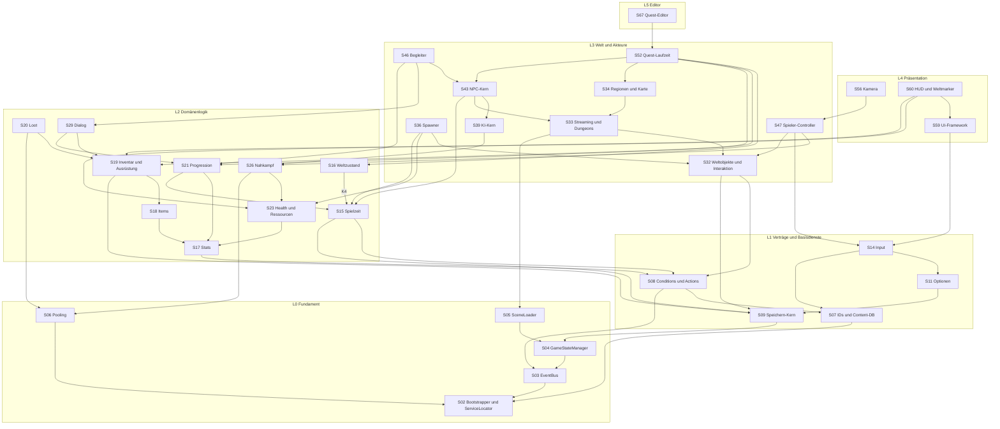

# Systeme und Abhängigkeiten

> Teil der Phase-0-Planung · Stand: 2026-10-13 · Quelle: [Master-Prompt](../00_Master-Prompt.md)

Verwandte Dokumente: [Technische Architektur](./01_Architektur.md) (Assemblies, Schichten, Events, verbindlich) · [Technik-Recherche](./03_Technik-Recherche.md) · [Vision und Umfangsstufen](../GDD/00_Vision_und_Ueberblick.md) · [Welt & Story](../GDD/01_Welt_Story_Fraktionen.md) · [Quests & Dialoge](../GDD/02_Quests_und_Dialoge.md) · [Kampf & Progression](../GDD/03_Kampf_Charakter_Progression.md) · [Items & Wirtschaft](../GDD/04_Items_Crafting_Wirtschaft_Endgame.md) · [UI/Audio/Grafik](../GDD/05_UI_Audio_Grafik_Barrierefreiheit.md)

**Zweck:** Phase 0, Schritt 3 (§31): alle Systeme des Spiels, ihre Abhängigkeiten und die Reihenfolge, in der sie gebaut werden. Assembly-Namen, Schichten und Event-Namen stammen unverändert aus [Technik/01](./01_Architektur.md). Wo dieses Dokument dort eine Lücke oder einen Widerspruch findet, steht ein Korrekturvorschlag in der [Konsistenz-Prüfung](#konsistenz-prüfung-gegen-die-architektur).

**Kennzeichnungen** (projektweit gleich):
- **Vorschlag:** füllt eine Lücke im Master-Prompt.
- **Verbesserungsvorschlag:** weicht bewusst vom Master-Prompt ab, Original bleibt erkennbar.
- ❓ **Offene Entscheidung:** liegt beim Auftraggeber, gesammelt am Dateiende.

---

## Inhalt

1. [Legende](#legende)
2. [Systemkatalog](#systemkatalog)
3. [Abhängigkeitsgraph](#abhängigkeitsgraph)
4. [Konsistenz-Prüfung gegen die Architektur](#konsistenz-prüfung-gegen-die-architektur)
5. [Bau-Reihenfolge](#bau-reihenfolge)
6. [Kritischer Pfad bis zum Vertical Slice](#kritischer-pfad-bis-zum-vertical-slice)
7. [Schnittstellen-Matrix](#schnittstellen-matrix)
8. [Status-Liste (§32.14)](#status-liste-3214)
9. [Offene Entscheidungen](#offene-entscheidungen)
10. [Risiken & Hinweise](#risiken--hinweise)

---

## Legende

### Schichten (aus [Technik/01, 3.2](./01_Architektur.md))

| Schicht | Inhalt | Assemblies (Nr. aus Technik/01, 3.3) |
|---|---|---|
| **L0** Fundament | Hilfsklassen, Dienste, EventBus, Logging, IDs | Utilities (1), Core (2) |
| **L1** Verträge & Basisdienste | Event-Structs, Definitionen, Conditions/Actions, Speichern, Optionen, Input | Events (3), Data (4), Conditions (5), SaveSystem (6), Options (7), Input (8) |
| **L2** Domänenlogik | weitgehend reine C#-Logik | GameTime (9), WorldState (10), Stats (11), Items (12), Inventory (13), Progression (14), Factions (15), Combat (16), Dialogue (17), Crafting (18), Economy (19) |
| **L3** Welt & Akteure | Szenen, Streaming, KI, NPCs, Spieler, Haus, Quests | World (20), AI (21), NPC (22), Companions (23), Player (24), Housing (25), Quests (26) |
| **L4** Präsentation | Kamera, Audio, Inszenierung, UI, Dev-Werkzeuge | CameraSystem (27), Audio (28), Cinematics (29), UI.Framework (30), UI.Screens (31), DevTools (32) |
| **L5** Editor | Editor-Fenster, Validatoren, Importer, Build | EditorTools.Core (33) … EditorTools.Build (37) |
| **L6** Tests | EditMode, PlayMode, Test-Doubles | Tests.Shared (38), Tests.EditMode (39), Tests.PlayMode (40) |

### Spalten des Systemkatalogs

| Spalte | Bedeutung |
|---|---|
| **Nr** | **Vorschlag:** Systemnummer `S01`–`S70`. Nicht verwechseln mit den Assembly-Nummern (1–40) aus Technik/01. |
| **Assembly** | Name ohne Präfix `Aetherfall.`, Assembly-Nummer in Klammern. **(V)** = in Technik/01, 3.3 vorgeschlagene spätere Assembly (`Aetherfall.Minigames`, `Aetherfall.Endgame`, `Aetherfall.Achievements`, `Aetherfall.Mounts`). |
| **Harte Abhängigkeit** | Code- bzw. Assembly-Referenz oder Laufzeit-Voraussetzung. Ohne sie lässt sich das System nicht kompilieren oder nicht sinnvoll starten. |
| **Weiche Abhängigkeit** | Nur über EventBus, Interfaces in tieferer Schicht („Interface tief, Implementierung hoch“, Technik/01, 3.5) oder Daten (IDs, Conditions/Actions). Das System funktioniert ohne den Partner, nur mit weniger Funktion. |
| **B** | Abkürzung für das Basis-Set **S01, S02, S03, S07, S13** (Logging, Bootstrapper/ServiceLocator, EventBus, IDs/Content-Datenbank, Lokalisierung). Jedes System ab L2 hängt hart daran. Von S13 zählt dabei nur der Teil in Data (4): `LocalizedString`-Felder in Definitionen. |
| **Speicherrelevant** | ja = eigener Abschnitt im Spielstand (`SaveKey` aus Technik/01, 9.2) oder Zustand in einem fremden Abschnitt |
| **Controller-UI nötig** | ja = der Spieler bedient eine eigene Oberfläche dieses Systems (§4.3, §32.9). Reine Anzeigen (HUD) zählen nicht. |
| **Komplexität** | Aufwand für den **vollen** Umfang, eine erfahrene Person: **S** ≈ 0,5–1 · **M** ≈ 1–3 · **L** ≈ 3–6 · **XL** ≈ 6–12 Personenwochen (PW) |
| **Roadmap-Phase** | Phase (§31, 1–7), in der das System laut [Bau-Reihenfolge](#bau-reihenfolge) begonnen wird. Klammer = Teilumfang in späterer Phase. **↑** = gegenüber §31 vorgezogen (**Verbesserungsvorschlag**, Begründung in der Bau-Reihenfolge). |
| **Im Vertical Slice?** | Abgleich mit Umfangsstufe A ([GDD 00](../GDD/00_Vision_und_Ueberblick.md)) und den 8 Beispiel-Quests ([GDD 02, 11.0](../GDD/02_Quests_und_Dialoge.md)) |

### Regeln für die Tabelle

1. **Harte Abhängigkeiten zeigen immer auf kleinere Nummern.** Die Tabelle ist damit topologisch sortiert und per Konstruktion zyklenfrei. Prüfbar: Kein Eintrag in „Harte Abhängigkeiten“ ist größer als die eigene Nummer.
2. **Gebündelte Zeilen:** Manche Zeilen fassen Teilsysteme zusammen (z. B. S26 Nahkampf). Die harten Abhängigkeiten gelten für den **vollen** Umfang. Ein früher Teilumfang (Spalte Phase, Klammer) braucht nur die bis dahin gebauten Systeme. Maßgeblich für den Bau ist die [Bau-Reihenfolge](#bau-reihenfolge).
3. Weiche Abhängigkeiten sind nicht vollständig, sondern nennen die wichtigsten Partner. Die vollständige Event-Verdrahtung steht in der [Schnittstellen-Matrix](#schnittstellen-matrix).
4. Verweise wie „K4“ zeigen auf die [Konsistenz-Prüfung](#konsistenz-prüfung-gegen-die-architektur).

---

## Systemkatalog

70 Systeme, sortiert nach Schicht und innerhalb der Schicht topologisch.

| Nr | System | Schicht | Assembly | Harte Abhängigkeiten (Nr.) | Weiche Abhängigkeiten (Nr.) | Speicherrelevant (ja/nein) | Controller-UI nötig (ja/nein) | Komplexität | Roadmap-Phase (§31, 1–7) | Im Vertical Slice? (ja/teilweise/nein) |
|---|---|---|---|---|---|---|---|---|---|---|
| S01 | Logging: `Log`-Fassade, Kategorien, Stufen, Stripping im Release | L0 | Core (2) | – | S64 | nein | nein | S | 1 | ja |
| S02 | GameBootstrapper & ServiceLocator: Installer-Liste, Fail-Fast, `EditorBootstrap`, zentraler `ITickable`-Runner | L0 | Core (2) | S01 | Installer aller Systeme (Daten) | nein | nein | M | 1 | ja |
| S03 | EventBus: typisierte `readonly struct`-Events, 0 B pro `Publish`, Tracer | L0 | Core (2) | S01, S02 | S64 | nein | nein | S | 1 | ja |
| S04 | GameStateManager & `TimeScaleService`: Basiszustand + Modal-Stapel | L0 | Core (2) | S02, S03 | S14, S57, S59 | nein | nein | M | 1 | ja |
| S05 | SceneLoader: additive Addressables-Szenen, Ladebildschirm-Ablauf, WorldSpace-Wechsel | L0 | Core (2) | S01–S04 | S59 (`ILoadingScreen`) | nein | nein | M | 1 | ja |
| S06 | Object Pooling & `AssetLease`: `IPrefabPool`, Vorwärmen, Leck-Bericht | L0 | Core (2) | S01, S02 | – | nein | nein | S | 1 | ja |
| S07 | ID-System & Content-Datenbank: ID-Format, `UniqueId`, `GameDefinition`, `IContentDatabase`, `[IdRef]`, `IdMigrationTable`, `IRandom` | L0/L1 | Utilities (1), Core (2), Data (4) | S01, S02 | S65 | nein | nein | M | 1 | ja |
| S08 | Conditions & Actions inkl. `ConditionWatcher`: UND/ODER/NICHT, Kontexte, ereignisgetriebene Re-Evaluation | L1 | Conditions (5) | S02, S03, S07 | S65; konkrete Typen aus S15–S58 | nein | nein | L | 1↑ | ja |
| S09 | Speichern – Kern: `ISaveable`, Slots, Kopf-Datei, atomares Schreiben, Backups, Vorschaubild | L1 | SaveSystem (6) | S01–S04 | S07 (K3), S56 (K14), S61 | ja (verwaltet alle Abschnitte) | ja | L | 1 | ja |
| S10 | Autosave, Speichersperren & Migration: `AutosaveScheduler`, Sperren, Migrationskette, Golden Saves | L1 | SaveSystem (6) | S04, S09 | S07 (K3); Auslöser-Events aus S26, S34, S42, S50, S52 | ja | nein | L | 3 (Gerüst 1) | ja |
| S11 | Optionen & Barrierefreiheit: `settings.json`, Untertitel, Farbenblind-Modi, Halten statt Drücken, Shake/Unschärfe aus, Zielhilfe, UI-Größe, Schwierigkeit | L1 | Options (7) | S02, S03, S09 | S14, S56, S57, S59 (über `OptionsChanged`) | nein (`settings.json`) | ja | M | 1 (Barrierefreiheit 4) | teilweise |
| S12 | Grafik-Optionen & Rendering-Setup: 4 URP-Presets, Auflösung, Sichtweite, Schatten, Vegetation, FPS-Limit, V-Sync; GRD- und Shader-Regeln | L1 | Options (7) + Projekt-Settings | S11 | S33 (Sichtweite), S61 | nein (`settings.json`) | ja | M | 1 (Menü 4) | teilweise |
| S13 | Lokalisierung: DE/EN, String Tables, Key = ID + Feld, Sprachwechsel zur Laufzeit, Pseudo-Locale | L1/L4 | Data (4), UI.Framework (30) | S07, S11 | S65 (Key-Automatik) | nein (`settings.json`) | nein | M | 1 | ja |
| S14 | Input: 5 Action Maps (+ Debug), Map-Wechsel, Geräteerkennung, Rebinding, Stick-Optionen, Vibration, Glyphen | L1 | Input (8) | S03, S04, S07, S11 | S13, S59, S61 | nein (`settings.json`) | ja | L | 1 (Rebinding, Glyphen 2) | ja |
| S15 | Spielzeit & Kalender (TimeManager): Spieluhr, aktive Spielzeit, Wochentage, Mondzyklus, Warten/Schlafen | L2 | GameTime (9; K4 eingearbeitet) | B, S04, S08, S09 | S35 | ja (`time`) | ja (Warten) | M | 1 (Kalender 2) | ja |
| S16 | Weltzustand: Flags, Zähler, Story-Zahlen, Zeitstempel, Waisen | L2 | WorldState (10; K4 eingearbeitet) | B, S08, S09, S15 (K4) | S64, S69 | ja (`worldstate`) | nein | M | 1↑ | ja |
| S17 | Stats: `StatCollection`, Modifikatoren mit Quelle, abgeleitete Werte | L2 | Stats (11) | B, S08 | S60, S61 | nein (beim Laden neu aufgebaut) | nein | M | 1 | ja |
| S18 | Items: Definition mit Komponenten, Seltenheit, Item-Level, Affixe, Sockel, Sets, legendäre Effekte | L2 | Items (12) | B, S08, S17 | S66 | ja (über S19) | ja (Tooltip, Vergleich) | L | 2 | teilweise |
| S19 | Inventar & Ausrüstung: Container, Kategorien, Traglast, Sortieren/Filtern, Neu/Favorit/Sperre, 3 Währungen, Lagerkiste, 13 Slots + 4 Schnellslots, Transmog | L2 | Inventory (13) | B, S08, S09, S17, S18 | S51, S61 | ja (`inventory`) | ja | L | 2 (Transmog 5) | teilweise |
| S20 | Loot: Tabellen, `LootRoller`, Glück, Bad-Luck-Schutz, Truhen-Qualität, Boss-Drops, Pickups, Loot-Strahlen | L2 | Items (12), Inventory (13) (K6) | B, S06, S17, S18, S19 | S32, S39–S42 (`EnemyKilled`), S60 | ja (Bad-Luck-Zähler) | ja (Beute-Fenster) | M | 2 | ja |
| S21 | Progression: XP-Kurve, Level 1–80, Attribut- und Skillpunkte, 6 Klassen, Skilltrees, Respec, Hybridklassen | L2 | Progression (14) | B, S08, S09, S15 (K5), S17 | S28 (Fähigkeiten per ID), S66; `EnemyKilled`, `LocationDiscovered` (K13) | ja (`progression`) | ja (Skilltree, Attribute) | L | 3 (Hybride 5) | teilweise |
| S22 | Fraktionen & Ruf: 8 Stufen, Übertragung, Beitritt/Ausschluss | L2 | Factions (15) | B, S08, S09 | S16 (Beitritts-Flags), S63 | ja (`factions`) | ja (Ruf-Screen) | M | 3↑ (Kern), 5 | teilweise |
| S23 | Health/Damageable & Ressourcen: LP, Ausdauer, Mana, Haltung, Tod-Adapter | L2 | Combat (16) | B, S17 | S60 | ja (`stats.player`) | nein | M | 1 | ja |
| S24 | DamageCalculator: Schadenstypen, Rüstung mit abnehmendem Ertrag, Resistenzen, Krit, Trefferzonen | L2 | Combat (16) | S07, S17 | S35 (Wetterbonus, K12) | nein | nein | M | 2 | ja |
| S25 | Statuseffekte & Element-Reaktionen: 8 Effekte inkl. Aether-Verderbnis, Aufbau, Resistenzen, `ElementReactionTable`, Umgebungszustände | L2 | Combat (16) | B, S17, S23, S24 | S35, S37 | ja (laufende Effekte in `stats.player`) | nein | L | 2 (Elemente 4) | teilweise |
| S26 | Nahkampf: Kampf-FSM, Kombos, Eingabepuffer, Animation Events, Override-Controller je Waffentyp, Hitbox/Hurtbox, Ausweichen, Blocken, Parieren, Konter, Finisher, Lock-On-Zielwahl, Hitstop | L2 | Combat (16) | B, S06, S17, S23, S24 | S25, S47, S56, S57 | nein | nein | XL | 2 | ja |
| S27 | Fernkampf: Bogen und Armbrust, Schulterzielen, Spannen, Pfeiltypen, Kopftreffer, Munition, Projektile | L2 | Combat (16) | S06, S26 | S19 (Munition über S47), S30 | nein | nein | L | 4↑ | teilweise |
| S28 | Fähigkeiten & Magie: `AbilityRunner`, 2 Leisten × 4 Slots, Fähigkeitsrad, Mana, 7 Schulen, 6 Zaubertypen | L2 | Combat (16) | S06, S17, S25, S26 | S14, S21 | ja (Belegung, Abklingzeiten > 10 s) | ja (Rad, Belegung) | XL | 3 (Magie 4) | teilweise |
| S29 | Dialog: `DialogueRunner`, 8 Knotentypen, Proben, Kennzeichnung, Themen, Gerüchte, Händler-Dialoge; Sprachausgabe später | L2 | Dialogue (17) | B, S04, S08, S09, S17, S19, S21 | S44, S58, S61 | ja (`dialogue`) | ja | L | 3 | ja |
| S30 | Crafting, Berufe & Sammeln: Rezepte, Stationen, Qualität, Zerlegen, Upgrade, Verzauberung, Stufen 1–100, Sammelpunkte mit Respawn | L2 | Crafting (18) | B, S08, S09, S15, S18, S19 | S51, S63 | ja (`crafting`, Sammelpunkte in `worldobjects`) | ja | L | 5 (Sammeln 4) | teilweise |
| S31 | Wirtschaft, Händler & Diebstahl: Preisformel, Bestand/Restock, Spezial- und Wanderhändler, Hehler, NPC-Auktionshaus | L2 | Economy (19) | B, S08, S09, S15, S17, S18, S19, S22 | S29, S45, S63 | ja (`economy`) | ja | L | 5 | nein |
| S32 | Persistente Weltobjekte & Interaktion: `IPersistentObject`-Store, Laufzeit-Spawns, `Interactable`, Türen, Hebel, Truhen, Dokumente | L3 | World (20) | B, S08, S09 | S20 (Truhen-Loot per Action), S47 (`Interactor`) | ja (`worldobjects`, `dynamic`) | nein | M | 2 | ja |
| S33 | Welt-Streaming & Dungeons: 512-m-Zellen, Ringe 3 × 3 / 5 × 5, gestaffelte Aktivierung, Fernterrain, NavMesh je Zelle, Dungeon-Szenen | L3 | World (20) | B, S05, S06, S32 | S10, S12, S47 (Streaming-Fokus) | nein (Position in `player`) | nein | XL | 2 (Dungeons 4) | ja |
| S34 | Regionen, Erkundung & Karten-Logik: Gebiets-Volumes, Entdeckung, Fundorte je Region, Aussichtspunkte, Nebel, eigene Marker, Wegpunkte, Kompass-Daten | L3 | World (20) | B, S08, S09, S33 | S47, S60, S63 | ja (`world`) | ja (Marker setzen) | L | 3 (Karte 4) | ja |
| S35 | Tag/Nacht & Wetter: Sonne, Licht, Himmel, Lichtwert für die KI; Wetter je Region mit Gameplay-Effekten | L3 | World (20) | B, S08, S15, S33 | S24, S40, S57 | ja (Wetter in `world`) | nein | L | 4 (Wetter 5) | teilweise |
| S36 | Spawner & Begegnungen: Spawn-Definitionen, Wellen, Respawn nach Spielzeit, `SpawnEncounter` | L3 | World (20) | B, S08, S09, S15, S23, S32 | S33, S39, S41 (K7) | ja (`spawners`) | nein | M | 2 | ja |
| S37 | Umgebungsrätsel, Untersuchen & Spuren: Druckplatten, Spiegel, Hebel, Elementrätsel, Detektiv-Modus, Aether-Sicht, Spuren | L3 | World (20) | B, S08, S25, S32 | S28, S47 | ja (in `worldobjects`) | nein | L | 4 | ja |
| S38 | Weltereignisse: Karawanen, Überfälle, Riss-Ausbrüche, Wanderhändler, Duellanten; Ereignis-Quests | L3 | World (20) | B, S08, S35, S36 | S43, S52 | ja (in `world`) | nein | L | 5 | nein |
| S39 | KI-Kern: HFSM mit 7 Zuständen, Angriffswahl, Angriffs-Token, Gruppen, Verstärkung, Leash, KI-LOD, Wildtiere | L3 | AI (21) | B, S17, S23, S26 | S33 (NavMesh je Zelle), S47 | nein | nein | XL | 2 (Wildtiere 5) | ja |
| S40 | Wahrnehmung: Sichtkegel, Gehör, Licht, Entdeckungswert, Schleichen | L3 | AI (21) | S39 | S35 (Lichtwert), S47 | nein | nein | M | 2 | ja |
| S41 | Gegnertypen, Varianten & Skalierung: `EnemyTypeDefinition`, Normal/Elite/Champion/Aether-verderbt, Gebietslevel, Schwierigkeitsgrade | L3 | AI (21) | B, S25, S39, S40 | S20, S36, S55 | nein | nein | L | 4 (1 Typ in 2) | ja |
| S42 | Bosse: Phasen, Arenen, Adds, Schwachpunkte, Weltboss-Respawn, garantierte Drops | L3 | AI (21) | S36, S41 | S20, S57, S60 (K11) | ja (in `spawners`) | nein | L | 4 | ja |
| S43 | NPCs – Kern & Tagesabläufe: `NpcDefinition`/`NpcState`, Spawnen/Bewegen, `ScheduleDefinition`, Aktivitäts-Anker | L3 | NPC (22) | B, S08, S09, S15, S33, S39 | S16 | ja (`npcs`) | nein | L | 3 (Abläufe 4) | ja |
| S44 | NPC-Beziehung, Reaktionen, Gedächtnis & Ambient-Dialoge: Barks, Gerüchte | L3 | NPC (22) | S16, S22, S29, S43 | S57, S60 | ja (`npcs`) | nein | L | 3 (Barks 4) | teilweise |
| S45 | Verbrechen & Kopfgeld: Zeugen, Wachen, Kopfgeld, Bezahlen/Absitzen | L3 | NPC (22) | S19, S40, S44 | S29, S31 | ja (Kopfgelder in `npcs`) | nein (über Dialog-UI) | L | 5 | nein |
| S46 | Begleiter: max. 2, Loyalität, Kommentare, 4 KI-Modi, Ausrüstung, einfacher Skilltree, Lagerfeuer, Tierbegleiter | L3 | Companions (23) | S19, S21, S26, S29, S39, S43, S44 | S52 (Events), S56, S63 | ja (`companions`) | ja (Begleiter-Screen) | XL | 4 (Tierbegleiter 5) | teilweise |
| S47 | Spieler-Controller: `CharacterController`, Gehen/Laufen/Sprinten/Springen, Rolle, Schleichen, Fallschaden, `Interactor`, IK, Spawn/Tod/Wiedereinstieg | L3 | Player (24) | B, S04, S09, S14, S17, S23, S26, S32 | S33, S56 | ja (`player`) | nein | L | 1 | ja |
| S48 | Klettern: markierte Flächen, Ausdauer, Klettersprung | L3 | Player (24) | S47 | S56, S60 | nein | nein | L | 4 | ja |
| S49 | Erweiterte Fortbewegung: Schwimmen, Tauchen mit Atem, Gleitschirm, Reiten mit 4 Reittieren | L3 | Player (24), ggf. Mounts (V) | S14, S47 | S35, S56, S57 | ja (Modus, Reittier in `player`) | nein | XL | 5 | nein |
| S50 | Schnellreise: Wegpunkte, Sperren, Zeitsprung | L3 | Player (24) | S05, S15 (K5), S33, S34, S47 | S10, S46 | nein (Wegpunkte in S34) | ja (Ziel wählen) | M | 4 | ja |
| S51 | Haus & Bau-Modus: Anwesen, Ausbaustufen, Räume, Möbel (Raster + frei), Garten, Trophäen, Boni, weitere Häuser | L3 | Housing (25) | B, S04, S09, S14, S15 (K5), S19, S30, S32, S43 | S42, S46 | ja (`housing`) | ja | XL | 5 | nein |
| S52 | Quest-Laufzeit: Stages, 26 Zieltypen, Verzweigungen, Fehlschlag, Ledger, max. 3 verfolgt, Verfügbarkeit, Questgeber-Symbole, Anschlag- und Kopfgeldbrett | L3 | Quests (26) | B, S08, S09, S15, S16, S19, S21, S22, S34, S43 | Events aus S20–S58 ([Matrix](#schnittstellen-matrix)) | ja (`quests`) | ja (Questlog, Brett) | XL | 3 | ja |
| S53 | Prozedurale Aufträge: Vorlagen, Seeds, Wendungen, Tageslimits; tägliche und wöchentliche Aufträge | L3 | Quests (26) | S34, S52 | S31, S41 | ja (Vorlage + Seed in `quests`) | ja | L | 5 | nein |
| S54 | Minispiele: Rahmen, Würfeln, Rissduell, Armdrücken, Pferderennen, Angeln | L3 | Minigames (V) | B, S04, S14, S19 | S30, S49, S52, S61 | ja (Ergebnisse, Karten) | ja | XL | 4 (Würfeln), 6 | teilweise |
| S55 | Endgame-Systeme: Weltstufen 1–10, Paragon, New Game+, Riss-Expeditionen, Arena, Raid-Bosse, wöchentliche Herausforderungen, saisonale Ereignisse | L3 | Endgame (V), Progression (14) | S20, S21, S33, S41, S52, S53 | S38, S62 | ja | ja | XL | 7 | nein |
| S56 | Kamera: Erkunden, Lock-On, Zielen, Reiten, Bauen, Kollision, Shake; Fotomodus später | L4 | CameraSystem (27) | B, S04, S11, S14, S26, S47 | S58 (Dialogkamera, K8) | nein | nein | L | 1 (Kontexte 2–5, Foto 7) | ja |
| S57 | Audio & Musik-Zustände: AudioManager, Mixer, SFX-Pool, Ambience, Schritte, Musik Erkundung/Spannung/Kampf/Boss | L4 | Audio (28) | B, S06, S08, S09, S11, S15, S26 (K9), S34 | S42 | ja (Musik-Override) | nein | L | 2 (Musik 4) | ja |
| S58 | Zwischensequenzen & Dialogkamera: Timeline, `PlayCutscene`, Überspringen, Schuss-Gegenschuss | L4 | Cinematics (29) | B, S04, S08, S43, S47, S56, S57 | S29 | nein | ja (Überspringen) | M | 3 (Dialogkamera), 4 | ja |
| S59 | UI-Framework: UIManager, Fokus-Stack, `FocusNavigator`, Ebenen, Meldungs-Queue, Bestätigung, Ladebildschirm | L4 | UI.Framework (30) | B, S04, S11, S14 | S05 | nein | ja | L | 1↑ | ja |
| S60 | HUD & Weltmarker: Balken, Fähigkeitenleiste, Schnellslots, Kompass, Quest-Tracker, Minikarte, Meldungen, Boss- und Gegnerbalken, Questgeber-Symbole, Schadenszahlen | L4 | UI.Screens (31) | S06, S17, S19, S23, S59 | S28, S34, S42, S52 | nein | nein | L | 2 | ja |
| S61 | Kern-Menüs: Haupt- und Pausemenü, Slots, Optionen inkl. Rebinding, Inventar mit 3D-Vorschau, Charakter, Skilltree, Questlog, Dialog-UI | L4 | UI.Screens (31) | S09, S11, S12, S14, S19, S21, S29, S52, S59 | S13 | nein | ja | XL | 1–3 | ja |
| S62 | Sammlungen & Erfolge: Bestiarium, Lore-Bibliothek, Titel, Trophäen, Codex-Fortschritt, Achievements, `IPlatformServices` | L4 | Achievements (V) | B, S09 | Events aller Systeme | ja (`meta`) | ja | M | 6 (Erfolge 7) | nein |
| S63 | Weltkarte & weitere Menüs: Karte mit Zoom/Filtern/Markern, Crafting, Handel, Fraktionen, Begleiter, Codex, Bau-Modus | L4 | UI.Screens (31) | S22, S30, S31, S34, S46, S51, S59, S62 | – | nein | ja | XL | 4 (Karte), 5–6 | teilweise |
| S64 | DevTools: Debug-Konsole, Debug-Overlay, Telemetrie (JSONL) | L4 | DevTools (32) | B, S59 | alle (Befehle registrieren sich selbst) | nein | ja | M | 1 (Telemetrie 2) | ja |
| S65 | ID-Validator & Editor-Grundwerkzeuge: Validator, Umbenennen, TypeMenu-Drawer, `[IdRef]`-Picker, Addressables-Automatik, Lokalisierungs-Keys | L5 | EditorTools.Core (33) | S07, S08 | – | nein | nein | L | 1 | ja |
| S66 | Balancing-Import & Daten-Editoren: CSV mit Diff-Vorschau, Skilltree-Vorschau, Loot-Simulation | L5 | EditorTools.Data (34) | S17, S18, S20, S21, S65 | – | nein | nein | M | 3 | ja |
| S67 | Quest-Editor: Liste/Inspector, Validierung V01–V18 und W01–W14, Play-Mode-Testfunktionen, Übersicht mit Filtern; Graph-Ansicht nach Spike | L5 | EditorTools.Narrative (35) | S16, S52, S65 | S68 (gemeinsame Editor-Shell) | nein | nein | XL | 3 | ja |
| S68 | Dialog-Editor: Knotenliste, Validierung (V01, V02, V04–V07, V10, V14), Vorschau; Graph-Ansicht nach Spike | L5 | EditorTools.Narrative (35) | S29, S65 | S67 | nein | nein | L | 3 | ja |
| S69 | Welt-Werkzeuge & Weltzustand-Fenster: Flag-Fenster, Zellen-Werkzeuge, NavMesh-Link-Generator, Szenen-ID-Index, Todesorte-Heatmap | L5 | EditorTools.World (36) | S16, S33, S39, S43, S65 | S64 | nein | nein | L | 1 (Flags), 2 | ja |
| S70 | Build-Pipeline, Tests & CI: Test-Assemblies, Testszenen, Assembly-Regel-Test, Golden Saves, GameCI, Build-Profile, Benchmark-Route | L5/L6 | EditorTools.Build (37), Tests.Shared/EditMode/PlayMode (38–40) | S01–S04, S09, S65 | alle getesteten Systeme | nein | nein | M | 1 | ja |

**Zählung:** 70 Systeme · 13 × XL, 31 × L, 23 × M, 3 × S · 35 speicherrelevant (dazu 4 mit Werten in `settings.json`) · 28 mit eigener Controller-UI · im Vertical Slice: 47 ja, 15 teilweise, 8 nein.

**Nicht als System geführt** (Inhalte, keine Code-Systeme): Legendäre Waffen-Questreihen, geheime Bosse, Easter Eggs, große Regionsgeheimnisse, Lore-Bücher. Sie entstehen mit S52, S42, S32 und S62 als Daten.

---

## Abhängigkeitsgraph

Auswahl von 33 Systemen mit harten Abhängigkeiten, transitiv reduziert. **Pfeil = „hängt hart ab von“.** S01 (Logging) und das Basis-Set B sind zur Übersicht weggelassen. Vollständige Kanten: [Systemkatalog](#systemkatalog).

**Lesehilfe:**
- **Zwei Stämme** treffen sich in S43/S52: der **Kampf-Stamm** (S17 → S23 → S26 → S39) und der **Welt-Stamm** (S09 → S32 → S33 → S34). Beide müssen vor dem Quest-System stehen.
- **S52 Quest-Laufzeit** hat die meisten harten Abhängigkeiten (14 inklusive Basis-Set) und steht deshalb spät. Das ist gewollt: Kein anderes System braucht Quest-Code (Technik/01, 3.3).
- **S08 Conditions & Actions** sitzt tief und wird von fast allem genutzt. Darum wird es vorgezogen ([VV1](#abweichungen-von-31)).

---

## Konsistenz-Prüfung gegen die Architektur

**Vorschlag:** Beim Abgleich jeder Abhängigkeit mit den erlaubten Assembly-Referenzen aus [Technik/01, 3.3](./01_Architektur.md) fallen 15 Stellen auf. Sie würden beim Setup als Compile-Fehler oder als fehlender Datenpfad auffallen. **Stand 2026-10-13:** K1–K15 sind in [Technik/01](./01_Architektur.md) eingearbeitet (K12 verlangt dort keine Änderung, nur die Aufruferregel unten). Alle Korrekturen behalten die Assembly- und Event-Namen bei. Ein Assembly-Name ändert sich nirgends.

| # | Befund | Warum ein Problem | Korrekturvorschlag |
|---|---|---|---|
| K1 | `GameStateChanged`, `SceneLoadStarted`, `SceneLoadCompleted` werden von Core (2) gesendet, sind aber laut 3.3 in Events (3) definiert | Events (3) referenziert Core (2), umgekehrt ist es verboten → Core kann diese Structs nicht sehen | Diese drei Structs in `Aetherfall.Core` definieren (Namen unverändert). Alle übrigen Events bleiben in Events (3). |
| K2 | Speichersperren „Dialog, Zwischensequenz“ (GameStateManager) und „Laden“ (SceneLoader), Technik/01, 9.8 | Core (2) darf SaveSystem (6) nicht aufrufen | `ISaveManager.IsSaveAllowed` fragt zusätzlich `IGameStateService.Current` gegen die Spalte „Speichern erlaubt“ (Tabelle 4.4) ab. SaveSystem referenziert Core bereits. Core setzt keine Sperren. |
| K3 | Ladeablauf Schritt „ID-Migration (`IdMigrationTable`)“ in SaveSystem (6) | `IdMigrationTable` liegt in Data (4), SaveSystem referenziert Data nicht | Interface `IIdAliasResolver` in Core, implementiert von der ContentDatabase (Data), per ServiceLocator geholt („Interface tief, Implementierung hoch“) |
| K4 | WorldState (früher 9) speichert `changedAtPlaytime` und wertet `FlagAge` aus | braucht die aktive Spielzeit aus GameTime (früher 10), Referenz nach oben verboten | **(eingearbeitet)** **Nummern tauschen:** GameTime → 9, WorldState → 10, WorldState referenziert GameTime. GameTime braucht WorldState nicht. Nur die Nummern in Tabelle 3.3 ändern sich (inkl. Referenzlisten von EditorTools.Narrative/World). asmdef-Referenzen laufen über Namen, nichts bricht. |
| K5 | Schnellreise (Player 24) springt die Uhr vor; Schlafen und Garten (Housing 25) brauchen Spielzeit; XP_Kill nutzt den Nacht-Faktor (Progression 14, [GDD 03, 12.7](../GDD/03_Kampf_Charakter_Progression.md)) | Player, Housing und Progression referenzieren GameTime nicht | Referenz auf GameTime ergänzen bei Player, Housing und Progression (alle zeigen nach unten, zulässig) |
| K6 | Loot-Ausgabe: Truhen (World 20), Gegner-Drops (AI 21) | World, AI und NPC referenzieren Items (12) nicht → `LootRoller` unerreichbar | `LootDropService`, `Pickup`-Komponente und Action `GiveLoot` liegen in **Inventory (13)**. Drops reagieren auf `EnemyKilled` (inkl. `LootTableId`), Truhen nutzen die Action. Loot-Beutel werden über `IRuntimeSpawnRegistry` (SaveSystem 6, Implementierung in World 20) gespeichert. `LootDropped` sendet Inventory. |
| K7 | `SpawnEncounter` und Spawner liegen in World (20), Gegnerdaten (`EnemyTypeDefinition`, `EnemyBrainDefinition`) in AI (21) | World darf AI nicht referenzieren | Interface `IEnemySpawnService` in World, Implementierung in AI |
| K8 | `DialogueCameraDirector` (Schuss-Gegenschuss) in CameraSystem (27) | braucht Sprecher-Transforms aus NPC (22), CameraSystem referenziert NPC nicht | Dialogkamera nach **Cinematics**: Logik in 29, Kameras in 29b (Boot-Szene); Positionen über `IPlayerLocator`/`IWorldMarkerRegistry` aus Core statt NPC-Transforms (S58) |
| K9 | Schritt- und SFX-Animation-Events (`Footstep`, `Sfx(id)`) kommen aus `AnimationEventRelay` in Combat (16) | Audio (28) referenziert Combat nicht, Combat darf Audio nicht aufrufen | Referenz Audio → Combat ergänzen (zulässig). Eine Brücken-Komponente in Audio hört auf das Relay. |
| K10 | Autosave-Intervall „auf aktiver Spielzeit“ (9.6) | SaveSystem (6) kann GameTime nicht lesen | Eigener Zähler im `AutosaveScheduler`, der nur in Zuständen mit laufender Spielzeit zählt (Tabelle 4.4, über `IGameStateService`) |
| K11 | Boss-Lebensbalken (§20.3) und Boss-Musik brauchen ein Start-Signal; die Event-Liste kennt nur `BossDefeated` | UI und Audio wissen nicht, wann ein Bosskampf beginnt oder abgebrochen wird | Zwei neue Events (Vorschlag, Payload nur IDs): `BossEncounterStarted` (`BossId`) und `BossEncounterEnded` (`BossId`, `Defeated`). Sender: AI. |
| K12 | Wetterboni gehen in Schritt 3 der Schadensformel ein ([GDD 03, 8.2](../GDD/03_Kampf_Charakter_Progression.md)) | `DamageCalculator` (Combat 16) kann Wetter (World 20) nicht lesen | Keine Änderung, nur Regel: Der Aufrufer (Player, AI) schreibt den Wetterbonus in den `AttackerSnapshot` |
| K13 | XP_Kill = f(Gegnerlevel, Variante, Nacht) | `EnemyKilled` enthält kein Level; Progression darf AI nicht referenzieren | Payload von `EnemyKilled` um `EnemyLevel` (int) ergänzen. Größe: 5 Referenzen à 8 Byte + `Vector3` 12 Byte + int 4 Byte = 56 Byte, unter der Grenze von 64 Byte. Nacht-Faktor über K5. |
| K14 | Kopf-Datei (Level, Klassen, Region, Spielzeit) und Vorschaubild (Kamera) | SaveSystem kennt Progression, World, GameTime und Kamera nicht | Interfaces `ISaveHeaderContributor` und `IScreenshotProvider` in SaveSystem, implementiert von Progression, World, GameTime bzw. CameraSystem |
| K15 | Conditions `DifficultyIs` und `NewGamePlusAtLeast` waren Core (2) zugeordnet (Technik/01, 7.7) | Konkrete Conditions erben von `Condition` aus Conditions (5); Core → Conditions ist verboten und ergäbe einen Zyklus | `DifficultyIs` → Options (7, + Referenz 5), `NewGamePlusAtLeast` → Progression (14) |
| K16 | `HarvestNode` (Sammelpunkt) war Crafting (18) zugeordnet (Technik/01, 11.13) | Er braucht Szene, Spieluhr, Spielerposition und den Weltobjekt-Speicher aus World (20); Crafting darf World nicht referenzieren, World darf Inventory (13) nicht referenzieren | `HarvestNode` liegt in World; den Ertrag gibt er über den Port `IGatheringService` aus Core (2), umgesetzt von `GatheringService` in Crafting (S30, Stufe A, 2026-10-16) |

K1–K15 sind vor dem Projekt-Setup (Phase 0.4) in [Technik/01](./01_Architektur.md) eingearbeitet (Stand 2026-10-13). K16 kam beim Bau von S30 dazu (2026-10-16). Der Assembly-Regel-Test (S70) fängt neue Verstöße ab Phase 1 automatisch ab.

---

## Bau-Reihenfolge

### Abweichungen von §31

Die Reihenfolge unten folgt der Roadmap aus §31, zieht aber einige Systeme vor. Jede Abweichung ist ein **Verbesserungsvorschlag**. Das Original ist jeweils in der Spalte „§31“ genannt.

| # | §31 (Original) | Vorschlag | Begründung |
|---|---|---|---|
| VV1 | Conditions & Actions und Weltzustand in Phase 3 (3.1, 3.2) | **Phase 1, Schritt 1.8**, zusammen mit der Spieluhr (S15) | Truhen, Türen und Loot-Bedingungen in Phase 2 brauchen Conditions/Actions. Der Weltzustand ist der einfachste echte `ISaveable` und testet das Speichern früh. `[SerializeReference]`-Typnamen werden ab dem ersten Content-Asset eingefroren (Technik/01, 7.6), also besser vor dem ersten Content. Aufwand gering (L + M). |
| VV2 | ID-System nicht genannt (§6.3 verlangt es) | **Phase 1, Schritt 1.3**: IDs, Content-Datenbank, Validator | Jede Definition, jeder Spielstand und jeder Konsolenbefehl nutzt IDs. Eingefrorene IDs lassen sich später nur per Migration ändern. |
| VV3 | Speichern: Grundgerüst in Phase 1, „funktioniert komplett“ erst in Phase 4 | **Speichern durchgehend:** Kern mit Golden-Save-Gerüst in 1.5, jedes neue System liefert sein `ISaveable` sofort mit, jede Phasen-Abnahme enthält eine Speicher-Rundreise | §32.8 und §25 („Speicherstände dürfen nicht kaputtgehen“). Ein Formatfehler, der erst in Phase 4 auffällt, betrifft alle Systeme gleichzeitig. |
| VV4 | HUD in Phase 2 (2.5), UI-Framework nicht genannt | **UI-Framework und UI-Spike in Phase 1 (1.11)** | Der Spike (Technik/01, 12) hat ein Abbruchkriterium und entscheidet UI Toolkit oder uGUI. Das muss vor dem HUD feststehen. Hauptmenü und Slot-Auswahl braucht schon Phase 1 für den Speichertest. |
| VV5 | Fraktionen in Phase 5 | **Kern (Werte, `ChangeReputation`, `ReputationAtLeast`) in Phase 3**, Screen und Freischaltungen in Phase 5 | Die 8 Beispiel-Quests setzen Ruf (Notation `Ruf(…)` in [GDD 02, 11.0](../GDD/02_Quests_und_Dialoge.md)). Die Assembly `Quests` referenziert `Factions` hart. Aufwand ~0,5 PW. |
| VV6 | NPCs nicht genannt (nur Begleiter) | **NPC-Kern in Phase 3**, Tagesabläufe in Phase 4 | `Quests` referenziert `NPC` hart (Questgeber, Eskorte, `SpawnNpc`). |
| VV7 | Phase 4 nennt nur Inhalte | **Phase 4 teilen: 4a Slice-Systeme, 4b Inhalte** | Die 8 Quests brauchen Bogen (Quest 2), Zauberstab (Magier), Feuer + Öl (Quest 6), Begleiterin, Dungeon mit Rätsel (Quest 7), Klettern und Aussichtspunkt (Quest 8), Tageszeit (Quest 5). Das sind ~40 PW Systemarbeit, mehr als Phase 3. |
| VV8 | Welt-Streaming nicht genannt | **Streaming-Spike in Phase 2 (2.6)** | Architekturentscheidung A21 ist „teuer nach Phase 4“. NavMesh je Zelle muss stehen, bevor KI in der echten Welt läuft. |
| VV9 | Builds in Phase 7, Telemetrie nicht in der Roadmap | **Build-Pipeline, Windows-Mono-Build und Telemetrie in Phase 2 (2.9)** | Windows-Fehler früh sehen (Technik/01, Risiko 15). Pacing-Messung für den Vertical Slice ([GDD 00](../GDD/00_Vision_und_Ueberblick.md): Telemetrie gehört in Phase 1–2). |
| VV10 | Engine-Version fest | **Schritt 3.0: Upgrade auf Unity 6.7 LTS** vor dem Quest-Editor (Technik/01, A01) | Graph Toolkit und reiferes UI Toolkit; ein Upgrade ist früh billig. ❓ **Offene Entscheidung:** siehe [unten](#offene-entscheidungen). |

❓ **Offene Entscheidung:** VV1–VV10 übernehmen? Empfehlung: ja, vollständig.

### Phase 0 – Planung (aktuell)

| Schritt | Inhalt | Fertig wenn … |
|---|---|---|
| 0.1–0.3 | GDD, Architektur, dieses Dokument | Auftraggeber hat die Dokumente gelesen und die offenen Entscheidungen beantwortet |
| 0.4 | Projekt-Setup nach [Technik/01, Abschnitt 2](./01_Architektur.md) – **erst nach OK (§32.1)** | Leeres Projekt mit Ordnern, 40 leeren asmdefs, Boot-Szene, `.gitignore`/`.gitattributes`, LFS; erster Commit mit Tag `setup-6000.3.<patch>`; Checkliste „Nicht verifiziert“ aus der Recherche abgearbeitet |

### Phase 1 – Fundament

Ziel: Ein leeres Spiel startet, lädt Szenen, speichert und lädt, ein Spielerkörper bewegt sich mit Controller. Alles mit Tests.

| Schritt | Systeme | Warum jetzt (Abhängigkeit) | Fertig wenn … | Testanleitung |
|---|---|---|---|---|
| 1.1 | S70 (Tests, CI), S01 | Jedes weitere System wird testgetrieben gebaut. Der Assembly-Regel-Test verhindert Zyklen ab der ersten Datei. | GameCI (Linux) führt bei jedem Pull Request EditMode-Tests und den Assembly-Regel-Test aus. `Log` mit Kategorien; `Trace`/`Debug` fehlen im Release-Build. | Pull Request öffnen → CI grün. Testweise eine verbotene asmdef-Referenz eintragen → CI rot. |
| 1.2 | S02, S03, S04 | Rückgrat aller Dienste (§31, 1.1) | `Boot.unity` startet die Installer in der Reihenfolge aus Technik/01, 4.1. Fehlender Dienst → Fehlerbildschirm mit Dienstname. `Publish` allokiert 0 Byte (Performance-Test). Übergangstabelle des GameStateManagers mit Unit-Tests. Play Mode in jeder Testszene lädt Boot zuerst. | Play in `Boot.unity` → Log zeigt die Boot-Schritte in Reihenfolge. Einen Installer aus der Liste nehmen → klare Fehlermeldung. |
| 1.3 | S07, S65 (**VV2**) | Jede Definition und jeder Save braucht IDs (§6.3). Der Validator muss vor dem ersten Content-Asset stehen. | Test-Definitionen laden per ID. Validator meldet doppelte und leere IDs, IDs im Prefab-Asset und kaputte `[IdRef]`. Strg/Cmd+D auf ein Szenenobjekt erzeugt eine neue `obj.auto.*`-ID. TypeMenu-Drawer listet `[SerializeReference]`-Typen mit deutschem Menüpfad. | Zwei Assets mit gleicher ID anlegen → „Aetherfall > Validierung > Alles prüfen“ meldet beide. Eine Truhe duplizieren → neue ID im Inspector. |
| 1.4 | S05, S06 | Hauptmenü, Testszenen und später Streaming laden additiv. Lecks früh sichtbar machen. | Additive Szenen laden und entladen mit Ladebildschirm-Stub. Leck-Bericht beim Wechsel ins Hauptmenü meldet 0 offene Addressables-Handles. | Eine Testszene 20× laden und entladen → Log meldet 0 offene Handles. |
| 1.5 | S09 (+ Versionsfeld und Golden-Save-Gerüst aus S10) (**VV3**) | §32.8: Jedes folgende System liefert sein `ISaveable` sofort mit. Formatfehler sind nach dem ersten externen Build teuer (A18). | Rundreise-Test für ein Test-`ISaveable`. Atomares Schreiben (tmp → `File.Replace`) besteht den Test mit simuliertem Schreibfehler auf macOS. Kopf-Datei < 2 KB. Golden Save `v1` liegt in `Tests/TestData/Saves/v1/` und lädt im CI. | Speichern, per Debug-Schalter einen Schreibfehler simulieren → der alte Stand lädt unverändert. |
| 1.6 | S11 (Basis), S12 (Basis), S13 | Input-Belegung, Sprache und Qualitätsstufe werden in Boot-Schritt 4–6 aus `settings.json` gelesen. DE/EN von Anfang an (§4.2). | `settings.json` wird geschrieben und gelesen. 4 Qualitätsstufen umschaltbar. Sprachwechsel DE ↔ EN zur Laufzeit ohne Neustart. Pseudo-Locale (+30 % Länge) wählbar. | Sprache im Testmenü umschalten → alle Testtexte wechseln. Spiel neu starten → Sprache und Qualität bleiben. |
| 1.7 | S14 (Kern) | §31, 1.2. Spieler, UI und Kamera brauchen die Action Maps. | Maps Gameplay, UI, Dialog, Reiten, Bauen (+ Debug) laut §7.3. Map-Wechsel folgt `GameStateChanged`. `InputDeviceChanged` mit 0,3 s Hysterese. Standardbelegung laut [GDD 03, 1.5](../GDD/03_Kampf_Charakter_Progression.md) (Basis §7.1/§7.2). | Gamepad an- und abstecken, zwischen Gamepad und Tastatur wechseln → Log zeigt den Gerätewechsel. Pausemenü öffnen → Angriffstaste wirkt nicht. |
| 1.8 | S08, S15 (Uhr), S16, S69 (Flag-Fenster) (**VV1**) | Phase 2 braucht Bedingungen an Truhen und Türen. Weltzustand ist der erste echte Spielstand-Inhalt. | `AllOf`, `AnyOf`, `Not`, `AtLeastNOf`, `FlagIs`, `SetFlag`, `AddToFlag`, `TimeOfDayBetween`, `FlagAge` im Inspector ohne Code wählbar. `ConditionWatcher` wertet nur bei Trigger-Events aus, Budget ≤ 0,5 ms/Frame. Weltzustand-Rundreise inkl. Zeitstempel. Flag-Debug-Fenster (§6.5). | Im Play Mode im Weltzustand-Fenster ein Test-Flag setzen → Test-Tür mit Bedingung öffnet sich. Speichern, laden → Flag und Zeitstempel unverändert. |
| 1.9 | S17, S23 | §31, 1.4. Ausdauer für die Bewegung, Grundlage für Kampf. | Formel (Basis + Σ Flat) × (1 + Σ Pct) × Π (1 + Mult) mit Unit-Tests. `RemoveAllFromSource` entfernt genau die Modifikatoren einer Quelle. `Changed` einmal pro Frame gebündelt. Ein `Damageable` für Spieler, Dummy und Fass. | EditMode-Tests grün. In `Test_Kampfarena` den Dummy per Testknopf schädigen → bei 0 LP feuert `Died`. |
| 1.10 | S47 (Basis), S56 (Erkunden) | §31, 1.3. Braucht Input (1.7) und Ausdauer (1.9). | Gehen, Laufen, Sprinten, Springen mit Luftkontrolle, Rolle, Schleichen mit den Werten aus [GDD 03, 3.1](../GDD/03_Kampf_Charakter_Progression.md). Stufen und Hänge. Kamera ohne Clipping durch Wände. `player`-Saveable speichert Zelle + lokale Position. | In `Test_Bewegung` mit Gamepad: Treppe, 45°-Hang, Sprung. Auf einem Dach speichern, laden → gleiche Position. |
| 1.11 | UI-Spike, S59, S61 (Haupt-, Pausemenü, Slots), S64 (Konsole, Overlay) (**VV4**) | Das HUD in Phase 2 braucht den Fokus-Stack. Die Spike-Entscheidung muss vor Phase 2 fallen. | Spike-Ergebnis dokumentiert (UI Toolkit bestätigt oder uGUI-Rückfall). Neues Spiel → Speichern → Hauptmenü → Laden komplett per Gamepad. Konsole mit `set_flag`, `save`, `load`; Overlay-Seiten Basis, Ort, Zustand. | Maus abziehen, den ganzen Ablauf nur mit Gamepad durchspielen. Konsole am Gamepad mit L3 + R3 öffnen. |

**Abnahme Phase 1:** Golden Save `v1` lädt im CI. Rundreise aller bisherigen `ISaveable`s. Windows-Mono-Build startet (Technik/01, 14.6, Stufe 2).

### Phase 2 – Kernspiel

Ziel: 10 Minuten Kampf gegen Wölfe in einer gestreamten Testwelt, mit Loot, HUD und Speichern.

| Schritt | Systeme | Warum jetzt (Abhängigkeit) | Fertig wenn … | Testanleitung |
|---|---|---|---|---|
| 2.1 | S24 | Reine Logik ohne Szene; der Kampf baut darauf auf (§9.7). | Pipeline aus [GDD 03, 8.2](../GDD/03_Kampf_Charakter_Progression.md) vollständig. Das Zahlenbeispiel aus GDD 03, 8.3 ist als Test reproduziert. Krit-Wurf über `IRandom` deterministisch. | EditMode-Lauf: Testfall „Level-10-Krieger trifft Grauwolf“ liefert den Wert aus GDD 03. |
| 2.2 | S26, S56 (Lock-On, Zielen) | §31, 2.1. KI und Gegner brauchen das Kampfmodell. | Kombo 3–5 Schläge, schwerer Angriff aufladbar, Eingabepuffer 0,2 s, Ausweichrolle mit I-Frames, Blocken, Parierfenster, Haltung → Taumeln → Finisher, lokaler Hitstop 40–120 ms ([GDD 03, 4.11](../GDD/03_Kampf_Charakter_Progression.md)), Lock-On per R3. Kein Durchtunneln bei 30 und 60 FPS. | `Test_Kampfarena`: Dummy greift alle 3 s an, perfekt parieren → Konterfenster öffnet sich. Mit FPS-Limit 30 prüfen, dass jeder Treffer zählt. |
| 2.3 | S32 | Truhen, Türen und Hebel brauchen Zustand und Conditions/Actions (aus 1.8). | `Interactable` mit Verb, Priorität und Bedingung. Truhe, Tür und Hebel speichern ihren Zustand im `WorldObjectStateStore`. Laufzeit-Spawns im `DynamicObjectRegistry`. | Truhe öffnen, Tür per Hebel öffnen, speichern, Szene neu laden → beide bleiben offen. |
| 2.4 | S18 → S19 → S20 | §31, 2.3 und 2.4. Loot braucht Inventar, Ausrüstung braucht Stats. | Stapeln, Gewicht, Traglast-Modifikator, Ausrüsten mit `SourceId = item:<instanceId>`. Affix-Anzahl je Seltenheit. `LootRoller` trifft über 100.000 Würfe jede Gewichtung auf ±1 %. Bad-Luck-Schutz greift. Drops über `EnemyKilled` (K6). | Konsole `give_item`, Waffe ausrüsten → Angriffswert im Overlay steigt. Eine Truhe 20× zurücksetzen und öffnen → Seltenheitsverteilung im Log plausibel. |
| 2.5 | S39, S40, S36, S41 (1 Typ: Grauwolf) | §31, 2.2. Braucht Kampf (2.2) und Spawner-Zustand (2.3). | Grauwolf patrouilliert, wird misstrauisch, sucht, kämpft, flieht, kehrt zurück. Höchstens 2 Nahkampf-Token am Spieler. Leash bei 40 m oder 8 s. Respawn nach 72 Spielstunden. Entdeckung über Sicht und Gehör. | `Test_KI` mit 4 Wölfen: nie mehr als 2 greifen gleichzeitig an. Über 40 m weglaufen → Wölfe kehren um. Schleichend hinter einem Wolf → keine Entdeckung. |
| 2.6 | S33 (ohne Dungeons), S69 (Zellen-Werkzeuge, NavMesh-Links) (**VV8**) | A21 wird ab Phase 4 teuer. NavMesh je Zelle muss stehen, bevor KI in der Welt läuft. | `Test_Streaming` mit 4 × 4 Zellen. 3 × 3 aktiv, 5 × 5 vorgeladen, Hysterese. Aktivierung ≤ 2 ms/Frame. Kein Frame > 33 ms beim Überqueren einer Zellgrenze (Development Build, MacBook). Truhenzustand überlebt das Entladen. Wölfe folgen über Zellgrenzen. | Mit `noclip` und zu Fuß über 4 Zellgrenzen; Overlay-Seite „Streaming“ und Profiler im Development Build beobachten. |
| 2.7 | S57 (Kern) | Treffer-Gefühl (§9.1) braucht Sound. Lautstärken kommen aus den Optionen. | Mixer laut [GDD 05, 2.5](../GDD/05_UI_Audio_Grafik_Barrierefreiheit.md), `SoundEvent`-Pool mit 48 Stimmen, Treffer- und Schritt-SFX, Lautstärke-Optionen wirken. | In der Arena 8 Gegner gleichzeitig treffen → kein Abbruch wichtiger Sounds. Effekte-Regler auf 0 → stumm. |
| 2.8 | S60, S61 (Inventar, Optionen), S14 (Rebinding, Glyphen) | §31, 2.5. Daten aus 2.4 und aus dem Kampf liegen vor. | LP-, Ausdauer- und Manabalken, Schnellslots, Meldungs-Queue, Gegnerbalken, Schadenszahlen (abschaltbar). Inventar 8 × 6 per Gamepad, Vergleich grün/rot, Neu-Markierung, Sperre. Rebinding mit Konfliktdialog. Glyphen wechseln ≤ 0,3 s nach Gerätewechsel. | Inventar nur mit Gamepad sortieren, filtern, ausrüsten. Eine Taste umbelegen, Neustart → Belegung bleibt. |
| 2.9 | S64 (Telemetrie), S70 (Build-Pipeline, Benchmark-Route) (**VV9**) | Messbasis vor der Inhaltsproduktion; Windows-Fehler früh sehen. | Mac-Dev- und Windows-Mono-Build per Menü „Aetherfall > Build“. Telemetrie-JSONL mit `PlayerDied` und `SceneLoadCompleted`. Werte der Benchmark-Route im Performance-Log. | Build starten, sterben, Datei in `Telemetry/` prüfen. Benchmark-Route im Build laufen lassen und eintragen. |

**Abnahme Phase 2:** Kampfprototyp in `Test_Streaming` (Wölfe, Loot, Truhen, HUD) 10 Minuten spielbar. Speichern und Laden an beliebiger Stelle außerhalb des Kampfes. Benchmark-Route ≥ 60 FPS auf dem MacBook (Preset Mittel, Testszene). Windows-Build auf dem Windows-PC gestartet (❓ **Offene Entscheidung:** Windows-Hardware, siehe unten).

### Phase 3 – RPG-Systeme

Ziel: Quest 2 „Die Wölfe vom Nordhang“ und der Harrik-Dialog sind ohne Code-Änderung als Daten spielbar.

| Schritt | Systeme | Warum jetzt (Abhängigkeit) | Fertig wenn … | Testanleitung |
|---|---|---|---|---|
| 3.0 | Engine-Upgrade 6.3 → 6.7 LTS (**VV10**) | Vor dem Quest-Editor (Graph Toolkit, A01). Nur wenn 6.7 mindestens 2 Patches hat. | Alle Tests, Golden Saves und der Validator sind auf 6.7 grün. Paketversionen neu gepinnt. | Vollständige Testsuite und manueller Durchlauf der Phase-2-Abnahme. |
| 3.1 | S21, S66 | §31, 3.5. Quest-Belohnungen brauchen Level. Balancing-Werte kommen ab jetzt per CSV. | XP-Kurve aus `XpCurve`. Je Level 1 Attribut- und 1 Skillpunkt. Knoten mit Voraussetzungen und Kosten, Respec. XP_Kill aus `EnemyKilled` (K13). CSV-Import mit Diff-Vorschau, kein Teilimport bei Fehlern. | `add_xp` bis Level 5 → je Level 1 AP und 1 SP. Einen CSV-Wert ändern → Diff zeigt genau dieses Feld. |
| 3.2 | S28 (Fähigkeiten, Leiste) | Skilltree-Knoten schalten Fähigkeiten frei; der Aether-Stoß gehört zu Quest 1. | `AbilityRunner` mit Ausholen, Wirken, Erholen. 2 Leisten × 4 Slots. Aether-Stoß laut [GDD 03, 6.5](../GDD/03_Kampf_Charakter_Progression.md): Kegel 6 m / 90°, 15 Mana, 8 s Abklingzeit. | In der Arena Aether-Stoß auf 3 Dummies → alle im Kegel werden 3 m zurückgestoßen. Abklingzeit auf der Leiste sichtbar. |
| 3.3 | S34 (Regionen, Volumes), S22 (Kern, **VV5**), S43 (Kern, **VV6**), S44 (Beziehung) | Die Assembly `Quests` referenziert NPC, Regionen und Ruf hart. | `AreaEntered`, `RegionEntered`, `LocationDiscovered` feuern. Ruf-Übertragung wirkt genau einmal (Unit-Test). NPCs spawnen und bewegen sich per Action, `npcs`-Saveable. `RelationshipAtLeast` wählbar. | In `Test_QuestRaum` ein Gebiet betreten → Event im Overlay. `set_rep` für eine Fraktion → Ruf der verfeindeten Fraktion sinkt einmal. |
| 3.4 | S29, S61 (Dialog-UI), S58 (Dialogkamera, K8), S68 | §31, 3.4. Quests starten über Dialoge. | 8 Knotentypen, Proben, Kennzeichnung der Optionen, Ausgrauen gewählter Optionen. Untertitel mit Sprechername und einstellbarer Textgeschwindigkeit. Schuss-Gegenschuss. Validator-Regeln für Dialoge. Beispiel-Dialog Harrik ([GDD 02, 12.10](../GDD/02_Quests_und_Dialoge.md)) vollständig. | `Test_DialogRaum`: alle Pfade des Harrik-Dialogs. Mitten im Dialog speichern wollen → gesperrt mit Hinweis. |
| 3.5 | S52, S60/S61 (Tracker, Questlog), S10 (Autosave, Sperren) | §31, 3.3. Alle Voraussetzungen aus 3.1–3.4 liegen vor. | Alle Zieltypen, die die 8 Beispiel-Quests nutzen; übrige Zieltypen bis Phase 6. Verzweigungen, Fehlschlag, Ledger, max. 3 verfolgte Quests, Questgeber-Symbole. EditMode-Pfadtest je Ausgang. Autosave bei `QuestStageChanged`. | Quest 2 in `Test_QuestRaum` über Pfad A und B spielen. Nach jeder Stage laden → gleicher Stand. |
| 3.6 | S67 + Graph-Spike (2 Tage) | §16.8. Phase 4 legt 8 Quests ohne Code an. | Übersicht mit Filtern (Region, Kategorie, Level, Status). Validierung V01–V18 und W01–W14 ([GDD 02, 10.2](../GDD/02_Quests_und_Dialoge.md)). Testfunktionen im Play Mode (starten, zu Stage springen, abschließen, zurücksetzen). Spike-Ergebnis Graph Toolkit/GraphView dokumentiert. | Eine neue Quest ohne Code anlegen und spielen. Absichtlich eine Sackgasse einbauen → Validator meldet sie, Klick pingt die Stage. |

**Abnahme Phase 3:** Quest 2 und Harrik-Dialog spielbar, Speichern und Laden an jeder Stage, 0 Validator-Fehler. Golden Save `v2` mit Migration `v1 → v2`, falls sich das Format geändert hat.

### Phase 4 – Vertical Slice

**Verbesserungsvorschlag (VV7):** Phase 4 in **4a Slice-Systeme** und **4b Inhalte** teilen. §31 nennt für Phase 4 nur Inhalte (Original: „Ein Teil des Eichentals, 1 Dorf, 1 Dungeon, 1 Boss, 8 Beispiel-Quests, 5 Gegnertypen, 1 Begleiter, Speichern komplett, 2–3 Stunden“). Diese Inhalte setzen die folgenden Systeme voraus.

**4a – Slice-Systeme**

| Schritt | Systeme | Warum jetzt (Abhängigkeit) | Fertig wenn … | Testanleitung |
|---|---|---|---|---|
| 4.1 | S27, S28 (Magie-Grundlagen), S25 (Element-Reaktionen) | Quest 2 (Kopftreffer gegen Glutfang), Klasse Magier, Quest 6 (Feuer + Öl) | Bogen mit Schulterzielen, Spannen, Kopftreffer. Zauberstab mit 3 Schulen (Feuer, Eis, Blitz; je 3 Knoten der Magier-Äste in Stufe A laut [GDD 03, 11.5](../GDD/03_Kampf_Charakter_Progression.md)). Brennen, Betäubung, Aether-Verderbnis. Reaktionen #2 Explosion und #16 Kettenexplosion ([GDD 03, 6.6](../GDD/03_Kampf_Charakter_Progression.md)). | In der Arena ein Ölfass mit Feuerpfeil treffen → Explosion mit 3 m Radius. Kopftreffer zeigt Zusatzschaden. |
| 4.2 | S41, S42 | §31: 5 Gegnertypen, 1 Boss | 5 Typen mit Varianten laut [GDD 01, 11.4](../GDD/01_Welt_Story_Fraktionen.md). Grimmbart mit 3 Phasen, Wachender Ritter, Glutfang. Boss-Balken über `BossEncounterStarted` (K11). | `spawn_enemy` je Typ und Variante. In der Grimmbart-Arena alle 3 Phasen auslösen. |
| 4.3 | S43 (Tagesabläufe), S44 (Barks), S46 | Quest-NPCs mit Zeiten (Hollmann 7–18 Uhr, Ole 10–24 Uhr). §31: 1 Begleiter. | Tagesabläufe in geladenen und entladenen Zellen. Maren: Loyalität (Warnung bei 20, Verlassen bei 10), Kommentare zu allen 8 Quests, 4 KI-Modi, 2 Lagerfeuer-Gespräche ([GDD 01, 10.6](../GDD/01_Welt_Story_Fraktionen.md)). | `set_time 06:59` → Hollmann geht zur Herde. Maren auf „Defensiv“ stellen → sie greift nur an, wenn der Spieler getroffen wird. |
| 4.4 | S33 (Dungeons), S37, S48 | Quest 7 (Gruft mit Rätsel und Mini-Boss), Quest 2 (Spuren), Krähennest (Kletterpassage) | Dungeon-Wechsel mit Ladebildschirm < 15 s und Autosave. Spiegel-Strahl-Rätsel. Untersuchen und Aether-Sicht. Klettern an Fels, Ranken und Leitern. | Gruft betreten und verlassen, dazwischen speichern und laden. Rätsel lösen → `PuzzleSolved` im Overlay. |
| 4.5 | S34 (Karte), S63 (Weltkarte), S60 (Kompass), S50 | Quest 8 (Aussichtspunkt), Säule „Erkundung“ | Nebel lichtet sich. Aussichtspunkt deckt einen Bereich auf. Eigene Marker. Schnellreise zwischen Wegpunkten < 5 s, Spieluhr springt um die Reisedauer. | Krähennest der Grauwacht erklettern → Karte deckt sich auf. Schnellreise nach Lindenhain → Uhrzeit springt passend. |
| 4.6 | S35 (Tag/Nacht), S57 (Musik, Ambience), S58 (Zwischensequenzen), S54 (Würfeln), S30 (Sammeln) | Quest 1 (Prolog-Sequenz), Quest 5 (Tageszeit, Kräuter), Quest 8 (Würfeln) | Licht folgt der Uhr. Musik wechselt Erkundung/Kampf/Boss mit Überblendung. Prolog-Timeline mit „Überspringen halten“. Würfeln gegen NPC sendet `MinigameFinished`. Kräuter-Sammelpunkte mit Respawn. | `set_time 22:00` → Nachtlicht und Nachtmusik. Prolog starten und per Halten überspringen. |
| 4.7 | S11 (Barrierefreiheit), S12 (Grafik-Menü), S10 (Migration) | Der Slice wird extern gespielt; Spielstände sind ab jetzt migrierbar. | Optionen aus [GDD 05, 4.2](../GDD/05_UI_Audio_Grafik_Barrierefreiheit.md) für den Slice: Untertitel, Farbenblind-Modi, Halten/Drücken, Shake aus, UI-Größe, Schwierigkeit. Golden Save `slice_v1`. | Farbenblind-Modus wählen → Seltenheitsfarben ändern sich überall. Golden Save lädt im CI. |

**4b – Inhalte und Abnahme**

| Schritt | Inhalt | Warum jetzt | Fertig wenn … | Testanleitung |
|---|---|---|---|---|
| 4.8 | Slice-Gebiet ~1,1 km² (Lindenhain, Hollmann-Hof, Mühle, Banditenlager, Steinbruch, Gruft) mit Terrain Tools und ProBuilder | Alle Systeme aus 4a stehen | Alle Orte aus [GDD 01, 4.1.2](../GDD/01_Welt_Story_Fraktionen.md) an ihrer Position. Zellbudget (≤ 1.500 Renderer, ≤ 150 Gameplay-Objekte) eingehalten. | Benchmark-Route durch Lindenhain mit 40 NPCs, Werte ins Performance-Log. |
| 4.9 | 8 Beispiel-Quests als Daten in der Reihenfolge aus [GDD 02, 11.0](../GDD/02_Quests_und_Dialoge.md) | Editor und Gebiet stehen | Alle Pfade gespielt, Pfadabdeckung 100 %, 0 Validator-Fehler, Status „Getestet“ | Zwei Durchgänge mit verschiedenen Entscheidungen. Dazwischen an jeder Stage speichern und laden. |
| 4.10 | Abnahme Vertical Slice | – | Kriterien aus §31 erfüllt: 2–3 h Spielzeit, Speichern und Laden komplett. 60 FPS auf dem MacBook (Mittel) und auf dem PC (Hoch). Windows-IL2CPP-Build. Pacing-Report aus der Telemetrie. | Externer Playtest mit Telemetrie; Checkliste §31 Phase 4 abhaken. |

**Nach Phase 4:** Produktionsrate messen (Personentage je Quest, Gegnertyp, km²) und Stufe B neu kalkulieren ([GDD 00, Umfangsstufen](../GDD/00_Vision_und_Ueberblick.md)).

### Phase 5 – Erweiterung

| Schritt | Systeme | Warum jetzt (Abhängigkeit) | Fertig wenn … | Testanleitung |
|---|---|---|---|---|
| 5.1 | S30 (Crafting, Berufe) | Haus-Werkbänke und Händler-Rezepte bauen darauf auf | Rezepte mit Station und Stufe, Qualitätswurf, Zerlegen, Upgrade, Verzauberung. Filter „herstellbar / fehlende Zutaten / alle“ (§13.3). | Trank an einer Station brauen. Ein Item zerlegen → Materialien im Inventar. |
| 5.2 | S31 | Gold-Senken, Munition kaufen; braucht den Fraktions-Kern (Ruf-Preise) | Preisformel aus GDD 04, Restock beim Besuch, Spezial- und Wanderhändler, Hehler nimmt nur Diebesgut | Charisma per Konsole erhöhen → Kaufpreise sinken laut Formel. |
| 5.3 | S22 (voll), S63 (Ruf-Screen) | Fraktionsquestreihen der Stufe B | 8 Rufstufen, Freischaltungen, Ausschlussregeln | Fraktion A beitreten → Beitritt bei der ausgeschlossenen Fraktion ist gesperrt. |
| 5.4 | S45 | Braucht Diebesgut (5.2) und Wahrnehmung (S40) | Zeugen, Wachen, Kopfgeld bezahlen oder absitzen | In Lindenhain vor einem Zeugen stehlen → Wache stellt den Spieler. |
| 5.5 | S51, S63 (Bau-UI) | Braucht Crafting (Stationen), Lagerkiste (S19), NPCs als Bewohner | Haus Stufe 1–2, Bau-Modus mit Raster 0,25 m und freier Platzierung, Undo der letzten 20 Schritte, NavMesh-Update, Garten | Möbel platzieren, speichern, laden → gleiche Position. Ein NPC läuft um das neue Möbelstück herum. |
| 5.6 | S49 | Reiten (Stunde ~6), Schwimmen (Goldküste), Gleitschirm (Aurelion) | Werte aus [GDD 03, 3.3/3.4](../GDD/03_Kampf_Charakter_Progression.md), Reitkamera, Atemleiste | Galopp (13 m/s) über 4 Zellgrenzen → keine Streaming-Hänger. |
| 5.7 | S35 (Wetter), S38 | Lebendige Welt der Stufe B | Wetter je Region mit Gameplay-Effekten; 5 Ereignistypen | `set_weather` Regen → Blitzschaden +20 % im Schadens-Log. |
| 5.8 | S53 | Braucht Belohnungen aus der Wirtschaft und Orte | 4–6 Vorlagen (Stufe B), deterministische Seeds, Tageslimit | Auftrag annehmen, speichern, laden → identische Parameter. |
| 5.9 | S46 (Tierbegleiter, weitere Begleiter), S26–S28 (weitere Waffen und Klassen), S21 (Hybride), S19 (Transmog), S39 (Wildtiere), S63 (Menüs) | Inhalte der Stufe B | je Inhalt laut GDD | Abnahme je Region |

### Phase 6 – Inhalte

| Schritt | Systeme | Warum jetzt | Fertig wenn … | Testanleitung |
|---|---|---|---|---|
| 6.1 | S54 (Rissduell, Armdrücken, Pferderennen, Angeln) | §31 Phase 6 „Minispiele“ | je Minispiel Regeln aus GDD, `MinigameFinished`, Controller-UI | Jedes Minispiel einmal gewinnen und verlieren. Ergebnis erscheint als Quest-Fortschritt. |
| 6.2 | S62 (Sammlungen, Codex) | Lore- und Bestiarium-Inhalte entstehen jetzt in Mengen | Fundorte je Region zählen, Codex-Einträge schalten sich frei | `reveal_map` und Lore-Item aufheben → Zähler und Codex-Eintrag aktualisiert. |
| 6.3 | S67, S68 (Graph-Ansicht, falls Spike positiv), Budget-Zähler | Schreiben in großen Mengen | Rundreise Liste ↔ Graph ohne Datenverlust, Undo/Redo | Eine Quest im Graph umbauen und in der Liste prüfen; Git-Diff bleibt lesbar. |
| 6.4 | Inhalte: Hauptstory Akt für Akt, Quests, Weltbosse, Geheimnisse | Werkzeuge stehen | je Akt Abnahme mit Telemetrie-Pacing | Playtest je Akt. |

### Phase 7 – Endgame und Feinschliff

| Schritt | Systeme | Warum jetzt (Abhängigkeit) | Fertig wenn … | Testanleitung |
|---|---|---|---|---|
| 7.1 | S55: Weltstufen → Paragon → New Game+ | Weltstufen sind die Basis aller Endgame-Skalierung (§20.4) | Weltstufen 1–10 heben Gegner auf Spielerlevel. Paragon nach Level 80. NG+ übernimmt Flags mit `carryToNewGamePlus`. | `set_level 80`, Weltstufe 5 wählen → Gegnerlevel im Overlay = Spielerlevel. |
| 7.2 | S55: Riss-Expeditionen, Arena, Herausforderungen, Raid-Bosse, saisonale Ereignisse, tägliche/wöchentliche Aufträge | Braucht prozedurale Aufträge (S53), Dungeons (S33), Bosse (S42) | Expeditionen aus Seeds mit Modifikatoren; Arena-Ranglisten gegen NPCs | Gleicher Seed → gleiche Expedition. |
| 7.3 | S62 (Erfolge, `IPlatformServices`), S56 (Fotomodus) | Vertriebsplattform steht fest | Erfolge hinter dem Adapter, Fotomodus mit Freiflug | Einen Erfolg per Konsole auslösen → Plattform-Overlay zeigt ihn. |
| 7.4 | Balancing (S66), Performance, Release-Builds (S70) | §31 Phase 7 | Signierte und notarisierte Mac-Builds, Windows-IL2CPP, Zielwerte aus §4.4 | Benchmark-Route auf beiden Referenzsystemen; Installation über die Vertriebsplattform. |

---

## Kritischer Pfad bis zum Vertical Slice

### Die Kette

Die längste Kette harter Abhängigkeiten bis zum Ende von Phase 4. Sie bestimmt die **kürzeste mögliche Kalenderzeit**, auch wenn beliebig viele Personen parallel arbeiten. Schätzwerte gelten für den **Slice-Umfang**, nicht für den vollen Umfang (**Vorschlag**, Mitte der Spanne aus der Legende).

```mermaid
flowchart LR
  A["Setup 1 PW"] --> B["S01 bis S03 Fundament 2,5 PW"]
  B --> C["S07 IDs 2 PW"]
  C --> D["S08 Conditions 3 PW"]
  D --> E["S17 und S23 Stats, Health 3 PW"]
  E --> F["S24 Schaden 1 PW"]
  F --> G["S26 Nahkampf 8 PW"]
  G --> H["S39 KI-Kern 6 PW"]
  H --> I["S43 NPC-Kern 3 PW"]
  I --> J["S52 Quests 7 PW"]
  J --> U["Engine-Upgrade 6.7 1,5 PW"]
  U --> K["S67 Quest-Editor 6 PW"]
  K --> L["8 Quests als Daten 7,5 PW"]
  L --> M["Integration und Abnahme 6 PW"]
```

| # | Glied | Systeme | Komplexität | PW | kumuliert |
|---|---|---|---|---|---|
| 1 | Projekt-Setup (Phase 0.4) | – | – | 1 | 1 |
| 2 | Fundament | S01, S02, S03 | S, M, S | 2,5 | 3,5 |
| 3 | IDs und Content-Datenbank | S07 | M | 2 | 5,5 |
| 4 | Conditions & Actions | S08 | L | 3 | 8,5 |
| 5 | Stats und Health | S17, S23 | M, M | 3 | 11,5 |
| 6 | Schadensformel | S24 | M | 1 | 12,5 |
| 7 | Nahkampf | S26 | XL | 8 | 20,5 |
| 8 | KI-Kern | S39 | XL | 6 | 26,5 |
| 9 | NPC-Kern | S43 | L | 3 | 29,5 |
| 10 | Quest-Laufzeit | S52 | XL | 7 | 36,5 |
| 11 | Engine-Upgrade 6.7 (Schritt 3.0, VV10) | – | – | 1,5 | 38 |
| 12 | Quest-Editor (Liste und Validierung) | S67 | XL | 6 | 44 |
| 13 | 8 Beispiel-Quests als Daten (36 PT laut [GDD 02, 10.6](../GDD/02_Quests_und_Dialoge.md)) | – | – | 7,5 | 51,5 |
| 14 | Integration, Fehlerbehebung, Performance Mac + Windows, Abnahme | – | – | 6 | **57,5** |

**Kritischer Pfad ≈ 57,5 PW ≈ 15 Monate** (bei ~46 produktiven Wochen pro Jahr). Schneller geht es auch mit großem Team nicht, außer durch Kürzungen auf dieser Kette. Der Welt-Stamm (S09 → S32 → S33 → S34, ~17,5 PW) läuft parallel und ist nicht kritisch.

### Gesamtaufwand bis zum Vertical Slice

Ein kleines Team arbeitet die Systeme großteils nacheinander ab. Dann zählt die **Summe**, nicht der Pfad.

| Phase | Enthaltene Arbeit (PW je System, Slice-Umfang) | PW |
|---|---|---|
| 0.4 | Setup | 1 |
| 1 | S70 1,5 · S01 0,5 · S02 1,5 · S03 0,5 · S04 1 · S07 2 · S65 3 · S05 1,5 · S06 0,5 · S09 4 · S11 1 · S12 0,5 · S13 1,5 · S14 2 · S08 3 · S15 1 · S16 1,5 · S69 1 · S17 1,5 · S23 1,5 · S47 3 · S56 1,5 · S59 4 · S61 2 · S64 1,5 | 42,5 |
| 2 | S24 1 · S26 8 · S56 0,5 · S32 2 · S18 2,5 · S19 3 · S20 2 · S25 1 · S39 6 · S40 2 · S36 1,5 · S33 5 · S69 2 · S57 1,5 · S14 1 · S60 3 · S61 2,5 · S64 0,5 · S15 0,5 | 45,5 |
| 3 | Engine-Upgrade 1,5 · S21 3 · S66 1,5 · S28 2 · S34 1,5 · S22 0,5 · S43 1,5 · S44 1 · S29 4 · S61 1,5 · S58 1 · S68 3 · S52 7 · S10 2 · S67 6 | 37 |
| 4a | S27 3 · S28 2 · S25 1,5 · S41 2 · S42 4 · S43 1,5 · S44 1 · S46 5 · S33 2 · S37 3 · S48 3 · S34 1,5 · S63 2 · S50 1 · S35 1,5 · S57 1 · S58 1 · S54 1 · S30 1 · S11 0,5 · S12 0,5 · S10 0,5 | 39,5 |
| **Summe Systeme** | | **≈ 166** |
| 4b | Quests 7,5 · Slice-Gebiet 9 · Gegner, Bosse, Begleiterin als Inhalte (Prefabs, Platzhalter-Animationen, Tuning) 7 · Prolog-Sequenz und Marens Dialoge 3 · Audio-/VFX-Platzhalter 2,5 | ≈ 29 |
| Puffer | Integration, Fehlerbehebung, Plattformtests ≈ 15 % | ≈ 30 |
| **Gesamt** | **Bandbreite −30 % / +40 %: 160–315 PW** | **≈ 225** |

Nicht enthalten: finale 3D-Modelle aus Blender (§4.1: bis dahin Platzhalter), Vertonung, Marketing.

| Teamgröße | Rechnung | Kalenderzeit bis Vertical Slice |
|---|---|---|
| 1 Person | 225 PW | **≈ 4,9 Jahre** |
| 2 Personen | 225 / 2 ≈ 113 PW + 10 % Abstimmung | ≈ 2,7 Jahre |
| 3 Personen (Gameplay, Systeme/Werkzeuge, Inhalte) | 75 PW + 10 % | ≈ 1,8 Jahre |
| 5 Personen | 45 PW < kritischer Pfad 57,5 PW → Pfad begrenzt, + 15 % | ≈ 1,4 Jahre |

**Ehrliche Einordnung:**
- Der Vertical Slice ist mit diesem Systemumfang für eine Einzelperson ein Mehrjahresprojekt. Der Grund ist die Breite: ~60 der 70 Systeme werden für 2–3 Stunden Spielzeit mindestens teilweise gebraucht.
- **Kürzen am Rand bringt wenig.** Die Streichliste unten spart ~10 PW (≈ 5 %). Wirksame Hebel sind Teamgröße, zugekaufte Bausteine (Animationspakete, VFX) und eine frühe Messung nach Phase 2.
- Die Werte sind Planungsschätzungen ohne Messung. Nach Phase 2 werden die tatsächlichen PW je System erfasst und die Rechnung erneuert.

❓ **Offene Entscheidung:** Teamgröße und Budget bis zum Vertical Slice. Empfehlung: eine ehrliche Zahl nennen; die Planung oben geht ab Phase 2 von 2–3 Personen aus.

**Streichliste „Slice-Lite“ (Vorschlag, nur bei Verzug nach Phase 2):**

| Kandidat | Ersparnis | Folge |
|---|---|---|
| Würfeln (S54) | 1 PW | Quest 8 braucht einen anderen Hinweisweg |
| Schnellreise (S50) | 1 PW | im ~1-km²-Slice kaum spürbar |
| Klettern nur an Leitern (S48) | 2 PW | Krähennest per Leiter statt Felswand |
| Weltkarte ohne Nebel, nur Kompass + statische Karte (S34, S63) | 1,5 PW | Aussichtspunkt verliert seine Wirkung |
| Dialog-Editor nur als Inspector (S68) | 1,5 PW | langsameres Schreiben |
| Begleiterin ohne Lagerfeuer-Gespräche und KI-Modus-Menü (S46) | 1,5 PW | weniger Säule 5 |
| Streaming ohne Fernterrain-Politur (S33) | 2 PW | Fernsicht im Slice schwächer |
| **Summe** | **≈ 10,5 PW** | |

❓ **Offene Entscheidung:** Umfang des Vertical Slice. Empfehlung: voller Umfang laut §31 und GDD 00; die Streichliste nur nach der Messung in Phase 2 anwenden.

---

## Schnittstellen-Matrix

Event-Namen exakt aus [Technik/01, 4.3](./01_Architektur.md). Die früheren Vorschläge `BossEncounterStarted` und `BossEncounterEnded` (K11) sowie die Pacing-Events `FeatureUnlocked` und `ScreenOpened` (Technik/01, 14.5) stehen dort inzwischen in der verbindlichen Liste. Befehle laufen nicht über Events, sondern über Service-Interfaces (z. B. `IQuestService`, `IInventoryService`).

| System | veröffentlicht | konsumiert |
|---|---|---|
| S04 GameStateManager | `GameStateChanged` (Struct in Core, K1) | – (Befehle über `IGameStateService`) |
| S05 SceneLoader | `SceneLoadStarted`, `SceneLoadCompleted` (K1) | – |
| S09/S10 Speichern | `GameSaved`, `GameLoaded` | `GameStateChanged`, `CombatStateChanged` (Sperre), `QuestStageChanged`, `QuestCompleted`, `RegionEntered`, `SceneLoadCompleted`, `AreaEntered`, `BossDefeated`, `FastTravelCompleted`, `RestCompleted`, `ChoiceMade` |
| S14 Input | `InputDeviceChanged` | `GameStateChanged`, `OptionsChanged` |
| S15 Spielzeit | `TimeOfDayChanged`, `RestCompleted` | `GameStateChanged` |
| S16 Weltzustand | `FlagChanged` | `EnemyKilled`, `NPCDied` (systemische Zähler, `flag.npc.*.tot`) |
| S08 ConditionWatcher | – (Callbacks an Beobachter) | `LevelUp`, `InventoryChanged`, `CurrencyChanged`, `QuestStarted`, `QuestStageChanged`, `QuestCompleted`, `QuestFailed`, `ReputationChanged`, `RelationshipChanged`, `FlagChanged`, `TimeOfDayChanged`, `WeatherChanged`, `SkillUnlocked`, `ClassUnlocked`, `CompanionJoined`, `CompanionLeft`, `RegionEntered`, `NPCDied` |
| S19/S20 Inventar & Loot | `ItemPickedUp`, `InventoryChanged`, `CurrencyChanged`, `ItemEquipped`, `LootDropped` (K6) | `EnemyKilled` (Drop), `GameLoaded` |
| S21 Progression | `XpGained`, `LevelUp`, `SkillUnlocked`, `ClassUnlocked`, `FeatureUnlocked` (Pacing) | `EnemyKilled` (XP_Kill, K13), `LocationDiscovered` (Entdeckungs-XP) |
| S23–S28 Kampf | `DamageDealt`, `CombatStateChanged`, `EnemyDefeated`, `StatusEffectApplied`, `AbilityUsedAt`, `ObjectDestroyed` | `OptionsChanged` (Schadenszahlen, Shake) |
| S29 Dialog | `DialogueStarted`, `NPCTalkedTo`, `DialogOutcome`, `ChoiceMade`, `SkillCheckResolved`, `ItemDelivered` | `GameStateChanged` |
| S32–S38 Welt | `AreaEntered`, `RegionEntered`, `LocationDiscovered`, `WeatherChanged`, `WorldCellActivated`, `WorldCellDeactivated`, `Interacted`, `ClueInspected`, `PuzzleSolved`, `DocumentRead`, `TrailNodeReached`, `WaveCompleted` | `PlayerSpawned`, `FlagChanged` (veränderte Orte, Türen), `TimeOfDayChanged` (Respawn, Ereignisse), `GameLoaded` |
| S39–S42 KI & Bosse | `EnemyKilled` (Adapter `EnemyDeathReporter`, Payload inkl. `EnemyLevel`, K13), `PlayerDetected`, `BossDefeated`, `BossEncounterStarted`, `BossEncounterEnded` (K11) | `DamageDealt`, `CrimeCommitted` (Wachen), `PlayerDied` (Rückkehr) |
| S43–S45 NPCs | `NPCDied`, `NPCArrived`, `RelationshipChanged`, `CrimeCommitted` | `TimeOfDayChanged`, `FlagChanged`, `ReputationChanged`, `DamageDealt` (Angriff auf NPC), `ItemPickedUp` (Diebstahl) |
| S46 Begleiter | `CompanionJoined`, `CompanionLeft` | `ChoiceMade`, `QuestStageChanged`, `QuestCompleted`, `DialogOutcome`, `LocationDiscovered`, `AreaEntered`, `CrimeCommitted` (Loyalität, Kommentare) |
| S47–S50 Spieler | `PlayerSpawned`, `PlayerDied`, `FastTravelCompleted`, `ItemUsedAt` | `ItemEquipped` (Modifikatoren), `GameStateChanged`, `RestCompleted` (Ausgeruht-Buff), `LevelUp` |
| S52/S53 Quests | `QuestStarted`, `QuestStageChanged`, `QuestCompleted`, `QuestFailed`, `ObjectiveProgressed`, `QuestAvailabilityChanged`, `ChoiceMade` | `EnemyKilled`, `EnemyDefeated`, `BossDefeated`, `ItemPickedUp`, `InventoryChanged`, `ItemDelivered`, `ItemUsedAt`, `ItemCrafted`, `NPCTalkedTo`, `DialogOutcome`, `SkillCheckResolved`, `AreaEntered`, `LocationDiscovered`, `Interacted`, `ClueInspected`, `PuzzleSolved`, `DocumentRead`, `TrailNodeReached`, `PlayerDetected`, `WaveCompleted`, `NPCDied`, `NPCArrived`, `ReputationChanged`, `MinigameFinished`, `CutsceneFinished`, `TimeOfDayChanged` (Zeitziele) |
| S57 Audio | – | `GameStateChanged`, `SceneLoadStarted`, `RegionEntered`, `TimeOfDayChanged`, `CombatStateChanged`, `BossEncounterStarted`, `BossDefeated`, `LevelUp`, `OptionsChanged` |
| S58 Zwischensequenzen | `CutsceneStarted`, `CutsceneFinished` | `DialogueStarted` (Dialogkamera) |
| S59–S63 UI | `ScreenOpened` (nur Telemetrie; sonst Befehle über Interfaces) | `InputDeviceChanged`, `OptionsChanged`, `GameStateChanged`, `SceneLoadStarted`, `SceneLoadCompleted`, `GameSaved`, `ItemPickedUp`, `CurrencyChanged`, `LootDropped`, `XpGained`, `LevelUp`, `QuestStarted`, `QuestStageChanged`, `QuestCompleted`, `QuestFailed`, `ObjectiveProgressed`, `QuestAvailabilityChanged`, `DamageDealt`, `LocationDiscovered`, `ReputationChanged`, `BossEncounterStarted`, `BossEncounterEnded` |
| S64 Telemetrie | – | `QuestStarted`, `QuestCompleted`, `QuestFailed`, `PlayerDied`, `LevelUp`, `XpGained`, `LootDropped`, `SceneLoadCompleted`, `GameSaved`; Pacing-Events laut Technik/01, 14.5 (u. a. `FeatureUnlocked`, `ScreenOpened`, `Interacted`, `DocumentRead`, `LocationDiscovered`) |
| Weitere Sender | S11 `OptionsChanged` · S22 `ReputationChanged` · S30 `ItemCrafted` · S54 `MinigameFinished` | – |

**Regeln aus der Matrix:**
- Jedes Event hat genau **einen** zuständigen Sender (Ausnahme laut Technik/01: `ChoiceMade` aus Dialog und Quests).
- Systeme in L2 konsumieren fast nichts. Sie werden über Interfaces beauftragt und bleiben dadurch ohne Szene testbar.
- Die Quest-Laufzeit konsumiert 26 Event-Typen. Ein Pfadtest muss deshalb jedes dieser Events künstlich einspeisen können (`Tests.Shared`).

---

## Status-Liste (§32.14)

Stand 2026-10-13. **Nichts ist implementiert, es gibt noch kein Unity-Projekt (§32.1).**

| Status | Punkt |
|---|---|
| **Erledigt** | Master-Prompt analysiert |
| Erledigt | [Technik-Recherche](./03_Technik-Recherche.md) (Unity-Version, Pakete, APIs) |
| Erledigt | [Technische Architektur](./01_Architektur.md) |
| Erledigt (Entwurf) | GDD [00](../GDD/00_Vision_und_Ueberblick.md), [01](../GDD/01_Welt_Story_Fraktionen.md), [02](../GDD/02_Quests_und_Dialoge.md), [03](../GDD/03_Kampf_Charakter_Progression.md), [05](../GDD/05_UI_Audio_Grafik_Barrierefreiheit.md) |
| Erledigt (Entwurf) | Dieses Dokument: Systemliste mit Abhängigkeiten und Reihenfolge (Phase 0, Schritt 3) |
| **In Arbeit** | [GDD 04](../GDD/04_Items_Crafting_Wirtschaft_Endgame.md) (Items, Crafting, Wirtschaft, Endgame), parallel; Zeilen S30, S31, S55 und S62 werden danach abgeglichen |
| Erledigt | Konsistenz-Korrekturen K1–K15 in Technik/01 eingearbeitet (2026-10-13) |
| In Arbeit | Durchsicht aller Phase-0-Dokumente durch den Auftraggeber |
| **Als Nächstes** | 1. Antworten des Auftraggebers auf die offenen Entscheidungen aller Dokumente (§33, Punkt 5) |
| Als Nächstes | 2. Roadmap-Anpassung VV1–VV10 nach Entscheidung des Auftraggebers in Technik/01 übernehmen |
| Als Nächstes | 3. Phase 0.4: Projekt-Setup nach Technik/01, Abschnitt 2 – **erst nach OK** |
| Als Nächstes | 4. Phase 1, Schritt 1.1: Test- und CI-Gerüst, Logging |

Ab Phase 1 bekommt jede Zeile der Bau-Reihenfolge zusätzlich **Ist-PW** und **Datum der Abnahme**, damit die Schätzung nach Phase 2 nachgerechnet werden kann.

---

## Offene Entscheidungen

| Frage | Optionen | Empfehlung | Warum wichtig |
|---|---|---|---|
| Teamgröße und Budget bis zum Vertical Slice | Solo · 2–3 Personen · 4–6 Personen · zusätzlich externe Grafik | Ehrliche Zahl nennen; Planung ab Phase 2 mit 2–3 Personen (Gameplay, Systeme/Werkzeuge, Inhalte) | Vertical Slice ≈ 225 PW: solo ≈ 4,9 Jahre, 3 Personen ≈ 1,8 Jahre |
| Roadmap-Anpassung VV1–VV10 | vollständig übernehmen · teilweise · §31 unverändert | vollständig übernehmen | Ändert Inhalt und Abnahme von Phase 1–4; ohne VV1/VV3 wird Speichern spät getestet |
| Umfang des Vertical Slice | voll (§31 + GDD 00 Stufe A) · Slice-Lite (Streichliste, −10,5 PW) | voll; Streichliste nur nach Messung in Phase 2 | Kürzen spart < 5 %, schwächt aber die Aussagekraft des Slice |
| Zugekaufte Bausteine | nur kostenlose Platzhalter · Animations- und VFX-Pakete kaufen (Drittanbieter-Policy, Technik/01, 1.5) | Animationspakete für Nahkampf, Bogen, Klettern kaufen | S26, S39, S46, S48 hängen an Animationen; spart mehrere Wochen auf dem kritischen Pfad |
| Alchemie im Vertical Slice (GDD 00 nennt bei Stunde 3:00 „Alchemie-Grundlagen“, Crafting liegt in Phase 5) | nein, nur Sammeln · ja (1 Station, 3 Rezepte, +2–3 PW) | nein, nur Sammeln; Trank als Belohnung | Crafting würde S30 aus Phase 5 in den Slice ziehen |
| Abnahme-Verfahren je Phase | Auftraggeber testet selbst · externe Tester · beides | Auftraggeber testet jede Phase mit Controller auf dem MacBook; Windows-Test ab Phase 2 | §30 verlangt Testanleitungen, §32.15 beide Plattformen |
| Windows-Testrechner ab Phase 2 | eigener Mittelklasse-PC · nur Windows-Runner · keiner | eigener PC (wie Technik/01) | Phase-2-Abnahme enthält einen Windows-Build; IL2CPP für Windows geht nicht vom Mac |
| Engine-Upgrade vor Phase 3 (VV10) | auf 6.7 LTS · auf 6.3 bleiben | 6.7, sobald es mindestens 2 Patches hat; sonst 6.3 und Graph-Editor später | Schritt 3.0 kostet 1–2 PW auf dem kritischen Pfad |
| Zeitpunkt der Neu-Kalkulation | nach Phase 2 · nach dem Vertical Slice · beides | beides: nach Phase 2 (Systeme), nach Phase 4 (Inhalte) | Schätzungen haben −30 % / +40 % Bandbreite |

---

## Risiken & Hinweise

| # | Risiko | Konkret | Gegenmaßnahme |
|---|---|---|---|
| 1 | Aufwand bis zum Vertical Slice | ≈ 166 PW Systeme + 29 PW Inhalte + 30 PW Puffer ≈ 225 PW; solo ≈ 4,9 Jahre | Teamgröße klären, Animationspakete zukaufen, Neu-Kalkulation nach Phase 2, Streichliste als Reserve |
| 2 | Kritischer Pfad durch zwei XL-Blöcke | Nahkampf (8 PW) und Quests + Editor (13 PW) liegen nacheinander; selbst ein großes Team braucht ≈ 15 Monate | Timebox je Schritt, Listen-Editor statt Graph, Kampf-Animationen früh beschaffen, Spikes vor den XL-Schritten |
| 3 | Phase 4 ist in §31 unterschätzt | 4a enthält ≈ 40 PW Systemarbeit, bevor Inhalte entstehen | 4a und 4b getrennt planen und abnehmen (VV7) |
| 4 | Assembly-Widersprüche in Technik/01 | K1–K15 wären beim Setup als Compile-Fehler oder fehlende Datenpfade aufgefallen | Am 2026-10-13 in Technik/01 eingearbeitet; Assembly-Regel-Test ab Schritt 1.1 fängt neue Verstöße ab |
| 5 | Gebündelte Katalogzeilen | Harte Abhängigkeiten gelten für den vollen Umfang, Teilumfänge sind nur in der Bau-Reihenfolge sichtbar | Bau-Reihenfolge ist maßgeblich; je Schritt ein kurzer Steckbrief vor Beginn |
| 6 | Speichern wird zu spät geprüft | Formatfehler betreffen sonst alle Systeme gleichzeitig | Golden Saves ab Phase 1, Speicher-Rundreise in jeder Phasen-Abnahme (VV3) |
| 7 | Controller-UI-Aufwand | S59–S63 zusammen 2 × XL + 2 × L + 1 × M; 28 Systeme brauchen eigene Controller-UI | UI-Spike mit Abbruchkriterium in 1.11, wiederverwendbare Screen-Vorlagen (Liste, Raster, Tabs) |
| 8 | Animationen sind kein System, blockieren aber vier | Nahkampf, KI, Klettern und Begleiterin hängen an Clips | Animationsliste je Phase führen, Platzhalter-Pakete unter der Drittanbieter-Policy |
| 9 | Streaming-Spike scheitert | Frame-Spitzen > 33 ms an Zellgrenzen trotz gestaffelter Aktivierung | Spike in Phase 2 (VV8); Rückfall: Slice in einer großen Szene, A21 vor Phase 4 neu bewerten |
| 10 | Engine-Upgrade auf dem kritischen Pfad | 6.7 erscheint spät oder bricht Pakete | Upgrade nur bei ≥ 2 Patches, eigener Branch, sonst auf 6.3 bleiben |
| 11 | Schätzungen ohne Messung | PW-Werte sind Planungswerte; die ersten Systeme dauern erfahrungsgemäß länger | Ist-PW in der Status-Liste; bei > 30 % Abweichung neu planen |
| 12 | GDD 04 fehlt noch | Crafting, Wirtschaft und Endgame (S30, S31, S55, S62) können sich ändern | Nach Fertigstellung von GDD 04 die Zeilen abgleichen |
