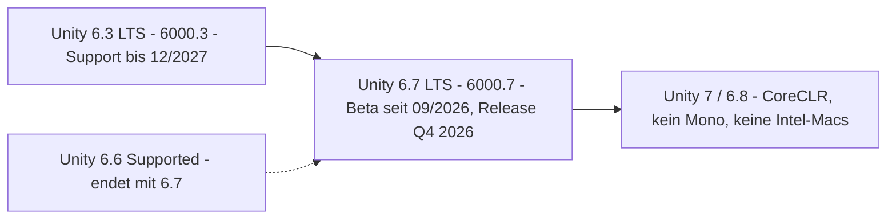

# Technik-Recherche: Unity-Stand, Pakete und Werkzeuge (Oktober 2026)

> Teil der Phase-0-Planung · Stand: 2026-10-13 · Quelle: [Master-Prompt](../00_Master-Prompt.md)

Verwandte Dokumente: [Technische Architektur](./01_Architektur.md) · [Systeme & Abhängigkeiten](./02_Systeme_und_Abhaengigkeiten.md) · [Quests & Dialoge](../GDD/02_Quests_und_Dialoge.md) · [UI/Audio/Grafik](../GDD/05_UI_Audio_Grafik_Barrierefreiheit.md) · [Welt & Story](../GDD/01_Welt_Story_Fraktionen.md)

---

## Zweck und Methode

- **Zweck:** Faktenbasis für die Architektur (§4, §5, §6, §27, §31 Phase 0 Schritt 4). Keine Designentscheidungen, nur geprüfte Fakten plus daraus abgeleitete Empfehlungen.
- **Methode:** Websuche (Stand 2026-10-12) und direktes Lesen von Primärquellen auf GitHub: Paket-Changelogs und `package.json` aus den Repos von Unity-Technologies und aus `needle-mirror` (ein automatischer Spiegel der Unity-Paket-Registry, Changelog-Texte stammen von Unity), Quelltext der GitHub-Dokumentation (`github/docs`), GameCI-Doku.
- **Einschränkung:** `unity.com`, `docs.unity3d.com`, `docs.unity.com` und `discussions.unity.com` waren aus der Recherche-Umgebung **nicht direkt abrufbar**. Aussagen daraus stammen aus Such-Auszügen. Alles mit Sicherheit „mittel“ oder „niedrig“ wird beim Projekt-Setup im Unity Hub bzw. Package Manager gegengeprüft (Checkliste unter [Nicht verifiziert](#nicht-verifiziert)).

| Sicherheit | Bedeutung |
|---|---|
| **hoch** | Primärquelle direkt gelesen (Changelog, Manifest, Quellcode, Doku-Quelltext) oder offizielle Seite mit eindeutigem Wortlaut, durch eine zweite Quelle bestätigt |
| **mittel** | Offizielle Quelle nur als Such-Auszug gesehen, Beitrag von Unity-Mitarbeitern im Forum oder mehrere übereinstimmende Sekundärquellen |
| **niedrig** | Einzelne Sekundärquelle, Forenmeinung, widersprüchliche Angaben oder eigene Ableitung |

---

## Kurzfazit

| Thema | Ergebnis | Konsequenz für Aetherfall |
|---|---|---|
| Engine | Neueste LTS: **Unity 6.3 LTS (6000.3)**, Support bis 12/2027. 6.7 LTS ist in der Beta (seit 17.09.2026) und kommt voraussichtlich in Q4 2026. | Mit 6.3 LTS starten, geplanter Umstieg auf 6.7 LTS vor Phase 3 |
| Zukunft | Unity 7 / 6.8 ersetzt Mono durch CoreCLR, Intel-Macs fallen ab 6.8 weg | Code von Anfang an CoreCLR-fest schreiben, nur Apple-Silicon-Builds |
| Lizenz | Personal kostenlos bis 200.000 USD Umsatz+Funding, Splash-Screen optional, Runtime Fee abgeschafft | Personal reicht anfangs, Pro ab Schwelle zwingend |
| Pakete | Alle 11 Pakete aus §4.2 sind für Unity 6 verfügbar und gepflegt. TextMeshPro steckt in `com.unity.ugui`. Addressables läuft in zwei Linien (2.x / 4.x). | Versionen im Manifest fest pinnen |
| UI | UI Toolkit: World Space ab 6.2, Shader Graph-UI ab 6.3. Laut Unity deckt es mit 6.7 „die meisten Spiel-UI-Fälle“ ab. Gamepad-Navigation braucht eigene Logik. | **Vorschlag:** UI Toolkit plus eigene Fokus-Schicht, vorher Spike |
| Node-Editor | GraphView ist weiter experimentell, Graph Toolkit ist ab 6.4 ein Editor-Modul und auf 6.3 nur ein veraltetes Experimentalpaket | Datenmodell editorunabhängig halten, Editor-Technik erst auf 6.7 festlegen |
| `[SerializeReference]` | Keine eingebaute Typauswahl gefunden | Eigener Drawer (TypeCache) oder MIT-Paket |
| Streaming | Kein fertiges Open-World-Streaming in URP. Bewährt: additive Zellen-Szenen, Terrain-Kacheln, GPU Resident Drawer (setzt Forward+ voraus) | Welt ≤ 16 × 16 km um den Ursprung planen |
| Git/LFS | GitHub Free/Pro: 10 GiB LFS-Speicher und 10 GiB Traffic pro Monat, danach 0,07 USD/GiB-Monat bzw. 0,0875 USD/GiB | Budget-Limit setzen, LFS-Cache in CI |
| Builds | Windows-IL2CPP lässt sich **nicht** auf macOS bauen, Windows-Mono schon. Seit 6.1 ist DX12 Standard für neue Windows-Projekte. | Windows-Rechner oder Windows-CI nötig |
| Speichern | `System.Text.Json` fehlt in Unity 6 (Mono), `JsonUtility` kann kein Dictionary | Newtonsoft (`com.unity.nuget.newtonsoft-json` 3.2.2) |
| CI | GameCI funktioniert mit Personal-Lizenz (.ulf). macOS-Runner kostet 0,062 USD/min. | Tests auf Linux, Mac-Builds lokal |

---

## 1. Unity-Versionen, Plattform-Support, Lizenz

| Befund | Quelle (URL) | Sicherheit |
|---|---|---|
| **Unity 6.3 LTS (6000.3)** erschien am 04.12.2025 und ist die erste LTS seit 6.0. Support bis **Dezember 2027** (2 Jahre), Enterprise/Industry +1 Jahr. | https://unity.com/releases/unity-6/support · https://unity.com/blog/unity-6-3-lts-is-now-available | hoch |
| Laut Unity empfohlen „für Entwickler, die die Produktion auf eine Version festlegen“. | https://unity.com/blog/unity-6-3-lts-is-now-available | mittel |
| **Unity 6.0 LTS** endet im **Oktober 2026** (diesen Monat). Erste Middleware unterstützt nur noch 6.3 LTS und neuer. | https://unity.com/releases/unity-6/support · https://docs.gamecreator.io/traversal/releases | hoch |
| Supported Releases nach 6.3: 6.4 (19.03.2026, ECS als Kernpaket), 6.5 (Mitte Juni 2026, inzwischen End-of-Life) und **6.6 (6000.6)**. Laut Forum erschien 6.6 am 01.09.2026, eine Sekundärquelle nennt den 02.10. 6.6 ist das letzte Supported Release vor 6.7 LTS und wird nur bis zu dessen Erscheinen gepflegt. | https://discussions.unity.com/t/unity-6-6-is-now-available/1735357 · https://www.cgchannel.com/2026/03/unity-releases-unity-6-4-and-unity-studio/ · https://www.gamemeca.com/en/view.php?gid=1779935 | mittel |
| **Unity 6.7 LTS:** Alpha seit Juni 2026, Beta seit 17.09.2026. Release für Q4 2026 angekündigt, ein genaues Datum fehlt. Zum Stichtag ist 6.7 LTS noch nicht erschienen. | https://discussions.unity.com/t/unity-6-7-beta-is-now-available/1736830 · https://www.gamemeca.com/en/view.php?gid=1779935 | mittel |
| 6.7 enthält einen experimentellen **CoreCLR-Desktop-Player** (.NET Standard 2.1, C# 9, keine Performance-Zusagen). | https://discussions.unity.com/t/coreclr-scripting-and-ecs-status-update-march-2026/1711852 · https://creativebloq.com/3d/video-game-design/unity-7s-most-surprising-advance-isnt-a-feature-upgrade | mittel |
| **Ab Unity 6.8 gibt es Mono nicht mehr.** Statische Variablen werden dann nicht mehr automatisch über Domain Reloads zurückgesetzt. Neue Lifecycle-Attribute wie `[AutoStaticsCleanup]` sind angekündigt, ihre Verfügbarkeit je Version ist unklar. | https://discussions.unity.com/t/path-to-coreclr-2026-upgrade-guide/1714279 | mittel |
| Unity 7: Beta 12/2026, Release Q1 2027 (Bericht von der Unite Seoul 2026, nicht offiziell bestätigt). | https://www.invenglobal.com/articles/24003/unity-engine-7-changing-the-development-paradigm-and-the-roadmap-ahead | niedrig |
| **Intel-Macs:** In 6.6/6.7 abgekündigt, ab 6.8 entfallen Intel-Editor und Intel-/Universal-Player. 6.7 LTS unterstützt Intel noch 2 Jahre. Apple Silicon ist das empfohlene Build-Ziel. | https://discussions.unity.com/t/unity-to-deprecate-intel-based-mac-support-starting-with-unity-6-6/1721740 · https://docs.unity3d.com/Manual/macos-building.html | hoch |
| Editor auf dem Mac (Seite für Unity 6.0): macOS Big Sur 11+, Apple M1 oder neuer, läuft nativ auf Apple Silicon. Die Seite für 6.3 wurde nicht gelesen. | https://docs.unity3d.com/Manual/system-requirements.html | mittel |
| **Lizenz:** Personal ist kostenlos bis **200.000 USD** Umsatz *und* Funding in 12 Monaten (vorher 100.000 USD). Der „Made with Unity“-Splash ist **ab Unity 6 optional** für Personal. | https://unity.com/products/pricing-updates · https://unity.com/blog/unity-is-canceling-the-runtime-fee | hoch |
| **Runtime Fee** wurde im September 2024 vollständig gestrichen, es gilt wieder das Sitzplatz-Modell. | https://unity.com/blog/unity-is-canceling-the-runtime-fee | hoch |
| **Unity Pro:** 2.310 USD pro Jahr und Sitz (oder 210 USD/Monat), +5 % seit 12.01.2026. Pflicht ab 200.000 USD. Enterprise ab 25 Mio. USD. | https://unity.com/products/pricing-updates · https://www.cgchannel.com/2025/11/price-of-paid-unity-subscriptions-to-rise-but-free-subs-extended/ | hoch |
| **Platform Toolkit** (ab 6.3): einheitliche API für Konten, Spielstände, Achievements, auch für Windows/Steam. Das Kernpaket ist frei, die Plattform-Supportpakete (auch Steam) verlangen Pro. | https://discussions.unity.com/t/platform-toolkit-official-cross-platform-api-now-available-for-6-3/1698376 | mittel |
| Ab 6.3 unterstützen Desktop-Player Screenreader (Narrator unter Windows ab 10 21H1, VoiceOver ab macOS 11) über `AccessibilityHierarchy`/`AssistiveSupport`. | https://docs.unity3d.com/Manual/accessibility.html · https://discussions.unity.com/t/native-desktop-screen-reader-support-now-available-in-unity-6-3/1681788 | mittel |



**Einordnung:** §4.1 verlangt „Unity 6 (oder die neueste LTS-Version)“. Das erfüllt **6.3 LTS** heute. 6.0 LTS läuft diesen Monat aus und kommt nicht infrage. 6.6 wird nur bis zum Erscheinen von 6.7 gepflegt und ist deshalb für ein Langzeitprojekt ungeeignet.

---

## 2. Paketstatus (Stand Oktober 2026)

| Befund | Quelle (URL) | Sicherheit |
|---|---|---|
| **Input System** `com.unity.inputsystem`: aktuell **1.20.1** (05.10.2026), Mindestversion Unity 6000.0. Project-Wide Actions lassen sich nicht mehr wegkompilieren. Neuer `InputSystemProvider` für UI Toolkit, Asset-Editoren auf UI Toolkit umgestellt. Rebinding-Sample mit Gamepad-Icons, `WithSuppressedActionPropagation()` beim Rebinding. | https://github.com/Unity-Technologies/InputSystem/blob/develop/Packages/com.unity.inputsystem/CHANGELOG.md | hoch |
| Input System Hardware: DualSense (PS5) auf Mac/Windows, Xbox per USB unter macOS über den Systemtreiber, Switch Pro auf Desktop. | wie oben | hoch |
| **Cinemachine 3** `com.unity.cinemachine`: stabil **3.1.7** (08.06.2026), Vorabversion 3.1.8-pre.2, Mindestversion 2022.3. Die Klassen `CinemachineCamera`, `CinemachineThirdPersonFollow`, `CinemachineThirdPersonAim`, `CinemachineOrbitalFollow`, `CinemachineRotationComposer`, `CinemachineDeoccluder`, `CinemachineDecollider` (ab 3.1.0), `CinemachineTargetGroup`, `CinemachineGroupFraming`, `CinemachineStateDrivenCamera`, `CinemachineClearShot` und `CinemachineImpulseSource` sind im Quellcode vorhanden. | https://github.com/Unity-Technologies/com.unity.cinemachine/blob/main/com.unity.cinemachine/CHANGELOG.md | hoch |
| Cinemachine-Kollision: `CinemachineDeoccluder` hält die Sichtlinie zum Ziel frei (eigene Klasse, nicht nur ein umbenannter `CinemachineCollider`). `CinemachineDecollider` verhindert nur, dass die Kamera in Collider oder Terrain eindringt, ohne die Sichtlinie zu erzwingen. Für ein Lock-On gibt es kein fertiges Sample. Üblich ist eine eigene Lock-On-Kamera (`ThirdPersonFollow` + `RotationComposer` auf eine `TargetGroup` aus Spieler und Ziel), die per Priorität eingeblendet wird. | Changelog wie oben · https://docs.unity3d.com/Packages/com.unity.cinemachine@3.1/manual/CinemachineRotationComposer.html · https://community.gamedev.tv/t/unity-3rd-person-combat-traversal-cinemachine-v-3-problems/256542 | mittel |
| **ProBuilder** `com.unity.probuilder`: **6.1.3** (07.10.2026), Mindestversion 6000.0. | https://github.com/needle-mirror/com.unity.probuilder (CHANGELOG) · https://github.com/Unity-Technologies/com.unity.probuilder/blob/master/CHANGELOG.md | hoch |
| **Terrain Tools** `com.unity.terrain-tools`: **5.3.3** (19.08.2026), Mindestversion 6000.0. Bereits auf CoreCLR-kompatible APIs umgestellt (für 6.5+). | https://github.com/needle-mirror/com.unity.terrain-tools | hoch |
| **AI Navigation** `com.unity.ai.navigation`: **2.0.16** (07.10.2026), Mindestversion 6000.0. **Verhaltensänderung in 2.0.16:** Ein NavMesh über Terrain bezieht jetzt die gemalten Bäume ein. Dichte Wälder verlieren dadurch Wege, Bakes dauern länger. Abschalten pro Baum über `NavMeshModifier` (Remove Object) oder global per Define `AI_NAVIGATION_IGNORE_TERRAIN_TREES`. | https://github.com/needle-mirror/com.unity.ai.navigation | hoch |
| AI Navigation zur Laufzeit: `NavMeshSurface.BuildNavMesh()`, `UpdateNavMesh(NavMeshData)` (gibt eine `AsyncOperation` zurück, intern `NavMeshBuilder.UpdateNavMeshDataAsync`), `AddData()/RemoveData()` (`NavMesh.AddNavMeshData`), `overrideTileSize`/`tileSize`. Standard-Kachel 256 Voxel, für Laufzeit-Bakes kleiner wählen, für Carving 64–128. | https://github.com/needle-mirror/com.unity.ai.navigation (Runtime/NavMeshSurface.cs) · https://docs.unity3d.com/Packages/com.unity.ai.navigation@2.0/manual/NavMeshSurface | hoch |
| **Addressables** `com.unity.addressables` hat **zwei parallele Linien**: 2.x wird gepflegt (2.10.3 vom 01.09.2026, 2.11.2 vom 20.08.2026), 4.x ist aktuell (4.1.1 vom 29.09.2026). Alle verlangen mindestens 6000.0. Version 3.1.1 nutzt „umbenannte Unity-6.6-BuildHistory-APIs“, also gehören 3.x/4.x zu 6.6+. 4.0 kann `await handle` direkt, `ToAwaitable(CancellationToken)`, Ordner-Keys (`LoadAssetsAsync(folderAddress)`) und bringt das Content-Directory-Schema. | https://github.com/needle-mirror/com.unity.addressables (CHANGELOG, Tags) | hoch (Versionen) / mittel (Zuordnung zu Editor-Versionen) |
| **Content Directories** (ab 6.6, Addressables 4): neues Format neben AssetBundles. Bisher nur für **lokale** Inhalte, Remote-Auslieferung ist für die Unity-7-Generation geplant. Bestehende Gruppen lassen sich umstellen. | https://unity.com/blog/content-directories-beyond-the-assetbundle · https://discussions.unity.com/t/unity-6-6-is-now-available/1735357 | mittel |
| **TextMeshPro** ist seit 2023.2 in `com.unity.ugui` **2.0** aufgegangen, das eigenständige Paket `com.unity.textmeshpro` ist veraltet. Die TMP Essential Resources müssen weiterhin importiert werden (Window > TextMeshPro). | https://docs.unity3d.com/Packages/com.unity.ugui@2.0/changelog/CHANGELOG.html · https://discussions.unity.com/t/2023-2-latest-development-on-textmesh-pro/917387 | hoch |
| **Timeline** `com.unity.timeline`: **1.8.13** (11.08.2026), Mindestversion 6000.0. | https://github.com/needle-mirror/com.unity.timeline | hoch |
| **Animation Rigging** `com.unity.animation.rigging`: **1.4.1** (16.01.2026), Mindestversion 6000.0.23f1. Wenig Entwicklung (1.3.0 → 1.4.0 lagen fast 3 Jahre auseinander), aber gepflegt. | https://github.com/needle-mirror/com.unity.animation.rigging | hoch |
| **Localization** `com.unity.localization`: **1.5.13** (02.09.2026). UI-Toolkit-Bindung über Runtime Data Binding (ab Unity 6), lokalisierte Dropdowns für UI Toolkit, uGUI und TMP, Google-Sheets-Anbindung, Smart Strings. | https://github.com/needle-mirror/com.unity.localization · https://docs.unity3d.com/Packages/com.unity.localization@1.5/manual/UIToolkit.html | hoch |
| **Unity Test Framework**: Seit 1.5.1 Kernpaket mit fester Bindung an die Editor-Version. Die Doku liegt ab 6.2 im Unity-Manual. Eine 2.0-Linie existiert nur als Pre-Release/experimentell. Das Performance-Testing-Paket 3.2.0 ist für 6000.3 freigegeben. Neueste Version von `com.unity.test-framework.performance` ist **3.6.0** (23.09.2026, Mindestversion 2020.3). Ob der Package Manager unter 6.3 3.2.x oder 3.6.x als „released“ anbietet, ist nicht verifiziert. | https://docs.unity3d.com/Packages/com.unity.test-framework@1.5/changelog/CHANGELOG.html · https://docs.unity3d.com/Manual/test-framework/test-framework-introduction.html · https://docs.unity3d.com/Manual/com.unity.test-framework.performance.html · https://github.com/needle-mirror/com.unity.test-framework.performance (package.json, CHANGELOG) | mittel / hoch (Version 3.6.0) |
| **Newtonsoft JSON** `com.unity.nuget.newtonsoft-json`: **3.2.2** (enthält Json.NET 13.0.2), offizielles Unity-Paket. Vermeidet Assembly-Konflikte und funktioniert mit IL2CPP. | https://github.com/needle-mirror/com.unity.nuget.newtonsoft-json · https://www.pkglnk.dev/pkg/newtonsoft-json | hoch / mittel (Json.NET-Version) |
| **Unity Behavior** `com.unity.behavior`: **1.0.16** (26.05.2026), Mindestversion 6000.0.16f1, Status „released“. **Seit Anfang 2025 weniger Investition:** nur noch Bugfixes und Stabilität. Runtime-Serialisierung wurde (Stand 1.0.8) nicht empfohlen. Open-Sourcing ist offen. | https://github.com/needle-mirror/com.unity.behavior · https://discussions.unity.com/t/an-update-on-behavior/1598451 | hoch (Version) / mittel (Investitionsstand) |
| `com.unity.serialization` gilt ab 6.6 offiziell als veraltet. Unity empfiehlt den Wechsel zu System.Text.Json, Odin Serializer oder MemoryPack. | https://discussions.unity.com/t/coreclr-scripting-and-serialization-update-june-2026/1723299 | mittel |

### Vorschlag: Paketliste und Versionspolitik

**Vorschlag:** Diese Pakete fest pinnen (exakte Version in `Packages/manifest.json`, keine Bereiche). Updates nur gebündelt mit einem Engine-Wechsel oder bei konkretem Bugfix-Bedarf. Die Versionen unten sind die neuesten gefundenen. Maßgeblich ist, was der Package Manager unter 6.3 als „released“ anbietet.

| Paket | Linie | Ab Phase | Anmerkung |
|---|---|---|---|
| Input System | 1.20.x | 1 | Active Input Handling = „Input System Package (New)“ |
| Cinemachine | 3.1.x (stabil, kein `-pre`) | 1 | 2.x-Tutorials nicht verwenden, die API ist umbenannt |
| Universal RP | an den Editor gebunden (Kernpaket) | 1 | Render Graph aktiv lassen |
| Newtonsoft JSON | 3.2.2 | 1 | Speichersystem |
| Unity Test Framework | Kernpaket | 1 | plus Performance Testing ab Phase 2: neueste 3.6.0 (23.09.2026); ob der Package Manager unter 6.3 3.2.x oder 3.6.x als „released“ anbietet, ist nicht verifiziert |
| Localization | 1.5.x | 1 | Deutsch/Englisch ab dem ersten UI-Text (§4.2) |
| ugui (enthält TMP) | an den Editor gebunden | 1 | TMP Essentials importieren |
| ProBuilder | 6.1.x | 2 | Blocking |
| AI Navigation | 2.0.x | 2 | Verhalten bei Terrain-Bäumen ab 2.0.16 beachten |
| Addressables | 2.x unter 6.3 · 4.x unter 6.7 | 1 | Linie wechselt mit dem Engine-Upgrade; ContentDatabase und SceneLoader ab Boot ([Technik/01, 4.1](./01_Architektur.md)) |
| Timeline | 1.8.x | 3 | Zwischensequenzen |
| Animation Rigging | 1.4.x | 2 | IK für Blick und Hände |
| Terrain Tools | 5.3.x | 4 | Vertical Slice |
| Unity Behavior | – | – | **nicht** als Kernabhängigkeit (siehe Empfehlung 9) |

---

## 3. UI Toolkit vs. uGUI zur Laufzeit

| Befund | Quelle (URL) | Sicherheit |
|---|---|---|
| Unitys Vergleichsseite (6.6/6.7) nennt in der Übersicht weiter **uGUI als empfohlenes Laufzeit-System** und UI Toolkit als Alternative. In der Anwendungsfall-Tabelle gilt UI Toolkit jedoch als übliche Wahl für Menüs und HUD in mehreren Auflösungen sowie für World-Space-UI und eigene Shader. | https://docs.unity.com/en-us/engine/6000.6/manual/uitoolkits/ui-system-compare · https://docs.unity3d.com/Manual/UI-system-compare.html | mittel |
| Nur UI Toolkit hat Data Binding, Übergangsanimationen, flexibles Layout und globales Styling (USS). Nur uGUI hat In-Scene-Authoring, serialisierte Events und eine Anbindung an Animation Clips und Timeline. | wie oben | mittel |
| **World-Space-UI im UI Toolkit** gibt es ab **6.2** (Panel Settings, Render Mode = World Space, Pixels Per Unit, `PanelInputConfiguration`). Ein Assert-Fehler wurde in 6000.2.9f1 bzw. 6000.3.0b7 behoben. | https://docs.unity3d.com/6000.2/Documentation/Manual/ui-systems/world-space-ui.html · https://unity.com/resources/how-to-create-world-space-ui-toolkit | hoch |
| Neu in 6.3 für UI Toolkit: native SVGs, **Shader Graph-UI-Target (nur URP)**, UI-Filter (Post-Processing). | https://80.lv/articles/unity-6-3-lts-released · https://discussions.unity.com/t/unity-6-3-beta-is-now-available/1680610 | mittel |
| Unity zum Stand in 6.7: „Mit Unity 6.7 deckt UI Toolkit die meisten Anwendungsfälle für Spiel-UI ab“. Der Advanced Text Generator (voller Unicode-Umfang, Bidi) wird in 6.7 Standard für Laufzeit-Panels. | https://discussions.unity.com/t/state-of-ui-toolkit-in-unity-6-7/1736756 · https://discussions.unity.com/t/ui-toolkit-development-status-and-next-milestones-november-2025/1698009 | mittel |
| **Gamepad und Fokus:** Beide UI-Systeme nutzen das EventSystem bzw. das Input-Modul des Input System. Für UI Toolkit berichten Nutzer bis 6.2 von unerwartetem Standard-Navigationsverhalten. Übliche Abhilfe: Navigationsereignisse selbst abfangen (`NavigationMoveEvent`), Fokus explizit setzen. Das ältere Legacy-Input-Backend von UI Toolkit ist ab 6.2 obsolet. | https://discussions.unity.com/t/how-to-implement-navigation-with-ui-toolkit/891024 · https://discussions.unity.com/t/enabling-gamepad-controller-xbox-with-unity-ui-toolkit-navigation/1705930 · https://docs.unity3d.com/ScriptReference/UIElements.UIToolkitInputBackendOption.LegacyBackend.html | mittel (Quirks: niedrig) |
| **Localization ↔ UI Toolkit:** `LocalizedString` lässt sich direkt in UXML/UI Builder an `text` binden und aktualisiert sich bei Sprachwechsel. Bekannter Fehler: UI Builder hängt bei Bindung mit Variablen an ein benanntes Label. | https://docs.unity3d.com/Packages/com.unity.localization@1.5/manual/UIToolkit.html · https://discussions.unity.com/t/error-parsing-format-string-in-ui-builder/1613414 | hoch / niedrig (Fehler) |
| **3D-Charaktervorschau:** Kamera rendert in eine RenderTexture, die als Hintergrund eines UI-Toolkit-Elements dient. Unity zeigt das im Sample „Dragon Crashers“. | https://docs.unity3d.com/cn/current/Manual/best-practice-guides/ui-toolkit-for-advanced-unity-developers/graphic-and-font-assets-preparation.html | mittel |
| Text im UI Toolkit läuft über TextCore bzw. den Advanced Text Generator, nicht über TMP-Komponenten. Die Font-Assets sind ähnlich aufgebaut. | https://discussions.unity.com/t/state-of-ui-toolkit-in-unity-6-7/1736756 | mittel |

**Vorschlag (Entscheidung zu §24.3, Details in [UI/Audio/Grafik](../GDD/05_UI_Audio_Grafik_Barrierefreiheit.md) und [Architektur](./01_Architektur.md)):**

- **UI Toolkit** für alle Bildschirm-Menüs und das HUD. Gründe: Data Binding passt zu „Ereignis bei Wertänderung → UI“ (§10.3). Lokalisierung lässt sich ohne Code binden. USS-Variablen und Skalierung decken die einstellbare UI-Größe und Farbenblind-Themes ab (§24.3, §29). Das System ist Unitys erklärte Zukunft.
- **Eigene Fokus-Schicht** im `UIManager` (§6.2): pro Bildschirm explizite Fokusgraphen, Tab-Wechsel mit LB/RB, „A = Bestätigen, B = Zurück“ zentral. Auf Unitys Standardnavigation verlassen wir uns nicht.
- **uGUI/TMP** nur, wo es Vorteile hat: 3D-Weltlabels und Schadenszahlen (gepoolt), Timeline-animierte UI in Zwischensequenzen.
- **Vor Phase 2 ein Spike von 2–3 Tagen:** Inventarraster 8 × 6 mit Gamepad, Tab-Leiste, Rebinding-Dialog, Tooltip mit Vergleichswerten, 3D-Vorschau per RenderTexture, Sprachwechsel zur Laufzeit. Abbruchkriterium: Fokuslogik braucht über 1 Tag Workarounds pro Bildschirm. Dann fällt die Wahl auf uGUI.
- **Verbesserungsvorschlag:** §4.2 verlangt „TextMeshPro für alle Texte“. Mit UI Toolkit rendert dessen eigene Text-Engine die Menütexte. TMP bleibt für uGUI- und 3D-Texte. Begründung: zwei UI-Systeme mit *einer* Text-Engine erzwingen zu wollen, kostet Aufwand und bringt keinen Nutzen. Einheitlich bleiben Font-Quellen, Zeichensätze und Fallbacks. Original (§4.2): „TextMeshPro für alle Texte“.

---

## 4. Node-Graph-Editoren (Quest- und Dialog-Editor, §16.8, §17)

| Befund | Quelle (URL) | Sicherheit |
|---|---|---|
| **GraphView** (`UnityEditor.Experimental.GraphView`) trägt in Unity 6 weiter den Hinweis „experimental, might be changed or removed“. Eine Abkündigung wurde nicht gefunden. Shader Graph und andere Unity-Werkzeuge bauen darauf auf. | https://docs-alpha.unity3d.com/ScriptReference/Experimental.GraphView.GraphView.html · https://discussions.unity.com/t/want-to-implement-a-visual-node-editor-which-framework-should-i-use/1635378 | mittel |
| **Graph Toolkit:** erschien mit 6.2 als experimentelles Paket `com.unity.graphtoolkit`, letzte Version **0.4.0-exp.2** vom 18.09.2025 (Mindestversion 6000.2.0a9). **Ab 6.4 ist das Paket veraltet**, Graph Toolkit ist dann ein eingebautes Editor-Modul. | https://github.com/needle-mirror/com.unity.graphtoolkit · https://docs.unity3d.com/Packages/com.unity.graphtoolkit@0.4/manual/whats-new.html | hoch (Paket) / mittel (Modul) |
| Die Graph-Toolkit-API ändert sich weiter: In 6.5 wurden Namen von camelCase auf PascalCase umgestellt und Subgraph-Optionen ergänzt. In 6.6 kamen stabile IDs für Assets, Knoten, Ports und Subgraphs, `IsConnectionAllowed()` und Wire-APIs hinzu. | https://discussions.unity.com/t/graph-toolkit-update-in-unity-6-5-alpha/1712169 · https://discussions.unity.com/t/graph-toolkit-update-in-unity-6-6-alpha/1721970 | mittel |
| Graph Toolkit hat **kein Laufzeit-Graphmodell**, eines ist auch „nicht in naher Zukunft geplant“. Vorgesehen ist: Graph-Asset im Editor → eigener Importer erzeugt Laufzeitdaten. | https://discussions.unity.com/t/graph-toolkit-missing-apis-patching-in-6-4/1696946 | mittel |
| **xNode** (MIT, 3,7k Sterne): letzter Commit am 26.08.2024, davor 2023. Praktisch nicht mehr gepflegt. | https://github.com/Siccity/xNode | hoch |
| **NodeGraphProcessor** (MIT, basiert auf GraphView, 2,7k Sterne): nach 2021 nur noch ein Commit „Fix Unity 6 compilation“ am 22.09.2025. | https://github.com/alelievr/NodeGraphProcessor | hoch |

| Option | Reife (Stand 10/2026) | Risiko | Eignung für Aetherfall |
|---|---|---|---|
| GraphView direkt | Seit Jahren produktiv genutzt, offiziell „experimental“ | Mittel: Entfernung möglich, aber unwahrscheinlich, solange Unity-Werkzeuge darauf bauen | Gut, wenn wir auf 6.3 bleiben |
| Graph Toolkit (Modul ab 6.4) | Jung, API bricht noch zwischen Minor-Versionen | Mittel bis hoch bis 6.7 LTS, danach geringer | Gut ab 6.7 LTS, vorher nicht |
| Graph Toolkit Paket 0.4 auf 6.3 | Veraltet, kein Support | Hoch | Nein |
| xNode / NodeGraphProcessor | Kaum gepflegt | Hoch (CoreCLR, Unity 7) | Nein |
| Eigene UI-Toolkit-Lösung | Volle Kontrolle | Aufwand ca. 3–6 Wochen für Zoom, Pan, Ports, Undo und Auswahl | Nur, wenn beide oben genannten scheitern |

**Vorschlag:** Das Quest- und Dialog-Datenmodell (ScriptableObjects + `[SerializeReference]`) ist die *einzige* Wahrheit und hängt von keinem Editor ab. Ein Graph-Editor ist nur eine Ansicht darauf. Bis zur Entscheidung (Phase 3) reicht ein Listen- und Inspector-Editor mit Validierung. Diese Variante ist auch als Rückfallebene gedacht. Die Editor-Technik wird erst nach dem Umstieg auf 6.7 LTS gewählt, voraussichtlich Graph Toolkit, sonst GraphView. Das deckt §16.8 („GraphView oder ähnlichem“) ab.

---

## 5. `[SerializeReference]` und Typauswahl im Inspector

| Befund | Quelle (URL) | Sicherheit |
|---|---|---|
| Unity zeichnet `[SerializeReference]`-Felder mit Wert, bietet aber **keine eingebaute Auswahl des konkreten Typs**. Ein Hinweis auf eine solche Funktion in Unity 6.x wurde nicht gefunden. | https://discussions.unity.com/t/custom-inspector-property-drawer-for-polymorphic-serializereference/917284 · https://docs.unity3d.com/6000.2/Documentation/ScriptReference/SerializeReference.html | mittel |
| **mackysoft/Unity-SerializeReferenceExtensions:** **MIT**, Version **1.7.0** vom 18.01.2026. Attribut `[SubclassSelector]` mit Dropdown, Suche, Listen, `[AddTypeMenu]` für Anzeigenamen, Kopieren/Einfügen. Ab 2021.3, generische Felder ab 2023.2. Installation per Git-URL oder OpenUPM. | https://github.com/mackysoft/Unity-SerializeReferenceExtensions | hoch |
| Alternative: AlexeyTaranov/SerializeReferenceDropdown mit Typauswahl, Hervorhebung fehlender Typen und stabilen IDs. Lizenz nicht geprüft. | https://github.com/AlexeyTaranov/SerializeReferenceDropdown | niedrig |
| **Umbenennen bricht Referenzen:** Unity speichert Klasse, Namespace und Assembly. Abhilfe ist `UnityEngine.Scripting.APIUpdating.MovedFromAttribute`. Das gilt auch, wenn eine **asmdef umbenannt** wird. | https://github.com/mackysoft/Unity-SerializeReferenceExtensions (README) | hoch |
| Fehlende Typen bleiben als Daten erhalten und lassen sich gezielt aufräumen: `SerializationUtility.ClearAllManagedReferencesWithMissingTypes` (plus Abfrage/Einzel-Variante). | https://docs-alpha.unity3d.com/ScriptReference/SerializationUtility.ClearAllManagedReferencesWithMissingTypes.html | hoch |
| Die Doku schließt einfache Typen (int, Structs) und C#-`Dictionary` für `[SerializeReference]` aus. Ab 6.6 kann `[SerializeField]` auf `Dictionary<,>` serialisieren. Für `[SerializeReference]` sind Dictionaries weiter offen. | https://docs.unity3d.com/6000.2/Documentation/ScriptReference/SerializeReference.html · https://discussions.unity.com/t/coreclr-scripting-and-serialization-update-june-2026/1723299 | mittel |

**Fallstricke und Regeln (Vorschlag für §6.4):**

1. Jede konkrete Condition- und Action-Klasse ist `[Serializable]`, `sealed`, nicht generisch und erbt nicht von `UnityEngine.Object`. Feldtyp ist die abstrakte Basisklasse (`Condition`, `GameAction`) aus `Aetherfall.Conditions`, siehe [Technik/01, 7.1](./01_Architektur.md).
2. Klassennamen, Namespaces (`Aetherfall.Conditions`) und asmdef-Namen gelten ab dem ersten Content-Asset als **eingefroren**. Wer umbenennt, setzt `[MovedFrom(…)]` und behält es dauerhaft.
3. Ein Editor-Validator (Teil des ID-Prüfwerkzeugs aus §6.3) meldet fehlende Typen in allen Assets. Ein CI-Test schlägt fehl, wenn Assets solche Referenzen enthalten.
4. Neue Felder bekommen sinnvolle Standardwerte. Wenn sich die Bedeutung ändert, sorgt ein Editor-Migrationsskript dafür, nicht `ISerializationCallbackReceiver`-Magie.
5. **Vorschlag:** ein eigener schlanker Drawer in `Aetherfall.EditorTools.Core` (ca. 150–250 Zeilen, UI Toolkit, `TypeCache.GetTypesDerivedFrom<T>()`, eigenes Attribut `[TypeMenu("Quest/Spieler hat Level")]` für deutsche Menüpfade). Begründung: keine Fremdabhängigkeit über den CoreCLR-Wechsel hinweg, Menü passt zu unserem Domänenvokabular. Rückfallebene: das MIT-Paket von mackysoft, eingebunden unter `Assets/ThirdParty/`.

Skizze (nur zur Verdeutlichung):

```csharp
namespace Aetherfall.Conditions {
  [Serializable] public abstract class Condition { public abstract bool Evaluate(in ConditionContext ctx); }
  [Serializable, TypeMenu("Logik/UND")]
  public sealed class AllOf : Condition { [SerializeReference] private List<Condition> items = new(); /* … */ }
}
namespace Aetherfall.Progression {
  [Serializable, TypeMenu("Spieler/Level mindestens")]
  public sealed class PlayerLevelAtLeast : Condition { [SerializeField] private int level = 1; /* … */ }
}
```

---

## 6. Veraltete und ersetzte APIs, asynchroner Code

| Befund | Quelle (URL) | Sicherheit |
|---|---|---|
| `FindObjectOfType` / `FindObjectsOfType` sind obsolet (seit 2023.1). | https://docs-alpha.unity3d.com/ScriptReference/Object.FindObjectOfType.html | hoch |
| **Auch `FindFirstObjectByType` ist inzwischen obsolet** (Doku 6.6, weil es auf der InstanceID-Reihenfolge beruht). Ersatz ist `FindAnyObjectByType`. | https://docs.unity3d.com/6000.6/Documentation/ScriptReference/Object.FindFirstObjectByType.html · https://issuetracker.unity3d.com/issues/vfx-samples-are-using-the-obsolete-findfirstobjectbytype-method | mittel |
| `FindObjectsByType` mit `FindObjectsSortMode`-Parameter ist ab 6.4 obsolet. Ersatz sind die Überladungen `FindObjectsByType(Type)` bzw. `(Type, FindObjectsInactive)`. Terrain Tools 5.3.3 musste deshalb nachbessern. | https://docs.unity3d.com/6000.6/Documentation/ScriptReference/FindObjectsSortMode.html · https://github.com/needle-mirror/com.unity.terrain-tools | hoch |
| **InstanceID → EntityId:** `Object.GetInstanceID()` erzeugt ab 6.2 Obsolet-Warnungen, Pakete stellen für 6.5+ auf `EntityId` um. **Ab 6.5 sind obsolete InstanceID-APIs ein Compile-Fehler** (CS0619, „Use GetEntityId instead“) laut offiziellem Migrationsleitfaden („Starting in Unity 6.5, obsolete InstanceID APIs produce compilation errors“). Der Unity-API-Updater migriert das nicht automatisch. Betroffen sind auch `FindObjectsSortMode.InstanceID` und `FindFirstObjectByType`. Die Werte sind ausdrücklich **nicht stabil** über Sitzungen oder Versionen hinweg. | https://docs.unity3d.com/Manual/instanceid-to-entityid-migration.html · https://docs.unity.com/en-us/engine/6000.5/manual/scripting/fundamental-unity-types/instanceid-to-entityid-migration.md · https://docs.unity3d.com/6000.7/Documentation/Manual/instanceid-to-entityid-migration.html · https://github.com/needle-mirror/com.unity.ai.navigation · https://github.com/needle-mirror/com.unity.behavior | hoch (Wortlaut der Manual-Seiten 6.5–6.7 übereinstimmend) |
| `Rigidbody.velocity` heißt seit Unity 6 `linearVelocity`, auch bei 2D. `angularVelocity` bleibt. | https://uhiyama-lab.com/en/notes/unity/unity6-api-migration-guide/ | mittel |
| `Rigidbody.drag`/`angularDrag` heißen `linearDamping`/`angularDamping`. | (eigenes Wissen, nicht nachgeprüft) | niedrig |
| Der alte **Input Manager** ist laut Manual 6.4 „nicht empfohlen und wird in künftigen Versionen entfernt“. Ab 6.3 warnt die Konsole. | https://docs.unity3d.com/6000.4/Documentation/Manual/InputLegacy.html · https://catlikecoding.com/unity/hex-map/5-0-0/ | mittel |
| **URP Render Graph:** In 6.3 ist der Compatibility Mode nur noch per Define `URP_COMPATIBILITY_MODE` erreichbar. Renderer Features ohne `RecordRenderGraph` laufen nicht. Ab 6.4 ist `SetupRenderPasses` veraltet. | https://discussions.unity.com/t/render-graph-updates-in-unity-6-3/1668122 · https://docs.unity3d.com/6000.4/Documentation/Manual/UpgradeGuideUnity62.html | mittel |
| **Awaitable** (Unity 6) wird gepoolt: **niemals zweimal awaiten** (undefiniertes Verhalten, Deadlock möglich). Es gibt `BackgroundThreadAsync`/`MainThreadAsync` für Arbeit, die länger als ein Frame dauert, nicht für Parallelität innerhalb eines Frames (dafür Jobs). Laufende Hintergrundarbeit wird beim Verlassen des Play Mode nicht gestoppt, abbrechen mit `Application.exitCancellationToken` bzw. `destroyCancellationToken`. | https://docs.unity3d.com/Manual/async-awaitable-introduction.html | hoch |
| **UniTask** 2.5.11 (MIT, Cysharp), angepasst an 6.2+. Laut Community bleibt es für komplexe Async-Abläufe nützlich, Awaitable deckt einfache Fälle ab. | https://github.com/Cysharp/UniTask · https://dev.to/gamedevtoollab/do-we-still-need-unitask-in-the-unity-6-era-choosing-between-awaitable-and-unitask-5d6 | hoch / niedrig (Bewertung) |
| CoreCLR-Vorbereitung: keine P/Invoke-Aufrufe in Mono-Bibliotheken. Statischen Zustand nicht dem Domain Reload überlassen, empfohlen ist schon jetzt „Reload Domain on Play Mode“ aus. Player-Builds testen, nicht nur den Editor. | https://discussions.unity.com/t/path-to-coreclr-2026-upgrade-guide/1714279 | mittel |

**Konsequenz:** Die Regel aus §32.6 („keine `FindObjectOfType` in Update-Schleifen“) wird verschärft. **Vorschlag:** Laufzeitcode nutzt gar keine `Find*`-Aufrufe. Dienste kommen über ServiceLocator/Bootstrapper (§6.2), Szenenreferenzen über `[SerializeField] private`. `FindAnyObjectByType` bleibt nur für Editor-Tools und Debug erlaubt. InstanceID/EntityId wird **nie** gespeichert, Spielstände nutzen ausschließlich die stabilen String-IDs (§6.3).

---

## 7. Open-World-Streaming und Rendering in Unity 6 / URP

| Befund | Quelle (URL) | Sicherheit |
|---|---|---|
| Unity hat **kein eingebautes Open-World-Streaming** für URP, sondern nur Bausteine. Das verbreitete Muster: Raster aus additiven Szenen (Zellen), in Ringen geladen, ferne Kacheln als Impostor oder Low-Res-Terrain. | https://discussions.unity.com/t/best-approach-for-handling-large-open-world-terrain-streaming/1710438 · https://developers.meta.com/vr/documentation/unity/unity-sample-asset-streaming/ | mittel |
| **Aktivierungsspitzen:** Beim Aktivieren einer Szene werden alle GameObjects im selben Frame aktiviert. Ein Bericht nennt ca. 1 s Hänger selbst bei einer kleinen Impostor-Szene. Das Meta-Sample nutzt drei Zustände (entladen / geladen und versteckt / aktiv) und gestaffeltes Entladen. | wie oben | mittel |
| Terrain-Kacheln verbinden sich automatisch, wenn **Auto Connect** an ist und der **Grouping ID** übereinstimmt (`TerrainUtility.AutoConnect`, `allowAutoConnect`, `groupingID`). | https://docs.unity3d.com/ja/2022.3/ScriptReference/TerrainUtils.TerrainUtility.AutoConnect.html | hoch |
| **GPU Resident Drawer (GRD)** setzt den **Forward+**-Pfad, compute-fähige Grafik-APIs (nicht GLES), den SRP Batcher und „BatchRendererGroup Variants = Keep All“ voraus (das verlängert Builds). Er wirkt nur auf `MeshRenderer`. Weitere Einschränkungen: kein `MaterialPropertyBlock`, DOTS-Instancing-fähige Shader, nur statisches GI, keine Per-Instance-Callbacks. Abschalten pro Objekt über die Komponente „Disallow GPU Driven Rendering“. | https://docs.unity3d.com/6000.3/Documentation/Manual/urp/gpu-resident-drawer.html · https://docs.unity3d.com/cn/current/Manual/urp/make-object-compatible-gpu-rendering.html | hoch (Voraussetzungen) / mittel (Detail-Einschränkungen) |
| **GPU Occlusion Culling** setzt GRD und Render Graph voraus (Compatibility Mode aus). Ohne viel Verdeckung kann es Frames *verlangsamen*. | https://docs.unity3d.com/6000.1/Documentation/Manual/urp/gpu-culling.html | hoch |
| **Mesh LOD** (ab 6.2): automatisch beim Import erzeugte LODs in einem einzigen Mesh. Cross-Fade in URP erfordert LOD Cross Fade *und* GRD. Bei Bäumen mit starker Krümmung können Artefakte entstehen. | https://docs.unity3d.com/6000.2/Documentation/Manual/lod/mesh-lod-generate-lods.html · https://docs.unity3d.com/Manual/lod/mesh-lod-troubleshooting.html | hoch |
| Terrain-Details mit „Use GPU Instancing“ schaffen laut Unity „Millionen Details bei über 60 fps“ auf PC. Für Bäume empfiehlt Unity **SpeedTree**, das URP unterstützt, der alte Tree Editor nur Built-in. Ob GRD auf Terrain-Bäume und Details wirkt, ist nicht belegt. | https://docs.unity3d.com/6000.4/Documentation/Manual/terrain-Trees-Landing.html · https://docs.unity3d.com/6000.2/Documentation/Manual/terrain-Trees.html | mittel |
| Unity liefert **keine eingebauten Impostors**. Dafür braucht es Drittanbieter oder Eigenbau. | (keine offizielle Funktion gefunden) | niedrig |
| **Gleitkomma:** Transforms und Physik nutzen 32-Bit-Floats. Der Transform-Inspector warnt ab ca. 100.000 Einheiten. Ein Unity-Mitarbeiter nannte „ca. 50 km“ als empfohlene maximale Weltgröße. **URP hat kein kamerarelatives Rendering** (HDRP schon). Die übliche Abhilfe ist ein Floating Origin. | https://discussions.unity.com/t/large-world-coordinates-double-precision-data/902530 · https://discussions.unity.com/t/camera-relative-rendering-for-urp-just-as-in-hdrp/765096 · https://discussions.unity.com/t/floating-point-limitations/766134 | mittel |

**Float-Schrittweite (eigene Rechnung: 24-Bit-Mantisse, Schrittweite = 2^(e−23) m):**

| Abstand vom Ursprung | kleinster Positionsschritt | Bewertung für Third-Person (Kamera 3–6 m) |
|---|---|---|
| 2–4 km | 0,24 mm | unkritisch |
| 4–8 km | 0,49 mm | unkritisch |
| 8–16 km | 0,98 mm | meist unkritisch, Physik und Animation testen |
| 16–32 km | 1,95 mm | Zittern bei feinen Animationen wahrscheinlich |
| 65–131 km | 7,8 mm | ohne Floating Origin nicht spielbar |

**Vorschläge (Abstimmung mit [Welt & Story](../GDD/01_Welt_Story_Fraktionen.md) und [Architektur](./01_Architektur.md)):**

- **Vorschlag:** Die Welt mit dem Mittelpunkt im Ursprung planen. Alle spielbaren Punkte liegen **≤ 8 km** vom Ursprung, die Welt misst also höchstens 16 × 16 km. Ein Floating Origin wird **nicht** in Phase 1 gebaut. Die Systeme bleiben aber „verschiebbar“: Positionen relativ zur Zelle speichern, Weltereignis `OriginShifted` vorsehen. Die Zittergrenze wird im Vertical Slice an einem Test-Ort 8 km vom Ursprung gemessen.
- **Vorschlag:** Zellraster aus Terrain-Kacheln (Startwert 512 m × 512 m, Heightmap 513², also ca. 1 m Auflösung, im Prototyp messen) als **additive Szenen**, geladen über Addressables. Drei Ringe: aktiv (3 × 3), vorgeladen und deaktiviert (5 × 5), außerhalb nur Low-Res-Terrain/Impostor-Mesh. Die Aktivierung wird über mehrere Frames verteilt (große Objektgruppen schrittweise einschalten).
- **Vorschlag:** URP mit **Forward+**, Render Graph an, GRD an. Materialvarianten über Shader-Parameter bzw. Instanzdaten, **nicht** über `MaterialPropertyBlock`. Muss bei Shader-Konventionen ab Phase 2 feststehen.
- NavMesh: Pro Zelle eine eigene `NavMeshSurface` mit gebackenen Daten, die mit der Zelle geladen wird (`AddData`/`RemoveData`). Links zwischen Zellen über NavMeshLinks an den Rändern. Laufzeit-Bake nur für Basisbau und zerstörbare Bereiche.

---

## 8. Git für Unity, Git LFS, Merge

| Befund | Quelle (URL) | Sicherheit |
|---|---|---|
| Offizielle Vorlage `github/gitignore` → **Unity.gitignore**. Kernzeilen: `/[Ll]ibrary/`, `/[Tt]emp/`, `/[Oo]bj/`, `/[Bb]uild/`, `/[Bb]uilds/`, `/[Ll]ogs/`, `/[Uu]ser[Ss]ettings/`, `/[Mm]emoryCaptures/`, `/[Rr]ecordings/`, `*.csproj`, `*.sln`, `*.slnx`, `*.blend1`, `.vs/`, `.utmp/`, Addressables-Artefakte (`/ServerData`, `/[Aa]ssets/StreamingAssets/aa*`, `/[Aa]ssets/AddressableAssetsData/*/*.bin*`), `InitTestScene*.unity*`, `/[Aa]ssets/[Ss]ceneDependencyCache*`. | https://github.com/github/gitignore/blob/main/Unity.gitignore | hoch |
| **UnityYAMLMerge (Smart Merge):** in `.gitconfig` `[merge] tool = unityyamlmerge` und `[mergetool "unityyamlmerge"] trustExitCode = false`, `cmd = '<Pfad>/UnityYAMLMerge' merge -p "$BASE" "$REMOTE" "$LOCAL" "$MERGED"`. Pfad auf dem Mac: `…/Unity.app/Contents/Tools/UnityYAMLMerge`, unter Windows: `…\Editor\Data\Tools\UnityYAMLMerge.exe`. Rückfallregeln stehen in `mergespecfile.txt`. | https://docs.unity3d.com/Manual/SmartMerge.html · https://w3.cs.jmu.edu/wangid/cs480/fa23/misc/unity-and-git/ | hoch |
| Editor-Einstellungen: **Asset Serialization = Force Text** ist laut Manual (bis 2023.2) der Standard. Die Standardeinstellung für **Version Control Mode** (Visible/Hidden Meta Files) ist in den Quellen widersprüchlich, für Unity 6 nicht geprüft. | https://docs.unity.cn/kr/2023.2/Manual/class-EditorManager.html | mittel / niedrig |
| **GitHub LFS, Freikontingent** (abgerechnet nach Verbrauch, Datenpakete abgeschafft): **Free und Pro je 10 GiB Speicher und 10 GiB Download-Traffic pro Monat**, Free for Organizations ebenso, Team und Enterprise Cloud je 250 GiB. Datei-Obergrenze in LFS 2 GiB, Warnung ab 50 MiB, Git-Limit ohne LFS 100 MiB. | https://docs.github.com/en/billing/concepts/product-billing/git-lfs (Quelltext: `github/docs` → `data/variables/large_files.yml`) | hoch |
| **LFS-Preise über dem Kontingent:** Speicher **0,07 USD pro GiB und Monat** (stündlich anteilig), Traffic **0,0875 USD pro GiB**. Bei Budget 0 USD wird LFS bis Monatsende **blockiert** statt berechnet. Jede neue Dateiversion zählt voll, Downloads durch GitHub Actions zählen zum Traffic. | https://docs.github.com/en/billing/using-the-new-billing-platform/about-billing-for-git-large-file-storage · https://docs.github.com/en/billing/concepts/product-billing/git-lfs | hoch |
| git-lfs aktuell **v3.8.0** (27.08.2026). | https://github.com/git-lfs/git-lfs/releases · https://github.com/git-lfs/git-lfs/blob/main/CHANGELOG.md | hoch |
| **Unity Version Control (UVCS)** in der Cloud: seit 01.03.2026 **ohne Sitzplatzgebühren**, 25 GB Speicher und 100 GB Egress pro Organisation und Monat frei, danach nutzungsbasiert. Die Überschreitungspreise wurden nicht gefunden. | https://support.unity.com/hc/en-us/articles/34748492914964-Understanding-Unity-DevOps-charges · https://unity.com/products/pricing-updates | mittel |

**Vorschlag: LFS-Dateitypen** (`.gitattributes`, Textdateien wie `.unity`, `.prefab`, `.asset`, `.mat`, `.anim`, `.controller`, `.meta` bleiben **nicht** in LFS):

| Gruppe | Endungen |
|---|---|
| 3D und Quellen | `*.fbx *.obj *.blend *.glb *.gltf *.abc *.spt *.st` |
| Texturen | `*.png *.jpg *.jpeg *.tga *.psd *.tif *.tiff *.exr *.hdr *.dds` |
| Audio und Video | `*.wav *.ogg *.mp3 *.aif *.flac *.mp4 *.mov *.webm` |
| Sonstiges Binär | `*.ttf *.otf *.cubemap *.bank *.unitypackage *.zip *.7z *.dll *.dylib *.so *.a`, Lightmaps `Lightmap-*.exr`, Terrain-Rohdaten `*.raw` |

Skizze (`.gitattributes`, gekürzt):

```gitattributes
* text=auto
*.unity  -text merge=unityyamlmerge diff
*.prefab -text merge=unityyamlmerge diff
*.asset  -text merge=unityyamlmerge diff
*.meta   text eol=lf
*.fbx  filter=lfs diff=lfs merge=lfs -text lockable
*.blend filter=lfs diff=lfs merge=lfs -text lockable
*.png  filter=lfs diff=lfs merge=lfs -text
*.psd  filter=lfs diff=lfs merge=lfs -text lockable
*.wav  filter=lfs diff=lfs merge=lfs -text
```

**Kostenbeispiel (Annahme):** 60 GiB LFS-Bestand und 200 GiB Downloads im Monat (2 Personen klonen neu, CI ohne Cache) ergeben (60 − 10) × 0,07 + (200 − 10) × 0,0875 ≈ **3,50 + 16,63 = 20,13 USD/Monat**. Mit LFS-Cache in der CI und ohne `.blend`-Quellen im Repo bleibt es meist im Freikontingent bis niedrigen einstelligen Dollarbereich.

❓ **Offene Entscheidung:** Git + GitHub LFS oder Unity Version Control. Empfohlener Standard: **Git + GitHub LFS mit Budget-Limit**. Gründe: GameCI, gängige Werkzeuge, Branching. UVCS lohnt sich, wenn mehrere Artists mit großen Binärdateien und Dateisperren arbeiten.

---

## 9. Builds, Grafik-APIs, Signierung

| Befund | Quelle (URL) | Sicherheit |
|---|---|---|
| **Windows-Player mit IL2CPP lässt sich nicht auf macOS bauen.** Unity unterstützt das Cross-Compiling mangels MSVC auf dem Mac nicht und empfiehlt dort Mono. Linux-IL2CPP geht dagegen von jedem Host aus (sysroot). | https://discussions.unity.com/t/why-is-there-no-windows-il2cpp-build-module-for-macos-installations-of-unity/919172 · https://docs.unity3d.com/Packages/com.unity.sysroot@2.0/manual/index.html | mittel |
| GameCI: „Viele Mono-Ziele lassen sich cross-kompilieren, etwa ein Windows-Mono-Player auf einem Linux-Runner. Ziele mit Plattform-SDK oder nativer IL2CPP-Toolchain brauchen einen passenden Host.“ Build Profiles (Unity 6) werden unterstützt. | https://github.com/game-ci/documentation/blob/main/docs/03-github/04-builder.mdx | hoch |
| macOS-Architekturen: Intel, Apple Silicon, Universal. **Apple Silicon ist empfohlen**, Intel ist abgekündigt. Universal macht die App größer. Unity signiert Mac-Builds automatisch (ad hoc). Für die **Notarisierung** braucht es eine Developer-ID-Signatur (Apple Developer Program) und Hardened Runtime. Mit `--deep` signieren kann Probleme machen. | https://docs.unity3d.com/Manual/macos-building.html · https://docs.unity3d.com/cn/2023.2/Manual/macoscodesigning.html | hoch / mittel (Notarisierungsdetails) |
| Steam und Notarisierung: Die Quellen widersprechen sich, ob Steam-Builds notarisiert sein müssen. Signiert *und* notarisiert vermeidet Gatekeeper-Probleme sicher. Für unsignierte Unity-Builds sind Quarantäne-Fehler bekannt („beschädigt“). | https://discussions.unity.com/t/notarizing-osx-builds/722901 · https://issuetracker.unity3d.com/issues/macos-builds-now-contain-a-quarantine-attribute · https://gamineai.com/blog/macos-notarization-stapling-ninety-minute-pass-unity-godot-steam-builds-2026 | niedrig |
| **DirectX 12 ist seit Unity 6.1 Standard** für neue Windows-Projekte. Mehr Multithreading kostet zusätzlichen Grafikspeicher pro Thread. DX11 bleibt wählbar. URP unterstützt DX11, DX12, Vulkan und Metal. Mit „Auto Graphics API“ wählt der Player zur Laufzeit. | https://unity.com/blog/directx-12-improvements-in-unity-6 · https://docs.unity3d.com/6000.6/Documentation/Manual/configure-graphicsAPIs.html | hoch |
| Einzelbericht: In einem URP-Projekt unter 6.1 lief DX12 im Editor langsamer als DX11. | https://discussions.unity.com/t/perfomance-issue-on-vulkan-and-dx12-unity-6-1-urp-windows-11/1638432 | niedrig |

| Ziel | Backend | Host | Einsatz |
|---|---|---|---|
| macOS, Apple Silicon | IL2CPP | Mac (Xcode-Toolchain) | Release, Performance-Messung |
| macOS, Apple Silicon | Mono | Mac | Entwicklungs-Builds |
| Windows x64 | Mono | Mac, Linux oder Windows | schnelle Test-Builds vom MacBook |
| Windows x64 | IL2CPP | **nur Windows** | Release, Performance-Messung (§4.4) |

**Vorschlag:** Releases auf beiden Plattformen mit IL2CPP. Mono nur für interne Builds. Windows: Graphics API = DX12, DX11 als Rückfall in der Liste. Mac: Metal, nur **Apple Silicon** (passt zu §4.1, Intel entfällt ohnehin mit 6.8). ❓ **Offene Entscheidung:** Hardware für Windows (eigener Mittelklasse-PC oder nur Windows-CI). Empfohlener Standard: ein echter Windows-PC spätestens ab Phase 2, weil sich das Leistungsziel „60 FPS auf Mittelklasse-PC“ (§4.4) nur auf echter Hardware messen lässt.

---

## 10. Speichern (§25)

| Befund | Quelle (URL) | Sicherheit |
|---|---|---|
| `JsonUtility` serialisiert nur wie Unitys Serializer: **kein `Dictionary`**, keine Top-Level-Arrays oder -Primitive, kein unstrukturiertes JSON. Für MonoBehaviour/ScriptableObject nur `FromJsonOverwrite`. | https://docs.unity3d.com/Manual/json-serialization.html | hoch |
| `System.Text.Json` ist in Unity 6 (Mono) **nicht eingebaut**. Mit IL2CPP gab es Probleme. Source Generators werden nur eingeschränkt unterstützt. Mit CoreCLR (Unity 7) empfiehlt Unity STJ als Ersatz für `com.unity.serialization`. | https://discussions.unity.com/t/please-add-system-text-json-support/815652 · https://discussions.unity.com/t/coreclr-scripting-and-serialization-update-june-2026/1723299 | mittel |
| **Newtonsoft** über `com.unity.nuget.newtonsoft-json` 3.2.2: Dictionaries, Polymorphie (`TypeNameHandling`), Konverter, IL2CPP-tauglich. Bei IL2CPP Code Stripping beachten: DTOs mit `[Preserve]` markieren oder per `link.xml` schützen. | https://github.com/needle-mirror/com.unity.nuget.newtonsoft-json · https://github.com/applejag/Newtonsoft.Json-for-Unity/wiki/Install-official-via-UPM | hoch (Paket) / mittel (Stripping-Hinweis) |
| **`Application.persistentDataPath`** (6.3): Windows `%userprofile%\AppData\LocalLow\<Firma>\<Produkt>`. macOS **Editor** `~/Library/Application Support/<Firma>/<Produkt>`, macOS **Player** `~/Library/Application Support/unity.<Firma>.<Produkt>`, außer der Editor-Pfad existiert schon. | https://docs.unity3d.com/ScriptReference/Application-persistentDataPath.html | hoch |
| **Steam Auto-Cloud:** feste Root-Pfade, für Unity unter Windows `WinAppDataLocalLow` und auf dem Mac als Root-Override `MacAppSupport`. Valve empfiehlt *einen* Root (Windows) plus Overrides pro Betriebssystem, damit Spielstände plattformübergreifend funktionieren. Optional `{64BitSteamID}` als Unterordner. | https://partner.steamgames.com/doc/features/cloud · https://www.gamedeveloper.com/game-platforms/quick-guide-to-steam-cloud-saves | mittel |

| Option | Dictionary | Polymorphie | IL2CPP | Lesbar | Empfehlung |
|---|---|---|---|---|---|
| JsonUtility | nein | nur über `[SerializeReference]`-Regeln, für Saves ungeeignet | ja | ja | nein |
| Newtonsoft 3.2.2 | ja | ja (mit Typ-Whitelist) | ja | ja | **ja** |
| System.Text.Json | ja | ja | unsicher unter Mono/IL2CPP | ja | erst unter CoreCLR neu bewerten |

**Vorschläge:**

- **Vorschlag:** Newtonsoft mit **eigenen DTO-Klassen** pro `ISaveable` (keine ScriptableObject- oder GameObject-Referenzen, nur String-IDs). Polymorphie über ein eigenes Diskriminatorfeld `"type"` oder `TypeNameHandling.Auto` **mit `ISerializationBinder`-Whitelist**, damit beim Laden keine beliebigen Typen entstehen. Dazu `saveVersion` und eine Migrationskette (§25). Optional GZip über `System.IO.Compression`.
- **Vorschlag:** Pfad `persistentDataPath/Saves/<slot>/`. Unter Steam als Unterordner zusätzlich die SteamID. Die Steam-Cloud-Overrides müssen den **Player**-Pfad unter macOS (`unity.<Firma>.<Produkt>`) abbilden, nicht den Editor-Pfad. Firmen- und Produktname werden vor dem ersten externen Build festgelegt und danach nie mehr geändert, sonst gehen alte Spielstände verloren.
- Speicher-I/O im Hintergrund per `Awaitable.BackgroundThreadAsync` (Serialisierung und Schreiben). Den Spielzustand vorher auf dem Main Thread als DTO-Schnappschuss kopieren.

---

## 11. CI mit GameCI und GitHub Actions

| Befund | Quelle (URL) | Sicherheit |
|---|---|---|
| **GameCI und Personal-Lizenz:** Im Unity Hub unter Preferences > Licenses > Add > „Get a free personal license“ aktivieren. Die entstehende `.ulf` (Mac: `/Library/Application Support/Unity/Unity_lic.ulf`) zusammen mit `UNITY_EMAIL` und `UNITY_PASSWORD` als GitHub-Secrets hinterlegen. Die Lizenz ist nicht an Plattform oder Unity-Version gebunden. Warnung der Doku: Je nach Hub-Version fehlt die `.ulf`-Option. | https://game.ci/docs/github/activation/ · https://github.com/game-ci/documentation/blob/main/docs/03-github/02-activation.mdx | hoch (Verfahren) / mittel (Zuverlässigkeit) |
| Personal-Lizenzen laufen nach einiger Zeit ab und müssen dann erneuert werden. | https://github.com/game-ci/unity-license-activate | niedrig |
| **Runner-Preise (Standard):** Linux 2-Core 0,006 USD/min, Windows 2-Core 0,010 USD/min, **macOS 3–4-Core (M1/Intel) 0,062 USD/min**. Größere Runner: macOS 12-Core 0,077, macOS 5-Core M2 Pro 0,102 USD/min. Abgerechnet in angefangenen Minuten. | https://docs.github.com/en/billing/reference/actions-runner-pricing (Quelltext `github/docs`) | hoch |
| **Inklusivminuten in privaten Repos:** Free 2.000/Monat, Pro und Team 3.000, Enterprise Cloud 50.000. In öffentlichen Repos sind Standard-Runner kostenlos. Larger Runner kosten immer. Pro Repo sind 10 GB Actions-Cache inklusive. | https://docs.github.com/en/billing/concepts/product-billing/github-actions | hoch |
| Ob macOS-Minuten das Inklusivkontingent mit einem Multiplikator verbrauchen (früher 10×), ist unklar. Die Multiplikator-Seite leitet heute auf die Preisseite um. | wie oben | niedrig |
| Eine Plattformgebühr für Self-hosted Runner (0,002 USD/min ab 01.03.2026) wurde angekündigt und dann **verschoben**. Stand 10/2026 nicht in Kraft. | https://sengi.run/blog/github-actions-pricing | niedrig |

**Kostenbeispiel (Annahme 45 min pro IL2CPP-Build):** macOS 45 × 0,062 = **2,79 USD pro Build**, bei 20 Builds im Monat 55,80 USD. Windows 45 × 0,010 = 0,45 USD pro Build. Ein Linux-Testlauf (EditMode + PlayMode, ca. 15 min) kostet 0,09 USD.

**Vorschlag:**

- **Phase 1:** CI für Tests auf Linux (EditMode und PlayMode) und einen Windows-Mono-Build auf Linux. `Library/` cachen, LFS-Objekte cachen, damit der LFS-Traffic nicht pro Lauf anfällt.
- **Mac-Builds:** lokal auf dem MacBook oder dort als Self-hosted Runner (derzeit gebührenfrei).
- **Windows-IL2CPP-Release-Builds:** ab Phase 4 auf einem Windows-Runner oder dem Windows-PC.

❓ **Offene Entscheidung:** CI-Budget und Repo-Sichtbarkeit (privat oder öffentlich). Empfohlener Standard: privat, Budget-Limit 25 USD/Monat für Actions plus LFS.

---

## Empfehlungen für Aetherfall

1. **Engine: Mit Unity 6.3 LTS (neuester 6000.3.x-Patch) starten. Der Umstieg auf 6.7 LTS folgt, sobald es mindestens 2 Patch-Releases hat, spätestens vor Phase 3 (Quest- und Dialog-Editor).**
   Begründung: 6.3 ist die einzige produktionsreife LTS mit Support bis 12/2027. 6.0 endet diesen Monat, 6.6 nur bis zum Erscheinen von 6.7. Ein frühes Upgrade ist billig, weil es noch wenig Inhalt gibt. Mit 6.7 kommen Graph Toolkit als Modul, ein reiferes UI Toolkit und Addressables 4. Vor dem 6.7-Upgrade alle Drittanbieter-Pakete auf EntityId-Kompatibilität prüfen (ab 6.5 sind obsolete InstanceID-APIs Compile-Fehler, Abschnitt 6).
2. **Code ab dem ersten Tag CoreCLR-fest schreiben.**
   Begründung: Unity 7 / 6.8 entfernt Mono. Konkret: „Enter Play Mode Options“ ohne Domain Reload, statischen Zustand per `[RuntimeInitializeOnLoadMethod(RuntimeInitializeLoadType.SubsystemRegistration)]` zurücksetzen. Kein `BinaryFormatter`, keine Mono-P/Invokes, keine Reflection-Hacks auf Unity-Interna. Das spart später Migrationsaufwand und verkürzt schon heute die Iterationszeit.
3. **Pakete fest pinnen und nur mit Engine-Wechseln aktualisieren (Liste in Abschnitt 2).**
   Begründung: Addressables läuft in zwei Linien, Graph Toolkit und Behavior ändern ihre APIs. Wenn sich Pakete unbemerkt mitändern, gefährdet das gespeicherte Daten und Builds.
4. **UI Toolkit plus eigene Fokus-Schicht, abgesichert durch einen Spike vor Phase 2. uGUI/TMP nur für Weltlabels, Schadenszahlen und Timeline-UI.**
   Begründung: Data Binding und Localization-Bindung passen zu §10.3 und §4.2. Unity zielt mit 6.7 auf Vollständigkeit. Die Gamepad-Navigation ist die bekannte Schwachstelle und wird deshalb zentral selbst gelöst.
5. **Datenmodell vor Editor-Technik. Quests und Dialoge sind ScriptableObjects mit `[SerializeReference]`-Bedingungen und -Aktionen. Der Graph-Editor wird erst nach dem Umstieg auf 6.7 LTS gewählt (Graph Toolkit bevorzugt, GraphView als Rückfall).**
   Begründung: Graph Toolkit bricht seine API noch zwischen Minor-Versionen. Auf 6.3 gibt es nur ein veraltetes Experimentalpaket. Ein Listen-Editor mit Validierung reicht für die 8 Beispiel-Quests aus §16.9.
6. **Eigener `[SerializeReference]`-Typauswahl-Drawer (TypeCache, deutsche Menüpfade), Namen einfrieren, `[MovedFrom]`-Pflicht, CI-Test gegen fehlende Typen.**
   Begründung: Unity bietet keinen Picker. Umbenennungen zerstören Inhalte stillschweigend, und bei 400+ Quests wäre das unbezahlbar.
7. **Keine `Find*`-Aufrufe im Laufzeitcode, nie InstanceID/EntityId persistieren, `linearVelocity` statt `velocity`, Input System „New only“, Render Graph ohne Compatibility Mode.**
   Begründung: Alle genannten Alt-APIs sind in 6.x obsolet oder werden es (siehe Abschnitt 6). Das erfüllt §32.6 strenger.
8. **Async-Standard ist `Awaitable` (Szenenladen, Speichern, Addressables 4 `await handle`), keine UniTask-Abhängigkeit zum Start.**
   Begründung: Das ist in die Engine eingebaut, eine Fremdabhängigkeit weniger über den CoreCLR-Wechsel hinweg. Regel „nie zweimal awaiten“ in die Coding-Richtlinien aufnehmen.
9. **Gegner-KI als eigenes, schlankes System (Zustandsmaschine plus Token-Manager, §20.2), nicht auf Unity Behavior aufbauen.**
   Begründung: Unity hat die Investition in Behavior Anfang 2025 reduziert (nur Bugfixes), Runtime-Serialisierung war nicht empfohlen. §20.2 verlangt ohnehin einen „schlanken eigenen Ansatz“.
10. **Welt ≤ 16 × 16 km um den Ursprung. Additive Zellen-Szenen (Start 512 m) über Addressables, gestaffelte Aktivierung, Forward+ und GPU Resident Drawer, Materialvarianten ohne `MaterialPropertyBlock`.**
    Begründung: Bei ≤ 8 km Abstand ist die Float-Schrittweite ≤ 1 mm. URP rendert nicht kamerarelativ. GRD und GPU Occlusion setzen Forward+ und Render Graph voraus, und die Shader-Regeln müssen vor der Massenproduktion von Assets feststehen.
11. **Git + GitHub mit LFS (Typliste in Abschnitt 8), UnityYAMLMerge für Szenen und Prefabs, LFS-Locking für `.blend`/`.psd`/`.fbx`, Budget-Limit statt 0-USD-Sperre.**
    Begründung: Das Freikontingent liegt bei nur 10 GiB pro Monat, jede Dateiversion zählt voll. Eine Sperre mitten im Monat blockiert die Arbeit.
12. **Builds: Releases mit IL2CPP. Mac nur Apple Silicon und notarisiert. Windows-IL2CPP auf Windows-Host, DX12 mit DX11 als Rückfall.**
    Begründung: Windows-IL2CPP geht nicht vom Mac aus. Intel-Mac-Support endet mit 6.8. Notarisierung vermeidet Gatekeeper-Fehler.
13. **Speichern mit Newtonsoft 3.2.2, eigenen DTOs, Typ-Whitelist, Versionsfeld und Migrationen. Pfade über `persistentDataPath` beachten, insbesondere die macOS-Player-Variante für Steam Cloud.**
    Begründung: `JsonUtility` kann keine Dictionaries, STJ fehlt unter Mono. Eine Whitelist verhindert unsichere Typauflösung.
14. **CI-Stufen: Tests auf Linux ab Phase 1, Mac-Builds lokal oder self-hosted, Windows-IL2CPP ab Phase 4.**
    Begründung: macOS-Runner kosten mehr als das Zehnfache von Linux pro Minute (0,062 gegenüber 0,006 USD/min). Personal-Lizenz in CI ist laut GameCI möglich.
15. **Beim Projekt-Setup (Phase 0, Schritt 4) die Checkliste aus „Nicht verifiziert“ im Hub und Package Manager abarbeiten und dieses Dokument aktualisieren.**
    Begründung: Mehrere Unity-Primärseiten waren aus der Recherche-Umgebung nicht direkt lesbar.

---

## Nicht verifiziert

| Punkt | Warum offen | Prüfung beim Setup |
|---|---|---|
| Genaue aktuelle Patch-Version von 6.3 LTS (gesehen: 6000.3.15f1/16f1, ohne Datum) | Release-Seite nicht abrufbar | Unity Hub → Installs → neuester 6000.3.x |
| Welche Addressables-Version der Package Manager unter 6.3 als „released“ anbietet (2.x erwartet) | Paket-Manifeste nennen nur „6000.0+“ | Package Manager unter 6.3 |
| Gebundene Version von Unity Test Framework in 6.3 (1.5.x oder 1.6.x) | keine 6.3-Seite gefunden | Package Manager → Built-in/Core |
| Welche Version von `com.unity.test-framework.performance` der Package Manager unter 6.3 als „released“ anbietet (3.2.x oder 3.6.x; neueste gefunden: 3.6.0 vom 23.09.2026) | Manual nennt 3.2.0 für 6000.3, Spiegel zeigt 3.6.0 | Package Manager unter 6.3 |
| Mindest-macOS für den 6.3-Editor (Seite für 6.0: Big Sur 11) | nur 6.0-Seite gesehen | System Requirements 6000.3 |
| Erscheinungsdatum von 6.7 LTS, Datum von 6.6 (01.09. oder 02.10.2026) | Quellen widersprechen sich oder fehlen | Unity-Blog/Forum „Releases“ |
| Unity-7-Zeitplan (Beta 12/2026, Release Q1 2027) | nur ein Pressebericht | offizielle Roadmap |
| `Rigidbody.drag/angularDrag` → `linearDamping/angularDamping` | nur eigenes Wissen | Script Reference 6000.3 |
| Eingebauter Typ-Picker für `[SerializeReference]` in 6.3–6.7 | Fehlen kann man schlecht belegen | im Editor testen |
| Ob GPU Resident Drawer auf Terrain-Bäume und Details wirkt | keine Quelle | Frame Debugger im Prototyp |
| Gamepad-Navigation im UI Toolkit unter 6.3/6.7 | nur Forenberichte | UI-Spike (Empfehlung 4) |
| Standardwert „Visible Meta Files“ in Unity 6 | Quellen widersprüchlich | Editor Settings prüfen und explizit setzen |
| Ob Steam unter macOS Notarisierung verlangt | Quellen widersprechen sich, Steamworks-Doku nicht gelesen | Steamworks-Doku, Testinstallation über Steam |
| Ob macOS-Minuten das Inklusivkontingent mit Multiplikator verbrauchen | GitHub-Doku nicht eindeutig | GitHub Pricing Calculator |
| UVCS-Preise über dem Freikontingent | nicht gefunden | Unity DevOps Pricing |
| Lizenz von AlexeyTaranov/SerializeReferenceDropdown | LICENSE-Datei nicht gefunden | Repo prüfen (nur relevant, wenn genutzt) |
| Apple-Developer-Programm-Gebühr (bekannt: 99 USD/Jahr) | nicht neu geprüft | developer.apple.com |
| Impostor-Lösung für URP | keine offizielle Funktion gefunden | Asset-Store-Evaluation in Phase 5 |

---

## Offene Entscheidungen

| Frage | Optionen | Empfehlung | Warum wichtig |
|---|---|---|---|
| Versionsverwaltung | Git + GitHub LFS / Unity Version Control / Git + anderer LFS-Host | Git + GitHub LFS mit Budget-Limit | Bestimmt Kosten, CI (GameCI), Arbeitsweise mit großen Binärdateien |
| LFS- und Actions-Budget | 0 USD (Sperre bei Überschreitung) / Limit 10–50 USD pro Monat | Limit ca. 25 USD/Monat, monatlich prüfen | Bei 0 USD wird LFS bis Monatsende blockiert und die Arbeit steht |
| Windows-Hardware | eigener Mittelklasse-PC / nur Windows-CI / keiner | eigener PC spätestens ab Phase 2 | Windows-IL2CPP geht nicht vom Mac aus, 60-FPS-Ziel (§4.4) braucht echte Hardware |
| Vertriebsplattform(en) | Steam / GOG / itch.io / eigener Shop / mehrere | Steam als technische Annahme | Bestimmt Cloud-Saves, Achievements, Notarisierung, ggf. Unity Pro (Platform Toolkit) |
| Unity-Lizenz | Personal / Pro (2.310 USD/Jahr/Sitz) | Personal, solange Umsatz+Funding < 200.000 USD, danach Pro (Pflicht) | Rechtliche Pflicht, Steam-Support im Platform Toolkit nur mit Pro |
| Apple Developer Program | ja (jährliche Gebühr) / nein | ja, ab der ersten externen Mac-Testversion | Ohne Developer-ID gibt es keine Notarisierung, also Gatekeeper-Warnungen |
| CI-Umfang | GitHub-hosted für alles / Mac self-hosted / nur lokal | Linux hosted für Tests, Mac lokal oder self-hosted, Windows ab Phase 4 | macOS-Runner kosten ca. 10× Linux |
| Repo-Sichtbarkeit | privat / öffentlich | privat | Schutz des Inhalts. Öffentlich wären Standard-Runner frei, LFS kostet trotzdem. |
| Zeitpunkt des Engine-Upgrades | 6.3 bleiben / 6.7 LTS nach 2 Patches / auf Unity 7 warten | 6.7 LTS nach 2 Patches, vor Phase 3 | Beeinflusst Zeitplan, Editor-Technik (Graph Toolkit) und Supportdauer |
| Firmen- und Produktname im Player | festlegen vor erstem externen Build | früh festlegen, danach nie ändern | Ist Teil des Speicherpfads, eine Änderung „verliert“ Spielstände |

---

## Risiken & Hinweise

| Risiko | Konkret | Gegenmaßnahme |
|---|---|---|
| Engine-Umbruch während der Entwicklung | 6.3 → 6.7 → Unity 7 (CoreCLR, kein Mono, keine Intel-Macs) innerhalb von ca. 12 Monaten. Ein 300-Stunden-RPG dauert deutlich länger. | Upgrade-Fenster einplanen (je 1–2 Wochen), CoreCLR-Regeln ab Tag 1, Engine-APIs hinter eigenen Schnittstellen kapseln, automatisierte Tests als Upgrade-Netz |
| Unreife Editor-Technik für den Quest-Editor | Graph Toolkit bricht seine API noch, GraphView ist offiziell experimentell | Datenmodell unabhängig, Listen-Editor als Rückfall, Entscheidung erst auf 6.7 LTS |
| Fremdpakete mit sinkender Pflege | Unity Behavior, xNode, NodeGraphProcessor, Animation Rigging (langsam) | Keine Kernlogik darauf aufbauen. Pakete unter `Assets/ThirdParty/` mit Lizenz-Notiz, bei Bedarf forken |
| UI Toolkit und Controller | Fokus- und Navigationsprobleme laut Forenberichten. §4.3 verlangt 100 % Controller-Bedienung. | Spike vor Phase 2 mit Abbruchkriterium, eigene Fokus-Schicht, Rückfall uGUI |
| `[SerializeReference]`-Datenverlust | Umbenennen von Klasse, Namespace oder asmdef macht Conditions und Actions in allen Quests „missing“ | Namen einfrieren, `[MovedFrom]`, CI-Test auf fehlende Typen, Backups durch Git |
| Streaming-Hänger | Szenenaktivierung kostet einen Frame-Spike, Ziel ist „keine Ladebildschirme“ (§4.4) | Vorladen und deaktivieren, gestaffelte Aktivierung, früh im Vertical Slice mit Profiler messen |
| Float-Präzision | Ohne kamerarelatives Rendering in URP zittert es ab ca. 16 km Abstand | Weltgröße begrenzen, Testpunkt bei 8 km, Floating Origin als vorbereitete Option |
| GRD-Einschränkungen | Kein `MaterialPropertyBlock`, nur MeshRenderer. Asset-Store-Assets können GRD unterlaufen. | Shader-Regeln vor Phase 2 festlegen, Assets beim Import prüfen |
| NavMesh-Verhalten ändert sich mit Paket-Patches | 2.0.16 backt Terrain-Bäume mit ein, Wege können verschwinden | Pakete pinnen, nach jedem Update NavMesh neu backen und die Pfadabdeckung testen |
| Repo- und LFS-Kosten | Texturen und Audio für 8 Regionen erreichen leicht 100+ GiB. Jede Version zählt voll. | Quell-Dateien (`.blend`, `.psd`) außerhalb des Repos oder nur Meilensteine, LFS-Cache in CI, Budget-Alarm |
| Windows-Abhängigkeit trotz Mac-Entwicklung | Windows-IL2CPP und PC-Leistungsziel lassen sich nicht vom MacBook prüfen | Windows-PC oder Windows-Runner einplanen, wöchentlicher Windows-Build ab Phase 2 |
| CI-Lizenzaktivierung | Personal-Lizenz per `.ulf` ist laut GameCI möglich, die Hub-Oberfläche variiert, Lizenzen laufen ab | Lokale Builds als Rückfall, Erneuerung dokumentieren, Pro-Seriennummer, sobald vorhanden |
| Lizenzschwelle | Über 200.000 USD Umsatz plus Funding (zusammengerechnet, Funding z. B. Förderung oder Publisher-Vorschuss) ist Pro Pflicht | Bei jeder Finanzierungsrunde prüfen, Kosten in die Planung aufnehmen |
| Recherche-Lücken | Unity-Primärseiten waren hier nicht direkt lesbar, einige Angaben sind „mittel/niedrig“ | Checkliste „Nicht verifiziert“ beim Setup abarbeiten, dieses Dokument mit Datum aktualisieren |
